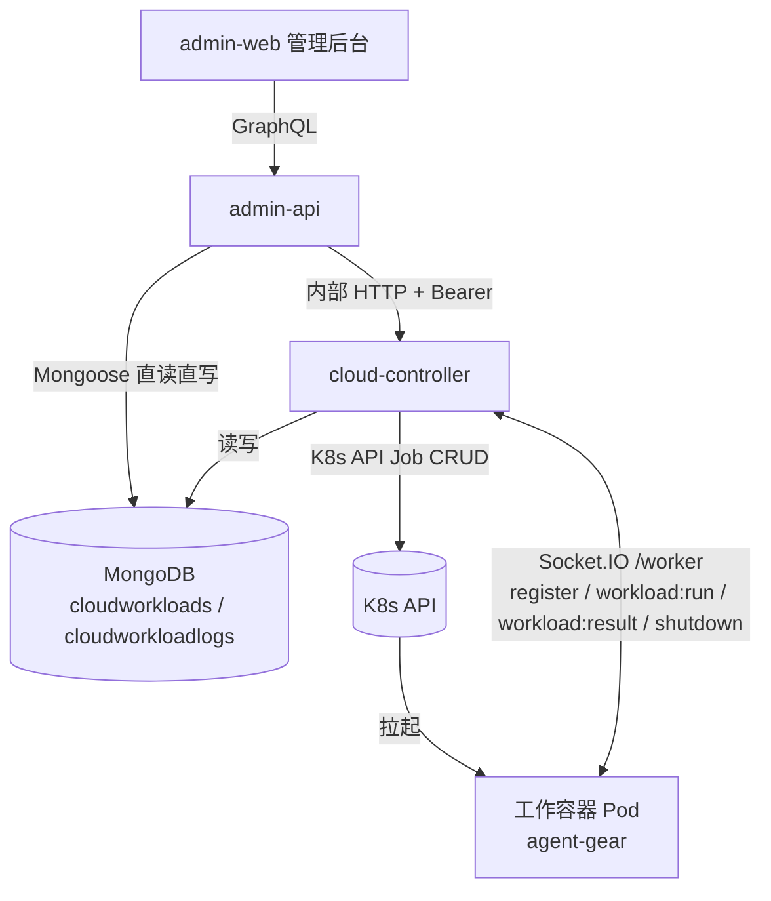
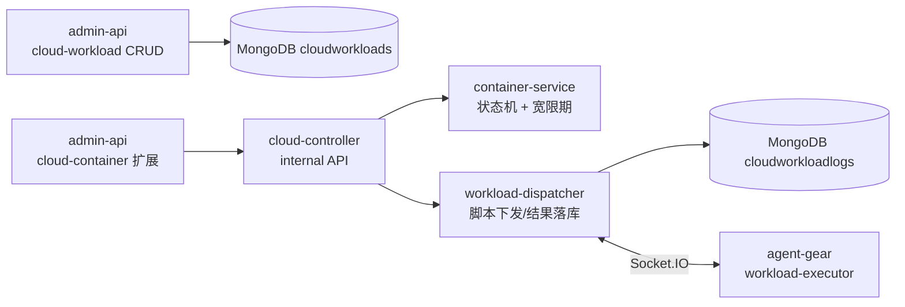
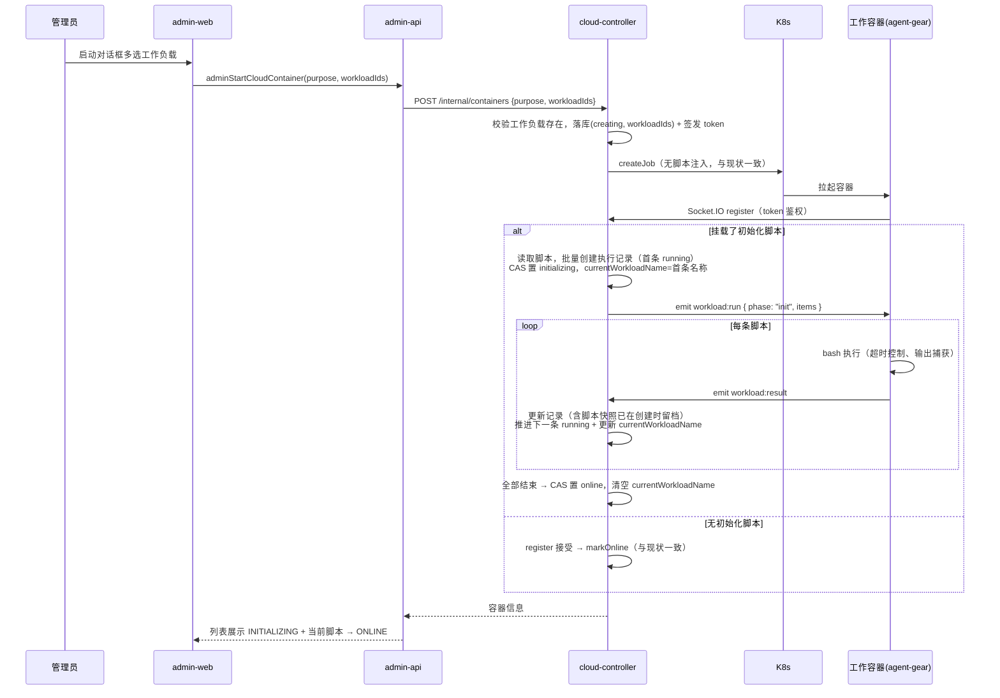
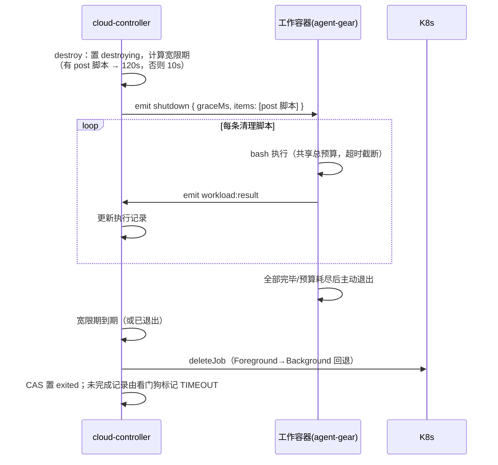

# 云控制器工作负载（Workload）功能 - 技术提案

**功能名称**: 云控制器工作负载管理
**关联 PRD**: docs/product/draft/20261017-cloud-controller-workload.md
**技术提案版本**: v1.1
**创建日期**: 2026-10-17
**作者**: ZeroAsh
**feat-branch**: `feat/cloud-controller-workload`

> v1.1 变更（评审意见修订）：
> 1. 工作负载脚本改为**由 cloud-controller 通过 Socket.IO 下发**（不再使用环境变量注入）；每次执行的脚本内容随执行记录**写入数据库留档**。
> 2. 工作容器新增 **INITIALIZING（初始化中）** 状态，容器记录携带当前正在执行的工作负载脚本名称供后台展示。

## 1. 概述

### 1.1 背景

云Agent二期已上线 cloud-controller 与云端工作容器管理链路（Job 拉起、token 回连、强制销毁）。本期在其上增加「工作负载」能力：管理员在后台维护工作负载（名称 + 初始化脚本 + 清理脚本），启动容器时多选挂载；容器回连后由 cloud-controller 经既有 Socket.IO 通道下发初始化脚本，容器执行并逐条回报结果；销毁时下发清理脚本，执行完毕后容器退出。每次执行的脚本内容与输出日志落库留档，后台可按容器查看；容器执行初始化脚本期间呈现「初始化中」状态并展示当前执行的脚本。

### 1.2 目标

- admin-api 提供工作负载 CRUD GraphQL 接口，admin-web 新增工作负载管理页面。
- 启动容器链路支持携带 `workloadIds`；脚本由 cloud-controller 在容器回连后通过 Socket.IO 下发，不经 K8s env 注入。
- 容器状态机新增 `initializing`，容器文档维护 `currentWorkloadName` 供列表实时展示。
- 执行记录（含脚本内容快照）持久化于 `cloudworkloadlogs`，admin-web 可按容器查看。

### 1.3 范围

**做**：
- 工作负载 CRUD（admin-api + admin-web）。
- 启动容器多选工作负载；cloud-controller 经 Socket.IO 下发 init/post 脚本。
- 容器 `initializing` 状态与当前执行脚本展示。
- 工作负载执行日志（含脚本内容留档）的存储与后台查看。

**不做**：
- 工作流/会话等任务类型挂载工作负载（后续迭代）。
- 工作负载参数化/变量机制。
- 容器异常退出（OOM 等）下的清理脚本保障。

## 2. 技术架构

### 2.1 系统架构图



### 2.2 技术栈

| 层级 | 技术选型 | 说明 |
|------|---------|------|
| 前端 | React + TypeScript + Vite + Apollo Client | admin-web，复用 base-image CRUD 页面模式 |
| 后端 | Node.js + Express + GraphQL + Mongoose | admin-api（CRUD/查询）、cloud-controller（下发/状态机/日志落库） |
| Worker | Node.js（agent-gear CLI）| packages/agent-controller 增加工作负载脚本执行器 |
| 数据库 | MongoDB | admin-api 与 cloud-controller 共享同一实例（沿用既有降级直读模式） |

### 2.3 模块划分



| 模块 | 职责 | 关键技术点 |
|------|------|-----------|
| admin-api cloud-workload | 工作负载 CRUD、容器日志查询 | Mongoose 直读写，复用 base-image resolver 模式 |
| cloud-controller workload-dispatcher | 脚本下发、结果接收、日志落库、当前脚本跟踪 | Socket.IO 事件编排，按序推进，看门狗超时 |
| cloud-controller container-service | 状态机扩展（initializing）、销毁宽限期调整 | CAS 状态流转、shutdown 携带 post 脚本 |
| agent-gear workload-executor | 接收脚本、bash 执行、输出捕获、超时控制、结果回报 | child_process spawn，逐条回报 |
| admin-web | 工作负载页、启动对话框多选、初始化进度展示、日志查看 | 复用 base-image 页面组件模式 |

## 3. API 设计

### 3.1 API 契约

新增契约文件 `contracts/admin-cloud-workload.graphql`，并扩展 `contracts/admin-cloud-container.graphql`。

#### 工作负载 CRUD（admin-api 本地数据，GraphQL）

```graphql
type CloudWorkload {
  id: ID!
  name: String!
  initScript: String
  postScript: String
  createdAt: String!
  updatedAt: String!
}

input CreateCloudWorkloadInput {
  name: String!
  initScript: String
  postScript: String
}

input UpdateCloudWorkloadInput {
  name: String
  initScript: String
  postScript: String
}

extend type Query {
  adminCloudWorkloads: [CloudWorkload!]!
  adminCloudContainerWorkloadLogs(containerId: ID!): [CloudWorkloadLog!]!
}

extend type Mutation {
  adminCreateCloudWorkload(input: CreateCloudWorkloadInput!): CloudWorkload!
  adminUpdateCloudWorkload(id: ID!, input: UpdateCloudWorkloadInput!): CloudWorkload!
  adminDeleteCloudWorkload(id: ID!): Boolean!
  adminStartCloudContainer(purpose: CloudContainerPurpose!, workloadIds: [ID!]): CloudContainer!
}
```

#### 工作负载执行日志（含脚本留档）

```graphql
enum CloudWorkloadLogPhase { INIT, POST }
enum CloudWorkloadLogStatus { PENDING, RUNNING, SUCCESS, FAILED, TIMEOUT }

type CloudWorkloadLog {
  id: ID!
  containerId: ID!
  workloadId: ID!
  workloadName: String!
  phase: CloudWorkloadLogPhase!
  status: CloudWorkloadLogStatus!
  script: String!        # 当时实际执行的脚本内容快照（留档）
  exitCode: Int
  log: String!
  startedAt: String
  finishedAt: String
}
```

#### 容器状态与字段扩展

```graphql
enum CloudContainerStatus {
  CREATING
  CONNECTING
  INITIALIZING   # 新增：回连后正在执行初始化脚本
  ONLINE
  EXITED
  DESTROYING
  FAILED
}

extend type CloudContainer {
  workloads: [CloudWorkload!]!
  currentWorkloadName: String   # 初始化中：当前正在执行的工作负载脚本名称
}
```

- 校验规则：`name` 必填且去重；`initScript` 与 `postScript` 至少其一非空；单脚本长度上限 16 KiB；单次启动挂载数量上限 10 个。
- 所有接口仅管理员可访问（沿用 `assertAdmin`）。
- `adminCloudContainerWorkloadLogs` 优先经 cloud-controller 内部 API 查询，控制面不可达时降级直读 Mongo（与容器列表降级模式一致）。

#### cloud-controller 内部接口（REST，internal-auth Bearer）

| 接口 | 说明 |
|------|------|
| `POST /internal/containers` | 请求体增加可选 `workloadIds: string[]`；校验存在性，不存在返回 400 |
| `GET /internal/containers/:id/workload-logs` | 返回该容器全部工作负载执行日志（按创建顺序升序） |

### 3.2 内部接口

#### Worker ↔ cloud-controller Socket.IO 协议扩展（`/worker` namespace）

在既有 `register` / `heartbeat` / `shutdown` / `unregister` 之上新增以下事件（协议文档同步更新到 `contracts/agent-controller-websocket.md` 或新增 worker 协议章节）：

| 方向 | 事件 | 载荷 | 说明 |
|------|------|------|------|
| server → worker | `workload:run` | `{ phase: "init"\|"post", items: [{ logId, workloadName, script, timeoutMs }] }` | 下发脚本批次；init 在 register 接受后下发，post 随销毁下发 |
| worker → server | `workload:result` | `{ logId, status: "success"\|"failed"\|"timeout", exitCode?, log, startedAt, finishedAt }` | 每条脚本执行完毕即回报；worker 按 items 顺序执行 |

- `shutdown` 事件载荷扩展为 `{ graceMs, items?: [...] }`，无清理脚本时载荷与现状兼容。
- 未升级的旧版 worker 不认识 `workload:run`：server 端看门狗在超时后将对应记录标记 `TIMEOUT` 并按失败继续推进，容器仍可上线（见 5.2 实现点 4）。

#### admin-api → cloud-controller

`CloudControllerClient` 增加 `start(purpose, workloadIds)` 与 `listWorkloadLogs(containerId)`；`CloudContainer.workloads` 字段 resolver 按 `workloadIds` 直读 Mongo 的 cloudworkloads 集合。

## 4. 数据模型

### 4.1 数据库设计

#### 集合: cloudworkloads（admin-api 管理，cloud-controller 只读）

| 字段 | 类型 | 说明 |
|------|------|------|
| name | String, required, unique | 工作负载名称 |
| initScript | String, default null | 初始化脚本（拉起容器时执行） |
| postScript | String, default null | 清理脚本（关闭容器时执行） |
| timestamps | createdAt / updatedAt | Mongoose timestamps |

#### 集合: cloudcontainers（扩展现有）

| 字段 | 类型 | 说明 |
|------|------|------|
| status | enum 增加 `initializing` | 回连后正在执行初始化脚本 |
| workloadIds | [ObjectId], default [] | 启动时挂载的工作负载，按选择顺序保存 |
| currentWorkloadName | String, default null | 当前正在执行的工作负载脚本名称；转 online/终态时清空 |

#### 集合: cloudworkloadlogs（cloud-controller 写入，admin-api 只读）

| 字段 | 类型 | 说明 |
|------|------|------|
| containerId | ObjectId, required, index | 所属容器 |
| workloadId | ObjectId, required | 工作负载 |
| workloadName | String, required | 冗余名称，删除工作负载后日志仍可读 |
| phase | enum(init/post), required | 执行阶段 |
| status | enum(pending/running/success/failed/timeout), required | 执行状态 |
| script | String, required | **当时实际执行的脚本内容快照（留档）** |
| exitCode | Number, default null | 脚本退出码 |
| log | String, default '' | 输出日志，超长截断保留尾部（上限 256 KiB） |
| startedAt | Date, default null | 开始时间（进入 running 时写入） |
| finishedAt | Date, default null | 结束时间 |

记录由 cloud-controller 在下发时批量创建（首条 `running`、其余 `pending`），收到 `workload:result` 后更新为终态并推进下一条。

### 4.2 缓存设计

无新增缓存。工作负载数据量小（百级），直接查库。

## 5. 技术实现方案

### 5.1 核心流程

#### 启动容器（挂载工作负载）



#### 销毁容器（执行清理脚本）



### 5.2 关键实现点

#### 实现点 1: 脚本下发与执行记录留档（workload-dispatcher）

- **描述**: 新增 `services/workload-dispatcher.ts`。register 接受后查询 `workloadIds` 对应的有 `initScript` 的工作负载，按下发顺序在 `cloudworkloadlogs` 批量创建记录（**创建时即写入脚本内容快照**），首条置 `running`，随后 emit `workload:run`。收到 `workload:result` 后按 `logId` 更新记录并推进下一条（置 `running` + 更新容器 `currentWorkloadName`），init 全部结束后将容器 CAS 置 `online` 并清空 `currentWorkloadName`。
- **技术细节**: 全程经 `KeyedMutex` 按容器串行化，与既有 destroy/status-sync 不竞争；`workload:result` 校验 `logId` 属于该 socket 对应容器，防止串号。
- **风险点**: 脚本内容在下发时才读取并留档，启动后对工作负载的编辑不影响本容器（PRD 边界情况已约定）。

#### 实现点 2: worker 端脚本执行器（agent-gear workload-executor）

- **描述**: `packages/agent-controller` 新增 `workload-executor.ts`：监听 `workload:run`，按 `items` 顺序以 `bash -c` 执行（spawn，捕获 stdout/stderr 合并），单条受 `timeoutMs` 约束（超时 kill 并回报 `timeout`），逐条 emit `workload:result`；post 批次共享总预算（预算耗尽跳过后续并回报）。执行期间心跳照常发送。
- **技术细节**: 输出在 worker 侧按条缓存，单条回报上限 256 KiB（超出截断保留尾部，与落库上限一致）；脚本失败（非零退出）回报 `failed` 并继续后续条目。
- **风险点**: 执行器与 agent-gear 主进程同生命周期；执行中进程被杀（OOM 等）时对应记录停留 `running`，由 server 看门狗兜底标记。

#### 实现点 3: 容器状态机扩展（initializing）

- **描述**: `ContainerService` 状态机扩展：`connecting` →（register 且有 init 脚本）→ `initializing` →（init 全部结束）→ `online`；无 init 脚本维持 register → `online` 现状。`initializing` 不属于终态；回连超时巡检覆盖 `connecting` 的逻辑同样覆盖 `initializing`（初始化为空转超过上限视为异常）。
- **技术细节**: `initializing` 期间容器照常参与心跳检测；`destroy` 对 `initializing` 容器直接走销毁流程（当前 init 批次未完成的记录由看门狗标记 TIMEOUT）。
- **风险点**: 状态枚举新增值需同步 GraphQL schema、admin-api 枚举映射与前端状态徽章三处。

#### 实现点 4: 超时与兜底

- **描述**: 每条脚本下发时携带 `timeoutMs`（init 默认 300s，post 共享预算默认 90s）；server 侧看门狗（并入 `StatusSyncService` 15s 巡检）对停留 `running` 超过 `timeoutMs + 30s` 容差的记录标记 `TIMEOUT` 并推进下一条，兼容旧版 worker 不响应 `workload:run` 的场景；销毁宽限期在有 post 脚本时调整为 `max(10000, WORKLOAD_POST_GRACE_MS=120000)`。
- **风险点**: 宽限期拉长推迟 Job 删除；由既有终态残留巡检兜底回收，无泄漏风险。

### 6.1 决策列表

| 决策 | 选项 A | 选项 B | 最终选择 | 原因 |
|------|--------|--------|---------|------|
| 工作负载数据归属 | admin-api 本地集合 | cloud-controller 持有 | admin-api 本地集合 | 复用 base-image CRUD 模式；cloud-controller 共享 Mongo 只读即可 |
| 脚本下发方式 | K8s env 注入 | **Socket.IO 由控制器下发** | Socket.IO 下发 | 评审意见：下发过程可控、可跟踪当前执行项；脚本内容不经 K8s manifest 落盘；worker 版本能力可协商 |
| 脚本留档 | 只存输出日志 | **执行记录含脚本内容快照** | 含脚本快照 | 评审意见：留档便于调查问题；工作负载被改/删后仍可还原现场 |
| 日志传输 | 容器 HTTP 回传 | **复用 Socket.IO `workload:result`** | Socket.IO | 同一鉴权通道，无需新增 HTTP 端点与额外鉴权 |
| 初始化状态 | 复用 connecting | **新增 initializing + currentWorkloadName** | 新增状态 | 评审意见：后台需区分「等待回连」与「正在跑初始化脚本」，并展示当前脚本 |
| init 失败策略 | 阻断容器上线 | 记录后继续 | 记录后继续 | 裸容器仍可使用，日志可定位问题（PRD 约定） |

### 6.2 依赖与约束

| 类型 | 内容 | 说明 |
|------|------|------|
| 依赖 | admin-api 与 cloud-controller 共享 MongoDB | 沿用容器列表降级直读的既有事实 |
| 依赖 | 工作容器镜像重新构建发布 | 预装支持 workload 协议的新版 agent-gear |
| 约束 | cloud-controller RBAC 不变 | 不新增 pods/logs 权限，Job manifest 不变 |
| 约束 | 既有 Socket.IO 事件向后兼容 | register/heartbeat/shutdown/unregister 语义不变；旧 worker 忽略新事件时由看门狗兜底 |

## 7. 项目结构

```
contracts/
├── admin-cloud-workload.graphql              # 新增：工作负载与日志契约
├── admin-cloud-container.graphql             # 扩展：INITIALIZING 状态、workloads/currentWorkloadName
└── agent-controller-websocket.md             # 扩展：workload:run / workload:result 协议
servers/admin-api/
└── src/
    ├── models/cloud-workload.ts              # 新增：CloudWorkload 模型
    ├── models/cloud-workload-log.ts          # 新增：日志降级直读模型
    ├── graphql/schemas/cloud-workload.ts     # 新增：typeDefs
    ├── graphql/resolvers/cloud-workload.ts   # 新增：CRUD + 日志查询 resolver
    └── services/cloud-controller-client.ts   # 扩展：workloadIds / listWorkloadLogs
servers/cloud-controller/
└── src/
    ├── models/cloud-workload.ts              # 新增：只读模型（共享集合）
    ├── models/cloud-workload-log.ts          # 新增：日志模型（含 script 快照）
    ├── services/workload-dispatcher.ts       # 新增：脚本下发、结果落库、看门狗
    ├── services/socketio-gateway.ts          # 扩展：workload:result 事件接入
    └── services/container-service.ts         # 扩展：initializing 状态机、workloadIds、宽限期调整
packages/agent-controller/
└── src/
    └── workload-executor.ts                  # 新增：脚本执行与结果回报
apps/admin-web/
└── src/
    ├── pages/CloudWorkloadsPage.tsx          # 新增：工作负载管理页
    ├── pages/CloudContainersPage.tsx         # 扩展：初始化进度与日志查看入口
    ├── components/cloud-workloads/           # 新增：表格/表单对话框/删除确认
    ├── components/cloud-containers/          # 扩展：启动对话框多选、状态徽章、日志抽屉
    └── graphql/                              # 扩展：queries/mutations/types
deploy/images/worker/
└── Dockerfile                                # 扩展：预装新版 agent-gear（entrypoint 不变）
```

## 8. 测试策略

### 8.1 测试覆盖要求

- 单元测试覆盖率：新增代码 >= 80%
- API 测试覆盖的端点：工作负载 CRUD 全部 GraphQL 操作、`adminStartCloudContainer(workloadIds)`、`adminCloudContainerWorkloadLogs`

### 8.2 测试类型

| 类型 | 工具 | 覆盖范围 |
|------|------|---------|
| 单元测试 | vitest | dispatcher 下发/推进/看门狗、状态机流转（initializing）、日志截断、executor 超时与结果回报、resolver 校验 |
| API 测试 | tests/api | 工作负载 CRUD、启动携带工作负载、日志查询（含降级路径） |
| E2E 测试 | tests/e2e | 后台新建工作负载 → 启动容器挂载 → 观察初始化中状态与当前脚本 → 查看执行日志 |
| 手工验证 | K8s 环境 | init/post 脚本真实下发执行、超时保护、旧 worker 兼容、镜像构建 |

开发遵循 TDD 红-绿-重构循环。

## 9. 部署方案

### 9.1 环境规划

| 环境 | 用途 | 部署方式 |
|------|------|---------|
| 本地开发 | Aspire 编排 | aspire start（cloud-controller 使用 InMemory K8s 或真实集群配置） |
| 内网 K8s | 生产 | deploy/k8s 既有 manifest，cloud-controller 滚动更新；worker 镜像重新构建推送 |

### 9.2 配置管理

| 配置项 | 服务 | 默认值 | 说明 |
|--------|------|--------|------|
| `WORKLOAD_INIT_TIMEOUT_MS` | cloud-controller | 300000 | 单条 init 脚本超时（随 `workload:run` 下发） |
| `WORKLOAD_POST_BUDGET_MS` | cloud-controller | 90000 | post 脚本总预算（随 shutdown 下发） |
| `WORKLOAD_POST_GRACE_MS` | cloud-controller | 120000 | 挂载 post 脚本时的销毁宽限期 |
| `WORKLOAD_LOG_MAX_BYTES` | cloud-controller | 262144 | 单条日志存储上限（截断保留尾部） |

## 10. 验收标准

- [ ] 技术方案评审通过
- [ ] Contract 评审通过
- [ ] 代码实现完成
- [ ] 单元测试覆盖达标
- [ ] API 测试通过
- [ ] E2E 测试通过
- [ ] 工作负载 CRUD 在后台可用，启动容器可多选挂载
- [ ] 脚本由控制器下发执行，容器初始化中状态与当前脚本在后台可见
- [ ] 每次执行的脚本内容与输出日志落库留档，后台可查看
- [ ] 不挂载工作负载的容器行为与现状一致

## 11. 相关文档

- PRD：`docs/product/draft/20261017-cloud-controller-workload.md`
- 既有提案：`docs/engineering/proposals/20261014-feat-cloud-agent-phase2.md`、`docs/engineering/proposals/20261014-feat-admin-console.md`
- 既有契约：`contracts/admin-cloud-container.graphql`、`contracts/agent-controller-websocket.md`
- 开发规范：`docs/engineering/backend-rules.md`、`docs/engineering/frontend-rules.md`
