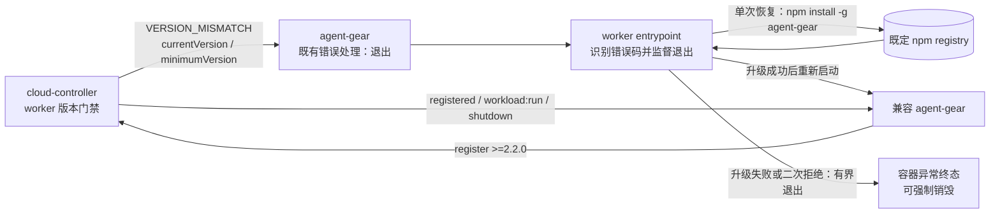
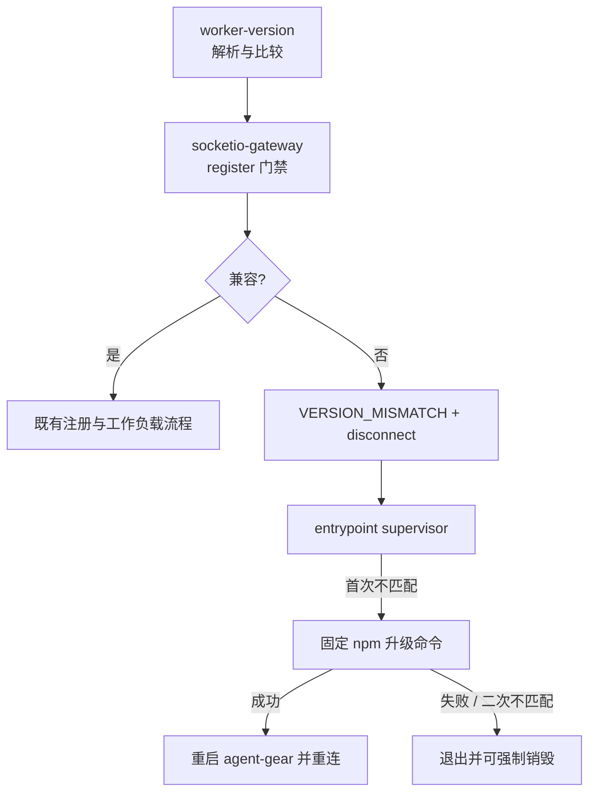
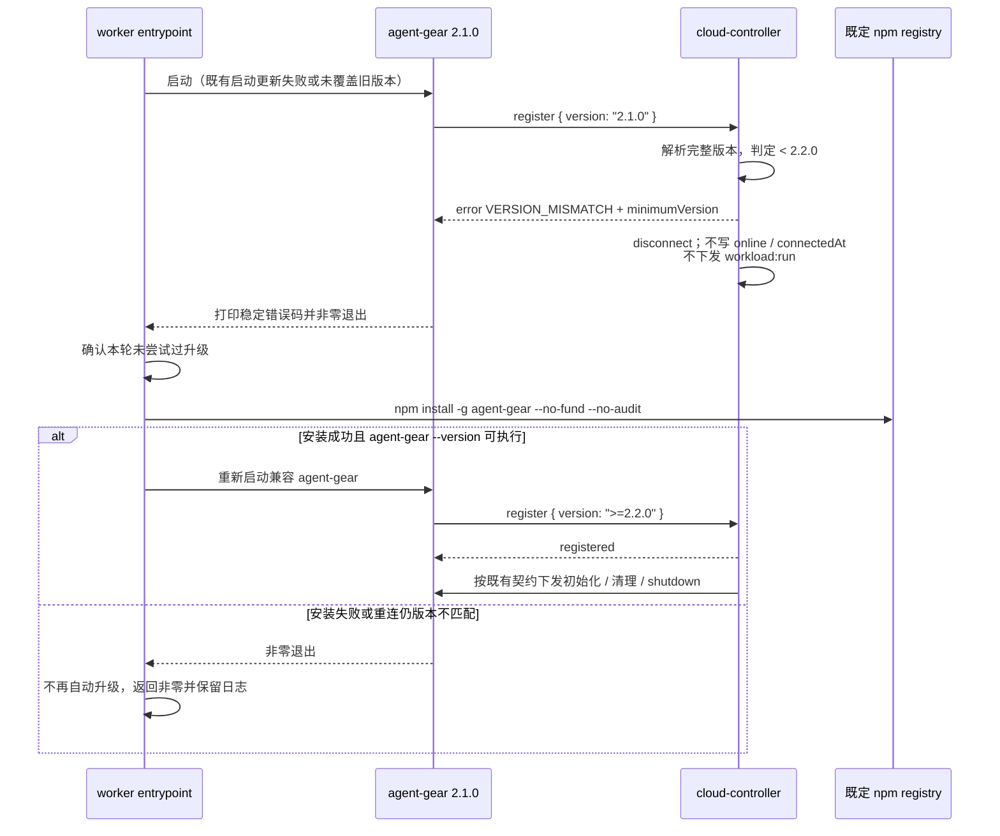
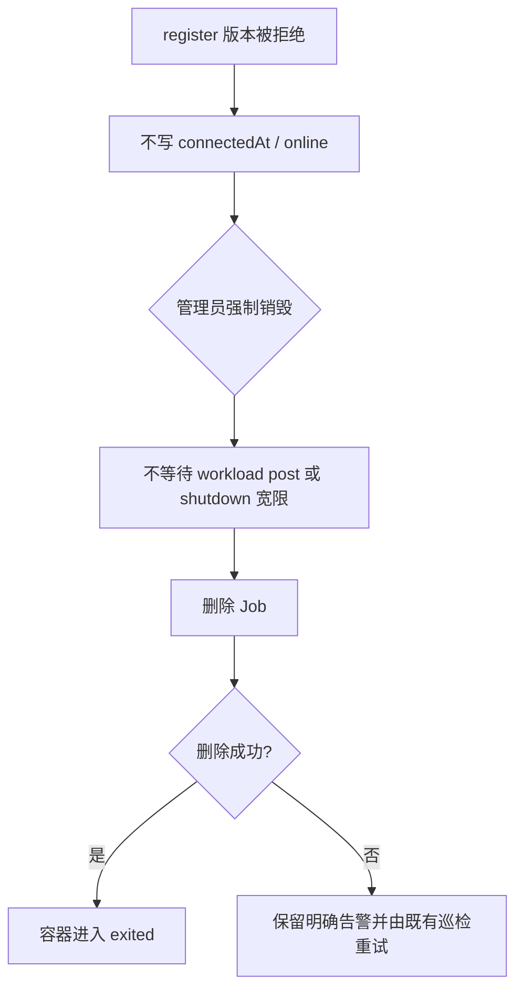

# 云端工作容器控制器版本门禁与自升级 - 技术提案

**功能名称**: 云端工作容器控制器版本门禁与自升级
**关联 PRD**: `docs/product/draft/20261017-controller-version-requirement.md`
**技术提案版本**: v1.0
**创建日期**: 2026-10-17
**作者**: ZeroAsh
**feat-branch**: `feat/controller-version-requirement`

## 1. 概述

### 1.1 背景

工作负载能力从 `agent-gear 2.2.0` 开始提供，但 `cloud-controller` 的 worker 注册目前只校验 `version` 的 major 是否为 `2`（`servers/cloud-controller/src/services/socketio-gateway.ts`）。因此 `2.1.0` 仍会通过注册并进入 `online` / `initializing`，却不会处理 `workload:run`：初始化只能等待看门狗收口，销毁时的 post 批次也只能等待预算耗尽，表现为脚本无法调度、强制销毁长时间等待甚至卡住。

既有 worker `entrypoint.sh` 已在每次启动时执行一次 `npm install -g agent-gear`，但安装失败会沿用镜像内旧版本继续启动；旧版 `agent-gear` 收到 `VERSION_MISMATCH` 后只会退出，不能靠本期新写的客户端逻辑获得自升级能力。因此，本方案必须同时覆盖服务端完整版本门禁和 worker 入口的旧版恢复路径，不能只在新版本 CLI 内增加升级逻辑。

### 1.2 目标

- `cloud-controller` 在 `register` 阶段执行完整数字版本校验，本期接受范围为 **`>=2.2.0` 且 major 为 `2`**。
- 低于最低版本、非法版本或不在兼容范围内的 worker 在 `markOnline` / `startInit` 之前收到 `VERSION_MISMATCH` 并断开。
- worker 入口识别既有客户端打印的 `VERSION_MISMATCH`，执行 `npm install -g agent-gear`，成功后自动重连；单次容器运行内最多恢复一次。
- 版本拒绝不得产生在线状态、初始化任务或销毁等待；升级失败和二次拒绝均可收敛并保留强制销毁路径。
- 兼容 worker 的注册、心跳、工作负载、重连和销毁协议不变。

### 1.3 范围

**做**：

- 扩展 `contracts/cloud-controller-websocket.md` 的版本兼容与 `VERSION_MISMATCH` 载荷约定。
- 修改 `cloud-controller` worker 注册版本校验、日志和相关单元测试。
- 修改默认 worker `entrypoint.sh`，增加版本不匹配后的有界自动升级与重连，并保持 PID 1 信号转发语义。
- 增加不依赖真实 npm 网络的入口脚本自动化测试，以及镜像构建/部署验收说明。
- 同步 `servers/cloud-controller/AGENTS.md` 与 `deploy/images/worker/BUILD.md` 中对应的版本和恢复约定。

**不做**：

- 不修改本地 `controller-api` 的 major 版本门禁，也不为本地控制器增加自升级。
- 不修改 `agent-gear` 的工作负载协议或新增运行中自我替换逻辑；自动恢复由 worker 入口承担。
- 不新增 GraphQL / REST 管理接口、数据库字段、前端页面或管理员可配置版本开关。
- 不承诺已运行旧入口容器能够原地获得新恢复逻辑；这类容器由强制销毁后重建完成一次性替换。

## 2. 技术架构

### 2.1 系统架构图



### 2.2 技术栈

| 层级 | 技术选型 | 说明 |
|------|---------|------|
| Worker 服务端 | Node.js 24 + TypeScript + Socket.IO + Vitest | `cloud-controller` 注册门禁与真实 socket 测试 |
| Worker 客户端 | 既有 `agent-gear >=2.2.0` | 本期不修改客户端协议；旧版收到错误后按既有逻辑退出 |
| 容器入口 | Bash + npm | 流式识别版本错误、一次自动升级、重启与信号转发 |
| 软件来源 | worker 镜像既定 npm registry | 只允许执行固定包名 `agent-gear`，不接受服务端提供下载地址 |
| 部署 | 既有 worker 镜像与 K8s Job | 不新增 RBAC、K8s API 或数据库依赖 |

### 2.3 模块划分



| 模块 | 职责 | 关键技术点 |
|------|------|-----------|
| `worker-version` | 解析 `major.minor.patch`、比较最低版本和 major | 纯函数、无新依赖，避免字典序比较 |
| `socketio-gateway` | 在注册副作用前执行版本门禁 | 拒绝时不写 `registered`、不 `markOnline`、不 `startInit` |
| `entrypoint.sh` | 保留启动更新，增加版本错误后的有界恢复 | 复用旧客户端错误输出；一次升级；信号转发；不缓存完整日志 |
| `container-service` 既有销毁路径 | 清理未完成兼容注册的容器 | 版本拒绝不写 `connectedAt`，从而跳过优雅停机等待并直接删除 Job |

## 3. API 设计

### 3.1 API 契约

本期仅修改 `contracts/cloud-controller-websocket.md`，不改变事件名称和注册成功载荷。

#### `register` 版本规则

`register.version` 仍为必填字符串。服务端按以下顺序处理：

1. 缺失或不符合数字 `major.minor.patch` 形式：拒绝。
2. major 不等于当前支持的 `2`：拒绝。
3. 完整版本低于 `2.2.0`：拒绝。
4. 其余版本：继续既有 hostname 校验和注册流程。

最低版本是与服务端协议能力绑定的代码常量 `MIN_WORKER_VERSION = '2.2.0'`，随契约评审和实现变更调整，不新增环境变量，避免部署配置把服务端放到自身不具备的协议能力上。

#### `VERSION_MISMATCH` 错误扩展

仍复用既有 `error` 事件和 `VERSION_MISMATCH` 错误码，确保 `2.1.0` 等既有客户端按原路径打印错误、断开并退出。错误载荷追加可选元数据，旧客户端忽略新增字段：

```json
{
  "code": "VERSION_MISMATCH",
  "message": "agent-gear 版本不兼容，当前版本 2.1.0，最低版本 2.2.0（supported major: 2）",
  "currentVersion": "2.1.0",
  "minimumVersion": "2.2.0",
  "supportedMajor": 2
}
```

| 字段 | 类型 | 必填 | 说明 |
|------|------|------|------|
| `code` | `string` | 是 | 固定 `VERSION_MISMATCH` |
| `message` | `string` | 是 | 面向日志的可读原因，包含当前版本与最低版本 |
| `currentVersion` | `string` | 否 | 客户端上报版本；缺失/非法时为原始值或 `unknown`，不包含凭据 |
| `minimumVersion` | `string` | 否 | 本期为 `2.2.0` |
| `supportedMajor` | `number` | 否 | 本期为 `2` |

**服务端副作用约束**：发送错误后调用 `socket.disconnect(true)`；不得设置 `socket.data.registered`，不得调用 `heartbeatTracker.record`、`hasInitScripts`、`startInit`、`markOnline` 或 `markInitializing`。

**客户端兼容性**：`agent-gear 2.1.0` 对 `VERSION_MISMATCH` 已会输出错误并以非零状态退出；本期不依赖旧客户端理解新增字段。worker 入口只把稳定错误码作为恢复触发条件，不解析本地化 `message`。

### 3.2 内部接口

不新增内部接口。`WorkerGatewayHandle.isConnected` 的既有含义不变；版本被拒绝的 socket 不会成为已注册 worker，也不会参与工作负载调度。

`agent-gear` 的 `error` 监听保持现状。自动升级不放入 `socketio-client.ts`，原因见 §6.1：旧客户端无法获得新代码，且运行中的 Node.js 进程替换全局包并自我重启会扩大信号和进程状态处理范围。

## 4. 数据模型

### 4.1 数据库设计

无数据库或集合作息变更。版本判断只使用本次 `register` 内存载荷；版本拒绝不写容器在线字段。

需要在测试中锚定以下既有状态语义：

- 新容器从未完成兼容注册时，`connectedAt` 保持 `null`。
- `ContainerService.destroy` 对 `connectedAt === null` 的容器不调用 `notifyShutdown`，直接执行 Job 删除和终态收口。
- 因而版本拒绝本身不会引入 post 批次预算或 shutdown 宽限等待。

### 4.2 缓存设计

无新增缓存。worker 入口仅在单次进程生命周期内保存一个 `upgrade_attempted` 布尔状态，以及流式扫描得到的 `version_mismatch_seen` 标记；不写持久文件，不缓存完整运行日志。

## 5. 技术实现方案

### 5.1 核心流程

#### 旧版 worker 自动升级并重连



#### 强制销毁版本异常容器



### 5.2 关键实现点

#### 实现点 1: 完整版本解析与注册门禁

- **描述**: 新增 `services/worker-version.ts`，导出 `isSupportedWorkerVersion(version: unknown, minimum = '2.2.0', supportedMajor = 2): boolean` 及供日志使用的解析结果；`socketio-gateway.ts` 在现有 major 判断位置改用完整版本判断。
- **技术细节**: 仅接受非负数字三段版本并按数字比较；`2.10.0` 必须高于 `2.2.0`，不能使用字符串比较。缺失、空串、前后空白、预发布/构建后缀及其他非法格式本期均拒绝，避免未经评审的版本形态绕过门禁。无需新增 `semver` 依赖。
- **风险点**: 未来若允许 prerelease，必须先扩展契约与测试，不在本期隐式接受。

#### 实现点 2: worker 入口兼容旧版的自动恢复

- **描述**: `entrypoint.sh` 保留启动时 `update_agent_gear` 的既有行为；最后的 `exec agent-gear` 改为受监督运行，以便在旧客户端退出后识别 `VERSION_MISMATCH` 并执行一次固定升级命令后重启。
- **技术细节**:
  - agent-gear 的 stdout/stderr 继续实时输出；stderr 采用流式扫描，只记录是否出现 `VERSION_MISMATCH`，不把长期运行日志完整写入临时文件。
  - 只有「进程非零退出 + 已观察到版本错误 + 本轮未尝试 + 未设置 `ZAG_SKIP_AGENT_GEAR_UPDATE=1`」才触发 `npm install -g agent-gear --no-fund --no-audit`。
  - 安装成功且 `agent-gear --version` 可执行后重启；第二次版本不匹配直接退出，不再安装。普通非零退出、信号退出和正常 `shutdown` 不触发升级。
  - shell 作为 PID 1 时必须向 agent-gear 子进程转发 `SIGTERM` / `SIGINT` 并等待其退出；不得在销毁信号后重启。恢复扫描和重启逻辑不得改变 dockerd 启动及 docker shim 行为。
- **风险点**: 仅靠修改新版 CLI 无法覆盖 `2.1.0`；本入口方案覆盖“新入口镜像 + 旧 CLI”的启动恢复。已经运行的旧入口容器无法远程获得该脚本，必须销毁重建一次。

#### 实现点 3: 版本拒绝与销毁副作用隔离

- **描述**: 版本校验保持在所有注册副作用之前，确保不兼容 worker 不会进入 `online` / `initializing`，不会写 `connectedAt`，也不会创建 init/post 执行记录。
- **技术细节**: 单测除断言错误载荷与 `disconnect(true)` 外，还必须 spy `markOnline`、`markInitializing`、`hasInitScripts`、`startInit` 和 `heartbeatTracker.record` 均未调用；另以 `connectedAt = null` 的容器调用 `destroy`，断言不等待 shutdown 即删除 Job。
- **风险点**: 若未来调整注册顺序，需保留本约束，否则版本门禁虽拒绝客户端，销毁路径仍可能因既有在线字段进入等待。

#### 实现点 4: 日志与安全边界

- **描述**: 服务端和入口日志记录版本及恢复阶段，但不记录 token、key 或完整连接 URL。
- **技术细节**: 升级命令、包名和 registry 均由镜像固定；服务端只返回版本元数据，不能指定 npm 包名、版本下载 URL 或 shell 命令。`currentVersion` 在写日志前限制长度并去除控制字符，避免伪造版本串污染日志。
- **风险点**: npm 安装失败信息可能包含 registry 地址，允许按现有镜像日志口径展示，但不得额外拼接 `ZAG_CONTROLLER_KEY` 或 endpoint query。

## 6. 技术决策

### 6.1 决策列表

| 决策 | 选项 A | 选项 B | 最终选择 | 原因 |
|------|--------|--------|---------|------|
| 版本判断 | 保持 major-only | 完整最低版本 + major 范围 | 完整最低版本 + major 范围 | 阻断 `2.1.0`，同时不默认接受未来未知 major |
| 自升级位置 | 新版 agent-gear 进程内 | worker entrypoint 监督恢复 | worker entrypoint | 旧 `2.1.0` 不含新代码；入口才能覆盖真实存量版本场景 |
| 错误码 | 新增升级专用错误码 | 复用 `VERSION_MISMATCH` | 复用既有错误码 | 旧客户端已能稳定打印并非零退出，协议改动最小 |
| 恢复次数 | 无限升级重连 | 每次容器运行最多一次 | 最多一次 | registry 未提供兼容版本或二次拒绝时必须收敛 |
| 版本库 | 新增 semver 依赖 | 本地严格三段数字解析 | 本地解析 | 当前发布形态足够，避免仅为三段比较新增直接依赖 |
| 最低版本配置 | 环境变量 | 随契约变更的代码常量 | 代码常量 | 最低版本由服务端协议能力决定，不应被部署误配 |
| 销毁等待 | 版本拒绝仍按在线处理 | 拒绝前不产生任何在线副作用 | 不产生在线副作用 | `connectedAt = null` 时既有 destroy 会直接删 Job |

### 6.2 依赖与约束

| 类型 | 内容 | 说明 |
|------|------|------|
| 依赖 | npm registry 提供 `agent-gear >=2.2.0` | 否则升级后二次拒绝并按有界失败退出 |
| 依赖 | 新 worker 镜像包含新 entrypoint | 旧入口容器需一次性销毁重建 |
| 约束 | 不修改本地 controller-api 版本规则 | 本期只针对 cloud-controller `/worker` |
| 约束 | 不增加 K8s RBAC 和数据库迁移 | 销毁复用既有 Job 删除与巡检 |
| 约束 | 保持 `ZAG_SKIP_AGENT_GEAR_UPDATE=1` 语义 | 启动更新与版本不匹配恢复均跳过，日志说明原因 |
| 约束 | 保持现有 stdout/stderr 与信号语义 | 不因日志扫描造成磁盘增长或销毁后重启 |

## 7. 项目结构

```
contracts/
└── cloud-controller-websocket.md                # 修改：最低版本、错误元数据、拒绝副作用
servers/cloud-controller/
├── AGENTS.md                                    # 修改：记录最低版本与恢复约束
└── src/services/
    ├── worker-version.ts                        # 新增：严格版本解析与比较
    ├── worker-version.test.ts                   # 新增：版本矩阵与边界
    ├── socketio-gateway.ts                      # 修改：注册门禁、错误载荷与日志
    ├── socketio-gateway.test.ts                 # 修改：2.1.0 拒绝及零副作用、2.2.0 接受
    └── container-service.test.ts                # 修改：未兼容注册容器销毁不等待
deploy/images/worker/
├── entrypoint.sh                                # 修改：流式错误识别、一次升级重连、信号转发
├── entrypoint.test.sh                           # 新增：纯 Bash + stub 的恢复/失败/信号测试
└── BUILD.md                                     # 修改：版本门禁与自升级自验步骤
packages/agent-controller/                       # 本期不修改
```

## 8. 测试策略

### 8.1 测试覆盖要求

- 新增 TypeScript 代码覆盖率不低于 80%，版本判断和注册拒绝分支必须由行为测试覆盖。
- `entrypoint.sh` 的升级成功、升级失败、二次拒绝、跳过开关、普通错误和信号退出必须有确定性自动化用例，不依赖真实 npm 网络。
- 开发遵循 TDD 红-绿-重构循环；先写版本矩阵和旧版恢复测试，再实现。

### 8.2 测试类型

| 类型 | 工具 | 覆盖范围 |
|------|------|---------|
| 版本纯函数单测 | Vitest | `2.1.0` 拒绝、`2.2.0` 接受、`2.10.0` 数字比较、major 不符、缺失/非法/prerelease 拒绝 |
| Worker 网关单测 | Vitest + 真实 socket.io-client | 拒绝载荷与断开；兼容注册回归；拒绝后无心跳、在线、初始化副作用 |
| 销毁单测 | Vitest | `connectedAt = null` 时不 `notifyShutdown`、不等待宽限，仍删除 Job 并收口 |
| 入口脚本测试 | 纯 Bash、临时 PATH stub | 首轮 `2.1.0` → 安装后 `2.2.0` → 重连；npm 失败；二次 mismatch；skip；非版本错误；SIGTERM 不重启 |
| 静态检查 | `bash -n`、TypeScript build | entrypoint 语法、cloud-controller strict build |
| 部署手工验收 | 内网镜像 + K8s | 新镜像正常回连；受控旧版恢复；init/post 调度；强制销毁；日志脱敏 |

入口测试使用临时目录中的假 `agent-gear` 和 `npm`：假客户端按用例打印 `VERSION_MISMATCH` 并记录启动次数，假 npm 按用例切换版本或失败。测试不新增 Bats 等依赖，并将 dockerd/shim 初始化和 supervisor 拆成可独立调用的函数，避免在测试环境启动真实 dockerd。

参考命令：

```bash
cd servers/cloud-controller
npx vitest run src/services/worker-version.test.ts src/services/socketio-gateway.test.ts src/services/container-service.test.ts
npm run build

cd ../../
bash -n deploy/images/worker/entrypoint.sh
bash deploy/images/worker/entrypoint.test.sh
```

本期没有新增管理 API 或页面，不新增 `tests/api` / `tests/e2e` 用例；既有相关套件按回归执行。真实旧版容器升级与强制销毁属于部署侧验收，不能用 `K8S_ENABLED=false` 的 E2E 假链路代替。

## 9. 部署方案

### 9.1 环境规划与发布顺序

| 环境 | 用途 | 部署方式 |
|------|------|---------|
| 本地 / CI | 版本矩阵、socket 行为和入口恢复测试 | Vitest + 纯 Bash stub，不访问真实 npm |
| 内网镜像环境 | 构建并自验新 worker 镜像 | 使用既有内网 registry 与 `BUILD.md` 流程 |
| K8s | 滚动升级云控制器并重建工作容器 | 先准备兼容 npm 版本和新入口镜像，再启用门禁 |

发布顺序：

1. 确认既定 npm registry 可获取 `agent-gear >=2.2.0`。
2. 构建、推送包含新 `entrypoint.sh` 的 worker 镜像，并将新工作容器切换到该镜像；优先在门禁上线前重建存量旧入口容器。
3. 部署带完整版本门禁的 `cloud-controller`。
4. 对仍运行旧入口的存量容器执行一次强制销毁重建；它们无法远程获得新入口恢复逻辑，不应等待其无限重连。
5. 观察版本拒绝、升级和重连日志，确认无批量升级循环后再扩大重建范围。

### 9.2 配置管理

无新增配置项。`MIN_WORKER_VERSION = 2.2.0` 和 `CURRENT_MAJOR_VERSION = 2` 随服务端代码与契约发布。

| 既有配置 | 作用 | 本期语义 |
|----------|------|---------|
| `ZAG_SKIP_AGENT_GEAR_UPDATE` | 跳过 agent-gear 启动更新 | 同时跳过版本不匹配后的自动升级；版本拒绝后直接非零退出 |
| `WORKER_IMAGE` | 默认工作容器镜像 | 指向包含新 entrypoint 的镜像 |
| npm registry 镜像配置 | 获取 agent-gear | 沿用镜像内配置，不通过服务端下发 |

## 10. 验收标准

- [ ] 技术方案与 `contracts/cloud-controller-websocket.md` 评审通过
- [ ] `2.1.0` 在注册副作用前收到 `VERSION_MISMATCH`，最低版本和当前版本日志完整
- [ ] `2.2.0`、`2.10.0` 等兼容版本正常注册；缺失、非法和错误 major 均被拒绝
- [ ] 被拒绝 worker 不进入 `online` / `initializing`，不写 `connectedAt`，不收发工作负载任务
- [ ] 新入口中的 `2.1.0` 能执行一次 `npm install -g agent-gear` 并自动重连
- [ ] 自动恢复后的容器可调度和回报工作负载，强制销毁正常完成
- [ ] npm 失败、二次版本拒绝、skip 开关均不会形成升级/重连循环
- [ ] SIGTERM/SIGINT 与正常 shutdown 不触发升级或重启
- [ ] 版本拒绝且从未兼容注册的容器，强制销毁不等待 post 或 shutdown 宽限
- [ ] cloud-controller 单测与 build、entrypoint 自动化测试和 `bash -n` 全部通过
- [ ] 内网 K8s 完成受控旧版恢复、工作负载和强制销毁手工验收
- [ ] 日志不包含 key、token 或带凭据 URL

## 11. 相关文档

- PRD：`docs/product/draft/20261017-controller-version-requirement.md`
- 既有 PRD：`docs/product/draft/20261017-cloud-controller-workload.md`
- 既有提案：`docs/engineering/proposals/20261017-feat-cloud-controller-workload.md`
- 既有契约：`contracts/cloud-controller-websocket.md`
- 相关实现：`servers/cloud-controller/src/services/socketio-gateway.ts`、`deploy/images/worker/entrypoint.sh`
- 开发规范：`docs/engineering/common-rules.md`、`docs/engineering/backend-rules.md`
