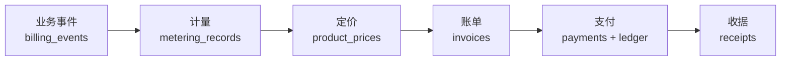
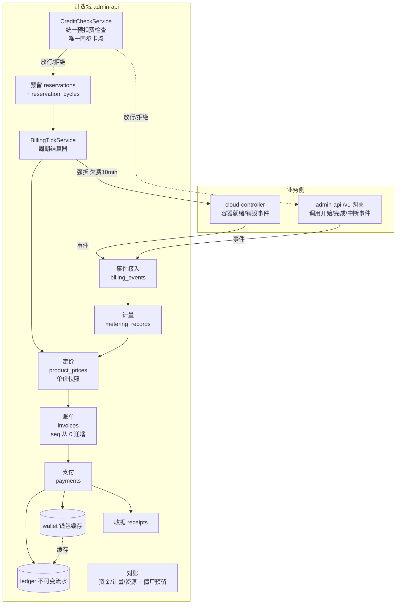
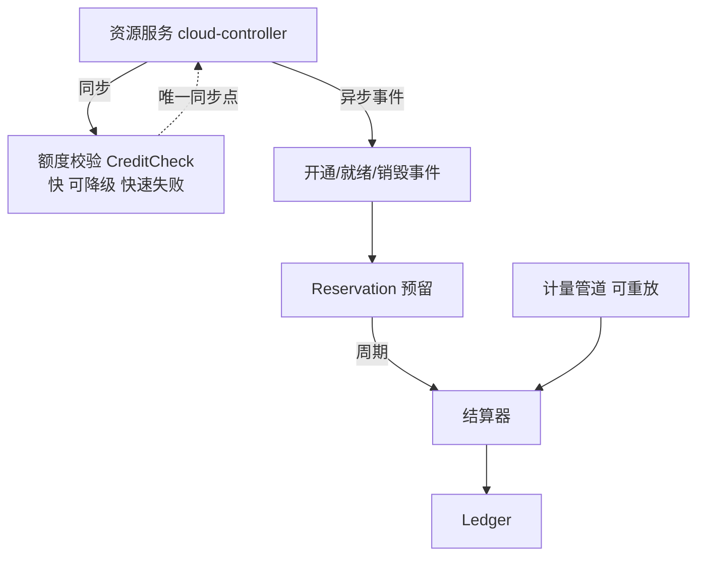
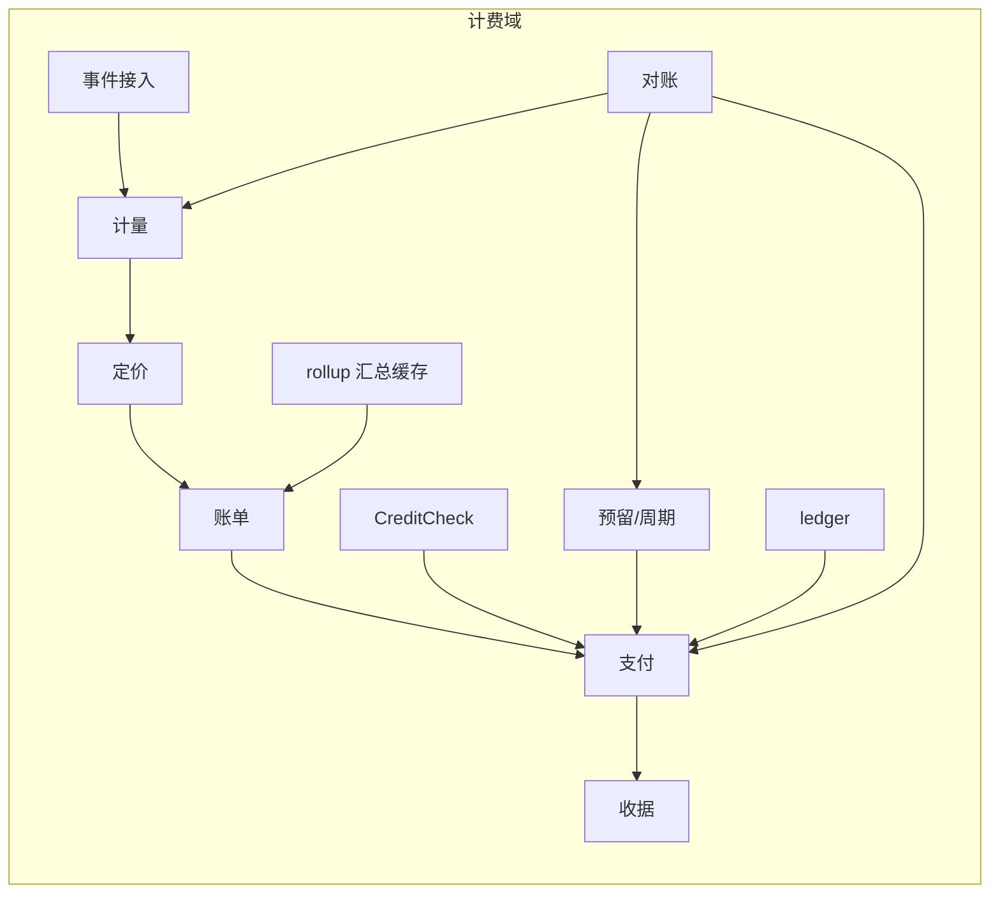
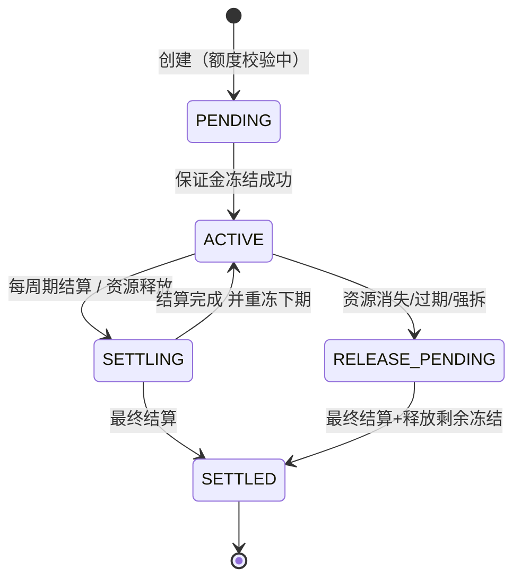
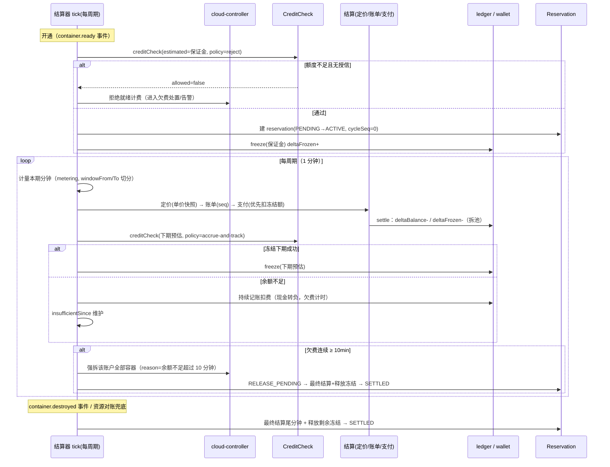
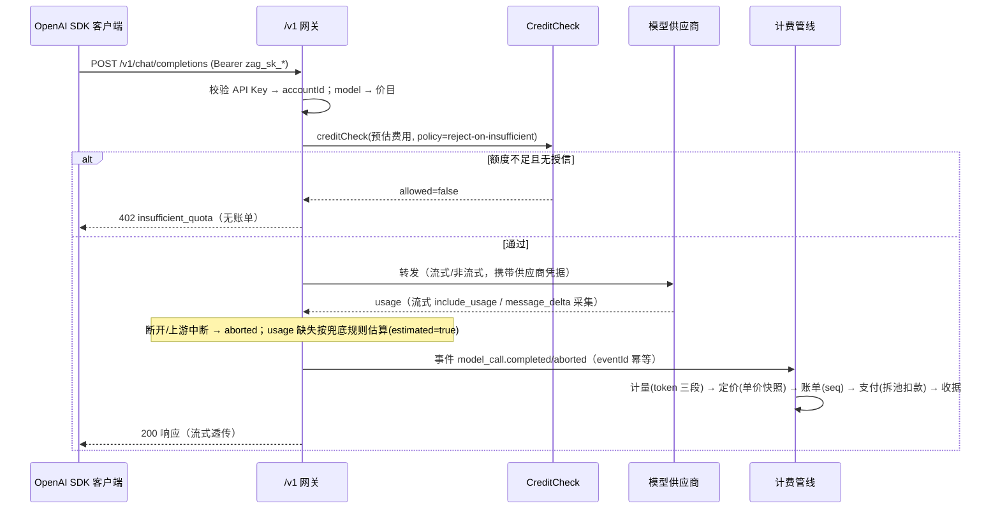

# 费用中心（Credits 计费） - 技术提案

**功能名称**: 后台费用中心与 Credits 计费体系
**关联 PRD**: `docs/product/draft/20261018-credits-billing.md`（v2.0）
**技术提案版本**: v2.0
**创建日期**: 2026-10-18
**作者**: ZeroAsh
**feat-branch**: `feat/credits-billing`
**版本说明**: v2.0（2026-10-18，返工重设计）按「业务事件 → 计量(Metering) → 定价(Pricing) → 账单(Invoice) → 支付(Payment) → 收据(Receipt)」重构计费架构：
- 职责分层——业务侧只发事件（不发扣费指令），计量是「事实」且可重放，扣费是「解释」；调价只影响新消费（单价快照入账单）。
- 资金模型——钱包拆出现金/赠送金/授信额度/冻结额，`available = cash + gift + creditLimit - frozen`；金额整数最小单位运算；ledger 不可变流水为唯一真相。
- 预扣策略——容器采用「保证金 + 周期实扣」（预留 reservation + 按周期 cycle 结算/重冻），预扣敞口最多一个周期；模型调用走「调用前额度校验 + 调用后结算」。
- 一致性——原子条件更新防超卖、三类幂等键、结算器可重入可重放；对账三线（资金/计量/资源）+ 僵尸预留扫描兜底。
- 同步 §2/§3/§4/§5/§6/§8/§9 与 PRD v2.0 口径。

## 1. 概述

### 1.1 背景

平台当前没有任何计费/余额/账单能力（全库检索 `billing|credit|余额|pricing` 无实现代码），同时存在两个可计量的消耗面：

1. **云端工作容器**（`servers/cloud-controller`）：容器生命周期已完备（`creating → connecting → initializing → online → exited/destroying/failed`），初始化工作负载完成的收口点是 `WorkloadDispatcher.finishInit → ContainerService.markOnline`（`servers/cloud-controller/src/services/workload-dispatcher.ts:477` / `container-service.ts:319`；无 init 脚本的容器在 `socketio-gateway.ts:311` register 直通 `markOnline`）。`cloudcontainers.userId` 字段已预留但**无任何写入路径**，容器与账户的归属关系缺失。
2. **模型调用**：`servers/admin-api` / `servers/agent-api` 只用 `services/llm-api.ts` 做 `models.list()` 连通性校验，**不存在任何 OpenAI 兼容的对外调用入口**，也没有 token 用量采集。

本提案按 PRD v2.0 落地六段计费管线：



核心设计立场：**计量数据是事实，扣费是解释**。业务侧（容器生命周期、调用网关）只上报事件；计量管道独立、可重放；定价把用量翻译成钱（带单价快照）；账单出账；支付做资金变动（含冻结/结算）；收据收口。三类在途难题（预扣多少、怎么持续扣、资源消失怎么兜底）分别由「保证金 + 周期实扣预留」「周期结算器」「资源对账 + 僵尸预留扫描」解决。

### 1.2 目标

- **管线分层**：事件 → 计量 → 定价 → 账单 → 支付 → 收据，每层单一职责、可独立核对、可重放；业务侧绝不发「扣费指令」，计费侧绝不回查业务库（规格、单价、时长都在事件里带够）。
- **资金模型健全**：钱包（现金/赠送金/授信/冻结）+ 不可变 ledger；`available = cash + gift + creditLimit - frozen`；金额整数最小单位（0.01 credits）运算；账本是真相、钱包是缓存。
- **预扣敞口最小**：容器用「保证金 + 周期实扣」——预扣额始终只有「最多一个周期 + 保证金」的风险敞口；模型调用只做调用前额度校验（拒绝式），不做长时间冻结。
- **统一预扣费检查**：`CreditCheckService` 是唯一的额度判定入口与计费链路唯一同步卡点（快、可降级、快速失败），容器开通/续期与模型调用都走它。
- **幂等可重放**：`event_id` 去重（业务事件）、`(reservation_id, cycle_seq)` 唯一（周期结算）、`idempotent_key` 唯一（资金操作）；结算器无状态可重入，故障恢复 = 重跑，无补偿逻辑。
- **对账兜底**：资金/计量/资源三线每日对账 + 僵尸预留扫描，抓脏数据、漏计重复计、资源已删预留未释放。
- **需求口径不变**：容器 1 credit/分钟、就绪起算、欠费持续扣费、10 分钟余额不足强拆；模型三段 token 定价、中断计费、透支/预付费规则；账单序号从 0 递增、快照余额 + 精确核算、分钟/小时/天 reduce-sum 汇总（PRD §1.2/§3.2）。

### 1.3 范围

**做**：

- admin-api：`services/billing/*` 计费域（事件接入、计量、定价、账单、支付、收据、预留、额度校验、对账）、`BillingTickService` 周期结算与欠费强拆、`/internal/billing/*` 内部 REST、`/v1/*` OpenAI 兼容计费网关、费用中心 GraphQL（`admin-billing.graphql`）。
- agent-api：前台「我的费用」/收据/API Key GraphQL（`billing.graphql`），经 admin-api 内部 REST 转发（计费写路径不落在 agent-api）。
- cloud-controller：`cloudcontainers` 新增 `billingAccountId` / `billingStartedAt` 写入链路（`markOnline` 写计费起点）；内部 API 透出新字段；`POST /internal/containers` 接受 `billingAccountId`；容器生命周期事件（就绪/销毁）作为业务事件投递。
- admin-web：费用中心（账户列表/账单与收据/充值/汇总/API Key/对账中心）、模型定价设置。
- agent-web：我的费用（余额/冻结/账单/收据）与 API Key 管理。
- contracts：新增 `admin-billing.graphql`、`billing.graphql`、`billing-openai.openapi.yaml`；扩展 `admin-cloud-container.graphql`、`admin-llm.graphql`、`llm.graphql`、`cloud-controller-websocket.md` 附录 A。

**不做**：

- 真实支付/充值渠道（充值仅后台人工操作，入现金池）；
- 发票/税务/多币种；credits 之外的货币；
- 赠送金/代金券的发放运营（**资金池模型与流水类型预留 `gift` 维度**，本期充值一律入 `cash`）；
- 账期出账（月结单）——本期账单逐笔出账，`periodFrom/To` 字段预留；
- agent-api 会话内 Agent（ACP）自用模型的计费（模型计费只走 OpenAI 兼容入口）；
- 容器内工作负载脚本执行单独计费。

## 2. 技术架构

### 2.1 系统架构图




**依赖方向**（严格单向，计费侧不回查业务库）：



### 2.2 技术栈

| 层级 | 技术选型 | 说明 |
|------|---------|------|
| 后端 | Node.js 24 + TypeScript strict + Express 5 + graphql-yoga 5 | 与现有 admin-api / agent-api 一致 |
| 数据库 | MongoDB（Mongoose 9），复用现有 `mongodb://localhost:27017/agent-gear` 实例 | 计费集合与现有集合同库，无新增部署资源 |
| 计费网关 | admin-api Express 路由 + `openai` / `@anthropic-ai/sdk`（已依赖） | `/v1/*` 直连供应商，流式透传，事件化计量 |
| 资金一致性 | Mongo 原子条件更新（CAS / `findOneAndUpdate` 条件 + `$inc`） | 防超卖、防丢失更新；唯一索引兜底幂等 |
| 前端 | React + TypeScript + Vite（admin-web / agent-web） | 复用现有页面/组件风格 |
| 调度 | admin-api 进程内 `setInterval`（结算 tick + 每日对账） | 与 cloud-controller `StatusSyncService` 15s tick 同模式 |
| 测试 | Vitest（单测/集成）+ 现有 E2E 套件 | TDD 红-绿-重构 |

### 2.3 模块划分



| 模块 | 职责 | 关键技术点 |
|------|------|-----------|
| `services/billing/event-ingest.ts` | 业务事件接入与去重 | `eventId` 唯一索引；事件只带事实（资源、规格、时段、用量），不带金额 |
| `services/billing/metering.ts` | 事件 → 用量事实 | 独立管道、可重放；计量缺失兜底（按规格/上限估算并标注） |
| `services/billing/pricing.ts` | 用量 × 价目 → 费用 | 价目带生效时间；账单存**单价快照**；金额整数分单位运算 |
| `services/billing/invoicing.ts` | 出账 | 逐笔账单，`{accountId, seq}` 唯一（seq 从 0 递增）；rollup 三粒度累计 |
| `services/billing/payment.ts` | 支付/资金变动 | 拆池（frozen → cash → gift → credit）；写 ledger + 更新 wallet；`idempotentKey` 唯一 |
| `services/billing/receipt.ts` | 收据 | 支付成功后出具，含用量、单价快照、金额、余额 |
| `services/billing/credit-check.ts` | **统一预扣费检查**（唯一同步卡点） | 原子条件更新；`reject`/`accrue` 双策略 |
| `services/billing/reservation.ts` | 预留/保证金/周期 | 状态机 `PENDING→ACTIVE→SETTLING→SETTLED`（+`RELEASE_PENDING`）；`(reservationId, cycleSeq)` 唯一 |
| `services/billing/settlement-tick.ts` | 周期结算器 + 欠费强拆 | 无状态可重入，按 `reservationId` 串行；欠费 10min 强拆 + 释放预留 |
| `services/billing/reconciliation.ts` | 三线对账 + 僵尸预留扫描 | 资金/计量/资源；差错记录与自动校准 |
| `routes/billing-openai.ts` | OpenAI 兼容计费网关 | Key 鉴权、事件化计量（含中断）、流式透传 |
| `graphql/{schemas,resolvers}/billing.ts` | 费用中心 GraphQL | 命名沿用 `admin*` 前缀 |

## 3. API 设计

### 3.1 API 契约

契约文件（下一阶段落 `contracts/`）：

- `contracts/admin-billing.graphql` — 后台费用中心 GraphQL（账户/账单/收据/汇总/预留/对账/定价/API Key）；
- `contracts/billing.graphql` — 前台「我的费用」GraphQL（agent-api）；
- `contracts/billing-openai.openapi.yaml` — OpenAI 兼容计费网关；
- 变更：`contracts/admin-cloud-container.graphql`（启动容器增加 `billingAccountId`、容器增加 `billingStartedAt`）、`contracts/admin-llm.graphql` 与 `contracts/llm.graphql`（`Model.pricing`）、`contracts/cloud-controller-websocket.md` 附录 A（内部 REST 字段 + 容器生命周期事件）。

#### OpenAI 兼容计费网关（admin-api，鉴权：`Authorization: Bearer zag_sk_<hex>`）

##### 接口 1: 列出可用模型

- **请求**
  - Method: GET
  - Path: `/v1/models`
  - Body: 无
- **响应**
  - Status: 200
  - Body:
    ```json
    {
      "object": "list",
      "data": [
        { "id": "gpt-5", "object": "model", "owned_by": "agent-gear", "created": 1760000000 }
      ]
    }
    ```
  仅列出 `isEnabled && pricing.isBillable` 且定价完整的全局（`scope=global`）模型。

##### 接口 2: 聊天补全（计费）

- **请求**
  - Method: POST
  - Path: `/v1/chat/completions`
  - Body:
    ```json
    {
      "model": "gpt-5",
      "messages": [{ "role": "user", "content": "hello" }],
      "stream": true,
      "max_tokens": 1024
    }
    ```
- **响应**
  - Status: 200 — OpenAI 标准 `chat.completion` 或 SSE `chat.completion.chunk` 流（注入 `stream_options.include_usage=true` 采集 usage）；
  - Status: 401 — `{"error":{"type":"invalid_request_error","code":"invalid_api_key","message":"..."}}`；
  - Status: 402 — `{"error":{"type":"insufficient_quota","code":"insufficient_quota","message":"余额不足，请联系管理员充值"}}`（预扣费检查未通过且无授信，**不产生账单**）；
  - Status: 404 — `{"error":{"type":"invalid_request_error","code":"model_not_found", ...}}`；
  - Status: 429 — 限速（复用 `SlidingWindowRateLimiter`）。

计费语义（管线视角）：调用前 `CreditCheck`（额度校验，按预估费用）→ 调用中产生**业务事件** `model_call.started/completed/aborted` → 计量（token 三段，含中断；缺失兜底估算）→ 定价（单价快照）→ 账单（seq）→ 支付（拆池扣款）→ 收据。Anthropic 类型供应商在网关内做 OpenAI ↔ Anthropic 形状转换。

#### 后台费用中心 GraphQL（`contracts/admin-billing.graphql`，admin-api）

```graphql
scalar JSON

enum BillingOwnerType { front_user admin_user }
enum BillingLedgerType { charge recharge adjust }
enum BillingCategory { container model manual }
enum BillingRollupGranularity { minute hour day }
enum ReservationStatus { PENDING ACTIVE SETTLING SETTLED RELEASE_PENDING }

type BillingAccount {
  id: ID!
  ownerType: BillingOwnerType!
  ownerId: ID!
  ownerName: String!
  cashBalance: Float!        # 现金余额，可为负
  giftBalance: Float!        # 赠送金（预留维度，本期恒 0）
  creditLimit: Float!        # 授信额度（0=不支持透支）
  frozenAmount: Float!       # 冻结额（在途预留）
  availableBalance: Float!   # = cash + gift + creditLimit - frozen
  status: String!            # active | frozen
  insufficientSince: String  # 欠费计时起点（ISO 时间）
  ledgerCount: Int!
  createdAt: String!
  updatedAt: String!
}

type BillingInvoice {
  id: ID!
  accountId: ID!
  seq: Int!                  # 账户内序号，从 0 递增
  type: BillingLedgerType!
  category: BillingCategory!
  amount: Float!             # 充值为正、消费为负
  balanceAfter: Float!
  refType: String            # container | model_call | recharge | reservation
  refId: String
  description: String!
  items: [InvoiceItem!]!     # 用量 + 单价快照
  receiptId: ID
  createdAt: String!
}

type InvoiceItem {
  productId: String!         # container.minute | model.<id>.token
  quantity: Float!
  unitPrice: Float!          # 计价时点单价快照
  amount: Float!
  meteringRef: ID            # 回溯计量事实
}

type BillingReceipt {
  id: ID!
  receiptNo: String!
  invoiceId: ID!
  accountId: ID!
  amount: Float!
  balanceAfter: Float!
  issuedAt: String!
}

type BillingRollup {
  bucketStart: String!
  chargeTotal: Float!
  rechargeTotal: Float!
  chargeCount: Int!
}

type BillingReservation {
  id: ID!
  accountId: ID!
  resourceId: String!
  status: ReservationStatus!
  reservedTotal: Float!
  settledTotal: Float!
  releasedTotal: Float!
  startedAt: String!
  lastSettleAt: String
}

type BillingApiKey {
  id: ID!
  name: String!
  keyPrefix: String!
  status: String!            # active | revoked
  lastUsedAt: String
  createdAt: String!
}

type BillingApiKeyPayload { apiKey: BillingApiKey!, secret: String! } # secret 仅此一次返回

type ReconciliationReport {
  line: String!              # funds | metering | resources
  ranAt: String!
  checkedCount: Int!
  errorCount: Int!
  errors: [JSON!]!
}

type Query {
  adminBillingAccounts(keyword: String, ownerType: BillingOwnerType, page: Int, pageSize: Int): [BillingAccount!]!
  adminBillingAccount(id: ID!): BillingAccount!
  adminBillingInvoices(accountId: ID!, from: String, to: String, type: BillingLedgerType, category: BillingCategory, page: Int, pageSize: Int): [BillingInvoice!]!
  adminBillingReceipts(accountId: ID!, page: Int, pageSize: Int): [BillingReceipt!]!
  adminBillingRollups(accountId: ID!, granularity: BillingRollupGranularity!, from: String!, to: String!): [BillingRollup!]!
  adminBillingReservations(accountId: ID, status: ReservationStatus): [BillingReservation!]!
  adminReconciliationReports(line: String): [ReconciliationReport!]!
  adminBillingApiKeys: [BillingApiKey!]!
}

type Mutation {
  rechargeBillingAccount(accountId: ID!, amount: Float!, note: String): BillingInvoice!
  setBillingAccountCreditLimit(accountId: ID!, creditLimit: Float!): BillingAccount!
  setBillingAccountStatus(accountId: ID!, status: String!): BillingAccount!
  reconcileBillingAccount(accountId: ID!): BillingAccount!   # 资金对账：sum(ledger) 校准钱包
  runReconciliation(line: String): [ReconciliationReport!]!
  updateModelPricing(modelId: ID!, pricing: ModelPricingInput!): Model!
  createBillingApiKey(name: String!): BillingApiKeyPayload!
  revokeBillingApiKey(id: ID!): BillingApiKey!
}
```

`Model.pricing`（`admin-llm.graphql` / `llm.graphql` 同步扩展，两侧 schema 同步演进）：

```graphql
type ModelPricing {
  inputPerMillion: Float!          # credits / 百万 token
  cachedInputPerMillion: Float!
  outputPerMillion: Float!
  isBillable: Boolean!
}
input ModelPricingInput {
  inputPerMillion: Float!
  cachedInputPerMillion: Float!
  outputPerMillion: Float!
  isBillable: Boolean! = true
}
# type Model 增加: pricing: ModelPricing
```

#### 前台「我的费用」GraphQL（`contracts/billing.graphql`，agent-api）

```graphql
type Query {
  myBillingAccount: BillingAccount!
  myBillingInvoices(from: String, to: String, type: BillingLedgerType, category: BillingCategory, page: Int, pageSize: Int): [BillingInvoice!]!
  myBillingReceipts(page: Int, pageSize: Int): [BillingReceipt!]!
  myBillingRollups(granularity: BillingRollupGranularity!, from: String!, to: String!): [BillingRollup!]!
  myBillingApiKeys: [BillingApiKey!]!
}
type Mutation {
  createMyBillingApiKey(name: String!): BillingApiKeyPayload!
  revokeMyBillingApiKey(id: ID!): BillingApiKey!
}
```

前台无充值 mutation（PRD：仅后台充值）。

### 3.2 内部接口

##### 业务事件接口（计费域唯一入口，`Authorization: Bearer <INTERNAL_API_TOKEN>`）

```jsonc
// POST /internal/billing/events  （cloud-controller 容器事件 / 网关调用事件统一投递）
{
  "eventId": "uuid",              // 幂等键，唯一索引，重复投递无副作用
  "eventType": "container.ready | container.destroyed | model_call.completed | model_call.aborted",
  "occurredAt": "ISO 时间",
  "accountId": "...",
  "resourceId": "...",            // containerId / requestId
  "payload": {                    // 事实信息，不带金额；计费侧绝不回查业务库
    "billingStartedAt": "...",    // container.ready：就绪时刻
    "minutes": 3,                 // container.destroyed：最终时长尾数
    "modelId": "...", "inputTokens": 0, "cachedInputTokens": 0, "outputTokens": 0,
    "estimated": false            // 计量缺失兜底估算时为 true
  }
}
```

##### admin-api `/internal/billing/*`（供 agent-api 调用）

| Method | Path | Body / Query | 返回 | 说明 |
|--------|------|--------------|------|------|
| GET | `/internal/billing/account` | `ownerType, ownerId` | `BillingAccount` | 幂等 get-or-create |
| GET | `/internal/billing/invoices` | `accountId, from, to, type, page` | `BillingInvoice[]` | 只读账单 |
| GET | `/internal/billing/receipts` | `accountId, page` | `BillingReceipt[]` | 只读收据 |
| GET | `/internal/billing/rollups` | `accountId, granularity, from, to` | `BillingRollup[]` | 汇总查询 |
| POST | `/internal/billing/api-keys` | `ownerType, ownerId, name` | `{apiKey, secret}` | 前台用户建 Key |
| DELETE | `/internal/billing/api-keys/:id` | `ownerType, ownerId` | `{success}` | 校验归属后吊销 |

##### 计费域对内接口（同进程模块）

```ts
creditCheck(input: {
  accountId: string;
  estimatedCredits: number;
  policy: 'reject-on-insufficient' | 'accrue-and-track';
  ref: { type: 'container_reservation' | 'model_call'; id: string };
}): Promise<{ allowed: boolean; reason?: 'INSUFFICIENT_BALANCE' | 'ACCOUNT_FROZEN' | 'NOT_FOUND';
              available: number; insufficient: boolean }>;
// 判定：available - estimatedCredits >= -creditLimit（creditLimit=0 即预付费严格模式）
// accrue-and-track：永远 allowed=true，回传 insufficient 供欠费宽限计时
```

##### cloud-controller 内部 REST 变更（`contracts/cloud-controller-websocket.md` 附录 A）

- A.2.2 `POST /internal/containers`：body 增加 `billingAccountId?: string`（为空表示不计费）；
- A.3 `GET /internal/containers`：每个容器增加 `billingAccountId`、`billingStartedAt`（`markOnline` 时刻，null=未就绪/不计费）；
- 强拆复用 A.2.3 `DELETE /internal/containers/:id`，`exitReason: '余额不足超过 10 分钟，强制销毁'`；
- 容器生命周期事件由 cloud-controller 在 `markOnline` / `destroyLocked` 处投递 `container.ready` / `container.destroyed`（投递失败仅告警，**以对账兜底**，不阻塞生命周期）。

## 4. 数据模型

全部为 MongoDB 集合（Mongoose model + `export type IX = mongoose.InferSchemaType<...>` 惯例）。**金额一律整数最小单位（0.01 credits 的倍数）**，代码层禁止浮点直接参与资金运算。

### 4.1 数据库设计

#### 资金真相：集合 `billingledgers`（`BillingLedger`，不可变流水，只增不删）

| 字段 | 类型 | 说明 |
|------|------|------|
| accountId | ObjectId | |
| pool | enum `cash`/`gift`/`credit` | 资金池；credit=授信占用 |
| bizType | enum `recharge`/`charge`/`freeze`/`unfreeze`/`settle`/`adjust` | 资金动作 |
| deltaBalance | Number | 钱包余额变动（冻结/解冻为 0，只动 deltaFrozen） |
| deltaFrozen | Number | 冻结额变动 |
| bizId | String | 业务对象 ID（invoice/payment/reservation/cycle） |
| idempotentKey | String | **唯一索引**，所有资金操作幂等 |
| createdAt | Date | |

无 update/delete 路径（schema 钩子抛错兜底）；唯一索引 `{idempotentKey:1}`、辅助 `{accountId:1, createdAt:-1}`。**wallet 缓存与 ledger 累加的差 = 资金对账对象**。

#### 钱包缓存：集合 `billingaccounts`（`BillingAccount`）

| 字段 | 类型 | 说明 |
|------|------|------|
| ownerType / ownerId | enum / String | `front_user`+`users._id` 或 `admin_user`+`admin_users._id`（唯一索引） |
| cashBalance | Number | 现金余额（**可为负**，欠费即负现金） |
| giftBalance | Number | 赠送金（预留维度，本期恒 0） |
| creditLimit | Number | 授信额度：前台 0、后台可配置；`available = cash + gift + creditLimit - frozen` |
| frozenAmount | Number | 冻结额（在途预留保证金/周期预扣） |
| invoiceSeq | Number | 已分配账单序号数（下一 seq = 该值），从 0 起 |
| status | enum `active`/`frozen` | |
| insufficientSince | Date \| null | 欠费宽限计时锚点 |
| timestamps | | |

#### 事件与计量（事实层，可重放）

##### 集合 `billingevents`（`BillingEvent`）

| 字段 | 类型 | 说明 |
|------|------|------|
| eventId | String | **唯一索引**（幂等接入） |
| eventType / occurredAt / accountId / resourceId / payload | | 同 §3.2 事件体 |
| metered | Boolean | 计量管道游标（可重放：false 可重扫） |
| receivedAt | Date | |

#### 集合 `meteringrecords`（`MeteringRecord`）

| 字段 | 类型 | 说明 |
|------|------|------|
| eventId | String | 关联事件（唯一索引：一事件一计量） |
| accountId / resourceType(`container`/`model_call`) / resourceId | | |
| productId | String | `container.minute` / `model.<modelId>.token` |
| quantity | Number | 分钟数 或 token 数 |
| dims | Mixed | token 三段：`{input, cachedInput, output}`；`estimated: true` = 兜底计量 |
| windowFrom / windowTo | Date | 用量时段（跨期按时间切分） |
| invoiced | Boolean | 出账游标 |

#### 定价：集合 `productprices`（`ProductPrice`，价目）

| 字段 | 类型 | 说明 |
|------|------|------|
| productId / productName | String | |
| pricingModel | enum `per_unit`/`per_token` | 容器=per_unit（1 credit/分钟）；模型=per_token 三段 |
| unitPrice | Number | per_unit 单价 |
| rates | `{inputPerMillion, cachedInputPerMillion, outputPerMillion}` | per_token |
| isBillable | Boolean | |
| effectiveFrom | Date | 生效时间；调价插新档，**旧档保留**供历史对账 |

#### 账单：集合 `billinginvoices`（`BillingInvoice`，逐笔出账）

| 字段 | 类型 | 说明 |
|------|------|------|
| accountId / seq | | **唯一索引 `{accountId, seq}`**，seq 从 0 递增（`$inc invoiceSeq` 原子分配） |
| type | `charge`/`recharge`/`adjust` | |
| category | `container`/`model`/`manual` | |
| amount / balanceAfter | Number | |
| refType / refId | String | `container`/`model_call`/`recharge`/`reservation` |
| items | `[{productId, quantity, unitPrice, amount, meteringRef}]` | **单价快照** |
| receiptId | ObjectId \| null | |
| periodFrom / periodTo | Date | 账期切分（预留） |
| createdAt | Date | |

辅助索引 `{accountId:1, createdAt:-1}`。

#### 支付与收据

#### 集合 `billingpayments`（`BillingPayment`）

| 字段 | 类型 | 说明 |
|------|------|------|
| invoiceId / accountId | | |
| amount | Number | |
| pools | `[{pool, amount}]` | 拆池明细：frozen → cash → gift → credit 优先级 |
| status | `pending`/`settled`/`failed` | |
| idempotentKey | String | **唯一索引**（如 `pay:<invoiceId>`） |

#### 集合 `billingreceipts`（`BillingReceipt`）

| 字段 | 类型 | 说明 |
|------|------|------|
| receiptNo | String | 收据号（`R<日期><seq>`，唯一） |
| invoiceId / paymentId / accountId | | |
| amount / balanceAfter / issuedAt | | |

#### 预留：集合 `billingreservations` + `billingreservationcycles`

| 字段 | 类型 | 说明 |
|------|------|------|
| reservation: `_id, accountId, resourceId, productId, status(PENDING/ACTIVE/SETTLING/SETTLED/RELEASE_PENDING), reservedTotal, settledTotal, releasedTotal, startedAt, expectedEndAt, lastSettleAt, version` | | `version` 乐观锁 |
| cycle: `reservationId, cycleSeq, windowStart, windowEnd, amountFrozen, amountSettled, status` | | **唯一索引 `{reservationId, cycleSeq}`**：周期结算天然幂等 |

预留状态机：



#### 模型调用与 API Key（保留 v1.0 设计）

- `billingapikeys`：`accountId/ownerType/ownerId, name, keyPrefix( zag_sk_a1b2 ), keyHash(bcrypt), status(active/revoked), lastUsedAt`；明文 `zag_sk_<32 hex>` 仅生成时返回一次。
- `billingapicalls`：`requestId, accountId, apiKeyId, modelId, inputTokens, cachedInputTokens, outputTokens, cost, status(completed/aborted/error), invoiceSeq, estimated, startedAt, finishedAt`（计量来源记录，关联 `meteringRef`）。

#### 变更：`models` 集合（admin-api / agent-api 双侧 schema 同步演进）

`pricing: { inputPerMillion, cachedInputPerMillion, outputPerMillion, isBillable }`（价目初始化进 `productprices`；`Model.pricing` 为便捷编辑视图，落库时同步价目档）。

#### 变更：`cloudcontainers` 集合

`billingAccountId: String|null`、`billingStartedAt: Date|null`（`markOnline` 写入）；`userId` 预留字段同步写 `ownerId`。

### 4.2 缓存设计

- **钱包缓存**（`billingaccounts` 各余额字段）：真相在 ledger，钱包只做快速判定；`CreditCheck` 读钱包（单文档）快速失败；资金对账每日比对 `钱包 vs Σ ledger`，不一致以 ledger 为准校准。
- **rollup 缓存**（`billingrollups`）：`{accountId, granularity(minute/hour/day), bucketStart(UTC), chargeTotal, rechargeTotal, chargeCount}` 唯一索引，出账时 `$inc` 三粒度桶；供汇总视图秒开；精确核算仍走 ledger sum。
- **API Key 校验缓存**（Redis，可选）：`billing:apikey:<keyHash>` → `accountId`，TTL 1h，吊销主动删除（沿用 `services/key-cache.ts` 模式）。
- 不做「余额放 Redis」：避免第三份真相。

## 5. 技术实现方案

### 5.1 核心流程

#### 容器：保证金 + 周期实扣（结算器 tick）



#### 模型调用：调用前校验 + 调用后结算



### 5.2 关键实现点

#### 实现点 1: 统一预扣费检查（`CreditCheckService`，唯一同步卡点）

- **唯一入口**：容器保证金冻结、周期重冻、模型调用准入全部经 `creditCheck()`；`payment`/`settle` 入参强制携带 `preCheck` 凭证（来源校验），绕过即抛错。
- **判定公式**：`available - estimatedCredits >= -creditLimit`（`available = cash + gift + creditLimit - frozen`；前台 `creditLimit=0` 即严格预付费，后台 >0 允许透支到额度）。
- **双策略**：`reject-on-insufficient`（模型调用）不足即拒绝，不产生任何账单；`accrue-and-track`（容器周期结算）永远放行但回传 `insufficient`，由结算器维护 `insufficientSince` 欠费宽限。
- **快、可降级**：只读钱包单文档 + 条件更新，< 5ms；不允许在该路径上做任何远程调用（PRD §4.1）。

#### 实现点 2: 事件与计量的幂等可重放（PRD 功能点 2）

- 事件接入按 `eventId` 唯一索引去重，重复投递直接返回成功；
- 计量按 `eventId` 一一映射（一事件一计量记录），`metered/invoiced` 游标可重置重扫；
- **计量是事实、扣费是解释**：重放「事件 → 计量 → 定价」得到的金额与历史一致（定价取 `windowFrom` 时点生效价档）；出账/支付按 `idempotentKey` 幂等，重跑结果一致（决策 D-4）；
- 计量缺失兜底：模型 usage 缺失按请求上限/已收文本估算（`estimated=true`）；容器心跳丢失按最后已知时段计量——保证「拔网线」不逃费。

#### 实现点 3: 预留与周期结算器（PRD 功能点 4）

- **预扣策略**（决策 D-3）：开通冻结 `max(首期预估 1 credit, 保证金 CONTAINER_DEPOSIT_CREDITS)`；每周期用冻结额结算本期实际费用并重冻下期；释放时最终结算 + 释放剩余冻结。风险敞口 = 最多一个周期 + 保证金。
- **周期结算幂等**：`(reservationId, cycleSeq)` 唯一约束，重复执行无副作用；结算器**无状态可重入**，按 `reservationId` 分区串行（复用 `KeyedMutex` 模式），跨 reservation 并行。
- **尾分钟**：`应计分钟 = ceil((now - billingStartedAt)/60s)`，不足 1 分钟按 1 分钟；销毁事件/资源对账触发最终结算，`windowFrom/To` 按时间切分到各周期（PRD：不在结束时一次性出账）。
- **计费起点**：`cloud-controller` 的 `markOnline` 写 `billingStartedAt`（覆盖 `finishInit` 与无 init 脚本的 register 直通两条路径），并投递 `container.ready` 事件；初始化期间不计费不冻结。
- **归属**：`adminStartCloudContainer(input.billingAccountId)`（缺省=当前管理员账户）→ `POST /internal/containers` → 落 `cloudcontainers.billingAccountId`。

#### 实现点 4: 支付拆池与 ledger 一致性（PRD 功能点 1/7）

- 拆池优先级：`冻结额 → 现金 → 赠送金 → 授信`；预留结算优先消耗该 reservation 的冻结额，避免「冻结了却花现金」的账不平。
- 资金变动原子性：`wallet.findOneAndUpdate({条件：available 够扣}, {$inc: {...}, $inc: {invoiceSeq}}, ...)`，`affected=0` → 不足（严格策略下失败）；同一事务性步骤序列内：ledger 插入（`idempotentKey` 唯一）→ wallet 更新 → rollup 累计；任一步失败由幂等重试修复。
- 账单 seq：`$inc invoiceSeq` 原子分配，`{accountId, seq}` 唯一索引兜底并发重号（重号整笔重试）。
- **金额整数化**：所有金额为 0.01 credits 倍数的整数（万分位定点亦可，禁止浮点）；token 计费 `ceil` 到 0.01。

#### 实现点 5: 欠费宽限与强拆兜底（PRD 功能点 4/9）

- 结算器每轮汇总 `insufficient`：首次不足记 `insufficientSince`，恢复清零，`≥ 10min` → 强拆该账户全部容器（`DELETE /internal/containers/:id`，`exitReason='余额不足超过 10 分钟，强制销毁'`）→ 逐个 reservation 最终结算 + 释放冻结 → 计时重置。
- **资源消失兜底**：业务事件可能丢（销毁事件未送达）→ 资源对账：`ACTIVE` reservation 且 `lastSettleAt` 超时 → 调 cloud-controller 探测容器 → 已删则强制结算释放（僵尸预留）；`expectedEndAt` 到期自动结算，不依赖业务侧发释放事件。
- **释放不被余额阻塞**：结算/释放时余额不足 → 允许现金转负（形成欠费账单），冻结照常释放，绝不卡住资源回收（PRD §3.5）。

#### 实现点 6: 对账三线（PRD 功能点 9）

| 对账线 | 比对 | 抓什么 | 处置 |
|--------|------|--------|------|
| 资金 | `wallet` 各余额字段 vs `Σ ledger.delta*` | 脏数据、丢失更新 | 以 ledger 为准自动校准，记 `adjust` + 差错记录 |
| 计量 | `meteringrecords` vs `billingevents` 原始事实 | 漏计、重复计 | 补计/冲正（`adjust` 账单），标注来源 |
| 资源 | `ACTIVE` reservations vs 实际存活容器 | 僵尸预留、超期悬挂 | 强制结算释放，计时/告警 |

每日定时执行（`runReconciliation`），费用中心可查报告、手动触发。

#### 实现点 7: 费用中心与我的费用界面

- admin-web：`pages/BillingPage.tsx`（账户列表 + 详情抽屉：余额/冻结卡、账单表、收据查看、汇总图、充值）、`pages/ReconciliationPage.tsx`（对账中心）、`components/billing/{AccountTable,RechargeDialog,InvoiceTable,ReceiptDrawer,RollupChart,MyApiKeyManager}.tsx`；`ModelConfigPage` 增加定价编辑列（落价目档）；`src/graphql/billing.ts`。
- agent-web：`pages/BillingPage.tsx`（余额/冻结/欠费提示/账单/收据/汇总/API Key），入口并入主导航；`src/graphql/billing.ts`。

## 6. 技术决策

### 6.1 决策列表

| # | 决策 | 选项 A | 选项 B | 最终选择 | 原因 |
|---|------|--------|--------|---------|------|
| D-1 | 架构组织 | 六段管线（事件→计量→定价→账单→支付→收据） | 扣费点直接记账 | A | 事实/解释分离，可重放、可对账、可重新定价；本次返工的核心要求 |
| D-2 | 计费核心部署位置 | admin-api 内 `services/billing/*` | 独立 billing 微服务 | A | 费用中心本属后台域；不新增部署面；单点实现天然满足「统一预扣费检查」 |
| D-3 | 容器预扣策略 | 保证金 + 周期实扣（reservation + cycle） | 包干预扣 / 纯滚动预扣 / 事后计费 | A | 预扣敞口最多一个周期+保证金；长期资源不冻结大额；防止窗口间跑路；参考设计同款结论 |
| D-4 | 一致性模型 | 事件幂等 + 唯一约束 + 结算器可重入可重放 | 逐笔补偿逻辑 | A | 故障恢复=重跑；`(reservationId,cycleSeq)`、`idempotentKey`、`eventId` 三类幂等键覆盖三层 |
| D-5 | 金额表示 | 整数最小单位（0.01 credits 倍数） | 浮点 | A | 禁止浮点资金运算；token 计费向上取整 0.01 |
| D-6 | 余额真相 | ledger 不可变流水为真相 + wallet 缓存 | 只存 wallet | A | 任何时刻可重算余额；对账=缓存 vs 流水累加（需求 6 口径） |
| D-7 | 欠费强拆范围 | 所有账户统一强拆（10min 宽限） | 授信账户豁免 | A（评审点） | 需求 3 未做豁免；防资源无限占用；授信语义只约束「调用」准入。若评审倾向 B，仅结算器汇总处加 `creditLimit=0` 过滤 |
| D-8 | 模型调用预扣 | 调用前额度校验（拒绝式）+ 调用后结算 | 调用前全额冻结 | A | 调用时长不确定、用量未知；额度校验是唯一同步卡点（快、快速失败）；参考设计「唯一同步点=额度校验」结论 |
| D-9 | 余额不足响应码 | 402 + `insufficient_quota` | 429 + `insufficient_quota` | A（评审点） | 402 语义准确；body 保持 OpenAI 兼容。SDK 兼容优先可切 B |
| D-10 | 计量缺失兜底 | 按规格/上限估算入账（`estimated=true`） | 不计费 | A | 「拔网线」不逃费；明细标注可审计 |
| D-11 | 价目版本 | 价目带 `effectiveFrom`，旧档保留 | 覆盖式改价 | A | 单价快照+价目历史才能对账历史账单；调价只影响新消费 |
| D-12 | 资金池 | `cash/gift/credit` 三池 + 冻结 | 单一余额 | A | 优先级拆账清晰；gift 本期不运营但模型预留，避免二次重构 |

### 6.2 依赖与约束

| 类型 | 内容 | 说明 |
|------|------|------|
| 依赖 | cloud-controller 内部 REST（A.2.2/A.2.3/A.3）扩展 + 生命周期事件投递 | `billingAccountId`/`billingStartedAt`；事件投递失败仅告警，以对账兜底 |
| 依赖 | `openai` / `@anthropic-ai/sdk`、`bcryptjs`、Redis（可选缓存） | 均已存在，无需新增 |
| 约束 | 无新增部署资源 | 复用现有 MongoDB / Redis / Aspire 编排 |
| 约束 | 计费侧绝不回查业务库 | 规格/单价/时长全部由事件携带 |
| 约束 | `models`/`providers` schema 在 admin-api 与 agent-api 同步演进 | 既有约定，加注释 |
| 约束 | ledger/invoice/receipt 追加式不可变 | schema 钩子拦截 update/delete |
| 约束 | 时间桶/周期窗口统一 UTC | 避免时区漂移导致 rollup、cycle 与明细对不上 |

## 7. 项目结构

```
servers/admin-api/src/
├── models/
│   ├── billing-event.ts            # billingevents（业务事件，eventId 唯一）
│   ├── metering-record.ts          # meteringrecords（用量事实）
│   ├── product-price.ts            # productprices（价目，带 effectiveFrom）
│   ├── billing-invoice.ts          # billinginvoices（账单，accountId+seq 唯一）
│   ├── billing-payment.ts          # billingpayments（拆池支付）
│   ├── billing-receipt.ts          # billingreceipts（收据）
│   ├── billing-ledger.ts           # billingledgers（不可变流水，idempotentKey 唯一）
│   ├── billing-account.ts          # billingaccounts（钱包缓存）
│   ├── billing-reservation.ts      # billingreservations + billingreservationcycles
│   ├── billing-api-key.ts / billing-api-call.ts
│   └── model.ts                    # + pricing 子文档（同步演进）
├── services/billing/
│   ├── event-ingest.ts             # 事件接入与去重（eventId 幂等）
│   ├── metering.ts                 # 事件→计量（可重放、缺失兜底）
│   ├── pricing.ts                  # 用量×价目（单价快照、金额整数化）
│   ├── invoicing.ts                # 出账（seq 分配、rollup 累计）
│   ├── payment.ts                  # 拆池支付（ledger+wallet，idempotentKey）
│   ├── receipt.ts                  # 收据出具
│   ├── credit-check.ts             # 统一预扣费检查（唯一同步卡点）
│   ├── reservation.ts              # 预留状态机 + 周期
│   ├── settlement-tick.ts          # 周期结算器 + 欠费计时/强拆
│   ├── reconciliation.ts           # 资金/计量/资源对账 + 僵尸预留扫描
│   ├── account-service.ts / api-key-service.ts
│   └── rollup-service.ts           # 分钟/小时/天 reduce-sum
├── routes/
│   ├── billing-openai.ts           # /v1/models、/v1/chat/completions
│   ├── internal-billing.ts         # /internal/billing/*（事件 + 查询 + Key）
├── graphql/{schemas,resolvers}/billing.ts
└── middleware/billing-key-auth.ts

servers/agent-api/src/
├── graphql/{schemas,resolvers}/billing.ts   # myBilling*（转发 internal REST）
└── services/billing-client.ts

servers/cloud-controller/src/
├── models/cloud-container.ts       # + billingAccountId / billingStartedAt
├── services/container-service.ts   # markOnline 写 billingStartedAt + 事件；destroy 发事件
└── routes/internal-api.ts          # A.2.2/A.3 字段扩展

apps/admin-web/src/
├── pages/{BillingPage,ReconciliationPage}.tsx
└── components/billing/{AccountTable,RechargeDialog,InvoiceTable,ReceiptDrawer,RollupChart,MyApiKeyManager}.tsx

apps/agent-web/src/
└── pages/BillingPage.tsx

contracts/
├── admin-billing.graphql           # 新增
├── billing.graphql                 # 新增
├── billing-openai.openapi.yaml     # 新增
├── admin-cloud-container.graphql   # + billingAccountId/billingStartedAt
├── admin-llm.graphql / llm.graphql # + Model.pricing
└── cloud-controller-websocket.md   # 附录 A 字段 + 生命周期事件
```

## 8. 测试策略

### 8.1 测试覆盖要求

- 单元测试覆盖率：`services/billing/*` ≥ 90%（资金相关标准高于全局）。
- API 测试覆盖端点：`/v1/models`、`/v1/chat/completions`（流式/非流式/中断/402/401/404）、`admin-billing` 全部 Query/Mutation、`billing` 全部 Query/Mutation、`/internal/billing/events` 与 `/*`、`POST /internal/containers`（billingAccountId）。

### 8.2 测试类型

| 类型 | 工具 | 覆盖范围 |
|------|------|---------|
| 单元测试（TDD 红-绿-重构） | Vitest + InMemory 仓储 | ① 事件/计量/资金三层幂等（重复 eventId、重复 cycle、重复 idempotentKey 均无副作用）；② 结算器可重入重放（同账期重复跑结果一致）；③ 预留状态机全迁移 + 并发（`version` CAS、`(reservationId,cycleSeq)` 并发唯一）；④ `creditCheck` 判定矩阵（creditLimit=0/>0、冻结额、冻结账户）；⑤ 拆池优先级与 ledger/wallet 一致性；⑥ 欠费计时与强拆边界（9'59"/10'00"、充值清零）；⑦ 金额整数化与向上取整；⑧ 计量缺失兜底估算 |
| 集成测试 | Vitest + MongoMemoryServer | 全管线事件→收据链路；价目调价后新旧消费的单价快照；资金/计量/资源三线对账的差错注入与自动校准；僵尸预留扫描；API Key 生成/校验/吊销 |
| API 测试 | 现有 tests/api 约定 | admin-billing / billing GraphQL 契约一致性；事件接口与 internal REST 鉴权（401） |
| E2E | 现有 tests/e2e 约定 | 充值→启动容器（含工作负载初始化）→保证金冻结→分钟账单/收据→欠费 10min 强拆+释放；建 Key→调模型→账单/收据→余额不足 402→充值→恢复调用；事件丢失场景（不发销毁事件）下资源对账兜底释放 |

## 9. 部署方案

### 9.1 环境规划

| 环境 | 用途 | 部署方式 |
|------|------|---------|
| 本地/开发 | 开发自测 | Aspire `aspire start`（现有编排，无新增资源） |
| 测试 | 集成/E2E | 现有 docker-compose manifest 流程 |

### 9.2 配置管理

| 配置项 | 默认值 | 说明 |
|--------|-------|------|
| `BILLING_CYCLE_SECONDS` | 60 | 容器计费周期（结算 tick 周期） |
| `CONTAINER_DEPOSIT_CREDITS` | 10 | 容器保证金（冻结额，credits） |
| `BILLING_ARREARS_GRACE_MS` | 600000 | 欠费宽限（10 分钟）后强拆 |
| `MODEL_DEFAULT_MAX_OUTPUT_TOKENS` | 4096 | 预检估算的默认输出上限 |
| `BILLING_RECON_CRON` | 每日 03:00 | 三线对账调度 |
| `RESERVATION_STALE_MS` | 900000 | 僵尸预留扫描阈值（lastSettleAt 超时） |
| `ADMIN_API_URL` | — | agent-api → admin-api `/internal/billing/*` |
| `INTERNAL_API_TOKEN` | — | 复用现有内部鉴权 token |
| `BILLING_CACHE_TTL_MS` | 3600000 | API Key Redis 缓存 TTL（可选） |

无新增 K8s/Aspire 资源；关键唯一索引（`idempotentKey`、`{accountId,seq}`、`{reservationId,cycleSeq}`、`eventId`）启动时 `syncIndexes` 建立。

## 10. 验收标准

- [ ] 技术方案评审通过（含 D-7 / D-9 两个评审点裁决）
- [ ] Contract 评审通过（admin-billing / billing / billing-openai / 存量契约变更）
- [ ] 代码实现完成（六段管线、预留/结算、计费网关、两侧 GraphQL、两侧界面、cloud-controller 事件与字段链路）
- [ ] 单元测试覆盖达标（billing ≥ 90%，含幂等/重放/状态机用例）
- [ ] API 测试通过
- [ ] E2E 测试通过（充值→保证金→周期结算→欠费强拆+释放；API Key 调用→402→充值恢复；事件丢失→对账兜底）
- [ ] 对账三线演示通过（差错注入 → 发现 → 校准/释放）
- [ ] PRD §1.3 成功标准逐条演示通过

## 11. 相关文档

- [[../../product/draft/20261018-credits-billing.md]] — 关联 PRD（v2.0）
- [[20261014-feat-cloud-agent-phase2.md]] — 云Agent二期（容器生命周期来源）
- [[20261017-feat-cloud-controller-workload.md]] — 工作负载（初始化完成语义来源）
- [[../common-rules.md]] / [[../backend-rules.md]] / [[../frontend-rules.md]] — 开发规范
- `contracts/cloud-controller-websocket.md` — 容器内部 API 契约
- [[../AGENTS.md]] — 工程文档管理规范
