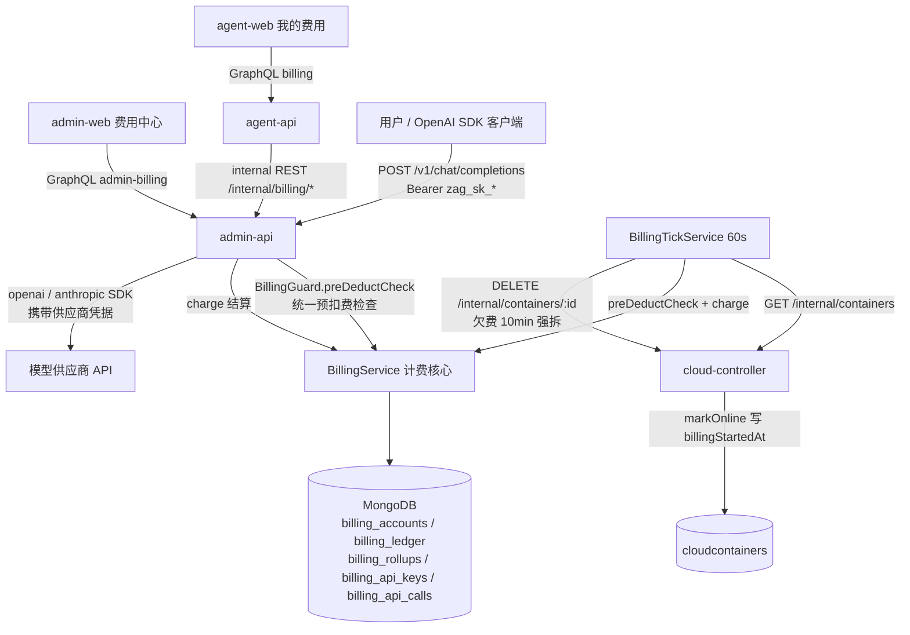
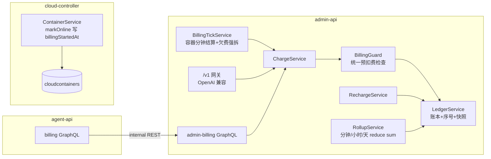
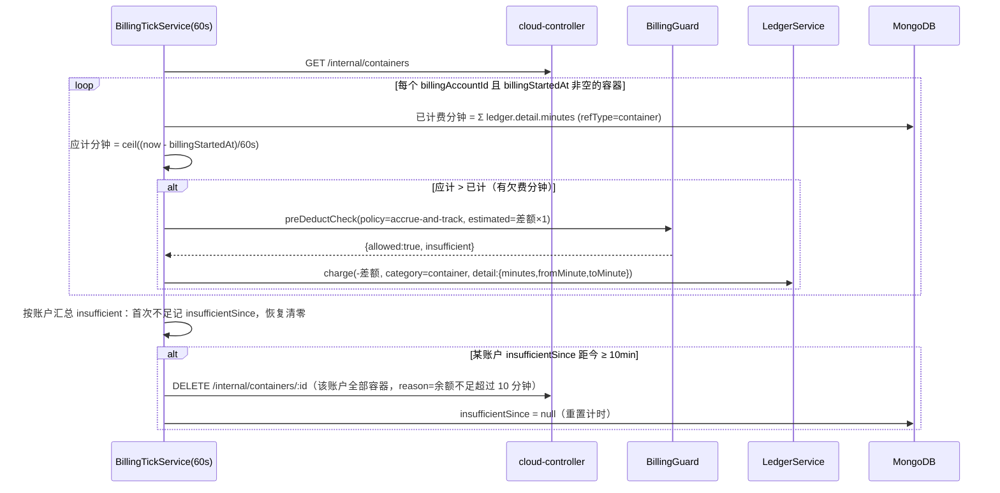
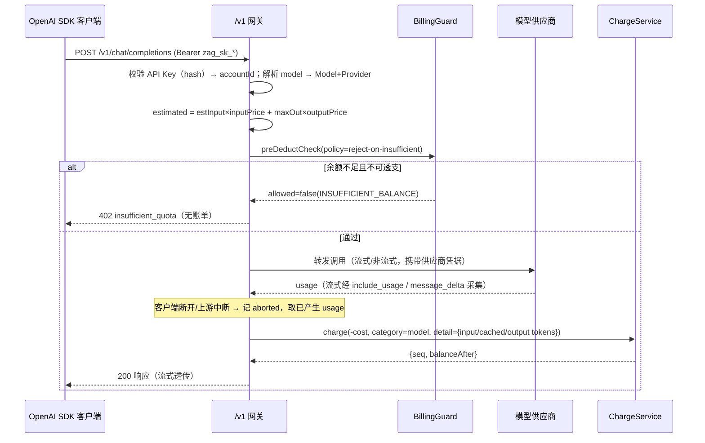

# 费用中心（Credits 计费） - 技术提案

**功能名称**: 后台费用中心与 Credits 计费体系
**关联 PRD**: `docs/product/draft/20261018-credits-billing.md`
**技术提案版本**: v1.0
**创建日期**: 2026-10-18
**作者**: ZeroAsh
**feat-branch**: `feat/credits-billing`

## 1. 概述

### 1.1 背景

平台当前没有任何计费/余额/账单能力（全库检索 `billing|credit|余额|pricing` 无实现代码），同时存在两个可计量的消耗面：

1. **云端工作容器**（`servers/cloud-controller`）：容器生命周期已完备（`creating → connecting → initializing → online → exited/destroying/failed`），初始化工作负载完成的收口点是 `WorkloadDispatcher.finishInit → ContainerService.markOnline`（`servers/cloud-controller/src/services/workload-dispatcher.ts:477` / `container-service.ts:319`；无 init 脚本的容器在 `socketio-gateway.ts:311` register 直通 `markOnline`）。`cloudcontainers.userId` 字段已预留但**无任何写入路径**，容器与账户的归属关系缺失。
2. **模型调用**：`servers/admin-api` / `servers/agent-api` 只用 `services/llm-api.ts` 做 `models.list()` 连通性校验，**不存在任何 OpenAI 兼容的对外调用入口**，也没有 token 用量采集。

本提案按 PRD（`docs/product/draft/20261018-credits-billing.md`）落地完整计费体系：credits 账户与追加式账单、分钟/小时/天 reduce-sum 汇总缓存、统一预扣费检查、容器按分钟计费与欠费强拆、admin-api 上的 OpenAI 兼容计费网关与 API Key 体系、费用中心前后台界面。

### 1.2 目标

- 单一计费核心：**所有**扣费（容器分钟、模型 token、未来的任何来源）都经由同一个 `BillingGuard.preDeductCheck` + `BillingChargeService.charge`，不允许各处自建余额检查（PRD 功能点 7）。
- 账本不可变（追加式）、序号连续（`{accountId, seq}` 唯一）、余额快照 + 精确核算（sum）双口径、分钟/小时/天 rollup 缓存（PRD 功能点 1/6）。
- 容器计费锚定「初始化完成」（`markOnline` 写 `billingStartedAt`），1 credit/分钟，欠费持续扣费，连续 10 分钟欠费强拆该账户全部容器（PRD 功能点 3）。
- admin-api 提供 `POST /v1/chat/completions`（流式+非流式）与 `GET /v1/models`，按 API Key 归属账户计费，中断调用按已产生用量计费（PRD 功能点 4）。
- 后台账户可透支、前台账户仅预付费，口径由统一检查实现（PRD 功能点 5）。

### 1.3 范围

**做**：

- admin-api：`services/billing/*` 计费核心（账户、账单、rollup、统一预检查、扣费、充值、对账）、`BillingTickService` 定时结算、`/internal/billing/*` 内部 REST、`/v1/*` OpenAI 兼容计费网关、费用中心 GraphQL（`admin-billing.graphql`）。
- agent-api：前台「我的费用」/API Key GraphQL（`billing.graphql`），经 admin-api 内部 REST 转发（计费写路径不落在 agent-api）。
- cloud-controller：`cloudcontainers` 新增 `billingAccountId` / `billingStartedAt` 写入链路（`markOnline` 写计费起点）；内部 API 透出新字段；`POST /internal/containers` 接受 `billingAccountId`。
- admin-web：费用中心（账户列表/详情账单/充值/汇总/我的 API Key）、模型定价设置。
- agent-web：我的费用（余额/账单/汇总）与 API Key 管理。
- contracts：新增 `admin-billing.graphql`、`billing.graphql`、`billing-openai.openapi.yaml`；扩展 `admin-cloud-container.graphql`、`admin-llm.graphql`、`llm.graphql`、`cloud-controller-websocket.md` 附录 A。

**不做**：

- 真实支付/充值渠道（充值仅后台人工操作）；
- 价格版本管理与历史定价追溯（按调用发生时点定价结算）；
- 发票/税务/多币种；credits 之外的货币；
- agent-api 会话内 Agent（ACP）自用模型的计费（模型计费只走 OpenAI 兼容入口；ACP 会话用量计费为后续需求）；
- 容器内工作负载执行（post/init 脚本运行）单独计费。

## 2. 技术架构

### 2.1 系统架构图



### 2.2 技术栈

| 层级 | 技术选型 | 说明 |
|------|---------|------|
| 后端 | Node.js 24 + TypeScript strict + Express 5 + graphql-yoga 5 | 与现有 admin-api / agent-api 一致 |
| 数据库 | MongoDB（Mongoose 9），复用现有 `mongodb://localhost:27017/agent-gear` 实例 | 计费集合与现有集合同库，无新增部署资源 |
| 计费网关 | admin-api Express 路由 + `openai` / `@anthropic-ai/sdk`（已依赖） | `/v1/*` 直连供应商，流式透传 |
| 前端 | React + TypeScript + Vite（admin-web / agent-web） | 复用现有页面/组件风格 |
| 定时结算 | admin-api 进程内 `setInterval`（60s tick） | 与 cloud-controller `StatusSyncService` 15s tick 同模式 |
| 测试 | Vitest（单测/集成）+ 现有 E2E 套件 | TDD 红-绿-重构 |

### 2.3 模块划分



| 模块 | 职责 | 关键技术点 |
|------|------|-----------|
| `admin-api/services/billing/billing-guard.ts` | **唯一**的预扣费检查入口 | 透支口径、拒绝/记账策略（`reject-on-insufficient` / `accrue-and-track`） |
| `admin-api/services/billing/ledger-service.ts` | 账本追加、seq 原子分配、余额快照更新 | `findOneAndUpdate $inc` 分配 seq；`{accountId,seq}` 唯一索引 |
| `admin-api/services/billing/rollup-service.ts` | 分钟/小时/天 reduce-sum 缓存 | 每次账本写入 upsert `$inc`；UTC bucket |
| `admin-api/services/billing/charge-service.ts` | 扣费收口（模型/容器/未来来源） | 强制先 `preDeductCheck` 再入账，携带 `refType/refId` |
| `admin-api/services/billing/billing-tick.ts` | 容器分钟结算、欠费计时、强拆 | 60s tick；幂等游标（已计费分钟 = 账本明细 `minutes` 求和） |
| `admin-api/routes/billing-openai.ts` | OpenAI 兼容计费网关 | Key 鉴权、用量采集（含中断）、流式透传 |
| `admin-api/graphql/{schemas,resolvers}/billing.ts` | 费用中心 GraphQL | 命名沿用 `admin*` 前缀 |
| `agent-api/graphql/{schemas,resolvers}/billing.ts` | 我的费用 / 我的 API Key | 只读+Key 管理，写路径经 internal REST |
| `cloud-controller/services/container-service.ts` | 计费起点落库 | `markOnline` 写 `billingStartedAt`（两条路径统一） |

## 3. API 设计

### 3.1 API 契约

契约文件（下一阶段落 `contracts/`）：

- `contracts/admin-billing.graphql` — 后台费用中心 GraphQL；
- `contracts/billing.graphql` — 前台「我的费用」GraphQL（agent-api）；
- `contracts/billing-openai.openapi.yaml` — OpenAI 兼容计费网关；
- 变更：`contracts/admin-cloud-container.graphql`（启动容器增加 `billingAccountId`、容器增加 `billingStartedAt`）、`contracts/admin-llm.graphql` 与 `contracts/llm.graphql`（`Model.pricing`）、`contracts/cloud-controller-websocket.md` 附录 A（内部 REST 字段）。

#### OpenAI 兼容计费网关（admin-api，鉴权：`Authorization: Bearer zag_sk_<hex>`）

##### 接口 1: 列出可用模型

- **请求**
  - Method: GET
  - Path: `/v1/models`
  - Body: 无
- **响应**
  - Status: 200
  - Body:
    ```json
    {
      "object": "list",
      "data": [
        { "id": "gpt-5", "object": "model", "owned_by": "agent-gear", "created": 1760000000 }
      ]
    }
    ```
  仅列出 `isEnabled && pricing.isBillable` 且定价完整的全局（`scope=global`）模型。

##### 接口 2: 聊天补全（计费）

- **请求**
  - Method: POST
  - Path: `/v1/chat/completions`
  - Body:
    ```json
    {
      "model": "gpt-5",
      "messages": [{ "role": "user", "content": "hello" }],
      "stream": true,
      "max_tokens": 1024
    }
    ```
- **响应**
  - Status: 200 — OpenAI 标准 `chat.completion` 或 SSE `chat.completion.chunk` 流（`stream_options.include_usage=true` 注入以采集 usage）；
  - Status: 401 — `{"error":{"type":"invalid_request_error","code":"invalid_api_key","message":"..."}}`；
  - Status: 402 — `{"error":{"type":"insufficient_quota","code":"insufficient_quota","message":"余额不足，请联系管理员充值"}}`（余额不足且不可透支，**调用前**拒绝，不产生账单）；
  - Status: 404 — `{"error":{"type":"invalid_request_error","code":"model_not_found", ...}}`（模型不存在/未开启计费）；
  - Status: 429 — 限速（复用 `SlidingWindowRateLimiter`）。

计费语义：调用前 `preDeductCheck`（`estimatedCredits` 见 §5.2 实现点 4）；调用结束后（含中断）按实际用量 `charge`，生成 `billing_api_calls` 与账单明细。Anthropic 类型供应商的请求/响应在网关内做 OpenAI ↔ Anthropic 形状转换（messages/usage 字段映射）。

#### 后台费用中心 GraphQL（`contracts/admin-billing.graphql`，admin-api）

```graphql
scalar JSON

enum BillingOwnerType { front_user admin_user }
enum BillingLedgerType { charge recharge adjust }
enum BillingCategory { container model manual }
enum BillingRollupGranularity { minute hour day }

type BillingAccount {
  id: ID!
  ownerType: BillingOwnerType!
  ownerId: ID!
  ownerName: String!
  balance: Float!            # 快照余额，可为负
  overdraftEnabled: Boolean!
  status: String!            # active | frozen
  insufficientSince: String  # 欠费计时起点（ISO 时间）
  ledgerCount: Int!
  createdAt: String!
  updatedAt: String!
}

type BillingLedgerEntry {
  id: ID!
  accountId: ID!
  seq: Int!                  # 账户内序号，从 0 递增
  type: BillingLedgerType!
  category: BillingCategory!
  amount: Float!             # 充值为正、消费为负
  balanceAfter: Float!
  refType: String            # container | api_call | recharge
  refId: String
  description: String!
  detail: JSON               # 分钟数/单价、token 明细等
  createdAt: String!
}

type BillingRollup {
  bucketStart: String!
  chargeTotal: Float!
  rechargeTotal: Float!
  chargeCount: Int!
}

type BillingApiKey {
  id: ID!
  name: String!
  keyPrefix: String!
  status: String!            # active | revoked
  lastUsedAt: String
  createdAt: String!
}

type BillingApiKeyPayload { apiKey: BillingApiKey!, secret: String! } # secret 仅此一次返回

type Query {
  adminBillingAccounts(keyword: String, ownerType: BillingOwnerType, page: Int, pageSize: Int): [BillingAccount!]!
  adminBillingAccount(id: ID!): BillingAccount!
  adminBillingLedgers(accountId: ID!, from: String, to: String, type: BillingLedgerType, category: BillingCategory, page: Int, pageSize: Int): [BillingLedgerEntry!]!
  adminBillingRollups(accountId: ID!, granularity: BillingRollupGranularity!, from: String!, to: String!): [BillingRollup!]!
  adminBillingApiKeys: [BillingApiKey!]!
}

type Mutation {
  rechargeBillingAccount(accountId: ID!, amount: Float!, note: String): BillingLedgerEntry!
  setBillingAccountOverdraft(accountId: ID!, enabled: Boolean!): BillingAccount!
  setBillingAccountStatus(accountId: ID!, status: String!): BillingAccount!
  reconcileBillingAccount(accountId: ID!): BillingAccount!   # 精确核算：sum(账本) 校准快照
  updateModelPricing(modelId: ID!, pricing: ModelPricingInput!): Model!
  createBillingApiKey(name: String!): BillingApiKeyPayload!
  revokeBillingApiKey(id: ID!): BillingApiKey!
}
```

`Model.pricing`（`admin-llm.graphql` / `llm.graphql` 同步扩展，两侧 schema 同步演进）：

```graphql
type ModelPricing {
  inputPerMillion: Float!          # credits / 百万 token
  cachedInputPerMillion: Float!
  outputPerMillion: Float!
  isBillable: Boolean!
}
input ModelPricingInput {
  inputPerMillion: Float!
  cachedInputPerMillion: Float!
  outputPerMillion: Float!
  isBillable: Boolean! = true
}
# type Model 增加: pricing: ModelPricing
```

#### 前台「我的费用」GraphQL（`contracts/billing.graphql`，agent-api）

```graphql
type Query {
  myBillingAccount: BillingAccount!
  myBillingLedgers(from: String, to: String, type: BillingLedgerType, category: BillingCategory, page: Int, pageSize: Int): [BillingLedgerEntry!]!
  myBillingRollups(granularity: BillingRollupGranularity!, from: String!, to: String!): [BillingRollup!]!
  myBillingApiKeys: [BillingApiKey!]!
}
type Mutation {
  createMyBillingApiKey(name: String!): BillingApiKeyPayload!
  revokeMyBillingApiKey(id: ID!): BillingApiKey!
}
```

前台无充值 mutation（PRD：仅后台充值）。

### 3.2 内部接口

##### admin-api `/internal/billing/*`（`Authorization: Bearer <INTERNAL_API_TOKEN>`，供 agent-api 调用）

| Method | Path | Body / Query | 返回 | 说明 |
|--------|------|--------------|------|------|
| GET | `/internal/billing/account` | `ownerType, ownerId` | `BillingAccount` | 幂等 get-or-create |
| GET | `/internal/billing/ledgers` | `accountId, from, to, type, category, page` | `BillingLedgerEntry[]` | 只读账单 |
| GET | `/internal/billing/rollups` | `accountId, granularity, from, to` | `BillingRollup[]` | 汇总查询 |
| POST | `/internal/billing/api-keys` | `ownerType, ownerId, name` | `{apiKey, secret}` | 前台用户建 Key |
| DELETE | `/internal/billing/api-keys/:id` | `ownerType, ownerId` | `{success}` | 校验归属后吊销 |

##### admin-api 内部（BillingGuard / ChargeService 对内接口，同进程模块调用；进程内不走 HTTP）

```ts
preDeductCheck(input: {
  accountId: string;
  estimatedCredits: number;
  policy: 'reject-on-insufficient' | 'accrue-and-track';
  ref: { type: 'model_call' | 'container_minute'; id: string };
}): Promise<{ allowed: boolean; reason?: 'INSUFFICIENT_BALANCE' | 'ACCOUNT_FROZEN' | 'NOT_FOUND'; balance: number; insufficient: boolean }>;

charge(input: {
  accountId: string; amount: number; category: 'container' | 'model';
  refType: string; refId: string; description: string; detail: JSON;
  preCheck: PreDeductResult;   // 强制携带，防绕过统一检查
}): Promise<{ seq: number; balanceAfter: number }>;
```

##### cloud-controller 内部 REST 变更（`contracts/cloud-controller-websocket.md` 附录 A）

- A.2.2 `POST /internal/containers`：body 增加 `billingAccountId?: string`（计费账户；为空表示不计费，仅存量/系统容器）；
- A.3 `GET /internal/containers`：每个容器增加 `billingAccountId`、`billingStartedAt`（`markOnline` 时刻，`null` 表示未就绪/不计费）；
- 强拆复用 A.2.3 `DELETE /internal/containers/:id`，`exitReason: '余额不足超过 10 分钟，强制销毁'`。

## 4. 数据模型

### 4.1 数据库设计

全部为 MongoDB 新集合（Mongoose model 命名与 `export type IX = mongoose.InferSchemaType<...>` 惯例一致），与现有集合同库。

#### 集合: `billingaccounts`（`BillingAccount`）

| 字段 | 类型 | 说明 |
|------|------|------|
| ownerType | enum `front_user`/`admin_user` | 账户主体类型 |
| ownerId | String | `users._id` 或 `admin_users._id` |
| balanceSnapshot | Number | 余额快照（0.01 精度），可为负；**非**精确值 |
| ledgerSeq | Number | 已分配序号数（下一 seq = 该值），从 0 起 |
| overdraftEnabled | Boolean | 后台账户 true、前台账户 false |
| status | enum `active`/`frozen` | 冻结拒绝调用与容器启动 |
| insufficientSince | Date \| null | 连续余额不足（欠费）计时锚点 |
| timestamps | | |

唯一索引 `{ownerType:1, ownerId:1}`。账户在用户创建时惰性 get-or-create（首次查询/首次计费时）。

#### 集合: `billingledgers`（`BillingLedger`，追加式账本 = 事实来源）

| 字段 | 类型 | 说明 |
|------|------|------|
| accountId | ObjectId | 所属账户 |
| seq | Number | 账户内序号，从 0 递增 |
| type | enum `charge`/`recharge`/`adjust`/`refund` | |
| category | enum `container`/`model`/`manual` | |
| amount | Number | 充值为正、消费为负 |
| balanceAfter | Number | 入账后快照余额 |
| refType / refId | String | `container`/`api_call`/`recharge` + 对象 ID |
| description | String | 人类可读说明 |
| detail | Mixed | 容器：`{minutes, unitPrice, fromMinute, toMinute}`；模型：`{inputTokens, cachedInputTokens, outputTokens, unitPrices, estimatedCredits}` |
| createdAt | Date | |

唯一索引 `{accountId:1, seq:1}`；辅助索引 `{accountId:1, createdAt:-1}`、`{refType:1, refId:1}`。**无 update/delete 路径**，更正用 `type:'adjust'` 补偿条目。

#### 集合: `billingrollups`（`BillingRollup`，reduce-sum 缓存）

| 字段 | 类型 | 说明 |
|------|------|------|
| accountId | ObjectId | |
| granularity | enum `minute`/`hour`/`day` | |
| bucketStart | Date | UTC 对齐的桶起点 |
| chargeTotal / rechargeTotal | Number | `$inc` 累计 |
| chargeCount | Number | 笔数 |

唯一索引 `{accountId:1, granularity:1, bucketStart:1}`。每次账本写入同步 upsert 三个粒度桶（`$inc`），供汇总视图秒开；**精确余额仍以 sum(账本) 为准**（PRD 口径）。

#### 集合: `billingapikeys`（`BillingApiKey`）

| 字段 | 类型 | 说明 |
|------|------|------|
| accountId / ownerType / ownerId | | 归属 |
| name | String | |
| keyPrefix | String | 形如 `zag_sk_a1b2`（前 8 位展示用） |
| keyHash | String | bcrypt（沿用 `controller-key.ts` 模式） |
| status | enum `active`/`revoked` | |
| lastUsedAt / revokedAt / timestamps | | |

Key 明文格式 `zag_sk_<32 hex>`，**仅生成时返回一次**；校验按 `keyHash` 命中（可加 Redis 缓存，沿用 `services/key-cache.ts` 模式，TTL 30 天）。

#### 集合: `billingapicalls`（`BillingApiCall`，调用计量记录）

| 字段 | 类型 | 说明 |
|------|------|------|
| requestId / accountId / apiKeyId / modelId / modelName | | |
| inputTokens / cachedInputTokens / outputTokens | Number | 实际用量（中断取已产生部分） |
| cost | Number | 结算金额（0.01 精度，向上取整） |
| status | enum `completed`/`aborted`/`error` | 中断计费依据 |
| ledgerSeq | Number | 关联账单序号 |
| startedAt / finishedAt / durationMs | | |

#### 变更: `models` 集合（admin-api / agent-api 双侧 schema 同步演进，加注「同步演进」注释）

| 字段 | 类型 | 说明 |
|------|------|------|
| pricing.inputPerMillion | Number | credits / 百万输入 token |
| pricing.cachedInputPerMillion | Number | credits / 百万缓存命中输入 token |
| pricing.outputPerMillion | Number | credits / 百万输出 token |
| pricing.isBillable | Boolean | 计费开关（默认 false，存量模型不计费） |

#### 变更: `cloudcontainers` 集合（cloud-controller schema + admin-api 只读镜像 + 内部 API JSON）

| 字段 | 类型 | 说明 |
|------|------|------|
| billingAccountId | String \| null | 计费账户 ID；null = 不计费 |
| billingStartedAt | Date \| null | 计费起点 = 初始化完成（`markOnline`）时刻 |

### 4.2 缓存设计

- **rollup 缓存**（`billingrollups`）：分钟/小时/天三粒度 reduce-sum，写入时 `$inc` 维护；key 语义 `{accountId, granularity, bucketStart(UTC)}`；无 TTL（分钟桶可按月归档清理，本期不做）。
- **API Key 校验缓存**（Redis，可选加速）：`billing:apikey:<keyHash>` → `accountId`，TTL 1h，吊销时主动删除（沿用 `servers/agent-api/src/services/key-cache.ts` 既有模式）。
- **余额不放 Redis**：余额判定直接读 `balanceSnapshot`（Mongo 单文档），避免缓存与账本双源不一致。

## 5. 技术实现方案

### 5.1 核心流程

#### 容器分钟结算与欠费强拆（admin-api `BillingTickService`，60s）



#### 模型调用计费（admin-api `/v1/chat/completions`）



### 5.2 关键实现点

#### 实现点 1: 统一预扣费检查（`BillingGuard`，PRD 功能点 7）

- **唯一入口**：`preDeductCheck(input)` 是全平台唯一的余额判定实现；`charge()` 入参强制携带 `preCheck` 结果（来源 token 校验），没有经过检查的扣费直接抛错，防止未来新场景绕过。
- **判定口径**：
  - `insufficient`（模型调用）：`balanceSnapshot < estimatedCredits && !overdraftEnabled`；
  - `insufficient`（容器欠费，`accrue-and-track`）：`balanceSnapshot < 0`（统一口径「欠费」，见决策 D-2）；
  - `ACCOUNT_FROZEN`：冻结账户一律 `allowed=false`。
- **策略**：`reject-on-insufficient`（模型调用）不足即拒绝；`accrue-and-track`（容器计费）永远放行但回传 `insufficient`，由调用方维护欠费计时。两处的判定函数同源，满足「不是各个扣费处各自的检查」。

#### 实现点 2: 账本序号与余额快照（PRD 功能点 1/6）

- seq 分配：`BillingAccount.findOneAndUpdate({_id}, {$inc:{ledgerSeq:1}}, {new:true})` → `seq = ledgerSeq-1`，配合 `{accountId,seq}` 唯一索引兜底并发重号（重号时整笔重试）。
- 同一原子流程内：插账本 → `$inc balanceSnapshot: amount` → upsert 三个 rollup 桶。三步之间用「账本为事实来源、快照与 rollup 可重建」的原则兜底：任一步失败由重试/对账修复。
- **精确核算**：`reconcileBillingAccount` = `sum(billingledgers.amount)` 与 `balanceSnapshot` 比对，不一致以账本为准写 `adjust`/直接校准并返回提示（PRD 3.5 口径）。
- 账本不可变：schema 层不暴露 update/delete；Mongoose `pre('updateOne'|'deleteOne')` 钩子直接抛错兜底。

#### 实现点 3: 容器计费锚点与幂等结算（PRD 功能点 3）

- **计费起点**：`cloud-controller` 的 `ContainerService.markOnline` 写 `billingStartedAt = new Date()`（覆盖两条路径：`finishInit` 收口与无 init 脚本的 register 直通），语义 = 「初始化工作负载完成、容器就绪」。初始化期间（`initializing`）`billingStartedAt` 为 null，不计费。
- **归属**：`adminStartCloudContainer(input.billingAccountId)`（缺省 = 当前管理员自己的账户）→ `CloudControllerClient.start` body → `POST /internal/containers` → `ContainerService.start` 落 `cloudcontainers.billingAccountId`（`userId` 预留字段同步写 `ownerId`，语义保持不变）。
- **幂等游标**：已计费分钟不落跨服务游标，直接由账本推导 `Σ detail.minutes (refType='container', refId=容器id)`；tick 里 `应收 - 已计` 即本轮补扣，天然幂等（tick 重跑/并发 tick 不重复扣费；tick 内对同一容器串行处理）。
- **尾分钟**：`应计 = ceil((now - billingStartedAt)/60s)`，销毁时由最后一次 tick 结清尾部（不足 1 分钟按 1 分钟），容器进入终态后不再计费。

#### 实现点 4: 模型用量采集与中断计费（PRD 功能点 4）

- **预检估算**：`estimatedCredits = estInputTokens × inputPerMillion/1e6 + maxOutputTokens × outputPerMillion/1e6`；`maxOutputTokens = 请求 max_tokens || 配置 MODEL_DEFAULT_MAX_OUTPUT_TOKENS（默认 4096）`；`estInputTokens` 由 messages 序列化长度/4 粗估（预检只做门槛，不作为结算依据）。
- **结算用量**：OpenAI 流式强制注入 `stream_options:{include_usage:true}`，取最终 chunk `usage`；Anthropic 取 `message_delta.usage`；非流式取响应 `usage`。
- **中断计费**：监听 `req.on('close')` 与上游 `AbortError`/超时，状态记 `aborted`；已拿到的 usage 直接入账；完全拿不到 usage 时按已转发/已接收的 prompt+completion 文本粗估 token 入账（宁可多收不可漏计，明细标注 `estimated: true`）。
- **结算精度**：`cost = inputTokens×inputPerMillion/1e6 + cachedInputTokens×cachedInputPerMillion/1e6 + outputTokens×outputPerMillion/1e6`，**向上取整到 0.01 credits**（决策 D-5）。
- **供应商适配**：`Provider.type === 'OpenAI'` 直接以 OpenAI SDK 转发（`baseURL = provider.endpoint`，凭据解密后使用）；`'Anthropic'` 在网关内做请求/响应形状映射。供应商密钥永不出网关。

#### 实现点 5: 欠费计时与强拆（PRD 功能点 3/5）

- 每个 tick 结束后按账户汇总本轮 `insufficient`：首次为真且 `insufficientSince == null` → 记当前时间；为假 → 清空；`now - insufficientSince >= BILLING_ARREARS_GRACE_MS(10min)` → 强拆。
- 强拆范围 = **该账户关联的全部容器**（`GET /internal/containers` 按 `billingAccountId` 过滤后逐个 `DELETE /internal/containers/:id`），`exitReason='余额不足超过 10 分钟，强制销毁'`（复用 `ContainerService.destroy` 的 reason 落库）；强拆后 `insufficientSince` 重置为 null。
- 透支账户同样受强拆保护（决策 D-2，评审点）；模型调用是否放行只看 `overdraftEnabled`，与强拆无关。

#### 实现点 6: 费用中心与我的费用界面

- admin-web：新增 `pages/BillingPage.tsx`（账户列表 + 详情抽屉：余额卡/账单表/汇总图/充值）、`components/billing/{AccountTable,RechargeDialog,LedgerTable,RollupChart,MyApiKeyManager}.tsx`；`ModelConfigPage` 增加定价编辑列；`AdminLayout` 导航增加「费用中心」；`src/graphql/billing.ts` 客户端。
- agent-web：新增 `pages/BillingPage.tsx`（余额/欠费提示/账单/汇总/API Key），入口并入 `SettingsPage`/主导航；`src/graphql/billing.ts`。
- 汇总图直接查 rollup（分钟/小时/天切换），账单表按 `{accountId, createdAt}` 索引分页。

## 6. 技术决策

### 6.1 决策列表

| # | 决策 | 选项 A | 选项 B | 最终选择 | 原因 |
|---|------|--------|--------|---------|------|
| D-1 | 计费核心部署位置 | admin-api 内 `services/billing/*` | 独立 billing 微服务 | A | 费用中心本属后台域（PRD「后台增加费用中心」）；不新增部署面；`Model`/`Provider` 已在 admin-api |
| D-2 | 欠费强拆是否适用于透支账户 | 所有账户统一强拆 | 透支账户豁免 | A（评审点） | 需求 3 未做豁免；防止资源无限占用；透支语义仅约束「调用」准入。若评审倾向 B，只需在 tick 汇总处加 `!overdraftEnabled` 过滤 |
| D-3 | 余额口径 | 快照 + 账本 sum 对账 + rollup | 每次精确 sum | A | 需求 6 明确「余额是 snapshot，精确余额需要 sum」 |
| D-4 | 计费起点 | `markOnline`（初始化完成） | register 即计费 / online 后延迟 N 分钟 | A | 需求 3 明确「初始化工作负载完成之后计费」；`markOnline` 是唯一收口，且覆盖无 init 脚本路径 |
| D-5 | token 计费精度 | 向上取整 0.01 credits | 4 位小数 / 整数 credits | A | 0.01 为 PRD 约束精度；向上取整保证不漏收；避免浮点长尾 |
| D-6 | 余额不足响应码 | 402 + `insufficient_quota` | 429 + `insufficient_quota`（OpenAI 官方风格） | A（评审点） | 402 语义准确；body 形状保持 OpenAI 兼容。若以 SDK 兼容性优先可切 B |
| D-7 | 计费逻辑共享方式 | admin-api 单点 + internal REST | `packages/billing-core` 共享包 | A | 与 `Provider`/`Model` 「同步演进」既有约定一致；单点实现天然满足「统一预扣费检查」 |
| D-8 | seq 分配 | 账户文档 `$inc ledgerSeq` | 独立计数器集合 / 时间戳排序 | A | 单文档原子自增简单可靠；唯一索引兜底；账户天然为热点单位 |
| D-9 | 容器已计费游标 | 由账本 `detail.minutes` 求和推导 | cloudcontainers 上存 `chargedMinutes` | A | 避免 admin-api 反向写 cloud-controller 的事实集合；账本即事实 |
| D-10 | 中断调用无 usage 时 | 按已收文本估算入账（标注 estimated） | 不计费 | A | 需求 4 明确「中断的调用也需要计费」 |

### 6.2 依赖与约束

| 类型 | 内容 | 说明 |
|------|------|------|
| 依赖 | cloud-controller 内部 REST（A.2.2/A.2.3/A.3）扩展 | `billingAccountId`/`billingStartedAt` 字段与销毁复用 |
| 依赖 | `openai` / `@anthropic-ai/sdk` | 已在 admin-api 依赖中，无需新增 |
| 依赖 | `bcryptjs`（Key 哈希）、`jsonwebtoken`、Redis（可选缓存） | 沿用现有设施 |
| 约束 | 无新增部署资源 | 复用现有 MongoDB / Redis / Aspire 编排 |
| 约束 | `models`/`providers` schema 在 admin-api 与 agent-api 同步演进 | 既有约定，加注释 |
| 约束 | 账本追加式不可变 | schema 钩子拦截 update/delete |
| 约束 | 时间桶统一 UTC | 避免时区漂移导致 rollup 与明细对不上 |

## 7. 项目结构

```
servers/admin-api/src/
├── models/
│   ├── billing-account.ts          # BillingAccount → billingaccounts
│   ├── billing-ledger.ts           # BillingLedger → billingledgers（追加式）
│   ├── billing-rollup.ts           # BillingRollup → billingrollups
│   ├── billing-api-key.ts          # BillingApiKey → billingapikeys
│   ├── billing-api-call.ts         # BillingApiCall → billingapicalls
│   └── model.ts                    # + pricing 子文档（同步演进）
├── services/billing/
│   ├── billing-guard.ts            # preDeductCheck（统一预扣费检查，唯一入口）
│   ├── account-service.ts          # get-or-create / 冻结 / 透支设置
│   ├── ledger-service.ts           # seq 分配 + 账本追加 + 快照更新
│   ├── rollup-service.ts           # 分钟/小时/天 reduce-sum
│   ├── charge-service.ts           # charge() 扣费收口（强制携带 preCheck）
│   ├── recharge-service.ts         # 后台充值
│   ├── reconcile-service.ts        # 精确核算（sum 对账校准）
│   ├── api-key-service.ts          # zag_sk_* 生成/校验/吊销
│   └── billing-tick.ts             # 60s 容器结算 + 欠费计时 + 强拆
├── routes/
│   ├── billing-openai.ts           # /v1/models、/v1/chat/completions（计费网关）
│   └── internal-billing.ts         # /internal/billing/*（供 agent-api）
├── graphql/{schemas,resolvers}/billing.ts   # 费用中心 admin* GraphQL
└── middleware/billing-key-auth.ts  # zag_sk_* 鉴权中间件

servers/agent-api/src/
├── graphql/{schemas,resolvers}/billing.ts   # myBilling*（转发 internal REST）
└── services/billing-client.ts               # admin-api /internal/billing/* 客户端

servers/cloud-controller/src/
├── models/cloud-container.ts       # + billingAccountId / billingStartedAt
├── services/container-service.ts   # markOnline 写 billingStartedAt；start 落 billingAccountId
└── routes/internal-api.ts          # A.2.2 收 billingAccountId、A.3 透出新字段

apps/admin-web/src/
├── pages/BillingPage.tsx           # 费用中心
└── components/billing/{AccountTable,RechargeDialog,LedgerTable,RollupChart,MyApiKeyManager}.tsx

apps/agent-web/src/
└── pages/BillingPage.tsx           # 我的费用 + API Key

contracts/
├── admin-billing.graphql           # 新增
├── billing.graphql                 # 新增
├── billing-openai.openapi.yaml     # 新增
├── admin-cloud-container.graphql   # + billingAccountId/billingStartedAt
├── admin-llm.graphql / llm.graphql # + Model.pricing
└── cloud-controller-websocket.md   # 附录 A 字段扩展
```

## 8. 测试策略

### 8.1 测试覆盖要求

- 单元测试覆盖率：billing 服务模块 ≥ 90%（计费核心为资金相关，标准高于全局）。
- API 测试覆盖端点：`/v1/models`、`/v1/chat/completions`（流式/非流式/中断/402/401/404）、`admin-billing` 全部 Query/Mutation、`billing` 全部 Query/Mutation、`/internal/billing/*`、`POST /internal/containers`（billingAccountId）。

### 8.2 测试类型

| 类型 | 工具 | 覆盖范围 |
|------|------|---------|
| 单元测试（TDD 红-绿-重构） | Vitest + InMemory 仓储 | seq 并发分配不重不漏；charge 原子性；rollup 三粒度累计；preDeductCheck 透支/冻结/不足矩阵；估价与向上取整；tick 幂等（重跑不重复扣费）、欠费计时与强拆边界（9'59"/10'00"、充值清零） |
| 集成测试 | Vitest + MongoMemoryServer | 账本→快照→rollup 一致性；对账校准；API Key 生成/校验/吊销；网关计费全链路（含 aborted 计费、usage 缺失估算） |
| API 测试 | 现有 tests/api 约定 | admin-billing / billing GraphQL 契约一致性；internal REST 鉴权（错误/缺失 token 401） |
| E2E | 现有 tests/e2e 约定 | 充值 → 启动容器（含工作负载初始化）→ 分钟账单出现 → 欠费 10 分钟强拆；建 Key → 调模型 → 账单扣费 → 余额不足 402 → 后台充值 → 恢复调用 |

## 9. 部署方案

### 9.1 环境规划

| 环境 | 用途 | 部署方式 |
|------|------|---------|
| 本地/开发 | 开发自测 | Aspire `aspire start`（现有编排，无新增资源） |
| 测试 | 集成/E2E | 现有 docker-compose manifest 流程 |

### 9.2 配置管理

| 配置项 | 默认值 | 说明 |
|--------|-------|------|
| `BILLING_TICK_INTERVAL_MS` | 60000 | 容器结算 tick 周期 |
| `BILLING_ARREARS_GRACE_MS` | 600000 | 欠费宽限（10 分钟）后强拆 |
| `MODEL_DEFAULT_MAX_OUTPUT_TOKENS` | 4096 | 预检估算的默认输出上限 |
| `ADMIN_API_URL` | — | agent-api → admin-api `/internal/billing/*` |
| `INTERNAL_API_TOKEN` | — | 复用现有内部鉴权 token |
| `BILLING_CACHE_TTL_MS` | 3600000 | API Key Redis 缓存 TTL（可选） |

无新增 K8s/Aspire 资源；数据库集合由 Mongoose 自动建索引（关键唯一索引在启动时 `syncIndexes`）。

## 10. 验收标准

- [ ] 技术方案评审通过（含 D-2 / D-6 两个评审点裁决）
- [ ] Contract 评审通过（admin-billing / billing / billing-openai / 存量契约变更）
- [ ] 代码实现完成（计费核心、tick、计费网关、两侧 GraphQL、两侧界面、cloud-controller 字段链路）
- [ ] 单元测试覆盖达标（billing ≥ 90%）
- [ ] API 测试通过
- [ ] E2E 测试通过（充值→容器计费→欠费强拆；API Key 调用→扣费→402→充值恢复）
- [ ] PRD §1.3 成功标准逐条演示通过

## 11. 相关文档

- [[../../product/draft/20261018-credits-billing.md]] — 关联 PRD
- [[20261014-feat-cloud-agent-phase2.md]] — 云Agent二期（容器生命周期来源）
- [[20261017-feat-cloud-controller-workload.md]] — 工作负载（初始化完成语义来源）
- [[../common-rules.md]] / [[../backend-rules.md]] / [[../frontend-rules.md]] — 开发规范
- `contracts/cloud-controller-websocket.md` — 容器内部 API 契约
- [[../AGENTS.md]] — 工程文档管理规范
