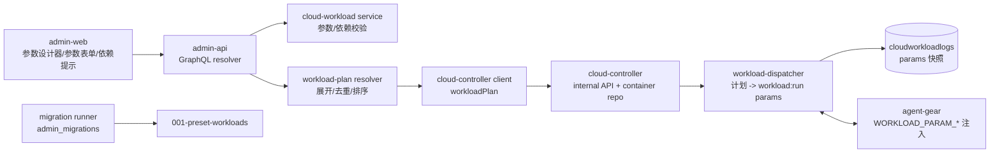
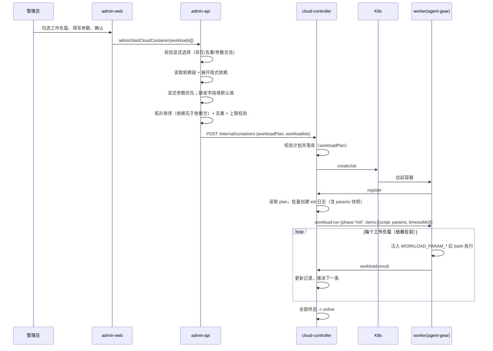
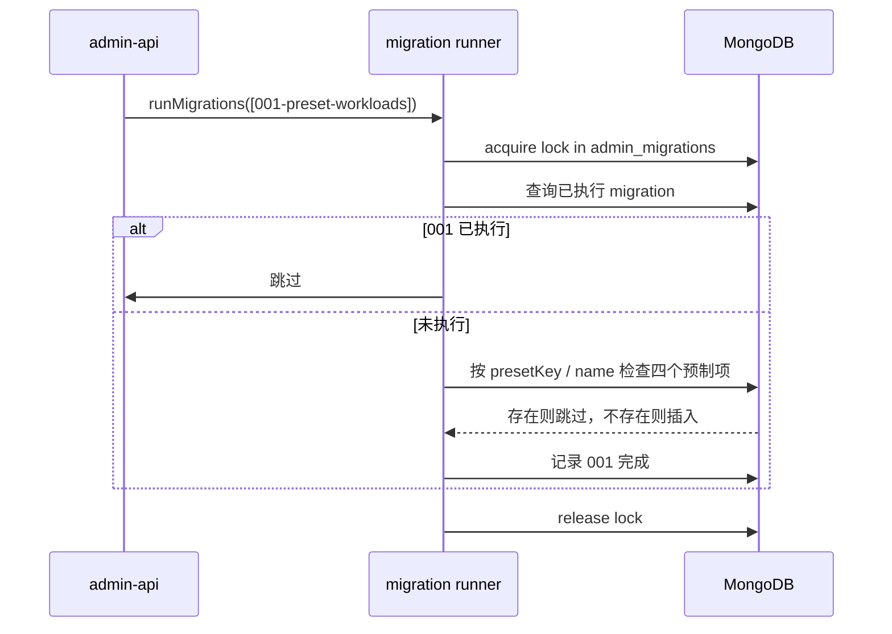

# 工作负载一期（参数、依赖与预制工作负载）- 技术提案

**功能名称**: 工作负载参数化、隐式依赖与预制工作负载
**关联 PRD**: docs/product/draft/20261018-workload-phase1.md
**技术提案版本**: v1.2
**创建日期**: 2026-10-18
**作者**: ZeroAsh
**feat-branch**: `feat/workload-phase1`

> v1.1 变更（返工）：Aspire 预制工作负载改为通过官方安装脚本 `curl -sSL https://aspire.dev/install.sh | bash` 安装 **Aspire CLI**，并强制执行 `aspire --version` 校验；移除 `dotnet workload install aspire`。
>
> v1.2 变更（返工）：工作负载依赖由「单个」调整为「多个」；`dependsOnWorkloadId` 改为 `dependsOnWorkloadIds: [ID!]!`；Aspire 预制项依赖 Docker 与 .NET（顺序 Docker → .NET → Aspire）。

## 1. 概述

### 1.1 背景

`20261017-feat-cloud-controller-workload` 已交付工作负载基线能力：admin-api/admin-web 维护「名称 + 初始化脚本 + 清理脚本」，启动容器时按 `workloadIds` 挂载；cloud-controller 在容器回连后经 Socket.IO 下发 `workload:run`，worker 逐条执行并回报，执行记录（含脚本快照）落库。当前工作负载是「固定脚本」，无法在启动时传参，也没有工作负载之间的依赖关系；Docker/Node.js/.NET 等环境仍固化在 worker 镜像与 entrypoint 中。

本期在既有链路上增加：

1. 工作负载参数表单（下拉单选、下拉多选、文本、布尔），参数在启动容器时填写并注入脚本执行环境。
2. 工作负载声明一个或多个隐式依赖；选择依赖方时后端自动展开全部依赖、去重、排序，显式选择优先使用用户参数。
3. Docker、Node.js、.NET、Aspire 四个预制工作负载，通过一次性 migration 写入，之后不再重复初始化。
4. dockerd 启动从 entrypoint 迁移到 Docker 预制工作负载。

### 1.2 目标

- admin-api 扩展工作负载模型/契约：`paramSchema`、`dependsOnWorkloadIds`、`isPreset`；服务层强制参数与依赖校验。
- admin-web 支持参数表单设计器、依赖选择器；启动对话框按工作负载填写参数、提示隐式依赖、预览初始化顺序。
- admin-api 在启动容器时完成「显式选择 + 隐式依赖」的展开、去重、拓扑排序与参数归一，将最终执行计划下发给 cloud-controller。
- cloud-controller 持久化执行计划，下发 `workload:run` 时携带每个工作负载的参数；worker 注入 `WORKLOAD_PARAM_*` 环境变量；执行记录保存参数快照。
- admin-api 引入 migration runner 与 `001-preset-workloads`，一次性写入四个预制工作负载；后续预制项通过新增 migration 增量写入。
- worker 镜像入口不再启动 dockerd；Docker 工作负载负责启动并等待 dockerd 就绪。

### 1.3 范围

**做**：

- 工作负载参数模型、GraphQL CRUD 扩展、参数校验与默认值归一。
- 参数值经内部 API → 容器执行计划 → Socket.IO → worker 环境变量的全链路透传。
- 多依赖的隐式依赖配置、前端提示、后端展开（依赖优先、去重、只执行一次、显式参数优先）。
- 预制工作负载 migration 与 Docker/Node.js/.NET/Aspire 脚本。
- entrypoint 移除 dockerd 启动，Docker 工作负载接管。
- 工作负载列表/编辑/启动/日志相关 UI。
- 单元、API、E2E 测试与 worker 镜像自验文档更新。

**不做**：

- 多依赖的条件覆盖、依赖版本范围（一期支持多个直接依赖，但依赖之间不能带条件）。
- 参数间联动、条件显示、敏感参数/密钥管理、参数在线修改。
- 工作流/会话等非 `idle` 任务类型挂载工作负载（沿用现有约束）。
- 预制工作负载的自动升级/回滚（预制项一旦写入即归管理员所有）。
- 自定义工作负载之间的自动脚本生成（参数只作为环境变量提供）。

## 2. 技术架构

### 2.1 系统架构图

```mermaid
graph TD
    AW[admin-web] -->|GraphQL| AA[admin-api]
    AA -->|Mongoose| M[(MongoDB<br/>cloudworkloads / cloudcontainers / cloudworkloadlogs / admin_migrations)]
    AA -->|内部 HTTP + Bearer<br/>workloadPlan| CC[cloud-controller]
    CC -->|Mongoose| M
    CC -->|K8s Job| K[K8s]
    K --> W[worker Pod<br/>agent-gear]
    W <-->|Socket.IO /worker<br/>register / workload:run(params) / workload:result / shutdown| CC
    AA -.启动时执行.-> MIG[migration runner<br/>001-preset-workloads]
    MIG --> M
```

关键边界：

- `cloudworkloads` 的写入方仍是 admin-api；cloud-controller 只读定义，用于下发脚本与参数校验兜底。
- 依赖展开与参数默认值归一以 admin-api 为准（它拥有 CRUD 与服务层校验）；cloud-controller 对旧版 admin-api 的 `workloadIds` 请求保留兜底展开。
- `cloudcontainers` 由 cloud-controller 写入；新增 `workloadPlan` 保存本次启动的最终执行计划（含参数），作为执行与留档的事实源。

### 2.2 技术栈

| 层级 | 技术选型 | 说明 |
|------|---------|------|
| 前端 | React + TypeScript + Vite + Apollo Client | admin-web，复用现有 Dialog/Select/Checkbox/Switch 组件 |
| 后端 | Node.js + Express + GraphQL + Mongoose | admin-api（CRUD/展开/migration）、cloud-controller（计划校验/下发） |
| Worker | Node.js（agent-gear） | `workload-executor` 注入参数环境变量 |
| 数据库 | MongoDB | 共享实例；新增 `admin_migrations` 集合 |
| 协议 | GraphQL + 内部 REST + Socket.IO | 沿用既有鉴权与降级模式 |

### 2.3 模块划分



| 模块 | 职责 | 关键技术点 |
|------|------|-----------|
| admin-api cloud-workload | 工作负载 CRUD、参数与依赖校验 | 字段级校验、依赖环检测、唯一索引 |
| admin-api workload-plan | 启动时展开依赖、归一参数、拓扑排序 | 纯函数、可单测；显式参数优先 |
| admin-api migrations | 一次性预制工作负载初始化 | 复用 agent-api migration 模式，独立集合与锁 |
| cloud-controller internal-api | 接收并校验 `workloadPlan`，兼容 `workloadIds` | 计划去重/上限/存在性校验，持久化 |
| cloud-controller workload-dispatcher | 按计划下发脚本与参数、日志留档 | 计划优先，旧记录回退 `workloadIds` |
| agent-gear workload-executor | 参数 → 环境变量，执行脚本 | 逐条注入、JSON 多选、向后兼容 |
| admin-web | 参数设计器、参数表单、依赖提示、顺序预览、日志参数展示 | 类型驱动的动态表单 |

## 3. API 设计

### 3.1 API 契约

新增/扩展 `contracts/admin-cloud-workload.graphql`、`contracts/admin-cloud-container.graphql`。

#### 3.1.1 JSON scalar

参数默认值与参数值需要同时支持字符串、字符串数组、布尔值，契约新增：

```graphql
scalar JSON
```

admin-api 的 resolver 合并 `JSON: GraphQLJSON`（引入 `graphql-type-json`，与 agent-api 用法一致）。

#### 3.1.2 工作负载参数与依赖

```graphql
enum CloudWorkloadParamType {
  SELECT        # 下拉单选
  MULTI_SELECT  # 下拉多选
  TEXT          # 文本
  BOOLEAN       # 布尔
}

type CloudWorkloadParamField {
  key: String!                 # 参数标识，工作负载内唯一
  label: String!               # 展示名称
  type: CloudWorkloadParamType!
  options: [String!]!          # SELECT/MULTI_SELECT 的可选项；其他类型为 []
  defaultValue: JSON!          # 必填：string | string[] | boolean
}

input CloudWorkloadParamFieldInput {
  key: String!
  label: String!
  type: CloudWorkloadParamType!
  options: [String!]
  defaultValue: JSON!
}

type CloudWorkload {
  id: ID!
  name: String!
  initScript: String
  postScript: String
  paramSchema: [CloudWorkloadParamField!]!
  dependsOnWorkloadIds: [ID!]!  # 依赖的工作负载，按配置顺序初始化；一期最多 5 个
  isPreset: Boolean!           # 是否为预制工作负载（仅展示用）
  createdAt: String!
  updatedAt: String!
}

input CreateCloudWorkloadInput {
  name: String!
  initScript: String
  postScript: String
  paramSchema: [CloudWorkloadParamFieldInput!]
  dependsOnWorkloadIds: [ID!]
}

input UpdateCloudWorkloadInput {
  name: String
  initScript: String
  postScript: String
  paramSchema: [CloudWorkloadParamFieldInput!]
  dependsOnWorkloadIds: [ID!]
}
```

#### 3.1.3 启动容器时传参

```graphql
input CloudWorkloadSelectionInput {
  workloadId: ID!
  params: JSON                 # 缺省/缺字段 = 使用该字段默认值
}

type Mutation {
  adminStartCloudContainer(
    purpose: CloudContainerPurpose!
    workloadIds: [ID!]         # 兼容旧调用：等价于 params 全默认
    workloads: [CloudWorkloadSelectionInput!]  # 新调用
  ): CloudContainer!
}
```

约束：

- `workloadIds` 与 `workloads` 二选一；同时非空返回错误 `workloadIds and workloads cannot both be provided`。
- `workloads` 中重复 `workloadId` 返回 `duplicate workload selection`（旧 `workloadIds` 保持去重保序语义）。
- 展开前或展开后超过 10 个返回 `expanded workloads exceed 10`。
- 依赖不存在返回 `dependency workload not found`；参数非法返回 `invalid value for parameter <key>`；未知参数返回 `unknown parameter: <key>`。
- 保存工作负载时依赖数量 >5 返回 `too many dependencies`；自依赖返回 `workload cannot depend on itself`；依赖环返回 `dependency cycle detected`。

#### 3.1.4 执行记录参数快照

```graphql
type CloudWorkloadLog {
  # ...既有字段
  params: JSON!                # 本次执行实际使用的参数值（含默认值）
}
```

### 3.2 内部接口

#### 3.2.1 admin-api → cloud-controller

`POST /internal/containers` 请求体扩展：

```json
{
  "purpose": "idle",
  "workloadPlan": [
    {
      "workloadId": "665f...",
      "params": { "version": "20", "package_manager": ["pnpm"] },
      "implicit": false
    },
    {
      "workloadId": "665e...",
      "params": {},
      "implicit": true
    }
  ],
  "workloadIds": ["665f...", "665e..."]
}
```

- `workloadPlan` 为**已展开、已排序、已去重**的最终计划，数组顺序即执行顺序。
- `workloadIds` 同时下发，保持旧版 cloud-controller 可用（滚动升级兼容）；新版 cloud-controller 优先使用 `workloadPlan`。
- 新 cloud-controller 校验：数组、≤10、`workloadId` 去重、全部存在、`params` 为对象、`implicit` 为布尔；非法返回 400 `INVALID_WORKLOAD`。
- 若请求只有 `workloadIds`（旧版 admin-api），cloud-controller 以默认参数 + 依赖展开兜底（读取 `dependsOnWorkloadIds` 与 `paramSchema`），行为与新 admin-api 一致。

`GET /internal/containers/:id/workload-logs` 返回记录增加 `params`。

#### 3.2.2 Worker ↔ cloud-controller（Socket.IO `/worker`）

`workload:run` 的 `items[]` 增加参数：

| 字段 | 类型 | 说明 |
|------|------|------|
| `workloadId` | `string` | 工作负载 ID（新增，便于排查/扩展） |
| `params` | `object` | 本次执行参数，键为参数标识；值类型见 §5.2 实现点 5 |

`workload:result` 不变。

worker 行为：

- 对每个 item，以 `process.env` 为基础注入参数环境变量后执行 `bash -c <script>`；
- 多选参数以 JSON 数组字符串注入，同时提供完整 `WORKLOAD_PARAMS` JSON；
- 参数为空对象时行为与旧版一致（仅 `WORKLOAD_PARAMS={}`）。

## 4. 数据模型

### 4.1 数据库设计

#### 集合: `cloudworkloads`（扩展）

| 字段 | 类型 | 说明 |
|------|------|------|
| `name` | String, required, unique | 沿用 |
| `initScript` / `postScript` | String, default null | 沿用 |
| `paramSchema` | 子文档数组，default [] | 参数定义；空数组表示无配置 |
| `paramSchema[].key` | String, required | `^[a-z][a-z0-9_]{0,31}$`，工作负载内唯一 |
| `paramSchema[].label` | String, required | 1~64 字符 |
| `paramSchema[].type` | enum(`select`/`multi_select`/`text`/`boolean`) | 字段类型 |
| `paramSchema[].options` | [String], default [] | 仅下拉类型使用；1~50 项、唯一、单项 1~100 字符 |
| `paramSchema[].defaultValue` | Mixed, required | 必填；类型由 `type` 决定 |
| `dependsOnWorkloadIds` | [ObjectId], default [], index | 依赖的工作负载，按配置顺序初始化；最多 5 个；禁止自依赖/环 |
| `presetKey` | String, default null, unique sparse | 预制项稳定标识：`docker`/`nodejs`/`dotnet`/`aspire` |
| `isPreset` | Boolean, default false | 展示用 |
| timestamps | createdAt / updatedAt | 沿用 |

#### 集合: `cloudcontainers`（扩展）

| 字段 | 类型 | 说明 |
|------|------|------|
| `workloadPlan` | 子文档数组，default [] | 本次启动最终执行计划，顺序即执行顺序 |
| `workloadPlan[].workloadId` | ObjectId, required | 工作负载 |
| `workloadPlan[].params` | Mixed, default {} | 参数快照（已归一，含默认值） |
| `workloadPlan[].implicit` | Boolean, default false | 是否由隐式依赖加入 |
| `workloadIds` | [ObjectId], default [] | 保留并写入（由 plan 派生），兼容旧版读取 |

历史记录无 `workloadPlan` 时，dispatcher 以 `workloadIds` + 空参数构造计划（等价旧行为）。

#### 集合: `cloudworkloadlogs`（扩展）

| 字段 | 类型 | 说明 |
|------|------|------|
| `params` | Mixed, default {} | 本次执行实际参数值快照（含默认值） |

#### 集合: `admin_migrations`（新增）

| 字段 | 类型 | 说明 |
|------|------|------|
| `name` | String, unique sparse | migration 名称，如 `001-preset-workloads` |
| `executedAt` | Date | 完成时间 |
| `_lock` | String, sparse | 迁移锁（`migration_lock`） |
| `acquired` / `expiresAt` | Date | 锁获取时间与过期时间 |

与 agent-api 的 `migrations` 集合隔离，避免两个服务共用同一迁移账本。

### 4.2 缓存设计

无新增缓存。工作负载规模为百级，参数与依赖随列表一次性查询；启动时的展开计算为纯内存操作。

## 5. 技术实现方案

### 5.1 核心流程

#### 5.1.1 启动容器：参数 + 隐式依赖展开



#### 5.1.2 预制工作负载 migration



#### 5.1.3 参数注入脚本

```mermaid
flowchart LR
    A[workloadPlan.params] --> B[workload:run items[].params]
    B --> C[worker: env = process.env + WORKLOAD_PARAM_*]
    C --> D[bash -c script]
    D --> E[脚本读取 ${WORKLOAD_PARAM_VERSION} 等]
```

### 5.2 关键实现点

#### 实现点 1: 参数模型与校验（admin-api）

- **描述**: `CloudWorkload` 增加 `paramSchema`，服务层对输入做归一与校验：
  - 参数数量 ≤20；`key` 满足 `^[a-z][a-z0-9_]{0,31}$` 且工作负载内唯一；`label` 1~64。
  - `options` 仅下拉类型使用：1~50 项、去重、非空、单项 ≤100；`TEXT`/`BOOLEAN` 归一为 `[]`。
  - `defaultValue` 必填：`SELECT` 必须是 options 中的字符串；`MULTI_SELECT` 必须是 options 子集且去重（可为空数组）；`TEXT` 为 ≤1024 字符的字符串；`BOOLEAN` 为布尔值。
  - 空 `paramSchema`/缺省视为无配置。
- **技术细节**: 校验放在 `services/cloud-workload.ts`，resolver 保持薄；错误文案直接返回字段路径（如 `paramSchema[1].defaultValue is invalid`）。
- **风险点**: GraphQL JSON scalar 会让 `defaultValue` 绕过静态类型，必须在服务层做运行时校验。

#### 实现点 2: 启动计划展开（admin-api）

- **描述**: 新增纯函数 `resolveWorkloadPlan(explicitSelections)`：
  1. 校验显式选择非空、ID 存在、单次显式选择不重复；读取全部工作负载（一次批量查询）。
  2. 建立 `explicitById`（含用户参数）。按显式选择顺序 DFS：
     - 依次访问 `dependsOnWorkloadIds` 中的每个依赖（按配置顺序）；全部访问完成后把当前工作负载加入结果（后序，保证依赖在前）。
     - 访问到已访问节点直接跳过（去重，天然实现「只初始化一次」，也覆盖多条依赖路径指向同一节点）。
     - DFS 栈出现重复即视为环（保存时已阻止，运行时兜底）。
  3. 参数归一：显式选择使用用户参数，缺省字段填默认值；隐式依赖使用其默认参数；未知参数/类型不符直接报错。
  4. 结果 ≤10；返回 `{workloadId, params, implicit}` 有序数组。
- **技术细节**: 纯函数不依赖 Mongoose，输入为定义快照，便于单测覆盖「显式依赖在前/在后」「多依赖顺序」「显式+隐式重复」「多条路径去重」「依赖环」「超上限」。显式依赖参数优先于隐式默认值；位置由拓扑序决定，而非用户勾选顺序。例如 Aspire 的依赖配置为 `[Docker, .NET]`，仅选 Aspire 时输出顺序为 Docker → .NET → Aspire。
- **风险点**: 保存时校验过依赖环不代表运行时数据一定无环（并发编辑/历史数据），DFS 需再次兜底。

#### 实现点 3: 依赖配置与环检测（admin-api）

- **描述**: `dependsOnWorkloadIds` 最多 5 个；保存时校验依赖存在、非自身、数组内去重；从每个依赖向上遍历 `dependsOnWorkloadIds`，若回到当前工作负载则拒绝，并返回环路径。
- **技术细节**: 工作负载更新时以「更新后的依赖列表」为准；删除工作负载不级联删除依赖方，运行时启动校验依赖存在并返回明确错误。
- **风险点**: 依赖图可能较深；展开后总上限 10 由计划展开兜底。历史数据可能已存在环，启动时 DFS 报错。

#### 实现点 4: 执行计划持久化与下发（cloud-controller）

- **描述**: `ContainerService.start` 增加 `workloadPlan` 参数并落库；同时派生写入 `workloadIds`。`WorkloadDispatcher` 优先读取 `plan`：
  - `startInit`/`hasInitScripts`/`preparePostBatch` 从 plan 读取有序条目与参数；
  - 已删除工作负载仍生成 FAILED 占位记录（沿用现状）；
  - `workload:run` 的每个 item 携带 `workloadId`、`params`；
  - 创建 `cloudworkloadlogs` 时写入 `params` 快照。
- **技术细节**: 旧容器无 plan 时回退 `workloadIds.map(id => ({id, params:{}, implicit:false}))`；旧版 admin-api 只传 `workloadIds` 时，cloud-controller 用定义做默认参数/依赖展开兜底。
- **风险点**: 计划中参数与脚本快照分别来自启动时与下发时；工作负载在启动后、回连前被编辑时，脚本取最新、参数取启动快照，需在契约中写明。

#### 实现点 5: worker 参数注入（agent-gear）

- **描述**: `WorkloadExecutor.executeItem` 的 `spawn` 环境由 `process.env` 扩展为：
  - `WORKLOAD_PARAMS=<完整 JSON>`；
  - 每个字段 `WORKLOAD_PARAM_<KEY_UPPER>`：字符串原样、布尔 `"true"`/`"false"`、多选为 JSON 数组字符串。
- **技术细节**: 不修改脚本文本，不做字符串替换，避免注入；参数 env 仅对当前 item 生效，不污染后续脚本。`params` 缺省为 `{}`。
- **风险点**: 多选参数需要脚本自行解析 JSON；预制 Node.js 脚本使用容器内 Node 解析，属于受控场景。

#### 实现点 6: 预制工作负载 migration

- **描述**: 复制 agent-api 的 `runMigrations` 模式到 admin-api（独立 `admin_migrations` 集合），在 Mongo 连接成功后、开始监听前执行；`001-preset-workloads` 依次写入：
  1. Docker：`presetKey=docker`，无参数、无依赖，初始化脚本启动 dockerd。
  2. Node.js：`presetKey=nodejs`，参数 `version`（TEXT，默认 `22`）、`package_manager`（MULTI_SELECT，options `npm/pnpm/bun/yarn`，默认 `["npm"]`）。
  3. .NET：`presetKey=dotnet`，无参数、无依赖，安装 LTS。
  4. Aspire：`presetKey=aspire`，无参数，`dependsOnWorkloadIds=[Docker, .NET]`（按 Docker → .NET 顺序初始化）。
- **技术细节**: 每项先按 `presetKey` 查，再按精确 `name` 查；已存在则跳过并打日志，不覆盖管理员数据。Aspire 的依赖目标分别取「本次插入的同名预制项」或「同名已存在项」；任一依赖缺失时记录告警并保留已有依赖关系。迁移完成写 `admin_migrations`；后续新增预制项使用新的 `002-...` migration 并注册到 `runMigrations` 数组。
- **风险点**: 迁移锁未释放会导致本次启动跳过；沿用 agent-api 的锁结构与日志，失败不阻断服务启动，下次启动重试。

#### 实现点 7: Docker 预制脚本与 entrypoint 改造

- **描述**: `entrypoint.sh` 删除 `start_dockerd` 调用与函数（保留镜像 shim 与 agent-gear 更新）；Docker 工作负载初始化脚本：
  - 若 `docker info` 已可用则直接成功（幂等）；
  - `nohup dockerd >/var/log/dockerd.log 2>&1 &`；
  - 最多等待 30s，每 1s 检查 `docker info`；
  - 失败输出 dockerd 日志尾部并非零退出。
- **技术细节**: 脚本由 worker 的 `bash -c` 执行，正常退出后 `nohup` 的 dockerd 继续运行；只有脚本超时/批次被打断时才会随进程组被终止。entrypoint 的 shim 仍负责镜像代理改写。
- **风险点**: 未设置 `nohup`/重定向时后台进程可能随 shell 退出；docker 运行时权限不足时脚本失败但容器按现有策略仍可上线（Docker 不可用）。

#### 实现点 8: Node.js/.NET/Aspire 预制脚本

- **描述**: 脚本见 §5.3。Node.js 使用 nvm 安装/切换版本，更新 `$NVM_DIR/current` 软链，配置 npm registry 后安装所选包管理器；.NET 使用官方 `dotnet-install.sh` 安装 LTS 到 `/usr/local/dotnet` 并写入 PATH；Aspire 依赖 Docker 与 .NET，在前置依赖完成后通过官方安装脚本安装 CLI，并执行 `aspire --version` 校验。
- **技术细节**: `NPM_REGISTRY`、`DOTNET_INSTALL_URL`、`DOTNET_INSTALL_DIR`、`ASPIRE_INSTALL_URL` 支持环境变量覆盖，默认指向现有内网 npm 代理与官方安装脚本；脚本均幂等（已安装则跳过）。
- **验证结论（2026-10-18）**: 在 .NET SDK `10.0.112` 环境实测：`dotnet workload list` 未安装 aspire workload，`dotnet workload search aspire` 无结果，而 `aspire --version` 返回 `13.5.4+9c1b401...`；CLI 位于 `~/.aspire/bin/aspire`，由 aspire.dev 安装脚本安装。由此确认 `dotnet workload install aspire` **不会**提供 `aspire` CLI，不能作为本预制项的安装方式。

  ```text
  $ dotnet workload list       # 已安装工作负载列表：无 aspire
  $ dotnet workload search aspire
  Workload ID      Description
  -------------    ------------
  # 无结果
  $ aspire --version
  13.5.4+9c1b401dd67746739044f68959cbf4d3d7af93a6
  ```

  因此 Aspire 预制脚本必须执行 `curl -sSL https://aspire.dev/install.sh | bash` 安装 CLI，并以 `aspire --version` 作为成功判据。
- **风险点**: `.NET`/Aspire 依赖外网或内部代理可用性；失败会记录日志但不阻断容器上线（沿用现有失败策略）。

#### 实现点 9: admin-web 参数与依赖交互

- **描述**:
  - 工作负载编辑对话框新增「参数」区：类型切换时展示不同默认值控件；下拉类型提供可选项编辑器；支持添加/删除/上移下移。
  - 新增依赖选择器：单选工作负载、支持清空；保存前给出环提示。
  - 启动对话框：每个选中工作负载展示参数表单；带依赖的工作负载显示「将自动初始化 XXX（默认参数）」提示；如用户显式勾选依赖，则使用该依赖的参数表单；展示最终初始化顺序预览。
  - 列表展示「预制」徽章、参数数量、依赖名称；日志详情展示参数快照。
- **技术细节**: 参数表单由 `paramSchema` 驱动；JSON 值按类型渲染；前端校验与服务端同口径，但服务端仍是唯一事实源。依赖展开预览可复用纯函数逻辑，但最终以服务端返回/执行为准。
- **风险点**: 动态表单的布尔 false/空字符串容易被误判为「未填写」，需以「键是否存在」判断，而不是 truthy。

### 5.3 预制脚本（migration 内置）

> 脚本存储在 `cloudworkloads.initScript`，由 migration 写入；以下为初始版本，管理员可在后台编辑。

#### Docker

```bash
#!/usr/bin/env bash
set -euo pipefail

if /usr/bin/docker info >/dev/null 2>&1; then
  echo "dockerd 已在运行"
  exit 0
fi

nohup dockerd >/var/log/dockerd.log 2>&1 &

for _ in $(seq 1 30); do
  if /usr/bin/docker info >/dev/null 2>&1; then
    echo "dockerd 已就绪"
    exit 0
  fi
  sleep 1
done

echo "dockerd 未在 30s 内就绪" >&2
tail -n 50 /var/log/dockerd.log >&2 || true
exit 1
```

#### Node.js

```bash
#!/usr/bin/env bash
set -euo pipefail

export NVM_DIR="${NVM_DIR:-/usr/local/nvm}"
# shellcheck disable=SC1091
. "$NVM_DIR/nvm.sh"

VERSION="${WORKLOAD_PARAM_VERSION:-22}"
if ! [[ "$VERSION" =~ ^[A-Za-z0-9._/*-]{1,32}$ ]]; then
  echo "非法的 Node.js 版本: $VERSION" >&2
  exit 2
fi

nvm install "$VERSION" --default
nvm alias default "$VERSION"
nvm use default

NODE_PREFIX="$(dirname "$(dirname "$(nvm which default)")")"
ln -sfn "$NODE_PREFIX" "$NVM_DIR/current"

REGISTRY="${NPM_REGISTRY:-https://nexus.internal.fffdan.com/repository/npm-proxy/}"
npm config set registry "$REGISTRY"

PACKAGE_MANAGERS="${WORKLOAD_PARAM_PACKAGE_MANAGER:-[]}"
while IFS= read -r pm; do
  [ -z "$pm" ] && continue
  case "$pm" in
    npm) ;;
    pnpm|yarn|bun) npm install -g "$pm" ;;
    *) echo "未知包管理器: $pm" >&2; exit 2 ;;
  esac
done < <(node -e 'const v = JSON.parse(process.argv[1] || "[]"); for (const x of v) console.log(x)' "$PACKAGE_MANAGERS")

node -v
npm -v
npm config get registry
```

#### .NET

```bash
#!/usr/bin/env bash
set -euo pipefail

if command -v dotnet >/dev/null 2>&1 && dotnet --list-sdks | grep -q .; then
  echo ".NET SDK 已安装"
  exit 0
fi

INSTALL_URL="${DOTNET_INSTALL_URL:-https://dot.net/v1/dotnet-install.sh}"
INSTALL_DIR="${DOTNET_INSTALL_DIR:-/usr/local/dotnet}"

curl -sSL "$INSTALL_URL" -o /tmp/dotnet-install.sh
bash /tmp/dotnet-install.sh --channel LTS --install-dir "$INSTALL_DIR"

ln -sfn "$INSTALL_DIR/dotnet" /usr/local/bin/dotnet
printf '%s\n' \
  'export DOTNET_ROOT=/usr/local/dotnet' \
  'export PATH=$DOTNET_ROOT:$PATH' \
  'export DOTNET_CLI_TELEMETRY_OPTOUT=1' \
  > /etc/profile.d/dotnet.sh
chmod +x /etc/profile.d/dotnet.sh

export DOTNET_ROOT="$INSTALL_DIR"
export PATH="$INSTALL_DIR:$PATH"
export DOTNET_CLI_TELEMETRY_OPTOUT=1
dotnet --info
```

#### Aspire

```bash
#!/usr/bin/env bash
set -euo pipefail

export DOTNET_ROOT="${DOTNET_ROOT:-/usr/local/dotnet}"
export PATH="$DOTNET_ROOT:$PATH"
export DOTNET_CLI_TELEMETRY_OPTOUT=1

command -v dotnet >/dev/null 2>&1 || {
  echo ".NET 未就绪，Aspire 无法初始化" >&2
  exit 1
}

if ! command -v docker >/dev/null 2>&1 || ! docker info >/dev/null 2>&1; then
  echo "Docker 未就绪，Aspire 无法初始化" >&2
  exit 1
fi

# 已安装过（PATH 或安装脚本默认目录）则跳过下载，直接校验版本
if ! command -v aspire >/dev/null 2>&1 && [ -x "$HOME/.aspire/bin/aspire" ]; then
  ln -sfn "$HOME/.aspire/bin/aspire" /usr/local/bin/aspire
fi
if command -v aspire >/dev/null 2>&1; then
  aspire --version
  exit 0
fi

INSTALL_URL="${ASPIRE_INSTALL_URL:-https://aspire.dev/install.sh}"
curl -sSL "$INSTALL_URL" | bash

ASPIRE_BIN="$HOME/.aspire/bin/aspire"
[ -x "$ASPIRE_BIN" ] || {
  echo "Aspire CLI 安装后未找到 $ASPIRE_BIN" >&2
  exit 1
}

# 让非登录 shell / 后续工作负载也能直接使用 aspire
ln -sfn "$ASPIRE_BIN" /usr/local/bin/aspire
printf '%s\n' 'export PATH="$HOME/.aspire/bin:$PATH"' > /etc/profile.d/aspire.sh
chmod +x /etc/profile.d/aspire.sh
export PATH="$HOME/.aspire/bin:$PATH"

# 必须校验成功，避免“安装脚本返回 0 但实际不可用”
aspire --version
```

## 6. 技术决策

### 6.1 决策列表

| 决策 | 选项 A | 选项 B | 最终选择 | 原因 |
|------|--------|--------|---------|------|
| 参数定义存储 | 单 JSON 字符串 | **结构化子文档** | 结构化 | 可直接校验、索引与前端渲染，避免脚本自行解析 schema |
| 参数传递方式 | 字符串替换脚本 | **环境变量注入** | 环境变量 | 不修改脚本、不引入注入风险；多选用 JSON |
| 参数默认值 | 可选 | **必填** | 必填 | PRD 要求「有表单必须有默认配置」，保证不填也能启动 |
| 依赖展开位置 | cloud-controller | **admin-api（cloud-controller 兜底）** | admin-api | 定义与校验都在 admin-api；cloud-controller 只执行计划 |
| 依赖数量 | **多依赖（≤5）** | 单依赖 | 多依赖 | Aspire 需要 Docker 与 .NET 两个依赖；单依赖无法表达 |
| 依赖顺序 | 无序集合 | **按配置顺序** | 按配置顺序 | 初始化顺序确定、可解释（Aspire：Docker → .NET → Aspire） |
| 显式/隐式重复 | 报错 | **去重，只执行一次** | 去重 | 需求明确「依赖只会初始化一次」；显式参数优先 |
| 预制初始化 | 每次启动 upsert | **一次性 migration** | migration | 需求明确「初始化过不再初始化」，且不覆盖管理员修改 |
| Docker 启动 | 保留 entrypoint | **迁移到 Docker 工作负载** | 迁移 | 需求明确；让 Docker 成为可选能力 |
| Aspire 初始化 | 仅依赖 .NET、不安装 CLI | **依赖 Docker + .NET + 安装 Aspire CLI 并校验版本** | CLI | Aspire 需要 Docker 与 .NET 两个依赖；`dotnet workload install aspire` 不提供 `aspire` CLI，必须用 aspire.dev 安装脚本 |
| 旧请求兼容 | 直接破坏 | **保留 workloadIds 并双写** | 兼容 | 滚动升级期间新旧 admin-api/cloud-controller 可共存 |

### 6.2 依赖与约束

| 类型 | 内容 | 说明 |
|------|------|------|
| 依赖 | `graphql-type-json` | admin-api 新增依赖，用于 JSON scalar |
| 依赖 | 共享 MongoDB | admin-api/cloud-controller 读写同一库；`admin_migrations` 独立集合 |
| 依赖 | worker 镜像更新 | agent-gear 需升级到支持参数注入的版本（建议 ≥2.3.0，major 仍为 2） |
| 依赖 | 内网 npm 代理 / nvm 源 | Node.js 预制脚本依赖镜像内已有配置 |
| 依赖 | .NET 安装源 / Aspire CLI 安装脚本 / NuGet | .NET 与 Aspire 脚本依赖外网或内部代理 |
| 约束 | 单次挂载 ≤10 | 展开后数量也受此限制 |
| 约束 | 参数不含敏感信息 | 参数会进入执行记录，禁止存放密码/Token |
| 约束 | 初始化失败不阻断上线 | 沿用既有工作负载失败策略 |
| 约束 | 预制项写入后归管理员所有 | migration 只补缺，不覆盖/恢复 |

## 7. 项目结构

```text
contracts/
├── admin-cloud-workload.graphql                  # 扩展：JSON scalar、paramSchema、dependsOnWorkloadIds、params
├── admin-cloud-container.graphql                 # 扩展：workloads 启动入参说明
└── cloud-controller-websocket.md                 # 扩展：workload:run items[].params 与环境变量约定

servers/admin-api/
└── src/
    ├── graphql/
    │   ├── schemas/cloud-workload.ts             # 扩展 typeDefs
    │   └── resolvers/
    │       ├── cloud-workload.ts                 # 扩展 CRUD 映射
    │       ├── cloud-container.ts                # 扩展启动入参/计划下发
    │       └── index.ts                          # 注册 JSON scalar
    ├── models/
    │   ├── cloud-workload.ts                     # paramSchema/dependsOnWorkloadIds/presetKey/isPreset
    │   └── cloud-container.ts                    # workloadPlan 只读对齐
    ├── services/
    │   ├── cloud-workload.ts                     # 参数/依赖校验
    │   ├── workload-plan.ts                      # 展开/去重/排序/参数归一（纯函数）
    │   └── cloud-controller-client.ts            # workloadPlan 下发
    ├── migrations/
    │   ├── runner.ts                             # 迁移 runner + 锁
    │   ├── models.ts                             # admin_migrations
    │   └── 001-preset-workloads.ts               # 四个预制项
    └── index.ts                                  # 启动时 runMigrations

servers/cloud-controller/
└── src/
    ├── models/
    │   ├── cloud-container.ts                    # workloadPlan 子文档
    │   ├── cloud-workload.ts                     # 只读 paramSchema/dependsOnWorkloadIds
    │   └── cloud-workload-log.ts                 # params
    ├── repositories/
    │   ├── container-repository.ts               # plan 映射
    │   ├── workload-repository.ts                # 定义扩展
    │   └── workload-log-repository.ts            # params 映射
    ├── routes/internal-api.ts                    # workloadPlan 校验/兜底展开
    └── services/workload-dispatcher.ts           # 计划 -> workload:run（params）

packages/agent-controller/
└── src/
    ├── workload-executor.ts                      # 参数 -> 环境变量
    └── workload-executor.test.ts                 # 四种类型注入测试

apps/admin-web/
└── src/
    ├── components/cloud-workloads/
    │   ├── WorkloadFormDialog.tsx                # 参数设计器 + 依赖选择
    │   ├── ParamSchemaEditor.tsx                 # 新增
    │   └── WorkloadTable.tsx                     # 预制/参数/依赖展示
    ├── components/cloud-containers/
    │   ├── StartContainerDialog.tsx              # 参数表单、依赖提示、顺序预览
    │   └── WorkloadLogsDialog.tsx                # 参数快照
    ├── graphql/{queries,mutations,types}.ts      # 扩展
    └── pages/CloudWorkloadsPage.tsx              # 表单接线

deploy/images/worker/
├── entrypoint.sh                                 # 移除 dockerd 启动
├── Dockerfile                                    # ENV NPM_REGISTRY；升级 agent-gear
└── BUILD.md                                      # 更新自验说明
```

## 8. 测试策略

### 8.1 测试覆盖要求

- 单元测试覆盖率：新增/修改代码 ≥80%。
- API 测试覆盖：
  - 工作负载 CRUD 的 `paramSchema`（四种类型、默认值、可选项、非法值）；
  - 依赖保存（正常、自依赖、环、依赖不存在）；
  - `adminStartCloudContainer(workloads)` 的展开、去重、排序、参数优先、超上限、非法参数；
  - 执行日志返回 `params`；
  - 迁移幂等（首次写入、二次启动不重复、同名不覆盖）。
- E2E 覆盖：预制项出现 → 编辑参数/依赖 → 启动容器 → 依赖提示与顺序 → 执行日志参数快照。

### 8.2 测试类型

| 类型 | 工具 | 覆盖范围 |
|------|------|---------|
| 单元测试 | vitest | `workload-plan` 纯函数全分支；工作负载参数/依赖校验；migration 幂等；dispatcher 计划读取与 params 落库；executor env 注入 |
| API 测试 | tests/api | GraphQL CRUD、启动传参、依赖展开、日志 params、迁移结果 |
| E2E 测试 | tests/e2e | 启动对话框参数表单、依赖提示、初始化顺序、日志展示 |
| 手工验证 | K8s 环境 | Docker/Node.js/.NET/Aspire 真实脚本执行（含 `aspire --version`）、超时、镜像重建、内部源可达性 |

开发遵循 TDD 红-绿-重构循环。

## 9. 部署方案

### 9.1 环境规划

| 环境 | 用途 | 部署方式 |
|------|------|---------|
| 本地开发 | Aspire 编排 | `aspire start`（Mongo 可用时自动执行 migration） |
| 内网 K8s | 生产 | 先滚动 cloud-controller，再 admin-api/admin-web；worker 镜像重建推送 |

### 9.2 配置管理

| 配置项 | 服务 | 默认值 | 说明 |
|--------|------|--------|------|
| `NPM_REGISTRY` | worker 镜像/脚本 | 内网 npm 代理 | Node.js 脚本设置 npm registry |
| `DOTNET_INSTALL_URL` | worker 脚本 | `https://dot.net/v1/dotnet-install.sh` | 可替换为内部代理 |
| `DOTNET_INSTALL_DIR` | worker 脚本 | `/usr/local/dotnet` | .NET 安装目录 |
| `ASPIRE_INSTALL_URL` | worker 脚本 | `https://aspire.dev/install.sh` | Aspire CLI 安装脚本地址，可替换为内部代理 |
| `WORKLOAD_INIT_TIMEOUT_MS` | cloud-controller | 300000 | 单条脚本超时（沿用） |
| `WORKLOAD_POST_BUDGET_MS` | cloud-controller | 90000 | 清理批次预算（沿用） |
| `WORKLOAD_LOG_MAX_BYTES` | cloud-controller | 262144 | 日志截断（沿用） |

### 9.3 发布顺序

1. **cloud-controller**：先支持 `workloadPlan`，同时兼容仅 `workloadIds` 的旧请求。
2. **admin-api**：启动时执行 `001-preset-workloads`；开始下发 `workloadPlan`（同时带 `workloadIds`）。
3. **admin-web**：上线参数/依赖交互。
4. **worker 镜像**：重建并推送包含参数注入的新版 agent-gear；滚动更新 `WORKER_IMAGE`。

回滚：admin-web/admin-api 可回滚；cloud-controller 对旧请求保持兼容。migration 记录保留，回滚后预制项仍在（视为普通工作负载，不影响旧逻辑）。

## 10. 验收标准

- [ ] 技术方案评审通过
- [ ] Contract 评审通过
- [ ] 代码实现完成
- [ ] 单元测试覆盖达标
- [ ] API 测试通过
- [ ] E2E 测试通过
- [ ] 工作负载可配置四种参数并保存/回显，空表单不展示配置
- [ ] 启动时可填写参数，参数在脚本中生效并在执行记录中可查
- [ ] 选择带依赖工作负载时自动展开依赖，显式依赖参数优先，且只初始化一次
- [ ] 依赖环/自依赖/缺失依赖有明确错误
- [ ] Docker/Node.js/.NET/Aspire 四个预制项一次性写入，修改/删除后不被覆盖
- [ ] Docker 工作负载可启动 dockerd；未选择时容器不启动 dockerd
- [ ] Node.js 版本/包管理器/内部 registry 生效
- [ ] .NET LTS 可用；Aspire 在 Docker 与 .NET 之后初始化，`aspire --version` 输出版本号
- [ ] 旧版 `workloadIds` 请求与历史容器行为兼容

## 11. 相关文档

- PRD：`docs/product/draft/20261018-workload-phase1.md`
- 基线提案：`docs/engineering/proposals/20261017-feat-cloud-controller-workload.md`
- 既有契约：`contracts/admin-cloud-workload.graphql`、`contracts/admin-cloud-container.graphql`、`contracts/cloud-controller-websocket.md`
- 既有实现：`servers/admin-api/src/services/cloud-workload.ts`、`servers/cloud-controller/src/services/workload-dispatcher.ts`、`packages/agent-controller/src/workload-executor.ts`
- 开发规范：`docs/engineering/backend-rules.md`、`docs/engineering/frontend-rules.md`、`docs/engineering/common-rules.md`
- 镜像构建：`deploy/images/worker/BUILD.md`
