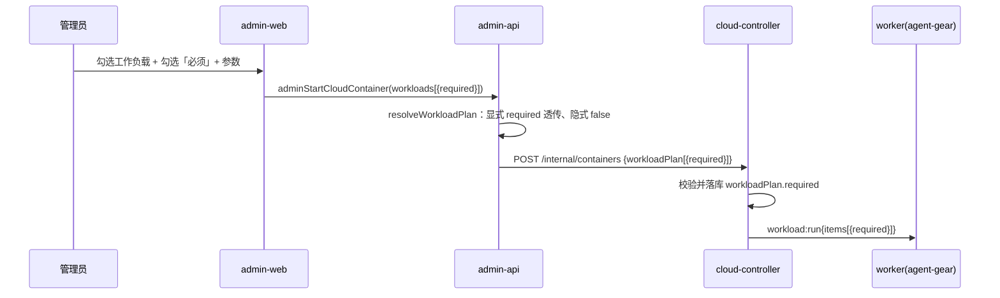
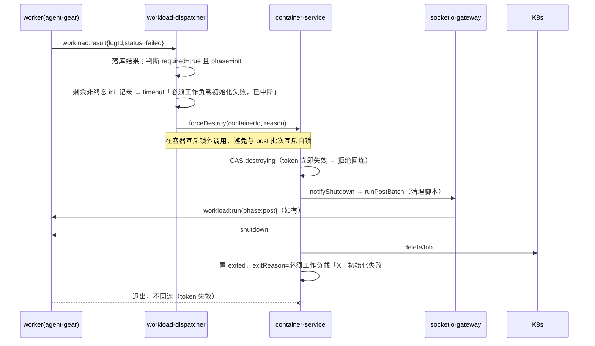
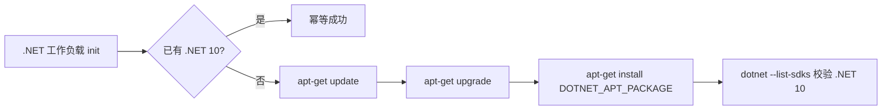

# 工作负载三期（必须工作负载硬失败与 .NET 安装优化）- 技术提案

**功能名称**: 工作负载「必须」标记与 .NET 包管理器安装
**关联 PRD**: docs/product/draft/20261018-workload-phase3.md
**技术提案版本**: v1.0
**创建日期**: 2026-10-18
**作者**: ZeroAsh
**feat-branch**: `feat/workload-phase3`

## 1. 概述

### 1.1 背景

`20261017-feat-cloud-controller-workload` 交付了工作负载基线（CRUD、启动挂载、初始化/清理批次、初始化中状态、执行日志留档），`20261018-feat-workload-phase1` 补齐了参数表单、隐式依赖展开与 Docker/Node.js/.NET/Aspire 四个预制工作负载。既有链路的失败策略是「初始化失败不阻断上线」：任一条脚本失败/超时只落库，全部终态后容器统一转 `online`。

本期在此之上解决两个问题：

1. 需要一个「硬约束」表达：本次启动中被标记为「必须」的工作负载一旦初始化失败/超时（含执行前被删除），容器不得上线，应被强制注销，且**不重试、不退避**。
2. 预制 .NET 工作负载当前用官方 `dotnet-install.sh` 安装 SDK，与内网「统一走包管理器/内部源」的策略不一致；改为用系统包管理器（apt）安装 .NET 10，并保守升级存量未被管理员改动的预制脚本。

### 1.2 目标

- 启动选择新增 `required`：显式选中的工作负载可标记为「必须」；隐式依赖默认非必须。
- `required` 经 admin-web → admin-api 计划展开 → 内部 API → cloud-controller 执行计划 → `workload:run` 全链路透传并落档。
- cloud-controller 在执行计划中识别必须项：一旦其初始化结果为 `failed`/`timeout`（含看门狗判定、执行前被删除的占位失败），立即中断本批剩余初始化并走既有销毁链路强制注销容器；注销原因写入 `exitReason`。
- 「不 backoff」由服务端保证：注销入口先把容器 CAS 为 `destroying`（终态，凭据立即失效），worker 因 `shutdown` 退出，任何回连握手被拒。
- `.NET` 预制脚本改用 `apt-get update && apt-get upgrade && apt-get install` 安装 .NET 10；新增一次性迁移 `002-preset-dotnet-apt` 升级存量未改动的预制脚本。
- Aspire 预制脚本无需改动即可兼容（其前置检查基于 `command -v dotnet`，apt 安装提供 `/usr/bin/dotnet`）。

### 1.3 范围

**做**：

- 契约扩展：`CloudWorkloadSelectionInput.required`、`CloudWorkloadLog.required`、执行计划 `workloadPlan[].required`、`workload:run items[].required`。
- admin-api：计划展开携带 `required`；日志 DTO/映射补齐 `required`；启动 resolver 透传。
- cloud-controller：计划/日志模型与仓储补齐 `required`；internal API 校验；dispatcher 必须项失败的分支（中断 + 注销）；container-service 支持带原因的销毁。
- agent-gear：`workload:run` 条目识别 `required`，必须项失败后短路后续条目（服务端仍为唯一裁决）。
- admin-web：启动对话框「必须」开关与顺序预览标识；执行日志展示必须标识。
- 预制 .NET 脚本改 apt；迁移 `002-preset-dotnet-apt`；worker 镜像/文档补充 .NET apt 源与包名配置。
- 单元 / API / E2E 测试与镜像自验文档更新。

**不做**：

- 不在工作负载定义上新增永久「必须」字段（必须只是本次启动的挂载选项）。
- 不支持「重试 N 次后再注销」、条件必须、必须项之间的优先级/依赖语义。
- 不改动清理脚本阶段的失败策略（容器本就在注销流程中）。
- 不把必须语义扩展到工作流/会话等非 `idle` 用途（沿用现有约束）。
- 不重构工作负载参数/依赖的一期能力。

## 2. 技术架构

### 2.1 系统架构图

```mermaid
graph TD
    AW[admin-web<br/>必须开关/顺序标识/日志必须标识] -->|GraphQL| AA[admin-api]
    AA -->|展开 required + 参数 + 依赖| AA
    AA -->|内部 HTTP + Bearer<br/>workloadPlan[{required}]| CC[cloud-controller]
    CC -->|落库 workloadPlan.required| M[(MongoDB<br/>cloudcontainers / cloudworkloadlogs)]
    CC -->|K8s Job| K[K8s]
    K --> W[worker Pod<br/>agent-gear]
    W <-->|Socket.IO /worker<br/>workload:run{items[].required} / workload:result| CC
    CC -->|必须失败<br/>CAS destroying → post 批次 → deleteJob| K
    CC -.token 失效.-> W
    AA -.启动时执行.-> MIG[migration runner<br/>002-preset-dotnet-apt]
    MIG --> M
```

关键边界：

- `required` 的**裁决权在 cloud-controller**：worker 只做省时短路，不作为唯一判据；旧版 worker 不认识该字段也不影响正确性（服务端仍会依据结果注销）。
- 注销复用既有销毁链路（`ContainerService.destroy`：CAS `destroying` → post 批次 + `shutdown` → `deleteJob` → `exited`），不新增独立删除路径；`exitReason` 由必须失败原因覆盖。
- 计划展开仍在 admin-api（它拥有 CRUD 与校验）；cloud-controller 对旧版 `workloadIds` 请求兜底展开时 `required` 一律为 `false`。

### 2.2 技术栈

| 层级 | 技术选型 | 说明 |
|------|---------|------|
| 前端 | React + TypeScript + Vite | admin-web，复用现有 Dialog/Checkbox/徽章样式 |
| 后端 | Node.js + Express + GraphQL + Mongoose | admin-api（计划展开/契约）、cloud-controller（执行裁决/注销） |
| Worker | Node.js（agent-gear） | `workload-executor` 识别 `required` 并短路 |
| 数据库 | MongoDB | 复用 `cloudcontainers` / `cloudworkloadlogs`；新增 `admin_migrations` 记录 002 |
| 协议 | GraphQL + 内部 REST + Socket.IO | 沿用既有鉴权与降级模式 |
| 容器镜像 | Ubuntu 24.04 + apt（内网源） | .NET 安装改走系统包管理器 |

### 2.3 模块划分

```mermaid
graph LR
    A[admin-web StartContainerDialog<br/>必须开关 + 预览标识] --> B[admin-api resolver<br/>adminStartCloudContainer]
    B --> C[workload-plan<br/>展开 + required 透传]
    C --> D[cloud-controller-client<br/>workloadPlan]
    D --> E[cloud-controller internal-api<br/>校验 plan.required]
    E --> F[container-repository<br/>workloadPlan.required]
    F --> G[workload-dispatcher<br/>必须失败裁决]
    G --> H[container-service<br/>destroy(reason)]
    G --> I[agent-gear workload-executor<br/>required 短路]
    G --> J[(cloudworkloadlogs<br/>required 快照)]
```

| 模块 | 职责 | 关键技术点 |
|------|------|-----------|
| admin-api workload-plan | 展开时把显式选择的 `required` 带入计划项 | 纯函数；隐式依赖 `required=false` |
| admin-api cloud-container resolver | 透传 `required` 到内部 API；日志映射 `required` | `GraphQLError` 文案沿用现有口径 |
| cloud-controller internal-api | 校验 `workloadPlan[].required` 为布尔、缺省 `false` | 非法形参 400 `INVALID_WORKLOAD` |
| cloud-controller workload-dispatcher | 必须项失败 → 中断剩余 init + 触发注销 | 在容器互斥锁**外**调用销毁，避免与 post 批次互斥自锁 |
| cloud-controller container-service | 带原因销毁 | 复用 `destroy`，`exitReason` 可覆盖；CAS `destroying` 先于宽限 |
| agent-gear workload-executor | 必须项失败后不再启动后续进程 | 服务端仍为唯一裁决，旧 worker 兼容 |
| admin-web | 必须开关、预览标识、日志必须标识 | 仅对有 `initScript` 的工作负载展示开关 |
| admin-api migrations | `002-preset-dotnet-apt` 保守升级预制 .NET 脚本 | 与内置旧脚本逐字节比对，改过则跳过 |

## 3. API 设计

### 3.1 API 契约

扩展 `contracts/admin-cloud-workload.graphql`、`contracts/admin-cloud-container.graphql`、`contracts/cloud-controller-websocket.md`。

#### 3.1.1 启动选择增加「必须」

```graphql
input CloudWorkloadSelectionInput {
  workloadId: ID!
  params: JSON
  # 本次启动是否将该项视为「必须」：其初始化失败/超时会中断初始化并强制注销容器。
  # 缺省 false；隐式依赖永远按 false 处理。
  required: Boolean
}
```

#### 3.1.2 执行记录增加「必须」快照

```graphql
type CloudWorkloadLog {
  # ...既有字段
  required: Boolean!   # 本次启动该项是否为「必须」；历史记录缺省 false
}
```

#### 3.1.3 启动入参说明（admin-cloud-container.graphql）

`adminStartCloudContainer(workloads)` 的契约注释补充：`workloads[].required` 缺省 `false`；`required=true` 仅对含初始化脚本的工作负载产生硬失败语义；`workloadIds` 兼容调用等价于全部 `required=false`。

### 3.2 内部接口

#### 3.2.1 admin-api → cloud-controller

`POST /internal/containers` 的 `workloadPlan` 条目新增 `required`：

```json
{
  "purpose": "idle",
  "workloadIds": ["665f...", "665e..."],
  "workloadPlan": [
    { "workloadId": "665f...", "params": {}, "implicit": false, "required": true },
    { "workloadId": "665e...", "params": {}, "implicit": true, "required": false }
  ]
}
```

- `required` 为可选布尔；缺省/`null` 归一为 `false`；非布尔返回 `400 INVALID_WORKLOAD`。
- 仅 `workloadIds` 的旧版请求经兜底展开得到的计划，`required` 一律 `false`。
- 响应 `CloudContainer.workloadPlan[].required` 回读一致。

#### 3.2.2 Worker ↔ cloud-controller（Socket.IO `/worker`）

`workload:run` 的 `items[]` 新增：

| 字段 | 类型 | 必填 | 说明 |
|------|------|------|------|
| `required` | `boolean` | 否 | 该项是否为本次初始化的「必须」项；缺省 `false`（兼容旧服务端） |

`workload:result` 结构不变。

**worker 行为（新增）：** 当 `phase=init` 且某 `item.required === true` 的执行结果为 `failed`/`timeout` 时，上报该结果后**不再启动后续条目**（直接结束本批）。服务端仍会按自身的必须失败裁决中断剩余记录并注销容器；worker 短路只是省去无谓执行。

**服务端行为（新增）：** `workload:result` 关联的记录若 `phase=init`、`required=true` 且结果终态为 `failed`/`timeout`，执行「必须失败」流程（见 §5.2 实现点 4）：中断剩余初始化记录、触发容器强制注销。

## 4. 数据模型

### 4.1 数据库设计

#### 集合: `cloudcontainers`（扩展）

| 字段 | 类型 | 说明 |
|------|------|------|
| `workloadPlan[].required` | Boolean, default false | 本次启动该条是否为「必须」 |

其余字段不变；`workloadIds` 仍由 plan 派生（不含隐式依赖的语义与一期一致）。

#### 集合: `cloudworkloadlogs`（扩展）

| 字段 | 类型 | 说明 |
|------|------|------|
| `required` | Boolean, default false | 该次执行是否为本次启动的「必须」项（快照，供 UI 标识） |

#### 集合: `cloudworkloads`（不变）

「必须」是启动期选项，不写入工作负载定义；本期不新增字段。

#### 集合: `admin_migrations`（新增记录）

| 字段 | 类型 | 说明 |
|------|------|------|
| `name` | String, unique | 新增 `002-preset-dotnet-apt` |

### 4.2 缓存设计

无新增缓存。

## 5. 技术实现方案

### 5.1 核心流程

#### 5.1.1 启动：required 贯通



#### 5.1.2 必须失败 → 中断 + 注销



#### 5.1.3 .NET 预制安装（apt）



### 5.2 关键实现点

#### 实现点 1: 执行计划携带 required（admin-api）

- **描述**: `WorkloadSelection` 增加 `required?: boolean`；`WorkloadPlanItem` 增加 `required: boolean`。`resolveWorkloadPlan` 中显式选择项取 `selection.required === true`，隐式依赖与 `undefined` 一律 `false`。
- **技术细节**: 纯函数改动，保持既有「显式优先/去重/拓扑序/上限」逻辑不变；不改写工作负载定义。`required=true` 但定义无 `initScript` 时保留原值（由 dispatcher 视为无效果），前端另做不展示。
- **风险点**: 无；纯数据透传。

#### 实现点 2: required 落库与校验（cloud-controller）

- **描述**: `WorkloadPlanEntry`/模型/仓储映射增加 `required`；`internal-api.resolveWorkloadPlan` 校验 `required` 缺省或布尔（否则 `INVALID_WORKLOAD`），归一 `false`；`container-service.normalizeWorkloadPlan` 同步归一；`toCloudContainerJson` 回读 `required`。
- **技术细节**: 缺省归一策略与一期 `params`/`implicit` 一致（缺省宽松、类型错误 400）；兜底展开（仅 `workloadIds`）一律 `required=false`。
- **风险点**: 旧记录无 `required` → 读取层默认 `false`，行为与现状一致。

#### 实现点 3: workload:run/日志携带 required（cloud-controller + agent-gear）

- **描述**: dispatcher 构造 init/post 日志与 `workload:run items[]` 时携带 `required`（init 阶段来自计划；post 阶段固定 `false`，post 不参与必须判定）；`cloudworkloadlogs.required` 落库；`CloudWorkloadLog` DTO/映射补齐。
- **技术细节**: worker 的 `WorkloadItem` 增加可选 `required`；`workload-executor` 在 `phase=init` 且必须项结果非 `success` 时回报后 `return`（不再启动后续条目）。旧 worker 忽略该字段，行为不变。
- **风险点**: worker 短路与服务端裁决可能并发：服务端将剩余记录标终态后，worker 若仍回报迟到结果会按幂等忽略（既有一期口径）。

#### 实现点 4: 必须失败的中断与注销（cloud-controller dispatcher）

- **描述**: dispatcher 新增 `requiredFailure` 信号：
  1. `handleResultLocked`：当记录 `phase=init` 且 `required=true` 且结果终态为 `failed`/`timeout` 时，**不调用 `advance`**，改为把该容器剩余非终态 init 记录标 `timeout` 并追加日志「必须工作负载初始化失败，已中断」，返回 `{ requiredFailure: { workloadName } }`。
  2. `handleResult`：在互斥锁外收到信号后调用 `deps.forceDestroy(containerId, '必须工作负载「<name>」初始化失败')`。
  3. `startInitLocked`：若计划中存在「必须且已被删除」的条目（其占位记录本为 `failed`）→ 同样返回必须失败信号（先落档再注销），不下发批次。
  4. `watchdogInitializing`：看门狗判定必须项 `timeout`（单条超时或批次超时）时，返回信号并在锁外注销。
- **技术细节**:
  - **锁外销毁**：`KeyedMutex` 非可重入；注销会触发 gateway 的 `runPostBatch`（同一容器互斥锁）。因此必须把 `forceDestroy` 放在 `mutex.runExclusive` 回调之外执行（把回调返回类型由 `boolean`/`void` 改为携带信号的结果对象，`startInit`/`handleResult`/`onWatchdog` 负责在锁外消费信号）。
  - **不重试/不退避**：`ContainerService.destroy` 在宽限与 post 批次之前就把状态 CAS 为 `destroying`；`destroying` 属终态集合，握手鉴权对其直接拒绝（`INVALID_TOKEN`），因此 worker 即使尚未退出也无法重新握手成功。worker 收到 `shutdown` 后退出进程，Socket.IO 自动重连不会发生。
  - **保留清理**：`forceDestroy` 走既有 `destroy`（先 post 批次后 `shutdown`），初始化记录的中断说明与清理记录都留存。
  - `finishInit` 对 `status !== 'initializing'` 直接返回，注销后不会再把容器置 `online`。
- **风险点**:
  - 若在容器互斥锁内调用销毁会造成死锁（post 批次等待结果、结果回调等待同一把锁）——必须锁外调用，并以单测覆盖。
  - 必须项失败与看门狗/销毁并发：均以 CAS 与「已终态幂等」收敛。

#### 实现点 5: 带原因的销毁（cloud-controller container-service）

- **描述**: `destroy(containerId, options?: { reason?: string })` 支持自定义退出原因；spi 端口 `WorkloadContainerStatePort` 增加 `forceDestroy(containerId, reason)`，`ContainerService` 实现为 `destroy(id, { reason })`。
- **技术细节**: 活跃路径的 `exitReason` 使用 `options.reason ?? '强制销毁'`；Job 删除失败时保留「（Job 删除失败，需人工清理）」后缀；终态/`destroying` 幂等路径语义不变。`index.ts` 把 dispatcher 的 `forceDestroy` 注入为 `(id, reason) => containerService.destroy(id, { reason })`。
- **风险点**: `adminDestroyCloudContainer` 不传 reason，行为与现状一致。

#### 实现点 6: admin-web 必须开关与展示

- **描述**:
  - `CloudWorkloadSelectionData` 增加 `required`；启动对话框为「已勾选且含 `initScript`」的工作负载展示「必须」开关（默认关），取消勾选时清除；提交时写入 selection。
  - 初始化顺序预览对必须项加「必须」标识；提供一行说明「标记为必须的工作负载初始化失败将导致容器被强制注销」。
  - 执行日志（`WorkloadLogsDialog`）展示每条的「必须」标识。
- **技术细节**: 前端不改变服务端裁决；`required` 仅随 `workloads` 提交（`workloadIds` 兼容路径不携带必须）。仅展示层控制，不做本地硬失败预判。
- **风险点**: 无 `initScript` 的工作负载不应出现开关，避免产生「设置了却无效」的误导。

#### 实现点 7: .NET 预制脚本改 apt（migration + 预制脚本）

- **描述**:
  - 更新 `001-preset-workloads` 内置的 `.NET` 脚本为 apt 版本（新库直接使用）。
  - 新增 `002-preset-dotnet-apt`：按 `presetKey=dotnet`（回退 `name='.NET'`）查找；若存在且其 `initScript` 等于内置**旧版** `dotnet-install.sh` 脚本（逐字节比对，即管理员未改动）→ 更新为 apt 版本；否则记录跳过。预制项不存在则跳过。迁移完成写入 `admin_migrations`。
- **技术细节**:
  - 在 `001-preset-workloads.ts` 导出 `DOTNET_SCRIPT`（新 apt 版），并在 `002` 内维护 `LEGACY_DOTNET_SCRIPT`（旧版）以做等值判断；`registerMigrations` 数组追加 `002`。
  - 脚本使用 `apt-get update && apt-get -y upgrade && apt-get install -y --no-install-recommends "$DOTNET_APT_PACKAGE"`，`DOTNET_APT_PACKAGE` 默认 `dotnet10`；幂等判据为 `dotnet --list-sdks` 含 `10.`。`apt-get upgrade` 由 `DOTNET_APT_UPGRADE`（默认 `1`）控制，便于排障与提速。
  - 安装源：优先使用镜像内已配置的内网 Ubuntu 源；若 .NET 10 不在该源，由镜像 `DOTNET_APT_SOURCE` / `DOTNET_APT_KEY_URL` build-arg 注入内部 Microsoft feed 代理。
- **风险点**: `apt-get upgrade` 在运行期可能接近单条初始化超时（默认 `WORKLOAD_INIT_TIMEOUT_MS=300000`）；缓解手段：镜像构建期预装/预热、必要时提高超时或关闭 upgrade。旧安装方式遗留的 `/usr/local/dotnet` 不再使用（保留 `DOTNET_ROOT` 兜底不影响 apt 安装的 `/usr/bin/dotnet`）。

#### 实现点 8: Aspire 兼容与文档

- **描述**: Aspire 预制脚本不改动：其 `.NET` 前置检查为 `command -v dotnet`，apt 安装后 `/usr/bin/dotnet` 在 PATH 中；脚本内 `DOTNET_ROOT=/usr/local/dotnet` 默认值指向不存在目录，仅作为兼容兜底，不影响判定。
- **技术细节**: 在 `deploy/images/worker/BUILD.md` 补充 .NET apt 包名/源变量与自验项（`dotnet --list-sdks` 显示 10.x）。
- **风险点**: 若内网源无 .NET 10 包则安装失败（沿用既有失败策略，非必须时容器可上线）。

### 5.3 预制脚本（migration 内置）

#### .NET（新，apt 版）

```bash
#!/usr/bin/env bash
set -euo pipefail

export DEBIAN_FRONTEND=noninteractive
PACKAGE="${DOTNET_APT_PACKAGE:-dotnet10}"
UPGRADE="${DOTNET_APT_UPGRADE:-1}"

if command -v dotnet >/dev/null 2>&1 && dotnet --list-sdks | grep -q '^10\.'; then
  echo ".NET 10 SDK 已安装"
  dotnet --list-sdks
  exit 0
fi

apt-get update
if [ "$UPGRADE" = "1" ]; then
  apt-get -y upgrade
fi
apt-get install -y --no-install-recommends "$PACKAGE"

command -v dotnet >/dev/null 2>&1 || {
  echo "dotnet 未安装成功（包：$PACKAGE）" >&2
  exit 1
}
export DOTNET_CLI_TELEMETRY_OPTOUT=1
dotnet --list-sdks
```

#### .NET（旧，dotnet-install.sh 版，仅用于 002 等值比对）

```bash
#!/usr/bin/env bash
set -euo pipefail

if command -v dotnet >/dev/null 2>&1 && dotnet --list-sdks | grep -q .; then
  echo ".NET SDK 已安装"
  exit 0
fi

INSTALL_URL="${DOTNET_INSTALL_URL:-https://dot.net/v1/dotnet-install.sh}"
INSTALL_DIR="${DOTNET_INSTALL_DIR:-/usr/local/dotnet}"

curl -sSL "$INSTALL_URL" -o /tmp/dotnet-install.sh
bash /tmp/dotnet-install.sh --channel LTS --install-dir "$INSTALL_DIR"

ln -sfn "$INSTALL_DIR/dotnet" /usr/local/bin/dotnet
printf '%s\n' \
  'export DOTNET_ROOT=/usr/local/dotnet' \
  'export PATH=$DOTNET_ROOT:$PATH' \
  'export DOTNET_CLI_TELEMETRY_OPTOUT=1' \
  > /etc/profile.d/dotnet.sh
chmod +x /etc/profile.d/dotnet.sh

export DOTNET_ROOT="$INSTALL_DIR"
export PATH="$INSTALL_DIR:$PATH"
export DOTNET_CLI_TELEMETRY_OPTOUT=1
dotnet --info
```

> Docker / Node.js / Aspire 三个预制脚本保持不变；Aspire 兼容性见实现点 8。

## 6. 技术决策

### 6.1 决策列表

| 决策 | 选项 A | 选项 B | 最终选择 | 原因 |
|------|--------|--------|---------|------|
| 「必须」的载体 | 工作负载定义字段 | **本次启动的选择字段** | 启动选择 | 需求为「容器启动时设置」；同一负载可按任务区分必须/非必须 |
| 失败判定位置 | worker | **cloud-controller dispatcher** | 服务端 | 凭据、状态、注销都在服务端；worker 仅省时短路，旧 worker 兼容 |
| 注销动作 | 直接标 `failed` | **复用既有 destroy（post 清理 + Job 回收）** | destroy | 避免孤儿 Job、保留清理脚本与留档 |
| 剩余未执行脚本 | 继续执行 | **中断并标 timeout** | 中断 | 需求要求立即失败；避免无谓执行 |
| 不 backoff 的实现 | 依赖 worker 主动退出 | **先 CAS `destroying`（凭据失效）再宽限** | 服务端 CAS | 与 worker 行为解耦，回连必然被拒 |
| 锁内/锁外注销 | 锁内调用 destroy | **锁外消费信号调用** | 锁外 | `KeyedMutex` 非可重入，锁内会与 post 批次自锁 |
| .NET 安装 | 官方 `dotnet-install.sh` | **系统包管理器 apt** | apt | 与内网源/镜像策略一致，稳定可控 |
| 存量预制升级 | 每次启动 upsert | **一次性迁移，未改动才覆盖** | 保守迁移 | 不覆盖管理员定制，符合预制项「归管理员所有」 |
| 必须语义范围 | 含清理脚本 | **仅初始化阶段** | 仅 init | 清理阶段容器已在注销流程中，无上线语义 |
| 迁移实现方式 | 修改 001 并期望重跑 | **新增 002 + 001 内置新脚本** | 002 | 迁移已执行不会重跑；002 才能升级存量 |

### 6.2 依赖与约束

| 类型 | 内容 | 说明 |
|------|------|------|
| 依赖 | 共享 MongoDB | `cloudcontainers` / `cloudworkloadlogs` / `admin_migrations` |
| 依赖 | worker 镜像 | apt 源与 `dotnet10`（或配置的包名）可用；agent-gear 需支持 `items[].required`（建议随镜像重建发布） |
| 依赖 | 内部 apt 源 | .NET 10 包与（如需）Microsoft feed 代理 |
| 约束 | 单次挂载 ≤10 | 沿用（展开后） |
| 约束 | 必须项不改变超时/权限 | 仅改变失败后的容器终态 |
| 约束 | 旧记录默认非必须 | 历史容器行为不变 |
| 约束 | 不支持重试/退避 | 需求明确「不 backoff，直接失败」 |

## 7. 项目结构

```text
contracts/
├── admin-cloud-workload.graphql                  # 扩展：CloudWorkloadSelectionInput.required、CloudWorkloadLog.required
├── admin-cloud-container.graphql                 # 扩展：启动入参 required 说明
└── cloud-controller-websocket.md                 # 扩展：workloadPlan[].required、items[].required、必须失败语义

servers/admin-api/src/
├── graphql/
│   ├── schemas/cloud-workload.ts                 # CloudWorkloadLog.required
│   └── resolvers/cloud-container.ts              # 透传 selection.required
├── services/
│   ├── cloud-workload.ts                         # mapWorkloadLog 补 required
│   ├── workload-plan.ts                          # 计划项补 required
│   └── cloud-controller-client.ts                # 计划下发携带 required
└── migrations/
    ├── 001-preset-workloads.ts                   # .NET 脚本改 apt（导出 DOTNET_SCRIPT）
    ├── 002-preset-dotnet-apt.ts                  # 新增：存量保守升级
    └── runner.ts                                 # 注册 002

servers/cloud-controller/src/
├── models/
│   ├── cloud-container.ts                        # workloadPlan[].required
│   └── cloud-workload-log.ts                     # required
├── repositories/
│   ├── container-repository.ts                   # plan.required 映射
│   └── workload-log-repository.ts                # required 映射
├── routes/internal-api.ts                        # 校验/回读 required
└── services/
    ├── container-service.ts                      # normalizeWorkloadPlan + destroy(reason)
    └── workload-dispatcher.ts                    # 必须失败裁决 + 锁外注销

packages/agent-controller/src/
├── workload-executor.ts                          # items[].required 短路
└── workload-executor.test.ts

apps/admin-web/src/
├── components/cloud-containers/StartContainerDialog.tsx     # 必须开关 + 预览标识
├── components/cloud-containers/WorkloadLogsDialog.tsx       # 必须标识
├── graphql/{queries,mutations,types}.ts                     # required 字段
└── lib/workload-plan.ts / workload-params.ts                # 类型对齐

deploy/images/worker/
└── BUILD.md                                       # .NET apt 包名/源与自验说明
```

## 8. 测试策略

### 8.1 测试覆盖要求

- 单元测试覆盖率：新增/修改代码 ≥80%。
- API 测试覆盖：
  - 启动 `workloads[].required` 的透传与缺省（`required` 缺省 `false`、非法类型 400）；
  - `workloadPlan[].required` 写入与回读；
  - `CloudWorkloadLog.required` 返回；
  - 迁移 `002`：未改动升级、已改动跳过、预制项不存在跳过、二次启动不重复。
- 单元覆盖：
  - `resolveWorkloadPlan` 显式 required 透传、隐式 false；
  - dispatcher：必须项 `failed`/`timeout` → 中断剩余 init（标 timeout）+ 触发 `forceDestroy`；非必须项失败维持现状；必须项为最后一条仍注销；必须项被删除的占位失败触发注销；看门狗必须项超时触发注销；**确认 `forceDestroy` 在容器互斥锁外调用**（防自锁回归）；
  - `container-service.destroy(id, { reason })` 的 `exitReason` 覆盖与 Job 删除失败后缀；
  - worker：`required` 失败后不再启动后续条目；无 `required` 行为不变。
- E2E 覆盖：启动对话框设置必须 → 必须脚本失败 → 容器最终非在线且退出原因含必须负载名；日志展示必须标识。

### 8.2 测试类型

| 类型 | 工具 | 覆盖范围 |
|------|------|---------|
| 单元测试 | vitest | workload-plan / dispatcher / container-service / workload-executor / migration 002 |
| API 测试 | tests/api | GraphQL 启动 required 透传、日志 required、迁移结果 |
| E2E 测试 | tests/e2e | 必须开关、顺序预览标识、必须失败注销、日志必须标识 |
| 手工验证 | K8s 环境 | 必须失败真实注销与凭据失效、.NET apt 安装 `dotnet --list-sdks` 显示 10.x、Aspire 前置检查通过 |

开发遵循 TDD 红-绿-重构循环。

## 9. 部署方案

### 9.1 环境规划

| 环境 | 用途 | 部署方式 |
|------|------|---------|
| 本地开发 | Aspire 编排 | `aspire start`（Mongo 可用时自动执行 migration） |
| 内网 K8s | 生产 | 先 cloud-controller，再 admin-api/admin-web；worker 镜像重建推送 |

### 9.2 配置管理

| 配置项 | 服务 | 默认值 | 说明 |
|--------|------|--------|------|
| `DOTNET_APT_PACKAGE` | worker 脚本 | `dotnet10` | .NET 10 apt 包名，可按内网源调整 |
| `DOTNET_APT_UPGRADE` | worker 脚本 | `1` | 是否执行 `apt-get upgrade`（排障/提速可置 `0`） |
| `DOTNET_APT_SOURCE` | worker 镜像 | 内网源（如需） | .NET 10 不在内网 Ubuntu 源时的 Microsoft feed 代理地址 |
| `DOTNET_APT_KEY_URL` | worker 镜像 | 内网源（如需） | 对应签名密钥地址 |
| `WORKLOAD_INIT_TIMEOUT_MS` | cloud-controller | 300000 | 单条初始化超时（沿用）；apt upgrade 较慢时需评估提高 |
| `WORKLOAD_POST_BUDGET_MS` | cloud-controller | 90000 | 清理批次预算（沿用） |

### 9.3 发布顺序

1. **cloud-controller**：支持 `workloadPlan[].required` 与必须失败裁决（对旧请求 `required` 缺省 `false`，行为不变）。
2. **admin-api**：启动时执行 `002-preset-dotnet-apt`；计划下发携带 `required`（同时保留 `workloadIds` 兼容）。
3. **admin-web**：上线必须开关与日志标识。
4. **worker 镜像**：重建并推送支持 `items[].required` 的 agent-gear 与 .NET apt 源；滚动更新 `WORKER_IMAGE`。

回滚：admin-web/admin-api 可回滚（多余字段被忽略）；cloud-controller 回滚后不再有必须失败裁决，容器回到「失败可上线」旧策略；worker 回滚后忽略 `required`（服务端仍会注销必须失败容器）。迁移记录与已升级脚本保留，不回滚。

## 10. 验收标准

- [ ] 技术方案评审通过
- [ ] Contract 评审通过
- [ ] 代码实现完成
- [ ] 单元测试覆盖达标
- [ ] API 测试通过
- [ ] E2E 测试通过
- [ ] 启动对话框可为含初始化脚本的工作负载设置「必须」，缺省非必须
- [ ] `required` 贯通 admin-web → admin-api → cloud-controller → worker 并落档（计划与执行记录）
- [ ] 必须工作负载失败/超时/执行前删除 → 中断剩余初始化、容器强制注销、退出原因含负载名称
- [ ] 必须失败后容器不上线、不回连成功、不重试/退避
- [ ] 非必须失败行为与现状一致（容器可上线）
- [ ] 清理脚本在注销流程中仍被执行并留档
- [ ] 历史容器与执行记录展示与现状一致（缺省非必须）
- [ ] .NET 预制工作负载通过 apt 安装，`dotnet --list-sdks` 显示 10.x
- [ ] Aspire 预制工作负载在前置检查中通过（.NET 就绪）
- [ ] 存量预制 .NET 脚本「未改动才升级」，管理员改动不被覆盖

## 11. 相关文档

- PRD：`docs/product/draft/20261018-workload-phase3.md`
- 基线提案：`docs/engineering/proposals/20261017-feat-cloud-controller-workload.md`
- 前序提案：`docs/engineering/proposals/20261018-feat-workload-phase1.md`
- 既有契约：`contracts/admin-cloud-workload.graphql`、`contracts/admin-cloud-container.graphql`、`contracts/cloud-controller-websocket.md`
- 既有实现：`servers/cloud-controller/src/services/workload-dispatcher.ts`、`servers/cloud-controller/src/services/container-service.ts`、`servers/admin-api/src/services/workload-plan.ts`、`packages/agent-controller/src/workload-executor.ts`、`servers/admin-api/src/migrations/001-preset-workloads.ts`
- 开发规范：`docs/engineering/backend-rules.md`、`docs/engineering/frontend-rules.md`、`docs/engineering/common-rules.md`
- 镜像构建：`deploy/images/worker/BUILD.md`
