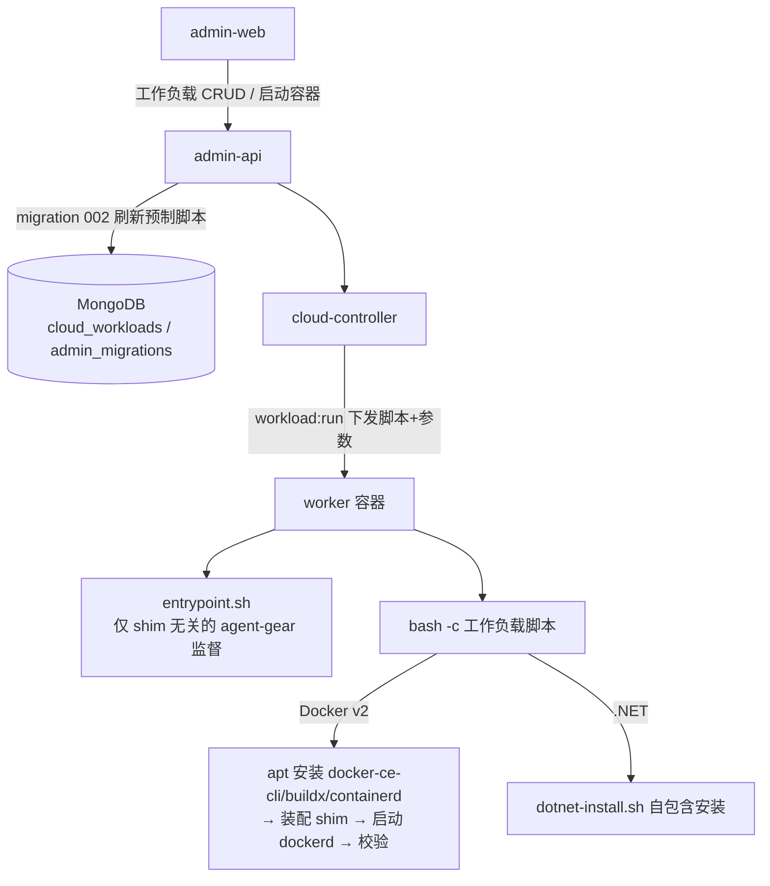
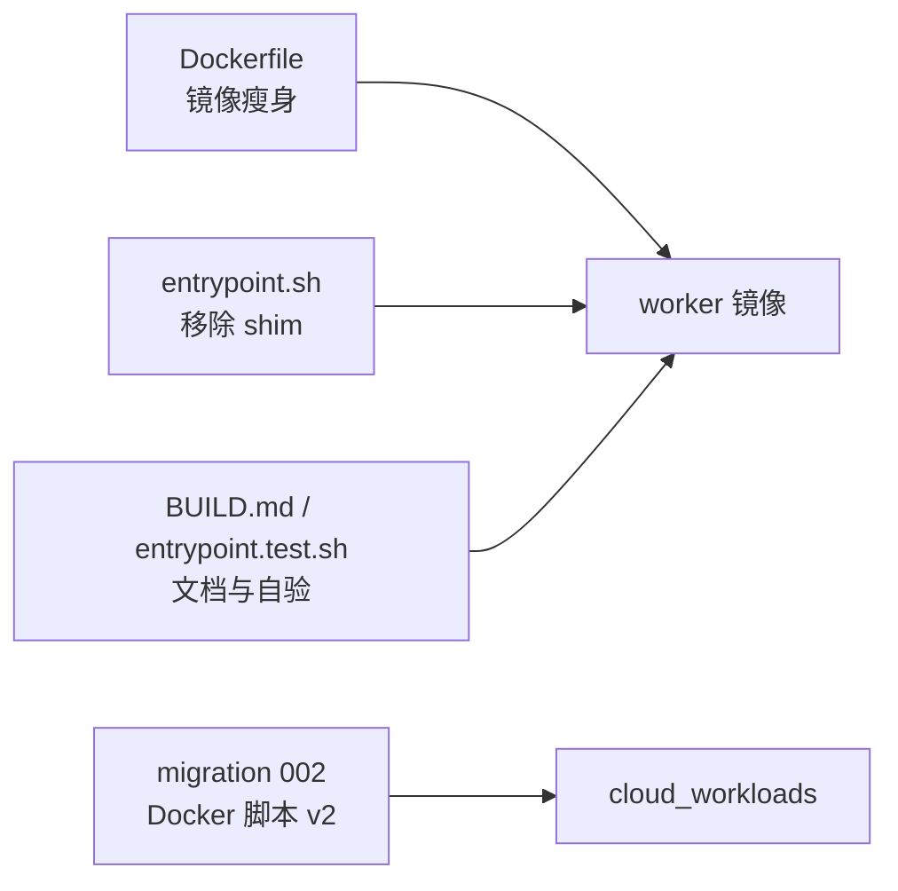
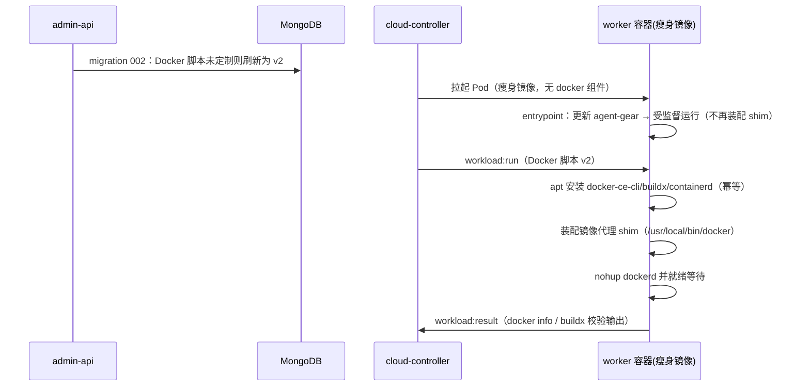
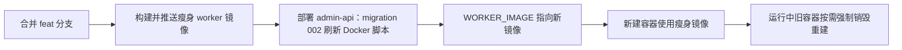

# 工作负载四期（worker 基础镜像瘦身）- 技术提案

**功能名称**: 工作容器基础环境瘦身（Docker/.NET 能力下沉工作负载）
**关联 PRD**: `docs/product/draft/20261018-workload-phase4.md`
**技术提案版本**: v1.0
**创建日期**: 2026-10-18
**作者**: ZeroAsh
**feat-branch**: `feat/workload-phase4`

## 1. 概述

### 1.1 背景

一期（`20261018-feat-workload-phase1.md`）已把 dockerd 的**启动**职责从容器入口迁移到「Docker」预制工作负载，但 worker 基础镜像仍包含 Docker/.NET 专有 setup：

- `deploy/images/worker/Dockerfile` 构建期安装 `docker-ce-cli` / `docker-buildx-plugin` / `containerd.io`（第 4 步，含 `DOCKER_APT_URL` 构建参数），并在第 2 步预装 dockerd 运行所需的 apt 依赖（`iptables` / `iproute2` / `fuse-overlayfs` / `libseccomp2` / `conntrack`）；
- Dockerfile 残留注释态的 `DOTNET_INSTALL_URL` / `ASPIRE_INSTALL_URL` ENV 提示；
- `entrypoint.sh` 在容器启动时装配 docker 镜像引用规范化 shim（`install_docker_shim`）。

本期按 PRD 要求把上述 setup 全部移除，Docker 的安装/配置/启动/校验整体并入「Docker」预制工作负载脚本；.NET 脚本本身已自包含，仅需清除镜像残留配置。

### 1.2 目标

- worker 基础镜像不含任何 Docker 专有包、apt 源配置与 shim 装配逻辑，不含 .NET / Aspire 相关 ENV 残留；
- 「Docker」预制脚本升级为自包含 v2：安装 Docker CE CLI + buildx + containerd → 装配镜像代理 shim → 启动并就绪 dockerd → 校验；
- 通过新迁移批次 `002-refresh-docker-preset-script` 将存量未定制的 Docker 预制脚本升级为 v2，定制过的不覆盖并告警；
- 构建文档（BUILD.md）与入口自验（entrypoint.test.sh）同步更新。

### 1.3 范围

**做**：

- `deploy/images/worker/Dockerfile` 瘦身；
- `deploy/images/worker/entrypoint.sh` 移除 docker shim 装配；
- `servers/admin-api/src/migrations/002-refresh-docker-preset-script.ts` 新迁移（含 Docker 脚本 v2）；
- `001-preset-workloads.ts` 导出 v1 脚本常量供 002 比对（不改写库行为）；
- `BUILD.md` / `entrypoint.test.sh` / 相关注释更新。

**不做**：

- Node.js（nvm/node/npm）继续保留在镜像中——它是容器内 `agent-gear` 的运行基础，不属于瘦身范围；
- 「.NET」「Aspire」预制脚本内容不变更（已自包含）；
- `workload:run` / `workload:result` 等 Socket.IO 契约不变更；
- K8s Pod 规格、sysbox runtime、版本门禁逻辑不变更。

## 2. 技术架构

### 2.1 系统架构图



### 2.2 技术栈

| 层级 | 技术选型 | 说明 |
|------|---------|------|
| 工作容器镜像 | Ubuntu 24.04 + nvm/Node.js + agent-gear | 瘦身后不含 Docker/.NET 组件 |
| 工作负载脚本 | Bash | 经 `workload:run` 下发，`bash -c` 执行 |
| 预制脚本迁移 | admin-api migrations（`admin_migrations` 账本） | 新增 002 批次 |
| 镜像构建 | Docker（内网 Nexus/Harbor 代理） | 构建口径见 BUILD.md |

### 2.3 模块划分



| 模块 | 职责 | 关键技术点 |
|------|------|-----------|
| `deploy/images/worker/Dockerfile` | 只保留通用基础能力 | 删除 docker-ce apt 源与包、dockerd 依赖、.NET ENV 残留 |
| `deploy/images/worker/entrypoint.sh` | agent-gear 监督与版本自恢复 | 删除 `install_docker_shim` 及调用 |
| `servers/admin-api/src/migrations/002-*.ts` | Docker 预制脚本升级 | 与 001 初版常量比对，未定制才覆盖 |
| Docker 脚本 v2 | Docker 环境全生命周期 | apt 安装幂等、shim 装配、dockerd 就绪等待、buildx 校验 |

## 3. API 设计

### 3.1 API 契约

本期**无契约变更**。工作负载下发仍走 `contracts/cloud-controller-websocket.md` §2.9 `workload:run`（脚本 + `WORKLOAD_PARAMS` / `WORKLOAD_PARAM_*` 参数注入）与 §2.10 `workload:result`，脚本执行语义（超时、截断、进程组终止）不变。

### 3.2 内部接口

- `migrations/runner.ts` 的 `Migration` 接口（`name` + `run`）不变；`servers/admin-api/src/index.ts` 注册处由 `runMigrations([migration001])` 变为 `runMigrations([migration001, migration002])`。
- `001-preset-workloads.ts` 新增加导出 `DOCKER_SCRIPT_V1`（即现有 `DOCKER_SCRIPT` 原样改名导出），供 002 做「未定制」比对；001 的写库行为完全不变。

## 4. 数据模型

### 4.1 数据库设计

无 schema 变更。

- `cloud_workloads`：002 仅更新 `presetKey='docker'` 文档的 `initScript` 字段（满足条件时）；
- `admin_migrations`：新增账本记录 `{ name: '002-refresh-docker-preset-script', executedAt }`，沿用 runner 的「已执行跳过、失败下轮重试」语义。

### 4.2 缓存设计

无缓存相关内容。

## 5. 技术实现方案

### 5.1 核心流程



### 5.2 关键实现点

#### 实现点 1: Dockerfile 瘦身

- 删除 `ARG DOCKER_APT_URL` 及第 4 步整个 docker-ce 安装块；
- 第 2 步 apt 包列表移除 dockerd 专有依赖 `iptables iproute2 fuse-overlayfs libseccomp2 conntrack`，保留通用工具 `ca-certificates curl gnupg git gh procps sudo`；
- 删除注释态 `DOTNET_INSTALL_URL` / `ASPIRE_INSTALL_URL` ENV 块与头部注释中相关说明；
- 其余（Ubuntu 源、nvm/Node.js、npm 全局包、ENTRYPOINT）不变。

#### 实现点 2: entrypoint.sh 移除 docker shim

- 删除 `install_docker_shim` 函数、`HARBOR_PROXY` / `DOCKER_SHIM_PATH` 变量与 `main()` 中的调用；
- 头部注释更新为「容器内 docker 相关能力（CLI、shim、dockerd）全部由『Docker』工作负载脚本提供」；
- 移除 `ZAG_DOCKER_SHIM_PATH` 开关说明（该开关随 shim 移入 Docker 脚本，语义保留）。

#### 实现点 3: Docker 预制脚本 v2（migration 002 内置）

```bash
#!/usr/bin/env bash
set -euo pipefail

DOCKER_APT_URL="${DOCKER_APT_URL:-https://mirrors.ustc.edu.cn/docker-ce/linux/ubuntu/}"
SHIM_PATH="${ZAG_DOCKER_SHIM_PATH:-/usr/local/bin/docker}"
HARBOR_PROXY="${HARBOR_PROXY:-core.harbor.internal.fffdan.com}"

# 1) 安装 Docker CE CLI + buildx + containerd 及运行时依赖（已安装则跳过，幂等）
if [ ! -x /usr/bin/docker ]; then
  apt-get update
  apt-get install -y --no-install-recommends \
    iptables iproute2 fuse-overlayfs libseccomp2 conntrack
  install -m 0755 -d /etc/apt/keyrings
  curl -fsSL "$DOCKER_APT_URL/gpg" -o /etc/apt/keyrings/docker.asc
  chmod a+r /etc/apt/keyrings/docker.asc
  printf 'deb [arch=%s signed-by=/etc/apt/keyrings/docker.asc] %s %s stable\n' \
    "$(dpkg --print-architecture)" "$DOCKER_APT_URL" \
    "$(. /etc/os-release && echo "$VERSION_CODENAME")" > /etc/apt/sources.list.d/docker.list
  apt-get update
  apt-get install -y --no-install-recommends docker-ce-cli docker-buildx-plugin containerd.io
  rm -rf /var/lib/apt/lists/*
  mkdir -p /usr/local/lib/docker/cli-plugins
  ln -sf /usr/libexec/docker/cli-plugins/docker-buildx \
    /usr/local/lib/docker/cli-plugins/docker-buildx 2>/dev/null || true
fi

# 2) 装配镜像引用规范化 shim（逻辑同一期 entrypoint 版本）
cat > "$SHIM_PATH" <<'SHIM'
#!/usr/bin/env bash
HARBOR_PROXY="core.harbor.internal.fffdan.com"

normalize_image() {
  local img="$1"
  case "$img" in
    ghcr.io/*) echo "${HARBOR_PROXY}/ghcr/${img#ghcr.io/}" ;;
    lscr.io/*) echo "${HARBOR_PROXY}/docker-hub-proxy/${img#lscr.io/}" ;;
    docker.io/*) echo "${HARBOR_PROXY}/docker-hub-proxy/${img#docker.io/}" ;;
    registry-1.docker.io/*) echo "${HARBOR_PROXY}/docker-hub-proxy/${img#registry-1.docker.io/}" ;;
    "${HARBOR_PROXY}"/*) echo "$img" ;;
    */*)
      local first="${img%%/*}"
      case "$first" in
        *.*|*:*|localhost) echo "$img" ;;
        *) echo "${HARBOR_PROXY}/docker-hub-proxy/${img}" ;;
      esac ;;
    *) echo "${HARBOR_PROXY}/docker-hub-proxy/${img}" ;;
  esac
}

cmd="${1:-}"
case "$cmd" in
  pull|run|create)
    args=("$cmd"); shift; normalized=0
    for a in "$@"; do
      if [ "$normalized" -eq 0 ] && [ "${a#-}" = "$a" ]; then
        args+=("$(normalize_image "$a")"); normalized=1
      else
        args+=("$a")
      fi
    done
    exec /usr/bin/docker "${args[@]}" ;;
  *) exec /usr/bin/docker "$@" ;;
esac
SHIM
chmod +x "$SHIM_PATH"

# 3) 启动 dockerd 并等待就绪（已就绪则跳过）
if /usr/bin/docker info >/dev/null 2>&1; then
  echo "dockerd 已在运行"
else
  nohup dockerd >/var/log/dockerd.log 2>&1 &
  for _ in $(seq 1 30); do
    if /usr/bin/docker info >/dev/null 2>&1; then
      echo "dockerd 已就绪"
      break
    fi
    sleep 1
  done
fi
if ! /usr/bin/docker info >/dev/null 2>&1; then
  echo "dockerd 未在 30s 内就绪" >&2
  tail -n 50 /var/log/dockerd.log >&2 || true
  exit 1
fi

# 4) 校验 CLI 与构建能力
docker version
docker buildx version
```

- **幂等**：以 `/usr/bin/docker` 是否存在判安装、`docker info` 判就绪，重复执行收敛；
- **风险点**：运行期 apt 安装依赖内网 Ubuntu 源与 `DOCKER_APT_URL` 可达；不可达时脚本失败但容器仍上线（沿用一期失败策略）。

#### 实现点 4: migration 002 刷新逻辑

```ts
export const name = '002-refresh-docker-preset-script';

async function run(): Promise<void> {
  const wl = await CloudWorkload.findOne({ presetKey: 'docker' });
  if (!wl) {
    // 防御：001 未写入（如同名冲突跳过时），直接按 v2 创建
    await CloudWorkload.create({ name: 'Docker', initScript: DOCKER_SCRIPT_V2, ... });
    return;
  }
  if (wl.initScript === DOCKER_SCRIPT_V2) return;              // 已刷新
  if (wl.initScript === DOCKER_SCRIPT_V1) {                    // 未定制 → 升级
    wl.initScript = DOCKER_SCRIPT_V2;
    await wl.save();
    return;
  }
  console.warn('[Migration 002] docker preset script modified by admin, skipping');  // 定制 → 不覆盖
}
```

- 全新环境：001 先写入 v1，002 随即刷新为 v2，最终落库即 v2；
- 比对常量 `DOCKER_SCRIPT_V1` 从 001 模块导出，保证「初版」口径唯一来源。

#### 实现点 5: 文档与测试同步

- `BUILD.md`：构建参数移除 `DOCKER_APT_URL`；自验清单中 `docker buildx version`、镜像代理拉取等 Docker 项移入「Docker 工作负载手工验收」段；「默认启动」段去掉 shim 装配步骤；已知限制中 shim 说明改注「由 Docker 工作负载脚本装配」；
- `entrypoint.test.sh`：T-EP0 改为断言入口**不**装配 shim、不调用 docker/dockerd；移除 `ZAG_DOCKER_SHIM_PATH` 相关布置；新增 Docker 脚本 v2 的静态断言（`bash -n` 语法检查，经 002 测试导出脚本内容）；
- `002-refresh-docker-preset-script.test.ts`：覆盖未存在创建 / v1 刷新 / v2 幂等 / 定制跳过四条路径（内存 MongoDB，沿用 001 测试口径）。

## 6. 技术决策

### 6.1 决策列表

| 决策 | 选项 A | 选项 B | 最终选择 | 原因 |
|------|--------|--------|---------|------|
| docker shim 归属 | 留在 entrypoint | 移入 Docker 脚本 | B | 未选 Docker 的容器内不应存在任何 docker 相关物；shim exec `/usr/bin/docker`，CLI 不存在时无意义 |
| 存量脚本升级策略 | 无条件覆盖 | 与 001 初版比对，未定制才覆盖 | B | 一期承诺「管理员修改不被覆盖」；初版常量比对可精确识别未定制 |
| Docker 安装源配置 | 保留镜像构建参数 | 脚本内环境变量（默认内网 mirror） | B | 镜像不再有 Docker 概念；脚本可经后台编辑或 ENV 覆盖 |
| dockerd apt 依赖 | 留在镜像第 2 步 | 随 Docker 脚本安装 | B | 这些包仅服务 dockerd/containerd，通用容器不需要 |
| .NET 脚本 | 一并重写 | 保持不变，仅清镜像 ENV 残留 | B | 脚本已自包含（dotnet-install.sh + 默认官方地址）；内网覆盖改由管理员编辑脚本 |

### 6.2 依赖与约束

| 类型 | 内容 | 说明 |
|------|------|------|
| 依赖 | 一期预制工作负载与迁移机制 | 002 复用 `admin_migrations` 账本与 runner |
| 依赖 | 内网 Ubuntu 源 / Docker CE apt 代理 | Docker 脚本运行期安装，来源不可达则该工作负载失败（容器仍上线） |
| 约束 | 镜像 Node.js 保留 | agent-gear 运行基础，不瘦身 |
| 约束 | 契约不变 | `workload:run` 协议、参数注入语义不动 |
| 约束 | 禁止 rebase/squash | 遵循 z-git 规范 |

## 7. 项目结构

```
deploy/images/worker/
├── Dockerfile                     # 删除 docker-ce 安装、dockerd 依赖、.NET ENV 残留
├── entrypoint.sh                  # 删除 install_docker_shim
├── entrypoint.test.sh             # T-EP0 改为「不装配 shim」断言
└── BUILD.md                       # 构建参数与自验清单同步
servers/admin-api/src/
├── index.ts                       # runMigrations([migration001, migration002])
└── migrations/
    ├── 001-preset-workloads.ts    # 导出 DOCKER_SCRIPT_V1（行为不变）
    ├── 001-preset-workloads.test.ts
    ├── 002-refresh-docker-preset-script.ts       # 新增：Docker 脚本 v2 + 刷新逻辑
    └── 002-refresh-docker-preset-script.test.ts  # 新增
```

## 8. 测试策略

### 8.1 测试覆盖要求

- migration 002 四条路径（创建 / 刷新 / 幂等 / 定制跳过）单测全覆盖；
- 001 既有测试不改动、保持通过；
- `entrypoint.test.sh` 全部用例通过（含更新后的 T-EP0）；
- `bash -n` 静态校验：entrypoint.sh 与 Docker 脚本 v2。

### 8.2 测试类型

| 类型 | 工具 | 覆盖范围 |
|------|------|---------|
| 单元测试 | vitest + 内存 MongoDB | migration 002 刷新逻辑 |
| 入口自验 | bash stub（entrypoint.test.sh） | 入口无 docker 残留行为 |
| 镜像自验 | BUILD.md 手工清单（内网） | 瘦身镜像构建、无 docker/.NET 组件、通用能力可用 |
| 集群验收 | 内网 K8s 手工 | Docker/.NET/Aspire 工作负载在瘦身镜像上初始化成功 |

## 9. 部署方案

### 9.1 环境规划

| 环境 | 用途 | 部署方式 |
|------|------|---------|
| 内网构建机 | 构建瘦身 worker 镜像 | `docker build`（BUILD.md） |
| 内网 K8s | cloud-controller / admin-api / worker 容器 | 既有 manifest，更新 `WORKER_IMAGE` tag |

### 9.2 配置管理

- `DOCKER_APT_URL` 从镜像构建参数迁移为 Docker 脚本内环境变量（默认 `https://mirrors.ustc.edu.cn/docker-ce/linux/ubuntu/`），管理员可直接编辑预制脚本调整；
- `ZAG_DOCKER_SHIM_PATH` 语义保留在 Docker 脚本内（默认 `/usr/local/bin/docker`），entrypoint 不再消费。

### 9.3 发布顺序



- 运行中的旧容器不受影响（仍为旧镜像，Docker 组件仍在）；重建后才进入瘦身口径；
- 若存量 Docker 脚本被管理员定制过，002 不覆盖，需在发布说明中提示管理员参照 v2 手工更新。

## 10. 验收标准

- [ ] 技术方案评审通过
- [ ] 瘦身镜像构建成功，`docker` / `dockerd` / `containerd` / `dotnet` 均不存在，通用能力（node/git/gh/agent-gear）可用
- [ ] migration 002 单测四条路径通过；001 既有测试通过
- [ ] `entrypoint.test.sh` 全部用例通过，T-EP0 断言入口不再装配 shim
- [ ] 瘦身镜像上选择「Docker」工作负载：`docker info`、`docker buildx version`、代理拉取 `docker pull ubuntu:24.04` 均成功
- [ ] 未选「Docker」时容器无 dockerd、无 docker CLI，其余功能正常上线
- [ ] 「.NET」「Aspire」工作负载在瘦身镜像上行为与一期一致
- [ ] 存量环境升级：未定制 Docker 脚本被刷新为 v2；定制脚本不覆盖且有告警日志

## 11. 相关文档

- [[../../../product/draft/20261018-workload-phase4.md]] — 工作负载四期 PRD
- [[20261018-feat-workload-phase1.md]] — 工作负载一期技术提案（本期基线）
- [[20261017-feat-cloud-controller-workload.md]] — 云控制器工作负载功能技术提案
- `contracts/cloud-controller-websocket.md` §2.9/§2.10 — 工作负载下发与结果契约
- `deploy/images/worker/BUILD.md` — 镜像构建与自验
