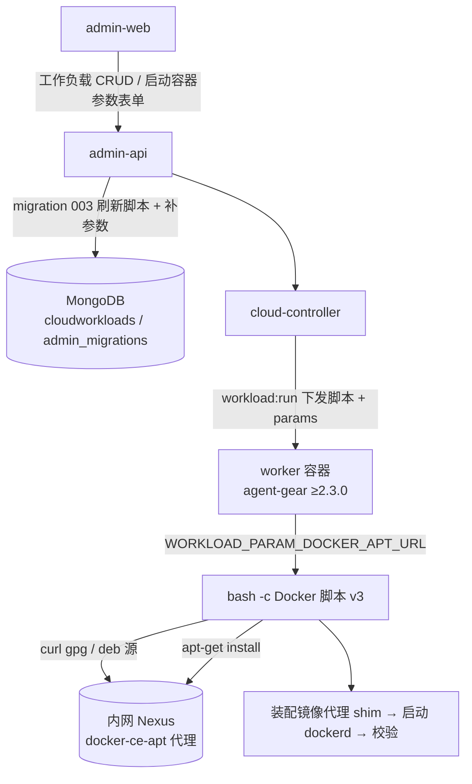
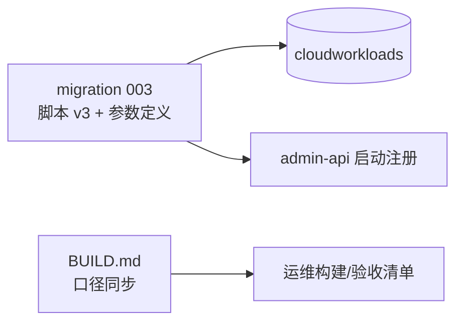
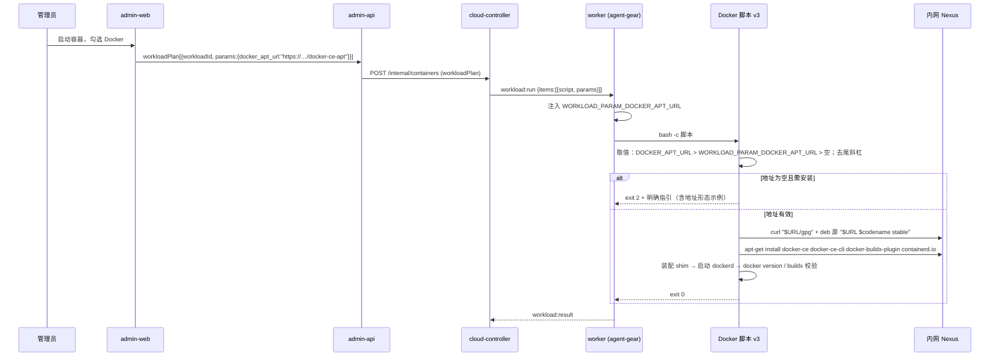
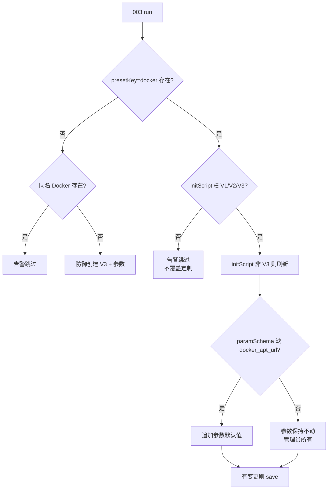
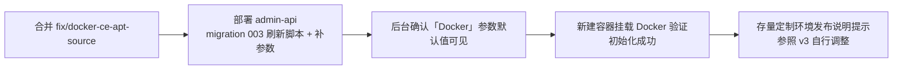

# Docker CE 软件源地址补齐（修复初始化必然失败）- 技术提案

**功能名称**: 「Docker」工作负载软件源地址配置（修复初始化必然失败）
**关联 PRD**: `docs/product/draft/20261018-docker-ce-apt-source.md`
**技术提案版本**: v1.0
**创建日期**: 2026-10-18
**作者**: ZeroAsh
**feat-branch**: `fix/docker-ce-apt-source`

## 1. 概述

### 1.1 背景

四期（`20261018-feat-workload-phase4.md`）把 Docker 的安装下沉到「Docker」预制工作负载脚本 v2，并按当时结论（内网 Nexus 无 docker-ce apt 代理，实测 404）把安装来源 `DOCKER_APT_URL` 设计为**必须由运行环境注入、脚本无默认值**。但这条「注入」链路在系统里根本不存在：

```mermaid
graph LR
    A[admin-web<br/>启动容器/工作负载参数] -->|workloadPlan[].params| B[admin-api]
    B -->|POST /internal/containers| C[cloud-controller]
    C -->|workload:run items[].params| D[worker / agent-gear]
    D -->|WORKLOAD_PARAM_&lt;KEY_UPPER&gt;| E[bash 工作负载脚本]
    K[K8s Job env<br/>ZAG_SERVER_ENDPOINT / ZAG_CONTROLLER_KEY] --> D
    E -.读取 DOCKER_APT_URL.-> X[空：从未有任何环节注入]
    style X fill:#f66,color:#fff
```

- K8s Job 只注入 `ZAG_SERVER_ENDPOINT` / `ZAG_CONTROLLER_KEY`（`k8s-job-manager.ts` `buildManifest`）；
- 工作负载参数只会变成 `WORKLOAD_PARAMS` / `WORKLOAD_PARAM_<KEY_UPPER>`（`packages/agent-controller/src/workload-executor.ts` `buildWorkloadEnv`）；
- 「Docker」预制工作负载 `paramSchema: []`（`001-preset-workloads.ts` / `002-refresh-docker-preset-script.ts` 均未定义参数），脚本却读 `DOCKER_APT_URL`。

于是瘦身后（容器内不再预装 Docker）的每次初始化都会走到安装分支，因 `DOCKER_APT_URL` 为空而 `exit 2`——**必然失败**；勾选「必须」（三期）时容器直接被销毁。管理员没有任何可填写入口，提示文案要求的「注入」无法完成。

运维现已创建内网 docker-ce apt 代理仓库并实测可达（见 §6.1 决策 5）：`https://nexus.internal.fffdan.com/repository/docker-ce-apt/`。本期把该地址作为「Docker」工作负载的**参数默认值**填入，并打通脚本读取链路。

### 1.2 目标

- 「Docker」工作负载新增 `docker_apt_url` 参数（默认值 = 内网软件源代理地址），脚本 v3 直接消费该参数；默认配置下初始化必然成功。
- 地址在启动容器的参数表单中可见、可按次调整；保留 `DOCKER_APT_URL` 环境变量覆盖能力（向后兼容既有注入方式）。
- 一次性迁移 `003-docker-apt-source`：未定制的 Docker 预制工作负载刷新为脚本 v3 并补齐参数；定制过的不覆盖、只告警；幂等。
- 失败兜底保留：地址缺失/不可达时快速失败、指引文案与真实地址形态一致。

### 1.3 范围

**做**：

- `servers/admin-api/src/migrations/003-docker-apt-source.ts`（含 Docker 脚本 v3 与 `docker_apt_url` 参数定义）及其单测；
- `servers/admin-api/src/index.ts` 注册 003 迁移；
- `deploy/images/worker/BUILD.md` 安装来源口径同步（默认值已提供、地址形态示例修正）。

**不做**：

- 不改 worker 镜像（`Dockerfile` / `entrypoint.sh`）——脚本是库内数据，本期无需重建镜像；
- 不改 `contracts/cloud-controller-websocket.md`（参数注入约定 §2.9 早已支持）与 GraphQL schema（`paramSchema` 既有类型可直接承载新参数）；
- 不改 Node.js / .NET / Aspire 预制工作负载；
- 不改「必须」失败语义、版本门禁（`MIN_WORKER_VERSION` 保持 `2.2.0`）与依赖展开逻辑。

## 2. 技术架构

### 2.1 系统架构图



### 2.2 技术栈

| 层级 | 技术选型 | 说明 |
|------|---------|------|
| 工作负载脚本 | Bash | 经 `workload:run` 下发，`bash -c` 执行 |
| 参数注入 | agent-gear `WORKLOAD_PARAM_<KEY_UPPER>` | 契约 §2.9「参数注入约定」，无需新增字段 |
| 一次性迁移 | admin-api migrations（`admin_migrations` 账本） | 新增 003 批次，沿用 runner 语义 |
| 单元测试 | vitest + mock `CloudWorkload` | 沿用 002 迁移测试模式 |

### 2.3 模块划分



| 模块 | 职责 | 关键技术点 |
|------|------|-----------|
| `migrations/003-docker-apt-source.ts` | 刷新 Docker 预制脚本为 v3、补齐 `docker_apt_url` 参数 | 未定制判定（V1/V2/V3 常量比对）、幂等、不覆盖定制 |
| Docker 脚本 v3 | 安装来源取值与安装、shim、dockerd 就绪、校验 | 取值优先级、尾斜杠规范化、缺失快速失败 |
| `migrations/index.ts` 注册处 | 随启动执行、失败不阻断 | `runMigrations([...])` 顺序在 001/002 之后 |
| `deploy/images/worker/BUILD.md` | 运维口径同步 | 默认来源、地址形态示例修正 |

## 3. API 设计

### 3.1 API 契约

**无契约变更**：

- `contracts/cloud-controller-websocket.md` §2.9 `workload:run.items[].params` → `WORKLOAD_PARAM_<KEY_UPPER>` 注入约定已完整支持本方案（`docker_apt_url` → `WORKLOAD_PARAM_DOCKER_APT_URL`）；
- §3.x `POST /internal/containers` 的 `workloadPlan[].params` 透传、A.2.2 校验口径不变；
- GraphQL `CloudWorkload.paramSchema` 既有字段类型（`key/label/type/options/defaultValue`）即可承载新参数，`key` 满足 `^[a-z][a-z0-9_]{0,31}$`、TEXT 值 ≤1024。

### 3.2 内部接口

- `migrations/runner.ts` 的 `Migration` 接口（`name` + `run`）不变；`servers/admin-api/src/index.ts` 注册处由
  `runMigrations([migration001, migration002DotnetApt, migration002RefreshDocker])` 追加为
  `runMigrations([..., migration003DockerAptSource])`。
- `003` 复用既有导出常量做「未定制」比对：`001-preset-workloads.DOCKER_SCRIPT_V1`、`002-refresh-docker-preset-script.DOCKER_SCRIPT_V2`；001/002 的写库行为完全不变。
- `003` 新增导出 `DOCKER_SCRIPT_V3`、`DOCKER_APT_PARAM`（参数定义常量），供单测与后续迁移比对。

## 4. 数据模型

### 4.1 数据库设计

无 schema 变更，仅数据刷新：

- `cloudworkloads`（`presetKey='docker'` 文档）：
  - `initScript` 刷新为 v3（仅未定制时）；
  - `paramSchema` 追加一项（仅缺失时）：

  ```json
  {
    "key": "docker_apt_url",
    "label": "Docker CE 软件源地址",
    "type": "text",
    "options": [],
    "defaultValue": "https://nexus.internal.fffdan.com/repository/docker-ce-apt"
  }
  ```

  > 默认值**不带尾部斜杠**（脚本会规范化，写库值统一形态）；实测该仓库根即 apt 源根（见 §6.1 决策 5）。
- `admin_migrations`：新增账本记录 `{ name: '003-docker-apt-source', executedAt }`，沿用「已执行跳过、失败下轮重试」语义。

### 4.2 缓存设计

无缓存相关内容。

## 5. 技术实现方案

### 5.1 核心流程



### 5.2 关键实现点

**实现点 1：脚本 v3 的安装来源取值（相对 v2 的唯一语义变化）**

```bash
# 安装来源取值优先级：显式环境变量 DOCKER_APT_URL > 工作负载参数 WORKLOAD_PARAM_DOCKER_APT_URL > 空（缺失即快速失败）
DOCKER_APT_URL="${DOCKER_APT_URL:-${WORKLOAD_PARAM_DOCKER_APT_URL:-}}"
while [ "${DOCKER_APT_URL%/}" != "$DOCKER_APT_URL" ]; do DOCKER_APT_URL="${DOCKER_APT_URL%/}"; done
```

- `DOCKER_APT_URL`（环境变量）保持最高优先级：兼容四期「由运行环境注入」的既有用法与高级覆盖场景（worker 继承宿主 env）；
- 参数值经 `WORKLOAD_PARAM_DOCKER_APT_URL` 注入（键 `docker_apt_url` 大写），TEXT 原样传递；
- 尾部斜杠全部去除：输入 `https://…/docker-ce-apt/` 与 `https://…/docker-ce-apt` 等价，避免 `$URL/gpg` 拼出双斜杠；
- 两者皆空时**保留**四期的快速失败（`exit 2`）与指引，仅把指引中的地址形态示例从
  `https://<nexus-host>/repository/<docker-ce-apt-proxy>/linux/ubuntu/` 修正为
  `https://<nexus-host>/repository/<docker-ce-apt>/`（实测 `/linux/ubuntu/...` 子路径 404，见决策 5）；
- 安装包列表、幂等锚点（`/usr/bin/docker` 与 `/usr/bin/dockerd` 任一缺失即安装）、shim 装配、dockerd 就绪等待与校验步骤**逐字不变**。

**实现点 2：迁移 003 的判定矩阵（幂等、不覆盖定制）**

| `initScript` 状态 | `paramSchema` 含 `docker_apt_url` | 动作 |
|---|---|---|
| 等于 V1 / V2 / V3 | 否 | 刷新为 V3（已是 V3 则不动脚本）+ 追加参数 → `save` |
| 等于 V1 / V2 / V3 | 是 | 刷新为 V3（已是 V3 且参数在 → 幂等跳过，不 `save`） |
| 其他（管理员定制） | 任意 | **不覆盖、不补参数**，`console.warn` 提示参照 v3 自行调整 |
| `presetKey='docker'` 不存在，同名 `Docker` 存在 | — | `console.warn` 跳过，不创建重名项（沿用 002 防御路径） |
| 两者都不存在 | — | 以 V3 + 参数防御创建（`isPreset: true`） |



**实现点 3：注册与执行语义**

- 003 排在 001/002 之后执行：全新环境链路为 001 建 V1 → 002 刷 V2 → 003 刷 V3 + 补参数；存量环境按上表收敛；
- 沿用 runner 语义：`admin_migrations` 记账、已执行跳过、失败不阻断启动且下轮重试；
- 001/002 源码不动（002 的 V1/V2 比对语义依赖 001 导出的 `DOCKER_SCRIPT_V1`）。

## 6. 技术决策

### 6.1 决策列表

1. **地址用工作负载参数承载，而非只写死在脚本里**。参数默认值即「已填写」，同时天然获得启动时可改、后台可维护、随执行计划落档可查（`workloadPlan[].params` 快照）三项能力；只写死脚本则又回到「改地址必须改脚本」的老路。
2. **脚本内不内置默认地址**。单一事实来源是参数默认值（由迁移保证补齐）；这样「清空即失败」的语义自然成立，不会出现「清空参数却悄悄回落默认值」的歧义。缺失兜底仍是快速失败 + 指引。
3. **保留 `DOCKER_APT_URL` 环境变量覆盖且优先**。四期口径是「由运行环境注入」，已按此部署/演练的环境继续有效；env 也提供给需要按宿主环境覆盖的高级场景。非空 env 优先于参数。
4. **新增迁移 003，而不是改 001/002**。001/002 已在存量环境记账执行、不会再跑；改动它们会让全新环境的 V1/V2/V3 比对链路失效（002 会把非 V1/V2 脚本误判为「管理员定制」）。新批次 + 常量比对是既有约定（002 就是这么处理 001 的）。
5. **默认值形态以实测为准**（2026-10-18）：`https://nexus.internal.fffdan.com/repository/docker-ce-apt/gpg` → 200；`…/dists/noble/Release` → 200（`Label: Docker CE`、`Suite: noble`、`Components: stable edge test nightly`）；`…/linux/ubuntu/gpg` 与 `…/linux/ubuntu/dists/noble/Release` → 404。即该 Nexus 仓库根直接对应上游 `download.docker.com/linux/ubuntu` 的 apt 布局，脚本的 `$URL/gpg` 与 `deb … $URL $codename stable` 用法与之匹配，**默认值不含 `/linux/ubuntu`**，并同步修正脚本指引与 BUILD.md 中的旧形态示例。
6. **不覆盖管理员定制脚本**（含不补参数）：沿用 002「未定制才刷新」口径，避免给定制脚本加一个它并不消费的参数；定制环境由管理员参照 v3 自行调整。
7. **不提高 `MIN_WORKER_VERSION`（保持 `2.2.0`）**：参数注入需 worker 内 agent-gear ≥2.3.0（当前构建镜像已 ≥2.4.0）。极老 worker 上参数不注入时，v3 行为等价于 v2（快速失败 + 指引），不会更糟；升级门禁属于版本兼容需求，不在本期范围。

### 6.2 依赖与约束

- 依赖运维持续维护内网 `docker-ce-apt` 代理仓库可达（初始化期可访问）；
- 依赖 worker 内 agent-gear ≥2.3.0 以获得参数注入（现网镜像已满足）；
- 约束：不改契约、不改镜像、不改其他预制工作负载与「必须」语义；
- 约束：TEXT 参数值上限 1024 字符、键名正则等既有校验口径不变。

## 7. 项目结构

```text
servers/admin-api/src/
├── index.ts                                  # [修改] 注册 migration 003
└── migrations/
    ├── 001-preset-workloads.ts               # [不变] 导出 DOCKER_SCRIPT_V1 供比对
    ├── 002-refresh-docker-preset-script.ts   # [不变] 导出 DOCKER_SCRIPT_V2 供比对
    ├── 003-docker-apt-source.ts              # [新增] 脚本 v3 + docker_apt_url 参数 + 迁移逻辑
    └── 003-docker-apt-source.test.ts         # [新增] 迁移判定矩阵与脚本不变量测试
deploy/images/worker/
└── BUILD.md                                  # [修改] 安装来源默认值口径与地址形态示例
```

## 8. 测试策略

采用 TDD（红-绿-重构）：先写迁移/脚本行为测试，再实现 003 与脚本 v3。工具沿用 vitest + mock `CloudWorkload`（模式同 `002-refresh-docker-preset-script.test.ts`）。

| 类型 | 用例 | 覆盖内容 |
|------|------|---------|
| 单元测试 | `T-MIG11` | 迁移名暴露为 `003-docker-apt-source` |
| 单元测试 | `T-MIG12` | v2 脚本 → 刷新为 v3 且追加 `docker_apt_url` 参数（默认值为内网地址） |
| 单元测试 | `T-MIG13` | v1 脚本（002 未跑完的防御路径）同样刷新为 v3 |
| 单元测试 | `T-MIG14` | 已 v3 且参数已存在 → 幂等跳过（不 `save`、不 `create`） |
| 单元测试 | `T-MIG15` | 已 v3 但参数缺失 → 只补参数，不动脚本 |
| 单元测试 | `T-MIG16` | 管理员定制脚本 → 不覆盖、不补参数、告警 |
| 单元测试 | `T-MIG17` | `presetKey` 缺失但同名 `Docker` 存在 → 告警跳过；两者都不存在 → 防御创建 v3 + 参数 |
| 脚本不变量 | `T-MIG18` | v3 含取值优先级与尾斜杠规范化；失败指引含新地址形态示例；不含公网源、不含 `/linux/ubuntu` 形态；`bash -n` 通过（模式同 `T-MIG10`） |
| 脚本行为 | `T-MIG19` | 抽取 v3 中取值/规范化两行在 `bash -c` 下执行：env 覆盖参数、参数生效、尾斜杠归一、双空得空（四种组合） |
| 回归 | — | `001`/`002` 既有迁移测试、`runner` 测试全绿；覆盖率 ≥80% |
| 集群验收 | 手工（内网） | 真实 Nexus 链路安装成功、镜像拉取走内部代理、清空地址快速失败、定制脚本不被覆盖 |

## 9. 部署方案

### 9.1 环境规划

| 环境 | 用途 | 部署方式 |
|------|------|---------|
| 内网 K8s | admin-api / cloud-controller / worker 容器 | 既有 manifest，仅更新 admin-api 镜像 |

### 9.2 配置管理

- 默认地址固化为「Docker」工作负载参数默认值 `https://nexus.internal.fffdan.com/repository/docker-ce-apt`（迁移写入，管理员可在后台调整）；
- `DOCKER_APT_URL` 保留为可选的环境级覆盖（优先级最高），无需在 Job/镜像层配置；
- `ZAG_DOCKER_SHIM_PATH` 语义不变（默认 `/usr/local/bin/docker`）。

### 9.3 发布顺序



- **无需重建 worker 镜像**：脚本与参数均在库内，部署 admin-api 即生效；
- 运行中的旧容器不受影响，重建后才使用新配置；
- 若 003 日志出现「modified by admin, skipping」，在发布说明中提示对应管理员。

## 10. 验收标准

- [ ] 技术方案评审通过
- [ ] `T-MIG11`~`T-MIG19` 全部通过，001/002/runner 既有测试全绿，覆盖率 ≥80%
- [ ] 全新环境首次启动：`cloudworkloads` 中「Docker」为脚本 v3 且含 `docker_apt_url` 参数（默认值为内网地址）
- [ ] 存量未定制环境升级后与上条一致；定制脚本不被覆盖且有告警日志
- [ ] 按默认参数启动容器并挂载「Docker」：初始化成功，`docker info` / `docker buildx version` / 代理拉取 `docker pull ubuntu:24.04` 均成功
- [ ] 启动时把地址改为另一可达来源：按新地址安装成功
- [ ] 清空地址启动：初始化快速失败并在执行记录中给出含正确地址形态的指引（「必须」口径行为不变）
- [ ] 地址不可达时：失败留痕，容器行为遵循「必须」口径
- [ ] 重复执行迁移不产生重复变更；重复执行脚本幂等
- [ ] `deploy/images/worker/BUILD.md` 口径与实现一致（默认来源、地址形态示例）

## 11. 相关文档

- [[../../../product/draft/20261018-docker-ce-apt-source.md]] — 本期 PRD
- [[20261018-feat-workload-phase4.md]] — 工作负载四期技术提案（安装来源注入式口径，本期直接前因）
- [[20261018-feat-workload-phase1.md]] — 工作负载一期技术提案（参数能力基线）
- [[20261018-feat-workload-phase3.md]] — 工作负载三期技术提案（「必须」硬失败语义）
- `contracts/cloud-controller-websocket.md` §2.9 / A.2.2 — 参数注入与 `workloadPlan` 约定（本期无变更）
- `deploy/images/worker/BUILD.md` — 镜像构建与自验清单
