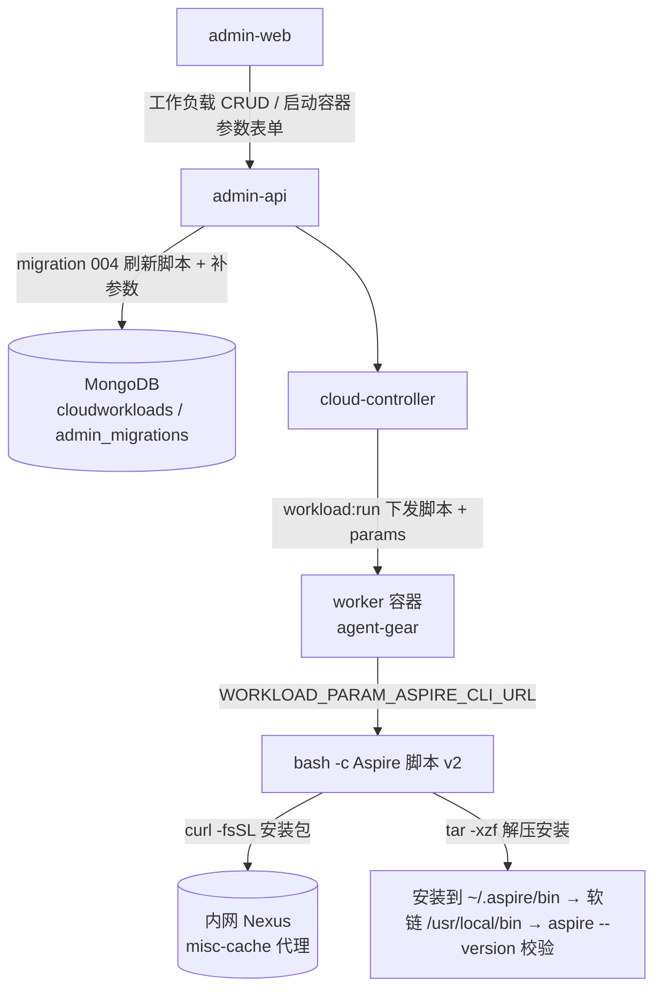
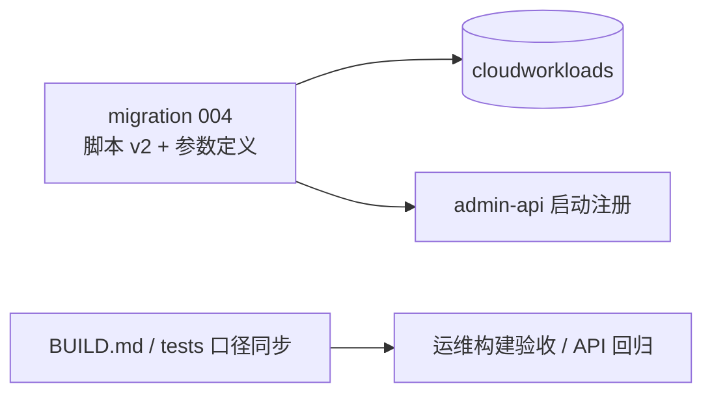
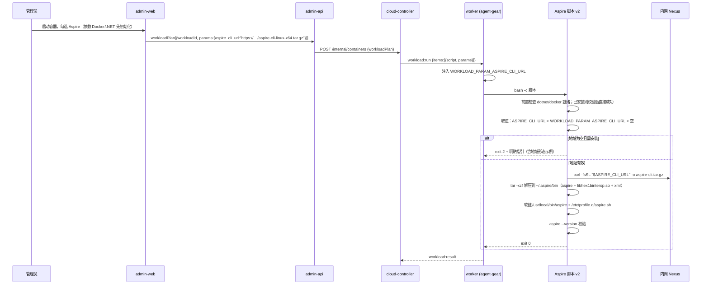
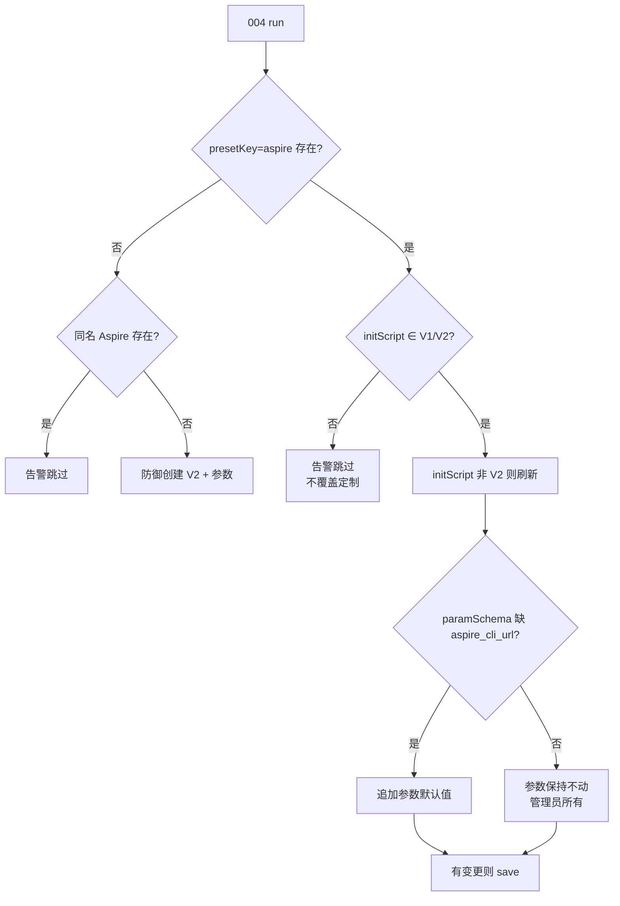

# Aspire 工作负载下载代理（Aspire CLI 内网代理下载）- 技术提案

**功能名称**: 「Aspire」工作负载下载来源代理（Aspire CLI 内网代理下载）
**关联 PRD**: `docs/product/draft/20261019-aspire-workload-proxy.md`
**技术提案版本**: v1.0
**创建日期**: 2026-10-19
**作者**: ZeroAsh
**feat-branch**: `feat/aspire-workload-proxy`

## 1. 概述

### 1.1 背景

「Aspire」预制工作负载脚本 v1（`001-preset-workloads.ts` `ASPIRE_SCRIPT`）经官方安装脚本安装 CLI：

```bash
INSTALL_URL="${ASPIRE_INSTALL_URL:-https://aspire.dev/install.sh}"
curl -sSL "$INSTALL_URL" | bash
```

该安装脚本内部**默认从公网官方地址下载安装包**：`https://aka.ms/dotnet/9/aspire/ga/daily/aspire-cli-linux-x64.tar.gz`（实测 301 跳转到 `https://ci.dot.net/public/aspire/<版本>/aspire-cli-linux-x64-<版本>.tar.gz`）。由此产生三个问题：


1. **公网直连**：与「统一走内网代理」策略不一致（npm 代理、apt 代理、Docker CE 软件源代理、镜像代理均在内网），出网受限/不稳时初始化失败，慢且不可审计；
2. **执行公网脚本**：`curl | bash` 的安装逻辑随公网内容变化，行为不可完全预期；
3. **下载来源无处可调**：想换内网缓存只能改脚本，缺少像 `docker_apt_url` 那样「可见、可按次调整」的配置项。

运维已创建内网缓存代理并实测可达（2026-10-19，见 §6.1 决策 5）：`https://nexus.internal.fffdan.com/repository/misc-cache/dotnet/aspire-cli-linux-x64.tar.gz`（Nexus `misc-cache` 通用代理，缓存同一安装包）。本期参照 Docker CE 软件源地址补齐（`20261018-fix-docker-ce-apt-source.md`）的既有模式：脚本直接下载安装包（弃用官方安装脚本），下载地址做成工作负载参数默认值。

### 1.2 目标

- 「Aspire」工作负载新增 `aspire_cli_url` 参数（默认值 = 内网缓存代理地址），脚本 v2 直接消费该参数下载安装包；默认配置下初始化不触公网。
- 下载地址在启动容器的参数表单中可见、可按次调整；保留 `ASPIRE_CLI_URL` 环境变量覆盖能力（高级场景）。
- 一次性迁移 `004-aspire-cli-source`：未定制的 Aspire 预制工作负载刷新为脚本 v2 并补齐参数；定制过的不覆盖、只告警；幂等。
- 失败兜底保留：地址缺失/不可达时快速失败、指引文案含真实地址形态。

### 1.3 范围

**做**：

- `servers/admin-api/src/migrations/004-aspire-cli-source.ts`（含 Aspire 脚本 v2 与 `aspire_cli_url` 参数定义）及其单测；
- `servers/admin-api/src/index.ts` 注册 004 迁移；
- `servers/admin-api/src/migrations/001-preset-workloads.ts` 仅把 `ASPIRE_SCRIPT` 更名并导出为 `ASPIRE_SCRIPT_V1`（内容逐字不变，写库行为不变），供 004 做「未定制」比对；
- `deploy/images/worker/BUILD.md` 安装来源口径同步（Aspire 段与已知限制）；
- `tests/api/src/admin-api/cloud-workload.test.ts` 预制脚本断言补充（含 `tests/api/AGENTS.md` 用例表同步）。

**不做**：

- 不改 worker 镜像（`Dockerfile` / `entrypoint.sh`）——脚本是库内数据，无需重建镜像；
- 不改 `contracts/cloud-controller-websocket.md`（§2.9 参数注入约定早已支持）与 GraphQL schema（`paramSchema` 既有类型直接承载新参数）；
- 不改 Docker / Node.js / .NET 预制工作负载，不改「Aspire」的依赖关系（仍依赖 Docker → .NET）；
- 不改「必须」失败语义、版本门禁（`MIN_WORKER_VERSION` 保持现状）与依赖展开逻辑。

## 2. 技术架构

### 2.1 系统架构图



### 2.2 技术栈

| 层级 | 技术选型 | 说明 |
|------|---------|------|
| 工作负载脚本 | Bash | 经 `workload:run` 下发，`bash -c` 执行 |
| 参数注入 | agent-gear `WORKLOAD_PARAM_<KEY_UPPER>` | 契约 §2.9「参数注入约定」，无需新增字段 |
| 一次性迁移 | admin-api migrations（`admin_migrations` 账本） | 新增 004 批次，沿用 runner 语义 |
| 单元测试 | vitest + mock `CloudWorkload` | 沿用 003 迁移测试模式 |

### 2.3 模块划分



| 模块 | 职责 | 关键技术点 |
|------|------|-----------|
| `migrations/004-aspire-cli-source.ts` | 刷新 Aspire 预制脚本为 v2、补齐 `aspire_cli_url` 参数 | 未定制判定（V1/V2 常量比对）、幂等、不覆盖定制 |
| Aspire 脚本 v2 | 下载来源取值、下载解压安装、PATH 集成、校验 | 取值优先级、缺失快速失败、幂等锚点不变 |
| `index.ts` 注册处 | 随启动执行、失败不阻断 | `runMigrations([...])` 顺序在 001/002/003 之后 |
| `deploy/images/worker/BUILD.md` | 运维口径同步 | Aspire 安装来源默认值、手工验收项 |
| `tests/api/src/admin-api/cloud-workload.test.ts` | 预制脚本内容回归断言 | 含内网代理地址、不含官方安装渠道 |

## 3. API 设计

### 3.1 API 契约

**无契约变更**：

- `contracts/cloud-controller-websocket.md` §2.9 `workload:run.items[].params` → `WORKLOAD_PARAM_<KEY_UPPER>` 注入约定已完整支持本方案（`aspire_cli_url` → `WORKLOAD_PARAM_ASPIRE_CLI_URL`）；
- `POST /internal/containers` 的 `workloadPlan[].params` 透传、A.2.2 校验口径不变；隐式依赖项取参数默认值的既有口径保证未显式填写时默认地址生效；
- GraphQL `CloudWorkload.paramSchema` 既有字段类型（`key/label/type/options/defaultValue`）即可承载新参数，`key` 满足 `^[a-z][a-z0-9_]{0,31}$`、TEXT 值 ≤1024。

### 3.2 内部接口

- `migrations/runner.ts` 的 `Migration` 接口（`name` + `run`）不变；`servers/admin-api/src/index.ts` 注册处由
  `runMigrations([migration001, migration002DotnetApt, migration002RefreshDocker, migration003DockerAptSource])` 追加为
  `runMigrations([..., migration004AspireCliSource])`。
- 004 复用既有导出常量做「未定制」比对：`001-preset-workloads.ASPIRE_SCRIPT_V1`（本期由 `ASPIRE_SCRIPT` 更名导出，内容逐字不变）；001/002/003 的写库行为完全不变。
- 004 新增导出 `ASPIRE_SCRIPT_V2`、`ASPIRE_CLI_PARAM`（参数定义常量），供单测与后续迁移比对。

## 4. 数据模型

### 4.1 数据库设计

无 schema 变更，仅数据刷新：

- `cloudworkloads`（`presetKey='aspire'` 文档）：
  - `initScript` 刷新为 v2（仅未定制时）；
  - `paramSchema` 追加一项（仅缺失时）：

  ```json
  {
    "key": "aspire_cli_url",
    "label": "Aspire CLI 下载地址",
    "type": "text",
    "options": [],
    "defaultValue": "https://nexus.internal.fffdan.com/repository/misc-cache/dotnet/aspire-cli-linux-x64.tar.gz"
  }
  ```

  > 默认值为**安装包直链**（`misc-cache` 通用代理缓存的官方安装包），实测可达（见 §6.1 决策 5）。
- `admin_migrations`：新增账本记录 `{ name: '004-aspire-cli-source', executedAt }`，沿用「已执行跳过、失败下轮重试」语义。

### 4.2 缓存设计

无缓存相关内容（内网 `misc-cache` 代理的缓存行为由 Nexus 负责，不在本系统内）。

## 5. 技术实现方案

### 5.1 核心流程



### 5.2 关键实现点

**实现点 1：脚本 v2 的下载与安装（相对 v1 的语义变化）**

v1 的 `INSTALL_URL`/`curl | bash` 安装段整体替换为「取值 → 下载安装包 → 解压安装」；前置检查（`.NET`/`Docker` 就绪）、幂等锚点（`aspire` 已可用则校验后退出、`$HOME/.aspire/bin/aspire` 存在则补软链）、PATH 集成与 `aspire --version` 校验**逐字不变**：

```bash
# 下载地址取值优先级：显式环境变量 ASPIRE_CLI_URL（最高）> 工作负载参数 WORKLOAD_PARAM_ASPIRE_CLI_URL > 空（需安装时快速失败）
ASPIRE_CLI_URL="${ASPIRE_CLI_URL:-${WORKLOAD_PARAM_ASPIRE_CLI_URL:-}}"
if [ -z "$ASPIRE_CLI_URL" ]; then
  echo "Aspire CLI 下载地址未设置：请在「Aspire」工作负载参数中填写 aspire_cli_url（形如 https://<nexus-host>/repository/misc-cache/dotnet/aspire-cli-linux-x64.tar.gz）后重试" >&2
  exit 2
fi

TMP_DIR="$(mktemp -d)"
trap 'rm -rf "$TMP_DIR"' EXIT
curl -fsSL "$ASPIRE_CLI_URL" -o "$TMP_DIR/aspire-cli.tar.gz"

install -m 0755 -d "$HOME/.aspire/bin"
tar -xzf "$TMP_DIR/aspire-cli.tar.gz" -C "$HOME/.aspire/bin"
chmod +x "$HOME/.aspire/bin/aspire"

# 让非登录 shell / 后续工作负载也能直接使用 aspire（与 v1 相同）
ln -sfn "$HOME/.aspire/bin/aspire" /usr/local/bin/aspire
printf '%s\n' 'export PATH="$HOME/.aspire/bin:$PATH"' > /etc/profile.d/aspire.sh
chmod +x /etc/profile.d/aspire.sh
export PATH="$HOME/.aspire/bin:$PATH"

# 必须校验成功，避免“安装返回 0 但实际不可用”（与 v1 相同）
aspire --version
```

- `ASPIRE_CLI_URL`（环境变量）保持最高优先级：提供按宿主/环境覆盖的高级场景，风格与 `NPM_REGISTRY`、`DOTNET_APT_PACKAGE`、`DOCKER_APT_URL` 的 env 覆盖一致；
- 参数值经 `WORKLOAD_PARAM_ASPIRE_CLI_URL` 注入（键 `aspire_cli_url` 大写），TEXT 原样传递；
- 整包解压到 `$HOME/.aspire/bin`：安装包根目录含 `aspire` 可执行文件与同目录原生库 `libhex1binterop.so`、`Aspire.TypeSystem.xml`，同目录布局是运行期原生库解析的前提（经 `/usr/local/bin/aspire` 软链执行时按真实路径解析，实测通过，见决策 5）；
- 下载用 `curl -fsSL`（失败即非零退出，`set -euo pipefail` 兜底）、临时目录 `trap` 清理；
- 成功判据仍是 `aspire --version` 非零退出且输出非空，不以下载成功为准（与 v1 口径一致）。

**实现点 2：迁移 004 的判定矩阵（幂等、不覆盖定制）**

| `initScript` 状态 | `paramSchema` 含 `aspire_cli_url` | 动作 |
|---|---|---|
| 等于 V1 / V2 | 否 | 刷新为 V2（已是 V2 则不动脚本）+ 追加参数 → `save` |
| 等于 V1 / V2 | 是 | 刷新为 V2（已是 V2 且参数在 → 幂等跳过，不 `save`） |
| 其他（管理员定制） | 任意 | **不覆盖、不补参数**，`console.warn` 提示参照 v2 自行调整 |
| `presetKey='aspire'` 不存在，同名 `Aspire` 存在 | — | `console.warn` 跳过，不创建重名项（沿用 003 防御路径） |
| 两者都不存在 | — | 以 V2 + 参数防御创建（`isPreset: true`，依赖解析同 001 口径） |



**实现点 3：注册与执行语义**

- 004 排在 001/002/003 之后执行：全新环境链路为 001 建 V1 → 004 刷 V2 + 补参数；存量环境按上表收敛；
- 沿用 runner 语义：`admin_migrations` 记账、已执行跳过、失败不阻断启动且下轮重试；
- 001/002/003 写库逻辑不动，001 仅导出 `ASPIRE_SCRIPT_V1`（内容逐字不变）。

## 6. 技术决策

### 6.1 决策列表

1. **直接下载安装包，弃用官方安装脚本（`curl | bash`）**。官方安装脚本的最终动作就是下载同一安装包到 `~/.aspire/bin`，直连下载后解压安装行为等价（安装布局、软链与校验口径保持 v1），但来源固定、过程可控、不再执行公网脚本内容；且官方脚本不提供「安装包来源」覆盖入口，无法满足本期目标。
2. **地址用工作负载参数承载，而非只写死在脚本里**（同 `20261018-fix-docker-ce-apt-source.md` 决策 1）。参数默认值即「已填写」，天然获得启动时可改、后台可维护、随执行计划落档可查（`workloadPlan[].params` 快照）三项能力。
3. **脚本内不内置默认地址**（同上决策 2）。单一事实来源是参数默认值（由迁移保证补齐）；「清空即失败」语义自然成立，不会出现「清空参数却悄悄回落默认值」的歧义。缺失兜底是快速失败（`exit 2`）+ 指引。
4. **保留 `ASPIRE_CLI_URL` 环境变量覆盖且优先**（同上决策 3）。与既有脚本的 env 覆盖风格一致，供按宿主环境覆盖的高级场景；非空 env 优先于参数。
5. **默认值形态以实测为准**（2026-10-19）：
   - `https://nexus.internal.fffdan.com/repository/misc-cache/dotnet/aspire-cli-linux-x64.tar.gz` → 200，`content-type: application/x-gzip`，`content-length: 156461359`，`server: Nexus/3.96.4-01`；
   - 安装包内布局：根目录 `./aspire`、`./libhex1binterop.so`、`./Aspire.TypeSystem.xml`；
   - 解压后 `./aspire --version` → `13.6.1+3751e615ad660621f2a7aa4c390ef48e08a0eed8`；经 `/usr/local/bin` 软链执行同输出（原生库按真实路径解析）；
   - 官方默认源 `https://aka.ms/dotnet/9/aspire/ga/daily/aspire-cli-linux-x64.tar.gz` → 301 → `https://ci.dot.net/public/aspire/13.6.1-preview.1.26506.6/aspire-cli-linux-x64-13.6.1.tar.gz`（同一安装包的公网源头）。
6. **不复用 `ASPIRE_INSTALL_URL` 变量名**。该变量在 v1 语义是「安装脚本地址」，本期语义是「安装包地址」，沿用会造成歧义；且 v1 的 `ASPIRE_INSTALL_URL` 覆盖场景（换安装脚本源）随安装脚本一并退役，管理员定制脚本不受迁移影响。
7. **新增迁移 004，而不是改 001**（同 `20261018-fix-docker-ce-apt-source.md` 决策 4）。001 已在存量环境记账执行、不会再跑；004 + 常量比对是既有约定（002/003 的做法）。001 仅追加 `ASPIRE_SCRIPT_V1` 导出，写库内容逐字不变。
8. **不覆盖管理员定制脚本**（含不补参数）：沿用 002/003「未定制才刷新」口径，避免给定制脚本加一个它并不消费的参数；定制环境由管理员参照 v2 自行调整。
9. **不提高 `MIN_WORKER_VERSION`**：参数注入需 worker 内 agent-gear ≥2.3.0（现网镜像已满足）。极老 worker 上参数不注入时，v2 行为为「取值为空 → 快速失败 + 指引」，不会静默回退公网；升级门禁属于版本兼容需求，不在本期范围。
10. **整包解压安装而非只取 `aspire` 文件**：安装包内同目录原生库（`libhex1binterop.so`）是运行期依赖，保持官方安装布局（`~/.aspire/bin`）可让软链、profile.d 与后续升级路径与 v1 完全兼容。

### 6.2 依赖与约束

- 依赖运维持续维护内网 `misc-cache` 代理可达（初始化期可访问），并保持对官方安装包的缓存更新；
- 依赖 worker 内 agent-gear ≥2.3.0 以获得参数注入（现网镜像已满足）；
- 约束：不改契约、不改镜像、不改其他预制工作负载与「必须」语义；
- 约束：TEXT 参数值上限 1024 字符、键名正则等既有校验口径不变。

## 7. 项目结构

```text
servers/admin-api/src/
├── index.ts                                  # [修改] 注册 migration 004
└── migrations/
    ├── 001-preset-workloads.ts               # [修改] ASPIRE_SCRIPT 更名导出为 ASPIRE_SCRIPT_V1（内容不变）
    ├── 002-preset-dotnet-apt.ts              # [不变]
    ├── 002-refresh-docker-preset-script.ts   # [不变]
    ├── 003-docker-apt-source.ts              # [不变]
    ├── 004-aspire-cli-source.ts              # [新增] 脚本 v2 + aspire_cli_url 参数 + 迁移逻辑
    └── 004-aspire-cli-source.test.ts         # [新增] 迁移判定矩阵与脚本不变量测试
deploy/images/worker/
└── BUILD.md                                  # [修改] Aspire 安装来源口径（默认值、手工验收项）
tests/api/
├── AGENTS.md                                 # [修改] T-IA 用例表同步
└── src/admin-api/cloud-workload.test.ts      # [修改] 预制 Aspire 脚本内容断言
```

## 8. 测试策略

采用 TDD（红-绿-重构）：先写迁移/脚本行为测试，再实现 004 与脚本 v2。工具沿用 vitest + mock `CloudWorkload`（模式同 `003-docker-apt-source.test.ts`）。

| 类型 | 用例 | 覆盖内容 |
|------|------|---------|
| 单元测试 | `T-MIG20` | 迁移名暴露为 `004-aspire-cli-source` |
| 单元测试 | `T-MIG21` | v1 脚本 → 刷新为 v2 且追加 `aspire_cli_url` 参数（默认值为内网代理地址） |
| 单元测试 | `T-MIG22` | 已 v2 且参数已存在 → 幂等跳过（不 `save`、不 `create`） |
| 单元测试 | `T-MIG23` | 已 v2 但参数缺失 → 只补参数，不动脚本 |
| 单元测试 | `T-MIG24` | 管理员定制脚本 → 不覆盖、不补参数、告警 |
| 单元测试 | `T-MIG25` | `presetKey` 缺失但同名 `Aspire` 存在 → 告警跳过；两者都不存在 → 防御创建 v2 + 参数 |
| 脚本不变量 | `T-MIG26` | v2 含取值优先级与 `curl -fsSL`/`tar -xzf` 安装段、失败指引含地址形态示例；不含 `install.sh`、不含 `aka.ms`/`aspire.dev` 公网来源；`bash -n` 通过（模式同 `T-MIG18`） |
| 脚本行为 | `T-MIG27` | 抽取 v2 中取值/失败分支在 `bash -c` 下执行：env 覆盖参数、参数生效、双空得空并触发快速失败指引（三种组合） |
| API 回归 | `T-IA 预制 Aspire 代理下载` | `tests/api`：预制「Aspire」`initScript` 含内网代理地址、不含官方安装渠道；迁移幂等后 ID 稳定 |
| 回归 | — | 001/002/003 既有迁移测试、`runner` 测试、`cloud-workload` 既有用例全绿；覆盖率 ≥80% |
| 集群验收 | 手工（内网） | 真实内网代理下载安装成功（全程不触公网）、改地址按新地址安装、清空地址快速失败、定制脚本不被覆盖 |

## 9. 部署方案

### 9.1 环境规划

| 环境 | 用途 | 部署方式 |
|------|------|---------|
| 内网 K8s | admin-api / cloud-controller / worker 容器 | 既有 manifest，仅更新 admin-api 镜像 |

### 9.2 配置管理

- 默认下载地址固化为「Aspire」工作负载参数默认值 `https://nexus.internal.fffdan.com/repository/misc-cache/dotnet/aspire-cli-linux-x64.tar.gz`（迁移写入，管理员可在后台调整）；
- `ASPIRE_CLI_URL` 保留为可选的环境级覆盖（优先级最高），无需在 Job/镜像层配置；
- `ASPIRE_INSTALL_URL` 随官方安装脚本退役，不再消费（BUILD.md 静态校验中「镜像禁用变量残留」清单同步调整）。

### 9.3 发布顺序


- **无需重建 worker 镜像**：脚本与参数均在库内，部署 admin-api 即生效；
- 运行中的旧容器不受影响，重建后才使用新配置；
- 若 004 日志出现「modified by admin, skipping」，在发布说明中提示对应管理员。

## 10. 验收标准

- [ ] 技术方案评审通过
- [ ] `T-MIG20`~`T-MIG27` 全部通过，001/002/003/runner 既有测试全绿，覆盖率 ≥80%
- [ ] 全新环境首次启动：`cloudworkloads` 中「Aspire」为脚本 v2 且含 `aspire_cli_url` 参数（默认值为内网代理地址）
- [ ] 存量未定制环境升级后与上条一致；定制脚本不被覆盖且有告警日志
- [ ] 按默认参数启动容器并挂载「Docker」「.NET」「Aspire」：初始化成功，`aspire --version` 输出非空；全程无公网访问（内网代理下载）
- [ ] 启动时把地址改为另一可达来源：按新地址下载安装成功
- [ ] 清空地址启动：初始化快速失败并在执行记录中给出含正确地址形态的指引（「必须」口径行为不变）
- [ ] 地址不可达时：失败留痕，容器行为遵循「必须」口径
- [ ] 重复执行迁移不产生重复变更；重复执行脚本幂等（已安装直接校验通过）
- [ ] `deploy/images/worker/BUILD.md` 与 `tests/api/AGENTS.md` 口径与实现一致

## 11. 相关文档

- [[../../../product/draft/20261019-aspire-workload-proxy.md]] — 本期 PRD
- [[20261018-fix-docker-ce-apt-source.md]] — Docker CE 软件源地址补齐技术提案（本期直接前例：参数化安装来源 + 迁移 003）
- [[20261018-feat-workload-phase1.md]] — 工作负载一期技术提案（预制工作负载与参数能力基线）
- [[20261018-feat-workload-phase3.md]] — 工作负载三期技术提案（「必须」硬失败语义）
- [[20261018-feat-workload-phase4.md]] — 工作负载四期技术提案（安装来源下沉工作负载）
- `contracts/cloud-controller-websocket.md` §2.9 / A.2.2 — 参数注入与 `workloadPlan` 约定（本期无变更）
- `deploy/images/worker/BUILD.md` — 镜像构建与自验清单
