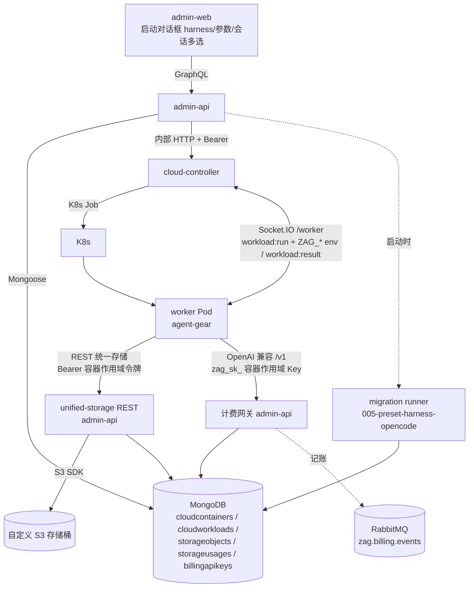
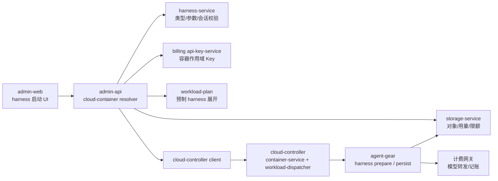
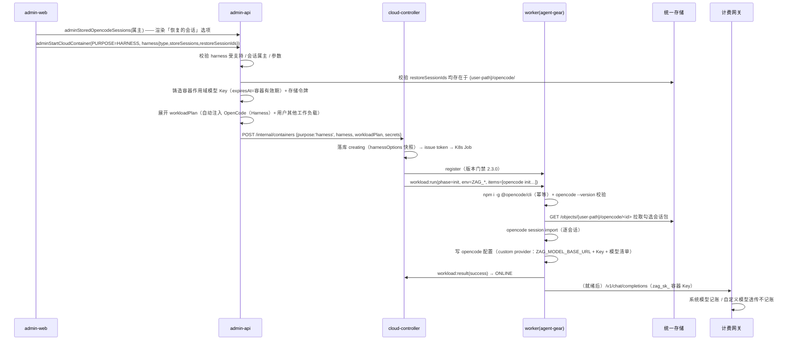
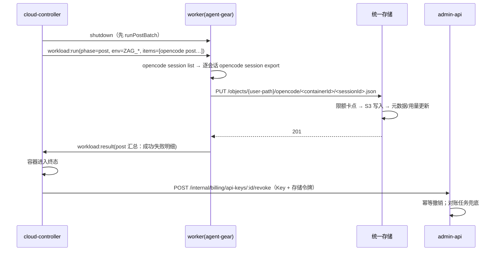
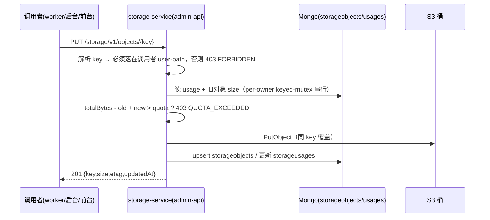

# 容器启动任务支持 harness 类型（OpenCode 工作负载与统一存储）- 技术提案

**功能名称**: 容器启动任务 harness 类型、OpenCode 工作负载、统一存储
**关联 PRD**: docs/product/draft/20261020-container-harness-support.md
**技术提案版本**: v1.0
**创建日期**: 2026-10-20
**作者**: ZeroAsh
**feat-branch**: `feat/container-harness-support`

## 1. 概述

### 1.1 背景

`20261014-feat-cloud-agent-phase2` 交付了 K8s 云端工作容器基线，`20261017-feat-cloud-controller-workload` 与 `20261018-feat-workload-phase1` 交付了工作负载体系（参数表单、隐式依赖、预制工作负载、执行留档），`20261018-feat-credits-billing` 交付了费用中心（计费账户、API Key、OpenAI 兼容计费网关、计量/账单）。当前状态：

- 云端容器启动任务类型（`purpose`）**仅开放 `idle`**，三处硬编码校验拒绝其余值：
  - `servers/admin-api/src/graphql/resolvers/cloud-container.ts`：`if (args.purpose !== 'IDLE') throw new GraphQLError('该任务类型暂未开放')`
  - `servers/cloud-controller/src/routes/internal-api.ts`：`if (purpose !== 'idle') → 400 UNSUPPORTED_PURPOSE`
  - `servers/cloud-controller/src/services/container-service.ts`：`if (purpose !== 'idle') throw new UnsupportedPurposeError()`
- 工作负载可以带参数（`paramSchema` 四类字段）、可声明依赖，预制工作负载经 migration 写入（`001-preset-workloads` 等），worker（`packages/agent-controller`，镜像内命令 `agent-gear`）逐条执行 `bash -c <script>` 并注入 `WORKLOAD_PARAM_*`。
- 计费已有 `billingapikeys`（`zag_sk_` 前缀 + bcrypt 哈希）与 OpenAI 兼容网关（`contracts/billing-openai.openapi.yaml`），但 Key 无有效期/作用域概念，也没有「随容器生灭」的凭证。
- 仓库内**没有任何对象存储能力**（无 S3/MinIO 客户端与配置），会话等产物无处可存。

本期需求（PRD）：启动任务新增 **harness** 类型，选择后必须选一个受支持的 harness（一期 OpenCode，以「工作负载」交付，参数「存储会话」「恢复的会话」）；配套新增**统一存储**（自定义 S3 存储桶、用户目录前缀、类 S3 CRUD+list、独立用量表与限额卡点）。

### 1.2 目标

- `purpose` 全链路放开 `harness`：admin-api GraphQL → cloud-controller 内部 API → `ContainerService.start` → 契约文档，四处口径一致；`harness` 必须携带受支持的 harness 选择。
- 交付预制「OpenCode（Harness）」工作负载：安装/校验 OpenCode、按参数恢复会话、注入容器作用域模型调用凭证、收尾导出会话入统一存储。
- 会话可存可取：已存会话列表 API（后台先行，按用户过滤）→ 启动参数多选 → 初始化导入 → 收尾导出并写入 `{user-path}/opencode/`。
- 模型调用计费：容器作用域 API Key（有效期 = 容器有效期，容器结束立即失效），计费归属容器的计费账户；前台用户自定义模型不计费、系统模型计费；可用模型范围按用户类型取「用户模型列表 / 后台模型列表」。
- 统一存储：S3 兼容桶 + 元数据/用量/限额三张口径，提供类 S3 的对象 CRUD + list REST 契约；写入前限额卡点（超限 403），后台用户不限量。
- 单元 / API / E2E 测试与 worker 镜像自验文档同步更新。

### 1.3 范围

**做**：

- `purpose=harness` 全链路放开与 `harnessType`（一期仅 `opencode`）建模、启动参数校验。
- 预制「OpenCode（Harness）」工作负载（migration）与参数动态选项机制（`optionsSource`）。
- 「已存储的 OpenCode 会话」查询 API（后台先行，按属主过滤，从统一存储元数据派生）。
- 容器作用域模型 API Key：铸造、注入、到期失效、容器销毁撤销（含对账兜底）。
- OpenCode 配置注入（custom provider：网关端点 + Key + 模型清单）。
- 会话导入（init）与会话导出 + 上传（post），worker 侧 `agent-gear harness prepare|persist` 子命令。
- 统一存储服务：S3 客户端封装、对象元数据与用量表、限额卡点、类 S3 REST 契约（PUT/GET/HEAD/DELETE/LIST/usage）。
- admin-web 启动对话框 harness 交互（任务类型 → harness 选择 → 参数表单/会话多选）、容器列表/详情展示 harness 信息。
- 计费网关按容器 Key 属主返回可用模型；自定义模型透传不记账、系统模型记账。
- 契约、测试、部署配置（S3 桶 env、Aspire/Compose MinIO 资源）与文档。

**不做**：

- 前台（agent-web）拉起 harness 容器与「恢复的会话」前台入口（二期；本期只保证 API 按属主过滤、口径兼容前台）。
- 前台用户存储限额的配置与执行（二期；本期只做用量记录与统一写入卡点，前台 `quotaBytes` 落 null=不限量）。
- 第二个 harness（Claude Code / Codex 等）——架构预留 `harnessType`，本期只实现 `opencode`。
- 存储的预签名直传、跨区域复制、版本化、生命周期清理；大文件分片上传。
- 会话的在线浏览/编辑/搜索；会话包格式转换（原样导出/导入）。
- 计费口径变化（定价、账单、支付链路不动，仅新增「容器作用域 Key」入口与转发规则）。
- 存储用量的定时对账/自愈（列为后续项，本期以事务内更新 + keyed-mutex 保证一致性）。

## 2. 技术架构

### 2.1 系统架构图



关键边界：

- `cloudworkloads` 仍由 admin-api 写、cloud-controller 只读；harness 语义（`workloadKind='harness'` + `harnessType`）由预制工作负载承载，启动计划展开仍走 `workload-plan`。
- `cloudcontainers` 由 cloud-controller 写（单一事实源）；harness 相关字段（`harnessType`、`harnessOptions`）随启动请求下发并落库留档。
- 统一存储的**元数据/用量/限额**由 admin-api 持有（`storageobjects`/`storageusages`）；S3 桶只是字节层，**一切 list/usage/限额以元数据表为准**。
- 模型调用凭证由 admin-api（billing `api-key-service`）铸造与撤销；cloud-controller 只负责在容器生命周期内**传递**（env 注入）与在销毁时**触发撤销**。

### 2.2 技术栈

| 层级 | 技术选型 | 说明 |
|------|---------|------|
| 前端 | React + TypeScript + Vite + Apollo Client | admin-web，复用 Dialog/Select/Switch/参数表单组件 |
| 后端 | Node.js + Express + GraphQL + Mongoose | admin-api（harness 校验、存储服务、Key 铸造）、cloud-controller（生命周期、env 注入、撤销触发） |
| Worker | Node.js（agent-gear） | 新增 `harness prepare/persist` 与存储客户端 |
| 对象存储 | S3 兼容（自建桶 / MinIO），`@aws-sdk/client-s3` | 自定义 S3 存储桶；Aspire/Compose 本地编排用 MinIO |
| 数据库 | MongoDB | 复用共享实例；新增 `storageobjects`、`storageusages` |
| 消息 | RabbitMQ | 沿用计费事件通道；`container.destroyed` 作为 Key 撤销兜底信号 |
| 协议 | GraphQL + REST(OpenAPI) + 内部 HTTP + Socket.IO | 统一存储对外走 REST（类 S3）；其余沿用 |

### 2.3 模块划分



| 模块 | 职责 | 关键技术点 |
|------|------|-----------|
| admin-api harness-service | purpose/harnessType/参数/会话选择校验、已存会话查询 | 受支持 harness 白名单、会话属主校验 |
| admin-api storage-service | 对象 CRUD+list、用量、限额卡点 | S3 SDK 封装、元数据表驱动 list、keyed-mutex 用量更新 |
| admin-api api-key-service（扩展） | 容器作用域 Key 铸造/撤销/校验 | `scope`/`containerId`/`expiresAt`，明文仅一次 |
| admin-api migrations | 预制「OpenCode（Harness）」工作负载 | 沿用 presetKey 幂等迁移 |
| admin-api billing-openai（扩展） | 容器 Key 的模型范围与转发/记账分流 | 自定义模型透传不记账、系统模型记账 |
| cloud-controller container-service | purpose=harness 生命周期、env 注入、销毁撤销 | 放开 purpose 校验、`ZAG_*` 环境注入 |
| cloud-controller workload-dispatcher | init/post 批次下发 | `workload:run` 增加 `env` |
| agent-gear harness | 会话导入/导出、OpenCode 配置注入 | `opencode session import/export`、custom provider 写入 |
| agent-gear storage-client | 统一存储 REST 调用 | 容器作用域存储令牌、幂等上传 |

## 3. API 设计

### 3.1 API 契约

新增/扩展：`contracts/admin-cloud-container.graphql`、`contracts/admin-cloud-workload.graphql`、`contracts/admin-unified-storage.graphql`（新增）、`contracts/unified-storage.openapi.yaml`（新增）、`contracts/admin-billing.graphql`、`contracts/billing-openai.openapi.yaml`、`contracts/cloud-controller-websocket.md`。

#### 3.1.1 启动任务类型与 harness 选择（`contracts/admin-cloud-container.graphql` 扩展）

```graphql
# 受支持的 harness 类型（本期仅 OPENCODE；新增 harness 时扩展该枚举并追加预制工作负载）
enum HarnessType {
  OPENCODE
}

# OpenCode（Harness）工作负载参数
input HarnessSelectionInput {
  harnessType: HarnessType!
  # 「存储会话」：容器结束时导出会话并写入统一存储；缺省 true
  storeSessions: Boolean
  # 「恢复的会话」：已存储会话 ID 多选；缺省 []。每项必须属于该容器属主的
  # `{user-path}/opencode/` 区域，否则返回错误
  restoreSessionIds: [ID!]
}

type CloudHarnessOptions {
  harnessType: HarnessType!
  storeSessions: Boolean!
  restoreSessionIds: [ID!]!   # 落库快照（启动时勾选的会话 ID）
}

# CloudContainer 扩展字段（purpose=HARNESS 时非空，其余为 null）
#   harness: CloudHarnessOptions

extend enum CloudContainerPurpose {
  HARNESS   # 内部 API 映射为小写 `harness`
}
```

`adminStartCloudContainer` 扩展（新增 `harness` 参数）：

```graphql
adminStartCloudContainer(
  purpose: CloudContainerPurpose!
  harness: HarnessSelectionInput
  workloadIds: [ID!]
  workloads: [CloudWorkloadSelectionInput!]
  billingAccountId: ID
): CloudContainer!
```

服务端强制校验与错误文案（逐字）：

| 条件 | 错误 |
|------|------|
| `purpose=HARNESS` 且 `harness` 为空 | `harness selection is required for HARNESS purpose` |
| `purpose!=HARNESS` 且 `harness` 非空 | `harness selection is only allowed for HARNESS purpose` |
| `harnessType` 不在受支持列表 | `unsupported harness type` |
| `restoreSessionIds` 含不属于该属主/不存在的会话 ID | `stored session not found: <id>` |
| `restoreSessionIds` 去重后 > 20 | `too many restore sessions` |
| 与 `workloads`/`workloadIds` 同时显式传入 harness 自定义选择 | harness 内部自动挂载预制工作负载，用户显式传入同名预制项返回 `duplicate workload selection`（沿用工作负载展开规则） |

说明：`purpose=HARNESS` 时服务端**自动**把预制「OpenCode（Harness）」工作负载展开进 `workloadPlan`（参数取自 `harness`），调用方无需（也不应）再显式传该工作负载；其余工作负载（Docker/Node.js/…）仍可按现有 `workloads` 传入并按现有规则展开排序（harness 工作负载强制排在依赖满足后的末位执行序，详见 §5.1.2）。

#### 3.1.2 已存储的 OpenCode 会话查询（`contracts/admin-unified-storage.graphql` 新增，后台先行）

```graphql
# 统一存储后台契约
# 鉴权：Authorization: Bearer <admin JWT>；未认证 UNAUTHENTICATED（`Not authenticated`）。
# 数据归属：storageobjects/storageusages 由 admin-api 统一存储服务写入（单一事实源）。

type StoredOpencodeSession {
  id: ID!            # 存储对象 ID（= 恢复会话多选的选项值）
  sessionId: String! # OpenCode 会话 ID（导出文件名/内容派生）
  label: String!     # 可辨识信息（会话标题或 sessionId 截断）
  containerId: ID    # 来源容器（导出时记录）
  size: Int!         # 字节
  storedAt: String!  # 存储时间
}

type StorageUsage {
  ownerType: StorageOwnerType!
  ownerId: ID!
  totalBytes: Int!
  objectCount: Int!
  quotaBytes: Int            # null = 不限量
  quotaExceeded: Boolean!
}

enum StorageOwnerType { FRONT_USER ADMIN_USER }

type Query {
  # 已存储的 OpenCode 会话（按属主过滤；ownerId 缺省取当前管理员本人）
  adminStoredOpencodeSessions(ownerId: ID, ownerType: StorageOwnerType): [StoredOpencodeSession!]!
  # 存储用量（任意用户，运营治理口径）
  adminStorageUsage(ownerType: StorageOwnerType!, ownerId: ID!): StorageUsage!
}

type Mutation {
  # 后台治理：设置/取消限额（取消 = quotaBytes 传 null）
  adminSetStorageQuota(ownerType: StorageOwnerType!, ownerId: ID!, quotaBytes: Int): StorageUsage!
  # 后台治理：删除用户目录下对象（沿用统一存储删除语义）
  adminDeleteStorageObject(id: ID!): Boolean!
}
```

一期前端（admin-web）：启动对话框在「恢复的会话」多选中调用 `adminStoredOpencodeSessions`，按当前启动上下文用户过滤后渲染选项。

#### 3.1.3 统一存储 REST（`contracts/unified-storage.openapi.yaml` 新增，类 S3）

Base：`/storage/v1`；鉴权 `Authorization: Bearer <token>`，token 三类：

1. admin JWT（后台，不限量）；
2. 前台用户 JWT（本期预留，经 agent-api 网关转发时携带；限量口径先行）；
3. **容器作用域存储令牌**（`stg_<random>`，云控制器随启动下发给 worker，有效期 = 容器有效期，仅允许写入/读取该容器属主的 `{user-path}/`）。

所有路径中的 `key` 为用户目录内的相对路径；服务端强制解析出的完整 key 必须落在调用者 user-path `/{user-type}/{user-id}/` 之下，否则 `403 FORBIDDEN`。

| Method | Path | 说明 | 成功 | 失败 |
|--------|------|------|------|------|
| PUT | `/objects/{key}` | 上传/覆盖（幂等覆盖同 key） | 201/200 `{key,size,etag,updatedAt}` | 403 `QUOTA_EXCEEDED` / 403 `FORBIDDEN` / 413 `PAYLOAD_TOO_LARGE`（单对象 ≤ 256 MiB） |
| GET | `/objects/{key}` | 下载（流式代理 S3） | 200 流 | 404 `NOT_FOUND` |
| HEAD | `/objects/{key}` | 元信息 | 200 `{key,size,contentType,etag,updatedAt}` | 404 `NOT_FOUND` |
| DELETE | `/objects/{key}` | 删除 | 204 | 404 `NOT_FOUND` |
| GET | `/objects?prefix=&limit=&cursor=` | 按前缀列表（元数据表驱动、游标分页） | 200 `{items:[{key,size,updatedAt}],nextCursor}` | 400 `INVALID_PREFIX` |
| GET | `/usage` | 当前调用者用量 | 200 `{totalBytes,objectCount,quotaBytes,quotaExceeded}` | — |

错误响应统一：`{"error": "QUOTA_EXCEEDED", "message": "storage quota exceeded"}`。

限额卡点语义（契约级）：

- 写入（PUT/覆盖）前判定 `totalBytes - 旧对象size + 新size > quotaBytes`（`quotaBytes=null` 不限）→ `403 QUOTA_EXCEEDED`；
- 读取（GET/HEAD/LIST）与删除（DELETE）不受限额影响；
- 用量更新与对象写入在同一服务内串行（keyed-mutex per owner）完成，覆盖同 key 先回退旧 size 再计入新 size。

#### 3.1.4 模型调用凭证（`contracts/admin-billing.graphql` / `contracts/billing-openai.openapi.yaml` 扩展）

`BillingApiKey` 扩展：

```graphql
enum BillingApiKeyScope { ACCOUNT CONTAINER }

type BillingApiKey {
  # ...existing fields...
  scope: BillingApiKeyScope!
  containerId: ID       # scope=CONTAINER 时非空
  expiresAt: String     # scope=CONTAINER 时非空（= 容器有效期）
}
```

计费网关语义扩展（OpenAPI 描述同步更新）：

- `Authorization: Bearer zag_sk_*` 校验后追加：`scope=CONTAINER` 且（`expiresAt` 已过 **或** 关联容器已终态）→ `401 invalid api key`（与现有文案一致）。
- `GET /v1/models`（容器 Key）：返回该 Key 属主可见模型——前台用户为其个人模型列表（启用的系统模型 + 其自定义模型），后台用户为后台模型列表（启用）。
- `POST /v1/chat/completions`：
  - 命中**自定义模型**（属主自有模型/自有端点）→ 网关代为转发到用户配置的端点（用户凭据不出库、不进容器），**不产生计费记录**；
  - 命中**系统模型** → 走既有计费链路（定价/预留/计量/记账），费用计入该 Key 绑定的计费账户。

#### 3.1.5 工作负载参数动态选项（`contracts/admin-cloud-workload.graphql` 扩展）

「恢复的会话」的可选项来自数据（已存会话），现有 `options`（静态字符串列表）不够用，扩展：

```graphql
enum CloudWorkloadParamOptionsSource {
  NONE             # 静态 options（现状）
  OPENCODE_SESSIONS # 取当前用户已存储的 OpenCode 会话
}

type CloudWorkloadParamField {
  # ...existing fields...
  optionsSource: CloudWorkloadParamOptionsSource!  # 缺省 NONE
}

input CloudWorkloadParamFieldInput {
  # ...existing fields...
  optionsSource: CloudWorkloadParamOptionsSource
}
```

约束：`optionsSource != NONE` 仅允许用于 `MULTI_SELECT`，且 `options` 必须为空（选项由前端按数据源拉取渲染）；`defaultValue` 仍必填（空数组）。参数值提交仍走既有 `params` JSON（字符串数组），服务端校验每个值属于数据源返回集合。

### 3.2 内部接口

#### 3.2.1 admin-api → cloud-controller（`POST /internal/containers` 扩展）

```jsonc
{
  "purpose": "harness",                  // 新增允许值（snake-case）
  "harness": {
    "type": "opencode",
    "storeSessions": true,
    "restoreSessionIds": ["..."]
  },
  "workloadPlan": [ /* 含自动展开的 OpenCode（Harness）项与既有展开规则产物 */ ],
  "billingAccountId": "…",
  "secrets": {                            // 一次性下发，仅用于 env 注入，不落库明文
    "modelApiKey": "zag_sk_…",            // 容器作用域模型 Key（admin-api 铸造）
    "storageToken": "stg_…"               // 容器作用域存储令牌
  }
}
```

- `purpose` 允许值扩展为 `idle | harness`（`admin-task/workflow/session` 仍拒绝，文案不变「该任务类型暂未开放」）。
- `secrets` 仅在创建请求中出现：cloud-controller 用于构建 `workload:run` 的 `env`，**不写入任何持久化**（日志/落库脱敏）。
- 新增 `GET /internal/containers/:id/storage-token` 供内部排查（默认关闭，`INTERNAL_STORAGE_TOKEN_ENABLED` 开关）。

#### 3.2.2 cloud-controller → admin-api（Key 撤销，internal-billing 扩展）

- `POST /internal/billing/api-keys/:id/revoke`（幂等；已撤销返回 200）。
- 触发点：容器进入 `exited`/`failed` 终态或 `destroy()` 完成时，撤销 `containerApiKeyId` 与存储令牌（令牌撤销即标记 `revoked`，后续 REST 校验拒绝）。
- 兜底：消费 `container.destroyed` 计费事件时再次调用（幂等）；另由 admin-api 定时任务扫描「容器已终态但 Key 仍 active」的记录并撤销（对账口径与费用中心一致）。

#### 3.2.3 Worker ↔ cloud-controller（Socket.IO `/worker` 扩展）

`workload:run` payload 增加容器级 `env`（对本容器全部脚本生效，区别于 `WORKLOAD_PARAM_*` 的单条生效）：

```jsonc
{
  "phase": "init",
  "env": {
    "ZAG_HARNESS_TYPE": "opencode",
    "ZAG_CONTAINER_ID": "…",
    "ZAG_USER_TYPE": "admin_user",
    "ZAG_USER_ID": "…",
    "ZAG_USER_PATH": "/admin_user/66f…/",
    "ZAG_STORE_SESSIONS": "true",
    "ZAG_RESTORE_SESSION_IDS": "ses_a,ses_b",
    "ZAG_MODEL_API_KEY": "zag_sk_…",
    "ZAG_MODEL_BASE_URL": "https://…/v1",
    "ZAG_MODEL_IDS": "model-1,model-2",
    "ZAG_STORAGE_BASE_URL": "https://…/storage/v1",
    "ZAG_STORAGE_TOKEN": "stg_…"
  },
  "items": [ /* 同现状 */ ]
}
```

- `env` 中 secret 值仅随下发报文存在，worker 内存持有并注入脚本进程环境；日志输出对 `ZAG_MODEL_API_KEY`/`ZAG_STORAGE_TOKEN` 做 `***` 脱敏（与现有日志截断机制同处）。
- 版本门禁：`MIN_WORKER_VERSION` 由 `2.2.0` 提升到 `2.3.0`（`servers/cloud-controller/src/services/worker-version.ts`），低版本 worker 拉起 harness 容器时按既有版本门禁流程拒绝并提示升级。

## 4. 数据模型

### 4.1 数据库设计

#### 集合: `cloudcontainers`（扩展）

| 字段 | 类型 | 说明 |
|------|------|------|
| purpose | string | 枚举扩展加入 `harness`（`CONTAINER_PURPOSES`） |
| harnessType | string \| null | `opencode`；非 harness 为 null |
| harnessOptions | object \| null | `{storeSessions: boolean, restoreSessionIds: string[]}` 落库快照 |
| containerApiKeyId | ObjectId \| null | 关联 `billingapikeys`（scope=container）；销毁时撤销 |
| storageTokenId | ObjectId \| null | 关联 `storagetokens`；销毁时撤销 |

#### 集合: `billingapikeys`（扩展）

| 字段 | 类型 | 说明 |
|------|------|------|
| scope | string | `account`（现状）/ `container`（新增），缺省 `account` |
| containerId | ObjectId \| null | scope=container 时非空，索引 |
| expiresAt | Date \| null | scope=container 时非空（= 容器有效期上限）；校验时 `expiresAt < now` 视同失效 |
| allowedModelIds | string[] \| null | 可选硬限定（默认 null=按属主模型列表动态判定） |

#### 集合: `storagetokens`（新增）

| 字段 | 类型 | 说明 |
|------|------|------|
| tokenPrefix | string | `stg_` 前缀 + 明文前 8 位，索引 |
| tokenHash | string | bcrypt；明文仅铸造时下发一次 |
| ownerType / ownerId | string | 令牌属主（= 容器属主） |
| containerId | ObjectId | 来源容器，索引 |
| expiresAt | Date | = 容器有效期 |
| status | string | `active` / `revoked` |

#### 集合: `storageobjects`（新增，统一存储元数据——list/会话查询的事实源）

| 字段 | 类型 | 说明 |
|------|------|------|
| key | string | 完整 key：`/{user-type}/{user-id}/…`，**唯一索引** |
| ownerType / ownerId | string | 属主（冗余自 key，便于过滤），复合索引 `{ownerType, ownerId, updatedAt}` |
| prefix | string | 目录前缀（key 去末段），索引，用于 list |
| size | int | 字节 |
| contentType | string | 缺省 `application/octet-stream` |
| etag | string | S3 etag |
| kind | string | `generic` / `opencode_session`（会话查询只取后者） |
| sessionId / containerId | string \| null | kind=opencode_session 时记录，派生会话列表 |
| createdAt / updatedAt | Date | timestamps |

#### 集合: `storageusages`（新增，独立用量表）

| 字段 | 类型 | 说明 |
|------|------|------|
| ownerType + ownerId | string | **唯一复合索引** |
| totalBytes | int | 当前占用字节 |
| objectCount | int | 对象数 |
| quotaBytes | int \| null | null=不限量（后台用户恒 null；前台用户本期 null，二期配置） |
| updatedAt | Date | |

#### 集合: `admin_migrations`（新增批次）

- `005-preset-harness-opencode`：写入预制工作负载「OpenCode（Harness）」（presetKey `harness-opencode`，`workloadKind='harness'`、`harnessType='opencode'`、`isPreset=true`），幂等不覆盖既有记录。

### 4.2 缓存设计

- 本期不引入新缓存。用量读取直接读 `storageusages`（单文档，量小）。
- 计费网关的模型列表判定沿用现有 pricing 查询路径；如后续成为热点，可在网关侧对「Key → 属主模型列表」加 60s 内存 TTL（列为后续优化，不在本期）。
- 存储 REST 的 GET 走 S3 流式转发，不缓存字节。

## 5. 技术实现方案

### 5.1 核心流程

#### 5.1.1 启动 harness 容器（端到端）



#### 5.1.2 启动计划展开规则（harness 版）

1. `purpose=HARNESS` 时，admin-api 把预制「OpenCode（Harness）」加入选择项，其参数由 `harness` 输入归一为 `params`：
   - `store_sessions: boolean`（缺省 `true`）
   - `restore_session_ids: string[]`（缺省 `[]`）
2. 其余用户显式选择的工作负载沿用既有展开（隐式依赖、去重、拓扑排序、参数归一、≤10 上限）。
3. 执行序：被依赖项 → 普通项 → **OpenCode（Harness）**（作为 harness 主体最后执行，避免与环境类工作负载争抢初始化顺序）；若用户显式选择项依赖 harness 工作负载（不常见），以显式依赖拓扑为准并记录 warning。
4. `required` 语义沿用：harness 工作负载缺省 `required=true`（它是本次任务主体，失败即硬失败，符合工作负载三期「必须工作负载硬失败」语义）。

#### 5.1.3 容器收尾：会话导出与存储



- `store_sessions=false` 时 post 脚本直接短路成功（不产生任何存储写入）。
- 逐会话独立 PUT、独立成败记录（写入 `cloudworkloadlogs` 的输出摘要）；单会话失败不阻断其余会话，全部结束后汇总非零退出仅记失败日志（不阻塞销毁）。
- 会话包大小上限 32 MiB/会话，超限跳过并记录原因（避免拖垮销毁宽限期）。

#### 5.1.4 OpenCode 配置注入（custom provider）

worker 写 `~/.config/opencode/opencode.json`（已存在则合并 `provider.zag`，不动用户其它配置），格式按 https://opencode.ai/v2/docs/providers/#custom：

```jsonc
{
  "provider": {
    "zag": {
      "npm": "@ai-sdk/openai-compatible",
      "name": "ZAG Model Gateway",
      "options": {
        "baseURL": "<ZAG_MODEL_BASE_URL>",
        "apiKey": "<ZAG_MODEL_API_KEY>"
      },
      "models": {
        "<modelId>": { "name": "<displayName>" }
      }
    }
  }
}
```

- `models` 取 `ZAG_MODEL_IDS`（启动时按属主模型列表生成快照）。
- 自定义模型调用不计费：容器内统一走网关 `zag` provider，网关按模型归属分流（§3.1.4），用户自定义模型的**真实端点与凭据保存在服务端**，不注入容器。
- Key 有效期 = 容器有效期：`expiresAt` 取容器 `activeDeadlineSeconds`（默认 24h）对应时刻；容器提前结束由撤销兜底（§3.2.2）。

#### 5.1.5 统一存储写入与限额卡点



- user-path 解析：`ownerType`（`front_user`/`admin_user`，与计费口径一致）+ `ownerId` → `/{user-type}/{user-id}/`；容器令牌的属主取自容器记录（`ZAG_USER_PATH` 由 cloud-controller 注入）。
- list 走 `storageobjects`（分页游标 = `{updatedAt, _id}`），不调用 S3 ListObjects——保证与限额/用量同一事实源。
- 删除：S3 DeleteObject + 元数据删除 + 用量回退，同一 keyed-mutex 内完成。

### 5.2 关键实现点

#### 实现点 1: purpose=harness 全链路放开（admin-api / cloud-controller）

- **描述**: 移除三处 `idle` 硬编码，改为白名单：admin-api 允许 `IDLE|HARNESS`，cloud-controller 允许 `idle|harness`，其余沿用「该任务类型暂未开放」文案；`CloudContainerPurpose` 枚举与 `CONTAINER_PURPOSES` 同步扩展；`cloud-controller-websocket.md` 附录 A.5 枚举同步。
- **技术细节**: GraphQL SCREAMING_SNAKE ↔ 内部 API snake-case 映射沿用现有 `admin-task`↔`ADMIN_TASK` 转换函数，新增 `harness`↔`HARNESS`（同构，无特判）。
- **风险点**: 存量调用方对枚举的 switch 穷举（admin-web 任务类型标签表）需同步补 `HARNESS` 展示文案。

#### 实现点 2: harness 选择校验与预制工作负载自动挂载（admin-api）

- **描述**: 新增 `services/harness-service.ts`：受支持 harness 白名单（`SUPPORTED_HARNESS_TYPES = ['opencode']`，含预制工作负载 presetKey 映射 `harness-opencode`）；校验 `restoreSessionIds` 属主与存在性；把 harness 输入归一为工作负载选择项并注入 `workloadPlan`（执行序见 §5.1.2）。
- **技术细节**: 复用 `workload-plan.ts` 的展开/去重/归一函数；harness 项参数直接受 `harness` 输入控制，忽略预制项 `defaultValue` 之外的用户篡改（显式传入同 presetKey 项 → `duplicate workload selection`）。
- **风险点**: 展开后 >10 上限；harness 项 + 用户多项可能超限，错误文案沿用 `expanded workloads exceed 10`。

#### 实现点 3: 容器作用域模型 Key 与存储令牌（admin-api / cloud-controller）

- **描述**: `api-key-service` 增加 `createContainerScopedKey({accountId, ownerType, ownerId, containerId, expiresAt})` 与 `revoke(id)`（幂等）；新增 `storagetokens` 铸造/撤销；cloud-controller 在销毁链路调用 revoke，billing 事件消费与定时对账兜底。
- **技术细节**: 明文仅铸造时返回一次（沿用 `BillingApiKeyPayload.secret` 语义）；`expiresAt` 由 cloud-controller 按 Job `activeDeadlineSeconds` 回传或 admin-api 读取容器配置（取前者，保持单一计算点）。
- **风险点**: secret 经内部 HTTP 传递需避免日志打印（统一脱敏 helper）；撤销幂等性必须单测覆盖（重复撤销/先撤销后到期）。

#### 实现点 4: 计费网关分流（自定义模型不计费）

- **描述**: `routes/billing-openai.ts` 鉴权后解析 Key 属主；`/v1/models` 按属主模型列表返回（前台：用户可用 + 自定义；后台：后台启用）；`/v1/chat/completions` 按模型归属分流：自定义模型→服务端代转发（用户凭据取自 `llm` 域配置）不记账；系统模型→既有计费链路。
- **技术细节**: 自定义模型标识沿用 `llm.graphql` 的自定义模型 ID 口径；代转发失败按现有错误映射返回；不记账路径不产生 MeteringRecord/outbox 事件。
- **风险点**: 自定义模型与系统模型 ID 冲突时按「属主自定义优先」判定并记录日志；转发超时/流式透传需保持 SSE 语义。

#### 实现点 5: 统一存储服务与 REST 契约（admin-api）

- **描述**: `services/storage/`：`s3-client.ts`（`@aws-sdk/client-s3`，path-style 可配）、`object-service.ts`（CRUD+list）、`usage-service.ts`（per-owner keyed-mutex 用量更新）、`quota-guard.ts`（唯一卡点入口）、`routes/unified-storage.ts`（REST）。三类令牌鉴权中间件统一解析属主与 user-path。
- **技术细节**: PUT 先限额后写 S3，再更新元数据；S3 写失败回滚用量预留（先记 `pendingDelta`，成功后落账，失败回退——保证用量不漂移）；单对象 256 MiB 上限、单次 list ≤1000。
- **风险点**: 并发 PUT 同 key 的 size 增量计算必须在同一互斥段内完成；S3 与元数据不一致时以元数据为准并在日志留痕（对账任务列为后续）。

#### 实现点 6: 已存会话列表派生（admin-api）

- **描述**: `adminStoredOpencodeSessions` 从 `storageobjects`（`kind='opencode_session'` 且属主匹配）派生：`sessionId`/`label`/`containerId`/`size`/`storedAt`；按 `storedAt` 倒序、上限 200（超出给 `nextCursor` 语义留二期）。
- **技术细节**: 导出文件命名约定 `{user-path}/opencode/{containerId}/{sessionId}.json`，元数据写入时登记 `sessionId`/`containerId`（REST PUT 支持 `x-zag-session-id`/`x-zag-container-id` 头，仅 `kind=opencode_session` 路径使用）。
- **风险点**: 手工上传到 opencode 目录的普通对象不进入会话列表（kind=generic），需在契约写明。

#### 实现点 7: 预制「OpenCode（Harness）」工作负载与动态选项（admin-api migration）

- **描述**: `005-preset-harness-opencode` 写入：`name='OpenCode（Harness）'`、`presetKey='harness-opencode'`、`workloadKind='harness'`、`harnessType='opencode'`、`paramSchema=[store_sessions(BOOLEAN,true), restore_session_ids(MULTI_SELECT, optionsSource=OPENCODE_SESSIONS, [])]`、`initScript`/`postScript`（§5.3）。`paramSchema` 扩展 `optionsSource`（§3.1.5）。
- **技术细节**: 沿用 migration runner 幂等语义（已存在 presetKey 不覆盖）；`optionsSource` 归一仅允许 MULTI_SELECT 且静态 `options` 为空。
- **风险点**: 既有工作负载 CRUD 校验需同步认识 `optionsSource`（旧记录缺省 `NONE`）。

#### 实现点 8: worker 会话恢复/持久化（agent-gear）

- **描述**: 新增 `src/harness/prepare.ts`、`src/harness/persist.ts`、`src/storage-client.ts`、`src/cli/harness.ts`：
  - `agent-gear harness prepare`：读 `ZAG_RESTORE_SESSION_IDS` → 存储 REST GET 会话包 → `opencode session import`（逐个、失败跳过并记录）→ 写 opencode custom provider 配置。
  - `agent-gear harness persist`：`opencode session list` → 逐会话 `opencode session export <id>` → PUT 到 `{user-path}/opencode/{containerId}/{sessionId}.json` → 汇总输出。
- **技术细节**: `opencode session export` 输出为单文件（JSON），原样上传不做转换；`opencode` 命令解析沿用 `acp/detector.ts` 的解析口径；环境变量缺失（非 harness 容器）时命令直接报错退出非零。
- **风险点**: `opencode session list` 输出格式随 CLI 版本变化——用 `--json`（若提供）否则解析文本并锁定镜像内 CLI 版本（BUILD.md 校验清单）。

#### 实现点 9: admin-web harness 启动交互

- **描述**: 启动对话框任务类型增加「Harness」；选择后展示 harness 下拉（一期仅 OpenCode）、参数区（存储会话开关、「恢复的会话」多选，选项来自 `adminStoredOpencodeSessions` 按用户过滤）；容器列表/详情展示 harness 摘要（类型、是否存储会话、恢复会话数）。
- **技术细节**: 复用工作负载参数表单渲染器（`optionsSource` 驱动的数据源多选）；空态/加载/失败态齐备；提交前本地校验「必须选 harness」。
- **风险点**: 选项刷新时机（打开对话框拉取 vs 提交前刷新）——采用打开时拉取 + 手动刷新按钮，避免长时间对话框内数据过期。

#### 实现点 10: 收尾脚本与销毁宽限期

- **描述**: OpenCode post 脚本预算纳入现有 post 批次（默认 90s）；`WORKLOAD_POST_BUDGET_MS` 对 harness 容器可上调（配置 `HARNESS_POST_BUDGET_MS`，默认 120s）；超时按现有 timeout 语义记录失败。
- **技术细节**: 每会话导出+上传串行执行，单会话包上限 32 MiB；上传并发 ≤2。
- **风险点**: 会话很多时超时——按 `storedAt` 只导出本容器产生的会话 + 勾选恢复后被修改的会话（`session.updatedAt` 过滤），避免全量重传。

### 5.3 预制脚本（migration 内置）

#### OpenCode（Harness）init 脚本（示意，最终以 migration 内容为准）

```bash
#!/usr/bin/env bash
set -euo pipefail

# 1) 安装/校验 OpenCode CLI（幂等；镜像预装时直接校验通过）
if ! command -v opencode >/dev/null 2>&1; then
  npm install -g @opencode/cli
fi
opencode --version   # 必须校验成功，避免「安装返回 0 但不可用」

# 2) 会话恢复 + 模型配置注入（agent-gear 负责与云端交互）
agent-gear harness prepare
```

#### OpenCode（Harness）post 脚本（示意）

```bash
#!/usr/bin/env bash
set -euo pipefail

if [ "${ZAG_STORE_SESSIONS:-true}" != "true" ]; then
  echo "store sessions disabled, skip persist"; exit 0
fi

# 导出本容器相关会话并写入统一存储 {user-path}/opencode/
agent-gear harness persist
```

> 需求原文写作 `npm install -g @opencode-cli`；官方包名为 `@opencode/cli`（worker 镜像 `deploy/images/worker/Dockerfile` 已预装同名包）。脚本按官方包名实现，幂等安装 + 版本校验，见 §6.1 决策 2。

## 6. 技术决策

### 6.1 决策列表

| # | 决策 | 选项 A | 选项 B | 最终选择 | 原因 |
|---|------|--------|--------|---------|------|
| 1 | harness 容器建模 | 新增 `purpose=harness` + harness 选择字段 | 复用 `idle` + 仅挂 harness 工作负载 | A | 需求明确「启动任务类型」扩展；任务类型是计费/生命周期/展示的一级维度，复用 idle 会丢失语义 |
| 2 | OpenCode 安装包名 | `@opencode-cli`（需求原文） | `@opencode/cli`（官方/镜像现状） | B | 官方包名与镜像已预装一致；幂等安装 + `opencode --version` 硬校验 |
| 3 | harness 载体 | 平台代码写死 harness 流程 | 预制「harness 类型」工作负载（presetKey） | B | 复用工作负载参数/留档/依赖体系；新增 harness 只需新增预制项 |
| 4 | 模型 Key 铸造位置 | admin-api 铸造（billing api-key-service） | cloud-controller 自铸 | A | 计费域唯一写入方在 admin-api；cloud-controller 只传递与触发撤销 |
| 5 | Key 失效机制 | 仅 expiresAt | 仅销毁撤销 | 两者叠加（A+B） | 「有效期=容器有效期」需要到期硬失效 + 容器提前结束立即失效双保险 |
| 6 | 自定义模型调用路径 | 注入用户端点/凭据进容器 | 网关代转发，凭据留服务端 | B | 用户凭据不落容器、不进日志；统一在网关决定计费与否 |
| 7 | 限额卡点位置 | S3 侧（桶策略/配额） | 应用层统一卡点（quota-guard） | B | S3 兼容实现差异大；应用层才能给出统一错误语义与用量表 |
| 8 | list 实现 | S3 ListObjects 透传 | 元数据表驱动（cursor 分页） | B | 用量/限额/会话查询需同一事实源；避免 S3 list 一致性差异 |
| 9 | 大文件传输 | 预签名直传 | 服务端代理 | B（一期） | 一期对象以会话包（≤32 MiB）为主，代理便于统一鉴权/限额/审计；预签名列二期 |
| 10 | 恢复会话选项 | 前端硬编码拉取 | paramSchema `optionsSource` 数据源机制 | B | 保持「参数表单」通用能力，未来 harness 参数可复用其它数据源 |
| 11 | 会话存储布局 | `{user-path}/opencode/<sessionId>.json` | `{user-path}/opencode/<containerId>/<sessionId>.json` | B | 同一会话多容器导出不互相覆盖，可追溯来源 |
| 12 | 存储位置 | 新建独立存储服务 | 并入 admin-api（storage 域模块） | B（一期） | 避免新增部署面；REST 契约独立，二期可平滑拆出独立服务 |

### 6.2 依赖与约束

| 类型 | 内容 | 说明 |
|------|------|------|
| 依赖 | 工作负载体系（参数/依赖/留档/必须失败） | 20261017 / 20261018 已交付 |
| 依赖 | 费用中心（账户/API Key/计费网关/事件） | 20261018 已交付；本期扩展其 Key 模型 |
| 依赖 | 模型列表（用户可用模型/自定义模型/后台模型） | 决定容器内可用模型与计费口径 |
| 依赖 | S3 兼容存储（自建桶或 MinIO） | 新增；本地/Aspire 编排用 MinIO，生产接自定义 S3 桶 |
| 依赖 | worker 镜像预装 `@opencode/cli` | `deploy/images/worker/Dockerfile` 已预装，BUILD.md 校验清单保留 |
| 约束 | 一期仅 `opencode` harness | `SUPPORTED_HARNESS_TYPES` 白名单控制 |
| 约束 | 仅后台可拉起容器 | 前台入口二期；API 一律按属主过滤，口径向前兼容 |
| 约束 | secret 不落库、不进日志 | env 注入 + 脱敏 helper + 一次性下发 |
| 约束 | 单对象 ≤ 256 MiB、单会话包 ≤ 32 MiB、恢复 ≤ 20 会话 | 保护销毁宽限期与限额计算 |
| 约束 | MIN_WORKER_VERSION → 2.3.0 | 低版本 worker 不允许承载 harness 容器 |

## 7. 项目结构

```
contracts/
├── admin-cloud-container.graphql        # 扩展：HARNESS / HarnessSelectionInput / CloudHarnessOptions
├── admin-cloud-workload.graphql         # 扩展：optionsSource
├── admin-unified-storage.graphql        # 新增：已存会话查询 / 用量 / 治理
├── unified-storage.openapi.yaml         # 新增：类 S3 CRUD+list REST
├── admin-billing.graphql                # 扩展：scope/containerId/expiresAt
├── billing-openai.openapi.yaml          # 扩展：容器 Key 模型范围与分流
└── cloud-controller-websocket.md        # 扩展：purpose=harness、workload:run env、版本门禁

servers/admin-api/src/
├── graphql/
│   ├── resolvers/cloud-container.ts     # 放开 purpose、harness 入参
│   └── resolvers/unified-storage.ts     # 新增：会话查询/用量/治理
├── services/
│   ├── harness-service.ts               # 新增：harness 白名单/参数/会话校验/计划注入
│   ├── storage/                         # 新增：s3-client / object-service / usage-service / quota-guard
│   └── billing/api-key-service.ts       # 扩展：容器作用域 Key
├── routes/unified-storage.ts            # 新增：类 S3 REST
├── routes/internal-billing.ts           # 扩展：revoke
├── models/storage-object.ts             # 新增
├── models/storage-usage.ts              # 新增
├── models/storage-token.ts              # 新增
└── migrations/005-preset-harness-opencode.ts  # 新增

servers/cloud-controller/src/
├── routes/internal-api.ts               # 放开 purpose、secrets 入参
├── services/container-service.ts        # 放开 purpose、harness 落库、销毁撤销
├── services/workload-dispatcher.ts      # workload:run env 注入
├── services/worker-version.ts           # MIN_WORKER_VERSION 2.3.0
└── models/cloud-container.ts            # harnessType/harnessOptions/containerApiKeyId

packages/agent-controller/src/
├── harness/prepare.ts                   # 新增：会话导入 + opencode 配置注入
├── harness/persist.ts                   # 新增：会话导出 + 上传
├── storage-client.ts                    # 新增：统一存储 REST 客户端
└── cli/harness.ts                       # 新增：agent-gear harness prepare|persist

apps/admin-web/src/                      # 启动对话框 harness 交互、容器展示、存储用量页
aspire/AgentGear.AppHost/                # 新增 MinIO 资源与 env
deploy/                                  # worker BUILD.md 校验清单更新、K8s env 示例
tests/api / tests/e2e                    # 见 §8
```

## 8. 测试策略

### 8.1 测试覆盖要求

- 单元测试覆盖率 ≥ 80%（新增模块：harness-service、storage/*、api-key 容器作用域、agent-gear harness/*）。
- API 测试覆盖全部新增/扩展端点：`adminStartCloudContainer(HARNESS)` 全部错误文案、`adminStoredOpencodeSessions`、统一存储 PUT/GET/HEAD/DELETE/LIST/usage、限额 403、跨用户 403、容器 Key 401/模型范围、自定义模型不记账。
- E2E 覆盖 admin-web 启动 harness 容器完整交互（含会话多选数据源、空态、必选校验）。

### 8.2 测试类型

| 类型 | 工具 | 覆盖范围 |
|------|------|---------|
| 单元 | vitest | quota-guard 限额算式（含覆盖同 key）、Key 铸造/到期/撤销幂等、harness 校验、会话列表派生、harness prepare/persist（mock 存储/opencode） |
| API | vitest + supertest（tests/api） | GraphQL harness 启动矩阵、统一存储 REST 全方法、计费网关分流（系统计费/自定义不计费）、内部 revoke |
| 集成 | vitest（cloud-controller） | purpose=harness 生命周期、env 注入脱敏、销毁撤销触发、版本门禁 |
| E2E | Playwright（tests/e2e） | 启动对话框 harness 流程、恢复会话选项/空态、容器列表 harness 摘要、存储用量展示 |
| 自验 | worker 镜像 BUILD.md | `@opencode/cli` 可用、`opencode --version`、配置注入后可调用网关 |

### 8.3 回归

- 现有 `idle` 启动、工作负载参数/依赖/必须失败、计费全链路测试全绿（admin-api 全量、cloud-controller、agent-gear、tests/api、tests/e2e）。
- 存量容器记录展示不受 `harness*` 新字段影响。

## 9. 部署方案

### 9.1 环境规划

| 环境 | 用途 | 部署方式 |
|------|------|---------|
| 本地/Aspire | 开发联调 | Aspire AppHost 新增 MinIO 资源（bucket 初始化容器） |
| Docker Compose | 交付验证 | aspire publish 产物追加 minio 服务与 env |
| K8s（生产） | 云端工作容器 | cloud-controller/admin-api 新增 S3 env；指向自定义 S3 桶 |

### 9.2 配置管理

| 配置 | 说明 | 默认 |
|------|------|------|
| `STORAGE_S3_ENDPOINT` / `STORAGE_S3_REGION` | S3 端点与区域 | 必填（fail-fast） |
| `STORAGE_S3_BUCKET` | 自定义存储桶名 | 必填 |
| `STORAGE_S3_ACCESS_KEY_ID` / `STORAGE_S3_SECRET_ACCESS_KEY` | 桶凭据 | 必填 |
| `STORAGE_S3_FORCE_PATH_STYLE` | path-style 访问 | `true`（MinIO） |
| `STORAGE_DEFAULT_QUOTA_BYTES` | 前台用户缺省限额 | `null`（本期不限） |
| `HARNESS_POST_BUDGET_MS` | harness 容器 post 批次预算 | `120000` |
| `INTERNAL_STORAGE_TOKEN_ENABLED` | 内部存储令牌排查接口 | `false` |

### 9.3 发布顺序

1. 契约合入（contract-first）。
2. admin-api（存储服务 + Key 扩展 + migration 005 + harness 校验）→ admin-web。
3. cloud-controller（purpose/env/撤销）→ agent-gear 发版 2.3.0 → worker 镜像重建（BUILD.md 校验）。
4. 版本门禁切换 `MIN_WORKER_VERSION=2.3.0` 后再对用户开放 `HARNESS` 入口（前端特性开关 `HARNESS_ENABLED`，默认关）。

## 10. 验收标准

- [ ] 技术方案评审通过
- [ ] Contract 评审通过（新增 2 份 + 扩展 5 份）
- [ ] `purpose=HARNESS` 全链路可用，其余未开放类型文案不变
- [ ] OpenCode（Harness）预制工作负载出现且幂等；参数（存储会话/恢复的会话）生效并留档
- [ ] 恢复会话：勾选导入成功、跳过/失败记录明确；选项仅含属主会话
- [ ] 存储会话：导出物落 `{user-path}/opencode/<containerId>/<sessionId>.json`，可被下次恢复
- [ ] 容器作用域 Key：有效期=容器有效期、容器结束立即失效、明文不落库不进日志
- [ ] 计费：系统模型计费入账、前台自定义模型不计费；可用模型范围符合用户/后台口径
- [ ] 统一存储：CRUD+list 全通、跨用户 403、超限 403、用量表准确（含覆盖/删除回退）
- [ ] 后台不限量、前台 quota=null（不限），`adminSetStorageQuota` 可设置并生效
- [ ] 单元/集成/API/E2E 全绿，既有回归全绿
- [ ] 部署配置与 worker 镜像自验文档更新；发布顺序与特性开关生效

## 11. 相关文档

- [[../../product/draft/20261020-container-harness-support.md]] — 本期 PRD
- [[20261017-feat-cloud-controller-workload.md]] — 云控制器工作负载功能
- [[20261018-feat-workload-phase1.md]] — 工作负载一期（参数、依赖与预制工作负载）
- [[20261018-feat-workload-phase3.md]] — 工作负载三期（必须工作负载硬失败）
- [[20261018-feat-credits-billing.md]] — 费用中心（Credits 计费）
- [[20261014-feat-cloud-agent-phase2.md]] — 云Agent二期（K8s 云端工作容器）
- contracts/：`admin-cloud-container.graphql`、`admin-cloud-workload.graphql`、`admin-billing.graphql`、`billing-openai.openapi.yaml`、`cloud-controller-websocket.md`
- OpenCode custom provider：https://opencode.ai/v2/docs/providers/#custom
- 开发规范：`docs/engineering/common-rules.md`、`backend-rules.md`、`frontend-rules.md`
