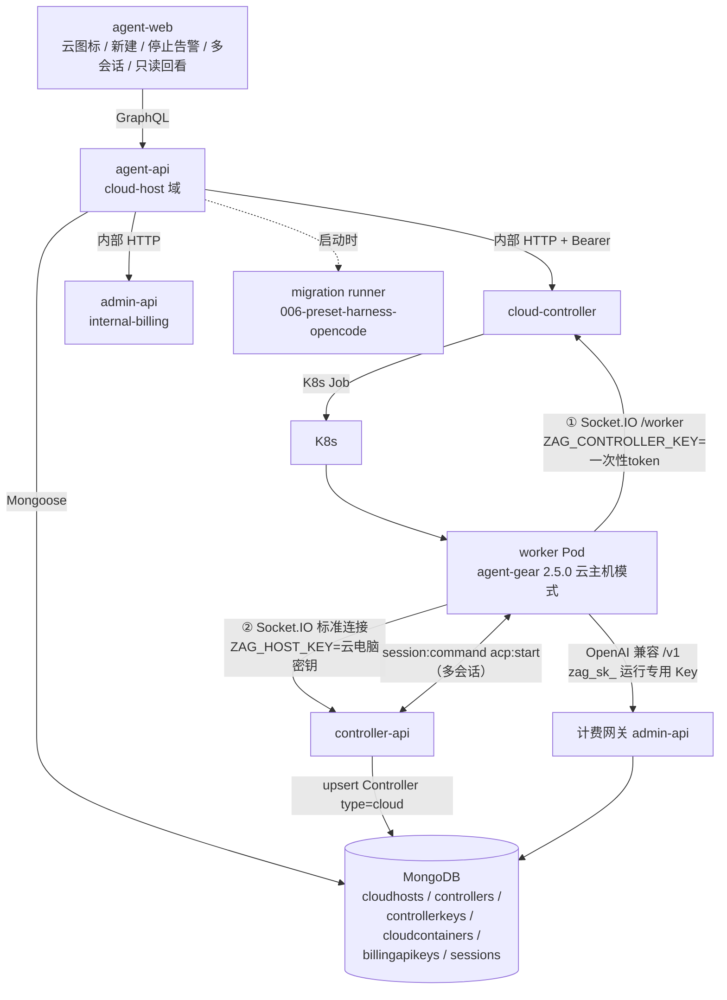
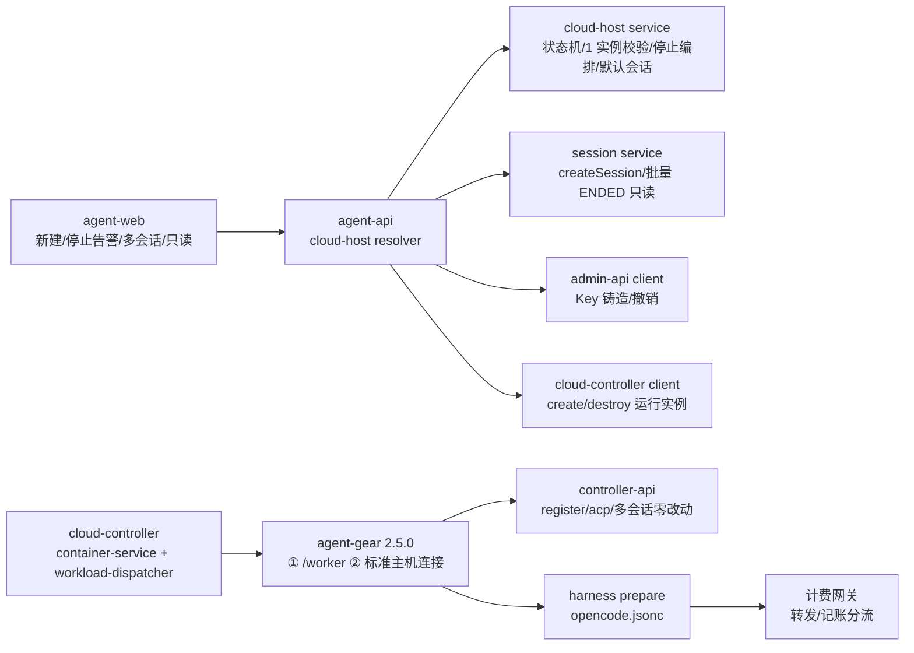
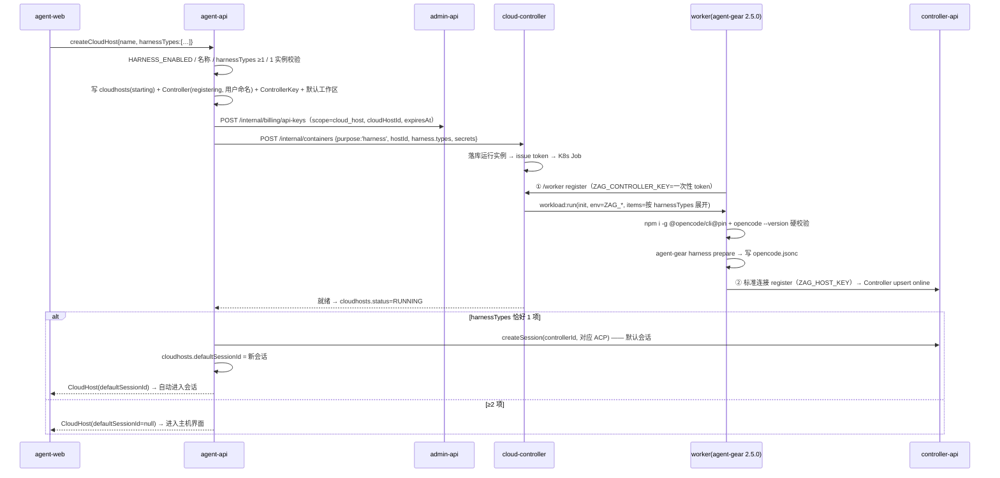
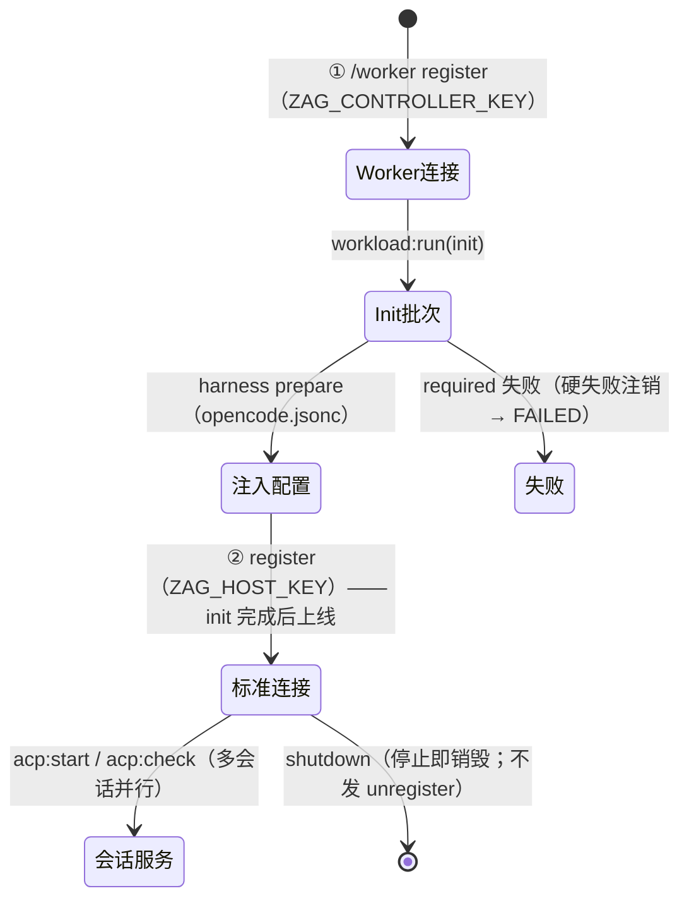
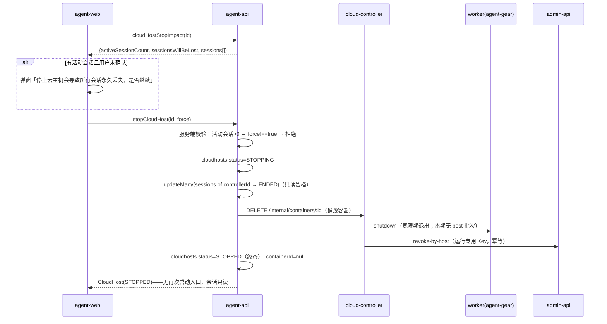

# 容器启动任务支持 harness 类型（OpenCode 云电脑）- 技术提案

**功能名称**: 容器启动任务 harness 类型、OpenCode 云电脑
**关联 PRD**: docs/product/draft/20261020-container-harness-support.md
**技术提案版本**: v5.0
**创建日期**: 2026-10-20
**作者**: ZeroAsh
**feat-branch**: `feat/container-harness-support`

> 术语：本期将 harness 容器定位为用户的**「云电脑」**，在左侧导航栏以**「主机」**（`Controller`）形态呈现。
>
> v2.0 变更（需求重构）：交付面改为前台 agent-web（后台本期不做，`adminStartCloudContainer` 维持仅 `IDLE`）；harness 容器复用既有 `Controller` 主机模型（`ControllerType.cloud`），主机界面与标准「会话」链路（`createSession` → `session:command acp:start`）零改动复用；用户命名。
>
> v3.0 变更（范围裁剪）：统一存储整体二期；会话导入（恢复的会话）二期；会话导出依赖统一存储一并二期。
>
> v4.0 变更（会话与生命周期模型）：一机多会话、手动启动/停止、停止前活动会话告警（force）、harnessTypes 多选与单选默认会话。
>
> v5.0 变更（生命周期简化，整体重写）：
>
> 1. **停止即销毁、不可重新运行**：删除 `startCloudHost` 与重启/Key 重铸语义；`STOPPED` 为**终态**（=已销毁）；停止后会话**批量置 ENDED 且仅只读**（消息留档保留、无「继续会话」路径）。
> 2. **每前台用户同时最多 1 个云电脑实例**：`CLOUD_HOST_MAX_PER_USER=1`；创建时校验存在运行中/启动中/停止中的云电脑即拒绝（`too many cloud hosts`）；销毁后可再新建。
> 3. **会话导入导出二期**（与统一存储同批）：「会话 ↔ 对应 harness 的 JSON 导出/导入、跨云电脑继续会话」不在本期；二期设计输入已记录**状态差异**问题——harness 运行一段时间后，当时容器的状态与重新初始化的截然不同（工作区内容、环境、上下文漂移），导入方案需显式处理。
> 4. 方案阶段允许完全重写：本版为 v5.0 整体重写后的现行设计；历史设计要点（多会话解耦、停止告警 force、harnessTypes 多选/默认会话、`ZAG_HOST_*` 分名、代码事实修正）全部保留。
>
> 保留的代码事实修正：agent-gear **2.5.0**、`MIN_WORKER_VERSION` 保持 `2.2.0` + harness 专用 2.5.0 门禁、worker 镜像未预装 `@opencode/cli`（固定版本安装）、`opencode.jsonc`、tests/api 用 `fetch`、`HARNESS_ENABLED` 开关、`ZAG_HOST_ENDPOINT`/`ZAG_HOST_KEY` 与 `/worker` 一次性 token 分名、默认工作区 `/root/workspace`、init 完成后标准连接再注册上线、ControllerKey 不出现在未绑定密钥列表。

## 1. 概述

### 1.1 背景

`20261014-feat-cloud-agent-phase2` 交付了 K8s 云端工作容器基线；`20261017-feat-cloud-controller-workload` / `20261018-feat-workload-phase1` 交付了工作负载体系；`20261018-feat-credits-billing` 交付了费用中心（计费账户、API Key、OpenAI 兼容计费网关）；「主机」体系（`Controller` + ControllerKey + `homeOverview` + 标准会话 + Harness 工具（ACP）探测）已在 agent-api/controller-api/agent-web 稳定运行。当前事实：

- 云端容器启动任务类型（`purpose`）**仅开放 `idle`**：`servers/admin-api/src/graphql/resolvers/cloud-container.ts`、`servers/cloud-controller/src/routes/internal-api.ts`、`servers/cloud-controller/src/services/container-service.ts` 三处硬编码拒绝其余值。
- worker 镜像（`deploy/images/worker/Dockerfile`）预装 `agent-gear@2.4.x`，**不含 `@opencode/cli`**，也**不再预装** Claude Code / Codex 的 ACP 适配器（`@agentclientprotocol/claude-agent-acp`、`@agentclientprotocol/codex-acp`）；`packages/agent-controller` 当前版本 `2.4.0`。
- agent-gear 连接端点抽象（`parseEndpoint` + `connectToServer`），同一二进制既可拨 `/worker`（工作负载通道），也可按标准 ControllerKey 拨 controller-api 注册为「主机」；`ZAG_CONTROLLER_KEY` 今天承载 `/worker` 一次性 token，与标准 ControllerKey **不可同名复用**。
- `ControllerType` 枚举已有 `cloud` 值；前端硬编码 `type:'local'`，无按主机类型区分的图标。
- 计费 Key（`billingapikeys`）无有效期/作用域概念；多会话由标准会话机制天然支持（`sessions` 按 `controllerId` 多条）；会话消息留档（`acpmessages`）支持历史只读回看。

本期需求（PRD v5.0）：启动任务新增 **harness** 类型并在**前台（agent-web）**交付——用户命名新建**云电脑**、**多选 harness 工具（≥1，一期 OpenCode）**、就绪后按「单选默认会话」规则自动建会话；云电脑以「主机」形态进左侧导航栏（云图标、主机同构、**多会话并存**）；**停止即销毁、不可重新运行**（停止前活动会话告警、停止后会话**只读**）；**每前台用户同时最多 1 个实例**；每次运行注入**专用模型调用凭证**（前台用户模型/计费口径）。

**会话继续能力的边界**：容器销毁后 harness（OpenCode）的会话状态丢失；要在新云电脑上**继续**云上留档的会话，需要「会话 → 对应 harness 的 JSON 导出 + 导入」能力，且 harness 运行一段时间后容器状态与全新初始化截然不同（状态差异）。该能力与统一存储**一起放二期**；一期停止后会话只读、不可继续。

### 1.2 目标

- agent-api 前台云电脑域：`createCloudHost`（命名 + `harnessTypes` ≥1）、`myCloudHosts`、`stopCloudHost(force)`、`cloudHostStopImpact`、`deleteCloudHost`；`HARNESS_ENABLED` 开关；**无 startCloudHost**（停止即终态）。
- **每用户 1 实例**：创建时校验（存在 `STARTING/RUNNING/STOPPING` 的云电脑 → `too many cloud hosts`）。
- 云电脑 = 既有 `Controller`（`type='cloud'`）：一台云电脑（一次运行）对应一个 `Controller` + 一个 `ControllerKey`；销毁后 `Controller` 与会话留档**保留**（只读可追溯），`ControllerKey` 撤销。
- agent-gear 2.5.0 云主机模式双连接——`/worker`（工作负载 init、shutdown）+ controller-api 标准连接（主机/多会话/ACP）。
- **多会话**：标准 `createSession` 在同一 `controllerId` 上多开；会话创建/结束不动云电脑状态；停止时活动会话批量置 `ENDED`（**只读**留档）。
- **默认会话**：`harnessTypes.length === 1` 时就绪后自动创建（`defaultSessionId`）；≥2 不创建。
- `purpose=harness` 在 cloud-controller 内部 API 与 `ContainerService.start` 放开（admin GraphQL 维持 `IDLE` 不动）。
- 预制 harness 工作负载（migration `005`，`workloadKind='harness'`）：按 `harnessTypes` 展开（一期仅「OpenCode（Harness）」：固定版本安装 `@opencode/cli` + 硬校验 + `opencode.jsonc` 注入）。本期无参数、无 post 脚本。
- 运行专用模型 Key（`scope=CLOUD_HOST`、绑定云电脑、`expiresAt`=本次容器有效期）：创建时铸造、停止/终态撤销；可用模型 = 用户个人模型列表；自定义模型不计费、系统模型计费。
- 单元 / API（fetch 风格）/ E2E 测试全绿；普通主机、多会话与后台存量能力零回归。

### 1.3 范围

**做**：

- agent-api 云电脑域（`contracts/cloud-host.graphql`）：创建/列表/停止/停止影响/删除；默认会话编排；活动会话批量 ENDED（只读）；1 实例并发校验。
- `cloudhosts`（一次运行即一生：`STARTING→RUNNING→STOPPING→STOPPED` 终态 + `FAILED`）。
- `Controller` 预创建（`type='cloud'`、`registering`、用户命名）与云图标展示；`ControllerKey(type='cloud')` 创建/撤销、不出现在未绑定密钥列表；销毁后 Controller/会话留档保留。
- agent-gear 2.5.0 云主机模式（双连接、init 完成后再注册上线、不发 `unregister`、默认工作区 `/root/workspace`、`harness prepare` 写 `opencode.jsonc`）。
- cloud-controller：`purpose=harness` 放开、`harnessTypes` 多预设展开、secrets 一次性下发与 env 注入（脱敏）、终态撤销触发、harness 容器 agent-gear ≥2.5.0 门禁。
- migration `005`：「OpenCode（Harness）」预置工作负载（init-only、无参数；多 harness 逐个展开）。
- 运行专用模型 Key（铸造/注入/到期失效/停止撤销，幂等）。
- 计费网关分流（系统模型记账 / 自定义模型代转发不记账）。
- agent-web：Sidebar 云图标、新建云电脑对话框（命名 + harness 多选 + 默认会话提示 + 实例上限提示）、停止（含告警弹窗）、删除、只读会话回看。
- worker 镜像（BUILD.md 校验清单）、`HARNESS_ENABLED` 开关。

**不做**：

- **重新运行/重启**：云电脑停止即销毁，无 `startCloudHost`、无重启、无 Key 重铸。
- **会话导入导出（二期，与统一存储同批）**：会话 ↔ harness JSON 导出/导入、跨云电脑继续会话（含状态差异处理：harness 长时间运行后的容器状态与全新初始化截然不同）、「存储会话」「恢复的会话」参数、`optionsSource`、post 脚本。**一期停止后会话只读、不可继续**。
- **统一存储（整体二期）**：S3 桶、类 S3 CRUD+list、`storage*` 集合、quota-guard、user-path、「我的存储」。
- 后台（admin-web/admin-api）harness 入口——二期。
- 第二个 harness 工具的预置工作负载——`harnessTypes` 白名单与多预设展开机制预留，本期仅 `opencode`。
- 云电脑规格/计费规格选择、定时启停、自动休眠。
- 云电脑工作区内容持久化（停止即销毁）。
- 计费口径变化（定价/账单/支付链路不动）。

## 2. 技术架构

### 2.1 系统架构图



关键边界：

- **一次运行即一生**：`cloudhosts`（agent-api，用户侧云电脑事实源）与 `cloudcontainers`（cloud-controller，运行事实源）1:1（本期无重启，`hostId` 关联）；停止 = 容器销毁 + `cloudhosts.status=STOPPED`（终态）。
- **云电脑 = `Controller`（`type='cloud'`）**：销毁后 `Controller` 记录保留（`controllerId` 稳定），会话与消息留档始终可追溯、只读回看；`homeOverview`/`acpCapabilities`/`createSession` 零改动复用。
- agent-gear **双连接**：`/worker` 通道保留工作负载体系；标准通道承载主机/多会话。
- 模型 Key 由 admin-api 铸造/撤销（`scope=CLOUD_HOST`），绑定云电脑 ID；停止/终态撤销（无重铸）。
- 会话生命周期归 agent-api（`sessions`）：创建走既有 `createSession`；停止时按 `controllerId` 批量置 `ENDED`（消息留档保留 → 只读回看）。

### 2.2 技术栈

| 层级 | 技术选型 | 说明 |
|------|---------|------|
| 前端 | React + TypeScript + Vite + Apollo Client | agent-web，复用 Sidebar/NewSessionDialog/确认弹窗/只读会话组件 |
| 后端 | Node.js + Express + GraphQL + Mongoose | agent-api（云电脑域/会话编排/主机预创建）、cloud-controller（运行生命周期/env/撤销）、admin-api（internal-billing） |
| Worker | Node.js（agent-gear 2.5.0） | 云主机模式（双连接）、harness prepare（`opencode.jsonc` 注入） |
| 数据库 | MongoDB | 新增 `cloudhosts`；扩展 `cloudcontainers`、`billingapikeys` |
| 消息 | RabbitMQ | 沿用计费事件通道；`container.destroyed` 作为 Key 撤销兜底 |
| 协议 | GraphQL + 内部 HTTP + Socket.IO | 云电脑/会话走 GraphQL；worker 双 Socket.IO |

### 2.3 模块划分



| 模块 | 职责 | 关键技术点 |
|------|------|-----------|
| agent-api cloud-host service | 创建/停止/删除、状态机、1 实例校验、停止影响、默认会话 | force 校验、幂等、凭据编排回滚 |
| agent-api session service（复用+扩展） | 多会话创建、停止批量置 ENDED（只读） | 沿用 `createSession`；批量更新按 `controllerId` |
| agent-api controller 预创建 | `Controller(type=cloud, registering, 用户命名)` + `ControllerKey(type=cloud)` | 销毁后 Controller 留档、Key 撤销 |
| cloud-controller container-service | `purpose=harness` 运行生命周期、secrets→env、终态撤销 | `hostId` 落库、2.5.0 门禁、脱敏 |
| cloud-controller workload-dispatcher | init 批次 + 容器级 `env` | `workload:run` 扩展 `env` |
| agent-gear 云主机模式 | 双连接、init 后再上线、不发 unregister | 2.5.0；`ZAG_HOST_*` 与 `ZAG_CONTROLLER_KEY` 分名 |
| agent-gear harness prepare | `opencode.jsonc` 注入 | 幂等合并、secret 脱敏 |
| admin-api internal-billing | 运行专用 Key 铸造/撤销 | `scope=CLOUD_HOST`、`cloudHostId`、`expiresAt` |
| admin-api billing-openai | Key 模型范围与转发/记账分流 | 自定义模型代转发不记账 |
| agent-web | 云图标、新建（多选+默认会话提示+上限）、停止告警、只读回看 | `type==='cloud'` 分支；确认弹窗 |

## 3. API 设计

### 3.1 API 契约

新增：`contracts/cloud-host.graphql`。
扩展：`contracts/agent-controller.graphql`（语义澄清）、`contracts/agent-controller-websocket.md`（云主机注册约定）、`contracts/cloud-controller-websocket.md`（purpose/harnessTypes/secrets/env/门禁）、`contracts/admin-billing.graphql`（Key scope）、`contracts/billing-openai.openapi.yaml`（运行专用 Key 分流）。
**不在本期改动**：`contracts/admin-cloud-container.graphql`、`contracts/admin-cloud-workload.graphql`。
**二期新增（本期不建）**：`contracts/unified-storage.openapi.yaml`、`contracts/admin-unified-storage.graphql`、会话导入导出契约（会话 ↔ harness JSON）。

#### 3.1.1 前台云电脑（`contracts/cloud-host.graphql` 新增）

```graphql
# 云电脑（harness 容器）前台契约
#
# 鉴权：Authorization: Bearer <user JWT>；未认证 UNAUTHENTICATED（`Not authenticated`）。
# 数据归属：
# - `cloudhosts`：用户侧云电脑事实源，agent-api 写（一次运行即一生）。
# - `controllers`/`controllerkeys`：agent-api 预创建（type=cloud），controller-api 注册时 upsert；
#   销毁后 Controller 保留（会话留档可追溯），Key 撤销。
# - `cloudcontainers`：运行实例，cloud-controller 写（单一事实源），agent-api 经内部 HTTP 代理。
# - `sessions`：标准会话（多会话），agent-api 写；停止时批量置 ENDED 并**只读**（消息留档保留）。
# 校验（服务端强制，契约级）：
# - `harnessTypes` 去重后 ≥1 且全部在白名单（一期仅 OPENCODE）；
# - **每用户同时最多 1 个实例**：存在 STARTING/RUNNING/STOPPING 的云电脑时 `createCloudHost` 拒绝；
# - `stopCloudHost`：存在活动会话且 `force !== true` 时拒绝；STOPPED 为终态（无 startCloudHost）；
# - `deleteCloudHost` 仅 STOPPED/FAILED 可用；所有写操作限属主；
# - `HARNESS_ENABLED=false` 时全部入口返回 `harness feature is disabled`。

enum HarnessType { OPENCODE }   # 一期仅 OPENCODE；二期扩展枚举 + 新增预置工作负载

enum CloudHostStatus {
  STARTING   # 创建/启动中（容器拉起 + init；Controller.status=registering）
  RUNNING    # 运行中（init 完成、标准连接已注册）
  STOPPING   # 停止中（会话批量只读化 + 容器收尾）
  STOPPED    # 已停止=已销毁（终态，不可重新运行；会话只读）
  FAILED     # 启动/运行失败（failureReason 有值；可删除后重新新建）
}

type CloudHost {
  id: ID!                       # 云电脑 ID（一次运行即一生）
  name: String!                 # 用户命名（= Controller.name）
  controllerId: ID!             # 关联主机（销毁后保留，会话留档归属）
  status: CloudHostStatus!
  harnessTypes: [HarnessType!]! # ≥1，创建时选定
  defaultSessionId: ID          # 单 harness 自动创建的默认会话；其余为 null
  activeSessionCount: Int!      # 当前活动会话数（非 ENDED）
  containerId: ID               # 运行实例；STOPPED/FAILED 后为 null（留档在 cloudcontainers 可查）
  createdAt: String!
  readyAt: String
  stoppedAt: String
  failureReason: String
}

# 停止影响（停止前告警数据源）
type CloudHostStopImpact {
  activeSessionCount: Int!
  sessionsWillBeLost: Boolean!              # = activeSessionCount > 0
  sessions: [CloudHostSessionSummary!]!     # 活动会话摘要
}

type CloudHostSessionSummary {
  id: ID!
  title: String
  acpServerType: AcpServerType!
  status: String!
}

input CreateCloudHostInput {
  name: String!                       # trim 后 1~64 字符，用户命名
  harnessTypes: [HarnessType!]!       # 去重后 ≥1
}

type Query {
  myCloudHosts: [CloudHost!]!
  # 停止影响查询（停止确认弹窗数据源；无活动会话时 sessionsWillBeLost=false）
  cloudHostStopImpact(id: ID!): CloudHostStopImpact!
}

type Mutation {
  createCloudHost(input: CreateCloudHostInput!): CloudHost!   # 创建即启动
  # force：存在活动会话时必须显式 true（对应弹窗确认）；无活动会话时可省略。
  # 成功后为终态：不可重新运行，会话转只读。
  stopCloudHost(id: ID!, force: Boolean): CloudHost!
  deleteCloudHost(id: ID!): Boolean!   # 仅 STOPPED/FAILED；幂等；留档保留
}
```

错误文案（逐字）：

| 条件 | 错误 |
|------|------|
| `HARNESS_ENABLED=false` | `harness feature is disabled` |
| `name` 为空/超长 | `name is required` / `name is too long` |
| `harnessTypes` 为空 | `at least one harness type is required` |
| `harnessTypes` 含白名单外值 | `unsupported harness type: <type>` |
| 存在运行中/启动中/停止中的云电脑再创建 | `too many cloud hosts`（每用户同时 1 个实例） |
| `stopCloudHost` 有活动会话且 `force !== true` | `stopping this cloud host will permanently lose all active sessions` |
| `stopCloudHost` 已 STOPPED/FAILED | 幂等返回当前状态（不报错） |
| `deleteCloudHost` 非 STOPPED/FAILED | `stop the cloud host before deleting` |
| 控制面不可达（创建/停止/删除） | `control plane unavailable`（写不降级） |

**默认会话规则（契约级）**：`createCloudHost` 收到 `harnessTypes` 去重后**恰好 1 项**时，服务端在云电脑就绪（init 成功、RUNNING）后自动创建一个使用该 harness 对应 ACP 的标准会话并写入 `defaultSessionId`；**≥2 项时不创建**。默认会话创建失败不影响云电脑可用（`defaultSessionId=null`，前端提示可手动创建）。

**停止语义（契约级，终态）**：`stopCloudHost` 成功后——容器运行销毁；该云电脑下所有非 `ENDED` 会话批量置 `ENDED`（**只读**：消息留档保留可查看，无「继续会话」路径，本期无恢复手段）；运行专用模型 Key 撤销；`cloudhosts.status=STOPPED`（终态，**不可重新运行**）；`Controller` 记录保留（心跳超时转 offline），云电脑条目继续展示（会话只读回看）。**无 `startCloudHost`**；需要新云电脑时重新 `createCloudHost`（受 1 实例上限约束）。

#### 3.1.2 Controller 主机语义（`contracts/agent-controller.graphql` 澄清、`agent-controller-websocket.md` 约定）

- `ControllerType.cloud` 落地：agent-api 在创建云电脑时预创建 `Controller { type:'cloud', status:'registering', name:<用户命名>, keyId }`；agent-gear 以 `ControllerKey(type='cloud')` 注册，controller-api `register` 的 `findOneAndUpdate({keyId}, {..., status:'online'}, {upsert:true})` 沿用（`$setOnInsert.name` 不覆盖用户命名）。
- 状态展示：`Controller.status`（registering/online/offline）反映**本次运行**连接情况；`CloudHost.status` 反映生命周期；前端以 `CloudHost.status` 为主、心跳离线为辅（与普通主机同口径）。
- **云主机注册约定**（`agent-controller-websocket.md` 增补）：云主机模式不发送 `unregister`（本地卸载语义）；停止/删除由 agent-api 编排清理（Key 撤销、Controller 留档）。
- 云电脑的 `ControllerKey` 不出现在「未绑定密钥」列表（前端过滤 `type==='cloud'`）。
- 云图标：agent-web 按 `controller.type === 'cloud'` 渲染（普通主机维持现状）。

#### 3.1.3 模型调用凭证与计费分流（`admin-billing.graphql` / `billing-openai.openapi.yaml` 扩展）

`BillingApiKey` 扩展：

```graphql
enum BillingApiKeyScope { ACCOUNT CLOUD_HOST }

type BillingApiKey {
  # ...existing fields...
  scope: BillingApiKeyScope!
  cloudHostId: ID     # scope=CLOUD_HOST 时非空 = 云电脑 ID
  expiresAt: String   # scope=CLOUD_HOST 时非空 = 本次容器有效期
}
```

- `createCloudHost` 铸造一枚运行专用 Key（`expiresAt` = 容器有效期）；`stopCloudHost`/`deleteCloudHost`/容器终态**撤销该云电脑的 active Key**（幂等）。本期无重启 → 无重铸。
- 计费网关语义（`scope=CLOUD_HOST`）：`expiresAt` 过期 **或** 云电脑非 RUNNING **或** Key 已撤销 → `401 invalid api key`。
- `GET /v1/models`：返回 Key 属主**个人可用模型列表**（启用的系统模型 + 其自定义模型）；后台口径预留。
- `POST /v1/chat/completions`：自定义模型 → 网关代转发（用户凭据留服务端、不进容器）**不记账**；系统模型 → 既有计费链路计入用户计费账户。

内部接口（`routes/internal-billing.ts` 扩展）：`POST /internal/billing/api-keys`（body 增 `scope`/`cloudHostId`/`expiresAt`）、`POST /internal/billing/api-keys/:id/revoke`、`POST /internal/billing/api-keys/revoke-by-host`（按 `cloudHostId` 撤销全部 active，幂等）。

### 3.2 内部接口

#### 3.2.1 agent-api → cloud-controller（运行实例，`POST /internal/containers` 扩展）

```jsonc
{
  "purpose": "harness",                  // idle | harness（其余沿用 400 UNSUPPORTED_PURPOSE）
  "hostId": "<cloudHostId>",             // 云电脑 ID
  "refId": "<controllerKeyId>",
  "userId": "<owner>",
  "harness": { "types": ["opencode"] },  // 多选展开；二期追加会话导入导出参数
  "workloadPlan": [ /* 按 harnessTypes 展开预置工作负载（init-only）+ 依赖项 */ ],
  "billingAccountId": "…",
  "secrets": {                            // 一次性下发，仅用于 env 注入，不落库明文
    "hostEndpoint": "wss://<controller-api>",
    "hostKey": "zag_k_1_…",              // 云电脑 ControllerKey（非 /worker token）
    "modelApiKey": "zag_sk_…"            // 运行专用
  },
  "hostName": "<用户命名>",
  "agentGearMinVersion": "2.5.0"
}
```

- `GET /internal/containers?hostId=`（状态代理）、`DELETE /internal/containers/:id`（停止编排中先批量只读化会话再调用）。

#### 3.2.2 cloud-controller → admin-api（撤销，幂等三线）

- `POST /internal/billing/api-keys/revoke-by-host`（按 `cloudHostId`）。
- 触发线 1：容器终态/`destroy()` 完成；线 2：`container.destroyed` 计费事件消费兜底；线 3：admin-api 定时对账（「云电脑处于 `STOPPING`/`STOPPED`/`FAILED` 等非合法态或 Key 已过期/缺 expiry 但 Key 仍 active」）。**`STARTING` 窗口 Key 必须存活**（Key 在 STARTING 期铸造、本期无重铸），由网关实时校验拒绝非 `RUNNING` 调用。

#### 3.2.3 Worker ↔ cloud-controller（Socket.IO `/worker` 扩展）

`workload:run` payload 增加容器级 `env`：

```jsonc
{
  "phase": "init",
  "env": {
    "ZAG_HARNESS_TYPES": "opencode",       // 多选逗号分隔
    "ZAG_CONTAINER_ID": "…",
    "ZAG_HOST_ID": "<cloudHostId>",
    "ZAG_HOST_NAME": "<用户命名>",
    "ZAG_HOST_ENDPOINT": "wss://<controller-api>",   // 标准连接端点
    "ZAG_HOST_KEY": "zag_k_1_…",                      // 标准连接密钥
    "ZAG_DEFAULT_WORKSPACE": "/root/workspace",
    "ZAG_USER_TYPE": "front_user",
    "ZAG_USER_ID": "…",
    "ZAG_MODEL_API_KEY": "zag_sk_…",
    "ZAG_MODEL_BASE_URL": "https://…/v1",
    "ZAG_MODEL_IDS": "model-1,model-2"
  },
  "items": [ /* 同现状 */ ]
}
```

> 命名冲突修正：`ZAG_CONTROLLER_KEY`/`ZAG_SERVER_ENDPOINT` 维持现状（`/worker` 一次性 token 与端点）；标准连接改用 `ZAG_HOST_KEY`/`ZAG_HOST_ENDPOINT`。

- secret 值仅随下发报文存在；日志对 `ZAG_HOST_KEY`/`ZAG_MODEL_API_KEY` 统一 `***` 脱敏。
- 版本门禁：`MIN_WORKER_VERSION` 保持 `2.2.0`；harness 运行按 `agentGearMinVersion=2.5.0` 单独门禁。

## 4. 数据模型

### 4.1 数据库设计

#### 集合: `cloudhosts`（新增，云电脑事实源，agent-api 写；一次运行即一生）

| 字段 | 类型 | 说明 |
|------|------|------|
| userId | string | 属主前台用户，索引（1 实例校验：按 `userId` + 状态 ∈ {starting,running,stopping} 计数） |
| name | string | 用户命名（1~64） |
| harnessTypes | string[] | 去重 ≥1（一期 `['opencode']`） |
| status | string | `starting/running/stopping/stopped/failed`（`stopped` 终态） |
| controllerId / keyId | ObjectId | 关联 `controllers`/`controllerkeys` |
| containerId | ObjectId \| null | 运行实例 `cloudcontainers`；stopped/failed 后 null（留档可查） |
| defaultSessionId | ObjectId \| null | 单 harness 自动创建的默认会话 |
| startedAt / stoppedAt / failureReason | | 生命周期留档 |
| createdAt / updatedAt | | timestamps |

#### 集合: `controllers` / `controllerkeys`（复用 + 约定）

- `Controller(type='cloud')` 一台云电脑一条；**销毁后保留**（会话/消息留档可追溯），仅撤销 Key、从主机列表移除（`deleteCloudHost`）。
- `ControllerKey(type='cloud')`：创建云电脑时生成（raw key 注入 `ZAG_HOST_KEY`），停止/删除时撤销；前端未绑定密钥列表过滤 `type==='cloud'`。

#### 集合: `cloudcontainers`（扩展，运行实例——cloud-controller 写）

| 字段 | 类型 | 说明 |
|------|------|------|
| purpose | string | 枚举扩展 `harness` |
| hostId | ObjectId | 云电脑（`cloudhosts`），索引（本期 1:1） |
| userId | string | 属主 |
| harnessTypes | string[] | 本次展开的工具 |
| controllerKeyId | ObjectId | |
| containerApiKeyId | ObjectId \| null | 运行专用模型 Key（停止/终态撤销） |

#### 集合: `sessions`（复用 + 约定）

- 多会话：同一 `controllerId` 多条；创建/结束**不触发**云电脑状态变化（服务端强制）。
- 停止编排：`updateMany({controllerId, status: {$ne: 'ended'}}, {status:'ended', endedAt})`；消息留档（`acpmessages`）保留。
- **只读口径**：`ENDED` 会话仅可读（历史消息回看），无「继续会话」命令路径——服务端对 `ENDED` 会话的 `session:command`（acp:start 等）一律拒绝（`session is ended`），前端只读渲染。

#### 集合: `controllerworkspaces`（复用）

- 创建云电脑时预置默认工作区 `{userId, controllerId, name:'workspace', path:'/root/workspace', isEnabled:true}`，多会话共用。

#### 集合: `billingapikeys`（扩展）

| 字段 | 类型 | 说明 |
|------|------|------|
| scope | string | `account`（现状）/ `cloud_host` |
| cloudHostId | ObjectId \| null | scope=cloud_host 非空，索引；撤销按此聚合 |
| expiresAt | Date \| null | = 本次容器有效期；`< now` 视同失效 |

#### 集合: `admin_migrations`（新增批次）

- `006-preset-harness-opencode`：预置工作负载「OpenCode（Harness）」（presetKey `harness-opencode`、`workloadKind='harness'`、`harnessType='opencode'`、`isPreset=true`、`paramSchema=[]`、仅 init 脚本）。二期新增 harness 时追加预置项，展开机制不变。

### 4.2 缓存设计

- 不引入新缓存：ACP 能力沿用既有 Redis 缓存（`acp:capability:*` 1h）；停止影响直查 `sessions`（按 `controllerId` 计数）。
- 计费网关模型列表判定沿用现有 pricing 查询。

## 5. 技术实现方案

### 5.1 核心流程

#### 5.1.1 创建云电脑（1 实例上限 + 默认会话规则）



- 默认会话创建失败：`defaultSessionId=null`、云电脑保持 RUNNING、前端提示「可手动创建会话」。
- 1 实例校验在 per-user keyed-mutex 内完成（防并发双开）。

#### 5.1.2 启动计划展开（多 harness）

1. agent-api 按 `harnessTypes` 为每个工具展开对应预置工作负载（一期仅 `opencode` →「OpenCode（Harness）」；`paramSchema=[]`）。
2. 依赖展开沿用 `workload-plan`；执行序：被依赖项 → 各 harness 工作负载；每项 `required=true`（硬失败，沿用工作负载三期语义）。
3. 白名单映射 `SUPPORTED_HARNESS_TYPES: { opencode: presetKey 'harness-opencode' }`，二期新增工具仅扩映射与预置项。
4. 二期会话导入导出参数随各 harness 工作负载参数接入（本期 `paramSchema=[]`）。

#### 5.1.3 云主机模式（agent-gear 2.5.0 双连接）与多会话



- 双连接并存于同一 agent-gear 进程；**init 全部成功后**标准连接才注册上线。
- 多会话：`session:command acp:start` 按 `sessionId` 并行拉起多个 ACP 进程（既有 `process-registry` 支持）；会话创建/结束不触碰 `/worker` 通道。
- 不发 `unregister`；停止 = 容器销毁（Agent 进程随容器消亡）。

#### 5.1.4 停止即销毁（含告警）与只读回看



- `stopCloudHost` 幂等（已 STOPPED/FAILED 直接返回）；**无 `startCloudHost`**。
- 只读口径：`ENDED` 会话无「继续会话」命令路径（服务端拒绝 `session:command`，前端只读渲染历史）。
- `deleteCloudHost`：仅 STOPPED/FAILED；撤销 `ControllerKey`、移除主机条目；`Controller` 与会话/消息留档保留（历史可追溯）。

#### 5.1.5 OpenCode 配置注入（custom provider，`opencode.jsonc`）

`agent-gear harness prepare` 写 `~/.config/opencode/opencode.jsonc`（存在则合并 `provider.zag`），格式按 https://opencode.ai/v2/docs/providers/#custom：

```jsonc
{
  "provider": {
    "zag": {
      "npm": "@ai-sdk/openai-compatible",
      "name": "ZAG Model Gateway",
      "options": { "baseURL": "<ZAG_MODEL_BASE_URL>", "apiKey": "<ZAG_MODEL_API_KEY>" },
      "models": { "<modelId>": { "name": "<displayName>" } }
    }
  }
}
```

- `models` 取 `ZAG_MODEL_IDS`（按用户个人模型列表快照）；自定义模型经网关分流不计费。
- Key 有效期 = 本次容器有效期；停止/终态撤销（无重铸，本期无重启）。

### 5.2 关键实现点

#### 实现点 1: 云电脑生命周期状态机（agent-api cloud-host service）

- **描述**: `cloudhosts` 状态机 `STARTING→RUNNING→STOPPING→STOPPED`（终态）+ `FAILED`；`createCloudHost`（含 1 实例校验）/`stopCloudHost(force)`/`deleteCloudHost`/`cloudHostStopImpact`；无 start。
- **技术细节**: per-user keyed-mutex 内做 1 实例校验与创建；per-host keyed-mutex 内做停止编排（会话批量 ENDED → 停容器 → 撤销 Key → STOPPED）；任一步失败回滚凭据并置 FAILED + `failureReason`；控制面不可达写不降级；全部操作幂等。
- **风险点**: `force` 校验必须服务端强制；停止统计与实际停止竞态（同 mutex 内二次校验）；默认会话失败不回滚云电脑。

#### 实现点 2: Controller/Key 预创建与云图标（agent-api / agent-web）

- **描述**: `Controller(type='cloud', registering, 用户命名)` + `ControllerKey(type='cloud')` 创建于 `createCloudHost`；销毁后 Controller 留档、Key 撤销。Sidebar 云图标 + 「新建云电脑」入口（harness 多选 + 默认会话提示 + 实例上限禁用态）。
- **技术细节**: `homeOverview.controllers` 自动包含；未绑定密钥列表过滤 `type==='cloud'`；`registering` 展示「启动中」；`NewSessionDialog` 仅 RUNNING 可选该云电脑。
- **风险点**: 存量 `GenerateKeyDialog` 硬编码 `type:'local'` 不动；`unregister` 不发。

#### 实现点 3: 停止告警与会话只读化（agent-api / agent-web）

- **描述**: `cloudHostStopImpact` 统计非 ENDED 会话（摘要）；`stopCloudHost(id, force)` 服务端校验（`stopping this cloud host will permanently lose all active sessions`）；前端弹窗「停止云主机会导致所有会话永久丢失，是否继续」。停止时会话批量置 `ENDED`，服务端对 `ENDED` 会话拒绝 `session:command`（`session is ended`），前端只读渲染。
- **技术细节**: 批量 `updateMany`（`endedAt`）；消息留档不动；无活动会话不弹窗、`force` 可省略。
- **风险点**: 只读口径需前后端双执行（服务端拒绝为主）；既有会话「已结束」语义复用对齐。

#### 实现点 4: 默认会话编排与 1 实例上限（agent-api）

- **描述**: `harnessTypes` 去重后长度 1 → 就绪后走既有 `createSession`（`acpServerType` 由 harnessType 映射、`workspaceId`=默认工作区）→ `defaultSessionId`；≥2 不创建。1 实例上限：创建前统计该用户 `STARTING/RUNNING/STOPPING` 云电脑，非零拒绝 `too many cloud hosts`（`CLOUD_HOST_MAX_PER_USER=1`）。
- **技术细节**: 复用 `services/session.ts` `create()` 全量校验；默认会话失败仅记录；幂等（已有 `defaultSessionId` 不重建）。
- **风险点**: 并发创建双开（keyed-mutex）；默认会话与手动创建并发互不干扰。

#### 实现点 5: agent-gear 2.5.0 云主机模式（packages/agent-controller）

- **描述**: `src/cloud-host/supervisor.ts`（双连接、init 后再上线、不发 unregister）、`src/harness/prepare.ts`、`src/cli/harness.ts`；`CONTROLLER_VERSION='2.5.0'`；标准连接读 `ZAG_HOST_ENDPOINT`/`ZAG_HOST_KEY`。
- **技术细节**: 多会话沿用既有 `acp/spawner` + `process-registry` 并行；`harness prepare` 幂等合并 `opencode.jsonc`、secret 脱敏；`ZAG_HOST_*` 缺失（非云主机模式）明确报错。
- **风险点**: 双连接断线互不干扰；停止时两连接同时收尾。

#### 实现点 6: purpose=harness 全链路（cloud-controller）

- **描述**: `routes/internal-api.ts` / `container-service.ts` 白名单 `idle|harness`（其余维持「该任务类型暂未开放」）；`CONTAINER_PURPOSES` 扩展 `harness`；`hostId`/`harnessTypes` 落库；secrets→`workload:run env`；终态触发 `revoke-by-host`；harness 运行 `agentGearMinVersion=2.5.0` 门禁。**admin GraphQL 不动**。
- **技术细节**: secret 脱敏 helper；`MIN_WORKER_VERSION` 保持 2.2.0；运行实例按 `hostId` 可查。
- **风险点**: 存量 idle 回归；secrets 进日志路径（脱敏单测）。

#### 实现点 7: 运行专用模型 Key（admin-api / cloud-controller）

- **描述**: `api-key-service` 增加 `createCloudHostScopedKey({cloudHostId, expiresAt})`、`revoke(id)`、`revokeByCloudHost(cloudHostId)`（幂等）；创建铸造、停止/终态撤销（本期无重铸）。
- **技术细节**: 明文仅铸造时返回一次；`expiresAt` 由 cloud-controller 按 Job `activeDeadlineSeconds` 回传；三线撤销兜底（§3.2.2）。
- **风险点**: 撤销幂等（重复撤销/先撤销后到期）。

#### 实现点 8: 计费网关分流（前台口径）

- **描述**: `routes/billing-openai.ts` 鉴权后解析 Key：`scope=CLOUD_HOST` 校验（过期/云电脑非 RUNNING/已撤销 → `401 invalid api key`）；`/v1/models` 按用户个人模型列表；`/v1/chat/completions` 自定义模型代转发不记账、系统模型走计费链路。
- **技术细节**: 自定义模型 ID 判定沿用 `llm` 域口径；SSE 流式透传；不记账路径不产生 MeteringRecord/outbox。
- **风险点**: 代转发超时/错误映射；用户凭据不出服务端。

#### 实现点 9: 预置 harness 工作负载展开（admin-api migration 005）

- **描述**: 写入「OpenCode（Harness）」（presetKey `harness-opencode`、`workloadKind='harness'`、`harnessType='opencode'`、init-only、`paramSchema=[]`）；`SUPPORTED_HARNESS_TYPES` 映射驱动 `workloadPlan` 展开（多选逐个展开、每项 required）。
- **技术细节**: 固定版本安装 `npm install -g @opencode/cli@<pin>` + `opencode --version` 硬校验；migration 幂等不覆盖。
- **风险点**: 多预置项执行序（依赖优先）；二期新增工具只增不改。

#### 实现点 10: agent-web 云电脑体验

- **描述**: Sidebar 云图标与状态；`NewCloudHostDialog`（名称必填、`harnessTypes` 多选 ≥1、「选 1 个将自动创建会话」提示、实例上限禁用态）；主机详情（停止/删除、活动会话数）；停止确认弹窗（`cloudHostStopImpact` 驱动）；已销毁云电脑的**只读会话回看**（无发送/继续入口）。
- **技术细节**: 复用 `homeOverview` 数据流与既有只读会话渲染；删除运行中云电脑内联停止确认。
- **风险点**: 弹窗数据过期（打开时拉取 impact，确认时服务端再校验）；移动端布局回归。

### 5.3 预置脚本（migration 内置，示意）

#### OpenCode（Harness）init 脚本（本期唯一脚本，无 post 脚本）

```bash
#!/usr/bin/env bash
set -euo pipefail

# 1) 安装/校验 OpenCode CLI（镜像未预装，固定版本幂等安装）
if ! command -v opencode >/dev/null 2>&1; then
  npm install -g "@opencode/cli@${OPENCODE_CLI_PIN:-pin}"
fi
opencode --version   # 必须校验成功，避免「安装返回 0 但不可用」

# 2) 默认工作区 + 模型配置注入（opencode.jsonc，custom provider）
agent-gear harness prepare
```

> 需求原文写作 `npm install -g @opencode-cli`；官方包名为 `@opencode/cli`（worker 镜像当前**未预装**，由本脚本固定版本安装）。
> 二期追加会话导出（post 脚本：`opencode session list/export` → harness JSON 写统一存储）与导入（`opencode session import`）时，须处理**状态差异**——harness 运行一段时间后容器状态与全新初始化截然不同（工作区内容、环境、上下文漂移）；本脚本保持向后兼容扩展。

## 6. 技术决策

### 6.1 决策列表

| # | 决策 | 选项 A | 选项 B | 最终选择 | 原因 |
|---|------|--------|--------|---------|------|
| 1 | 交付面 | 后台 admin-web | 前台 agent-web | B | 需求重构；后台本期不做 |
| 2 | 云电脑建模 | 新建独立实体/页面 | 复用 `Controller`（`type='cloud'`） | B | 主机同构零成本；会话/ACP 零改动 |
| 3 | 生命周期 | 可重启（start/stop） | **停止即销毁、不可重新运行**（终态） | B | 需求 v5.0；大幅简化状态机/Key/会话语义 |
| 4 | 停止后会话 | 删除/丢失 | **批量 ENDED + 只读留档**（服务端拒绝继续） | B | 「会话只能只读，无法继续」；历史可回看 |
| 5 | 会话与电脑关系 | 一会话绑定一台 | 一机多会话、生命周期解耦、零会话运行 | B | 需求 v4.0 保留 |
| 6 | 停止影响 | 直接停止 | stopImpact + `force` 服务端强制 + 弹窗告警 | B | 「会话永久丢失」必须知情确认 |
| 7 | 实例上限 | N 台 | **每前台用户同时 1 个实例** | B | 需求 v5.0；per-user keyed-mutex 校验 |
| 8 | 会话导入导出 | 一期做 | 二期（与统一存储同批） | B | 需求 v5.0；状态差异问题列入二期设计输入 |
| 9 | Key 归属 | containerId=运行实例 | `cloudHostId`=云电脑（按电脑撤销） | B | 停止/删除一键撤销；语义清晰 |
| 10 | Key 重铸 | 重启重铸 | 一次运行一枚（无重铸） | B | 无重启后简化 |
| 11 | harness 选择 | 单值 `harnessType` | 数组 `harnessTypes`（≥1）+ 多预设展开 | B | 需求：至少一个、可多选；二期新增工具不改流程 |
| 12 | 默认会话 | 总是/从不创建 | 恰好 1 个 harness 时创建，≥2 不创建 | B | 需求明确规则 |
| 13 | 默认会话失败 | 启动失败回滚 | 云电脑可用 + 提示可手动创建 | B | 会话是增值项 |
| 14 | 标准连接凭据命名 | 复用 `ZAG_CONTROLLER_KEY` | `ZAG_HOST_KEY`/`ZAG_HOST_ENDPOINT` | B | 与 `/worker` 一次性 token 冲突 |
| 15 | OpenCode 安装 | `@opencode-cli` | `@opencode/cli` 固定版本安装 | B | 官方包名；镜像未预装 + 硬校验 |
| 16 | harness 载体 | 代码写死流程 | 预置工作负载（presetKey + 映射表） | B | 复用工作负载留档/必须失败 |
| 17 | worker 通道 | 仅标准连接 | 双连接（`/worker` + 标准连接） | B | 保留工作负载 init/留档/shutdown |
| 18 | 主机命名 | register 携带 name | 预创建 `Controller(name, registering)` | B | 创建即上列表；register 不覆盖命名 |
| 19 | 云电脑清理 | 发 `unregister` | 不发，编排清理（Key 撤销、Controller 留档） | B | 卸载语义；留档保会话可追溯 |
| 20 | 版本门禁 | 提升 `MIN_WORKER_VERSION` | 保持 2.2.0 + harness 专用 2.5.0 | B | 存量 idle 零影响 |
| 21 | 自定义模型调用 | 注入用户凭据进容器 | 网关代转发，凭据留服务端 | B | 凭据不落容器；网关统一决定计费 |
| 22 | 配置文件 | `opencode.json` | `opencode.jsonc` | B | 与 opencode CLI 约定一致（按实测） |
| 23 | 功能开关 | 无 | `HARNESS_ENABLED`（toBool） | B | 灰度与回滚 |

### 6.2 依赖与约束

| 类型 | 内容 | 说明 |
|------|------|------|
| 依赖 | 主机/会话/ACP 体系（Controller、homeOverview、createSession、多会话、历史只读回看） | 零改动复用 |
| 依赖 | 工作负载体系（init/留档/必须失败） | 预置 harness 工作负载 |
| 依赖 | 费用中心（账户/API Key/计费网关/事件） | 扩展 Key 模型 |
| 依赖 | 模型列表（用户可用模型/自定义模型） | 前台口径 |
| 约束 | 每前台用户同时 1 个实例；停止即销毁、不可重新运行；会话只读 | `CLOUD_HOST_MAX_PER_USER=1` |
| 约束 | 一期仅 `opencode` 可选，`harnessTypes` 按多选（≥1）契约设计 | 二期新增工具不改创建流程 |
| 约束 | 会话导入导出/统一存储二期（含状态差异设计输入） | 一期无 S3/存储/导入导出依赖 |
| 约束 | 后台本期不做 | admin 契约/页面零改动 |
| 约束 | secret 不落库、不进日志；`ZAG_HOST_*` 与 `/worker` token 分名 | 脱敏 + 一次性下发 |
| 约束 | agent-gear 2.5.0；`MIN_WORKER_VERSION` 保持 2.2.0 | 存量零影响 |

## 7. 项目结构

```
contracts/
├── cloud-host.graphql                   # 新增：云电脑（创建/停止终态/影响/删除/默认会话/1 实例）
├── agent-controller.graphql             # 澄清：type=cloud 语义
├── agent-controller-websocket.md        # 增补：云主机注册约定（不发 unregister）
├── cloud-controller-websocket.md        # 扩展：purpose=harness、harnessTypes、secrets、env、门禁
├── admin-billing.graphql                # 扩展：scope=cloud_host / cloudHostId / expiresAt + revoke-by-host
└── billing-openai.openapi.yaml          # 扩展：运行专用 Key 模型范围与分流

servers/agent-api/src/
├── graphql/schemas/cloud-host.ts        # 新增：云电脑 resolver（create/stop/impact/delete）
├── services/cloud-host-service.ts       # 新增：状态机/1 实例校验/停止编排/默认会话/凭据回滚
├── services/cloud-controller-client.ts  # 新增：内部 HTTP 客户端
├── services/session.ts                  # 扩展：停止批量 ENDED + ENDED 只读拒绝（复用 createSession）
└── services/controller-key.ts           # 复用：type=cloud

servers/admin-api/src/
├── routes/internal-billing.ts           # 扩展：scope 铸造 + revoke + revoke-by-host
├── services/billing/api-key-service.ts  # 扩展：云电脑作用域 Key
├── routes/billing-openai.ts             # 扩展：分流（自定义不记账）
└── migrations/006-preset-harness-opencode.ts  # 新增（init-only，多预设展开）

servers/cloud-controller/src/
├── routes/internal-api.ts               # 放开 purpose、hostId/harnessTypes、secrets
├── services/container-service.ts        # 运行实例生命周期、终态 revoke-by-host、2.5.0 门禁
├── services/workload-dispatcher.ts      # workload:run env 注入
└── models/cloud-container.ts            # hostId/harnessTypes/containerApiKeyId

packages/agent-controller/src/           # agent-gear 2.5.0
├── cloud-host/supervisor.ts             # 新增：双连接（ZAG_HOST_*）、init 后上线、不发 unregister
├── harness/prepare.ts                   # 新增：opencode.jsonc 注入
└── cli/harness.ts                       # 新增：agent-gear harness prepare

apps/agent-web/src/
├── components/Sidebar.tsx               # 云图标 + 状态 + 新建入口（上限禁用态）
├── components/cloud-host/NewCloudHostDialog.tsx   # 新增：命名 + harness 多选 + 默认会话提示
├── components/cloud-host/StopCloudHostDialog.tsx  # 新增：停止影响告警
└── pages/…                              # 主机详情（停止/删除/活动会话数/多会话/只读回看）

deploy/images/worker/                    # BUILD.md 校验清单（opencode 固定版本）
tests/api / tests/e2e                    # 见 §8（fetch 风格 API 测试）
```

（二期新增：`contracts/unified-storage.openapi.yaml`、storage 域与 `storage*` 集合、agent-gear `harness/persist.ts` + `restore.ts`（会话 ↔ harness JSON，含状态差异处理）、会话参数与 `optionsSource`、我的存储页。）

## 8. 测试策略

### 8.1 测试覆盖要求

- 单元测试覆盖率 ≥ 80%（云电脑状态机/1 实例校验/停止编排/默认会话、云电脑作用域 Key、agent-gear supervisor/harness prepare）。
- API 测试（`tests/api`，**fetch 风格**，跑在 Aspire 真实服务上）覆盖：`createCloudHost`（harnessTypes 空/白名单外/单选/多选/1 实例拒绝）、`stopCloudHost` 状态矩阵与有活动会话无 force 拒绝文案、`cloudHostStopImpact`、`deleteCloudHost` 状态限制、多会话解耦、默认会话规则、停止后会话只读（`session:command` 拒绝 `session is ended`）、Key 铸造/撤销/`401`、自定义模型不记账、`HARNESS_ENABLED` 开关。
- E2E 覆盖 agent-web 完整体验（新建命名与多选、默认会话自动进入、多会话、停止告警、只读回看、删除约束）。

### 8.2 测试类型

| 类型 | 工具 | 覆盖范围 |
|------|------|---------|
| 单元 | vitest | 状态机（含终态幂等）、1 实例校验并发、stop force 校验与竞态、会话批量 ENDED + 只读拒绝、默认会话（1 vs ≥2 vs 失败）、Key 铸造/撤销幂等、harnessTypes 展开、supervisor |
| API | vitest + fetch（tests/api） | 云电脑 GraphQL 矩阵、多会话解耦、只读会话、计费网关分流、revoke-by-host、register upsert 命名保留 |
| 集成 | vitest（cloud-controller） | purpose=harness、hostId 落库、env 脱敏、终态撤销、2.5.0 门禁、MIN_WORKER_VERSION 2.2.0 回归 |
| E2E | Playwright（tests/e2e） | 新建（必填/多选/默认会话提示/上限禁用）、云图标与状态、多会话、停止告警（取消/确认）、只读回看（无发送入口）、删除约束 |
| 自验 | worker 镜像 BUILD.md | `@opencode/cli@pin` 安装校验、`opencode.jsonc` 注入、双连接 env 分名 |

### 8.3 回归

- 既有 `idle` 启动、工作负载体系、计费全链路、普通主机/多会话/标准会话全绿。
- 普通主机生命周期不新增任何启停语义；Sidebar 普通主机零视觉变化；后台 admin-web 零改动。
- E2E 无真实 worker 边界：云电脑「启动中→运行中」状态推进在测试环境用 in-memory/桩推进（沿用 `K8S_ENABLED=false` 模式），真实 worker 链路由集成/API 测试与镜像自验覆盖。

## 9. 部署方案

### 9.1 环境规划

| 环境 | 用途 | 部署方式 |
|------|------|---------|
| 本地/Aspire | 开发联调 | 既有编排（mongodb/redis/rabbitmq），无新增资源 |
| Docker Compose | 交付验证 | 无新增服务 |
| K8s（生产） | 云电脑容器 | agent-api 新增 `HARNESS_ENABLED` 等 env；无存储依赖 |

### 9.2 配置管理

| 配置 | 说明 | 默认 |
|------|------|------|
| `HARNESS_ENABLED` | agent-api 云电脑功能开关 | `false`（灰度开） |
| `CLOUD_HOST_MAX_PER_USER` | 每用户同时云电脑实例上限 | `1` |
| `OPENCODE_CLI_PIN` | `@opencode/cli` 安装版本 | 固定 pin（BUILD.md 锁定） |
| `HARNESS_INIT_TIMEOUT_MS` | harness init 预算 | 沿用 `WORKLOAD_INIT_TIMEOUT_MS` |

### 9.3 发布顺序

1. 契约合入（contract-first）。
2. admin-api（Key 扩展 + migration 005 + 分流）。
3. cloud-controller（purpose/env/撤销/门禁）→ agent-gear 发版 **2.5.0** → worker 镜像重建（BUILD.md 校验）。
4. agent-api（云电脑域 + 会话编排/只读）→ agent-web（新建/停止告警/只读回看）。
5. 灰度：`HARNESS_ENABLED=true` 按用户放开；回滚 = 关开关（运行中云电脑按停止即销毁自然收敛）。

## 10. 验收标准

- [ ] 技术方案评审通过
- [ ] Contract 评审通过（新增 1 份 + 扩展 5 份；admin-cloud-container/admin-cloud-workload 零改动）
- [ ] 新建云电脑：命名必填、`harnessTypes` ≥1 白名单校验、默认会话规则（1 个自动创建/≥2 不创建）、`HARNESS_ENABLED` 开关生效
- [ ] 每用户同时 1 个实例：已有运行中/启动中/停止中云电脑时新建被拒（`too many cloud hosts`）；停止后可再新建
- [ ] 一机多会话：多会话并存切换、会话创建/结束不影响云电脑、零会话运行正常
- [ ] 云电脑呈现：云图标、名称=用户命名、状态与实际一致、界面与普通主机一致（ACP 列表含所选工具）
- [ ] 停止即销毁：停止后**无再次启动入口**、状态终态；删除仅限已销毁/失败，删除后留档可追溯、Key 撤销
- [ ] 停止告警：有活动会话时 `cloudHostStopImpact` + 弹窗「停止云主机会导致所有会话永久丢失，是否继续」；取消不停止；确认后会话全部 ENDED
- [ ] 会话只读：停止后会话仅只读回看（消息留档可查），服务端拒绝 `session:command`（`session is ended`），前端无发送/继续入口
- [ ] 运行专用 Key：创建铸造、停止/终态/删除撤销、过期失效、明文不落库不进日志
- [ ] 计费：系统模型计费入用户账户、自定义模型不计费；可用模型=用户个人模型列表
- [ ] 本期无任何统一存储/会话导入导出入口与依赖；二期口径（会话 ↔ harness JSON、状态差异）已在文档记录
- [ ] 后台零改动：admin 启动维持仅 `IDLE`
- [ ] 单元/API/E2E 全绿，既有回归全绿（普通主机/多会话/计费/idle）
- [ ] worker 镜像自验与发布顺序、灰度开关就绪

## 11. 相关文档

- [[../../product/draft/20261020-container-harness-support.md]] — 本期 PRD（v5.0）
- [[20261017-feat-cloud-controller-workload.md]] — 云控制器工作负载功能
- [[20261018-feat-workload-phase1.md]] — 工作负载一期（参数、依赖与预制工作负载）
- [[20261018-feat-workload-phase3.md]] — 工作负载三期（必须工作负载硬失败）
- [[20261018-feat-credits-billing.md]] — 费用中心（Credits 计费）
- [[20261014-feat-cloud-agent-phase2.md]] — 云Agent二期（K8s 云端工作容器）
- contracts/：`cloud-host.graphql`、`agent-controller.graphql`、`agent-controller-websocket.md`、`cloud-controller-websocket.md`、`admin-billing.graphql`、`billing-openai.openapi.yaml`
- OpenCode custom provider：https://opencode.ai/v2/docs/providers/#custom
- 开发规范：`docs/engineering/common-rules.md`、`backend-rules.md`、`frontend-rules.md`
