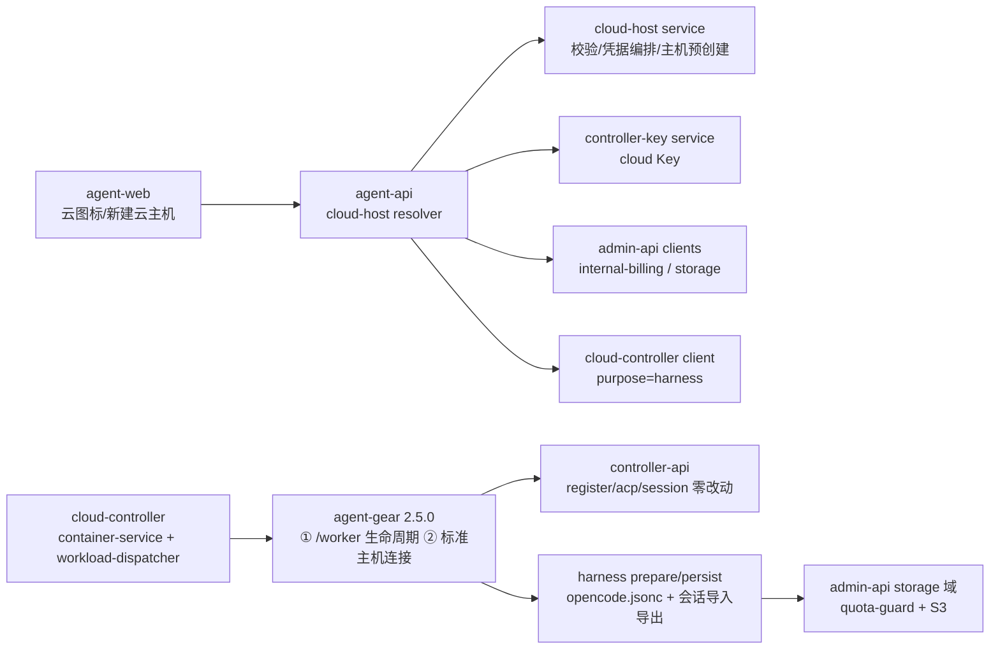
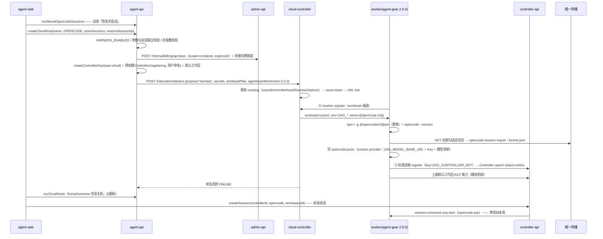
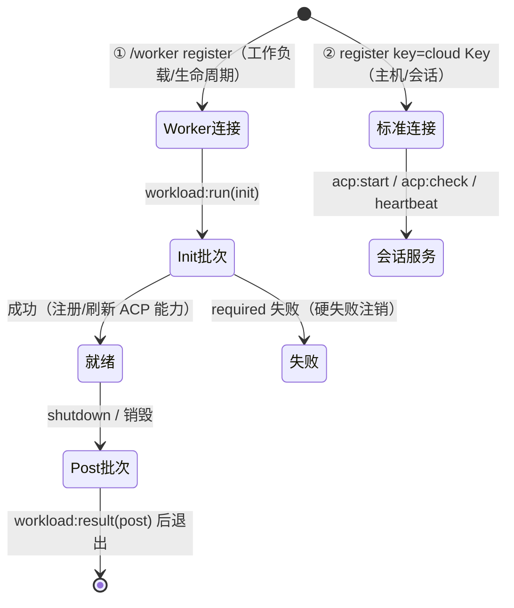
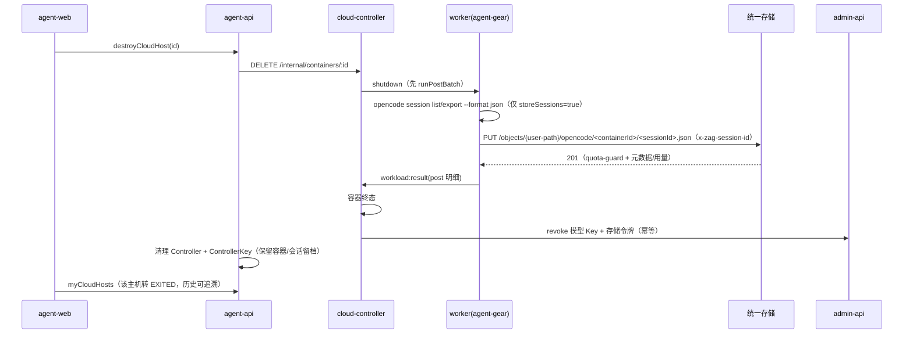
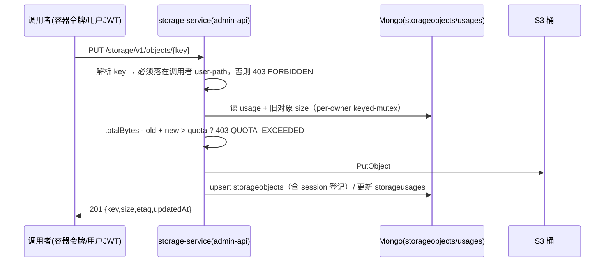

# 容器启动任务支持 harness 类型（OpenCode 云主机与统一存储）- 技术提案

**功能名称**: 容器启动任务 harness 类型、OpenCode 云主机、统一存储
**关联 PRD**: docs/product/draft/20261020-container-harness-support.md
**技术提案版本**: v2.0
**创建日期**: 2026-10-20
**作者**: ZeroAsh
**feat-branch**: `feat/container-harness-support`

> v2.0 变更（需求重构返工，与 PRD v2.0 同步）：
>
> 1. **交付面反转**：一期交付面改为前台 agent-web；admin-web/admin-api 的启动对话框、容器治理页、后台存储治理页移出一期（`adminStartCloudContainer` 维持仅 `IDLE` 现状不动）。启动链路改为 **agent-api → cloud-controller 内部 API**。
> 2. **产品模型变更**：harness 容器不再只是「后台容器列表里的一行」，而是**一台「主机」**——直接复用既有 `Controller` 模型（`ControllerType.cloud` 枚举已存在），经既有 ControllerKey 握手注册进 controller-api，`homeOverview.controllers` 自动包含、左侧导航栏同构展示（云图标），主机界面（Harness 工具（ACP）列表）与标准「会话」链路（`createSession` → `session:command acp:start` → opencode ACP）**零改动复用**。
> 3. **用户命名**：agent-api 预创建 `Controller`（`type='cloud'`、`status='registering'`、`name`=用户命名）随云主机创建落库，创建即出现在主机列表（启动中）；容器注册后转 `online`。
> 4. **标准会话**：容器内 agent-gear（agent-controller）天然支持 opencode ACP；恢复的会话经既有「工作目录历史会话同步」以历史/标准会话呈现，不新建会话体系。
> 5. 按实现计划节点对当前代码事实的核查修正：agent-gear 升 **2.5.0**（云主机双连接模式），cloud-controller `MIN_WORKER_VERSION` 保持 `2.2.0`、harness 容器单独做 2.5.0 门禁；worker 镜像**未预装** `@opencode/cli`（固定版本安装）；OpenCode 配置文件为 `opencode.jsonc`、会话导出用 `--format json`；tests/api 用 `fetch`（非 supertest）；字节字段用 `Float`；新增后端 `HARNESS_ENABLED` 开关（沿用 cloud-controller `toBool` 模式）。
>
> 会话存储/恢复、统一存储、容器作用域模型 Key 与计费分流保持一期范围，口径转为**前台用户**。

## 1. 概述

### 1.1 背景

`20261014-feat-cloud-agent-phase2` 交付了 K8s 云端工作容器基线；`20261017-feat-cloud-controller-workload` / `20261018-feat-workload-phase1` 交付了工作负载体系（参数表单、隐式依赖、预制工作负载、执行留档）；`20261018-feat-credits-billing` 交付了费用中心（计费账户、API Key、OpenAI 兼容计费网关）；「主机」体系（`Controller` + ControllerKey + `homeOverview` + 标准会话 + Harness 工具（ACP）探测）已在 agent-api/controller-api/agent-web 稳定运行。当前事实：

- 云端容器启动任务类型（`purpose`）**仅开放 `idle`**：`servers/admin-api/src/graphql/resolvers/cloud-container.ts`、`servers/cloud-controller/src/routes/internal-api.ts`、`servers/cloud-controller/src/services/container-service.ts` 三处硬编码拒绝其余值。
- worker 镜像（`deploy/images/worker/Dockerfile`）预装 `agent-gear@2.4.x`、`@agentclientprotocol/claude-agent-acp`、`@agentclientprotocol/codex-acp`，**不含 `@opencode/cli`**；`packages/agent-controller` 当前版本 `2.4.0`。
- agent-gear 的连接端点是抽象的（`parseEndpoint` + `connectToServer(endpoint, key)`），同一二进制既可拨 `wss://<cloud-controller>/worker`（工作负载通道），也可按标准 ControllerKey 拨 controller-api 注册为「主机」——但今天 worker 只走前者，`register.key` 被 cloud-controller 忽略，不产生 `Controller` 记录。
- `ControllerType` 枚举**已有 `cloud` 值**（契约 `contracts/agent-controller.graphql`，模型 `servers/{agent-api,controller-api}/src/models/controller.ts`），但前端一律硬编码 `type:'local'`，也没有按主机类型区分的图标。
- 计费 Key（`billingapikeys`）无有效期/作用域概念；仓库内**没有任何对象存储能力**。

本期需求（PRD v2.0）：启动任务新增 **harness** 类型并**在前台（agent-web）交付**——用户命名新建云主机、选 harness（一期 OpenCode）、配「存储会话/恢复的会话」；云主机作为一台「主机」进左侧导航栏（云图标、与普通主机同构的 ACP 列表与标准会话）；配套**统一存储**（自定义 S3 桶、user-path、类 S3 CRUD+list、独立用量表与限额卡点）与**容器专用模型调用凭证**（前台用户模型/计费口径）。后台管理面本期不做。

### 1.2 目标

- agent-api 新增前台云主机域：创建（命名 + harness + 参数）、列表、销毁、已存会话查询；`HARNESS_ENABLED` 开关控制入口。
- 云主机 = 既有 `Controller`（`type='cloud'`）：预创建 `Controller` + `ControllerKey(type:'cloud')`，容器内 agent-gear 以 **2.5.0 云主机模式双连接**——`/worker`（cloud-controller：工作负载 init/post、shutdown）+ controller-api 标准连接（主机/会话/ACP）。
- `purpose=harness` 在 cloud-controller 内部 API 与 `ContainerService.start` 放开（admin GraphQL 本期不动，维持 `IDLE`）；启动请求携带 harness 选择与一次性 secrets（模型 Key、存储令牌、控制器 Key）。
- 预制「OpenCode（Harness）」工作负载（migration `005`）：固定版本安装 `@opencode/cli`、恢复会话导入、`opencode.jsonc` 注入 custom provider（网关端点 + 容器作用域 Key）、收尾 `opencode session list/export --format json` 并写入统一存储 `{user-path}/opencode/`。
- 恢复的会话经既有「工作目录历史会话同步」在该云主机以历史/标准会话呈现，标准 `createSession`/ACP 链路零改动。
- 容器作用域模型 API Key：有效期 = 容器有效期、销毁即撤销；可用模型 = 用户个人模型列表；自定义模型不计费（网关代转发、凭据不出服务端）、系统模型计费入用户计费账户。
- 统一存储：S3 兼容桶 + `storageobjects`/`storageusages` 元数据事实源 + 类 S3 REST（PUT/GET/HEAD/DELETE/LIST/usage）+ `quota-guard` 写入卡点；后台不限量、前台限额口径预留（本期 `quotaBytes=null`）。
- 单元 / API（fetch 风格）/ E2E 测试与 worker 镜像自验文档同步更新；普通主机与后台存量能力零回归。

### 1.3 范围

**做**：

- agent-api 前台云主机域（GraphQL 契约 `contracts/cloud-host.graphql`）：`createCloudHost`（含命名）、`myCloudHosts`、`destroyCloudHost`、`myStoredOpencodeSessions`、`myStorageUsage`。
- `Controller` 预创建（`type='cloud'`、`status='registering'`、用户命名）与云图标展示；销毁时清理 Controller/Key/凭据。
- agent-gear 2.5.0 云主机模式（双连接、不发 `unregister`、默认工作区上报、harness prepare|persist 子命令、存储客户端）。
- cloud-controller：`purpose=harness` 放开、secrets 一次性下发与 env 注入（脱敏）、销毁撤销触发、harness 容器 agent-gear ≥2.5.0 门禁。
- 预制「OpenCode（Harness）」工作负载与 `optionsSource=OPENCODE_SESSIONS` 动态选项。
- 容器作用域模型 Key / 存储令牌（铸造、注入、到期失效、撤销三线幂等）。
- 计费网关容器 Key 分流（系统模型记账 / 自定义模型代转发不记账）。
- 统一存储服务与类 S3 REST（前台用户 + 容器令牌鉴权）。
- agent-web：Sidebar 云图标、「新建云主机」对话框（名称/harness/参数）、云主机销毁与状态、我的存储页。
- worker 镜像（BUILD.md 校验清单）、Aspire/Compose MinIO 资源、K8s env 示例、`HARNESS_ENABLED` 开关。

**不做**：

- 后台（admin-web/admin-api）harness 入口：启动对话框扩展、容器治理页 harness 过滤、后台存储治理页、后台模型口径（`adminStartCloudContainer` 维持仅 `IDLE`；`admin-unified-storage.graphql` 不在本期新增）——二期。
- 前台用户存储限额的配置与执行（二期；本期 `quotaBytes=null`，卡点机制先行）。
- 第二个 harness（Claude Code / Codex 等）——`harnessType` 白名单预留，本期仅 `opencode`。
- 预签名直传、分片上传、版本化、生命周期清理、存储定时对账。
- 会话在线浏览/编辑/搜索；会话包格式转换（原样导出/导入）。
- 云主机工作区内容持久化（随容器生命周期；会话数据经统一存储留存）。
- 计费口径变化（定价/账单/支付链路不动，仅新增容器作用域 Key 入口与转发规则）。

## 2. 技术架构

### 2.1 系统架构图

```mermaid
graph TD
    AW[agent-web<br/>Sidebar 云图标 / 新建云主机 / 标准会话] -->|GraphQL| AA[agent-api<br/>cloud-host 域]
    AA -->|Mongoose| M[(MongoDB<br/>controllers / controllerkeys /<br/>cloudcontainers / storageobjects /<br/>storageusages / billingapikeys)]
    AA -->|内部 HTTP + Bearer| CC[cloud-controller]
    AA -->|内部 HTTP| AD[admin-api<br/>internal-billing / storage 域]
    CC -->|K8s Job| K[K8s]
    K --> W[worker Pod<br/>agent-gear 2.5.0 云主机模式]
    W -->|① Socket.IO /worker<br/>register / workload:run+env / workload:result / shutdown| CC
    W -->|② Socket.IO 标准连接<br/>register key=zag_k_cloud / heartbeat / acp:*| CA[controller-api]
    CA <-->|session:command acp:start| W
    CA -->|upsert Controller type=cloud| M
    W -->|REST 统一存储 Bearer stg_| ST[/storage/v1<br/>admin-api storage 域]
    ST -->|S3 SDK| B[(自定义 S3 存储桶)]
    W -->|OpenAI 兼容 /v1<br/>zag_sk_ 容器 Key| BG[计费网关 admin-api]
    BG --> M
    AA -.启动时.-> MIG[migration runner<br/>005-preset-harness-opencode]
```

关键边界：

- **云主机 = `Controller`（`type='cloud'`）**：`homeOverview.controllers`、`acpCapabilities`、`createSession`、历史会话同步全部零改动复用；agent-web 仅按 `type==='cloud'` 换图标 + 增加创建入口。
- agent-gear **双连接**：`/worker` 通道保留工作负载体系（init/post、必须失败、留档、shutdown）；标准通道承载主机/会话。两条通道互不感知，由 agent-gear 云主机模式统一编排。
- `cloudworkloads` 仍由 admin-api 写（migration 005 产物），cloud-controller 只读下发；harness 语义由预制工作负载（`workloadKind='harness'`、`harnessType`）承载。
- `cloudcontainers` 由 cloud-controller 写（单一事实源），新增 `userId`（属主前台用户）、`controllerKeyId`、`harnessOptions`、`containerApiKeyId`。
- 统一存储的元数据/用量/限额由 admin-api storage 域持有，S3 桶只是字节层；**list/usage/限额以元数据表为准**。
- 模型 Key / 存储令牌由 admin-api 铸造与撤销（billing/storage 域），cloud-controller 只传递（env）与触发撤销。

### 2.2 技术栈

| 层级 | 技术选型 | 说明 |
|------|---------|------|
| 前端 | React + TypeScript + Vite + Apollo Client | agent-web，复用 Sidebar/NewSessionDialog/设置组件体系 |
| 后端 | Node.js + Express + GraphQL + Mongoose | agent-api（云主机域/主机预创建）、cloud-controller（生命周期/env/撤销）、admin-api（storage 域 + internal-billing） |
| Worker | Node.js（agent-gear 2.5.0） | 云主机模式（双连接）、harness prepare\|persist、存储客户端 |
| 对象存储 | S3 兼容（自建桶 / MinIO），`@aws-sdk/client-s3` | 自定义 S3 存储桶；本地/Aspire 编排用 MinIO |
| 数据库 | MongoDB | 复用共享实例；新增 `storageobjects`、`storageusages`、`storagetokens` |
| 消息 | RabbitMQ | 沿用计费事件通道；`container.destroyed` 作为 Key 撤销兜底信号 |
| 协议 | GraphQL + REST(OpenAPI) + 内部 HTTP + Socket.IO | 云主机/会话走 GraphQL；统一存储走 REST（类 S3）；worker 双 Socket.IO |

### 2.3 模块划分



| 模块 | 职责 | 关键技术点 |
|------|------|-----------|
| agent-api cloud-host service | 创建/销毁云主机、参数与会话校验、凭据编排 | 复用 controller-key/工作区服务；`HARNESS_ENABLED` 开关 |
| agent-api controller 预创建 | `Controller(type=cloud, registering, 用户命名)` + `ControllerKey(type=cloud)` | register upsert 兼容 `$setOnInsert`；销毁清理 |
| cloud-controller container-service | `purpose=harness` 生命周期、secrets→env、销毁撤销 | 放开校验、脱敏、harness 门禁（agent-gear ≥2.5.0） |
| cloud-controller workload-dispatcher | init/post 批次 + 容器级 `env` 下发 | `workload:run` 扩展 `env` |
| agent-gear 云主机模式 | 双连接编排、默认工作区、不发 unregister | 版本 2.5.0；`/worker` + 标准连接并存 |
| agent-gear harness | 会话导入/导出、`opencode.jsonc` 注入 | `--format json`、幂等安装 `@opencode/cli@pin` |
| admin-api storage 域 | 对象 CRUD+list、用量、限额卡点 | S3 SDK、元数据驱动 list、keyed-mutex |
| admin-api internal-billing | 容器作用域 Key 铸造/撤销 | `scope`/`containerId`/`expiresAt` |
| admin-api billing-openai | 容器 Key 模型范围与转发/记账分流 | 自定义模型代转发不记账 |
| agent-web | 云图标、新建云主机对话框、销毁、我的存储 | `type==='cloud'` 分支；复用对话框/表格组件 |

## 3. API 设计

### 3.1 API 契约

新增：`contracts/cloud-host.graphql`、`contracts/unified-storage.openapi.yaml`。
扩展：`contracts/agent-controller.graphql`（语义澄清）、`contracts/agent-controller-websocket.md`（云主机注册约定）、`contracts/cloud-controller-websocket.md`（purpose/secrets/env/门禁）、`contracts/admin-cloud-workload.graphql`（optionsSource）、`contracts/admin-billing.graphql`（Key scope）、`contracts/billing-openai.openapi.yaml`（容器 Key 分流）。
**不在本期改动**：`contracts/admin-cloud-container.graphql`（admin 启动维持仅 `IDLE`，二期再扩 `HARNESS`）。

#### 3.1.1 前台云主机（`contracts/cloud-host.graphql` 新增）

```graphql
# 云主机（harness 容器）前台契约
#
# 鉴权：Authorization: Bearer <user JWT>；未认证 UNAUTHENTICATED（`Not authenticated`）。
# 数据归属：
# - `controllers`/`controllerkeys`：agent-api 预创建（type=cloud），controller-api 注册时 upsert。
# - `cloudcontainers`：cloud-controller 持有（单一事实源），agent-api 经内部 HTTP 代理取数；
#   控制面不可达时列表降级只读落库状态（与 admin 侧容器列表降级模式一致）。
# - 服务端强制：云主机属主 = 当前用户；`HARNESS_ENABLED=false` 时全部入口返回
#   `harness feature is disabled`。

enum CloudHostHarnessType { OPENCODE }

enum CloudHostStatus {
  PROVISIONING  # 创建中/容器启动中（Controller.status=registering）
  ONLINE        # 主机已注册在线
  OFFLINE       # 心跳丢失/已结束但记录保留
  DESTROYING
  EXITED
  FAILED
}

type CloudHost {
  id: ID!                       # = controllerId（主机同构展示的事实源）
  name: String!                 # 用户命名（= Controller.name）
  controllerId: ID!
  containerId: ID
  status: CloudHostStatus!
  harnessType: CloudHostHarnessType!
  storeSessions: Boolean!
  restoreSessionIds: [ID!]!     # 启动快照
  createdAt: String!
  readyAt: String               # 首次在线
  exitedAt: String
  failureReason: String
}

# 「恢复的会话」选项（= 统一存储 {user-path}/opencode/ 下的会话对象，仅本人）
type StoredOpencodeSession {
  id: ID!            # 存储对象 ID（选项值）
  sessionId: String! # OpenCode 会话 ID
  label: String!     # 会话标题或 sessionId 截断
  containerId: ID    # 来源云主机
  size: Float!       # 字节（Float：GraphQL Int 为 32 位，字节量可能溢出；与费用域 Float 先例一致）
  storedAt: String!
}

type StorageUsage {
  totalBytes: Float!
  objectCount: Int!
  quotaBytes: Float            # null = 不限量（本期前台恒 null）
  quotaExceeded: Boolean!
}

input CreateCloudHostInput {
  name: String!                            # trim 后 1~64 字符，用户命名
  harnessType: CloudHostHarnessType!
  storeSessions: Boolean                   # 缺省 true
  restoreSessionIds: [ID!]                 # 缺省 []，去重后 ≤20，必须属于本人已存会话
}

type Query {
  myCloudHosts: [CloudHost!]!
  myStoredOpencodeSessions: [StoredOpencodeSession!]!
  myStorageUsage: StorageUsage!
}

type Mutation {
  createCloudHost(input: CreateCloudHostInput!): CloudHost!
  destroyCloudHost(id: ID!): Boolean!      # 幂等：终态重复调用返回 true
}
```

错误文案（逐字）：

| 条件 | 错误 |
|------|------|
| `HARNESS_ENABLED=false` | `harness feature is disabled` |
| `name` 为空/超长 | `name is required` / `name is too long` |
| `harnessType` 不在白名单 | `unsupported harness type` |
| `restoreSessionIds` 含非本人/不存在对象 | `stored session not found: <id>` |
| `restoreSessionIds` 去重后 > 20 | `too many restore sessions` |
| 容器配额/并发超限（每用户并发云主机 ≤ 3） | `too many cloud hosts` |
| 控制面不可达（创建/销毁） | `control plane unavailable`（写不降级） |

#### 3.1.2 Controller 主机语义（`contracts/agent-controller.graphql` 澄清、`agent-controller-websocket.md` 约定）

- `ControllerType.cloud` 语义落地：由 agent-api 在创建云主机时**预创建** `Controller { type:'cloud', status:'registering', name:<用户命名>, keyId }`；容器内 agent-gear 以 `ControllerKey(type:'cloud')` 的 raw key 注册，controller-api `register` 的 `findOneAndUpdate({keyId}, {..., type: keyType, status:'online'}, {upsert:true})` 沿用——已存在文档时 `$setOnInsert.name` 不覆盖用户命名。
- 状态展示：`registering` → 前台「启动中」；`online`/`offline` 与普通主机同口径（心跳 60s 超时扫描沿用）。
- **云主机注册约定**（`agent-controller-websocket.md` 增补）：云主机模式下 agent-gear **不发送 `unregister`**（该事件会删除 Controller+Key，属本地卸载语义）；容器销毁由 agent-api `destroyCloudHost` 编排清理（Controller/Key 撤销），避免与心跳离线语义打架。
- 云图标：agent-web 按 `controller.type === 'cloud'` 渲染云图标（普通主机维持现状），无契约字段新增。

#### 3.1.3 统一存储 REST（`contracts/unified-storage.openapi.yaml` 新增，类 S3）

Base：`/storage/v1`；鉴权 `Authorization: Bearer <token>`，两类令牌：

1. **用户 JWT**（前台，经统一网关/agent-api 代理转发；后台治理二期）；
2. **容器作用域存储令牌**（`stg_<random>`，agent-api 铸造、cloud-controller 随启动注入，有效期 = 容器有效期，仅限该容器属主的 `{user-path}/`）。

`key` 为用户目录内相对路径；服务端解析的完整 key 必须落在调用者 user-path `/{user-type}/{user-id}/` 之下，否则 `403 FORBIDDEN`。

| Method | Path | 说明 | 成功 | 失败 |
|--------|------|------|------|------|
| PUT | `/objects/{key}` | 上传/覆盖（幂等） | 201/200 `{key,size,etag,updatedAt}` | 403 `QUOTA_EXCEEDED` / 403 `FORBIDDEN` / 413 `PAYLOAD_TOO_LARGE`（单对象 ≤ 256 MiB） |
| GET | `/objects/{key}` | 下载（流式代理 S3） | 200 流 | 404 `NOT_FOUND` |
| HEAD | `/objects/{key}` | 元信息 | 200 `{key,size,contentType,etag,updatedAt}` | 404 `NOT_FOUND` |
| DELETE | `/objects/{key}` | 删除 | 204 | 404 `NOT_FOUND` |
| GET | `/objects?prefix=&limit=&cursor=` | 按前缀列表（元数据驱动、游标分页，≤1000/页） | 200 `{items:[{key,size,updatedAt}],nextCursor}` | 400 `INVALID_PREFIX` |
| GET | `/usage` | 当前调用者用量 | 200 `{totalBytes,objectCount,quotaBytes,quotaExceeded}` | — |

错误响应统一：`{"error":"QUOTA_EXCEEDED","message":"storage quota exceeded"}`。限额卡点语义（契约级）：

- PUT/覆盖前判定 `totalBytes - 旧size + 新size > quotaBytes`（`quotaBytes=null` 不限）→ `403 QUOTA_EXCEEDED`；
- GET/HEAD/LIST/DELETE 不受限额影响；
- 用量更新与对象写入在 per-owner keyed-mutex 内完成；覆盖同 key 先回退旧 size 再计入新 size；S3 写失败回退预留（`pendingDelta` 模式），用量不漂移。
- 会话对象登记：opencode 会话 PUT 携带 `x-zag-session-id` / `x-zag-container-id` 头（仅 `{user-path}/opencode/` 前缀生效），落 `storageobjects.kind='opencode_session'`；其他对象 `kind='generic'` 不进入会话列表。

#### 3.1.4 模型调用凭证与计费分流（`admin-billing.graphql` / `billing-openai.openapi.yaml` 扩展）

`BillingApiKey` 扩展：`scope: BillingApiKeyScope { ACCOUNT CONTAINER }`、`containerId: ID`、`expiresAt: String`（scope=CONTAINER 时非空 = 容器有效期）。

计费网关语义（容器 Key）：

- 鉴权后追加：`scope=CONTAINER` 且（`expiresAt` 过期 **或** 关联容器已终态 **或** Key 已撤销）→ `401 invalid api key`。
- `GET /v1/models`：返回 Key 属主**个人可用模型列表**（启用的系统模型 + 其自定义模型）；后台口径（后台模型列表）本期不接入前台 Key，预留。
- `POST /v1/chat/completions`：
  - 命中**自定义模型** → 网关代转发到用户配置的端点（用户凭据留服务端、不进容器），**不产生计费记录**；
  - 命中**系统模型** → 既有计费链路（定价/预留/计量/记账），费用计入 Key 绑定的用户计费账户。

内部接口（`routes/internal-billing.ts` 扩展）：`POST /internal/billing/api-keys`（body 增 `scope`/`containerId`/`expiresAt`）、`POST /internal/billing/api-keys/:id/revoke`（幂等）。

#### 3.1.5 工作负载参数动态选项（`admin-cloud-workload.graphql` 扩展）

```graphql
enum CloudWorkloadParamOptionsSource {
  NONE              # 静态 options（现状）
  OPENCODE_SESSIONS # 取当前用户已存储的 OpenCode 会话
}
# CloudWorkloadParamField / Input 增加 optionsSource（缺省 NONE）
```

约束：`optionsSource != NONE` 仅允许 `MULTI_SELECT` 且静态 `options` 为空；`defaultValue` 仍必填（空数组）。参数值提交沿用 `params` JSON（字符串数组），服务端校验每个值属于数据源集合。

### 3.2 内部接口

#### 3.2.1 agent-api → cloud-controller（`POST /internal/containers` 扩展）

```jsonc
{
  "purpose": "harness",                  // 新增允许值（idle | harness；其余沿用 400 UNSUPPORTED_PURPOSE）
  "refId": "<controllerKeyId>",          // 关联 ControllerKey，销毁清理用
  "userId": "<owner>",                   // 属主前台用户（计费/存储口径来源）
  "harness": {
    "type": "opencode",
    "storeSessions": true,
    "restoreSessionIds": ["<storageObjectId>"]
  },
  "workloadPlan": [ /* 自动展开 OpenCode（Harness）+ 用户/依赖项 */ ],
  "billingAccountId": "…",
  "secrets": {                            // 一次性下发，仅用于 env 注入，不落库明文
    "controllerEndpoint": "wss://<controller-api>",
    "controllerKey": "zag_k_1_…",         // ControllerKey(type=cloud) raw key
    "modelApiKey": "zag_sk_…",
    "storageToken": "stg_…"
  },
  "hostName": "<用户命名>",
  "agentGearMinVersion": "2.5.0"          // harness 容器专用门禁
}
```

- `secrets` 仅在创建请求中出现：cloud-controller 用于构建 `workload:run` 的 `env`，**不写入任何持久化**（日志/落库脱敏）。
- 新增 `GET /internal/containers?userId=`（agent-api 列表/状态代理）与既有 `DELETE /internal/containers/:id` 复用。

#### 3.2.2 cloud-controller → admin-api（撤销，幂等三线）

- `POST /internal/billing/api-keys/:id/revoke`（模型 Key + 存储令牌同口径）。
- 触发线 1：容器终态（`exited`/`failed`/`destroy()` 完成）时撤销；线 2：`container.destroyed` 计费事件消费兜底；线 3：admin-api 定时对账扫描「容器已终态但 Key/令牌仍 active」并撤销。

#### 3.2.3 Worker ↔ cloud-controller（Socket.IO `/worker` 扩展）

`workload:run` payload 增加容器级 `env`（对本容器全部脚本生效，区别于 `WORKLOAD_PARAM_*` 单条生效）：

```jsonc
{
  "phase": "init",
  "env": {
    "ZAG_HARNESS_TYPE": "opencode",
    "ZAG_CONTAINER_ID": "…",
    "ZAG_HOST_NAME": "<用户命名>",
    "ZAG_CONTROLLER_ENDPOINT": "wss://<controller-api>",
    "ZAG_CONTROLLER_KEY": "zag_k_1_…",
    "ZAG_DEFAULT_WORKSPACE": "/home/zag/workspace",
    "ZAG_USER_TYPE": "front_user",
    "ZAG_USER_ID": "…",
    "ZAG_USER_PATH": "/front_user/66f…/",
    "ZAG_STORE_SESSIONS": "true",
    "ZAG_RESTORE_SESSION_IDS": "obj_1,obj_2",
    "ZAG_MODEL_API_KEY": "zag_sk_…",
    "ZAG_MODEL_BASE_URL": "https://…/v1",
    "ZAG_MODEL_IDS": "model-1,model-2",
    "ZAG_STORAGE_BASE_URL": "https://…/storage/v1",
    "ZAG_STORAGE_TOKEN": "stg_…"
  },
  "items": [ /* 同现状 */ ]
}
```

- secret 值仅随下发报文存在，worker 内存持有并注入脚本进程环境；日志对 `ZAG_MODEL_API_KEY`/`ZAG_STORAGE_TOKEN`/`ZAG_CONTROLLER_KEY` 统一 `***` 脱敏。
- 版本门禁：`MIN_WORKER_VERSION` **保持 `2.2.0`**（存量 idle 容器不受影响）；harness 容器按 `agentGearMinVersion=2.5.0` 单独门禁（`register` 携带的 `version` 不满足即拒绝并提示升级，沿用版本门禁流程）。

## 4. 数据模型

### 4.1 数据库设计

#### 集合: `controllers`（复用 + 约定）

| 字段 | 类型 | 说明 |
|------|------|------|
| type | string | 本期启用 `cloud`（枚举已存在）；云图标展示依据 |
| status | string | 预创建 `registering` → 注册后 `online` → 心跳超时 `offline` |
| name | string | 云主机 = 用户命名（预创建写入，register 不覆盖） |
| keyId | ref | 关联 `controllerkeys`（type=cloud）；销毁清理入口 |

#### 集合: `controllerkeys`（复用）

- `createControllerKey` 既有 `type` 字段落 `cloud`；raw key `zag_k_1_<48hex>` 注入容器 env `ZAG_CONTROLLER_KEY`；撤销沿用既有语义。

#### 集合: `cloudcontainers`（扩展）

| 字段 | 类型 | 说明 |
|------|------|------|
| purpose | string | 枚举扩展 `harness`（`CONTAINER_PURPOSES`） |
| userId | string | 属主前台用户（计费/存储/会话口径来源），索引 |
| controllerKeyId | ObjectId | 关联 ControllerKey，销毁清理编排用 |
| harnessType | string \| null | `opencode` |
| harnessOptions | object \| null | `{storeSessions, restoreSessionIds}` 快照 |
| containerApiKeyId | ObjectId \| null | 容器作用域模型 Key |
| storageTokenId | ObjectId \| null | 容器作用域存储令牌 |

#### 集合: `controllerworkspaces`（复用）

- 云主机创建时预置默认工作区行 `{userId, controllerId, name:'workspace', path: $ZAG_DEFAULT_WORKSPACE, isEnabled:true}`，标准会话直接可用。

#### 集合: `billingapikeys`（扩展）

| 字段 | 类型 | 说明 |
|------|------|------|
| scope | string | `account`（现状）/ `container`，缺省 `account` |
| containerId | ObjectId \| null | scope=container 非空，索引 |
| expiresAt | Date \| null | = 容器有效期；`< now` 视同失效 |

#### 集合: `storagetokens`（新增）

| 字段 | 类型 | 说明 |
|------|------|------|
| tokenPrefix / tokenHash | string | `stg_` 前缀 + bcrypt；明文仅铸造时下发一次 |
| ownerType / ownerId | string | = 容器属主 |
| containerId | ObjectId | 来源容器，索引 |
| expiresAt | Date | = 容器有效期 |
| status | string | `active` / `revoked` |

#### 集合: `storageobjects`（新增，list/会话查询事实源）

| 字段 | 类型 | 说明 |
|------|------|------|
| key | string | `/{user-type}/{user-id}/…`，**唯一索引** |
| ownerType / ownerId | string | 复合索引 `{ownerType, ownerId, updatedAt}` |
| prefix | string | 目录前缀，索引（list） |
| size | Float | 字节 |
| contentType / etag | string | |
| kind | string | `generic` / `opencode_session` |
| sessionId / containerId | string \| null | kind=opencode_session 时登记 |
| createdAt / updatedAt | Date | timestamps |

#### 集合: `storageusages`（新增，独立用量表）

| 字段 | 类型 | 说明 |
|------|------|------|
| ownerType + ownerId | string | **唯一复合索引** |
| totalBytes | Float | 当前占用字节 |
| objectCount | Int | 对象数 |
| quotaBytes | Float \| null | null=不限量（前台本期恒 null，二期配置） |
| updatedAt | Date | |

#### 集合: `admin_migrations`（新增批次）

- `005-preset-harness-opencode`：预制工作负载「OpenCode（Harness）」（presetKey `harness-opencode`、`workloadKind='harness'`、`harnessType='opencode'`、`isPreset=true`、paramSchema 见 §5.2-5），幂等不覆盖。

### 4.2 缓存设计

- 不引入新缓存：用量直接读 `storageusages`（单文档）；ACP 能力/会话选项沿用既有 Redis 缓存（`acp:capability:*` 1h）。
- 计费网关模型列表判定沿用现有 pricing 查询；热点化后可加 60s 内存 TTL（后续项）。
- 存储 GET 走 S3 流式转发，不缓存字节。

## 5. 技术实现方案

### 5.1 核心流程

#### 5.1.1 新建云主机（端到端）



#### 5.1.2 启动计划展开（harness 版）

1. agent-api 把预制「OpenCode（Harness）」自动加入 `workloadPlan`，参数由 `CreateCloudHostInput` 归一：`store_sessions`（缺省 true）、`restore_session_ids`（缺省 []，值为存储对象 ID，init 时映射完整 key 拉取）。
2. 其余工作负载一期不开放给前台用户（云主机 = harness 单主体）；依赖展开沿用 `workload-plan` 逻辑（harness 预制项可带依赖，如 Node.js 环境）。
3. 执行序：被依赖项 → OpenCode（Harness）；`required=true`（主体硬失败，沿用工作负载三期语义）。
4. `optionsSource=OPENCODE_SESSIONS` 仅驱动前端选项渲染，提交值仍由服务端校验属主与存在性。

#### 5.1.3 云主机模式（agent-gear 2.5.0 双连接）



- 两条 Socket.IO 连接并存于同一 agent-gear 进程（新增 supervisor 编排）：`/worker` 沿用现状；标准连接沿用 `connectToServer(controller-api, cloudKey)` 与既有 ACP/会话事件。
- **不发送 `unregister`**（避免删除 Controller/Key）；进程退出后心跳超时 → `offline`。
- 默认工作区：`ZAG_DEFAULT_WORKSPACE` 目录在 init 时创建，注册后经既有工作区机制上报（agent-api 已预置 `ControllerWorkspace` 行，路径一致即可）。
- 会话恢复呈现：`opencode session import` 后，opencode 会话数据落容器内其数据目录，**既有「工作目录历史会话同步」**在主机上发现并以历史/标准会话呈现（`externalSessionId` 口径），无需新会话机制。

#### 5.1.4 云主机销毁



- `storeSessions=false` 时 post 脚本短路成功，不产生写入。
- 逐会话独立 PUT、独立成败；单会话失败不阻断其余，全部结束后汇总（失败仅记日志，不阻塞销毁）。
- 单会话包上限 32 MiB；上传并发 ≤2；post 批次预算 `HARNESS_POST_BUDGET_MS`（默认 120000）。

#### 5.1.5 OpenCode 配置注入（custom provider，`opencode.jsonc`）

worker 写 `~/.config/opencode/opencode.jsonc`（存在则合并 `provider.zag`，不动其他配置），格式按 https://opencode.ai/v2/docs/providers/#custom：

```jsonc
{
  "provider": {
    "zag": {
      "npm": "@ai-sdk/openai-compatible",
      "name": "ZAG Model Gateway",
      "options": { "baseURL": "<ZAG_MODEL_BASE_URL>", "apiKey": "<ZAG_MODEL_API_KEY>" },
      "models": { "<modelId>": { "name": "<displayName>" } }
    }
  }
}
```

- `models` 取 `ZAG_MODEL_IDS`（启动时按用户个人模型列表生成快照）。
- 自定义模型不计费：容器内统一走 `zag` provider，网关按模型归属分流；用户自定义模型真实端点与凭据保存在服务端。
- Key 有效期 = 容器有效期：`expiresAt` 取 Job `activeDeadlineSeconds` 对应时刻；销毁撤销兜底。

#### 5.1.6 统一存储写入与限额卡点



- user-path：`ownerType`（`front_user`/`admin_user`）+ `ownerId` → `/{user-type}/{user-id}/`；容器令牌属主取自容器记录。
- list 走 `storageobjects`（游标 `{updatedAt,_id}`），不调用 S3 ListObjects。
- 删除：S3 DeleteObject + 元数据删除 + 用量回退，同一互斥段内完成。

### 5.2 关键实现点

#### 实现点 1: 前台云主机域（agent-api）

- **描述**: 新增 `graphql/schemas/cloud-host.ts` + `services/cloud-host-service.ts` + `models` 只读代理：`createCloudHost/myCloudHosts/destroyCloudHost/myStoredOpencodeSessions/myStorageUsage`；`HARNESS_ENABLED`（`toBool` 模式）关闭时全部入口 `harness feature is disabled`。
- **技术细节**: 创建编排顺序（Key/令牌铸造 → Controller 预创建 → 内部启动）；任一步失败回滚已铸凭据（幂等撤销）；列表经 cloud-controller 内部 API 取容器状态，控制面离线降级只读落库（与既有容器列表降级同构）。
- **风险点**: 并发创建限额（≤3/用户）与重复点击幂等；`restoreSessionIds` 在创建与 init 之间被删除的容错（跳过并记录）。

#### 实现点 2: Controller 预创建与云图标呈现（agent-api / agent-web）

- **描述**: agent-api 复用 `controller-key.ts` 的 `create()`（`type:'cloud'`）与 `Controller` 预创建（`status:'registering'`、`name`=用户命名）；`register` upsert 沿用（`$setOnInsert.name` 不覆盖）；销毁清理 Controller+Key。agent-web Sidebar 按 `type==='cloud'` 渲染云图标 + 「新建云主机」入口。
- **技术细节**: `homeOverview.controllers` 自动包含（零改动）；`registering` 状态在 Sidebar 展示「启动中」样式；`NewSessionDialog` 对 `registering` 主机隐藏（就绪后可选）。
- **风险点**: 既有 `GenerateKeyDialog`/`ControllerListSection` 硬编码 `type:'local'` 保持不动（云主机不走手工 Key 流程）；`unregister` 语义仅本地卸载，云主机不发。

#### 实现点 3: agent-gear 2.5.0 云主机模式（packages/agent-controller）

- **描述**: 新增 `src/cloud-host/supervisor.ts`（双连接编排）、`src/harness/prepare.ts`、`src/harness/persist.ts`、`src/storage-client.ts`、`src/cli/harness.ts`（`agent-gear harness prepare|persist`）；`CONTROLLER_VERSION='2.5.0'`。
- **技术细节**: 双连接互不阻塞；`/worker` 通道事件沿用；标准连接复用 `connectToServer`；不发 `unregister`；`harness prepare`：拉取会话包 → `opencode session import --format json`（逐个、失败跳过记录）→ 写 `opencode.jsonc`；`harness persist`：`opencode session list --format json` → 逐会话 `opencode session export <id> --format json` → PUT 存储。
- **风险点**: `opencode` CLI 输出格式随版本变化——固定安装版本（`@opencode/cli@<pin>`）并解析 `--format json`；双连接断线重连互不干扰。

#### 实现点 4: purpose=harness 全链路（cloud-controller）

- **描述**: `routes/internal-api.ts` / `container-service.ts` 放开为白名单 `idle|harness`（其余维持 `UNSUPPORTED_PURPOSE`「该任务类型暂未开放」）；`CONTAINER_PURPOSES` 扩展 `harness`；secrets 一次性下发 → `workload:run env`；销毁触发撤销；harness 容器 `agentGearMinVersion=2.5.0` 门禁。**admin GraphQL 不动**（维持 `IDLE`）。
- **技术细节**: `cloudcontainers` 新字段落库快照；secret 脱敏 helper 统一；`buildServerEndpoint` 沿用。
- **风险点**: 存量 idle 流程回归（门禁保持 `MIN_WORKER_VERSION=2.2.0`）；secrets 出现在错误路径日志的风险（脱敏单测）。

#### 实现点 5: 预制「OpenCode（Harness）」工作负载（admin-api migration 005）

- **描述**: 写入 `name='OpenCode（Harness）'`、`presetKey='harness-opencode'`、`workloadKind='harness'`、`harnessType='opencode'`、`paramSchema=[store_sessions(BOOLEAN,true), restore_session_ids(MULTI_SELECT, optionsSource=OPENCODE_SESSIONS, [])]`；init/post 脚本见 §5.3。`paramSchema` 扩展 `optionsSource`（§3.1.5）。
- **技术细节**: migration runner 幂等（presetKey 不覆盖）；固定版本安装 `npm install -g @opencode/cli@<pin>` + `opencode --version` 硬校验（镜像未预装，必须安装）。
- **风险点**: 既有工作负载 CRUD 校验同步认识 `optionsSource`（旧记录缺省 `NONE`）。

#### 实现点 6: 容器作用域模型 Key 与存储令牌（admin-api / cloud-controller）

- **描述**: `api-key-service` 增加 `createContainerScopedKey` / `revoke`（幂等）；`storagetokens` 铸造/撤销；三线撤销兜底（§3.2.2）。
- **技术细节**: 明文仅铸造时返回一次；`expiresAt` 由 cloud-controller 按 Job `activeDeadlineSeconds` 回传；secret 全链路脱敏。
- **风险点**: 撤销幂等（重复撤销/先撤销后到期）；`expiresAt` 双端一致。

#### 实现点 7: 计费网关分流（前台口径）

- **描述**: `routes/billing-openai.ts` 鉴权后解析 Key 属主；容器 Key `/v1/models` 按**用户个人模型列表**返回；`/v1/chat/completions` 自定义模型→服务端代转发不记账、系统模型→既有计费链路。
- **技术细节**: 自定义模型 ID 判定沿用 `llm` 域口径（属主自定义优先，冲突记日志）；SSE 流式透传保持语义；不记账路径不产生 MeteringRecord/outbox。
- **风险点**: 代转发超时/错误映射；用户凭据不出服务端的约束单测。

#### 实现点 8: 统一存储服务与 REST（admin-api storage 域）

- **描述**: `services/storage/`（s3-client/object-service/usage-service/quota-guard）+ `routes/unified-storage.ts`；两类令牌鉴权中间件统一解析属主与 user-path。
- **技术细节**: PUT 先限额后写 S3 再落元数据（`pendingDelta` 回退）；list 元数据驱动；单对象 256 MiB、单页 ≤1000；会话对象 `x-zag-session-id` 登记。
- **风险点**: 并发 PUT 同 key 增量计算必须同互斥段；S3/元数据不一致留痕（对账任务后续）。

#### 实现点 9: 已存会话查询与恢复呈现（agent-api / agent-gear）

- **描述**: `myStoredOpencodeSessions` 从 `storageobjects`（`kind='opencode_session'`、属主匹配）派生（storedAt 倒序、上限 200）；恢复导入后由既有「工作目录历史会话同步」在主机历史会话呈现。
- **技术细节**: 存储布局 `{user-path}/opencode/{containerId}/{sessionId}.json`；对象 ID→完整 key 映射在 agent-api 校验时完成并随 `workloadPlan` 下发。
- **风险点**: 导入会话与历史会话同步的重复呈现（按 `externalSessionId` 去重，既有机制）；手工上传的 generic 对象不进会话列表（契约写明）。

#### 实现点 10: agent-web 云主机体验

- **描述**: Sidebar 云图标（`type==='cloud'`）+「新建云主机」入口；`NewCloudHostDialog`（名称必填、harness 选择、存储会话开关、恢复的会话多选含空态/刷新）；云主机详情（状态/参数摘要/销毁确认）；我的存储页（对象列表/上传/下载/删除/用量）。
- **技术细节**: 复用 `homeOverview` 数据流（子组件不自建信息流查询）；`registering` 展示「启动中」；销毁二次确认文案提示「将执行会话存储（若开启）」。
- **风险点**: 选项刷新时机（打开时拉取 + 手动刷新）；移动端布局回归（沿用响应式组件）。

#### 实现点 11: 收尾预算与销毁宽限

- **描述**: harness 容器 post 批次预算 `HARNESS_POST_BUDGET_MS`（默认 120000）；单会话 ≤32 MiB、上传并发 ≤2；只导出本容器相关会话（`storedAt`/`updatedAt` 过滤）避免全量重传。
- **技术细节**: 超时按既有 timeout 语义记录失败；销毁流程不因 post 失败而中止（失败提示 + 留档）。
- **风险点**: 会话量大拖垮宽限期——过滤 + 上限 + 明细留档。

### 5.3 预制脚本（migration 内置，示意）

#### OpenCode（Harness）init 脚本

```bash
#!/usr/bin/env bash
set -euo pipefail

# 1) 安装/校验 OpenCode CLI（镜像未预装，固定版本幂等安装）
if ! command -v opencode >/dev/null 2>&1; then
  npm install -g "@opencode/cli@${OPENCODE_CLI_PIN:-pin}"
fi
opencode --version   # 必须校验成功，避免「安装返回 0 但不可用」

# 2) 默认工作区 + 会话恢复 + 模型配置注入（opencode.jsonc）
agent-gear harness prepare
```

#### OpenCode（Harness）post 脚本

```bash
#!/usr/bin/env bash
set -euo pipefail

if [ "${ZAG_STORE_SESSIONS:-true}" != "true" ]; then
  echo "store sessions disabled, skip persist"; exit 0
fi

# list/export --format json 并写入统一存储 {user-path}/opencode/
agent-gear harness persist
```

> 需求原文写作 `npm install -g @opencode-cli`；官方包名为 `@opencode/cli`（worker 镜像当前**未预装**，由本脚本固定版本安装），见 §6.1 决策 3。

## 6. 技术决策

### 6.1 决策列表

| # | 决策 | 选项 A | 选项 B | 最终选择 | 原因 |
|---|------|--------|--------|---------|------|
| 1 | 交付面 | 后台 admin-web 启动 | 前台 agent-web 自助创建 | B | 需求重构：直接呈现在 agent-web，后台本期不做 |
| 2 | 云主机建模 | 新建「CloudHost」实体与页面 | 复用 `Controller`（`type='cloud'`，枚举已存在） | B | 「界面与正常主机一致」零成本达成；会话/ACP/历史同步零改动 |
| 3 | OpenCode 安装 | `@opencode-cli`（需求原文） | `@opencode/cli` 固定版本安装 | B | 官方包名；镜像未预装，需幂等安装 + `opencode --version` 硬校验 |
| 4 | harness 载体 | 平台代码写死 harness 流程 | 预制「harness 类型」工作负载（presetKey） | B | 复用工作负载参数/留档/必须失败体系 |
| 5 | worker 通道 | 仅标准连接（controller-api） | 双连接（`/worker` + 标准连接） | B | 保留工作负载 init/post/留档/shutdown 体系，会话走标准通道；单连接需重构 controller-api 生命周期，风险大 |
| 6 | 主机命名 | register 携带 name | agent-api 预创建 `Controller(name, registering)` | B | 创建即出现在主机列表（启动中），register upsert 不覆盖命名；契约零改动 |
| 7 | 云主机清理 | 发 `unregister`（删 Controller+Key） | 不发 unregister，销毁时编排清理 | B | `unregister` 是本地卸载语义；云主机保留状态留档、由 `destroyCloudHost` 统一清理 |
| 8 | 版本门禁 | 提升 `MIN_WORKER_VERSION` | 保持 2.2.0 + harness 专用 2.5.0 门禁 | B | 存量 idle 容器零影响；harness 能力按需门禁（agent-gear 2.5.0） |
| 9 | 模型 Key 铸造 | admin-api 铸造（billing 域） | agent-api/cloud-controller 自铸 | A | 计费域唯一写入方；cloud-controller 仅传递与触发撤销 |
| 10 | Key 失效 | 仅 expiresAt | 仅销毁撤销 | 两者叠加 | 「有效期=容器有效期」需到期硬失效 + 销毁立即失效 |
| 11 | 自定义模型调用 | 注入用户端点/凭据进容器 | 网关代转发，凭据留服务端 | B | 用户凭据不落容器；网关统一决定计费与否 |
| 12 | 限额卡点 | S3 侧（桶策略/配额） | 应用层 `quota-guard` | B | S3 兼容实现差异大；应用层统一错误语义与用量表 |
| 13 | list 实现 | S3 ListObjects 透传 | 元数据表驱动（cursor 分页） | B | 用量/限额/会话查询同一事实源 |
| 14 | 大文件传输 | 预签名直传 | 服务端代理 | B（一期） | 会话包 ≤32 MiB，代理统一鉴权/限额/审计；预签名二期 |
| 15 | 恢复会话选项 | 前端硬编码拉取 | paramSchema `optionsSource` | B | 参数表单通用能力，可复用其它数据源 |
| 16 | 恢复会话呈现 | 新建「云会话」体系 | 既有历史会话同步（`externalSessionId`） | B | 需求明确走标准「会话」呈现 |
| 17 | 会话存储布局 | `{user-path}/opencode/<sessionId>.json` | `.../opencode/<containerId>/<sessionId>.json` | B | 多容器导出不互相覆盖、可溯源 |
| 18 | 字节字段标量 | `Int` | `Float` | B | GraphQL Int 32 位；用量/对象字节数可能溢出；与费用域 Float 先例一致 |
| 19 | 配置文件 | `opencode.json` | `opencode.jsonc` | B | 与当前 opencode CLI 约定一致（注释友好），按实测落地 |
| 20 | 存储实现位置 | 新建独立服务 | 并入 admin-api（storage 域） | B（一期） | 避免新增部署面；REST 契约独立可平滑拆出 |
| 21 | 功能开关 | 无开关 | `HARNESS_ENABLED`（agent-api，toBool） | B | 灰度与回滚；沿用 cloud-controller `toBool` 模式 |

### 6.2 依赖与约束

| 类型 | 内容 | 说明 |
|------|------|------|
| 依赖 | 主机/会话/ACP 体系（Controller、homeOverview、createSession、历史会话同步） | 云主机零改动复用 |
| 依赖 | 工作负载体系（参数/依赖/留档/必须失败） | 20261017/20261018 已交付 |
| 依赖 | 费用中心（账户/API Key/计费网关/事件） | 20261018 已交付；扩展 Key 模型 |
| 依赖 | 模型列表（用户可用模型/自定义模型） | 前台口径 |
| 依赖 | S3 兼容存储（自建桶/MinIO） | 新增 |
| 约束 | 一期仅 `opencode` harness | `SUPPORTED_HARNESS_TYPES` 白名单 |
| 约束 | 后台本期不做 | admin 契约/页面零改动（`IDLE` 维持） |
| 约束 | secret 不落库、不进日志 | env 注入 + 脱敏 + 一次性下发 |
| 约束 | 单对象 ≤256 MiB、单会话包 ≤32 MiB、恢复 ≤20 会话、每用户并发云主机 ≤3 | 保护宽限期与配额 |
| 约束 | agent-gear 2.5.0；`MIN_WORKER_VERSION` 保持 2.2.0 + harness 专用门禁 | 存量零影响 |

## 7. 项目结构

```
contracts/
├── cloud-host.graphql                   # 新增：前台云主机/会话选项/用量
├── unified-storage.openapi.yaml         # 新增：类 S3 CRUD+list REST
├── agent-controller.graphql             # 澄清：type=cloud 语义（无字段新增）
├── agent-controller-websocket.md        # 增补：云主机注册约定（不发 unregister）
├── cloud-controller-websocket.md        # 扩展：purpose=harness、secrets、workload:run env、门禁
├── admin-cloud-workload.graphql         # 扩展：optionsSource
├── admin-billing.graphql                # 扩展：scope/containerId/expiresAt + revoke
└── billing-openai.openapi.yaml          # 扩展：容器 Key 模型范围与分流

servers/agent-api/src/
├── graphql/schemas/cloud-host.ts        # 新增：前台云主机 resolver
├── services/cloud-host-service.ts       # 新增：创建/销毁编排、凭据回滚
├── services/cloud-controller-client.ts  # 新增：内部 HTTP 客户端
└── services/controller-key.ts           # 复用：type=cloud

servers/admin-api/src/
├── services/storage/                    # 新增：s3-client / object / usage / quota-guard
├── routes/unified-storage.ts            # 新增：类 S3 REST
├── routes/internal-billing.ts           # 扩展：scope 铸造 + revoke
├── services/billing/api-key-service.ts  # 扩展：容器作用域 Key
├── routes/billing-openai.ts             # 扩展：分流（自定义不记账）
├── models/storage-{object,usage,token}.ts # 新增
└── migrations/005-preset-harness-opencode.ts  # 新增

servers/cloud-controller/src/
├── routes/internal-api.ts               # 放开 purpose、secrets
├── services/container-service.ts        # 放开 purpose、落库快照、销毁撤销、2.5.0 门禁
├── services/workload-dispatcher.ts      # workload:run env 注入
└── models/cloud-container.ts            # userId/controllerKeyId/harness*

packages/agent-controller/src/           # agent-gear 2.5.0
├── cloud-host/supervisor.ts             # 新增：双连接编排（不发 unregister）
├── harness/{prepare,persist}.ts         # 新增：会话导入导出 + opencode.jsonc
├── storage-client.ts                    # 新增：统一存储 REST
└── cli/harness.ts                       # 新增：agent-gear harness prepare|persist

apps/agent-web/src/
├── components/Sidebar.tsx               # 云图标 + 新建云主机入口
├── components/cloud-host/NewCloudHostDialog.tsx  # 新增
└── pages/…                              # 云主机详情/我的存储

deploy/images/worker/                    # BUILD.md 校验清单（opencode 固定版本）
aspire/AgentGear.AppHost/                # MinIO 资源与 env
tests/api / tests/e2e                    # 见 §8（fetch 风格 API 测试）
```

## 8. 测试策略

### 8.1 测试覆盖要求

- 单元测试覆盖率 ≥ 80%（cloud-host-service、storage/*、容器 Key、agent-gear cloud-host/harness/*）。
- API 测试覆盖全部新增/扩展端点（`tests/api`，**fetch 风格**，跑在 Aspire 真实服务上）：`createCloudHost` 全错误文案矩阵、`myCloudHosts/destroyCloudHost`、`myStoredOpencodeSessions`、统一存储 REST 全方法、限额 403、跨用户 403、容器 Key 401/模型范围、自定义模型不记账。
- E2E 覆盖 agent-web 云主机完整体验（新建命名、云图标、ACP 列表、标准会话、销毁确认）。

### 8.2 测试类型

| 类型 | 工具 | 覆盖范围 |
|------|------|---------|
| 单元 | vitest | quota-guard 限额算式（含覆盖同 key）、Key 铸造/到期/撤销幂等、cloud-host 编排回滚、会话列表派生、harness prepare/persist（mock）、双连接 supervisor |
| API | vitest + fetch（tests/api） | GraphQL 云主机矩阵、统一存储 REST、计费网关分流、内部 revoke、register upsert 命名保留 |
| 集成 | vitest（cloud-controller） | purpose=harness 生命周期、env 注入脱敏、销毁撤销、2.5.0 门禁、MIN_WORKER_VERSION 2.2.0 回归 |
| E2E | Playwright（tests/e2e） | 新建云主机对话框（命名必填/会话多选/空态）、Sidebar 云图标与启动中状态、标准会话创建（opencode）、销毁流程、我的存储页 |
| 自验 | worker 镜像 BUILD.md | `@opencode/cli@pin` 安装、`opencode --version`、`opencode.jsonc` 注入后可调网关 |

### 8.3 回归

- 既有 `idle` 启动（admin 后台）、工作负载参数/依赖/必须失败、计费全链路、普通主机/标准会话全绿。
- Sidebar/主机界面对普通主机零视觉与行为变化；后台 admin-web 零改动。
- 存量 `controllers`（type=local）展示不受影响。

## 9. 部署方案

### 9.1 环境规划

| 环境 | 用途 | 部署方式 |
|------|------|---------|
| 本地/Aspire | 开发联调 | AppHost 新增 MinIO 资源（bucket 初始化） |
| Docker Compose | 交付验证 | aspire publish 产物追加 minio 与 env |
| K8s（生产） | 云主机容器 | agent-api/admin-api/cloud-controller 新增 S3 env；指向自定义 S3 桶 |

### 9.2 配置管理

| 配置 | 说明 | 默认 |
|------|------|------|
| `HARNESS_ENABLED` | agent-api 云主机功能开关 | `false`（灰度开） |
| `STORAGE_S3_ENDPOINT` / `STORAGE_S3_REGION` | S3 端点与区域 | 必填（fail-fast） |
| `STORAGE_S3_BUCKET` | 自定义存储桶名 | 必填 |
| `STORAGE_S3_ACCESS_KEY_ID` / `STORAGE_S3_SECRET_ACCESS_KEY` | 桶凭据 | 必填 |
| `STORAGE_S3_FORCE_PATH_STYLE` | path-style | `true`（MinIO） |
| `STORAGE_DEFAULT_QUOTA_BYTES` | 前台缺省限额 | `null`（本期不限） |
| `HARNESS_POST_BUDGET_MS` | harness post 批次预算 | `120000` |
| `OPENCODE_CLI_PIN` | `@opencode/cli` 安装版本 | 固定 pin（BUILD.md 锁定） |
| `CLOUD_HOST_MAX_PER_USER` | 每用户并发云主机上限 | `3` |

### 9.3 发布顺序

1. 契约合入（contract-first）。
2. admin-api（storage 域 + Key 扩展 + migration 005 + 分流）。
3. cloud-controller（purpose/env/撤销/门禁）→ agent-gear 发版 **2.5.0** → worker 镜像重建（BUILD.md 校验）。
4. agent-api（云主机域）→ agent-web（云图标/对话框/我的存储）。
5. 灰度：`HARNESS_ENABLED=true` 按用户放开；回滚 = 关开关（云主机存量按生命周期自然收敛）。

## 10. 验收标准

- [ ] 技术方案评审通过
- [ ] Contract 评审通过（新增 2 份 + 扩展 6 份；admin-cloud-container.graphql 零改动）
- [ ] 前台可命名新建云主机；名称/harness 必填校验、`HARNESS_ENABLED` 开关生效
- [ ] 云主机出现在左侧导航栏：云图标、名称=用户命名、状态口径与普通主机一致；界面与普通主机一致（支持的 Harness 工具（ACP）列表含 OpenCode）
- [ ] 云主机上创建的会话即标准「会话」，对话/模式/模型/历史消息与普通主机一致
- [ ] 恢复会话：勾选导入后以历史/标准会话呈现可继续；跳过/失败记录明确；选项仅本人
- [ ] 存储会话：导出物落 `{user-path}/opencode/<containerId>/<sessionId>.json`，可被下次恢复；关闭时不存储
- [ ] 容器作用域 Key：有效期=容器有效期、销毁立即失效、明文不落库不进日志
- [ ] 计费：系统模型计费入用户账户、自定义模型不计费；可用模型=用户个人模型列表
- [ ] 统一存储：CRUD+list 全通、跨用户 403、超限 403、用量准确（含覆盖/删除回退）；前台 quota=null 卡点机制先行
- [ ] 后台零改动：admin 启动维持仅 `IDLE`，admin-web 无新增入口
- [ ] 单元/API/E2E 全绿，既有回归全绿（普通主机/会话/计费/idle）
- [ ] worker 镜像自验（opencode 固定版本安装/校验）与发布顺序、灰度开关就绪

## 11. 相关文档

- [[../../product/draft/20261020-container-harness-support.md]] — 本期 PRD（v2.0）
- [[20261017-feat-cloud-controller-workload.md]] — 云控制器工作负载功能
- [[20261018-feat-workload-phase1.md]] — 工作负载一期（参数、依赖与预制工作负载）
- [[20261018-feat-workload-phase3.md]] — 工作负载三期（必须工作负载硬失败）
- [[20261018-feat-credits-billing.md]] — 费用中心（Credits 计费）
- [[20261014-feat-cloud-agent-phase2.md]] — 云Agent二期（K8s 云端工作容器）
- contracts/：`cloud-host.graphql`、`unified-storage.openapi.yaml`、`agent-controller.graphql`、`agent-controller-websocket.md`、`cloud-controller-websocket.md`、`admin-cloud-workload.graphql`、`admin-billing.graphql`、`billing-openai.openapi.yaml`
- OpenCode custom provider：https://opencode.ai/v2/docs/providers/#custom
- 开发规范：`docs/engineering/common-rules.md`、`backend-rules.md`、`frontend-rules.md`
