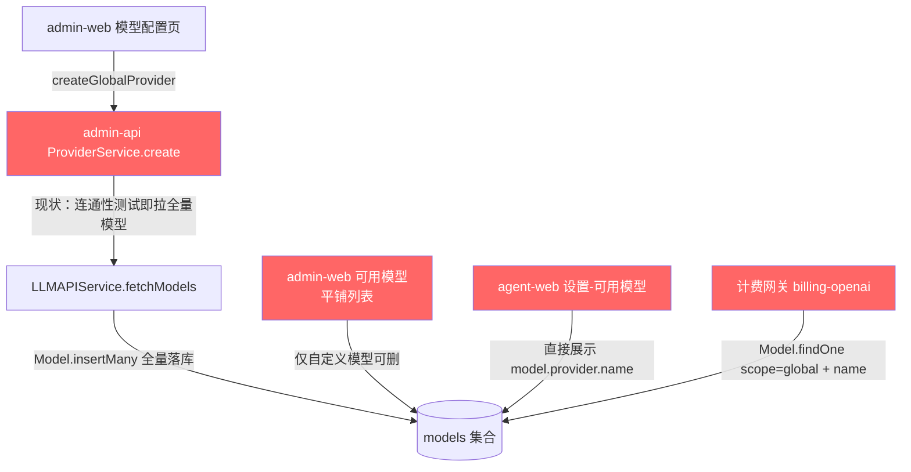
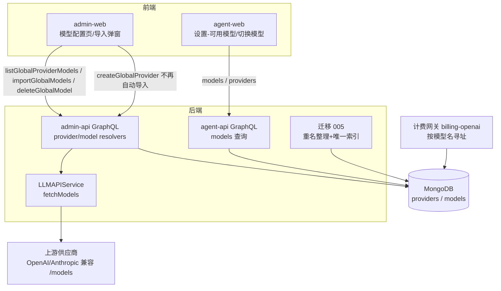
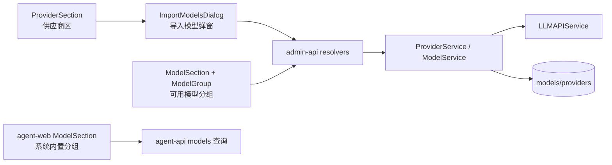
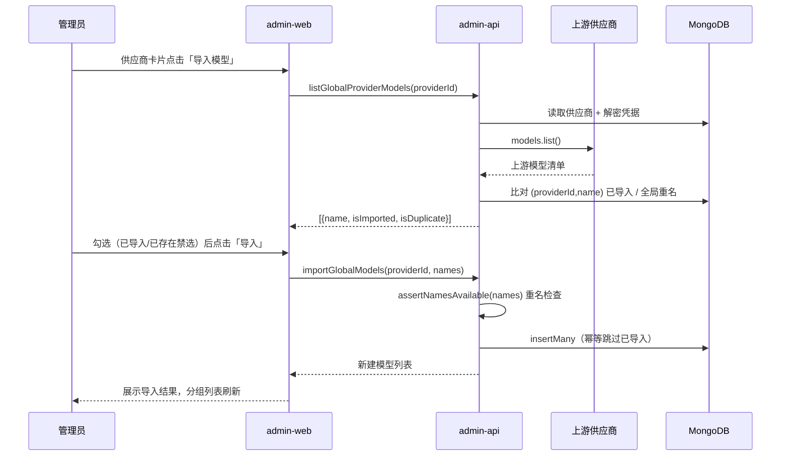
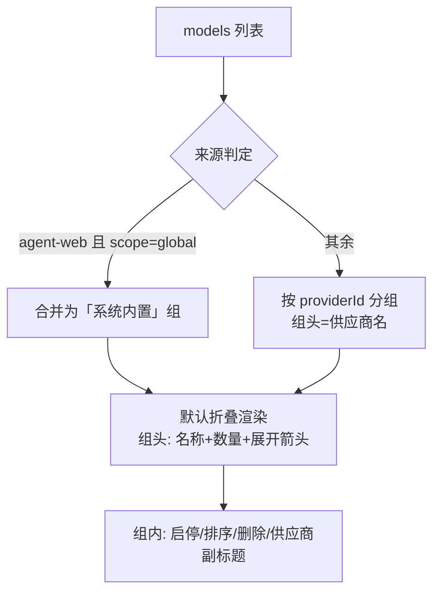

# 内建 API 渠道一期上线后问题修复（供应商与模型管理）- 技术提案

**功能名称**: 内建 API 渠道供应商与模型管理优化
**关联 PRD**: `docs/product/draft/20261020-api-channel-model-fixes.md`
**技术提案版本**: v1.0
**创建日期**: 2026-10-20
**作者**: ZeroAsh
**feat-branch**: `fix/api-channel-model-fixes`

## 1. 概述

### 1.1 背景

内建 API 渠道一期（供应商/模型管理 + 计费网关）上线后暴露四个问题，与 PRD §1.1 一一对应，均落在「模型清单怎么来、怎么展示、怎么删、怎么保证唯一」四条线上：



现状代码事实：

1. **自动导入**：`servers/admin-api/src/services/provider.ts` `create()`（L139 `fetchModels` 连通性校验 → L165-190 `Model.insertMany` 全量导入）；`update()`（L226 `needsResync` → L232 重拉、L279-315 upsert + 删除陈旧模型）。前端 `apps/admin-web/src/components/models/ModelSection.tsx:165` 文案「添加供应商后自动拉取」。
2. **平铺展示 + 暴露供应商名**：`apps/admin-web/src/components/models/ModelSection.tsx`（`DndContext` 平铺列表）、`apps/agent-web/src/components/settings/ModelSection.tsx` / `ModelItem.tsx:81-83`（`{model.provider.name}` 原样展示供应商）。
3. **删不掉**：`servers/admin-api/src/services/model.ts` `delete()` L54-64 `if (!model.isCustom) return null;`；前端删除按钮仅 `model.isCustom` 时渲染（`ModelItem.tsx:73-83`）。导入模型只能禁用或随供应商删除。
4. **重名**：`models` 集合仅 `{providerId, name}` 唯一（`servers/admin-api/src/models/model.ts:26`），跨供应商可同名；而计费网关按 `Model.findOne({ scope: 'global', name, isEnabled: true })` 寻址（`servers/admin-api/src/routes/billing-openai.ts:195`），同名即路由不确定。

### 1.2 目标

- 供应商创建/更新**不再自动导入或同步模型**；新增「导入模型」手动导入链路（拉取上游清单 → 勾选 → 导入）。
- 后台/前台模型列表按供应商分组、默认折叠；前台后台来源模型统一显示「系统内置」。
- 后台可用模型支持删除任意模型（含导入模型），契约语义从「仅自定义」演进为「任意」。
- 后台模型名全局唯一（`scope=global` 内跨供应商唯一）：写入路径重名检查 + 数据库唯一索引兜底 + 存量重名一次性迁移整理。

### 1.3 范围

**做**：

- `admin-api`：新增 `listGlobalProviderModels` / `importGlobalModels` / `deleteGlobalModel`；`create/updateGlobalProvider` 移除自动导入与重同步；模型写入路径统一重名检查；迁移 005（存量重名整理 + 部分唯一索引）。
- `admin-web`：供应商「导入模型」弹窗；可用模型分组折叠；全量删除；重名即时校验。
- `agent-web`：设置「可用模型」分组折叠 +「系统内置」展示；会话「切换模型」弹窗分组折叠。
- `contracts/admin-llm.graphql` 同步演进；测试覆盖（单测 / tests/api / tests/e2e）。

**不做**：

- 不做模型改名/编辑能力；不做供应商级的前台分组（前台统一「系统内置」）。
- 不改计费网关寻址规则（`billing-openai.ts` 维持按模型名寻址，本期通过「名字唯一」使其确定）。
- 不改 `agent-api` 用户侧模型管理（自定义模型仍按供应商内唯一，行为不变）。
- 不改 ACP 探测链路的模型数据来源（仅同步分组折叠的展示样式）。

## 2. 技术架构

### 2.1 系统架构图



### 2.2 技术栈

| 层级 | 技术选型 | 说明 |
|------|---------|------|
| 前端 | React + TypeScript + Vite（@base-ui/react + Tailwind、@dnd-kit、@apollo/client） | 后台 admin-web、前台 agent-web，沿用现有组件风格，不新增依赖 |
| 后端 | Node.js + Express + GraphQL（code-first SDL）+ Mongoose | admin-api 写全局配置；agent-api 读用户可见模型 |
| 数据库 | MongoDB | `providers` / `models` 集合；新增 partial unique index |
| 上游 | OpenAI / Anthropic 官方 SDK `models.list()` | 复用 `LLMAPIService.fetchModels`（10s 超时） |
| 测试 | vitest + supertest（tests/api）、Playwright（tests/e2e） | 沿用现有测试栈 |

### 2.3 模块划分



| 模块 | 职责 | 关键技术点 |
|------|------|-----------|
| `admin-web` `ProviderSection` / `ProviderActionMenu` | 供应商管理 +「导入模型」入口 | 移除「自动拉取」文案；操作菜单新增导入项 |
| `admin-web` `ImportModelsDialog`（新增） | 拉取上游清单、勾选、导入 | `listGlobalProviderModels` + `importGlobalModels`；已导入/已存在禁选；全选/过滤/重试 |
| `admin-web` `ModelSection` + `ModelGroup`（新增）/ `ModelItem` | 分组折叠、删除、重名校验 | 按 `providerId` 分组；`@dnd-kit` 组内排序；删除不限 `isCustom` |
| `admin-api` `services/provider.ts` | 供应商增删改 | `create/update` 保留连通性校验、移除自动导入/重同步 |
| `admin-api` `services/model.ts` + `services/llm-api.ts` | 模型写入/删除/清单拉取 | 统一重名检查 `assertNamesAvailable`；`delete()` 放开 `isCustom` 限制 |
| `admin-api` `migrations/005-model-name-unique-global` | 存量重名整理 + 唯一索引 | 幂等；改名留痕 |
| `agent-web` `settings/ModelSection` / `ModelItem` / `session/ModelSelectDialog` | 分组折叠 +「系统内置」 | `scope === 'global'` 归并「系统内置」组；折叠复用既有手写模式 |

## 3. API 设计

### 3.1 API 契约

契约变更集中在 `contracts/admin-llm.graphql`（用户侧 `contracts/llm.graphql` 不变）。

#### 变更 1: Query `listGlobalProviderModels` — 拉取供应商上游模型清单

- **请求**（GraphQL Query）

  ```graphql
  listGlobalProviderModels(providerId: ID!): [ProviderModelOption!]!
  ```

  ```json
  { "query": "query($id: ID!) { listGlobalProviderModels(providerId: $id) { name isImported isDuplicate } }", "variables": { "id": "665f...c2a" } }
  ```

- **响应**

  ```json
  {
    "data": {
      "listGlobalProviderModels": [
        { "name": "gpt-4o", "isImported": true, "isDuplicate": false },
        { "name": "o3-mini", "isImported": false, "isDuplicate": true }
      ]
    }
  }
  ```

  ```graphql
  type ProviderModelOption {
    name: String!        # 上游模型名
    isImported: Boolean! # 该供应商下已导入（(providerId, name) 已存在）
    isDuplicate: Boolean! # 已被其他供应商模型占用（全局唯一冲突，禁止导入）
  }
  ```

- **错误**：`PROVIDER_CONNECTIVITY_ERROR`（连通性/凭据失败，沿用现有文案语义，仅校验不落库）、`PROVIDER_NOT_FOUND`。

#### 变更 2: Mutation `importGlobalModels` — 按勾选导入模型

- **请求**

  ```graphql
  importGlobalModels(providerId: ID!, names: [String!]!): [Model!]!
  ```

  ```json
  { "query": "mutation($id: ID!, $names: [String!]!) { importGlobalModels(providerId: $id, names: $names) { id name } }", "variables": { "id": "665f...c2a", "names": ["o3-mini", "gpt-4.1"] } }
  ```

- **响应**：返回**实际新建**的模型列表；`names` 内已在该供应商下导入的条目幂等跳过。

- **错误**：`MODEL_NAME_EXISTS`（与其他供应商模型重名，附冲突名称明细）、`MODEL_NAME_INVALID`（空名/非法名）、`PROVIDER_NOT_FOUND`、`PROVIDER_CONNECTIVITY_ERROR`（导入前复用上游连通校验，避免把凭据失效时期的脏数据写入）。

#### 变更 3: Mutation `deleteGlobalModel` — 删除任意模型（替换 `deleteGlobalCustomModel`）

- **请求**

  ```graphql
  deleteGlobalModel(id: ID!): Model   # 返回被删除模型，不存在返回 null
  ```

- **语义演进**：`deleteGlobalCustomModel` 仅允许 `isCustom: true`（`services/model.ts:54-64` 静默返回 null，resolver 抛 `Model not found or is not a custom model`）。本期契约直接演进为 `deleteGlobalModel`（任意模型可删），`admin-web` 调用点（`graphql/mutations.ts:124-130`、`ModelSection.tsx:97-112`）与 `tests/api/src/admin-api/llm.test.ts` 同步替换。删除仅移除模型文档本身，定价历史、账单、收据、计量记录不动。

#### 变更 4: 重名语义写入契约注释

`contracts/admin-llm.graphql` 头部注释补充：`scope=global` 内 `Model.name` 全局唯一（跨供应商）；`createGlobalCustomModel` / `importGlobalModels` 均返回 `MODEL_NAME_EXISTS`。

### 3.2 内部接口

| 接口 | 调用方 | 说明 |
|------|--------|------|
| `LLMAPIService.fetchModels(type, endpoint, credentialValue)` | `ProviderService.create/update`（连通性校验）、`ModelService.listProviderModels` | 复用现有实现（`services/llm-api.ts`，OpenAI/Anthropic SDK `models.list()`，10s 超时）；凭据解密仅在服务端进行 |
| `ModelService.assertNamesAvailable(names)` | `createGlobalCustomModel`、`importGlobalModels` | 统一重名检查入口（口径唯一，禁止各写入点自建规则） |
| `ProviderService.decryptedCredential(providerId)` | `listProviderModels` | 由 `encryptedCredential`（AES-256-GCM）解密，仅内存使用 |

## 4. 数据模型

### 4.1 数据库设计

#### 集合: `models`（`servers/admin-api/src/models/model.ts` 与 `servers/agent-api/src/models/model.ts` 同步演进）

| 字段 | 类型 | 说明 |
|------|------|------|
| `providerId` | ObjectId (ref Provider) | 所属供应商，`{providerId, name}` 唯一（保留） |
| `name` | String | 模型名；本期起在 `scope='global'` 内全局唯一 |
| `isCustom` | Boolean | 自定义模型标记（删除能力不再受其限制） |
| `isEnabled` | Boolean | 启停（保留） |
| `sortOrder` | Number | 顺序（分组内排序继续使用） |
| `scope` | `user \| global` | `global` = 后台（系统内置）来源 |
| `pricing` | SubDoc | 计费定价（不动） |

**索引变更**：

| 索引 | 类型 | 说明 |
|------|------|------|
| `{providerId: 1, name: 1}` | unique（既有） | 供应商内唯一，保留 |
| `{name: 1}` + `partialFilterExpression: { scope: 'global' }` | unique（**新增**） | 后台模型名全局唯一兜底；`user` 作用域不受影响 |

`providers`、`productprices` 等集合不做结构变更。

### 4.2 缓存设计

不新增缓存。`listGlobalProviderModels` 为实时透传上游（管理员低频操作，追求清单新鲜度），不做服务端缓存，避免与导入结果不一致。

## 5. 技术实现方案

### 5.1 核心流程

手动导入模型：



分组折叠渲染（admin-web / agent-web 同构）：



### 5.2 关键实现点

#### 实现点 1: 取消供应商创建/更新的自动导入与重同步

- **描述**：`ProviderService.create()` 删除 L165-190 的 `Model.insertMany` 段，`update()` 删除 L226-315 的 `needsResync` 重同步段；**保留** `fetchModels` 作为保存前连通性校验（凭据/地址填错仍能即时发现），只校验不落库。`agent-api` 对应的 `syncSyncedModels`（`services/provider.ts:155-192`）同语义移除，两侧行为一致。
- **技术细节**：`create()` 事务范围缩小为单文档写入；`admin-web` 空态文案从「添加供应商后自动拉取」改为「暂无可用模型，通过供应商的『导入模型』手动导入」；`tests/api/src/admin-api/llm.test.ts`、`servers/*/src/services/provider.test.ts` 中「自动导入/重同步」断言改为「创建后 models 为空」。
- **风险点**：运维习惯变化（过去靠自动同步刷新清单）→ 提案明确「刷新清单 = 重新打开导入弹窗增量导入」；更新凭据/地址后不再自动清理陈旧模型，由管理员用删除能力处理。

#### 实现点 2: 导入模型弹窗与两条新链路

- **描述**：`ModelService.listProviderModels(providerId)` 拉上游清单并标注 `isImported`（`(providerId, name)` 已存在）与 `isDuplicate`（`scope=global` 且 `name` 被其他供应商占用）；`importModels(providerId, names)` 幂等导入。
- **技术细节**：`admin-web` 新增 `components/models/ImportModelsDialog.tsx`（清单 + 勾选 + 全选 + 关键字过滤 + 重试 + 结果反馈），入口在 `ProviderItem`/`ProviderActionMenu`；已导入与重名条目 `disabled` 并带「已导入」「已存在」标记；导入前服务端二次校验重名（防绕过 UI）。错误映射沿用 `resolvers/provider.ts:9-14` 的 E11000/连通性文案风格。
- **风险点**：上游清单可能很大（数百条）→ 弹窗内关键字过滤 + 虚拟滚动兜底（沿用现有列表样式，必要时分批渲染）；重复点击导入 → 幂等跳过，不报错。

#### 实现点 3: 模型分组折叠（admin-web / agent-web / 切换模型弹窗）

- **描述**：三处模型列表统一「按供应商分组、默认折叠」。admin-web `ModelSection` 把平铺 `SortableContext` 改为按 `providerId` 分组渲染（新增 `ModelGroup`：组头 = 供应商名 + 数量 + 展开箭头，`defaultExpanded: false`）；`@dnd-kit` 排序收敛为**组内排序**，`UPDATE_GLOBAL_MODEL_SORT_ORDER` 仍提交全量有序 id（组间顺序按供应商创建顺序拼接，保证接口不变）。agent-web `settings/ModelSection` 同构改造，`scope === 'global'` 的模型统一归入「系统内置」组，`ModelItem.tsx:81-83` 的 `{model.provider.name}` 在该组内不再渲染（改为「系统内置」徽标，沿用 `McpRegistrySection.tsx:39-42`「平台内置」徽标样式）；`session/ModelSelectDialog.tsx:32-56` 按 `provider` 字符串分组折叠（数据来自 ACP 探测，来源名沿用探测值）。
- **技术细节**：折叠交互沿用 agent-web 既有 `TreeSection`（`components/tree/TreeSection.tsx:14-67`）/ `Sidebar` 手写 `useState + chevron` 模式，抽一个轻量 `CollapsibleGroup` 共享组件（admin-web 无 Collapse 组件可复用，不引第三方库）；`agent-web` 的 `GET_MODELS` / `GET_PROVIDERS` 查询补 `scope` 字段（契约 `llm.graphql` 已有 `Model.scope: ConfigScope!`，后端零改动）；`aria-expanded` 可访问性与现有折叠组件一致。
- **风险点**：分组后拖拽排序语义变化（跨组拖动取消）→ 组内拖拽、组间不互拖，避免重排语义混乱；「系统内置」组内模型来自多个后台供应商，排序按原 `sortOrder`。

#### 实现点 4: 可用模型删除能力泛化

- **描述**：`ModelService.delete()` 去掉 `if (!model.isCustom) return null` 限制（`services/model.ts:54-64`），契约/前端演进为 `deleteGlobalModel`（见 §3.1 变更 3）；admin-web `ModelItem` 删除按钮不再限定 `isCustom`，确认弹窗文案补充影响说明（前台不可见、调用报「模型不存在」）。
- **技术细节**：删除不级联其他集合（定价真相在 `productprices`，账单/收据/计量为历史事实）；删除后 `(providerId, name)` 与全局名自动释放，可重新导入/新建同名；`agent-api` 用户侧 `deleteCustomModel` 语义不变（仅自定义）。
- **风险点**：删除被计费网关正在寻址的模型 → 网关返回 `model_not_found`（`billing-openai.ts:197` 既有行为），PRD 已定义为预期；删除操作补审计级日志（谁删了哪个模型）。

#### 实现点 5: 模型名全局唯一（重名检查 + 迁移 005）

- **描述**：三层保障——UI 即时校验、写入路径统一检查、数据库唯一索引兜底。
- **技术细节**：
  - `ModelService.assertNamesAvailable(names)`：校验 `scope='global'` 内 `name` 冲突（含跨供应商），`createGlobalCustomModel` / `importGlobalModels` 统一调用，冲突返回 `MODEL_NAME_EXISTS`（含冲突名明细）；admin-web `CustomModelDialog` 与 `ImportModelsDialog` 提交前本地预检并提示「模型名已存在」。
  - 迁移 `005-model-name-unique-global`（沿用 `agent-api/src/migrations` 既有 runner 模式）：① 扫描 `scope='global'` 存量重名；② 每组保留 `sortOrder` 最小、`createdAt` 最早的一条原名，其余按 `createdAt` 升序改名为 `<name>-2`、`<name>-3`…，逐条日志留痕（old→new）；③ 创建 partial unique index `{name:1}`（`partialFilterExpression: {scope:'global'}`）；④ 幂等（重跑检测无重名且索引已存在则跳过），索引创建失败即抛错中止。
- **风险点**：改名影响既有按名调用方 → 仅存量重名模型被改名（这些名字在网关下本就路由不确定），迁移日志提供 old→new 对照供运维公告；并发写入在索引建立后由 E11000 兜底，resolver 统一映射为 `MODEL_NAME_EXISTS`。

## 6. 技术决策

### 6.1 决策列表

| 决策 | 选项 A | 选项 B | 最终选择 | 原因 |
|------|--------|--------|---------|------|
| 供应商保存时连通性校验 | 保留（仅校验不导入） | 一并移除 | A | 凭据/地址填错需即时发现；与「不自动导入」不冲突 |
| 更新供应商时模型重同步 | 保留 | 移除 | B | 模型清单完全由手动导入控制，凭据/地址变更不应静默增删模型 |
| 重名口径 | 供应商内唯一（现状） | `scope=global` 内全局唯一 | B | 计费网关按 `Model.findOne({scope:'global', name})` 寻址（`billing-openai.ts:195`），重名即路由不确定 |
| 重名兜底 | 仅应用层校验 | 应用层 + 部分唯一索引 | B | 防并发绕过；`user` 作用域用 partial index 隔离不受影响 |
| 存量重名处理 | 删除重名项 | 仅禁用 | 改名（保留最早原名，其余 `<name>-n`） | 删除丢数据；禁用无法建唯一索引；改名保数据且让寻址确定，日志留痕可核对 |
| 删除能力契约 | 放宽 `deleteGlobalCustomModel` 语义 | 演进为 `deleteGlobalModel` | B | 命名语义清晰；admin-api/admin-web 同仓同步发布，无外部消费方 |
| 「系统内置」数据来源 | 后端新增字段 | 复用 `Model.scope` / `Provider.scope`，前端补齐查询 | B | 契约已有 `ConfigScope`，后端零改动、口径一致 |
| 分组折叠实现 | 引入折叠库 | 抽共享 `CollapsibleGroup`（沿用既有手写模式） | B | 两端已有成熟手写折叠模式，不新增依赖 |

### 6.2 依赖与约束

| 类型 | 内容 | 说明 |
|------|------|------|
| 依赖 | `LLMAPIService.fetchModels` + 凭据加解密 | 导入链路复用，不新增上游调用方式 |
| 依赖 | 既有迁移 runner（`servers/*/src/migrations`） | 迁移 005 沿用既有模式与启动执行时机 |
| 约束 | 计费网关寻址规则不变 | 唯一性由本期保证，网关代码不动 |
| 约束 | `contracts/llm.graphql`（用户侧）不变 | `agent-api` 行为零变化（仅查询字段可选补 `scope`） |
| 约束 | 不引入新前端依赖 | 折叠组件自研复用 |

## 7. 项目结构

```
contracts/
└── admin-llm.graphql                        # 新增 ProviderModelOption / listGlobalProviderModels / importGlobalModels / deleteGlobalModel
servers/admin-api/src/
├── models/model.ts                          # 新增 partial unique index（scope=global, name）
├── migrations/005-model-name-unique-global.ts  # 新增：存量重名整理 + 唯一索引
├── graphql/schemas/{provider,model}.ts      # SDL 演进
├── graphql/resolvers/{provider,model}.ts    # 新解析器 / 错误映射
└── services/{provider,model,llm-api}.ts     # 移除自动导入；assertNamesAvailable / listProviderModels / importModels / delete 放开
servers/agent-api/src/
├── models/model.ts                          # 同步演进索引定义（保持一致）
└── services/provider.ts                     # 移除 syncSyncedModels 自动同步
apps/admin-web/src/
├── components/providers/{ProviderSection,ProviderActionMenu}.tsx  # 「导入模型」入口 / 文案
├── components/models/{ModelSection,ModelItem,CustomModelDialog}.tsx  # 分组折叠 / 删除 / 重名校验
└── components/models/{ModelGroup,ImportModelsDialog,CollapsibleGroup}.tsx  # 新增
apps/agent-web/src/
├── graphql/queries.ts                       # GET_MODELS / GET_PROVIDERS 补 scope
└── components/settings/{ModelSection,ModelItem}.tsx  # 分组折叠 +「系统内置」
└── components/session/ModelSelectDialog.tsx # 分组折叠
tests/
├── api/src/admin-api/llm.test.ts            # 新链路 / 重名 / 删除泛化 / 幂等
└── e2e/src/admin-model-config.spec.ts       # 导入弹窗、分组折叠、删除、重名提示
```

## 8. 测试策略

### 8.1 测试覆盖要求

- 新增/改动逻辑（service 层）单测覆盖率 ≥ 80%。
- API 测试覆盖：`listGlobalProviderModels`、`importGlobalModels`、`deleteGlobalModel`、`createGlobalCustomModel` 重名分支、`create/updateGlobalProvider` 不再落模型、迁移 005。
- E2E 覆盖 PRD 四个功能点的主验收路径。

### 8.2 测试类型

| 类型 | 工具 | 覆盖范围 |
|------|------|---------|
| 单元测试 | vitest | `ModelService.assertNamesAvailable` / `listProviderModels` / `importModels`（幂等、重名）、`ProviderService.create/update` 不落模型、迁移 005（重名整理规则、幂等、索引生效） |
| API 契约测试 | tests/api（supertest + 内存 Mongo） | `tests/api/src/admin-api/llm.test.ts`：新增两条链路全分支、错误码（`MODEL_NAME_EXISTS`/`PROVIDER_CONNECTIVITY_ERROR`）、`deleteGlobalModel` 对导入/自定义模型均可删、删除后同名可再导入、并发重名兜底、scope 隔离（`user` 不受唯一索引影响） |
| E2E | Playwright | `tests/e2e/src/admin-model-config.spec.ts`：创建供应商后无自动导入 + 导入弹窗勾选导入 + 已导入/已存在禁选 + 分组折叠 + 删除确认；agent-web 断言「系统内置」分组、无后台供应商名、切换模型弹窗分组 |
| 回归 | tests/api / tests/e2e 既有用例 | 计费网关寻址、模型启停/排序、用户自定义模型链路不回归 |

## 9. 部署方案

### 9.1 环境规划

| 环境 | 用途 | 部署方式 |
|------|------|---------|
| 本地开发 | 开发自测 | Aspire（`aspire start`） |
| 测试 | 集成/E2E | CI + tests/api、tests/e2e |
| 生产 | 上线 | 既有发布流程（docker compose / K8s） |

### 9.2 配置管理

- 无新增配置项；沿用现有凭据加密密钥与上游超时设置。
- 迁移 005 随服务启动自动执行（与既有 migrations 一致），执行前建议备份 `models` 集合；迁移输出 old→new 改名清单日志，运维据此公告受影响模型名。

## 10. 验收标准

- [ ] 技术方案评审通过
- [ ] Contract（`contracts/admin-llm.graphql`）评审通过
- [ ] 代码实现完成（admin-api / admin-web / agent-web 及迁移 005）
- [ ] 单元测试覆盖达标（新增逻辑 ≥ 80%）
- [ ] API 测试通过（含重名、删除泛化、幂等导入、迁移幂等）
- [ ] E2E 测试通过（PRD §1.3 成功标准逐条可验证）

## 11. 相关文档

- [关联 PRD] `docs/product/draft/20261020-api-channel-model-fixes.md`
- [关联 Contract] `contracts/admin-llm.graphql`、`contracts/llm.graphql`、`contracts/billing-openai.openapi.yaml`
- [开发规范] `docs/engineering/{common,backend,frontend}-rules.md`
- [其他] `docs/engineering/proposals/20260517-feat-llm-provider-settings.md`（供应商/模型基线）、`docs/engineering/proposals/20261014-feat-admin-console.md`（全局 scope 机制）、`docs/engineering/proposals/20261018-feat-credits-billing.md`（计费网关寻址）
