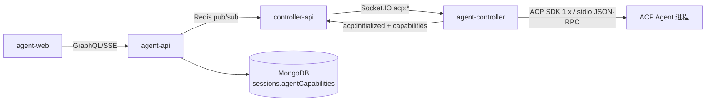
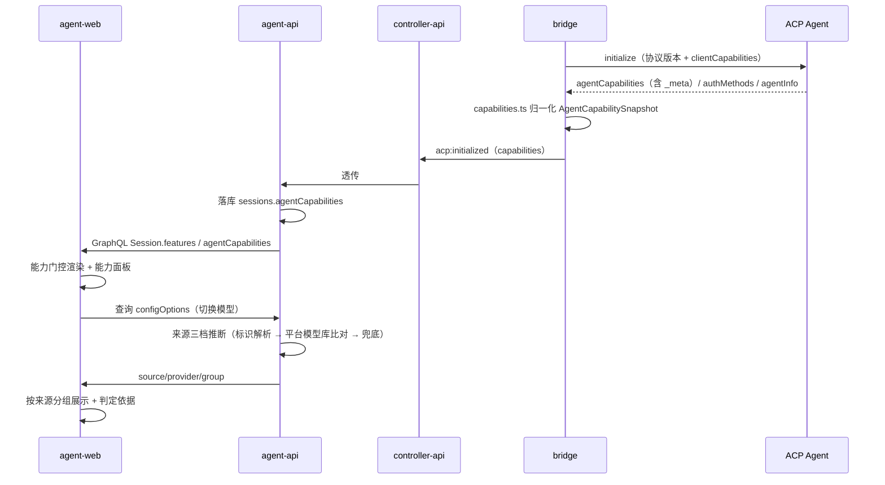

# ACP 协议增强 — 技术提案

**功能名称**: ACP 协议能力透明化与模型来源分组
**关联 PRD**: `docs/product/draft/20261021-acp-protocol-enhancement.md`
**技术提案版本**: v1.1
**创建日期**: 2026-10-21
**作者**: ZeroAsh
**feat-branch**: `feat/acp-protocol-enhancement`

> **v1.1 变更（下游评审返工）**：
> 1. **保留**：能力快照归一化（实现点 1）、模型来源三档推断（实现点 2）、前端能力门控与能力面板（实现点 3）；
> 2. **移除**：agentgear 扩展通道（原实现点 2）、工作流上下文与产物闭环（原实现点 4）、OpenCode 差异能力接入（原实现点 6）——均移出本期范围，仅在 §3/§4 如实盘点；
> 3. **新增 §5**：「OpenCode ACP 回传形态 → 落库处理 → 前端渲染」全链路现状梳理与对照矩阵（含观察项登记）；
> 4. 模型来源三档推断改为**纯标准协议 + 平台侧数据**口径（原 `_meta.agentgear.modelSource` 一档因扩展通道裁剪而替换为标识解析）。

## 1. 概述

### 1.1 背景

仓库在 `packages/agent-controller` 中以 `@agentclientprotocol/sdk`（`^1.3.0`）实现 ACP Client，拉起多种 ACP Agent（OpenCode、GitHub Copilot、Claude Code、Gemini CLI、Codex、MiMo Code、Kimi Code），经 Socket.IO（`acp:*`）→ controller-api → Redis → agent-api → GraphQL/SSE 管线向 agent-web 提供会话能力。此前 `20260803-feat-acp-v1-completion` 已完成 ACP v1 稳定能力的补全（SDK 1.x、config options、`session/delete`、`messageId`、多模态、认证、elicitation 等）。

本提案的来源是产品需求「ACP 协议增强」，要求回答两个问题并落到实现：

1. **ACP 现在的能力边界是什么**——协议支持什么、不支持什么（见 §2）；
2. **ACP 扩展机制是什么、OpenCode 在这两方面支持什么**（见 §3、§4）。

在此基础上补齐产品侧缺口：能力不透明（入口一刀切）、模型列表无来源区分（见 `20261020-api-channel-model-fixes` 需求总 PR 的遗留项「须由 ACP 侧补来源字段才能分组」）、回传内容各层处理口径无对照说明、协议演进跟进成本高。

### 1.2 目标

1. **能力快照归一化**：把 `initialize` 获得的能力协商结果归一化为「能力快照」（三档状态 + 原始对象留档），全链路持久化，成为能力展示与适配的唯一事实源（PRD F1）。
2. **模型来源三档推断与分组**：为「切换模型」的每个模型判定来源并分组展示，判定规则统一、结果可核对（PRD F3）。
3. **前端能力门控与能力面板**：会话界面按能力快照自适应入口（显示/禁用/提示），并提供逐项可查的能力面板（PRD F1/F2）。
4. **回传形态 → 落库 → 渲染 现状梳理**：逐形态理清 OpenCode（及其他 Agent）经 ACP 回传内容的形态全集、平台当前落库处理与前端渲染口径，形成对照矩阵与观察项登记（PRD F4，文档交付）。
5. **兼容可演进**：所有新能力以「探测不到即降级」为原则接入，存量 Agent 零退化（PRD F4）。

### 1.3 范围

**做**：
- 能力快照（`AgentCapabilitySnapshot`）归一化、持久化、GraphQL 暴露；
- 模型来源三档推断（标识解析 → 平台模型库比对 → 兜底）与来源分组展示；
- 前端能力门控（入口自适应）与能力面板；
- 「回传形态 → 落库处理 → 前端渲染」现状对照梳理（§5，随提案交付）；
- 契约增量（`agent-session.graphql`、`agent-session-websocket.md`）与测试覆盖。

**不做**（经评审裁剪，列为后续需求候选）：
- **平台扩展通道（agentgear）**：`_meta.agentgear.*` 命名空间、`_agentgear/*` 扩展方法与扩展能力广播，本期不实施（§3 仅作扩展机制能力盘点）；
- **工作流上下文与产物闭环**：工作流节点上下文透传、结构化产物回传写黑板，本期不实施；
- **OpenCode 差异能力接入**：子会话动态透传、`session/fork` 入口、命令面板增强、认证引导定制等，本期不实施（仅在 §4/§5 如实记录）；
- **终端能力**（`clientCapabilities.terminal` 与 `terminal/*`）与 **ACP `fs/*` client 能力**：沿用 `20260803` 的云端架构决策；
- **MCP 相关变更**：MCP 模块维持现状；**ACP v2 实施**：仅跟踪评估（§2.6）；**ACP Registry 接入**：不在本期；
- 现状梳理中发现的存储/渲染缺口：本期**只登记不修改**（观察项，避免范围蔓延）。

## 2. ACP v1 能力全景与能力边界

> 来源：ACP v1 官方文档 <https://agentclientprotocol.com/protocol/v1/>（overview / initialization / authentication / session-setup / session-list / session-delete / prompt-turn / content / tool-calls / elicitation / file-system / cancellation / terminals / agent-plan / session-modes / session-config-options / slash-commands / extensibility / transports），下文引用简称「文档名」。

### 2.1 通信模型与能力协商

| 要点 | 说明 |
|---|---|
| 协议基础 | JSON-RPC 2.0；两类消息：Methods（请求-响应）与 Notifications（单向，无响应） |
| 传输 | **stdio 为基线**（Client 以子进程拉起 Agent，`\n` 分隔、UTF-8、不得混写非 ACP 消息）；Streamable HTTP 传输**仍在草案讨论中**；允许自定义传输但必须保持 JSON-RPC 格式与生命周期 |
| 版本协商 | `protocolVersion` 为 MAJOR 整数，仅破坏性变更递增；不兼容时 Client SHOULD 断开并提示 |
| 能力协商 | 所有能力均 OPTIONAL；**未在 `initialize` 出现的能力 MUST 视为不支持**；新增能力不算破坏性变更；双方 SHOULD 容忍对端能力的任意组合 |
| 参数规约 | 文件路径 MUST 绝对路径；行号 1-based；对象键 camelCase、判别值 snake_case |
| 错误 | 标准 JSON-RPC error；文档出现的错误码：`-32601` Method not found、`-32602` Invalid params、`-32800` Request Cancelled，另有 `auth_required` 门控 |

`initialize` 双向能力对象（camelCase 原名）：

| 侧 | 能力字段 | 含义 |
|---|---|---|
| Client → Agent | `auth.terminal` | Client 可复现交互式终端登录（Agent 才可通告 `type:"terminal"` 认证方法） |
| Client → Agent | `fs.readTextFile` / `fs.writeTextFile` | Agent 可调用 `fs/read_text_file` / `fs/write_text_file` |
| Client → Agent | `terminal` | Agent 可调用 `terminal/*` 五件套 |
| Client → Agent | `elicitation.form` / `elicitation.url` | 支持的 `elicitation/create` 模式（省略/null = 不支持；`{}` = 通告零模式，**不同于 MCP**） |
| Client → Agent | `session.configOptions.boolean` | 支持 `type:"boolean"` 配置项 |
| Client → Agent | `session.compaction` | 支持 ID 寻址压缩更新（不通告 Agent 禁止发送，含重放） |
| Client → Agent | `session.notices` | 能呈现 `notice` 实时通知（不通告 Agent MUST NOT 发） |
| Agent → Client | `loadSession` | `session/load` 可用（带历史重放） |
| Agent → Client | `promptCapabilities.image/audio/embeddedContext` | prompt 可含图片/音频/内嵌资源 |
| Agent → Client | `mcpCapabilities.http` / `.sse` | 可连接 http / sse MCP server（sse 已被 MCP 规范弃用） |
| Agent → Client | `auth.logout` | `logout` 可用 |
| Agent → Client | `sessionCapabilities.list` / `.delete` / `.resume` / `.close` / `.additionalDirectories` | 会话发现/删除/无重放恢复/关闭/附加工作区根 |
| 双方 | `_meta` | 扩展能力与自定义数据广播（§3） |

基线要求：所有 Agent MUST 支持 `session/new`、`session/prompt`、`session/cancel`、`session/update`；prompt 内容基线 MUST 支持 `text` 与 `resource_link`。

### 2.2 Agent 侧方法（Client 调用 Agent）

| 方法 | 类型 | 能力开关 | 说明 |
|---|---|---|---|
| `initialize` | baseline | — | 版本与能力协商 |
| `authenticate` | baseline | — | 以 `methodId` 执行认证（`methodId` MUST NOT 用 terminal 类型） |
| `session/new` | baseline | — | 创建会话（`cwd`、`mcpServers`、可选 `additionalDirectories`） |
| `session/prompt` | baseline | — | 发送 prompt，回合以 stop reason 结束 |
| `session/load` | optional | `loadSession` | 恢复会话并重放全部历史后才响应 |
| `session/resume` | optional | `sessionCapabilities.resume` | 无重放重连会话 |
| `session/close` | optional | `sessionCapabilities.close` | 取消进行中工作并释放资源 |
| `session/list` | optional | `sessionCapabilities.list` | 发现历史会话（`cursor` 不透明分页） |
| `session/delete` | optional | `sessionCapabilities.delete` | 从发现结果移除会话 |
| `session/set_config_option` | optional | boolean 类需 `session.configOptions.boolean` | 设置配置项，响应为完整配置状态 |
| `session/set_mode` | optional | — | 切换模式，**协议已标记未来版本移除**（由 config option `category:"mode"` 取代） |
| `logout` | optional | `auth.logout` | 结束认证状态 |
| `session/cancel` | 通知 | — | 取消回合（Agent MUST 以 `cancelled` stop reason 响应） |
| `$/cancel_request` | 通知（双向） | — | 请求级取消，原请求须以响应或 `-32800` 收尾 |

### 2.3 Client 侧方法（Agent 调用 Client）

| 方法 | 类型 | 能力开关 | 说明 |
|---|---|---|---|
| `session/request_permission` | baseline | — | 工具执行前授权（`selected`/`cancelled`；`session/cancel` 后 MUST 对挂起请求回 `cancelled`） |
| `fs/read_text_file` / `fs/write_text_file` | optional | `fs.readTextFile` / `fs.writeTextFile` | Client 侧文本文件读写（仅文本、绝对路径） |
| `terminal/create` / `output` / `wait_for_exit` / `kill` / `release` | optional | `terminal` | Client 侧终端执行与管理 |
| `elicitation/create` | optional | `elicitation.form` / `.url` | 结构化问询（form：扁平 schema、禁止密钥类；url：带外/OAuth，须同源同人） |
| `session/update` | 通知 | `session.notices` / `session.compaction` 限特定更新 | 会话更新流（见 §2.4） |
| `elicitation/complete` | 通知 | — | url 模式带外交互完成回报 |

### 2.4 会话更新、内容与工具能力

`session/update` 的 `sessionUpdate` **全集共 14 种**（`prompt-turn.md` 明示为当前 schema 完整集合）：

| 类别 | 更新类型 | 要点 / 能力开关 |
|---|---|---|
| 消息流 | `user_message_chunk` / `agent_message_chunk` / `agent_thought_chunk` | 可带不透明 `messageId`（同 ID = 同一消息）；thought 经独立更新流，**不是**独立内容块类型 |
| 工具 | `tool_call` / `tool_call_update` | 状态机 `pending → in_progress → completed/failed`（取消语境另有 cancelled）；`kind`：read/edit/delete/move/search/execute/think/fetch/switch_mode/other；内容含 `content`/`diff`（`oldText:null` = 新文件）/`terminal` |
| 计划 | `plan` | `entries[]` 全量替换语义，`priority` high/medium/low、`status` pending/in_progress/completed |
| 命令/模式/配置 | `available_commands_update` / `current_mode_update` / `config_option_update` | 命令执行 = 普通 prompt 文本 `/cmd args`；模式 API 将移除 |
| 元信息 | `session_info_update` / `usage_update` | 前者 title/updatedAt/`_meta`（cwd 不可变更）；后者 `used`/`size`（上下文 token）+ `cost{amount,currency}`（累计费用，ISO 4217） |
| 通知 | `notice` | `severity` info/warning/error（开放枚举，`_` 前缀留给实现）、`title` 必填；不入历史不重放、不可承载致命信息；需 `session.notices` |
| 压缩 | `compaction_update` / `compaction_summary_chunk` | ID 寻址、patch 语义、须报终态；需 `session.compaction` |

内容块（ContentBlock，与 MCP 同构）：`text`（基线）、`resource_link`（基线）、`image`（`promptCapabilities.image`）、`audio`（`promptCapabilities.audio`）、`resource` 内嵌资源（`promptCapabilities.embeddedContext`）。工具权限选项 `kind`：`allow_once`/`allow_always`/`reject_once`/`reject_always`；`locations[]` 提供 follow-along 定位（绝对路径 + 1-based 行号）。

其他能力域：**Session Config Options**（`id`/`name`/`category`/`type:select|boolean`/`currentValue`/`options`（值或分组，分组支持 `_meta`），category 预留 `mode`/`model`/`model_config`/`thought_level`，`_` 前缀自定义）；**Slash Commands**（`availableCommands[{name,description,input.hint}]`）；**Elicitation**（form/url 双模式）；**Terminal** 五件套；**Agent Plan**；**MCP 接入**（`session/new|load|resume` 传 `mcpServers`：stdio 必支持、http 需 `mcpCapabilities.http`、sse 需 `mcpCapabilities.sse` 且已弃用）。

### 2.5 ACP v1 能力边界：支持 / 不支持对比

| 能力 | ACP v1 状态 | 说明 |
|---|---|---|
| 会话创建/提示/取消/更新流 | ✅ 支持（基线 MUST） | 全体 Agent 必备 |
| 会话恢复（load 重放 / resume 无重放） | ✅ 支持（能力开关） | `loadSession`、`sessionCapabilities.resume` |
| 会话发现/删除/关闭 | ✅ 支持（能力开关） | `sessionCapabilities.list/.delete/.close` |
| 附加工作区根 | ✅ 支持（能力开关） | `sessionCapabilities.additionalDirectories` |
| 消息 ID 分组 | ✅ 支持（MAY） | 不透明 ID，无编辑/删除/回执语义 |
| 上下文用量与累计费用 | ✅ 支持（MAY） | `usage_update`；仅会话累计粒度，**无按请求/按工具细分** |
| 多模态输入 | ✅ 支持（能力开关） | image/audio/embeddedContext 分别开关 |
| 会话配置项（select/boolean、category） | ✅ 支持 | boolean 需 client 能力；category 仅 UX 提示 |
| 认证/登出 | ✅ 支持 | `authenticate`/`logout`；方法类型仅 `agent`/`terminal` |
| 结构化问询 Elicitation | ✅ 支持（2026 稳定） | form/url 双模式，安全规则严格 |
| 终端执行（Agent 借 Client 终端） | ✅ 支持（能力开关） | 需 `clientCapabilities.terminal` |
| Client 文件读写（Agent 借 Client 文件） | ✅ 支持（能力开关） | 仅文本文件 |
| 压缩/实时通知 | ✅ 支持（能力开关） | `session.compaction` / `session.notices` |
| 请求级取消 `$/cancel_request` | ✅ 支持（可选实现） | 双向 |
| 会话分叉 `session/fork` | ❌ **不在 v1** | 仅 RFD（<https://agentclientprotocol.com/rfds/session-fork>）；OpenCode 已按扩展抢先实现（§4.3） |
| 子代理/子会话 | ❌ **不在 v1** | 仅 RFD（`/rfds/subagents`），无任何方法/能力字段 |
| MCP over ACP（协议桥接/端点转发） | ❌ **不在 v1** | v1 中 MCP 仅单向：Client 传 `mcpServers` 配置、Agent 侧连接 |
| 可配置 LLM endpoint / API Key | ❌ **不在 v1** | 协议无 endpoint/key 配置；`category:"model"` 仅是 Agent 自定义值选择器 |
| Streamable HTTP / WebSocket 传输 | ❌ **未定稿** | HTTP 为草案讨论中；WebSocket 无标准定义，仅可走「自定义传输」 |
| 按消息编辑/删除/回执 | ❌ 不在 v1 | messageId 仅分组语义 |
| 会话中变更 cwd / additionalDirectories | ❌ 不在 v1 | `session_info_update` 明确不可变更 |
| 删除活动会话、load 已删会话、logout 对活动会话影响 | ⚠️ 实现自定义 | 规范不保证行为 |
| Session Modes 专属 API | ⚠️ 可用但将移除 | `session/set_mode`/`modes`/`current_mode_update` → `configOptions(category:"mode")` |
| `loadSession` 与 `sessionCapabilities` | ⚠️ 不统一 | 文档注明未来版本统一 |
| `clientInfo`/`agentInfo` | ⚠️ SHOULD | 未来版本将必填 |
| MCP SSE | ⚠️ 弃用 | ACP 仍保留开关 |

### 2.6 协议演进方向（跟踪项，不在本期实施）

ACP v2 已发布草案（<https://agentclientprotocol.com/announcements/acp-v2-draft>，官方 TS SDK 亦已发布 `2.0.0` 并含 `experimental/v2`、`http-client` 入口），RFD 队列含子代理会话、MCP-over-ACP、session fork、LLM endpoint 配置、token 用量细分、HTTP/WebSocket 传输等。另注意 **SDK 方法面已先行于 v1 文档**：`@agentclientprotocol/sdk@1.3.0` 已含 `session/fork`（`unstable_forkSession`）与 `providers/list|set|disable` 方法常量，属文档之外的未稳定面。

本平台策略：**v1 能力开关 + 扩展机制为唯一实施面**，RFD/v2/SDK unstable 面仅作能力快照与设计留位（§6.2 中 `raw` 字段保留原始能力对象，未来字段变化不阻塞）；调用 unstable API 必须经隔离封装（`20260803` 的 `unstable_setSessionModel` 教训）。

## 3. ACP 扩展机制

> 来源：`extensibility.md`、`initialization.md`、`prompt-turn.md`、`session-config-options.md`、RFD `meta-propagation`。
> **本期口径**：扩展机制仅作能力盘点与兼容容错依据（§5 对 OpenCode 扩展的处理如实记录），**不实施平台扩展通道**（见 §1.3 不做项）。

| 机制 | 能做 | 不能做 / 红线 |
|---|---|---|
| `_meta` 字段 | 在**定义了 `_meta` 的类型**上附加 `{ [key: string]: unknown }`：多数请求/响应/通知与嵌套类型（content block、tool call、plan entry、能力对象、`SessionConfigOption`、`SessionInfo`、`SessionUpdate`、`ConfigOptionUpdate`、`SessionPromptRequest/Response` 等） | 非所有类型都有（如 `Error` 无）；**MUST NOT** 在规范类型**根部**加任何自定义字段（根级名称全部保留给未来版本） |
| W3C 保留键 | `_meta` 根级 `traceparent`/`tracestate`/`baggage` SHOULD 保留给 W3C Trace Context（与 MCP/OpenTelemetry 互通） | 平台扩展不得占用这三键 |
| 扩展方法 | `_` 前缀方法名保留给自定义扩展（如 `_zed.dev/workspace/buffers`）；请求必须按 `id` 响应，未知方法回 `-32601 Method not found`；自定义通知同样 `_` 前缀、省略 `id` | 未广播就调用可能收到 Method not found；扩展 MUST 走 JSON-RPC 标准语义 |
| 未知通知 | 未知自定义通知 SHOULD **忽略**（与请求不同） | 不得因未知通知断连 |
| 扩展能力广播 | SHOULD 在能力对象 `_meta` 广告扩展支持（如 `agentCapabilities._meta["zed.dev"] = { workspace: true }`），调用方先探测再适配 | 未广播 = 不支持，调用方须降级 |
| 开放枚举 | `notice.severity`、compaction status 等开放枚举的 `_` 前缀值留给实现扩展 | 其他未知值保留给未来 ACP，Client MUST 保留并通用呈现，不得推断行为 |
| `_meta` 传播惯例 | Client MAY 经 `params._meta` 向 Agent 传关联字段（如 `requestId`），已形成 RFD 惯例 | 平台扩展键需成文档化命名空间，避免双方各自漂移 |

**结论**：未来若实施平台扩展，必须走 `_meta`（数据）+ `_` 方法（行为）+ 能力 `_meta`（协商）三条通道、命名空间化，并遵守「未知即忽略/降级」红线；**本期不实施扩展通道**（§1.3），上述规则仅作为 OpenCode 扩展的容错依据（§5.4 观察项 7）。

## 4. OpenCode ACP 支持清单

> 来源：OpenCode 官方文档（v1 <https://opencode.ai/docs/acp/>、v2 <https://opencode.ai/v2/docs/cli/acp>）、**源码**（`anomalyco/opencode` dev 分支 `packages/cli/src/acp/` 与 tag `v1.17.9`）与**本机实测**（`opencode acp` v2.0.31 stdio JSON-RPC 探针）。完整证据（含源码文件定位与 v1/v2 差异）见调研附录 [`20261021-feat-acp-protocol-enhancement-opencode-support.md`](./20261021-feat-acp-protocol-enhancement-opencode-support.md)。标注「实测」为探针证据、「源码」为实现证据、「文档」为官方说明。

### 4.1 能力广播（initialize 响应，实测）

```json
{
  "protocolVersion": 1,
  "agentCapabilities": {
    "loadSession": true,
    "mcpCapabilities": { "http": true, "sse": false },
    "promptCapabilities": { "embeddedContext": true, "image": true },
    "sessionCapabilities": {
      "additionalDirectories": {}, "close": {}, "delete": {},
      "fork": {}, "list": {}, "resume": {}
    },
    "_meta": { "opencode/child-session-updates": true }
  },
  "authMethods": [
    { "id": "opencode-login", "name": "Login with opencode",
      "description": "Run `opencode auth login` in the terminal" }
  ],
  "agentInfo": { "name": "OpenCode", "version": "2.0.31" }
}
```

### 4.2 Agent 侧方法支持清单

| ACP 方法 | OpenCode 支持 | 证据 |
|---|---|---|
| `initialize` | ✅ | 实测：protocolVersion 1、`agentInfo` OpenCode 2.0.31 |
| `session/new` | ✅ | 实测：返回 `sessionId` + `configOptions`（`modes:null`，按 config options 为准） |
| `session/prompt` | ✅ | 实测：`end_turn`；响应含 `stopReason`、`usage`、**`_meta`** |
| `session/cancel` | ✅ | 基线能力（文档「All features are supported」） |
| `session/load` | ✅ | `loadSession:true` + 实测返回 `configOptions` |
| `session/resume` | ✅ | `sessionCapabilities.resume` |
| `session/list` | ✅ | `sessionCapabilities.list` + 实测返回 `sessions[{sessionId,cwd,title,updatedAt}]` |
| `session/delete` | ✅ | `sessionCapabilities.delete` |
| `session/close` | ✅ | `sessionCapabilities.close` + 实测成功 |
| `session/set_config_option` | ✅ | 实测：设置 `effort=low` 成功并返回全量 `configOptions` |
| `session/set_mode` | ✅ | 实测方法存在（无效参数报 `-32602` 而非 Method not found）；OpenCode 以 `category:"mode"` 配置项为主 |
| `authenticate` | ✅ | `authMethods: ["opencode-login"]`（默认 `agent` 类型；文档提示在终端执行 `opencode auth login`） |
| `logout` | ⚠️ 未广播 | 实测 `agentCapabilities` 无 `auth.logout`，按协议 MUST NOT 调用 |
| `session/fork` | ⚠️ 扩展实现 | `sessionCapabilities.fork` 已广播且 `session/fork` 方法存在（无效参数报 `-32602`）；协议 v1 尚无此方法（RFD 状态） |
| 未知 `_` 扩展方法 | ✅ 规范降级 | 实测 `_opencode/ping`、`_agentgear/ping` 均回 `-32601 Method not found` |

### 4.3 通知与扩展支持清单

| 能力 | OpenCode 支持 | 证据 |
|---|---|---|
| `agent_message_chunk`（带 `messageId`） | ✅ | 实测：`messageId: "msg_..."` 稳定分组；源码 `translate.ts` |
| `user_message_chunk` | ✅（仅 `session/load` 回放） | 源码 `replay.ts`：实时回合不发，仅历史回放 |
| `agent_thought_chunk` | ✅ | 实测 + 源码：`messageId` 形如 `<msgId>:reasoning:<ordinal>` |
| `tool_call` / `tool_call_update` | ✅ | 实测 `kind:"edit"`；源码：`pending → in_progress/completed/failed`，完成时附 text/image/diff 内容 |
| `available_commands_update` | ✅ | 实测：`init`、`review`、`compact`；源码 `catalog.ts`（目录命令 + 内置 `compact`） |
| `usage_update`（`used`/`size`/`cost`） | ✅ | 实测：`{used:5421,size:1000000,cost:{amount:0,currency:"USD"}}`；prompt 响应另有 `usage`（token 明细） |
| `config_option_update` | ✅ | 实测 + 源码：模型/agent 列表变化或他端改配置时推送全量 |
| `session_info_update` | ⚠️ 仅承载 `_meta` | 源码 `translate.ts`/`compaction.ts`：只用于 `opencode/retry`（重试状态）与 `opencode/compaction`（压缩标记），**不更新 title 等元数据** |
| `compaction_update` / `compaction_summary_chunk` | ✅（需 `clientCapabilities.session.compaction`） | 源码 `compaction.ts`：否则降级为 `_meta` 标记 |
| `plan` / `plan_update` / `plan_removed` | ❌ 从不发送 | 源码无构造代码：OpenCode 不向 ACP 暴露执行计划 |
| `current_mode_update` | ❌ 从不发送 | 模式改用 `mode` config option 表达（`session/set_mode` 仍实现） |
| `notice` | ❌ 从不发送 | 源码无构造代码 |
| `subagent_update` / `session_message*`（实验面） | ❌ | 以自有扩展替代（见下） |
| 扩展能力 `_meta` | ✅ | 实测：`agentCapabilities._meta["opencode/child-session-updates"] = true` |
| `_meta` 扩展键（共 5 个） | ✅ | 源码：`opencode/child-session-updates`、`opencode/child-session`（子会话）、`opencode/retry`（重试）、`opencode/compaction`（压缩标记）、`terminal-auth`（认证方法 `_meta`） |
| 自定义通知 `opencode/session/child_update` | ✅（需客户端 `_meta` opt-in） | 源码 `child.ts`：⚠️ **未用 `_` 前缀**（协议建议扩展方法以 `_` 开头），平台须按未知方法容错处理 |
| prompt 响应 `_meta` | ✅ | 实测：`session/prompt` 响应含 `stopReason`/`usage`/`_meta`（可能带 `opencode/retry`） |
| 自定义 `_` 扩展请求（如 `_agentgear/*`） | ❌ 无 | 实测未知扩展方法回 `-32601 Method not found`（OpenCode 只做 `_meta` 与自定义通知两类扩展） |

### 4.4 Client 侧依赖（OpenCode 是否回调 Client）

| Client 方法 | OpenCode 是否调用 | 证据与结论 |
|---|---|---|
| `fs/read_text_file` / `fs/write_text_file` | v2 ❌ / v1 ⚠️ | 实测 v2：声明 `clientCapabilities.fs` 后让其建文件，仍走内部 `edit` 工具，无 `fs/*` 请求；源码：v1 在 edit 权限批准后会调 `fs/write_text_file` 写回，v2 完全不用 |
| `terminal/*` | ❌ 不调用 | 实测 + 源码：shell 由 OpenCode 自身工具在 Agent 侧执行 |
| `session/request_permission` | ✅ 会调用 | 源码 `permission.ts`：固定 `once/always/reject` 三选项，涉改文件时尽力附 `diff` 预览（不保证必有） |
| `elicitation/create` | ✅（仅 form 模式，v2） | 源码 `elicitation.ts`：无 `url` 模式、不发 `elicitation/complete`；涉密/复杂表单直接取消 |

### 4.5 OpenCode 通过 ACP 的产品能力面（文档）

| 能力 | 状态 | 说明 |
|---|---|---|
| 内置工具（文件、终端等） | ✅ 支持 | 文档：All features are supported |
| 自定义工具与 slash 命令 | ⚠️ 部分支持 | 目录命令 + 内置 `compact` 经 `available_commands_update` 下发；其他 `/…` 按普通文本透传 |
| MCP servers（OpenCode 配置） | ✅ 支持 | 另经 ACP `mcpServers` 注入亦受支持（stdio + HTTP；`mcpCapabilities.http:true`，SSE 不支持） |
| `AGENTS.md` 项目规则 | ✅ 支持 | 文档明确 |
| 自定义 formatter/linter | ✅ 支持 | 文档明确 |
| Agents 与 permissions 系统 | ✅ 支持 | ACP 下照常生效，`ask` 转 `session/request_permission` |
| 执行计划（plan/todo）展示 | ❌ 不支持 | OpenCode 不向 ACP 暴露执行计划 |
| 实时通知（notice） | ❌ 不支持 | 从不发送 |
| 内置 `/undo`、`/redo`、`/help` 命令 | ❌ 不支持 | 文档明确「currently unsupported」，仅按普通文本透传 |
| 音频输入 | ❌ 不支持 | 实测 `promptCapabilities` 无 `audio`（prompt 中 audio 块被忽略） |
| SSE MCP 传输 | ❌ 不支持 | 实测 `mcpCapabilities.sse:false` |
| MCP over ACP（`mcp/message`） | ❌ 不支持 | v2 文档明确 |
| 编辑器/Client 侧集成（Zed、JetBrains、Avante.nvim、CodeCompanion.nvim） | ✅ | `opencode acp` 子进程 + JSON-RPC stdio（文档配置示例） |

### 4.6 与其他 Agent 的关系

平台 detector 支持 7 类 Agent（opencode / github_copilot / claude_code / gemini_cli / codex / mimo_code / kimi_code，`packages/agent-controller/src/acp/detector.ts`）。各 Agent 能力广播差异大（如认证方法、`sessionCapabilities`、多模态），**能力快照（§9.2 实现点 1）是唯一可靠依据**；OpenCode 的专有扩展（`opencode/*` `_meta` 键、`opencode/session/child_update` 自定义通知、`fork`）本期只做识别与容错记录，不做能力接入。

## 5. OpenCode ACP 回传形态 → 落库处理 → 前端渲染 现状梳理

> **本节口径**：逐形态如实记录 Agent 回传内容在平台三层（bridge 协议面 → 落库 → 前端渲染）的当前处理方式，**只梳理与登记，不修改既有行为**（缺口列入 §5.5 观察项，作为后续需求候选）。证据：调研附录（回传形态）、`packages/agent-controller/src/acp/bridge.ts`、`servers/controller-api/src/services/acp-session-manager.ts`、`servers/agent-api/src/models/acp-message.ts`、`apps/agent-web/src/components/session/*`。

### 5.1 回传形态全集（Agent → 平台）

OpenCode 经 ACP 回传给平台的内容形态（`session/update` 通知 + 请求 + 响应，详见调研附录 §7/§9/§13/§15）：

| # | 形态 | 载荷形态 | OpenCode 实际行为 |
|---|---|---|---|
| 1 | `agent_message_chunk`（text） | `content: {type:"text",text}` + 可选 `messageId` | 模型输出流式片段，`messageId` 稳定（`msg_...`） |
| 2 | `agent_message_chunk`（多模态块） | `content: {type:"image"/"audio"/"resource"}` | 理论可发（image/embeddedContext 已广播）；audio 不支持 |
| 3 | `agent_thought_chunk` | 文本片段 + `messageId` | `messageId` 形如 `<msgId>:reasoning:<ordinal>` |
| 4 | `user_message_chunk` | 文本/附件块 | **仅 `session/load` 回放**时发出，实时回合不发 |
| 5 | `tool_call` | `toolCallId/title/kind/status:"pending"/locations/rawInput` | 工具开始 |
| 6 | `tool_call_update` | 状态 + `content`（text/image/**diff**/**terminal**）+ `rawOutput` | `in_progress/completed/failed`；完成时附结果 |
| 7 | `plan` | `entries[]` | **从不发送**（OpenCode 不暴露执行计划） |
| 8 | `available_commands_update` | `availableCommands[]` | 建会话后发一次，命令变化再发 |
| 9 | `config_option_update` | 全量 `configOptions` | 模型/agent 列表变化或他端改配置时发 |
| 10 | `current_mode_update` | `currentModeId` | **从不发送**（用 `mode` 配置项表达） |
| 11 | `session_info_update` | 仅 `_meta`（`opencode/retry`、`opencode/compaction`） | 不更新 title 等元数据 |
| 12 | `usage_update` | `used/size/cost{amount,currency}` | 回合结束前发送 |
| 13 | `compaction_update` / `compaction_summary_chunk` | 压缩状态 / 摘要片段 | 需 `clientCapabilities.session.compaction`，否则降级 `_meta` 标记 |
| 14 | `notice` | — | **从不发送** |
| 15 | `session/prompt` 响应 | `stopReason` + `usage`（token 明细）+ `_meta` | `usage` 为端 RFD 草案面；`_meta` 可能带 `opencode/retry` |
| 16 | `session/request_permission` | `toolCall`（含 diff 预览）+ `options` | 固定 `once/always/reject` 三选项 |
| 17 | `elicitation/create` | form 模式 | 仅 form；无 url 模式、无 `elicitation/complete` |
| 18 | 自定义通知 `opencode/session/child_update` | 子会话状态/更新 | 需客户端 `_meta` opt-in；⚠️ 未用 `_` 前缀 |

### 5.2 落库处理现状（bridge → controller-api → MongoDB）

**第一层：bridge（`packages/agent-controller/src/acp/bridge.ts`，`sessionUpdate` switch L629-675）**

| 回传形态 | bridge 处理 |
|---|---|
| `agent_message_chunk`（text） | 聚合缓冲：有 `messageId` 按 ID 边界立即 flush；无 ID 走 50ms debounce flush，随后 `sendUpdate`（L634-651、L790-806） |
| `agent_message_chunk`（多模态块） | 先 flush 文本缓冲，再原样 `sendUpdate`（L652-656） |
| `agent_thought_chunk` / `tool_call` / `tool_call_update` / `plan` | 直接 `sendUpdate`（L657-662） |
| `config_option_update` | **不走 `acp:message`**：更新 bridge 配置缓存并 emit 专用事件 `acp:config-options`（L663-671） |
| `user_message_chunk` | **丢弃**，不透传（L672-673） |
| 其余（`usage_update`、`available_commands_update`、`session_info_update`、`notice`、`compaction_*`、未知类型） | default 分支直接 `sendUpdate`（L674-678） |

`sendUpdate` 将**原始 `SessionUpdate` 对象完整**经 `acp:message {sessionId, message}` 发出（L809-814），不做裁剪。

**第二层：controller-api 落库（`servers/controller-api/src/services/acp-session-manager.ts`，`processControllerMessage` L275-357）**

| 处理点 | 现状 |
|---|---|
| 消息串行化 | 同一 session 消息按队列串行处理（L258-273） |
| `config_option_update` | 更新 `Session.configOptions/currentModeId/currentModelId` + 配置缓存 + 发布状态（L275-297） |
| `current_mode_update` | 更新 `Session.currentModeId`（L300-310） |
| 落库 | **所有**经 `acp:message` 到达的 update 一律 `AcpMessage.create`：`direction:'output'`、`content` = 原始 update（Mixed 完整保真）、`messageId` 透传（L320-350） |
| 落库 `type` 映射 | `agent/user_message_chunk`、`agent_thought_chunk` → `text`；`tool_call`/`tool_call_update` → `tool_call`；`plan` → `plan`；`config_option_update`/`current_mode_update` → `text`；**其余一律 default → `text`**（`usage_update`/`available_commands_update`/`session_info_update`/`notice`/`compaction_*`/未知均落 `text`） |
| 实时分发 | 落库后 `publishMessage`（Redis → SSE）推送前端（L352-357） |

**存储模型**（`servers/agent-api/src/models/acp-message.ts:3-13`，controller-api 同构）：

| 字段 | 类型 | 说明 |
|---|---|---|
| `sessionId` | ObjectId | 会话关联（索引） |
| `direction` | `input` / `output` | 用户输入 / Agent 输出 |
| `type` | enum `text/image/tool_call/tool_result/plan/error` | ⚠️ **无** thought/usage/commands/notice 等专用值，均兜底 `text` |
| `content` | Mixed | **原始 `SessionUpdate` JSON 完整保真**（前端据 `content.sessionUpdate` 还原真实形态） |
| `metadata` / `messageId` | Mixed / String | 备注与消息分组 ID（`sessionId+messageId` 索引） |

其他链路：用户输入经 `agent-api` `session.addMessage`（`services/session.ts:535`）落 `direction:'input'` 并据首条输入生成会话标题（50 字符截断）；历史会话导入 `session-import.ts`（`insertMany`）；`migrations/001-unify-content-format.ts` 统一 content 格式。

### 5.3 前端渲染现状（`apps/agent-web/src/components/session/`）

前端**不依赖落库 `type`**，而是解析 `content.sessionUpdate` 重新分组（`group-messages.ts:35-154`），按 `messageId`/`toolCallId` 归并：

| sessionUpdate | 分组 | 渲染组件 | 渲染形态 |
|---|---|---|---|
| `user_message_chunk` | `user_message`（每条独立组） | `MessageItem` | 纯文本气泡 |
| `agent_message_chunk` | `agent_message`（按 `messageId` 归并） | `MessageItem` + `MarkdownContent` | Markdown；`mergeMessageChunks` **仅合并 text 块** |
| `agent_thought_chunk` | `thought`（按 `messageId` 归并） | `ThoughtBlock` | 可折叠推理块 |
| `tool_call`/`tool_call_update` | `tool_call`（按 `toolCallId` 归并） | `ToolCallCard` | 状态徽标、`locations` 文件:行号、`rawInput`/`rawOutput`、结果 content：text/image/**diff（DiffView）/terminal（terminalId 占位）** |
| 同上（`kind:"read"`） | `read` | `ReadCard` | 读文件特化卡片 |
| 同上（`kind:"fetch"`） | `fetch` | `FetchCard` | 抓取特化卡片 |
| 同上（`kind:"other"` + `rawInput.subagent_type`） | `sub_agent` | `SubAgentCard` | 子代理卡片 |
| `plan` | `plan` | `PlanCard`（最新一组浮层展示） | 计划条目列表 |
| `available_commands_update` | `available_commands` | `AvailableCommandsCard` | 命令列表 |
| `usage_update` | `usage` | `UsageCard` | `used/size/cost` |
| `config_option_update` | `config_option_update` | `ConfigOptionCard` | 配置快照 |
| `current_mode_update` | `current_mode_update` | `CurrentModeCard` | 模式变更 |
| 其他/未知（`session_info_update`、`notice`、`compaction_*` 等） | `unknown` | `MessageItem` 兜底 | 按落库 `type` 取样式；非 text 时 `displayContent` 为空（`MessageItem.tsx:37-52`） |

### 5.4 四层对照矩阵（形态 × bridge × 落库 × 渲染）

| 回传形态 | bridge | 落库（type / 内容） | 前端渲染 | 结论 |
|---|---|---|---|---|
| `agent_message_chunk`（text） | 聚合后透传 | `text` / 原样 | Markdown 气泡 | ✅ 链路完整 |
| `agent_message_chunk`（image/audio/resource 块） | 原样透传 | `text` / 原样保真 | ⚠️ `mergeMessageChunks` 只取 text，多模态块不渲染 | ⚠️ 落库保真、渲染缺失（观察项 1） |
| `agent_thought_chunk` | 透传 | `text` / 原样 | `ThoughtBlock` 按 messageId 归并 | ✅（落库 type 语义粗） |
| `user_message_chunk`（回放） | 丢弃 | 回放链路经导入落 `input` | 用户气泡 | ✅（实时不发，符合协议语义） |
| `tool_call`（pending） | 透传 | `tool_call` / 原样 | `ToolCallCard`（含 read/fetch/sub_agent 特化） | ✅ 链路完整 |
| `tool_call_update`（diff/terminal/text/image） | 透传 | `tool_call` / 原样 | diff→DiffView、terminal→ID 占位、text/image→内容 | ✅（terminal 仅占位，观察项 2） |
| `plan` | 透传 | `plan` / 原样 | `PlanCard`（OpenCode 不发，其他 Agent 可用） | ✅ |
| `available_commands_update` | 透传 | `text`（兜底）/ 原样 | `AvailableCommandsCard` | ✅（落库 type 兜底，观察项 3） |
| `config_option_update` | 专用事件 `acp:config-options`（不走 `acp:message`） | 更新 `Session` 配置快照；同名 update 经 `acp:message` 时落 `text` | `ConfigOptionCard` + 状态栏 | ✅（双通道并存，观察项 4） |
| `current_mode_update` | 透传 | `text`（兜底）+ 更新 `Session.currentModeId` | `CurrentModeCard` | ✅ |
| `session_info_update`（仅 `_meta`） | 透传 | `text`（兜底）/ 原样 | ⚠️ `unknown` 兜底（OpenCode 的 retry/compaction 标记不可见） | ⚠️ 观察项 5 |
| `usage_update` | 透传 | `text`（兜底）/ 原样 | `UsageCard` | ✅（落库 type 兜底，观察项 3） |
| `compaction_update`/`compaction_summary_chunk` | 透传 | `text`（兜底）/ 原样 | ⚠️ `unknown` 兜底 | ⚠️ 观察项 5 |
| `notice` | 透传 | `text`（兜底）/ 原样 | ⚠️ `unknown` 兜底（OpenCode 不发，其他 Agent 可能发） | ⚠️ 观察项 5 |
| 未知 `sessionUpdate` | default 透传 | `text`（兜底）/ 原样 | `unknown` 兜底，可能为空白气泡 | ⚠️ 观察项 6 |
| `session/prompt` 响应（stopReason/usage/`_meta`） | 不经 `acp:message`，走 `acp:prompt:complete` | 不落 `AcpMessage` | 回合结束状态 | ✅ |
| `session/request_permission` | 专用事件 `acp:permission` | `PendingPermission` 记录 | `PermissionDialog`（含 diff 预览） | ✅ 链路完整 |
| `elicitation/create`（form） | 专用事件 `acp:elicitation` | `PendingElicitation` 记录 | 表单弹窗 | ✅ 链路完整 |
| `opencode/session/child_update`（自定义通知） | ⚠️ 未注册路由（且未用 `_` 前缀） | 不可达 | 不渲染 | ⚠️ 本期仅容错记录（观察项 7） |
| `_meta` 键（retry/compaction/child-session 等） | 随原始 update 透传 | 保真于 `content` | 随所属 update 渲染（多数走 unknown） | ⚠️ 观察项 5/7 |

### 5.5 观察项登记（本期不修改，作为后续需求候选）

| # | 观察项 | 现状 | 建议 |
|---|---|---|---|
| 1 | 多模态内容块（image/audio/resource）渲染缺失 | 落库保真，`mergeMessageChunks` 只取 text、`MessageItem` 非 text 取空 | 后续需求：多模态块渲染 |
| 2 | `tool_call_update` 的 terminal 内容仅显示 terminalId 占位 | 无终端流展示（与终端能力不实施一致） | 维持现状，随终端决策联动 |
| 3 | 落库 `type` 语义粗（usage/commands/notice 等兜底 `text`） | `AcpMessage.type` enum 无对应值 | 后续需求：type 枚举扩展或废弃（前端已不依赖） |
| 4 | `config_option_update` 双通道（`acp:config-options` 专用事件 + `acp:message` 落库分支）并存 | 历史演进形成 | 后续需求：链路收敛 |
| 5 | `session_info_update`/`compaction_*`/`notice` 走 `unknown` 兜底，OpenCode 的 retry/compaction 标记不可见 | 渲染层不识别 | 后续需求：呈现补全 |
| 6 | 未知 `sessionUpdate` 兜底渲染可能为空白气泡 | `MessageItem` displayContent 取空 | 后续需求：兜底展示原始 JSON/提示 |
| 7 | `opencode/session/child_update` 未用 `_` 前缀、bridge 未注册路由 | 子会话动态不可达（本期 OpenCode 差异能力不做） | 后续需求：按未知方法容错 + 差异能力接入 |

### 5.6 平台能力现状与差距（本期改造视角）

| 能力 | 平台现状 | 本期动作 | 优先级 |
|---|---|---|---|
| 能力协商结果 | `bridge.ts` 仅摘取 `promptCapabilities`/`agentInfo`/`authMethods`/`mcpCapabilities`/`additionalDirectories` 逐个透传，无统一结构 | 归一化为能力快照（含 `raw` 留档）并持久化、GraphQL 暴露 | P0 |
| 能力驱动 UI | 前端无统一能力依据，入口一刀切 | `Session.features` 为唯一事实源 + 门控 hook + 能力面板 | P0 |
| 模型来源 | `SessionConfigOptionValue` 仅 `{value,name}`，无来源（PR #242 遗留） | 三档来源推断 + `source/provider/group` 暴露与分组展示 | P0 |
| 回传形态口径 | 三层处理分散、无对照说明（§5.1-§5.5） | 对照矩阵随提案交付；缺口只登记不修改 | P1 |

## 6. 技术架构

### 6.1 系统架构图



架构不变。变更收敛在四层：agent-controller（能力快照归一化）、controller-api/agent-api（快照透传与持久化、GraphQL 暴露）、agent-web（能力门控、能力面板、模型来源分组）。**既有消息链路（§5）零改动。**

### 6.2 技术栈

| 层级 | 技术选型 | 说明 |
|------|---------|------|
| 协议层 | `@agentclientprotocol/sdk` 1.x | 仅读取 `initialize` 结果（`agentCapabilities` 含 `_meta`），无需扩展 API |
| 前端 | React + TypeScript + Vite | 能力门控 hook、能力面板、来源分组弹层 |
| 后端 | Node.js + Express + GraphQL + Mongoose | 快照持久化、来源推断纯函数 |
| 探测 | Node.js 子进程 stdio JSON-RPC | 一次性能力探测与回归比对（§12） |

### 6.3 模块划分

| 模块 | 职责 | 关键变更 |
|------|------|-----------|
| `agent-controller/acp/capabilities.ts`（新增） | 能力归一化 | `AgentCapabilitySnapshot` 构造、FeatureId 映射表、`raw` 留档 |
| `agent-controller/acp/bridge.ts` | ACP 协议面 | `initConnection` 接入归一化，`acp:initialized` 携带 `capabilities` |
| `controller-api`（acp 会话管理） | 事件透传 | `acp:initialized` 增量透传（消息链路不动） |
| `agent-api` | 对外契约 | 快照落库、GraphQL `Session.features`/`agentCapabilities`、模型来源推断 |
| `agent-web` | 展示 | `useAgentCapabilities` 门控、能力面板、模型来源分组（含判定依据） |

## 7. API 设计（契约变更）

### 7.1 `contracts/agent-session-websocket.md` 增量

| 事件 | 变更 | 说明 |
|---|---|---|
| `acp:initialized` | 增 `capabilities: AgentCapabilitySnapshot` | 归一化能力快照 + `raw` 原始对象；其余事件（含 `acp:message` 消息链路）零变更 |

`AgentCapabilitySnapshot` 载荷：

```json
{
  "protocolVersion": 1,
  "agentInfo": { "name": "OpenCode", "version": "2.0.31" },
  "features": [
    { "id": "session.load", "status": "supported", "detail": "loadSession" },
    { "id": "prompt.audio", "status": "unsupported", "detail": "promptCapabilities.audio 未声明" },
    { "id": "session.fork", "status": "supported", "detail": "sessionCapabilities.fork" }
  ],
  "raw": { "agentCapabilities": {}, "authMethods": [] }
}
```

### 7.2 `contracts/agent-session.graphql` 增量

```graphql
enum AgentFeatureStatus { supported partial unsupported }

type AgentFeatureSupport {
  id: String!
  status: AgentFeatureStatus!
  detail: String
}

type AgentCapabilitySnapshot {
  protocolVersion: Int
  agentInfo: AgentInfo
  features: [AgentFeatureSupport!]!
  raw: JSON
}

extend type Session {
  agentCapabilities: AgentCapabilitySnapshot
  features: [AgentFeatureSupport!]!
}

extend type SessionConfigOptionValue {
  # 来源三档推断结果：platform | custom | agent | unknown
  source: String
  provider: String
  group: String
}
```

### 7.3 内部接口

- agent-controller → controller-api：`acp:initialized`（增 `capabilities`），经既有 Redis 透传；
- controller-api → agent-api：落 `sessions.agentCapabilities`；
- agent-api：`Session.features` 由快照派生（唯一事实源），`SessionConfigOptionValue.source/provider/group` 由来源推断纯函数计算返回。

## 8. 数据模型

### 8.1 MongoDB `sessions` 集合增量

| 字段 | 类型 | 说明 |
|------|------|------|
| `agentCapabilities` | Object（Mixed） | 能力快照（`protocolVersion`/`agentInfo`/`features[]`/`raw`），随 `acp:initialized` 写入、Agent 变更时整体更新 |

### 8.2 来源推断与缓存

- 模型来源三档推断为**纯函数**（§9.2 实现点 2），输入 `configOptions` 与平台模型库，输出 `source/provider/group`，随 GraphQL 查询计算返回，**不落库**（避免与配置快照双写不一致）；
- 如后续性能需要，可在 `Session` 增加推断结果缓存（本期不做）；
- `AcpDetector` 探测缓存（TTL 1h）维持现状。

## 9. 技术实现方案

### 9.1 核心流程



### 9.2 关键实现点

#### 实现点 1: 能力快照归一化（`capabilities.ts`）

- **描述**: 将 `initialize` 结果（`agentCapabilities` 全量含 `_meta`、`authMethods`、`agentInfo`）映射为稳定的 FeatureId 三档清单，同时保留 `raw` 原始对象。
- **技术细节**: FeatureId 映射表集中管理（`session.load/resume/close/list/delete/fork`、`prompt.image/audio/embeddedContext`、`auth.login/logout`、`mcp.http/sse`、`config.boolean`、`session.additionalDirectories`、`elicitation.form/url` 等）；缺失字段一律 `unsupported` 并记 `detail`（来源字段名）；未知 `_meta` 键（如 `opencode/child-session-updates`）原样保留进 `raw`，仅登记不消费。
- **风险点**: Agent 版本升级导致字段形态变化（如 `loadSession` 未来并入 `sessionCapabilities`）；对策：映射表集中管理 + `raw` 留档 + 探针回归（§12）。

#### 实现点 2: 模型来源三档推断

- **描述**: 「切换模型」列表来源分组的判定规则（**不依赖协议扩展**，纯标准信息 + 平台侧数据）：
  1. **一档·标识解析**：模型值形如 `<provider>/<model>`（如 `opencode-go/kimi-k3`）时解析出 `provider`；
  2. **二档·平台模型库比对**：与平台模型库比对（内建渠道模型 `scope=global` →「平台内置」；用户自定义模型 →「自定义」）；解析出 provider 但平台库无匹配 →「Agent 自带」；
  3. **三档·兜底**：无标识段且比对不上 →「来源未知」。
- **技术细节**: 纯函数可单测；`SessionConfigOptionValue` 扩展 `source/provider/group`；分组顺序沿用 `configOptions` 原始顺序保持稳定；每组附判定依据文案（「按标识前缀判定」「按平台模型库比对」「无法判定」）。
- **风险点**: 无前缀模型名或多来源重名；对策：兜底组 + 判定依据可查 + 同名按规则优先级归组不重复。

#### 实现点 3: 前端能力门控与能力面板

- **描述**: `useAgentCapabilities(sessionId)` 提供三档能力判断；入口（附件、模型、模式、认证、会话恢复、历史管理）按能力显示/禁用/提示；能力面板逐项展示 `features[]`；模型弹层按来源分组并展示判定依据。
- **技术细节**: 门控仅依赖 `Session.features`（唯一事实源），不在组件内散落能力判断；禁用态 tooltip 用 `detail` 文案；模型分组数据来自 `source/group`。
- **风险点**: 能力与实际行为不一致（声明了但调用失败）；对策：调用失败统一错误提示 + 记录，能力面板展示 `detail` 便于排查。

## 10. 技术决策

### 10.1 决策列表

| 决策 | 选项 A | 选项 B | 最终选择 | 原因 |
|------|--------|--------|---------|------|
| 能力快照 | 落库持久化 | 仅会话内存 | **A** | 支持跨端展示、回归比对与 Agent 升级差异发现 |
| 来源判定 | 仅标识解析 | 三档（解析 → 平台库比对 → 兜底） | **三档** | 兼容无前缀标识与平台库模型，兜底可解释 |
| 来源数据载体 | 协议扩展 `_meta` 字段 | 标准协议信息 + 平台侧数据 | **B** | agentgear 扩展通道本期不实施（评审裁剪） |
| 门控依据 | 组件内散落判断 | `Session.features` 唯一事实源 | **B** | 避免判断口径漂移 |
| 现状梳理 | 顺手修复缺口 | 只登记不修改 | **B** | 控范围（评审裁剪），缺口走后续需求 |
| 消息链路 | 顺带重构落库 type 枚举 | 零改动 | **零改动** | §5 明确「只登记不修改」；前端已不依赖落库 type |
| `fs`/`terminal` client 能力 | 实施 | 不实施 | **不实施** | 沿用 20260803 云端架构决策；OpenCode v2 亦不回调（v1 会调 `fs/write_text_file` 属历史行为） |

### 10.2 依赖与约束

| 类型 | 内容 | 说明 |
|------|------|------|
| 依赖 | `@agentclientprotocol/sdk` 1.x `initialize` 结果读取 | 含 `_meta` 的 `agentCapabilities` 读取无需扩展 API |
| 依赖 | 平台模型库数据准确性（内建渠道 `scope=global`、用户自定义模型） | 来源二档比对的基准 |
| 约束 | 不改标准协议交互、不改既有消息链路 | 契约只做增量，旧 Agent 零退化 |
| 约束 | 不实施协议扩展通道/工作流闭环/OpenCode 差异能力 | 评审裁剪项，列为后续需求候选 |

## 11. 项目结构

```
packages/agent-controller/src/acp/
├── bridge.ts            # 协议面：initConnection 接入能力快照
├── capabilities.ts      # 新增：AgentCapabilitySnapshot 归一化与 FeatureId 映射
├── detector.ts          # Agent 探测（不变）
└── ...
servers/controller-api/src/   # acp:initialized 透传增量（消息链路不动）
servers/agent-api/src/        # 快照落库、Session.features、来源三档推断
apps/agent-web/src/           # useAgentCapabilities、能力面板、来源分组
contracts/
├── agent-session-websocket.md   # acp:initialized 增 capabilities
└── agent-session.graphql        # AgentCapabilitySnapshot、Session.features、来源字段
```

## 12. 测试策略

### 12.1 测试覆盖要求

- 单元测试覆盖率：`capabilities.ts` ≥ 90%（穷举映射与缺失降级分支）；来源三档推断纯函数全覆盖；
- API 测试覆盖：`Session.features`、`Session.agentCapabilities`、`SessionConfigOptionValue.source/provider/group`、旧 payload 兼容；
- E2E：OpenCode 真实会话（能力面板一致性、入口门控、模型来源分组、零退化）。

### 12.2 测试类型

| 类型 | 工具 | 覆盖范围 |
|------|------|---------|
| 单元测试 | vitest | 能力归一化映射、缺失字段降级、来源三档推断、兜底分组 |
| 探针回归 | stdio 探针（本提案 §4 实测脚本固化） | OpenCode 能力广播快照比对（字段增删可发现），CI 可选 |
| API 测试 | z-test / supertest+GraphQL | 契约增量全字段、快照落库与更新、旧 Agent（无能力广播）兼容 |
| E2E | z-test | 能力面板与实际行为一致、禁用提示、模型分组与判定依据、存量会话零退化 |

## 13. 部署方案

### 13.1 环境规划

| 环境 | 用途 | 部署方式 |
|------|------|---------|
| 本地/Aspire | 开发联调 | `aspire start` |
| 集成/发布 | 验收与上线 | 既有发布流程（agent-controller 版本门禁随版本发布） |

### 13.2 配置管理

- 平台模型库来源分组映射（内建渠道/自定义 → 分组名），随内建渠道配置调整；
- 能力快照无独立配置（随会话写入）；探针回归脚本可选启用。

## 14. 验收标准

- [ ] 技术方案评审通过
- [ ] Contract 评审通过（`agent-session.graphql`、`agent-session-websocket.md` 增量）
- [ ] 能力快照全链路可见：OpenCode 会话能力面板逐项展示且与实测能力广播一致
- [ ] 能力门控生效：不支持能力的入口隐藏/禁用并有原因说明，操作不被静默丢弃
- [ ] 模型来源分组可用：三档规则判定一致、兜底「来源未知」不遗漏、判定依据可查
- [ ] §5 现状梳理随提案交付：对照矩阵覆盖全部回传形态，观察项逐条登记
- [ ] 旧 Agent（无能力广播）会话功能零退化（回归用例锁定）；既有消息链路零改动
- [ ] 单元测试覆盖达标、API 测试通过、E2E 测试通过

## 15. 相关文档

- 关联 PRD：`docs/product/draft/20261021-acp-protocol-enhancement.md`
- 调研附录：`docs/engineering/proposals/20261021-feat-acp-protocol-enhancement-opencode-support.md`（OpenCode ACP 支持清单调研：源码级证据、v1/v2 差异、信息缺口）
- 相关提案：`docs/engineering/proposals/20260803-feat-acp-v1-completion.md`、`docs/engineering/proposals/20260705-feat-acp-server-extend.md`、`docs/engineering/proposals/20260721-feat-acp-mimo-kimi.md`
- 契约：`contracts/agent-session-websocket.md`、`contracts/agent-session.graphql`
- 参考：ACP v1 协议 <https://agentclientprotocol.com/protocol/v1/>、扩展机制 <https://agentclientprotocol.com/protocol/v1/extensibility>、Session Config Options <https://agentclientprotocol.com/protocol/v1/session-config-options>、RFD meta-propagation <https://agentclientprotocol.com/rfds/meta-propagation>、RFD session-fork <https://agentclientprotocol.com/rfds/session-fork>、OpenCode ACP <https://opencode.ai/docs/acp/>、OpenCode v2 ACP <https://opencode.ai/v2/docs/cli/acp>
