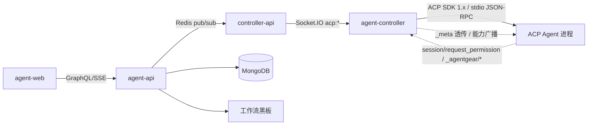
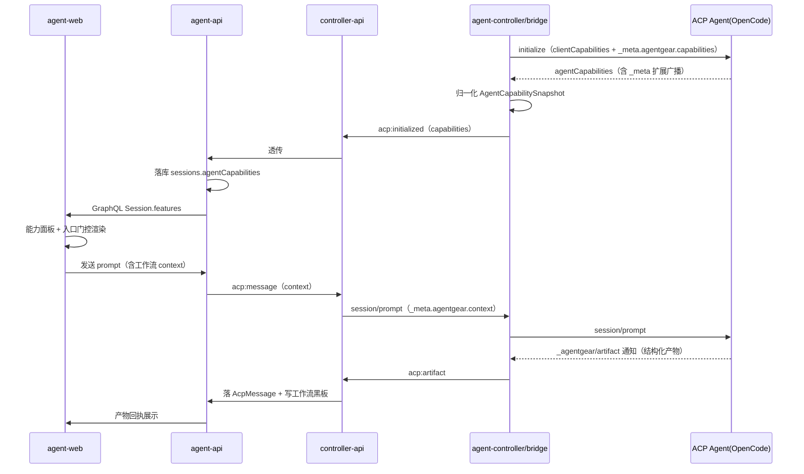

# ACP 协议增强 — 技术提案

**功能名称**: ACP 协议能力透明化与扩展互通
**关联 PRD**: `docs/product/draft/20261021-acp-protocol-enhancement.md`
**技术提案版本**: v1.0
**创建日期**: 2026-10-21
**作者**: ZeroAsh
**feat-branch**: `feat/acp-protocol-enhancement`

## 1. 概述

### 1.1 背景

仓库在 `packages/agent-controller` 中以 `@agentclientprotocol/sdk`（`^1.3.0`）实现 ACP Client，拉起多种 ACP Agent（OpenCode、GitHub Copilot、Claude Code、Gemini CLI、Codex、MiMo Code、Kimi Code），经 Socket.IO（`acp:*`）→ controller-api → Redis → agent-api → GraphQL/SSE 管线向 agent-web 提供会话能力。此前 `20260803-feat-acp-v1-completion` 已完成 ACP v1 稳定能力的补全（SDK 1.x、config options、`session/delete`、`messageId`、多模态、认证、elicitation 等）。

本提案的来源是产品需求「ACP 协议增强」，要求回答两个问题并落到实现：

1. **ACP 现在的能力边界是什么**——协议支持什么、不支持什么（见 §2）；
2. **ACP 扩展机制是什么、OpenCode 在这两方面支持什么**（见 §3、§4）。

在此基础上补齐产品侧缺口：能力不透明（入口一刀切）、平台与 Agent 之间信息单薄（模型来源、会话标签、工作流上下文无法互通，见 `20261020-api-channel-model-fixes` 需求总 PR 的遗留项「须由 ACP 侧补来源字段才能分组」）、协议演进跟进成本高。

### 1.2 目标

1. **能力透明**：把 `initialize` 获得的能力协商结果归一化为「能力快照」，全链路持久化与展示，会话界面按能力自适应（PRD F1/F2）。
2. **扩展互通**：按 ACP 扩展机制建立平台扩展通道（`agentgear` 命名空间），打通模型来源、会话标签、工作流上下文与产物回传（PRD F3）。
3. **重点 Agent 适配**：把 OpenCode 已支持的进阶能力（命令集、会话恢复/发现/删除、认证、`usage_update`、子会话动态、`session/fork` 等）转化为产品体验（PRD F4）。
4. **兼容可演进**：所有新能力以「未探测到即降级」为原则接入，存量 Agent 零退化（PRD F5）。

### 1.3 范围

**做**：
- 能力快照（`AgentCapabilitySnapshot`）归一化、持久化、GraphQL 暴露、前端能力面板与入口门控；
- `agentgear` 扩展通道：`_meta` 透传（会话元信息、工作流上下文、模型来源）+ `_agentgear/*` 扩展方法（产物回传、上下文更新）+ 扩展能力广播；
- 模型来源三档推断与「切换模型」来源分组；
- OpenCode 差异能力接入：命令集入口与不支持命令提示、认证引导文案、推理档位展示、子会话动态透传（P2）、`session/fork` 探测入口（P2）；
- 契约增量（`agent-session-websocket.md`、`agent-session.graphql`）与测试覆盖。

**不做**：
- **终端能力**（`clientCapabilities.terminal` 与 `terminal/*`）：沿用 `20260803` 的云端架构决策，client 运行在用户各自环境，不实施；
- **ACP `fs/*` client 能力**：维持既有设计决策（契约 `agent-session-websocket.md` §5.3），实测亦确认 OpenCode 自持文件能力、不回调 Client fs（见 §4.4）；
- **MCP 相关变更**：MCP 模块维持现状，不修复不扩展；
- **ACP v2 实施**：仅跟踪评估（§2.6）；**ACP Registry 接入**：不在本期；
- 对 `_agentgear` 扩展的第三方 Agent 强制要求：扩展永远是可选增强。

## 2. ACP v1 能力全景与能力边界

> 来源：ACP v1 官方文档 <https://agentclientprotocol.com/protocol/v1/>（overview / initialization / authentication / session-setup / session-list / session-delete / prompt-turn / content / tool-calls / elicitation / file-system / cancellation / terminals / agent-plan / session-modes / session-config-options / slash-commands / extensibility / transports），下文引用简称「文档名」。

### 2.1 通信模型与能力协商

| 要点 | 说明 |
|---|---|
| 协议基础 | JSON-RPC 2.0；两类消息：Methods（请求-响应）与 Notifications（单向，无响应） |
| 传输 | **stdio 为基线**（Client 以子进程拉起 Agent，`\n` 分隔、UTF-8、不得混写非 ACP 消息）；Streamable HTTP 传输**仍在草案讨论中**；允许自定义传输但必须保持 JSON-RPC 格式与生命周期 |
| 版本协商 | `protocolVersion` 为 MAJOR 整数，仅破坏性变更递增；不兼容时 Client SHOULD 断开并提示 |
| 能力协商 | 所有能力均 OPTIONAL；**未在 `initialize` 出现的能力 MUST 视为不支持**；新增能力不算破坏性变更；双方 SHOULD 容忍对端能力的任意组合 |
| 参数规约 | 文件路径 MUST 绝对路径；行号 1-based；对象键 camelCase、判别值 snake_case |
| 错误 | 标准 JSON-RPC error；文档出现的错误码：`-32601` Method not found、`-32602` Invalid params、`-32800` Request Cancelled，另有 `auth_required` 门控 |

`initialize` 双向能力对象（camelCase 原名）：

| 侧 | 能力字段 | 含义 |
|---|---|---|
| Client → Agent | `auth.terminal` | Client 可复现交互式终端登录（Agent 才可通告 `type:"terminal"` 认证方法） |
| Client → Agent | `fs.readTextFile` / `fs.writeTextFile` | Agent 可调用 `fs/read_text_file` / `fs/write_text_file` |
| Client → Agent | `terminal` | Agent 可调用 `terminal/*` 五件套 |
| Client → Agent | `elicitation.form` / `elicitation.url` | 支持的 `elicitation/create` 模式（省略/null = 不支持；`{}` = 通告零模式，**不同于 MCP**） |
| Client → Agent | `session.configOptions.boolean` | 支持 `type:"boolean"` 配置项 |
| Client → Agent | `session.compaction` | 支持 ID 寻址压缩更新（不通告 Agent 禁止发送，含重放） |
| Client → Agent | `session.notices` | 能呈现 `notice` 实时通知（不通告 Agent MUST NOT 发） |
| Agent → Client | `loadSession` | `session/load` 可用（带历史重放） |
| Agent → Client | `promptCapabilities.image/audio/embeddedContext` | prompt 可含图片/音频/内嵌资源 |
| Agent → Client | `mcpCapabilities.http` / `.sse` | 可连接 http / sse MCP server（sse 已被 MCP 规范弃用） |
| Agent → Client | `auth.logout` | `logout` 可用 |
| Agent → Client | `sessionCapabilities.list` / `.delete` / `.resume` / `.close` / `.additionalDirectories` | 会话发现/删除/无重放恢复/关闭/附加工作区根 |
| 双方 | `_meta` | 扩展能力与自定义数据广播（§3） |

基线要求：所有 Agent MUST 支持 `session/new`、`session/prompt`、`session/cancel`、`session/update`；prompt 内容基线 MUST 支持 `text` 与 `resource_link`。

### 2.2 Agent 侧方法（Client 调用 Agent）

| 方法 | 类型 | 能力开关 | 说明 |
|---|---|---|---|
| `initialize` | baseline | — | 版本与能力协商 |
| `authenticate` | baseline | — | 以 `methodId` 执行认证（`methodId` MUST NOT 用 terminal 类型） |
| `session/new` | baseline | — | 创建会话（`cwd`、`mcpServers`、可选 `additionalDirectories`） |
| `session/prompt` | baseline | — | 发送 prompt，回合以 stop reason 结束 |
| `session/load` | optional | `loadSession` | 恢复会话并重放全部历史后才响应 |
| `session/resume` | optional | `sessionCapabilities.resume` | 无重放重连会话 |
| `session/close` | optional | `sessionCapabilities.close` | 取消进行中工作并释放资源 |
| `session/list` | optional | `sessionCapabilities.list` | 发现历史会话（`cursor` 不透明分页） |
| `session/delete` | optional | `sessionCapabilities.delete` | 从发现结果移除会话 |
| `session/set_config_option` | optional | boolean 类需 `session.configOptions.boolean` | 设置配置项，响应为完整配置状态 |
| `session/set_mode` | optional | — | 切换模式，**协议已标记未来版本移除**（由 config option `category:"mode"` 取代） |
| `logout` | optional | `auth.logout` | 结束认证状态 |
| `session/cancel` | 通知 | — | 取消回合（Agent MUST 以 `cancelled` stop reason 响应） |
| `$/cancel_request` | 通知（双向） | — | 请求级取消，原请求须以响应或 `-32800` 收尾 |

### 2.3 Client 侧方法（Agent 调用 Client）

| 方法 | 类型 | 能力开关 | 说明 |
|---|---|---|---|
| `session/request_permission` | baseline | — | 工具执行前授权（`selected`/`cancelled`；`session/cancel` 后 MUST 对挂起请求回 `cancelled`） |
| `fs/read_text_file` / `fs/write_text_file` | optional | `fs.readTextFile` / `fs.writeTextFile` | Client 侧文本文件读写（仅文本、绝对路径） |
| `terminal/create` / `output` / `wait_for_exit` / `kill` / `release` | optional | `terminal` | Client 侧终端执行与管理 |
| `elicitation/create` | optional | `elicitation.form` / `.url` | 结构化问询（form：扁平 schema、禁止密钥类；url：带外/OAuth，须同源同人） |
| `session/update` | 通知 | `session.notices` / `session.compaction` 限特定更新 | 会话更新流（见 §2.4） |
| `elicitation/complete` | 通知 | — | url 模式带外交互完成回报 |

### 2.4 会话更新、内容与工具能力

`session/update` 的 `sessionUpdate` **全集共 14 种**（`prompt-turn.md` 明示为当前 schema 完整集合）：

| 类别 | 更新类型 | 要点 / 能力开关 |
|---|---|---|
| 消息流 | `user_message_chunk` / `agent_message_chunk` / `agent_thought_chunk` | 可带不透明 `messageId`（同 ID = 同一消息）；thought 经独立更新流，**不是**独立内容块类型 |
| 工具 | `tool_call` / `tool_call_update` | 状态机 `pending → in_progress → completed/failed`（取消语境另有 cancelled）；`kind`：read/edit/delete/move/search/execute/think/fetch/switch_mode/other；内容含 `content`/`diff`（`oldText:null` = 新文件）/`terminal` |
| 计划 | `plan` | `entries[]` 全量替换语义，`priority` high/medium/low、`status` pending/in_progress/completed |
| 命令/模式/配置 | `available_commands_update` / `current_mode_update` / `config_option_update` | 命令执行 = 普通 prompt 文本 `/cmd args`；模式 API 将移除 |
| 元信息 | `session_info_update` / `usage_update` | 前者 title/updatedAt/`_meta`（cwd 不可变更）；后者 `used`/`size`（上下文 token）+ `cost{amount,currency}`（累计费用，ISO 4217） |
| 通知 | `notice` | `severity` info/warning/error（开放枚举，`_` 前缀留给实现）、`title` 必填；不入历史不重放、不可承载致命信息；需 `session.notices` |
| 压缩 | `compaction_update` / `compaction_summary_chunk` | ID 寻址、patch 语义、须报终态；需 `session.compaction` |

内容块（ContentBlock，与 MCP 同构）：`text`（基线）、`resource_link`（基线）、`image`（`promptCapabilities.image`）、`audio`（`promptCapabilities.audio`）、`resource` 内嵌资源（`promptCapabilities.embeddedContext`）。工具权限选项 `kind`：`allow_once`/`allow_always`/`reject_once`/`reject_always`；`locations[]` 提供 follow-along 定位（绝对路径 + 1-based 行号）。

其他能力域：**Session Config Options**（`id`/`name`/`category`/`type:select|boolean`/`currentValue`/`options`（值或分组，分组支持 `_meta`），category 预留 `mode`/`model`/`model_config`/`thought_level`，`_` 前缀自定义）；**Slash Commands**（`availableCommands[{name,description,input.hint}]`）；**Elicitation**（form/url 双模式）；**Terminal** 五件套；**Agent Plan**；**MCP 接入**（`session/new|load|resume` 传 `mcpServers`：stdio 必支持、http 需 `mcpCapabilities.http`、sse 需 `mcpCapabilities.sse` 且已弃用）。

### 2.5 ACP v1 能力边界：支持 / 不支持对比

| 能力 | ACP v1 状态 | 说明 |
|---|---|---|
| 会话创建/提示/取消/更新流 | ✅ 支持（基线 MUST） | 全体 Agent 必备 |
| 会话恢复（load 重放 / resume 无重放） | ✅ 支持（能力开关） | `loadSession`、`sessionCapabilities.resume` |
| 会话发现/删除/关闭 | ✅ 支持（能力开关） | `sessionCapabilities.list/.delete/.close` |
| 附加工作区根 | ✅ 支持（能力开关） | `sessionCapabilities.additionalDirectories` |
| 消息 ID 分组 | ✅ 支持（MAY） | 不透明 ID，无编辑/删除/回执语义 |
| 上下文用量与累计费用 | ✅ 支持（MAY） | `usage_update`；仅会话累计粒度，**无按请求/按工具细分** |
| 多模态输入 | ✅ 支持（能力开关） | image/audio/embeddedContext 分别开关 |
| 会话配置项（select/boolean、category） | ✅ 支持 | boolean 需 client 能力；category 仅 UX 提示 |
| 认证/登出 | ✅ 支持 | `authenticate`/`logout`；方法类型仅 `agent`/`terminal` |
| 结构化问询 Elicitation | ✅ 支持（2026 稳定） | form/url 双模式，安全规则严格 |
| 终端执行（Agent 借 Client 终端） | ✅ 支持（能力开关） | 需 `clientCapabilities.terminal` |
| Client 文件读写（Agent 借 Client 文件） | ✅ 支持（能力开关） | 仅文本文件 |
| 压缩/实时通知 | ✅ 支持（能力开关） | `session.compaction` / `session.notices` |
| 请求级取消 `$/cancel_request` | ✅ 支持（可选实现） | 双向 |
| 会话分叉 `session/fork` | ❌ **不在 v1** | 仅 RFD（<https://agentclientprotocol.com/rfds/session-fork>）；OpenCode 已按扩展抢先实现（§4.3） |
| 子代理/子会话 | ❌ **不在 v1** | 仅 RFD（`/rfds/subagents`），无任何方法/能力字段 |
| MCP over ACP（协议桥接/端点转发） | ❌ **不在 v1** | v1 中 MCP 仅单向：Client 传 `mcpServers` 配置、Agent 侧连接 |
| 可配置 LLM endpoint / API Key | ❌ **不在 v1** | 协议无 endpoint/key 配置；`category:"model"` 仅是 Agent 自定义值选择器 |
| Streamable HTTP / WebSocket 传输 | ❌ **未定稿** | HTTP 为草案讨论中；WebSocket 无标准定义，仅可走「自定义传输」 |
| 按消息编辑/删除/回执 | ❌ 不在 v1 | messageId 仅分组语义 |
| 会话中变更 cwd / additionalDirectories | ❌ 不在 v1 | `session_info_update` 明确不可变更 |
| 删除活动会话、load 已删会话、logout 对活动会话影响 | ⚠️ 实现自定义 | 规范不保证行为 |
| Session Modes 专属 API | ⚠️ 可用但将移除 | `session/set_mode`/`modes`/`current_mode_update` → `configOptions(category:"mode")` |
| `loadSession` 与 `sessionCapabilities` | ⚠️ 不统一 | 文档注明未来版本统一 |
| `clientInfo`/`agentInfo` | ⚠️ SHOULD | 未来版本将必填 |
| MCP SSE | ⚠️ 弃用 | ACP 仍保留开关 |

### 2.6 协议演进方向（跟踪项，不在本期实施）

ACP v2 已发布草案（<https://agentclientprotocol.com/announcements/acp-v2-draft>，官方 TS SDK 亦已发布 `2.0.0` 并含 `experimental/v2`、`http-client` 入口），RFD 队列含子代理会话、MCP-over-ACP、session fork、LLM endpoint 配置、token 用量细分、HTTP/WebSocket 传输等。另注意 **SDK 方法面已先行于 v1 文档**：`@agentclientprotocol/sdk@1.3.0` 已含 `session/fork`（`unstable_forkSession`）与 `providers/list|set|disable` 方法常量，属文档之外的未稳定面。

本平台策略：**v1 能力开关 + 扩展机制为唯一实施面**，RFD/v2/SDK unstable 面仅作能力快照与设计留位（§6.2 中 `raw` 字段保留原始能力对象，未来字段变化不阻塞）；调用 unstable API 必须经隔离封装（`20260803` 的 `unstable_setSessionModel` 教训）。

## 3. ACP 扩展机制

> 来源：`extensibility.md`、`initialization.md`、`prompt-turn.md`、`session-config-options.md`、RFD `meta-propagation`。

| 机制 | 能做 | 不能做 / 红线 |
|---|---|---|
| `_meta` 字段 | 在**定义了 `_meta` 的类型**上附加 `{ [key: string]: unknown }`：多数请求/响应/通知与嵌套类型（content block、tool call、plan entry、能力对象、`SessionConfigOption`、`SessionInfo`、`SessionUpdate`、`ConfigOptionUpdate`、`SessionPromptRequest/Response` 等） | 非所有类型都有（如 `Error` 无）；**MUST NOT** 在规范类型**根部**加任何自定义字段（根级名称全部保留给未来版本） |
| W3C 保留键 | `_meta` 根级 `traceparent`/`tracestate`/`baggage` SHOULD 保留给 W3C Trace Context（与 MCP/OpenTelemetry 互通） | 平台扩展不得占用这三键 |
| 扩展方法 | `_` 前缀方法名保留给自定义扩展（如 `_zed.dev/workspace/buffers`）；请求必须按 `id` 响应，未知方法回 `-32601 Method not found`；自定义通知同样 `_` 前缀、省略 `id` | 未广播就调用可能收到 Method not found；扩展 MUST 走 JSON-RPC 标准语义 |
| 未知通知 | 未知自定义通知 SHOULD **忽略**（与请求不同） | 不得因未知通知断连 |
| 扩展能力广播 | SHOULD 在能力对象 `_meta` 广告扩展支持（如 `agentCapabilities._meta["zed.dev"] = { workspace: true }`），调用方先探测再适配 | 未广播 = 不支持，调用方须降级 |
| 开放枚举 | `notice.severity`、compaction status 等开放枚举的 `_` 前缀值留给实现扩展 | 其他未知值保留给未来 ACP，Client MUST 保留并通用呈现，不得推断行为 |
| `_meta` 传播惯例 | Client MAY 经 `params._meta` 向 Agent 传关联字段（如 `requestId`），已形成 RFD 惯例 | 平台扩展键需成文档化命名空间，避免双方各自漂移 |

**结论**：平台扩展必须走 `_meta`（数据）+ `_` 方法（行为）+ 能力 `_meta`（协商）三条通道，命名空间化（§6.2 的 `agentgear`），并遵守「未知即忽略/降级」。

## 4. OpenCode ACP 支持清单

> 来源：OpenCode 官方文档 <https://opencode.ai/docs/acp/> 与**本机实测**（`opencode acp` v2.0.31，stdio JSON-RPC 探测：`initialize` → `session/new` → `session/prompt` → `session/set_config_option`/`session/close`/`session/load`/`session/list`，并声明 `fs`/`terminal`/`elicitation` 等 client 能力观察回调）。实测证据标注「实测」，文档标注「文档」。

### 4.1 能力广播（initialize 响应，实测）

```json
{
  "protocolVersion": 1,
  "agentCapabilities": {
    "loadSession": true,
    "mcpCapabilities": { "http": true, "sse": false },
    "promptCapabilities": { "embeddedContext": true, "image": true },
    "sessionCapabilities": {
      "additionalDirectories": {}, "close": {}, "delete": {},
      "fork": {}, "list": {}, "resume": {}
    },
    "_meta": { "opencode/child-session-updates": true }
  },
  "authMethods": [
    { "id": "opencode-login", "name": "Login with opencode",
      "description": "Run `opencode auth login` in the terminal" }
  ],
  "agentInfo": { "name": "OpenCode", "version": "2.0.31" }
}
```

### 4.2 Agent 侧方法支持清单

| ACP 方法 | OpenCode 支持 | 证据 |
|---|---|---|
| `initialize` | ✅ | 实测：protocolVersion 1、`agentInfo` OpenCode 2.0.31 |
| `session/new` | ✅ | 实测：返回 `sessionId` + `configOptions`（`modes:null`，按 config options 为准） |
| `session/prompt` | ✅ | 实测：`end_turn`；响应含 `stopReason`、`usage`、**`_meta`** |
| `session/cancel` | ✅ | 基线能力（文档「All features are supported」） |
| `session/load` | ✅ | `loadSession:true` + 实测返回 `configOptions` |
| `session/resume` | ✅ | `sessionCapabilities.resume` |
| `session/list` | ✅ | `sessionCapabilities.list` + 实测返回 `sessions[{sessionId,cwd,title,updatedAt}]` |
| `session/delete` | ✅ | `sessionCapabilities.delete` |
| `session/close` | ✅ | `sessionCapabilities.close` + 实测成功 |
| `session/set_config_option` | ✅ | 实测：设置 `effort=low` 成功并返回全量 `configOptions` |
| `session/set_mode` | ✅ | 实测方法存在（无效参数报 `-32602` 而非 Method not found）；OpenCode 以 `category:"mode"` 配置项为主 |
| `authenticate` | ✅ | `authMethods: ["opencode-login"]`（默认 `agent` 类型；文档提示在终端执行 `opencode auth login`） |
| `logout` | ⚠️ 未广播 | 实测 `agentCapabilities` 无 `auth.logout`，按协议 MUST NOT 调用 |
| `session/fork` | ⚠️ 扩展实现 | `sessionCapabilities.fork` 已广播且 `session/fork` 方法存在（无效参数报 `-32602`）；协议 v1 尚无此方法（RFD 状态） |
| 未知 `_` 扩展方法 | ✅ 规范降级 | 实测 `_opencode/ping`、`_agentgear/ping` 均回 `-32601 Method not found` |

### 4.3 通知与扩展支持清单

| 能力 | OpenCode 支持 | 证据 |
|---|---|---|
| `agent_message_chunk`（带 `messageId`） | ✅ | 实测：`messageId: "msg_..."` 稳定分组 |
| `user_message_chunk` / `agent_thought_chunk` | ✅ | 实测（`user_message_chunk` 于 load 重放出现） |
| `tool_call` / `tool_call_update`（`kind:"edit"` 等） | ✅ | 实测：建文件走内部 edit 工具 |
| `available_commands_update` | ✅ | 实测：`init`、`review`、`compact` 三个命令 |
| `usage_update`（`used`/`size`/`cost`） | ✅ | 实测：`{used:5421,size:1000000,cost:{amount:0,currency:"USD"}}` |
| `plan` / `current_mode_update` / `config_option_update` | ✅ | 实测 `config_option_update` 路径（set 返回全量）；plan/mode 属常规能力 |
| `session_info_update` | ✅ | 会话标题/updatedAt 管理（`session/list` 可见 title 变化） |
| `notice` / `compaction_update` | ⚠️ 未实测 | OpenCode 未在探测回合中发出；平台按能力开关门控（`session.notices`/`session.compaction`） |
| 扩展能力 `_meta` | ✅ | 实测：`agentCapabilities._meta["opencode/child-session-updates"] = true`（子会话动态扩展） |
| prompt 响应 `_meta` | ✅ | 实测：`session/prompt` 响应含 `_meta` 键 |
| 自定义 `_` 扩展方法（自定义请求） | ❌ | 实测未知扩展方法回 `-32601`（仅 `_meta` 形式的扩展） |

### 4.4 Client 侧依赖（OpenCode 是否回调 Client）

| Client 方法 | OpenCode 是否调用 | 证据与结论 |
|---|---|---|
| `fs/read_text_file` / `fs/write_text_file` | ❌ 不调用 | 实测：声明 `clientCapabilities.fs` 后让其建文件，仍走内部 `edit` 工具，无任何 `fs/*` 请求。OpenCode 自持文件系统（文档：内置工具含文件操作） |
| `terminal/*` | ❌ 不调用 | 实测：无 `terminal/*` 请求，终端由 OpenCode 自身处理 |
| `session/request_permission` | ✅ 会调用 | 文档：Agents and permissions system 受支持；平台已全链路实现（`acp:permission`） |
| `elicitation/create` | ⚠️ 未实测 | 平台已声明 `elicitation.form/url` 并实现处理；OpenCode 文档未单独说明，按需门控 |

### 4.5 OpenCode 通过 ACP 的产品能力面（文档）

| 能力 | 状态 | 说明 |
|---|---|---|
| 内置工具（文件、终端等） | ✅ 支持 | 文档：All features are supported |
| 自定义工具与 slash 命令 | ✅ 支持 | 含用户自定义命令 |
| MCP servers（OpenCode 配置） | ✅ 支持 | 另经 ACP `mcpServers` 注入亦受支持（`mcpCapabilities.http:true`，stdio 基线） |
| `AGENTS.md` 项目规则 | ✅ 支持 | 文档明确 |
| 自定义 formatter/linter | ✅ 支持 | 文档明确 |
| Agents 与 permissions 系统 | ✅ 支持 | 文档明确 |
| 内置 `/undo`、`/redo` 命令 | ❌ 不支持 | 文档明确「currently unsupported」，平台须做入口提示 |
| 音频输入 | ❌ 不支持 | 实测 `promptCapabilities` 无 `audio` |
| SSE MCP 传输 | ❌ 不支持 | 实测 `mcpCapabilities.sse:false` |
| 编辑器/Client 侧集成（Zed、JetBrains、Avante.nvim、CodeCompanion.nvim） | ✅ | `opencode acp` 子进程 + JSON-RPC stdio（文档配置示例） |

### 4.6 与其他 Agent 的关系

平台 detector 支持 7 类 Agent（opencode / github_copilot / claude_code / gemini_cli / codex / mimo_code / kimi_code，`packages/agent-controller/src/acp/detector.ts`）。各 Agent 能力广播差异大（如认证方法、`sessionCapabilities`、多模态），**能力快照（§6.1）是唯一可靠依据**；OpenCode 的专有项（`opencode/child-session-updates`、`fork`）按扩展能力门控，不影响其他 Agent。

## 5. 平台现状与差距

| 能力 | 平台现状 | 差距/动作 | 优先级 |
|---|---|---|---|
| 能力协商结果 | `bridge.ts` 仅摘取 `promptCapabilities`/`agentInfo`/`authMethods`/`mcpCapabilities`/`additionalDirectories` 逐个透传 | 归一化为能力快照（含 `_meta` 扩展）并持久化、展示 | P0 |
| 能力驱动 UI | 前端按零散布尔字段局部判断 | 统一入口门控 + 能力面板 | P0 |
| `_meta` 扩展 | 全仓未使用（协议允许的扩展通道闲置） | 建立 `agentgear` 命名空间与透传链路 | P0 |
| `_` 扩展方法 | 未注册、未消费 | 实现 `_agentgear/artifact`（产物回传）、`_agentgear/context/update`（上下文更新） | P1 |
| 模型来源 | `SessionConfigOptionValue` 仅 `{value,name}`，无来源（PR #242 遗留） | 三档来源推断 + 分组展示 | P0 |
| 工作流上下文 | 会话仅有 `workflowInstanceId/workflowNodeId`，无上下文透传 | `session/prompt` `_meta` + 降级文本注入；产物回传写黑板 | P0 |
| OpenCode 命令集 | `available_commands_update` 已透传 | 命令面板入口 + 不支持命令（/undo /redo）提示 | P1 |
| OpenCode 子会话动态 | `_meta["opencode/child-session-updates"]` 未消费 | 识别广播并透传子会话动态（P2） | P2 |
| `session/fork` | 未接入 | 按能力探测开放「从当前会话分叉」（P2） | P2 |
| 推理档位 | `thought_level` 配置项已可用 | 按 category 归组展示为「推理档位」 | P2 |

## 6. 技术架构

### 6.1 系统架构图



架构不变。变更收敛在四层：agent-controller（协议面：能力快照、扩展通道）、controller-api/agent-api（透传、持久化、黑板写入）、agent-web（能力面板、入口门控、来源分组）。

### 6.2 技术栈

| 层级 | 技术选型 | 说明 |
|------|---------|------|
| 协议层 | `@agentclientprotocol/sdk` 1.x | `_meta`/扩展方法经 SDK 透传，bridge 层隔离 |
| 前端 | React + TypeScript + Vite | 能力门控 hook、能力面板、来源分组 |
| 后端 | Node.js + Express + GraphQL + Mongoose | 契约增量、快照持久化 |
| 探测 | Node.js 子进程 stdio JSON-RPC | 一次性能力探测与回归比对 |

### 6.3 模块划分

| 模块 | 职责 | 关键变更 |
|------|------|-----------|
| `agent-controller/acp/bridge.ts` | ACP 协议面 | 能力快照归一化、`_meta` 透传（session/prompt/new）、`_agentgear/artifact` 注册、扩展能力广播 |
| `agent-controller/acp/capabilities.ts`（新增） | 能力归一化 | `AgentCapabilitySnapshot` 构造、`raw` 保留、FeatureId 映射表 |
| `agent-controller/acp/extensions.ts`（新增） | 扩展通道 | `agentgear` 命名空间编解码、未知扩展降级 |
| `controller-api`（acp 会话管理） | 事件透传 | `acp:initialized` 增 `capabilities`、`acp:artifact` 新事件、`acp:start` 增 `sessionMeta` |
| `agent-api` | 对外契约 | GraphQL：能力快照、配置项来源、产物落库与黑板写入 |
| `agent-web` | 展示 | 能力面板、入口门控 hook、模型来源分组、命令面板与不支持命令提示、工作流上下文卡片 |

### 6.4 扩展通道设计（`agentgear` 命名空间）

**命名空间规约**（详见 `contracts/agent-session-websocket.md` 增补节）：

| 载体 | 键/方法 | 方向 | 载荷 |
|---|---|---|---|
| `_meta` | `agentgear.session`（`session/new`、`session/load`、`session/resume` 请求） | Client→Agent | `{ tags: string[], source: "platform"\|"workflow", workflowInstanceId?, workflowNodeId?, requirementTitle? }` |
| `_meta` | `agentgear.context`（`session/prompt` 请求） | Client→Agent | `{ nodeId?, task?, attachments?: [{name,uri}] }`，工作流节点上下文 |
| `_meta` | `agentgear.modelSource`（`SessionConfigOption` / 值级 `_meta`） | Agent→Client | `{ kind: "platform"\|"agent"\|"custom", provider?: string }` |
| `_meta` | `agentgear.capabilities`（`clientCapabilities` / `agentCapabilities`） | 双向广播 | `{ sessionContext: true, artifacts: true, contextUpdate: true }` |
| 扩展方法 | `_agentgear/artifact`（通知） | Agent→Client | `{ title: string, value: string }` 结构化产物回传 |
| 扩展方法 | `_agentgear/context/update`（通知） | Client→Agent | `{ context: {...} }` 运行中上下文更新 |

**兼容规则**（必须全部满足）：
1. 不在任何规范类型根部新增字段；平台数据只进 `_meta` 与 `_agentgear/*`；
2. 不占用 `_meta` 根级 `traceparent`/`tracestate`/`baggage`；
3. 未收到 `agentgear.capabilities` 广播 → 视为不支持扩展，全部走降级路径；
4. 未知 `_meta` 键安全忽略；未知 `_agentgear/*` 请求回 `-32601`、未知通知忽略（协议规定）；
5. 扩展载荷不携带密钥/令牌（PRD 4.2）。

**降级路径**：

| 能力 | 扩展可用 | 扩展不可用（降级） |
|---|---|---|
| 工作流上下文 | `_meta.agentgear.context` 传递 | 以文本块注入首条 prompt（可读、可追溯） |
| 产物回传 | `_agentgear/artifact` → 写黑板 | 既有 MCP 工作流工具 / 人工搬运 |
| 模型来源 | `_meta.agentgear.modelSource` | value 前缀推断（`provider/model`）→ 兜底「其他」组 |

## 7. API 设计（契约变更）

### 7.1 `contracts/agent-session-websocket.md` 增量

| 事件 | 变更 | 说明 |
|---|---|---|
| `acp:initialized` | 增 `capabilities: AgentCapabilitySnapshot` | 归一化能力快照 + `raw` 原始对象 |
| `acp:start` / `acp:resume` | 增 `sessionMeta: { tags, source, workflowInstanceId?, workflowNodeId? }` | 会话元信息，bridge 写入 `session/new` `_meta.agentgear.session` |
| `acp:message`（发起 prompt） | 增 `context`（可选） | 写入 `session/prompt` `_meta.agentgear.context` |
| `acp:artifact`（新增，Controller→Server） | 新事件 | `{ sessionId, title, value }`，来自 `_agentgear/artifact` |

`AgentCapabilitySnapshot` 载荷：

```json
{
  "protocolVersion": 1,
  "agentInfo": { "name": "OpenCode", "version": "2.0.31" },
  "features": [
    { "id": "session.load", "status": "supported", "detail": "loadSession" },
    { "id": "prompt.audio", "status": "unsupported", "detail": "promptCapabilities.audio 未声明" },
    { "id": "ext.childSessionUpdates", "status": "supported", "detail": "_meta.opencode/child-session-updates" }
  ],
  "raw": { "agentCapabilities": {}, "authMethods": [] }
}
```

### 7.2 `contracts/agent-session.graphql` 增量

```graphql
enum AgentFeatureStatus { supported partial unsupported }

type AgentFeatureSupport {
  id: String!
  status: AgentFeatureStatus!
  detail: String
}

type AgentCapabilitySnapshot {
  protocolVersion: Int
  agentInfo: AgentInfo
  features: [AgentFeatureSupport!]!
  raw: JSON
}

extend type Session {
  agentCapabilities: AgentCapabilitySnapshot
  features: [AgentFeatureSupport!]!
}

extend type SessionConfigOptionValue {
  # 来源：agentgear.modelSource → value 前缀推断 → "fallback"
  source: String
  provider: String
  group: String
}
```

### 7.3 内部接口

- agent-controller → controller-api：`acp:initialized`（增 `capabilities`）、`acp:artifact`（新增）；
- controller-api → agent-api（Redis）：同名透传；
- agent-api：`_agentgear/artifact` 落 `AcpMessage(type=artifact)`，会话归属工作流节点时写黑板 key `{节点ID}-{节点名称}-产物-{title}`（与工作流工具产物口径一致）。

## 8. 数据模型

### 8.1 MongoDB `sessions` 集合增量

| 字段 | 类型 | 说明 |
|------|------|------|
| `agentCapabilities` | Object（Mixed） | 能力快照（含 `features[]` 与 `raw`），随 `acp:initialized` 写入、随 Agent 变更更新 |
| `sessionMeta` | Object | `{ tags: string[], source: string, workflowInstanceId?, workflowNodeId? }` |
| `configOptionSources` | Object | `configId → { source, provider, group }` 推断结果缓存（可由快照重算） |

### 8.2 缓存设计

- 能力快照随会话生命周期持久化，无 TTL；`AcpDetector` 探测缓存（TTL 1h）不变；
- 模型来源推断结果随 `acp:config-options` 快照刷新，不单独缓存服务。

## 9. 技术实现方案

### 9.1 核心流程



### 9.2 关键实现点

#### 实现点 1: 能力快照归一化（`capabilities.ts`）

- **描述**: 将 `initialize` 结果（`agentCapabilities` 全量含 `_meta`、`authMethods`、`agentInfo`、`promptCapabilities`、`mcpCapabilities`、`sessionCapabilities`）映射为稳定的 FeatureId 三档清单，同时保留 `raw` 原始对象。
- **技术细节**: FeatureId 映射表（`session.load/resume/close/list/delete/fork`、`prompt.image/audio/embeddedContext`、`auth.login/logout`、`mcp.http/sse`、`config.boolean`、`session.additionalDirectories`、`elicitation.form/url`、`ext.agentgear`、`ext.childSessionUpdates`…）；缺失字段一律 `unsupported` 并记录 `detail`（来源字段名）；未知 `_meta` 键原样保留进 `raw` 供回归比对。
- **风险点**: Agent 版本升级导致字段形态变化（如 `loadSession` 未来并入 `sessionCapabilities`）；对策：映射表集中管理 + 原始快照留存 + 探针回归测试。

#### 实现点 2: `agentgear` 扩展通道（`extensions.ts`）

- **描述**: 编解码 `_meta.agentgear.*` 与 `_agentgear/*` 扩展方法，负责能力广播、未知扩展降级与安全过滤（丢弃疑似密钥字段、限制载荷大小）。
- **技术细节**: 扩展请求注册进 SDK connection 的自定义方法路由；未知方法回 `-32601`、未知通知忽略；`_meta` 只在允许的类型上写入（`SessionPromptRequest`、`NewSessionRequest` 等实测/文档确认含 `_meta` 的类型）。
- **风险点**: Agent 对 `_meta` 透传实现不一；对策：一切扩展能力以广播为前提，未广播即降级（§6.4 降级表）。

#### 实现点 3: 模型来源三档推断

- **描述**: 「切换模型」列表来源分组：① Agent 经 `_meta.agentgear.modelSource` 提供 → ② `value` 前缀推断（`provider/model`，如 `opencode-go/kimi-k3` → provider `opencode-go`）+ 平台侧 provider→分组映射（平台内置 / Agent 自带 / 自定义）→ ③ 兜底「其他」组。
- **技术细节**: `SessionConfigOptionValue` 扩展 `source/provider/group`；推断纯函数可单测；分组顺序按 `configOptions` 原始顺序稳定。
- **风险点**: 无前缀模型名无法推断；对策：兜底组 + 文案标注「来源未知」，不空白。

#### 实现点 4: 工作流上下文与产物闭环

- **描述**: 工作流节点会话在 `session/new` 携带 `agentgear.session`（节点/需求标识）、`session/prompt` 携带 `agentgear.context`；Agent 回传 `_agentgear/artifact` → `acp:artifact` → 落 `AcpMessage` + 写工作流黑板（`{节点ID}-{节点名称}-产物-{title}`）。
- **技术细节**: 扩展不可用时上下文降级为 prompt 文本块注入；产物降级走既有 MCP 工作流工具；黑板写入幂等（同 title 覆盖更新）。
- **风险点**: 产物格式不可信；对策：长度限制 + 转义 + 校验 `title/value` 必填，解析失败不误判节点完成。

#### 实现点 5: 前端能力门控与能力面板

- **描述**: `useAgentCapabilities(sessionId)` 提供三档能力判断；入口（附件/命令/模型/模式/认证/恢复会话/历史管理）按能力显示、禁用与提示；能力面板逐项展示 `features[]`。
- **技术细节**: 门控仅依赖 `Session.features`（唯一事实源），不在组件内散落能力判断；禁用态 tooltip 使用 `detail` 文案。
- **风险点**: 能力与实际行为不一致（Agent 声明了但调用失败）；对策：调用失败统一错误提示 + 记录，能力面板提供「报告问题」入口（展示 detail）。

#### 实现点 6: OpenCode 差异能力

- **描述**: 命令面板（`availableCommands` + 输入 hint）与不支持命令提示表（`/undo`、`/redo`）；认证引导文案（`opencode-login` 的 description）；`thought_level` 归组为「推理档位」；P2：`opencode/child-session-updates` 动态透传、`session/fork` 分叉入口。
- **技术细节**: 不支持命令表按 `agentInfo` 版本维护（OpenCode 文档明确）；`session/fork` 以 `sessionCapabilities.fork` 广播为唯一门控，调用 SDK `unstable_forkSession` 并封装在独立适配器（unstable API 隔离，失效可回退隐藏）。
- **风险点**: OpenCode 专有扩展形态随版本变化；对策：扩展载荷只透传不解释，UI 通用渲染。

## 10. 技术决策

### 10.1 决策列表

| 决策 | 选项 A | 选项 B | 最终选择 | 原因 |
|------|--------|--------|---------|------|
| 扩展承载 | ACP `_meta` + `_agentgear/*` 方法 | 自建旁路 WebSocket 通道 | **A** | 协议内协商、天然可忽略、跨 Agent 通用，符合扩展机制红线 |
| 能力快照 | 落库持久化 | 仅会话内存 | **A** | 支持跨端展示、回归比对与 Agent 升级差异发现 |
| 模型来源 | 仅 `_meta` | 三档推断（`_meta` → 前缀 → 兜底） | **三档** | 存量 Agent 不提供 `_meta` 也能分组（PR #242 遗留诉求） |
| 上下文降级 | 只用扩展 | 扩展 + 文本块注入 | **扩展 + 注入** | 保证任意 Agent 都能携带工作流上下文 |
| `session/fork`/子会话 | 一期全做 | 能力门控 + P2 | **P2** | 协议未稳定（SDK 仅 `unstable_forkSession`）、依赖 Agent 专有扩展，先落探测与展示 |
| `fs`/`terminal` client 能力 | 实施 | 不实施 | **不实施** | 沿用 20260803 云端架构决策；实测 OpenCode 亦不回调（§4.4） |

### 10.2 依赖与约束

| 类型 | 内容 | 说明 |
|------|------|------|
| 依赖 | `@agentclientprotocol/sdk` 1.x `_meta`/自定义方法透传能力 | ✅ 已核实 `@1.3.0` 支持：`NewSessionRequest` 等携 `_meta`；`request<Response,Params>(method: string)`/`notify` 支持自定义方法与通知；`onRequest`/`onNotification` 可注册 `_agentgear/*` 路由。`session/fork` 以 `unstable_forkSession` 提供（P2，须隔离封装） |
| 依赖 | 各 Agent 的能力广播真实性 | 以探针回归测试 + 失败提示兜底 |
| 约束 | 不改标准协议消息结构 | 扩展只走 `_meta`/`_` 方法/能力 `_meta` |
| 约束 | 存量 Agent 零退化 | 未探测即降级，契约只做增量 |

## 11. 项目结构

```
packages/agent-controller/src/acp/
├── bridge.ts            # 协议面：能力快照接入、_meta 透传、扩展方法注册
├── capabilities.ts      # 新增：AgentCapabilitySnapshot 归一化与 FeatureId 映射
├── extensions.ts        # 新增：agentgear 扩展通道编解码与降级
├── detector.ts          # Agent 探测（不变）
└── ...
servers/controller-api/src/   # acp:* 事件增量透传
servers/agent-api/src/        # 快照落库、产物落 AcpMessage + 黑板写入
apps/agent-web/src/           # useAgentCapabilities、能力面板、来源分组
contracts/
├── agent-session-websocket.md   # acp:initialized 增量、acp:artifact、sessionMeta
└── agent-session.graphql        # AgentCapabilitySnapshot、Session.features、配置项来源
```

## 12. 测试策略

### 12.1 测试覆盖要求

- 单元测试覆盖率：`capabilities.ts` / `extensions.ts` ≥ 90%（纯函数，穷举映射与降级分支）；
- API 测试覆盖：`Session.features`、`Session.agentCapabilities`、配置项 `source/provider/group`、`acp:artifact` 落库与黑板写入；
- E2E：OpenCode 真实会话全链路（能力面板、入口门控、模型分组、工作流上下文与产物闭环）。

### 12.2 测试类型

| 类型 | 工具 | 覆盖范围 |
|------|------|---------|
| 单元测试 | vitest | 能力归一化映射、来源三档推断、扩展编解码、未知扩展降级、安全过滤 |
| 探针回归 | 自研 stdio 探针（本提案 §4 实测脚本固化） | OpenCode 能力广播快照比对（字段增删可发现） |
| API 测试 | z-test / supertest+GraphQL | 契约增量全字段、幂等黑板写入、旧 payload 兼容 |
| E2E | z-test | 能力面板一致性、入口拦截提示、模型分组、产物闭环、旧 Agent 零退化 |

## 13. 部署方案

### 13.1 环境规划

| 环境 | 用途 | 部署方式 |
|------|------|---------|
| 本地/Aspire | 开发联调 | `aspire start` |
| 集成/发布 | 验收与上线 | 既有发布流程（agent-controller 版本门禁随版本发布） |

### 13.2 配置管理

- `agentgear` 扩展开关（按 Agent 类型可关，默认开、自动降级）；
- provider → 来源分组映射表（配置化，可随内建渠道调整）；
- 不支持命令提示表（按 `agentInfo` 维度配置）。

## 14. 验收标准

- [ ] 技术方案评审通过
- [ ] Contract 评审通过（`agent-session-websocket.md`、`agent-session.graphql` 增量）
- [ ] 能力快照全链路可见：OpenCode 会话能力面板逐项展示且与实测能力广播一致
- [ ] 能力门控生效：不支持能力的入口隐藏/禁用并有原因说明，操作不被静默丢弃
- [ ] 模型来源分组可用：来源缺失时兜底分组且有据可查
- [ ] 工作流上下文传递与产物闭环可验证；扩展不可用时降级路径可用
- [ ] 旧 Agent（无能力广播/无扩展）会话功能零退化（回归用例锁定）
- [ ] 单元测试覆盖达标、API 测试通过、E2E 测试通过
- [ ] OpenCode 能力探针回归脚本纳入 CI 可选项

## 15. 相关文档

- 关联 PRD：`docs/product/draft/20261021-acp-protocol-enhancement.md`
- 相关提案：`docs/engineering/proposals/20260803-feat-acp-v1-completion.md`、`docs/engineering/proposals/20260705-feat-acp-server-extend.md`、`docs/engineering/proposals/20260721-feat-acp-mimo-kimi.md`
- 契约：`contracts/agent-session-websocket.md`、`contracts/agent-session.graphql`、`contracts/workflow.graphql`
- 参考：ACP v1 协议 <https://agentclientprotocol.com/protocol/v1/>、扩展机制 <https://agentclientprotocol.com/protocol/v1/extensibility>、Session Config Options <https://agentclientprotocol.com/protocol/v1/session-config-options>、RFD meta-propagation <https://agentclientprotocol.com/rfds/meta-propagation>、RFD session-fork <https://agentclientprotocol.com/rfds/session-fork>、OpenCode ACP <https://opencode.ai/docs/acp/>
