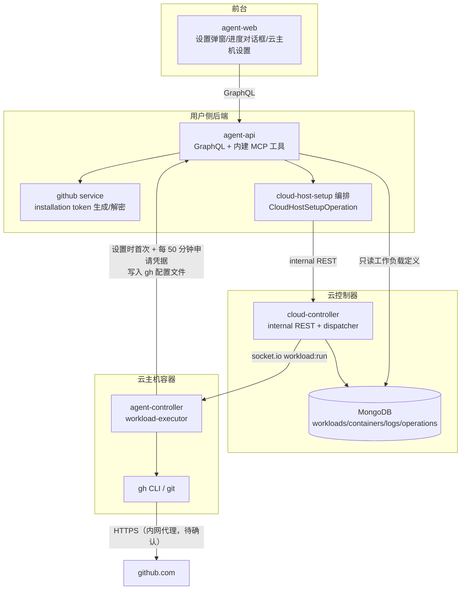
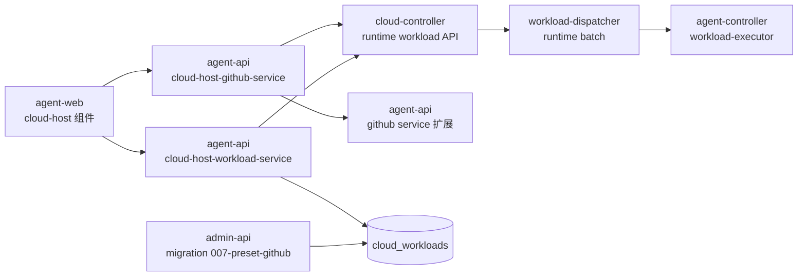
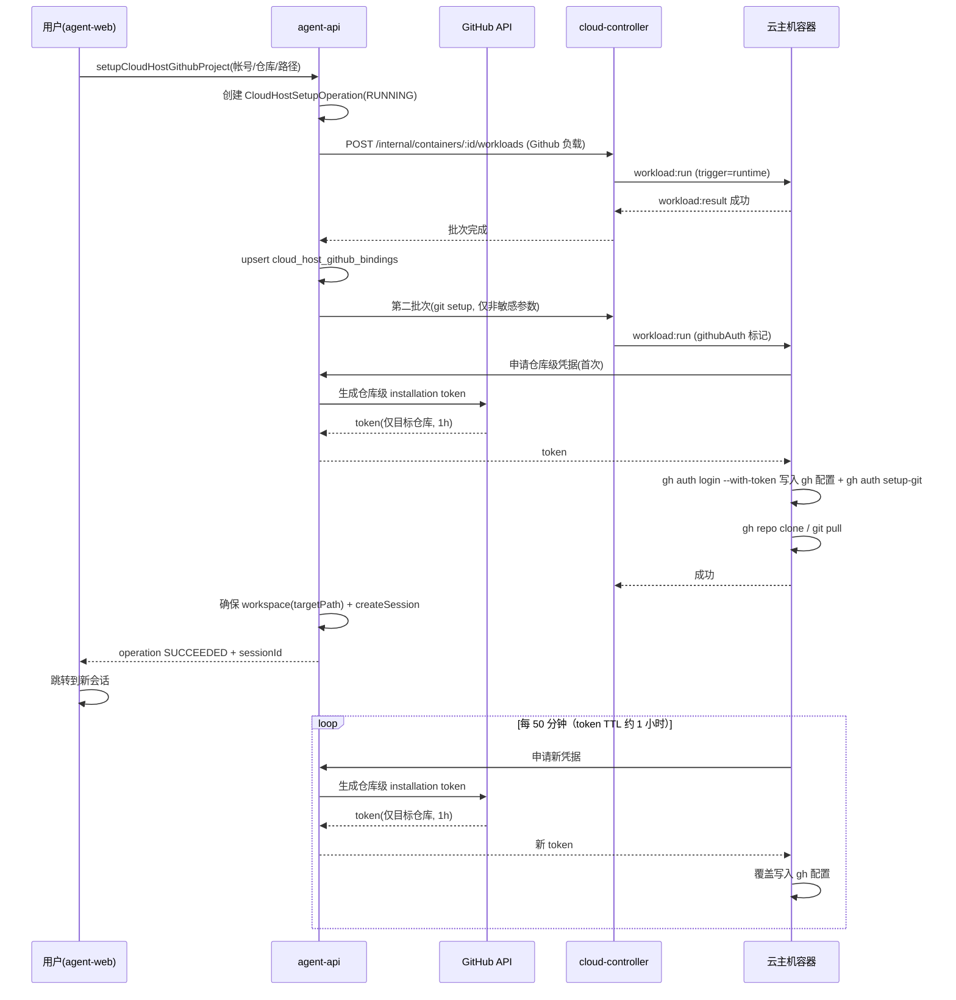

# Github 工作负载与云主机 Git 项目设置 - 技术提案

**功能名称**: Github 工作负载与云主机 Git 项目设置
**关联 PRD**: `docs/product/draft/20261021-github-workload.md`
**技术提案版本**: v1.1
**创建日期**: 2026-10-21
**作者**: ZeroAsh Agent
**feat-branch**: `feat/github-workload`

> v1.1 变更（评审返工）：废除「agent-api → 容器一次性 secret env 下发凭据」的通路，凭据统一下发改为**云主机控制器向系统申请凭据并写入 gh 配置文件**（`gh auth login --with-token` + `gh auth setup-git`）：Git 项目设置时申请首次凭据，之后**每 50 分钟**申请一次新凭据覆盖写入（installation token 约 1 小时过期，留 10 分钟余量），解决 token 过期导致容器内 gh/git 不可用的问题；同步修订 §1.2/§1.3/§2.1/§3.2/§5.1/§5.2 实现点 5/§6/§7/§9。

## 1. 概述

### 1.1 背景

PRD 要求把现有两块能力打通并各补一块短板：

1. **工作负载**（`20261017-cloud-controller-workload` ~ `phase4`）目前只能在容器创建时挂载：`cloud-controller` 仅在容器 register 时触发 `workloadDispatcher.startInit`（`servers/cloud-controller/src/services/socketio-gateway.ts`），internal API 只有 `POST /internal/containers` 携带 workloadPlan，没有「给在线容器追加执行工作负载」的入口；用户侧（agent-api/agent-web）完全没有工作负载概念。
2. **Github 帐号绑定**（`20260709-github-account-binding`）已存储 installation access token（AES-256-GCM 加密，`servers/agent-api/src/services/github.ts`），但没有把凭据下发到云主机完成 clone 的通路。
3. 容器内执行器 `packages/agent-controller/src/workload-executor.ts` 的 `runBatch()` 本身支持在线接收新批次（socket.io `workload:run`），缺的只是服务端触发点与状态/权限语义。

### 1.2 目标

- cloud-controller 支持对**在线容器**追加执行工作负载批次（runtime install），并记录「已安装」集合与触发来源。
- agent-api 向前台提供云主机工作负载列表/安装 GraphQL，并以 **MCP 工具**形式向会话内 Agent 开放同一能力。
- 新增「Github」预制工作负载（迁移 `007-preset-github`），幂等安装 gh CLI（内部 apt 代理）。
- agent-api 提供 `setupCloudHostGithubProject` 编排：安装 Github 工作负载 → 云主机申请**仓库级最小化 installation token** 写入 gh 配置完成认证与 clone → 在目标路径建会话；前台弹窗轮询进度并自动切换会话。
- 凭据下发唯一通路为「云主机控制器申请 → 写入 gh 配置文件」：设置时申请首次凭据，之后每 50 分钟申请一次新凭据覆盖写入，保证容器内 gh/git 在 token 约 1 小时有效期下长期可用；agent-api 不向容器推送凭据（无 secret env）。

### 1.3 范围

**做**：

- 「Github」预制工作负载（迁移 + 脚本）。
- 工作负载 runtime 安装链路（cloud-controller internal API + dispatcher + 状态语义 + agent-api GraphQL + agent-web 云主机设置 UI）。
- 工作负载 list/install 的 MCP 工具（agent-api 内建 MCP）。
- 云主机「设置 Github 项目」弹窗、进度对话框、自动建会话与切换。
- 仓库级最小化凭据的生成与下发：**云主机控制器申请凭据并写入 gh 配置文件**（设置时首次 + 每 50 分钟刷新），全程无 secret env 推送、无落库、日志遮蔽。

**不做**：

- 工作负载卸载（PRD 明确不支持）。
- Github Enterprise、多仓库同时设置。
- 本地/自定义主机的拉起后安装。

## 2. 技术架构

### 2.1 系统架构图



### 2.2 技术栈

| 层级 | 技术选型 | 说明 |
|------|---------|------|
| 前端 | React + TypeScript + Vite（apps/agent-web） | 弹窗/进度组件，轮询 operation 状态 |
| 后端 | Node.js + Express + GraphQL + Mongoose（servers/agent-api） | 用户侧编排与 MCP 工具 |
| 云控制器 | Node.js + Express + Socket.IO + K8s（servers/cloud-controller） | runtime 批次下发 |
| 数据库 | MongoDB（共享库，按服务分 model） | 工作负载定义/容器/执行记录/操作记录 |
| Git 平台 | GitHub App Installation Access Token | 仓库级 scope，裸 fetch（沿用现有实现，不引 octokit） |

### 2.3 模块划分



| 模块 | 职责 | 关键技术点 |
|------|------|-----------|
| admin-api migration 007 | 写入「Github」预制工作负载 | presetKey 幂等、只增不改 |
| cloud-controller internal-api | 在线容器追加工作负载批次 | 容器在线校验、依赖展开复用 |
| workload-dispatcher | runtime 批次调度与状态 | 复用 init 语义，新增 trigger=runtime |
| agent-api cloud-host-workload-service | 用户侧列表/安装 | 权限校验（仅本人云主机）、转发 cloud-controller |
| agent-api MCP 工具 | workload.list / workload.install | 会话上下文定位云主机 |
| agent-api cloud-host-github-service | 设置编排（三步） | operation 状态机、幂等重试 |
| agent-api github service 扩展 | 仓库级 token 生成 | installation token repositories/permissions scope |
| agent-web | 弹窗 + 进度 + 设置区 | 轮询、会话跳转 |

## 3. API 设计

### 3.1 API 契约

#### 契约文件变更

- `contracts/cloud-host.graphql`：新增工作负载列表/安装、Github 项目设置与进度查询。
- `contracts/cloud-controller-websocket.md`：`workload:run` 批次补充 `trigger: 'start' | 'runtime'`、git setup 批次的 `githubAuth` 标记与 `env` 密钥遮蔽约定（附录 A.2.2 workloadPlan 同步补充 `source`）。
- cloud-controller 内部 REST 端点目前无独立契约文件（以代码 + `tests/api/src/cloud-controller/internal-api.test.ts` 为准），本期新增端点沿用同一管理方式，并在本提案 §3.2 固化。

#### cloud-host.graphql 新增（摘要）

```graphql
type CloudHostWorkloadItem {
  workloadId: ID!
  name: String!
  description: String
  paramSchema: JSON
  installed: Boolean!
  installedAt: DateTime
}

extend type Query {
  """当前用户某云主机可安装的工作负载列表（含已安装标记）"""
  cloudHostWorkloads(controllerId: ID!): [CloudHostWorkloadItem!]!
  """Github 项目设置操作进度"""
  cloudHostSetupOperation(id: ID!): CloudHostSetupOperation
}

extend type Mutation {
  """对在线云主机追加安装工作负载"""
  installCloudHostWorkload(input: InstallCloudHostWorkloadInput!): CloudHostSetupOperation!
  """一键设置 Github 项目：安装工作负载 → 凭据 clone → 建会话"""
  setupCloudHostGithubProject(input: SetupCloudHostGithubProjectInput!): CloudHostSetupOperation!
  """重试失败的设置操作（跳过已成功步骤）"""
  retryCloudHostSetupOperation(id: ID!): CloudHostSetupOperation!
}

input InstallCloudHostWorkloadInput { controllerId: ID!, workloadId: ID!, params: JSON }
input SetupCloudHostGithubProjectInput { controllerId: ID!, accountId: ID!, repoFullName: String!, targetPath: String! }

type CloudHostSetupOperation {
  id: ID!
  status: SetupOperationStatus!   # RUNNING | SUCCEEDED | FAILED
  steps: [CloudHostSetupStep!]!
  sessionId: ID
  error: String
}
type CloudHostSetupStep { key: String!, status: StepStatus!, detail: String }
```

#### 接口示例: setupCloudHostGithubProject

- **请求**
  - GraphQL Mutation `setupCloudHostGithubProject`
  - Body:
    ```json
    {
      "input": {
        "controllerId": "66f...",
        "accountId": "66f...",
        "repoFullName": "Deliay/z-agent-gear",
        "targetPath": "/root/workspace"
      }
    }
    ```
- **响应**
  - 200:
    ```json
    {
      "id": "op_...",
      "status": "RUNNING",
      "steps": [
        { "key": "workload", "status": "RUNNING", "detail": "Github" },
        { "key": "gitSetup", "status": "PENDING", "detail": "" },
        { "key": "session", "status": "PENDING", "detail": "" }
      ],
      "sessionId": null,
      "error": null
    }
    ```

### 3.2 内部接口

#### cloud-controller 新增内部 REST 端点

- `POST /internal/containers/:containerId/workloads`
  - Header：内部服务鉴权（沿用现有 internal-api 鉴权）
  - Body: `{ "workloadId": "...", "params": {}, "required": false, "source": "user" | "mcp", "env": {} }`
  - 校验：容器存在且处于在线；workloadId 存在；复用 `resolveWorkloadPlan` 展开依赖（≤10、去重、默认参数归一）。
  - 行为：组 init 批次（`trigger: 'runtime'`）经 socket.io 下发；`env` 为通用能力（密钥键按既有 SECRET_ENV_KEYS 机制遮蔽，不写入日志），**Github 凭据不使用该通道**（见下文凭据下发）。
  - 响应: `200 { batchId, items: [{ workloadId, name }] }`；`409` 容器不在线；`404` 容器/工作负载不存在。

#### 凭据签发（agent-api → GitHub，按申请签发）

- `github service` 新增 `createRepoScopedToken(accountId, repoFullName)`：
  - 解密该 account 的 installation 信息 → `POST https://api.github.com/app/installations/{installationId}/access_tokens`，body `{ repositories: [repoName], permissions: { contents: "write" } }`；
  - 返回的 installation access token 仅对目标仓库有效、约 1 小时过期——**这就是 PRD 凭据调研问题的结论：GitHub App installation token 支持 repositories + permissions 级 scope，可产出只对单个用户授权仓库有效的凭据，无需下放 App 私钥/总凭据**。
  - 仅在云主机控制器申请凭据时被调用；token 不落库、不日志、**不主动推送给容器**。

#### 凭据申请接口（agent-api 内部，凭据唯一下发通路）

- `POST /internal/cloud-hosts/:controllerId/github-credential`
  - 鉴权：沿用容器接入凭据（云主机控制器持有的一次性凭据，经 cloud-controller 校验/转发），**仅允许云主机获取其自身绑定仓库的凭据**。
  - 行为：按 `cloud_host_github_bindings` 中该 controllerId 的绑定（accountId + repoFullName）调用 `createRepoScopedToken` 签发新 token 并返回。
  - 响应: `200 { token, expiresAt }`；`404` 无绑定（未设置过 Github 项目）；`403` 凭据非法。
  - 该接口是容器获取 Github 凭据的**唯一**通路：Git 项目设置时的首次凭据与运行期每 50 分钟的续期凭据均由云主机控制器主动申请，agent-api 不再经 secret env 向容器推送凭据。

#### agent-controller（容器内）

- `workload-executor` 协议仅小扩展：批次 payload 增加 `trigger` 字段透传（执行记录回报时带回）与 git setup 批次的 `githubAuth` 标记（批次中不含任何凭据）。
- **凭据管理器（github-credential-manager）**：容器内凭据的唯一写入口，负责申请凭据并写入 gh 配置文件：
  - 时机一（Git 项目设置）：收到带 `githubAuth` 标记的批次后、执行 clone 脚本**之前**，调用凭据申请接口获取首次 token 并写入 gh 配置；
  - 时机二（运行期续期）：**每 50 分钟**（token TTL 约 1 小时，留 10 分钟余量）申请新 token 并覆盖写入 gh 配置，会话内 gh/git 操作无感知；
  - 写入方式：
    ```bash
    echo "$TOKEN" | gh auth login --with-token   # 写入 ~/.config/gh/hosts.yml
    gh auth setup-git                            # git 凭据助手走 gh
    ```
  - 失败时在凭据有效期内指数退避重试；连续失败超过有效期则记录告警（前台提示用户重新设置）。token 仅存在于进程内存与 gh 配置文件，不写日志；凭据管理器随 agent-controller 进程生命周期结束。
- Git 项目设置步骤脚本（由 agent-api 作为第二个 runtime 批次下发，非用户可见工作负载；批次只含 `repoFullName`/`targetPath` 等非敏感参数）要点：
  ```bash
  command -v gh >/dev/null || { echo "gh missing"; exit 1; }
  if [ -d "$TARGET_PATH/.git" ]; then git -C "$TARGET_PATH" pull --ff-only; \
  else gh repo clone "$REPO_FULL_NAME" "$TARGET_PATH"; fi
  ```
  gh 认证由凭据管理器在脚本执行前完成；批次下发前 agent-api upsert `cloud_host_github_bindings`（绑定即凭据申请依据，设置失败不删除，便于重试与续期）。

## 4. 数据模型

### 4.1 数据库设计

#### 表/集合: cloud_workloads（admin-api，复用）

新增迁移 `servers/admin-api/src/migrations/007-preset-github.ts`（runner 按 name 幂等跳过；当前编号到 006）：

| 字段 | 值 |
|------|------|
| presetKey | `github`（部分唯一索引，查重逻辑同 001） |
| name | `Github` |
| workloadKind | `setup` |
| initScript | 见 §5.2 实现点 1（幂等安装 gh） |
| postScript | 空 |
| paramSchema | `repoFullName`（text，默认 `""`）；`targetPath`（text，默认 `/root/workspaces/{repo}`） |
| dependsOnWorkloadIds | 空 |

#### 表/集合: cloud_containers（cloud-controller，扩展）

| 字段 | 类型 | 说明 |
|------|------|------|
| installedWorkloads | `[{ workloadId: ObjectId, name: String, installedAt: Date, source: 'start'\|'user'\|'mcp' }]` | 已安装集合（启动挂载成功 + runtime 成功），用于「已安装」标记；无卸载路径 |

#### 表/集合: cloud_workload_logs（cloud-controller，扩展）

| 字段 | 类型 | 说明 |
|------|------|------|
| trigger | `'start' \| 'runtime'` | 启动批次 / 拉起后安装 |
| source | `'admin' \| 'user' \| 'mcp'` | 触发来源（执行记录可区分） |

#### 表/集合: cloud_host_setup_operations（agent-api，新增）

| 字段 | 类型 | 说明 |
|------|------|------|
| userId / controllerId | ObjectId | 归属与目标云主机（权限校验） |
| kind | `'installWorkload' \| 'githubSetup'` | 操作类型 |
| steps | `[{ key, status: PENDING/RUNNING/SUCCEEDED/FAILED/SKIPPED, detail }]` | 分步状态，支撑幂等重试 |
| sessionId | ObjectId? | 建会话成功后回填 |
| error | String? | 失败原因（不含凭据） |
| createdAt / updatedAt | Date | |

#### 表/集合: cloud_host_github_bindings（agent-api，新增）

| 字段 | 类型 | 说明 |
|------|------|------|
| userId / controllerId | ObjectId | 归属与目标云主机（controllerId 唯一索引，一机一绑定） |
| accountId / repoFullName / targetPath | ObjectId / String | Git 项目设置批次下发前 upsert，供凭据申请接口签发仓库级 token |
| createdAt / updatedAt | Date | 重新设置时覆盖更新 |

### 4.2 缓存设计

无新增缓存。`cloudHostSetupOperation` 由前台 1.5~2s 轮询，操作规模小，不引入 Redis。

## 5. 技术实现方案

### 5.1 核心流程



### 5.2 关键实现点

#### 实现点 1: 「Github」预制工作负载脚本

- **描述**: 迁移 `007-preset-github.ts` 写入，init 脚本幂等安装 gh。
- **技术细节**:
  ```bash
  set -e
  if command -v gh >/dev/null 2>&1; then gh --version; exit 0; fi
  install -m 0755 -d /etc/apt/keyrings
  curl -fsSL https://nexus.internal.fffdan.com/repository/github-cli-apt-proxy/githubcli-archive-keyring.gpg \
    -o /etc/apt/keyrings/githubcli-archive-keyring.gpg
  echo "deb [signed-by=/etc/apt/keyrings/githubcli-archive-keyring.gpg] https://nexus.internal.fffdan.com/repository/github-cli-apt-proxy/ stable main" \
    > /etc/apt/sources.list.d/github-cli.list
  apt-get update && apt-get install -y gh
  gh --version
  ```
  注：当前 worker 镜像已预装 `gh`（`deploy/images/worker/Dockerfile`），脚本首行幂等短路；旧镜像容器走安装路径。
- **风险点**: 内部 apt 代理不可达 → 失败留档，沿用既有失败策略。

#### 实现点 2: 容器拉起后安装（runtime install）

- **描述**: cloud-controller 新增 internal 端点与 dispatcher runtime 批次。
- **技术细节**:
  - 复用 `resolveWorkloadPlan`（依赖展开、去重、≤10、默认参数归一）；`required` 本期固定 false（runtime 安装失败不注销容器，沿用「失败不阻断」策略）。
  - 批次 `phase` 复用 `'init'`（执行器无需改协议），新增 `trigger: 'runtime'` 透传到执行记录。
  - 容器状态：runtime 批次期间复用「初始化中」语义，status-sync 现有逻辑可覆盖；完成后回「在线」。
  - 成功条目写入 `installedWorkloads`；重复安装依赖幂等脚本兜底（各预制脚本均已幂等）。
- **风险点**: 容器在执行期间掉线 → 沿用既有离线巡检与重连续跑策略；批次超时沿用单条脚本超时。

#### 实现点 3: 用户侧 GraphQL 与权限

- **描述**: agent-api 新增 `cloud-host-workload-service`，resolver 校验云主机归属（`myCloudHosts` 同口径）。
- **技术细节**: 工作负载定义只读共享 Mongo（沿用 `cloud-workload-reader.ts` 的直连 model 模式，仅暴露 `setup` 类工作负载，不暴露 harness 类）；安装调用 `cloud-controller-client` 新方法。

#### 实现点 4: MCP 工具开放

- **描述**: agent-api 内建 MCP 工具 `workload_list` / `workload_install`，经既有 MCP registry/proxy（`contracts/mcp-server.graphql`、`mcp-proxy`）挂到会话。
- **技术细节**: 工具从会话上下文解析 controllerId（仅云主机会话可用，否则返回明确错误）；`workload_install` 与前台安装共用 `cloud-host-workload-service`，`source='mcp'` 落执行记录。

#### 实现点 5: 凭据最小化、申请下发与自动续期

- **描述**: 仓库级 installation token 的签发、下发、日志安全与运行期续期。
- **技术细节**:
  - **凭据唯一下发通路**：云主机控制器的 `github-credential-manager` 调用凭据申请接口（§3.2）获取 token 并写入 gh 配置文件（`gh auth login --with-token` + `gh auth setup-git`）；**agent-api 不经 secret env 向容器推送凭据**，token 不落库、不日志，operation 记录与错误信息不含 token。
  - **时机**：Git 项目设置批次执行 clone 前申请首次凭据；此后**每 50 分钟**申请一次新凭据并覆盖写入（对齐 token 约 1 小时有效期，留 10 分钟余量），对会话内所有 gh/git 操作透明。
  - **权限边界**：凭据申请接口以容器接入凭据鉴权，只能取回该云主机自身绑定（`cloud_host_github_bindings`）的仓库级凭据，无法换取其他仓库/用户凭据；签发的 token 本身 repositories+permissions 限定到目标仓库。
  - **续期失败**：在剩余有效期内指数退避重试；超过有效期仍失败则容器内 gh/git 失效，前台提示用户重新设置。
- **风险点**: 凭据申请接口可用性直接影响容器内长期 Git 操作 → 需纳入监控告警；用户解绑 Github 帐号/撤销仓库授权后续期会失败，按「重新授权」引导处理。

#### 实现点 6: 会话创建与切换

- **描述**: clone 成功后在 targetPath 建会话。
- **技术细节**: `createSession` 的 cwd 来自 `ControllerWorkspace.path`（`servers/agent-api/src/services/session.ts`），因此先按 `(controllerId, targetPath)` 查/建 workspace，再 createSession；operation 回填 sessionId，前台轮询到 SUCCEEDED 后跳转既有会话路由。会话创建失败不使整体失败（PRD 3.2 功能点 7）。

## 6. 技术决策

### 6.1 决策列表

| 决策 | 选项 A | 选项 B | 最终选择 | 原因 |
|------|--------|--------|---------|------|
| 容器内 Git 凭据形态 | 平台 App 私钥/总 token 下放 | 仓库级 installation access token | B | 可限定 repositories+permissions、自动过期，满足 PRD 凭据最小化；不下放总凭据 |
| 凭据下发通路 | agent-api 经 secret env 一次性推送给容器 | 云主机控制器申请凭据并写入 gh 配置文件（唯一通路，设置时首次 + 每 50 分钟刷新） | B | 评审意见：废除「agent-api → 容器」直推；凭据统一由控制器申请、下发到 gh 配置，token 约 1 小时过期由 50 分钟刷新兜住，对会话内操作透明 |
| git setup 执行载体 | 新协议指令 | 复用 workload runtime 批次（第二批次） | B | 零协议变更，执行记录/日志/遮蔽机制全部复用 |
| runtime 批次 phase | 新增 phase 枚举 | 复用 `init` + `trigger` 标记 | B | 执行器与前端状态语义零改动，记录可区分 |
| 会话 cwd 传入 | 扩展 createSession 支持裸路径 | 先建/复用 workspace 再建会话 | B | 不改动既有会话契约，路径纳入 workspace 管理 |
| GitHub API 客户端 | 引入 octokit | 沿用裸 fetch + jsonwebtoken | B | 与现有 github service 一致，不新增依赖 |
| 进度反馈 | WebSocket 推送 | operation 轮询 | B | 流程分钟级、步骤少，轮询实现最简单 |

### 6.2 依赖与约束

| 类型 | 内容 | 说明 |
|------|------|------|
| 依赖 | 内网 apt 代理 `github-cli-apt-proxy` | gh 安装来源 |
| 依赖 | **容器到 github.com 的网络通道待确认** | worker 镜像注明公网不可达、全走 nexus 代理；clone/gh 需确认是否有 git/https 代理（如注入 `HTTPS_PROXY` 或 nexus github proxy）。实施前必须验证，否则 git setup 步骤必然失败 |
| 依赖 | 既有 workload 执行链路与 SECRET_ENV_KEYS 遮蔽机制 | runtime 批次复用 |
| 依赖 | 云主机控制器持有有效接入凭据 | 凭据申请接口鉴权（仅可取回本机绑定仓库的凭据） |
| 约束 | runtime 安装 `required` 固定 false | 失败不注销容器 |
| 约束 | 已安装不卸载；仅云主机；仅 github.com | PRD 约束 |

## 7. 项目结构

```
servers/admin-api/src/migrations/007-preset-github.ts        # 预制 Github 工作负载迁移
servers/cloud-controller/src/routes/internal-api.ts          # + POST /internal/containers/:id/workloads
servers/cloud-controller/src/services/workload-dispatcher.ts # + startRuntimeBatch
servers/cloud-controller/src/models/cloud-container.ts       # + installedWorkloads
servers/cloud-controller/src/models/cloud-workload-log.ts    # + trigger/source
servers/agent-api/src/services/cloud-host-workload-service.ts# 用户侧列表/安装
servers/agent-api/src/services/cloud-host-github-service.ts  # 设置编排（三步）
servers/agent-api/src/services/github.ts                     # + createRepoScopedToken
servers/agent-api/src/models/cloud-host-setup-operation.ts   # 操作记录
servers/agent-api/src/models/cloud-host-github-binding.ts    # 云主机 Git 项目绑定（凭据申请依据）
servers/agent-api/src/routes/internal-api.ts                 # + POST /internal/cloud-hosts/:id/github-credential
servers/agent-api/src/graphql/{schemas,resolvers}/cloud-host.ts # 契约实现
servers/agent-api/src/mcp/                                    # 内建 workload_list/workload_install 工具
packages/agent-controller/src/github/credential-manager.ts    # 凭据申请 + 每 50 分钟刷新写入 gh 配置（容器内唯一凭据写入口）
apps/agent-web/src/components/cloud-host/GithubProjectSetupDialog.tsx
apps/agent-web/src/components/cloud-host/GithubSetupProgressDialog.tsx
apps/agent-web/src/components/cloud-host/CloudHostWorkloadsSection.tsx
contracts/cloud-host.graphql                                  # 契约更新
contracts/cloud-controller-websocket.md                       # trigger/遮蔽约定
tests/api/src/cloud-controller/internal-api.test.ts           # runtime 端点覆盖
tests/api/src/admin-api/cloud-workload.test.ts                # 预制迁移覆盖
```

## 8. 测试策略

### 8.1 测试覆盖要求

- 遵循 TDD（红-绿-重构）；新增服务/resolver/dispatcher 分支均有单元测试。
- API 测试覆盖：`POST /internal/containers/:id/workloads`（在线/离线/不存在/依赖展开/env 遮蔽）、凭据申请接口（有绑定/无绑定/凭据非法/越权仓库）、agent-api 三个新 mutation/query、迁移 007 幂等。
- 单元测试覆盖凭据管理器：首次写入时机、50 分钟刷新节奏、gh 配置写入、失败退避与告警。
- E2E：云主机设置 Github 项目全流程（GitHub API 走 mock/stub），含失败重试路径。

### 8.2 测试类型

| 类型 | 工具 | 覆盖范围 |
|------|------|---------|
| 单元测试 | vitest（各包既有框架） | token scope 组装、plan 展开、operation 状态机、脚本幂等逻辑 |
| API 测试 | tests/api（vitest + supertest） | 上述端点与 GraphQL |
| E2E | tests/e2e（playwright） | 弹窗 → 进度 → 会话跳转 |

## 9. 验收标准

- [ ] 技术方案评审通过
- [ ] Contract 评审通过（cloud-host.graphql / cloud-controller-websocket.md）
- [ ] 迁移 007 写入「Github」预制工作负载且幂等
- [ ] 在线云主机可通过前台与 MCP 安装工作负载，已安装标记正确，无卸载入口
- [ ] 设置 Github 项目全流程成功：gh 可用、凭据仅目标仓库有效、clone 完成、自动建会话并切换
- [ ] 凭据统一下发：容器内 gh 凭据只能来自云主机控制器的凭据申请（写入 gh 配置文件），批次/env/日志/记录中均无凭据
- [ ] 凭据管理器每 50 分钟申请新凭据并更新 gh 配置；超过原 token 有效期后容器内 gh/git 操作仍可用
- [ ] 凭据申请接口仅能为本云主机绑定的仓库签发凭据；无绑定的云主机请求返回 404
- [ ] 凭据不出现在任何日志/记录/界面
- [ ] 失败分步可见、可重试且已成功步骤不重复
- [ ] API 测试与 E2E 测试通过

## 10. 相关文档

- 关联 PRD：`docs/product/draft/20261021-github-workload.md`
- [[20261018-feat-workload-phase1.md]] — 工作负载一期技术提案（参数/依赖/预制/迁移机制）
- [[20261017-feat-cloud-controller-workload.md]] — 工作负载执行链路提案
- [[20260709-feat-github-account-binding.md]] — GitHub 帐号绑定提案（token 存储）
- `contracts/cloud-host.graphql`、`contracts/cloud-controller-websocket.md`、`contracts/github.graphql`
