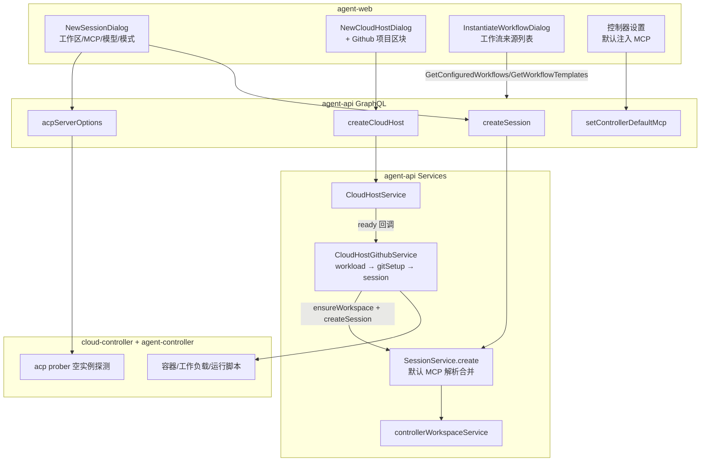
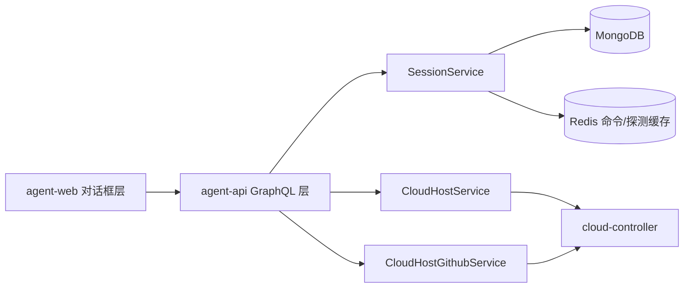
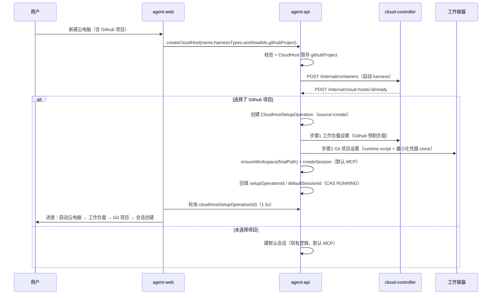
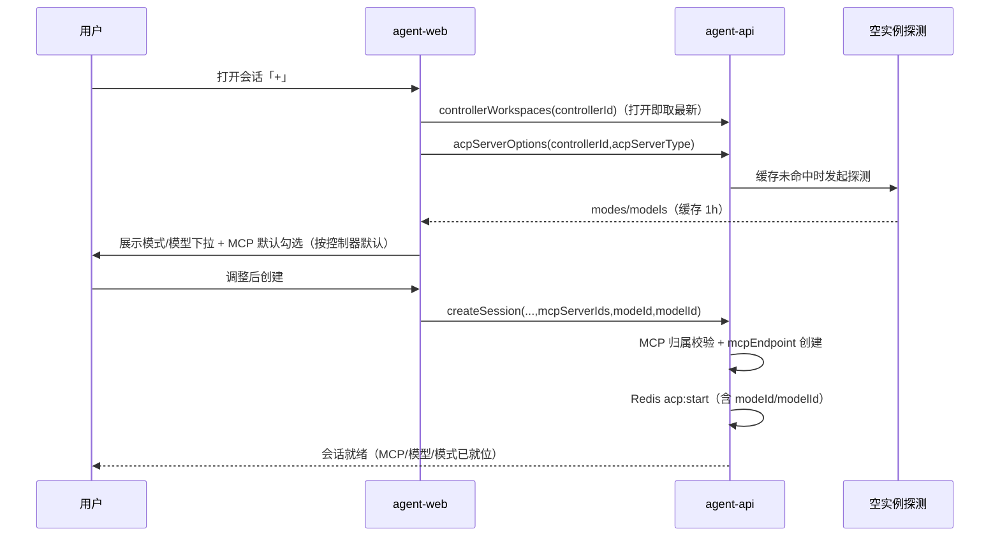

# 云容器优化一期 - 技术提案

**功能名称**: 云容器优化一期
**关联 PRD**: `docs/product/draft/20261022-cloud-container-optimization-phase1.md`
**技术提案版本**: v1.0
**创建日期**: 2026-10-22
**作者**: ZeroAsh Agent
**feat-branch**: `feat/cloud-container-optimization-phase1`

## 1. 概述

### 1.1 背景

云电脑（`Controller.type === 'cloud'`，云端工作容器 harness）已具备「Git 项目设置」（`CloudHostSetupOperation`：工作负载设置 → Git 项目设置 → 会话创建）、MCP 注册中心与 MCP 端点注入、Agent 工作流（已配置工作流/模板）、以及「按类型空实例探测」得到的可用模式与模型能力。但这些能力在「拉起」链路上存在四处断点：

1. `NewSessionDialog` 的工作区列表查询 `GetControllerWorkspacesEnabled` 与 `InstantiateWorkflowDialog` 的 `GetConfiguredWorkflows` / `GetWorkflowTemplates` / `GetWorkspaces` 均为 Apollo 默认 `cache-first`，对话框打开不刷新；「Git 项目设置」成功后只 refetch `HOME_OVERVIEW`，因此新增工作区/新建工作流要整页 reload 才可见。
2. `NewCloudHostDialog` 只收 `name / harnessTypes / workloadIds`，Github 项目必须等容器 ready 后再手动执行一次「Git 项目设置」。
3. `SessionService.create` 只有「云会话自动并入 `agent-cloud-host-tools`」这一处自动装配，`mcpServerIds` 缺省即不注入；`CloudHostGithubService.runSessionStep` 与 `CloudHostService.handleReadyLocked` 的自动建会话均不带 MCP。系统中无「默认注入 MCP」配置。
4. `CreateSessionInput` 无 `modeId` / `modelId`，模型与模式只能会话起来后 `setSessionMode` / `setSessionModel` 切换；而工作流侧已通过 `acpServerOptions(controllerId, acpServerType)`（按类型空实例探测 + `controllerId+type` 1h 缓存）拿到了前置选项。

### 1.2 目标

- 所有「+」对话框（新建会话、实例化工作流）打开即拉取最新列表，无需整页刷新。
- `createCloudHost` 支持可选 Github 项目参数，容器就绪后复用既有三步编排完成项目准备并创建项目会话。
- 新建会话默认注入 MCP（默认「全部已启用」），并新增控制器级「默认注入 MCP」配置；自动建会话遵循同一配置。
- `CreateSessionInput` 支持 `modeId` / `modelId` 前置传参，新建会话对话框复用 `acpServerOptions` 探测结果供用户选择。

### 1.3 范围

**做**：

- `contracts/agent-session.graphql`、`contracts/agent-controller.graphql`、`contracts/cloud-host.graphql` 契约变更。
- agent-api：`SessionService.create` 默认 MCP 解析合并、`setControllerDefaultMcp`、`CloudHostService.create` 携带 Github 项目、ready 回调改走 `CloudHostGithubService` 编排、`CreateSessionInput.modeId/modelId` 透传。
- agent-web：`NewSessionDialog` / `InstantiateWorkflowDialog` 列表刷新、MCP 默认勾选与模型/模式前置选择、控制器设置「默认注入 MCP」、`NewCloudHostDialog` Github 项目区块与创建进度展示。
- 单元测试、API 测试、E2E 测试（TDD 红-绿-重构）。

**不做**：

- 不改变云电脑「每用户 1 实例、停止即销毁、会话只读」生命周期契约。
- 不做 MCP 服务本身的注册/停用能力变更（沿用 MCP 注册中心与 `setMcpServerEnabled`）。
- 不做会话中途更换默认 MCP（仅作用于新建会话）。
- 不做多 Harness 场景的自动会话创建（沿用「多 Harness 不自动建会话」约定）。
- 不新增独立的模型/模式探测链路（复用既有空实例探测与缓存）。
- 不改变会话内切换模型/模式、工作流节点 `agentConfig` 的既有语义。

## 2. 技术架构

### 2.1 系统架构图



### 2.2 技术栈

| 层级 | 技术选型 | 说明 |
|------|---------|------|
| 前端 | React 19 + TypeScript + Vite + Tailwind CSS v4 | 沿用 `apps/agent-web` |
| 前端数据 | Apollo Client v4 + GraphQL Code Generator | 本期以 `fetchPolicy` / `refetch` 控制刷新 |
| 后端 | Node.js 24 + Express v5 + GraphQL-Yoga | `servers/agent-api` |
| 数据库 | MongoDB（Mongoose） | `Controller` / `CloudHost` / `McpServer` / `Session` |
| 缓存 | Redis | `acp:options:<controllerId>:<serverType>`（1h，复用）、`session:command` |
| 容器编排 | cloud-controller 内部 REST + Socket.IO | 既有 workload / runtime-script 通路，不改 |

### 2.3 模块划分



| 模块 | 职责 | 关键技术点 |
|------|------|-----------|
| `NewSessionDialog` | 会话创建参数采集 | 打开即刷新工作区；`acpServerOptions` 探测；MCP 默认勾选；`modeId/modelId` 提交 |
| `InstantiateWorkflowDialog` | 工作流实例化来源采集 | 打开即刷新 `GetConfiguredWorkflows` / `GetWorkflowTemplates` / `GetWorkspaces` |
| `ControllerConfigPage` / `McpDefaultSection` | 控制器默认注入 MCP 配置 | `setControllerDefaultMcp`；「默认全部」开关 + 多选 |
| `NewCloudHostDialog` + 进度对话框 | 创建云电脑（可选 Github 项目） | 复用 Github 项目表单与 `CloudHostSetupProgressDialog` |
| `SessionService` | 会话创建/恢复/切换 | 默认 MCP 解析合并；`modeId/modelId` 随 `acp:start` 下发 |
| `CloudHostService` | 云电脑生命周期 | 创建期暂存 Github 项目；ready 回调分流 |
| `CloudHostGithubService` | Git 项目设置三步编排 | 幂等步骤、失败回退默认会话、`setupOperationId` 回填 |

## 3. API 设计

> 契约式开发：先改 `contracts/`，再实现 schema/resolver。以下为契约文件变更点。

### 3.1 API 契约

#### 接口 1: `CreateSessionInput` 扩展（`contracts/agent-session.graphql`）

```graphql
input CreateSessionInput {
  controllerId: ID!
  acpServerType: String!
  workspaceId: ID
  enableWorktree: Boolean = false
  worktreeBranchSuffix: String
  existingWorktreePath: String
  # 语义变更：缺省 = 按控制器「默认注入 MCP」解析（useAllEnabled 时取全部已启用 MCP）；
  # 显式传数组 = 以调用方为准（含空数组 = 不注入）。云会话仍自动并入 agent-cloud-host-tools。
  mcpServerIds: [ID!]
  additionalDirectories: [String!]
  # 新增：拉起前选择的模式/模型（来自 acpServerOptions 探测结果）；缺省使用工具默认值
  modeId: ID
  modelId: ID
}
```

- **响应**：沿用 `CreateSessionPayload`（`session`）。
- **校验**：`modeId` / `modelId` 仅做非空长度与字符集校验，不强校验是否在探测结果内（工具侧对未知值按默认处理）；`mcpServerIds` 沿用「必须属于当前用户且 `enabled=true`，否则 `MCP_SERVER_NOT_FOUND`」。

#### 接口 2: 控制器默认注入 MCP（`contracts/agent-controller.graphql`）

```graphql
type ControllerDefaultMcp {
  # true = 新建会话默认注入「全部已启用 MCP」（动态跟随新增服务）；false = 仅注入 serverIds
  useAllEnabled: Boolean!
  serverIds: [ID!]!
}

extend type Controller {
  defaultMcp: ControllerDefaultMcp!
}

extend type Mutation {
  # useAllEnabled=true 时忽略 serverIds（服务端归一为 []）；false 时 serverIds 允许为空数组（= 不注入）
  setControllerDefaultMcp(controllerId: ID!, useAllEnabled: Boolean!, serverIds: [ID!] = []): Controller!
}
```

- **响应**：更新后的 `Controller`（含 `defaultMcp`）。
- **错误**：`CONTROLLER_NOT_FOUND`；`MCP_SERVER_NOT_FOUND`（`serverIds` 中存在非本用户/已停用/已删除的服务）。
- **兼容**：未配置过的存量控制器 `defaultMcp = { useAllEnabled: true, serverIds: [] }`（缺省即「全部」），无数据迁移。

#### 接口 3: 创建云电脑携带 Github 项目（`contracts/cloud-host.graphql`）

```graphql
input CloudHostGithubProjectInput {
  accountId: ID!          # GitHub 帐号（复用 githubAccounts）
  repoFullName: String!   # "owner/repo"
  targetPath: String      # 前缀地址（工作根目录），缺省取云电脑默认工作区；服务端负责拼接最终 clone 地址
}

input CreateCloudHostInput {
  name: String!
  harnessTypes: [HarnessType!]!
  workloadIds: [ID!]
  githubProject: CloudHostGithubProjectInput   # 新增，可选
}

extend type CloudHost {
  # 创建期项目准备操作（未选择项目时为 null）；进度沿用 cloudHostSetupOperation(id)
  setupOperationId: ID
}
```

- **响应**：`CreateCloudHostPayload { cloudHost }`（沿用；`setupOperationId` 在容器 ready 后由后端回填）。
- **错误**：`ACCOUNT_NOT_FOUND` / `invalid targetPath`（非绝对路径或含 `..`、反斜杠）/ 既有 `name`、`harness`、`workload` 校验不变。
- **行为**：`githubProject` 存在时不改变容器启动编排，仅在 CloudHost 记录暂存项目；容器 ready 后按「工作负载设置 → Git 项目设置 → 会话创建」执行（见 §5.2 实现点 2）。

#### 接口 4: 既有查询复用（无契约变更）

| 查询 | 用途 |
|------|------|
| `acpServerOptions(controllerId, acpServerType)` | 拉起会话前探测模式/模型（与工作流节点配置同源，`controllerId+type` 缓存 1h） |
| `controllerWorkspaces(controllerId)` | 新建会话工作区列表（改为打开即取最新） |
| `configuredWorkflows(controllerId)` / `workflowTemplates` / `workspaces` | 实例化工作流来源列表（改为打开即取最新） |
| `cloudHostSetupOperation(id)` / `retryCloudHostSetupOperation(id)` | 创建期项目准备进度与重试 |
| `mcpServers` | 默认注入 MCP 配置与会话 MCP 勾选数据源 |

### 3.2 内部接口

本期不新增内部 REST 接口，沿用既有通路：

| 通路 | 说明 |
|------|------|
| `POST /internal/containers/:id/workloads` | 「工作负载设置」步骤（Github 预制负载安装） |
| `POST /internal/containers/:id/runtime-scripts` | 「Git 项目设置」步骤（容器内 `gh repo clone`，`githubAuth`） |
| `POST /internal/cloud-hosts/:id/ready` | 容器就绪回调（本期在此分流「带项目 / 不带项目」两种收尾） |
| `POST /internal/cloud-hosts/:controllerId/github-credential` | 仓库级最小化凭据下发（不变） |
| Redis `session:command` `acp:start` | 已支持 `modeId` / `modelId`（工作流已在用），本期会话创建复用 |

## 4. 数据模型

### 4.1 数据库设计

#### 表/集合: `controllers`（`servers/agent-api/src/models/controller.ts`）

| 字段 | 类型 | 说明 |
|------|------|------|
| `defaultMcp.useAllEnabled` | Boolean | 默认 `true`；`true` 表示动态注入全部已启用 MCP |
| `defaultMcp.serverIds` | [ObjectId] | `useAllEnabled=false` 时的注入集合，允许空数组 |

> 嵌套子文档注意 Mongoose 空对象物化：`defaultMcp` 需字段级 resolver 归一化为 `{ useAllEnabled: true, serverIds: [] }`（历史行无该字段），并在 `resolvers/index.ts` 登记（backend-rules「resolver 合并清单」）。

#### 表/集合: `cloudhosts`（`servers/agent-api/src/models/cloud-host.ts`）

| 字段 | 类型 | 说明 |
|------|------|------|
| `githubProject.accountId` | ObjectId | 可选；创建期选择的 GitHub 帐号 |
| `githubProject.repoFullName` | String | `"owner/repo"` |
| `githubProject.targetPath` | String | 归一后的前缀地址（服务端已计算 `finalPath` 存入 operation） |
| `setupOperationId` | ObjectId | 可选；创建期项目准备操作（`CloudHostSetupOperation`）id，供前端轮询 |

#### 表/集合: `cloud_host_setup_operations`（不改结构）

- 复用既有 `steps: workload | gitSetup | session`、`status: PENDING/RUNNING/SUCCEEDED/FAILED/SKIPPED`、`retry` 幂等语义。
- 创建期场景新增来源标记（`source: 'manual' | 'create'`，记录于 `detail` 或新增轻量字段，便于区分进度标题），不改变步骤机。

### 4.2 缓存设计

| Key | 内容 | TTL | 说明 |
|-----|------|-----|------|
| `acp:options:<controllerId>:<serverType>` | 模式/模型探测结果 | 3600s（失败 60s） | 复用既有「按类型空实例探测」缓存，本期不新增 |
| `session:command`（Redis pub/sub） | `acp:start` 含 `modeId/modelId` | - | 既有通路，工作流节点已在用 |

> 默认 MCP 解析不引入缓存：`McpServer` 查询为小集合按 `_id/$in` 或 `userId+enabled` 过滤，直接读库，避免缓存失效带来的「默认集合不更新」问题。

## 5. 技术实现方案

### 5.1 核心流程

创建云电脑并初始化 Github 项目：



新建会话（默认 MCP + 前置选择模型/模式）：



### 5.2 关键实现点

#### 实现点 1: 「+」对话框列表实时刷新

- **描述**: `NewSessionDialog` 的 `GetControllerWorkspacesEnabled`、`InstantiateWorkflowDialog` 的 `GetConfiguredWorkflows` / `GetWorkflowTemplates` / `GetWorkspaces`、`WorkflowSection` 的来源列表，改为「打开即取最新」。
- **技术细节**:
  - 统一策略：`useQuery` 保留 `cache-first` 首屏快照，`useEffect([open])` 内调用 `refetch()`；或直接 `fetchPolicy: 'network-only'`（列表小，代价可接受）。二选一在实现期统一为一种写法。
  - `GithubSetupProgressDialog` 成功后除 `HOME_OVERVIEW` 外增加 `refetchQueries: ['GetControllerWorkspacesEnabled']`，形成「操作方负责失效」的闭环（不依赖对话框下次打开的刷新兜底）。
  - 加载分支遵循 frontend-rules「Apollo v4 轮询陷阱」：`loading && !data` 才显示骨架，刷新期间不得卸载表单、不得清空用户已填内容（E2E 断言输入不丢）。
  - 不在 Sidebar/首页新增信息流查询（`HOME_OVERVIEW` 统一下发约束不变）；对话框保持自有查询，避免把弹窗数据流耦合进首页聚合。
- **风险点**: `refetch()` 与用户操作并发时的竞态——用「刷新只替换列表数据、不重置受控输入」保证。

#### 实现点 2: 新建云电脑初始化 Github 项目

- **描述**: `CreateCloudHostInput.githubProject` 可选入参；容器 ready 后按既有三步编排完成项目准备并创建项目会话。
- **技术细节**:
  - `CloudHostService.create`：校验（帐号归属、`repoFullName` 形态、`targetPath` 绝对路径且不含 `..`/反斜杠）后把 `githubProject` 写入 `CloudHost`（暂存），容器启动编排不变。
  - `CloudHostService.handleReadyLocked` 分流：有 `githubProject` 时不直接建默认会话，改为 `CloudHostGithubService.createOperation(..., source: 'create')` 执行 `workload → gitSetup → session`；`session` 步骤的 `createSession` 走默认 MCP 解析（实现点 3）。`defaultSessionId` 由 `session` 步骤结果经既有 CAS 窗口回填（保持「前端不会观测到 RUNNING + defaultSessionId=null」语义）。
  - 幂等/重试：重复 ready 回调若 `setupOperationId` 已存在则不重建；步骤重试沿用 `retryCloudHostSetupOperation`（已完成步骤不重复执行）。
  - 失败回退：`gitSetup` 失败时按现有「仓库未就绪」语义报错并保留重试；为保证云电脑可用，`session` 步骤失败沿用「仓库已就绪，请手动创建会话」降级（不整体判 FAILED）。多 Harness 时仅执行 `workload + gitSetup`，跳过 `session`（与「多 Harness 不自动建会话」一致）。
  - 前端 `NewCloudHostDialog` 增加「Github 项目（可选）」区块：复用 `GithubProjectSetupDialog` 的帐号/仓库/前缀地址/最终地址预览逻辑（抽取共享 hook/子组件，如 `useGithubProjectForm` + `lib/workspace-path.ts`）；创建成功后展示四阶段进度（启动云电脑由 `cloudHost.status` 驱动，其余由 `cloudHostSetupOperation` 驱动），成功自动进入项目会话（沿用 `defaultSessionId` 自动跳转）。
- **风险点**: ready 回调与前端轮询的时序（`setupOperationId` 需在 operation 创建后立即回填，前端以 `setupOperationId` 非空作为「进入项目进度」切换点）；容器启动失败时不产生 operation，前端需能停留在「启动失败」态并给出删除/重建入口。

#### 实现点 3: 默认 MCP 注入与控制器默认 MCP 设置

- **描述**: 新建会话默认注入 MCP；控制器可配置默认注入集合；自动建会话遵循同一配置。
- **技术细节**:
  - `SessionService.create`（`servers/agent-api/src/services/session.ts` L145 附近合并段）扩展解析顺序：
    1. 调用方显式传 `mcpServerIds`（含空数组）→ 以调用方为准；
    2. 未传 → 读 `Controller.defaultMcp`：`useAllEnabled=true` 取用户全部 `enabled=true` 的 `McpServer` id；否则取 `serverIds`（过滤已删除/已停用）；
    3. 云会话继续并入 `ensureCloudHostToolsServer(userId)`（既有行为）；
    4. 去重后走既有「归属校验 + `mcpEndpointService.createEndpoint`」链路（fail-fast 语义不变）。
  - 自动建会话入口不传 `mcpServerIds` 即可自动生效：`cloud-host-github-service.ts` `runSessionStep`、`cloud-host-service.ts` `handleReadyLocked` 默认会话、创建期项目会话。
  - GraphQL：`Controller.defaultMcp` 字段 resolver 归一（历史行空对象物化陷阱），并按 backend-rules 在 `resolvers/index.ts` 登记；`setControllerDefaultMcp` 校验 `serverIds` 必须属于当前用户且 `enabled=true`。
  - 前端：控制器设置新增「默认注入 MCP」区块（`components/settings/McpDefaultSection.tsx`）：「默认注入全部 MCP」开关 + MCP 多选（开关开启时禁用并提示「新 MCP 上线后自动注入」）；`NewSessionDialog` 打开时按该配置预选（全部勾选/按子集勾选），用户可调整，提交显式 `mcpServerIds`。
- **风险点**: 「全部」是动态语义——用户后续新增 MCP 会自动进入默认集合（这是需求预期，需在设置界面明示）；已停用服务必须从解析结果中剔除，避免 `MCP_SERVER_NOT_FOUND` 导致建会话失败。

#### 实现点 4: 拉起会话前置选择模型与模式

- **描述**: 选定 `acpServerType` 后复用 `acpServerOptions` 探测结果，供用户前置选择 `modeId` / `modelId`。
- **技术细节**:
  - 前端 `NewSessionDialog` 在控制器 + 工具确定后发起 `GetAcpServerOptions`（与 `WorkflowGraphEditor.AgentNodeOptionFields` 同源同写法）：loading 提示「正在探测可用模式与模型…」，渲染下拉（首项「默认」= 留空不传），无选项时仅「默认」不阻断创建。
  - 契约 `CreateSessionInput.modeId/modelId` → resolver → `SessionService.create` 内参（已存在）→ Redis `acp:start`（已支持），controller-api/agent-controller 链路零改动。
  - 探测缓存按 `controllerId+serverType` 1h 复用，不新增缓存键；遵循 backend-rules「能力探测」：配置阶段无会话可查，只走空实例探测，不编造 pre-session 能力数据。
- **风险点**: 探测失败/超时（既有实现返回空列表）不得阻断建会话；`modeId/modelId` 对不支持的工具按工具默认处理，会话内仍可切换。

#### 实现点 5: 工作流「+」列表刷新（含 MCP 创建的条目）

- **描述**: 通过 MCP（`agent-workflow-admin-tools`）创建的已配置工作流/模板需在前端「+」对话框立即可见。
- **技术细节**: 与实现点 1 同一策略——`InstantiateWorkflowDialog` 打开即 `refetch` `GetConfiguredWorkflows` / `GetWorkflowTemplates`；`ConfigureWorkflowDialog` / `TemplateEditorDialog` 保存后的既有 `refetchQueries` 保留；`WorkflowSection` 进入设置页时刷新一次。AI/MCP 侧创建路径（`createConfiguredWorkflow` / `createWorkflowTemplate`）无需改动（对话框刷新即兜底），不引入推送通道。
- **风险点**: 已删除条目的陈旧缓存——`refetch` 以服务端返回为准整表替换。

## 6. 技术决策

### 6.1 决策列表

| 决策 | 选项 A | 选项 B | 最终选择 | 原因 |
|------|--------|--------|---------|------|
| 默认 MCP 作用域 | 用户级全局一份 | 控制器级一份 | B | 需求明确「在控制器设置中增加设置」；不同控制器（本地/云电脑）常用工具集不同 |
| 「默认全部」语义 | 保存时物化全量 id 列表 | 动态标志 `useAllEnabled`（跟随新增 MCP） | B | 需求要求「系统中的 MCP 都默认启用」，物化列表会在新增 MCP 后失真 |
| 空配置的表达 | `serverIds=null` 表示全部 | 显式 `useAllEnabled` + `serverIds` 两字段 | B | GraphQL 单列表字段无法区分「未配置/null/空数组」，显式标志无歧义且可测试 |
| 列表刷新策略 | 对话框打开即 `refetch` | 统一收敛到 `HOME_OVERVIEW` 聚合下发 | A | 弹窗数据不在首页信息流范围；改动最小、可独立测试，且不违反「首页/Sidebar 不各自发起查询」约束 |
| Github 项目初始化时机 | 创建期同步阻塞到项目就绪 | 暂存项目，容器 ready 后复用既有三步编排 | B | 复用 `CloudHostSetupOperation` 的幂等/重试/进度能力，容器启动与项目准备解耦，失败可回退 |
| 模型/模式探测 | 新建会话探测接口 | 复用 `acpServerOptions`（工作流同款） | B | 同一探测源保证「与工作流看到的选项一致」，零新增缓存与链路 |
| 会话模型/模式 | 创建后 `setSessionModel/setSessionMode` | `CreateSessionInput` 前置传参 | B | `acp:start` 已支持 `modeId/modelId`（工作流在用），前置传参避免「起错会话再切换」的空转对话 |
| 自动建会话的模型/模式 | 一并按探测默认注入 | 不传，沿用工具默认 | B | 需求只要求「拉起会话时给用户前置选择」；自动建会话无用户在场，不编造选择 |

### 6.2 依赖与约束

| 类型 | 内容 | 说明 |
|------|------|------|
| 依赖 | Git 项目设置（`CloudHostSetupOperation` 三步编排） | 创建期项目准备复用其步骤、幂等与重试语义 |
| 依赖 | `acpServerOptions` 空实例探测 | 复用 `controllerId+type` 1h 缓存，禁止新增第二套探测 |
| 依赖 | MCP 注册中心（`McpServer` / `mcpEndpoint`） | 默认 MCP 解析的数据源与注入通路 |
| 约束 | 云电脑生命周期契约 | 每用户 1 实例、停止即销毁、会话只读，均不改 |
| 约束 | `HOME_OVERVIEW` 数据流约束 | 首页/Sidebar 信息流唯一聚合，不得各自发起信息流查询 |
| 约束 | Mongoose 空对象物化 + `resolvers/index.ts` 登记 | 新增嵌套字段必须配字段 resolver 与登记（backend-rules） |
| 约束 | 契约先行 | 先改 `contracts/`，再实现 schema/resolver 与前端 codegen |

## 7. 项目结构

```
z-agent-gear/
├── contracts/
│   ├── agent-session.graphql          # CreateSessionInput: +modeId/modelId、mcpServerIds 语义注释
│   ├── agent-controller.graphql       # Controller.defaultMcp + setControllerDefaultMcp
│   └── cloud-host.graphql             # CreateCloudHostInput.githubProject、CloudHost.setupOperationId
├── servers/agent-api/src/
│   ├── models/
│   │   ├── controller.ts              # +defaultMcp 子文档
│   │   └── cloud-host.ts              # +githubProject/setupOperationId
│   ├── graphql/
│   │   ├── schemas/{agent-controller,cloud-host,session}.ts
│   │   └── resolvers/{agent-controller,cloud-host,session}.ts   # 字段 resolver 归一 + 登记
│   └── services/
│       ├── session.ts                 # 默认 MCP 解析合并、modeId/modelId 透传
│       ├── cloud-host-service.ts      # 创建期暂存项目、ready 回调分流
│       └── cloud-host-github-service.ts # source=create 编排、失败回退、setupOperationId 回填
├── apps/agent-web/src/
│   ├── components/session/NewSessionDialog.tsx        # 列表刷新/MCP 预选/模型模式前置选择
│   ├── components/workflow/InstantiateWorkflowDialog.tsx  # 来源列表打开即刷新
│   ├── components/cloud-host/NewCloudHostDialog.tsx   # Github 项目区块
│   ├── components/cloud-host/GithubProjectSetupDialog.tsx # 表单逻辑抽取共享
│   ├── components/settings/McpDefaultSection.tsx      # 新增：默认注入 MCP
│   ├── pages/ControllerConfigPage.tsx                 # 挂载新设置区块
│   └── graphql/{queries,mutations,workflow}.ts        # 契约字段同步 + codegen
└── tests/
    ├── api/                          # GraphQL 契约与服务行为测试
    └── e2e/                          # Playwright 场景测试
```

## 8. 测试策略

### 8.1 测试覆盖要求

- 全程 TDD 红-绿-重构：先写失败测试（契约/服务行为），再写最少实现，最后重构。
- 单元测试（vitest）覆盖：默认 MCP 解析矩阵（显式传参 / 未传 + useAllEnabled / 未传 + 子集 / 空数组 / 停用与删除剔除）、`setControllerDefaultMcp` 校验、创建期项目参数校验与 ready 分流、`modeId/modelId` 透传。
- API 测试（`tests/api`，vitest + supertest）覆盖：`createSession`（默认 MCP / 显式 MCP / modeId/modelId）、`setControllerDefaultMcp`、`createCloudHost(githubProject)`、`cloudHostSetupOperation` 进度与重试、`acpServerOptions` 复用。

### 8.2 测试类型

| 类型 | 工具 | 覆盖范围 |
|------|------|---------|
| 单元测试 | vitest | 服务层解析/合并/校验逻辑、字段 resolver 归一 |
| API 测试 | tests/api（vitest + supertest） | 契约变更端点、错误码、幂等与回退语义 |
| E2E 测试 | tests/e2e（Playwright） | 五条验收主链路（见 §9），含「列表刷新不丢输入」「刷新无横向溢出」断言 |
| 前端组件测试 | vitest + React Testing Library | `NewSessionDialog` 预选/探测态、`McpDefaultSection`、云电脑项目区块表单校验 |

## 9. 验收标准

- [ ] 技术方案评审通过、Contract 评审通过
- [ ] 「Git 项目设置」添加工作区后，不刷新页面打开会话「+」即可选到新工作区并建会话
- [ ] 新建云电脑可选择 Github 项目，全程进度可见，成功后自动进入项目会话；失败可重试/手动设置且云电脑可用
- [ ] 新建会话 MCP 默认全选并按控制器默认配置预选；会话内 MCP 工具可用；「Git 项目设置」自动创建的会话同样带默认 MCP
- [ ] 控制器设置可配置「默认注入 MCP」，保存后对后续新建会话生效；清空选择即回到不注入
- [ ] 新建会话可前置选择模式与模型（与工作流节点选项一致），留空走工具默认；探测中/无选项不阻断创建
- [ ] 通过 MCP 创建已配置工作流/模板后，不刷新页面打开工作流「+」即可看到并实例化
- [ ] 单元测试覆盖达标、API 测试通过、E2E 测试通过

## 10. 相关文档

- 产品需求：`docs/product/draft/20261022-cloud-container-optimization-phase1.md`
- 契约：`contracts/agent-session.graphql`、`contracts/agent-controller.graphql`、`contracts/cloud-host.graphql`
- 既有提案：`docs/engineering/proposals/20261021-feat-github-workload.md`、`docs/engineering/proposals/20261020-feat-container-harness-support.md`、`docs/engineering/proposals/20261022-feat-workload-optimization.md`、`docs/engineering/proposals/20260522-feat-available-models-and-mode-switch.md`
- 开发规范：`docs/engineering/common-rules.md`、`docs/engineering/backend-rules.md`、`docs/engineering/frontend-rules.md`
