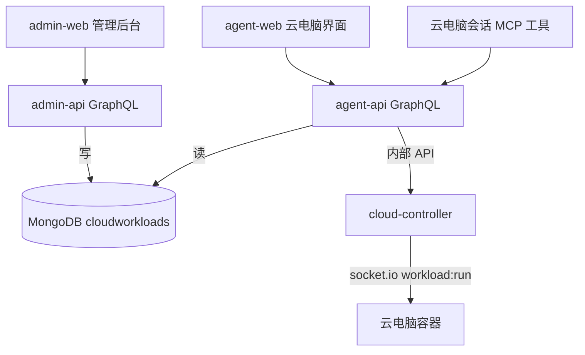
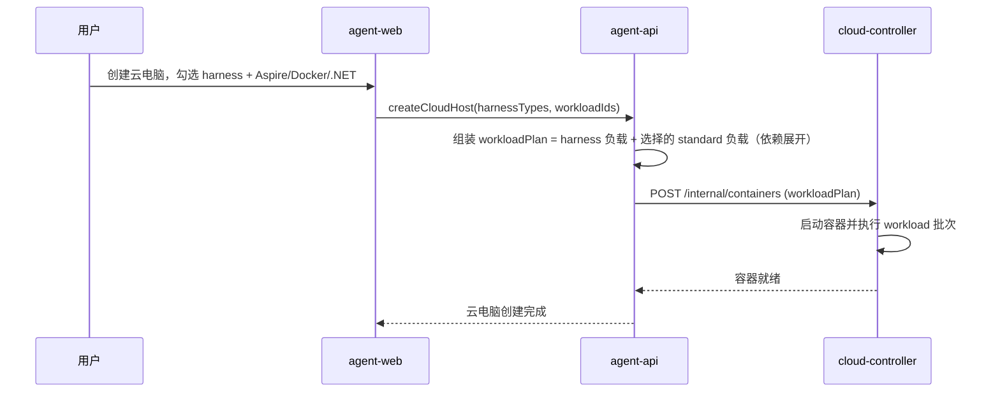
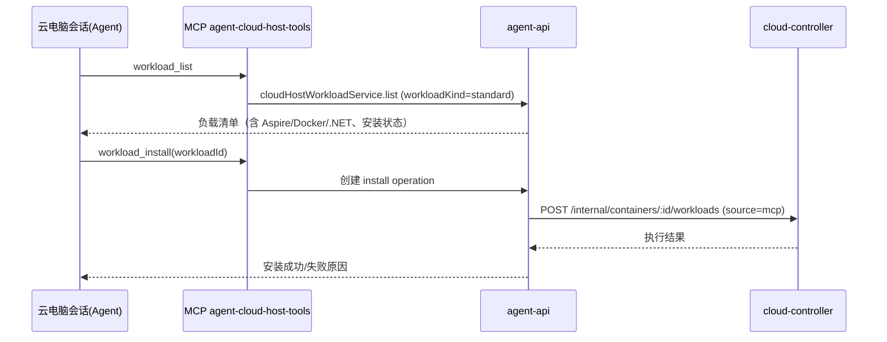
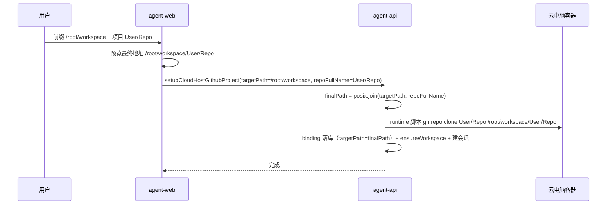

# 工作负载优化 - 技术提案

**功能名称**: 工作负载优化
**关联 PRD**: `docs/product/draft/20261022-workload-optimization.md`
**技术提案版本**: v1.0
**创建日期**: 2026-10-22
**作者**: ZeroAsh Agent
**feat-branch**: `feat/workload-optimization`

## 1. 概述

### 1.1 背景

工作负载机制（一期至四期）与 Github 工作负载（20261021）已落地：Docker / .NET / Aspire / Github 均已作为 `workloadKind='standard'` 的预制负载存在（迁移 `001`~`007`），运行时安装（`POST /internal/containers/:id/workloads`）、MCP 工具 `workload_list` / `workload_install` 也已实现。当前缺口：

1. **云电脑创建时无法挂载 standard 负载**：`servers/agent-api/src/services/cloud-host-service.ts:234-253` 创建云电脑时 `workloadPlan` 仅由 `harnessTypes` 映射的 harness 预制负载组成，用户无法在创建时勾选 Aspire/Docker/.NET。
2. **负载分类信息未透出**：`contracts/admin-cloud-workload.graphql` 的 `CloudWorkload` 类型（`:59-69`）不含 `workloadKind` / `harnessType`，admin-web 启动容器弹窗（`StartContainerDialog.tsx:222-250`）仅按名称平铺，无法分类展示。
3. **Github clone 地址语义不直观**：`cloud-host-github-service.ts:93-96` 将 `targetPath` 直接当作最终 clone 目录，无「前缀 + 项目」拼接；预制负载参数默认值 `/root/workspaces/{repo}` 中的 `{repo}` 占位符无任何替换逻辑。

### 1.2 目标

- 云电脑创建与展示全链路支持 standard 负载（Aspire / Docker / .NET 可被看见、可选、可装）。
- 确认并补齐 MCP 通道（`workload_list` / `workload_install`）对上述负载的列出与安装能力。
- `SetupCloudHostGithubProject` 的目标路径语义改为「前缀地址 + 项目名」拼接：`finalPath = posix.join(prefix, repoFullName)`。

### 1.3 范围

**做**：

- agent-api 云电脑创建流程支持附加 standard 负载；
- 契约透出负载分类信息（`workloadKind`）并优化 admin-web / agent-web 展示；
- Github 项目设置路径拼接语义改造（契约 → 服务 → 脚本 → 前端预览）；
- MCP 负载工具的核对与补齐。

**不做**：

- 新增负载类型（Aspire/Docker/.NET 已存在，本需求只做透出与挂载）；
- worker 镜像内容调整（镜像瘦身策略维持四期结论：按需安装）；
- 存量 Github 绑定数据的强制迁移（旧绑定按原路径保持可用）。

## 2. 技术架构

### 2.1 系统架构图



### 2.2 技术栈

| 层级 | 技术选型 | 说明 |
|------|---------|------|
| 前端 | React + TypeScript + Vite | agent-web / admin-web |
| 后端 | Node.js + Express + GraphQL + Mongoose | agent-api / admin-api / cloud-controller |
| 数据库 | MongoDB | `cloudworkloads`、`cloudcontainers`、`cloud_host_github_bindings` |
| 容器编排 | K8s + socket.io | cloud-controller 下发 workload 批次 |

### 2.3 模块划分

| 模块 | 职责 | 关键技术点 |
|------|------|-----------|
| `cloud-host-service.ts`（agent-api） | 云电脑创建时组装 workloadPlan | 支持用户选择的 standard 负载并入 harness 负载 |
| `cloud-host-github-service.ts`（agent-api） | Github 项目设置编排 | 前缀拼接、校验、脚本参数 |
| `cloud-host-tools.ts`（agent-api） | MCP `workload_list` / `workload_install` | 保持仅列 standard 负载，确认展示信息充分 |
| admin-web / agent-web | 负载分类展示、创建勾选、路径前缀输入与预览 | `workloadKind` 分组、最终地址实时预览 |

## 3. API 设计

### 3.1 API 契约

#### 契约 1: `contracts/admin-cloud-workload.graphql` — 透出负载分类

`CloudWorkload` 类型新增字段：

```graphql
enum CloudWorkloadKind { STANDARD HARNESS }

type CloudWorkload {
  # ...既有字段...
  workloadKind: CloudWorkloadKind!   # 新增，默认 STANDARD
  harnessType: String                # 新增，harness 负载时的类型（如 opencode）
}
```

`CloudWorkloadInput` 维持不变（分类仍由迁移/管理端内部管理），仅查询透出。

#### 契约 2: `contracts/cloud-host.graphql` — 创建云电脑支持选择负载 + Github 路径前缀语义

```graphql
extend input CreateCloudHostInput {
  workloadIds: [ID!]   # 新增：创建时附加安装的 standard 负载（可选，≤5）
}

# SetupCloudHostGithubProjectInput.targetPath 语义变更：
# 由「最终 clone 目录」改为「clone 前缀地址（工作根目录）」
# 最终目录 = <targetPath>/<repoFullName>
input SetupCloudHostGithubProjectInput {
  controllerId: ID!
  repoFullName: String!
  targetPath: String!   # 语义：前缀地址，最终以 <前缀>/<User/Repo> 落盘
}
```

> 字段名保持 `targetPath` 不改以避免契约破坏性重命名；语义变更通过契约注释、前端文案与预览明确。评审若认为字段名必须表意，可新增 `workspacePrefix` 并废弃 `targetPath`（见 §6.1 决策）。

`CloudHostWorkloadItem` 新增 `workloadKind` 透出，便于前端分组展示。

### 3.2 内部接口

- `POST /internal/containers`（cloud-controller）：既有 `workloadPlan` 入参不变，agent-api 在创建云电脑时把用户选择的 standard 负载并入 plan。
- `POST /internal/containers/:containerId/workloads`：不变，MCP 与设置页追加安装沿用。
- socket.io `workload:run` 批次协议：不变。

## 4. 数据模型

### 4.1 数据库设计

#### 集合: `cloudworkloads`

无结构变更（`workloadKind` / `harnessType` 已存在于 admin-api 模型 `servers/admin-api/src/models/cloud-workload.ts:49-56`）。本期仅补齐 cloud-controller 只读模型与契约透出。

#### 集合: `cloud_host_github_bindings`

| 字段 | 类型 | 说明 |
|------|------|------|
| targetPath | string | 语义变更为「最终 clone 目录」（拼接结果）。存量记录保持原值，天然兼容：旧记录本身存的就是最终目录 |

无需迁移脚本：新记录存拼接后的最终目录，旧记录存的本来就是最终目录，后续按 `(controllerId, targetPath)` 建会话的逻辑（`cloud-host-github-service.ts:330-346`）不受影响。

### 4.2 缓存设计

不涉及新增缓存。

## 5. 技术实现方案

### 5.1 核心流程

#### 流程 1: 创建云电脑时挂载 standard 负载



#### 流程 2: MCP 列出与安装负载



#### 流程 3: Github 项目设置（前缀拼接）



### 5.2 关键实现点

#### 实现点 1: 云电脑创建支持 standard 负载

- **描述**: `cloud-host-service.ts:151-253` 的创建流程增加可选 `workloadIds` 入参；校验全部为 `workloadKind='standard'` 且存在，与 harness 负载合并后经既有依赖展开生成 `workloadPlan`。
- **技术细节**: 复用 `resolveRuntimeWorkloadPlan` 同款依赖展开逻辑；harness 负载仍强制包含，standard 负载上限 5 个（与 `dependsOnWorkloadIds` 约束一致）。
- **风险点**: Aspire 依赖 `[Docker, .NET]`，依赖展开后批次变大、创建耗时增加——前端需提示「勾选环境类负载会延长首次就绪时间」。

#### 实现点 2: 负载分类透出与展示

- **描述**: 契约 `CloudWorkload` / `CloudHostWorkloadItem` 增加 `workloadKind`；cloud-controller 只读模型补 `workloadKind` 字段；admin-web `StartContainerDialog` 与 agent-web `CloudHostWorkloadsSection` 按「运行环境（standard）/ 云电脑（harness）」分组展示，并展示预制标记。
- **技术细节**: Mongoose 只读模型补字段即可，无迁移。
- **风险点**: 无。

#### 实现点 3: Github 路径前缀拼接

- **描述**: `cloud-host-github-service.ts:93-96` 校验保留「必须绝对路径」，新增拼接：`finalPath = path.posix.join(targetPath, repoFullName)`（`posix.join` 自动规整末尾斜杠，且 `User/Repo` 两级路径正确落盘）。脚本 `GITHUB_SETUP_SCRIPT`（`:37-53`）的 `$TARGET` 改用拼接结果；binding 落库与 ensureWorkspace 均使用 `finalPath`。
- **技术细节**: 校验追加拒绝含 `..` 的前缀输入（防路径穿越）；`repoFullName` 沿用既有 `owner/repo` 格式校验。
- **风险点**: 存量前端默认值 `/root/workspaces/{repo}`（迁移 `007` 的 targetPath 默认值）在拼接语义下会得到 `/root/workspaces/{repo}/User/Repo`，需同步把预制参数默认值改为 `/root/workspace`（纯前缀）并移除 `{repo}` 占位文案。

#### 实现点 4: MCP 负载工具核对补齐

- **描述**: 确认 `workload_list`（`cloud-workload-catalog.ts:26` 仅查 `workloadKind='standard'`）返回信息包含名称、说明、参数 schema、安装状态，足以让 Agent 正确选型；`workload_install` 失败时把脚本错误摘要回传给 Agent。
- **技术细节**: 若列表项缺少「是否已安装」标注，补充 `installed` 字段（数据在 `installedWorkloads` 已有）。
- **风险点**: 无。

#### 实现点 5: 前端 Github 项目设置改造

- **描述**: `GithubProjectSetupDialog.tsx:318-334` 单输入框改为「前缀地址」输入 + 项目选择 + 最终地址实时预览（`posix.join` 同规则在前端计算）；默认值取 `cloudHost.defaultWorkspace`（回退 `/root/workspace`）。
- **技术细节**: 预览仅做展示，拼接权威逻辑在服务端。
- **风险点**: 用户按旧习惯粘贴完整目录会得到 `<粘贴目录>/<User/Repo>`——预览与文案必须醒目。

## 6. 技术决策

### 6.1 决策列表

| 决策 | 选项 A | 选项 B | 最终选择 | 原因 |
|------|--------|--------|---------|------|
| 路径拼接字段 | 保留 `targetPath` 改语义 | 新增 `workspacePrefix` 废弃 `targetPath` | 保留 `targetPath` 改语义 | 避免契约破坏性变更；`repoFullName` 本就同请求携带，拼接信息完整 |
| 拼接执行方 | 服务端拼接 | 前端拼好传最终目录 | 服务端拼接 | 权威逻辑收敛一处，前端预览仅为体验 |
| 创建时负载挂载 | workloadPlan 直接暴露给前台 | 新增 `workloadIds` 由服务端展开 | 新增 `workloadIds` | 前台不感知依赖展开细节，与既有启动挂载协议解耦 |
| 存量 binding | 迁移改写 | 不改 | 不改 | 旧记录值本身即最终目录，语义天然兼容 |

### 6.2 依赖与约束

| 类型 | 内容 | 说明 |
|------|------|------|
| 依赖 | 工作负载一期~四期 | 预制负载、依赖展开、runtime 安装均已落地 |
| 依赖 | Github 工作负载（20261021） | 凭据管理器、三步 operation 编排 |
| 约束 | 容器内网环境 | 安装走 nexus 代理，容器到 github.com 网络通道沿用既有结论 |
| 约束 | 契约兼容 | `targetPath` 语义变更需前后端同版本发布 |

## 7. 项目结构

```
contracts/
├── cloud-host.graphql                 # CreateCloudHostInput.workloadIds、targetPath 语义、CloudHostWorkloadItem.workloadKind
└── admin-cloud-workload.graphql       # CloudWorkload.workloadKind/harnessType
servers/
├── agent-api/src/services/
│   ├── cloud-host-service.ts          # 创建时 workloadIds 并入 workloadPlan
│   ├── cloud-host-github-service.ts   # 前缀拼接 + 校验 + 脚本参数
│   ├── cloud-host-tools.ts            # MCP 工具信息补齐
│   └── cloud-workload-catalog.ts      # standard 负载目录查询
├── cloud-controller/src/models/
│   └── cloud-workload.ts              # 只读模型补 workloadKind
└── admin-api/src/graphql/             # workloadKind 透出 resolver
apps/
├── agent-web/src/components/cloud-host/
│   ├── GithubProjectSetupDialog.tsx   # 前缀输入 + 最终地址预览
│   └── CloudHostWorkloadsSection.tsx  # 分组展示 + 安装状态
└── admin-web/src/components/cloud-containers/
    └── StartContainerDialog.tsx       # 按 workloadKind 分组展示
```

## 8. 测试策略

### 8.1 测试覆盖要求

- 单元测试：路径拼接与校验（绝对路径、末尾斜杠、`..` 拒绝、`User/Repo` 两级拼接）、创建时 workloadIds 校验与依赖展开。
- API 测试覆盖的端点：`createCloudHost`（含 workloadIds）、`setupCloudHostGithubProject`（前缀语义）、`cloudHostWorkloads`（workloadKind 透出）、`adminCloudWorkloads`（workloadKind 透出）、MCP `workload_list` / `workload_install`。

### 8.2 测试类型

| 类型 | 工具 | 覆盖范围 |
|------|------|---------|
| 单元测试 | vitest | 拼接/校验/展开纯逻辑 |
| API 测试 | tests/api | 上述 GraphQL 端点与 MCP 工具 |
| E2E 测试 | tests/e2e | 创建云电脑勾选负载 → 就绪；Github 项目设置 → clone 落盘路径正确 → 自动建会话 |

## 9. 部署方案

### 9.1 环境规划

| 环境 | 用途 | 部署方式 |
|------|------|---------|
| 本地 | 开发联调 | Aspire 编排 |
| 线上 | 生产 | K8s（cloud-controller）+ 既有服务发布 |

### 9.2 配置管理

无新增配置项。契约语义变更要求 agent-api 与 agent-web 同版本发布。

## 10. 验收标准

- [ ] 技术方案评审通过
- [ ] Contract 评审通过
- [ ] 代码实现完成
- [ ] 单元测试覆盖达标
- [ ] API 测试通过
- [ ] E2E 测试通过
- [ ] 云电脑创建可勾选 Aspire/Docker/.NET 并就绪可用
- [ ] MCP 可列出并安装 Aspire/Docker/.NET 负载
- [ ] 前缀 `/root/workspace` + 项目 `User/Repo` 最终 clone 到 `/root/workspace/User/Repo`

## 11. 相关文档

- [[../../product/draft/20261022-workload-optimization.md|关联 PRD：工作负载优化]]
- [[20261021-feat-github-workload.md|Github 工作负载与云主机 Git 项目设置]]
- [[20261018-feat-workload-phase1.md|工作负载一期]]
- [[20261018-feat-workload-phase4.md|工作负载四期（worker 基础镜像瘦身）]]
- [[20261020-feat-container-harness-support.md|容器启动任务支持 harness 类型]]
- [[20260804-feat-integrated-mcp-registry.md|集成式 MCP 注册中心]]
