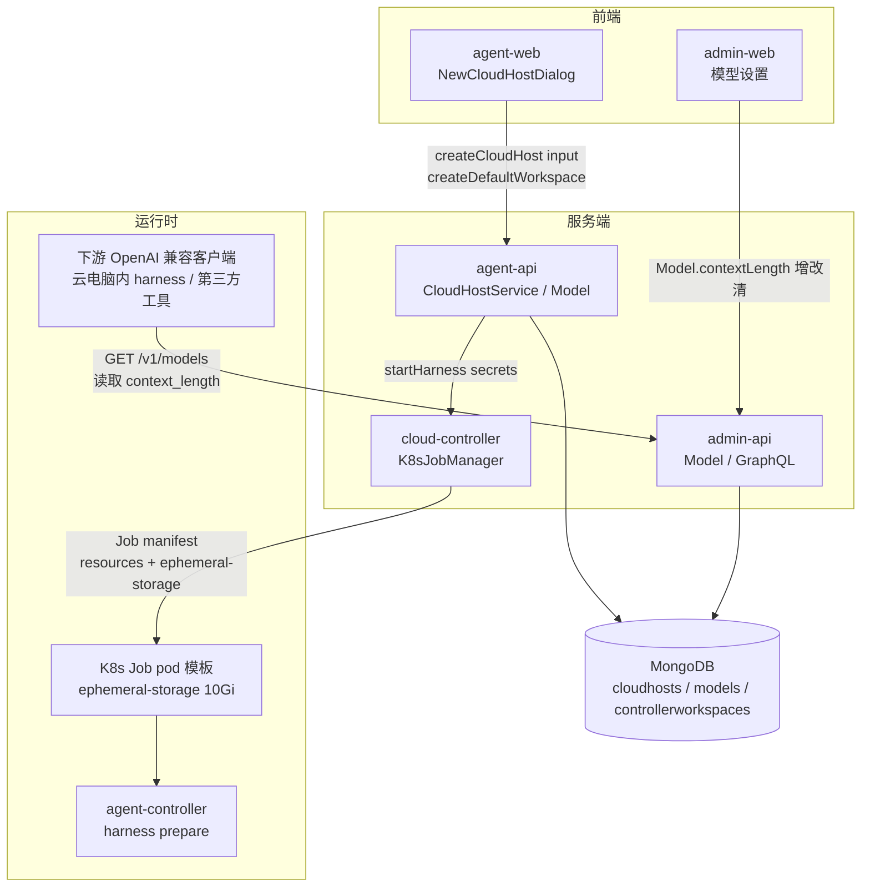
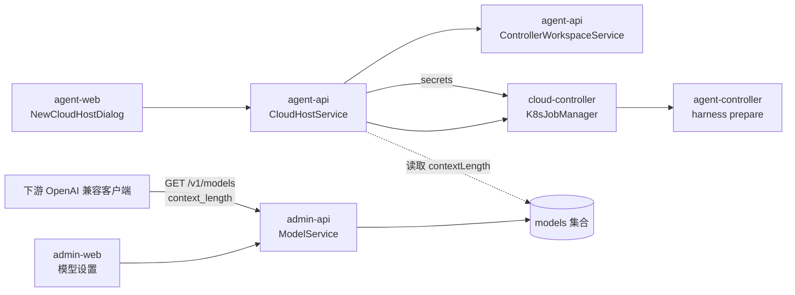
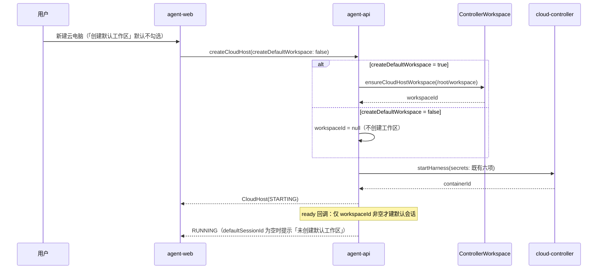
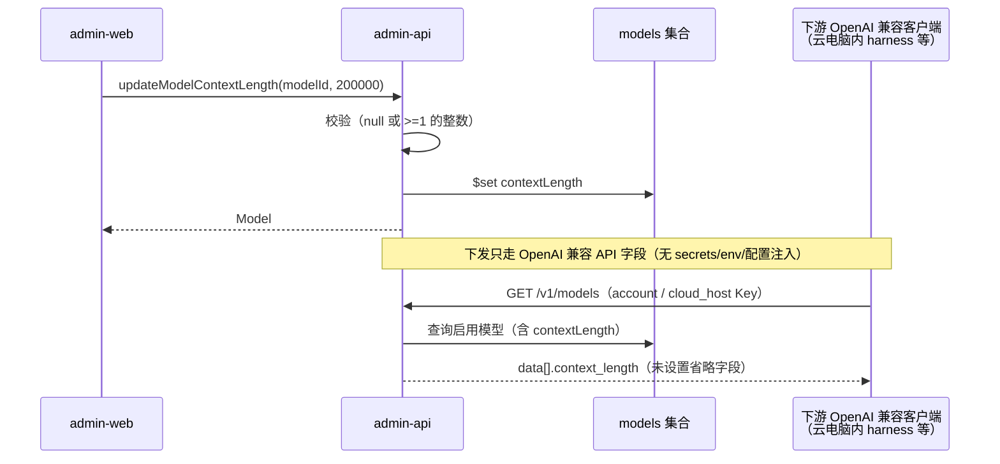

# 云容器优化二期 - 技术提案

**功能名称**: 云容器优化二期
**关联 PRD**: `docs/product/draft/20261023-cloud-container-optimization-phase2.md`
**技术提案版本**: v1.1
**创建日期**: 2026-10-23
**作者**: ZeroAsh Agent
**feat-branch**: `feat/cloud-container-optimization-phase2`
**变更记录**: v1.1（2026-10-23）返工修订——模型最长上下文改为经 OpenAI 兼容 API（`GET /v1/models` 模型对象 `context_length` 字段）下发给下游，移除 `secrets → ZAG_MODEL_CONTEXT_LENGTHS → opencode.jsonc limit.context` 自研注入链（原实现点 3 / 决策 8 重写）；v1.0 初版。

## 1. 概述

### 1.1 背景

云容器优化一期正在并行推进（`feat/cloud-container-optimization-phase1` / 实现分支 `-impl`），本期三项需求来自一期之外的并行优化，互不阻塞：

1. **默认工作区硬编码**：`CloudHostService.create` 无条件调用 `controllerWorkspaceService.ensureCloudHostWorkspace(controllerId, userId, config.cloudHostDefaultWorkspace)`（`servers/agent-api/src/services/cloud-host-service.ts`），把 `/root/workspace`（`CLOUD_HOST_DEFAULT_WORKSPACE`，`servers/agent-api/src/config/index.ts`）写进 `ControllerWorkspace` 并挂到 `CloudHost.workspaceId`（required）。前端 `CreateCloudHostInput` 没有任何工作区相关开关，用户无法拒绝这个默认工作区。
2. **模型缺少上下文能力字段**：`Model` schema（`servers/admin-api/src/models/model.ts` 与 `servers/agent-api/src/models/model.ts` 同步演进）只有 `providerId / name / isCustom / isEnabled / sortOrder / scope / pricing`，契约 `contracts/admin-llm.graphql` / `contracts/llm.graphql` 与后台 `apps/admin-web/src/components/models/*` 均无「最长上下文」入口；全仓无 `contextLength` / `maxTokens` 之类字段。对外 OpenAI 兼容面（`contracts/billing-openai.openapi.yaml` 的 `Model` 对象、`servers/admin-api/src/routes/billing-openai.ts` `toModelEntry()`）同样只有 `id / object / owned_by / created`，下游无法从 API 得知模型上下文能力。
3. **云电脑存储无上限**：云电脑 Job 的 pod 模板由 `K8sJobManager.buildManifest()`（`servers/cloud-controller/src/services/k8s-job-manager.ts`）构造，`JOB_RESOURCES` 只有 `cpu/memory`，`ephemeral-storage` 全仓零出现；`K8sResourceList`（`servers/cloud-controller/src/services/k8s-client.ts`）类型也只声明 `cpu/memory`。工作容器内含 dockerd 与项目 clone，可写层可以吃满节点磁盘。

> 说明：仓库中没有独立的「云电脑模板」实体（`BaseImage` 仅是后台 Dockerfile 文本库，未接入创建链路）；需求所称「云电脑模板」即 `buildManifest()` 构造的 Job pod 模板（`spec.template`），资源口径集中在 `JOB_RESOURCES`。

### 1.2 目标

- 新建云电脑默认不创建默认工作区：`CreateCloudHostInput` 增加 `createDefaultWorkspace: Boolean = false`，仅显式勾选才创建 `ControllerWorkspace`（`/root/workspace`），否则 `CloudHost.workspaceId` 为空、就绪后不自动建默认会话。
- 模型支持「最长上下文大小」：`Model.contextLength`（正整数 token，null = 未设置），后台可增改清空，双侧 schema/契约同步，并经 OpenAI 兼容 API（`GET /v1/models` 模型对象 `context_length` 字段）下发给下游使用方。
- 云电脑 Job 模板增加 `ephemeral-storage` 资源约束：requests/limits 均为 10Gi（env 可覆盖），超限由 K8s 按既有失败语义回收。

### 1.3 范围

**做**：

- `contracts/cloud-host.graphql`：`CreateCloudHostInput +createDefaultWorkspace`（默认 `false`）。
- `contracts/admin-llm.graphql`：`Model +contextLength`、`CustomModelInput +contextLength`、`Mutation.updateModelContextLength`；`contracts/llm.graphql`：`Model +contextLength`（只读镜像）。
- agent-api：`CloudHost.workspaceId` 可空、按开关创建默认工作区、无工作区时跳过默认会话（`handleReadyLocked` 与重复 ready 补建两处）。
- admin-api / agent-api：`Model.contextLength` 持久化与 GraphQL 暴露（双侧 schema 同步演进，共用同一 MongoDB `models` 集合）。
- admin-web：模型新增/编辑表单的「最长上下文大小」输入与校验、模型条目展示与编辑入口。
- admin-api 计费网关（OpenAI 兼容）：`contracts/billing-openai.openapi.yaml` 的 `Model` 增可选 `context_length`（token），`GET /v1/models` 随模型对象下发（未设置不返回该字段）；下游（云电脑内 harness、第三方 OpenAI 兼容客户端）直接从 API 读取。
- cloud-controller：`JOB_RESOURCES` 增加 `ephemeral-storage`（默认 `10Gi`，env `JOB_EPHEMERAL_STORAGE` 可覆盖），`K8sResourceList` 类型扩展；`deploy/k8s/cloud-controller.yaml`、`aspire/AgentGear.AppHost/AppHost.cs`、`aspire/manifest/docker-compose.yaml` 补 env。

**不做**：

- 不改容器内 `/root/workspace` 目录创建（`agent-gear harness prepare` / `cloud-host/supervisor.ts` 的幂等 `mkdir` 保留）：需求针对「工作区列表」，容器内目录属 harness 内部准备，改它要协调 `agent-gear` 版本发布。
- 不做上下文裁剪/超限拒绝（计费网关 `servers/admin-api/src/routes/billing-openai.ts` 的 `max_tokens` 口径不变）。
- 不做 harness 侧配置注入：不向 `StartHarnessInput.secrets` 增加上下文字段、不新增 `ZAG_*` env、不写 `opencode.jsonc` 的 `limit.context`（`packages/agent-controller` 本期零改动）。上下文能力只走 OpenAI 兼容 API 字段，由下游按需读取（评审结论）。
- 不做按套餐/用户的差异化存储配额；不做存量云电脑的资源追溯调整。
- 不改 `CloudHost.defaultWorkspace` 契约形态（见决策 4）。

## 2. 技术架构

### 2.1 系统架构图



### 2.2 技术栈

| 层级 | 技术选型 | 说明 |
|------|---------|------|
| 前端 | React + TypeScript + Vite（agent-web / admin-web） | 新建云电脑对话框、后台模型设置 |
| 后端 | Node.js + Express + GraphQL + Mongoose（agent-api / admin-api） | `CreateCloudHostInput`、`Model.contextLength` |
| 控制面 | Node.js + Express + `@kubernetes/client-node`（cloud-controller） | Job manifest 构造与资源约束 |
| 容器内 | agent-controller（CLI）+ OpenCode harness | `harness prepare` 写 `opencode.jsonc`（仅 `provider.zag` 基础配置；本期不写上下文字段） |
| 数据库 | MongoDB（共用 `agent-gear` 库） | `cloudhosts` / `models`（admin-api 与 agent-api 共享集合、schema 同步演进） |
| 编排 | .NET Aspire（`aspire/AgentGear.AppHost`）+ docker-compose manifest | 注入 `JOB_EPHEMERAL_STORAGE` 等 env |

### 2.3 模块划分



| 模块 | 职责 | 关键技术点 |
|------|------|-----------|
| agent-api `CloudHostService` | 云电脑创建编排、默认工作区与默认会话 | `createDefaultWorkspace` 分支、`workspaceId` 可空、ready 回调条件化建会话 |
| agent-api `ControllerWorkspaceService` | 工作区 upsert（`ensureCloudHostWorkspace`） | 幂等 upsert，不触发 10 工作区上限 |
| admin-api `ModelService` + agent-api `ModelService` | 模型配置（含 `contextLength`） | 双 schema 同步演进、同一 `models` 集合 |
| admin-api `/v1` 计费网关（`routes/billing-openai.ts`） | OpenAI 兼容模型发现面 | `toModelEntry` 附带 `context_length`（未设置省略），下游按兼容口径读取 |
| cloud-controller `K8sJobManager` | Job pod 模板构造 | `JOB_RESOURCES` + `ephemeral-storage`、env 注入 |
| agent-controller `harness/*` | 容器内 harness 准备 | **本期零改动**：不注入上下文字段（能力信息走 OpenAI 兼容 API） |

## 3. API 设计

### 3.1 API 契约

#### 契约 1: `contracts/cloud-host.graphql` — 创建云电脑可选默认工作区

```graphql
input CreateCloudHostInput {
  name: String!
  harnessTypes: [HarnessType!]!
  workloadIds: [ID!]
  createDefaultSession: Boolean = true
  # 新增：是否创建默认工作区（/root/workspace）；默认不创建（需求：默认不勾选）
  createDefaultWorkspace: Boolean = false
}
```

- `CloudHost.defaultWorkspace: String!` **不变**：`workspaceId → ControllerWorkspace.path`，缺失回退 `CLOUD_HOST_DEFAULT_WORKSPACE`（语义为「Github 项目准备前缀默认值」，见决策 4）。
- 错误语义不变：`too many cloud hosts` / `control plane unavailable` / `billing service unavailable`。

#### 契约 2: `contracts/admin-llm.graphql` — 后台模型最长上下文

```graphql
type Model {
  # ...既有字段
  # 最长上下文大小（token）；null = 未设置
  contextLength: Int
}

input CustomModelInput {
  providerId: ID!
  name: String!
  # 可选：新增时即设置最长上下文（token，正整数）
  contextLength: Int
}

extend type Mutation {
  # contextLength 传 null 表示清空（回到「未设置」）；正整数保存
  updateModelContextLength(modelId: ID!, contextLength: Int): Model!
}
```

校验规则（服务端统一裁定，非法即抛错）：`contextLength` 允许 `null`；非 null 必须是整数且 `>= 1`（拒绝 0 / 负数 / 小数 / 字符串）。

#### 契约 3: `contracts/llm.graphql` — 前台模型只读镜像

```graphql
type Model {
  # ...既有字段
  # 最长上下文大小（token）；null = 未设置（只读）
  contextLength: Int
}
```

前端不提供前台修改入口（模型管理仅后台）；`servers/agent-api/src/graphql/schemas/model.ts` 与 admin 侧逐字同步。

#### 契约 4: `contracts/billing-openai.openapi.yaml` — OpenAI 兼容 `/v1/models` 下发最长上下文

```yaml
components:
  schemas:
    Model:
      type: object
      required: [id, object, owned_by, created]
      properties:
        id: { type: string }
        object: { type: string, enum: [model] }
        owned_by: { type: string }
        created: { type: integer }
        # 新增（可选）：模型最长上下文大小（token，>= 1）；未设置时不返回该字段
        context_length: { type: integer, minimum: 1 }
```

- 语义：`GET /v1/models` 的 `data[]` 每个模型对象携带 `context_length`（token）；`Model.contextLength` 未设置（`null`）时**省略**该字段，下游视为「未知」。
- 口径：`account` 与 `cloud_host` 两种 Key 的模型列表均生效（沿用既有 A4/B-7 列表口径，不改筛选规则）。
- 兼容性：可选新增字段，老客户端忽略即可；命名对齐兼容网关惯例（OpenRouter `context_length`，vLLM 系为 `max_model_len`），字段命名为评审点（见决策 12）。
- **下发原则（评审结论）**：模型最长上下文只经本 OpenAI 兼容 API 字段下发给下游；禁止经 `secrets` / `ZAG_*` env / `opencode.jsonc` 等自研链路注入。

### 3.2 内部接口

#### 内部 1: 无新增内部接口（上下文下发仅走 OpenAI 兼容契约）

- v1.0 的 `StartHarnessInput.secrets.modelContextLengths` / `ZAG_MODEL_CONTEXT_LENGTHS` / `opencode.jsonc limit.context` 链路**整体撤销**：`POST /internal/containers`（`servers/agent-api/src/services/cloud-controller-client.ts`、`servers/cloud-controller/src/routes/internal-api.ts`）、`container-service.buildHarnessJobEnv`、`workload-dispatcher`、`packages/agent-controller/src/harness/*` 均零改动。
- 模型最长上下文只经对外 OpenAI 兼容契约（契约 4：`GET /v1/models` 的 `context_length`）下发；下游（含云电脑内 harness 的 `@ai-sdk/openai-compatible` provider）作为标准 OpenAI 兼容客户端从 API 读取，平台不代替客户端写任何静态配置。

#### 内部 2: 云电脑 Job 模板资源约束（cloud-controller 内部）

```yaml
resources:
  requests: { cpu: '250m', memory: '1Gi', ephemeral-storage: '10Gi' }
  limits:   { cpu: '2',    memory: '4Gi', ephemeral-storage: '10Gi' }
```

## 4. 数据模型

### 4.1 数据库设计

#### 集合: `models`（admin-api 与 agent-api 共享，双 schema 同步演进）

| 字段 | 类型 | 说明 |
|------|------|------|
| `contextLength` | `Number \| null`（default `null`） | **新增**：模型最长上下文大小（token，正整数）；`null` = 未设置。上层 GraphQL 映射为 `Int` |
| 其余字段 | — | 不变（`providerId/name/isCustom/isEnabled/sortOrder/scope/pricing`） |

- 无迁移：存量行天然 `undefined/null`，按「未设置」语义读取（`?? null`）。
- 不建索引：该字段不参与查询条件。

#### 集合: `cloudhosts`（agent-api）

| 字段 | 类型 | 说明 |
|------|------|------|
| `workspaceId` | `ObjectId \| null` | **语义变更**：`required: true` → `required: false, default: null`；`null` = 未创建默认工作区 |
| `createDefaultSession` | `Boolean` | 不变；仅在 `workspaceId` 非空时生效 |

- 零迁移：存量行 `workspaceId` 均非空，行为不变；唯一索引 `uniq_active_cloud_host_per_user`、生命周期字段均不受影响。
- 回滚路径 `rollback()` 已按 `workspaceId` 可空处理（`if (input.workspaceId) ... deleteOne`），无需改动。

### 4.2 缓存设计

- 本期不引入新缓存。
- `contextLength` 由 `GET /v1/models` 实时读取 `models` 集合返回：后台修改/清空后，下游下一次模型发现即读到最新值，**无需重建云电脑或重启容器**；未设置的模型不返回 `context_length` 字段。

## 5. 技术实现方案

### 5.1 核心流程

创建云电脑（默认工作区开关）：



模型最长上下文设置与下发：



### 5.2 关键实现点

#### 实现点 1: `createDefaultWorkspace` 开关（agent-api + agent-web）

- **描述**: 创建云电脑不再无条件预置 `/root/workspace` 工作区；开关默认 `false`。
- **技术细节**:
  - `servers/agent-api/src/services/cloud-host-service.ts`：`validateInput` 返回值增加 `createDefaultWorkspace: input.createDefaultWorkspace === true`；`create()` 中把 `ensureCloudHostWorkspace(...)` 包进 `if (createDefaultWorkspace)`，否则 `workspaceId` 保持 `null` 落库（`CloudHost.create` 传 `workspaceId: workspaceId ?? undefined`）。
  - `servers/agent-api/src/models/cloud-host.ts`：`workspaceId` 改 `required: false, default: null`。
  - `handleReadyLocked`（STARTING→RUNNING 分支）与重复 ready 补建分支：默认会话条件由 `harnessTypes.length === 1 && wantsDefaultSession` 增加 `host.workspaceId` 判空；无工作区时 `defaultSessionId` 保持 `null`（只 log，不报错）。
  - `servers/agent-api/src/graphql/schemas/cloud-host.ts` 与 `contracts/cloud-host.graphql` 同步 `CreateCloudHostInput`。
  - `apps/agent-web/src/components/cloud-host/NewCloudHostDialog.tsx`：新增「创建默认工作区」复选（默认不选中，与 Github 项目/预装工作负载区块并列），`handleSubmit` 组装 `createDefaultWorkspace`；`apps/agent-web/src/graphql/mutations.ts` `CREATE_CLOUD_HOST` 与 `types.ts` 同步。
  - 就绪后无默认会话的提示与入口：复用一期的进度/提示组件语义，给出「Git 项目设置」与新建工作区入口（不新增会话创建逻辑）。
- **风险点**: 存量调用方若依赖「必有默认工作区」，默认值 `false` 是**有意的行为变更**（PRD 已声明）；`secrets.defaultWorkspace` 保持下发，容器内 `mkdir` 不变，无 agent-gear 版本依赖。

#### 实现点 2: `Model.contextLength`（admin-api + agent-api + admin-web）

- **描述**: 模型可配置最长上下文大小（token），可增改清空，双侧契约/ schema 同步。
- **技术细节**:
  - `servers/admin-api/src/models/model.ts` 与 `servers/agent-api/src/models/model.ts` 同步新增 `contextLength: { type: Number, default: null }`（注释标注「与另一侧同步演进」）。
  - 契约与 typeDefs：`contracts/admin-llm.graphql` + `servers/admin-api/src/graphql/schemas/model.ts`（`Model.contextLength`、`CustomModelInput.contextLength`、`updateModelContextLength`）；`contracts/llm.graphql` + `servers/agent-api/src/graphql/schemas/model.ts`（只读 `contextLength`）。
  - `servers/admin-api/src/graphql/resolvers/model.ts`：`createGlobalCustomModel` 接受可选 `contextLength`；新增 `updateModelContextLength`（复用既有 granular mutation 风格，如 `toggleGlobalModel` / `updateModelPricing`），入参校验：`null` 清空，否则 `Number.isInteger(v) && v >= 1`，非法抛明确错误文案。
  - `apps/admin-web`：`components/models/CustomModelDialog.tsx` 增加可选输入「最长上下文大小（token）」并支持编辑模式（或 `ModelItem` 增加「编辑」入口打开同弹窗）；`ModelItem`/`ModelGroup` 展示 `128K` 之类摘要（未设置显示「未设置」）；`graphql/types.ts` 同步 `AdminModelData.contextLength`。
- **风险点**: `Int` 上限为 2^31-1，实际模型上下文远小于该值，无需 `Float`；导入模型（`importGlobalModels`）上游清单无上下文信息，导入后为「未设置」，可再编辑补齐。

#### 实现点 3: `contextLength` 经 OpenAI 兼容 API 下发（admin-api `/v1/models`）

- **描述**: 模型最长上下文作为 OpenAI 兼容模型对象字段，随 `GET /v1/models` 下发给下游；不走任何自研注入链路。
- **技术细节**:
  - `contracts/billing-openai.openapi.yaml`：`components/schemas/Model` 增可选 `context_length: integer`（`minimum: 1`，token），并在 `/v1/models` 描述注明「未设置不返回该字段」（见契约 4）。
  - `servers/admin-api/src/routes/billing-openai.ts`：`toModelEntry()` 附带 `context_length`（取 `Model.contextLength`，`null/undefined` 时省略字段）；`account` 与 `cloud_host` 两种 Key 的列表口径均生效（沿用既有 A4/B-7 筛选规则，不改）。
  - 下游消费：任何 OpenAI 兼容客户端（云电脑内 harness 的 `@ai-sdk/openai-compatible` provider、第三方工具/脚本）按兼容口径读取 `data[].context_length`；平台**不**代替客户端写任何静态配置。
  - 明确不改：`StartHarnessInput.secrets`（`cloud-controller-client.ts` / `routes/internal-api.ts`）、`container-service.buildHarnessJobEnv`、`workload-dispatcher`、`packages/agent-controller`（含 `harness/env.ts`、`harness/opencode-config.ts`）本期零改动。
- **风险点**: OpenAI 官方 `Model` 对象无上下文字段，`context_length` 为兼容生态惯例扩展（OpenRouter 等），可选字段向后兼容、老客户端忽略即可；字段命名为评审点（决策 12）。若个别下游客户端（如需静态 `limit.context` 的 harness）要消费该值，应由其自行读取 API 后决定，**不得回流为平台侧注入**（评审结论）。

#### 实现点 4: `ephemeral-storage` 资源约束（cloud-controller）

- **描述**: 云电脑 Job 模板增加临时存储上限 10Gi。
- **技术细节**:
  - `servers/cloud-controller/src/services/k8s-job-manager.ts`：`JOB_RESOURCES` 增加 `requests['ephemeral-storage']` / `limits['ephemeral-storage']`；取值来自 `JobManagerConfig.ephemeralStorage`（缺省 `'10Gi'`，由 env `JOB_EPHEMERAL_STORAGE` 注入，风格对齐 `RUNTIME_CLASS_NAME`）。
  - `servers/cloud-controller/src/services/k8s-client.ts`：`K8sResourceList` 增加可选 `'ephemeral-storage'?: string`（键名含连字符需引号）。
  - 配置注入：`deploy/k8s/cloud-controller.yaml`（Deployment env）、`aspire/AgentGear.AppHost/AppHost.cs`、`aspire/manifest/docker-compose.yaml` 增加 `JOB_EPHEMERAL_STORAGE=10Gi`。
  - 测试锚点：`servers/cloud-controller/src/services/k8s-job-manager.test.ts`（既有对 `JOB_RESOURCES` 的断言处补 `ephemeral-storage`）。
- **风险点**: 节点 `allocatable.ephemeral-storage` 不足时 Pod 会 Pending（`Unschedulable`）；超限时 kubelet 以 `Evicted`/容器失败回收，落到既有 `FAILED` + `failureReason` 语义（`k8s-job-manager` 的 watch 映射已在处理 Job 失败）。requests = limits 是 K8s「只给 limit 时 request 默认等于 limit」的显式化，不改变调度结果。

## 6. 技术决策

### 6.1 决策列表

| # | 决策 | 选项 A | 选项 B | 最终选择 | 原因 |
|---|------|--------|--------|---------|------|
| 1 | 「创建默认工作区」默认值 | `true`（旧行为） | `false` | **B** | 需求明确「默认不勾选」；旧行为可显式勾选完全等价 |
| 2 | 无默认工作区时的默认会话 | 强制建会话并报错 | 跳过并提示 | **B** | 会话必须绑定工作区；跳过 + 引导创建/绑定工作区最平滑 |
| 3 | `CloudHost.workspaceId` | 保持 required | 改为可空 | **B** | 无默认工作区即无 workspaceId；可空零迁移、回滚路径已兼容 |
| 4 | `CloudHost.defaultWorkspace` 契约 | 改 nullable | 保持 `String!` 回退配置值 | **B** | 该字段仅作 Github 项目准备的前缀默认值/占位，改可空会牵连前端与既有测试，收益为零 |
| 5 | 容器内 `/root/workspace` 目录 | 一并跳过 mkdir | 保留幂等 mkdir | **B** | 需求针对工作区列表；改 mkdir 需发布 agent-gear 新版本，本期避免跨包发布耦合 |
| 6 | `contextLength` 载荷 | `Int!` 必填 | `Int` 可空 | **B** | 存量模型与导入模型没有上下文信息，「未设置」必须是一等状态 |
| 7 | 修改入口 | 通用 `updateModel` | 独立 `updateModelContextLength` | **B** | 与既有 granular mutation（`toggleGlobalModel`/`updateModelPricing`）风格一致，改动面小 |
| 8 | `contextLength` 下发渠道 | secrets/env/`opencode.jsonc` 注入（自研链路） | OpenAI 兼容 API `/v1/models` 字段 | **B** | **返工修订**：需求要求经 OpenAI 兼容 API 字段下发给下游；标准协议面任意兼容客户端可读、修改即生效、不耦合 harness 内部配置与容器重建 |
| 9 | `ephemeral-storage` 单位 | `10G`（10^9 B） | `10Gi`（2^30 B） | **B** | 与 memory 的 `Gi` 口径一致、符合 K8s 惯例；10Gi ≈ 10.7GB，覆盖「10G」语义 |
| 10 | requests/limits | 只写 limits | 双显式 10Gi | **B** | K8s 只给 limit 时 request 默认等于 limit，显式化便于审计与测试断言 |
| 11 | 存储上限口径 | 硬编码 | env `JOB_EPHEMERAL_STORAGE` 覆盖 | **B** | 与 `RUNTIME_CLASS_NAME`/`JOB_ACTIVE_DEADLINE_SECONDS` 配置风格一致，便于按环境调整 |
| 12 | `/v1/models` 上下文字段命名 | `context_length`（OpenRouter 等兼容网关惯例） | `max_model_len`（vLLM 系） | **A** | 语义直指「上下文长度」且单位为 token，贴近 OpenAI 兼容网关常见口径；仅命名差异，契约评审可整体替换 |
| 13 | 未设置时的字段形态 | 返回 `null` | 省略字段 | **B** | 「未设置」即未知，省略字段对老客户端最友好，也与 OpenAI 可选字段惯例一致 |

### 6.2 依赖与约束

| 类型 | 内容 | 说明 |
|------|------|------|
| 依赖 | 一期（`feat/cloud-container-optimization-phase1`） | 仅在实现时协调合并顺序（同改 `NewCloudHostDialog`/`cloud-host.graphql`）；本方案改动与一期正交，冲突点小 |
| 依赖 | OpenAI 兼容 `/v1/models` 契约扩展 | `Model.context_length` 可选字段，老客户端忽略，向后兼容 |
| 约束 | 上下文能力只走 OpenAI 兼容 API 字段 | **评审结论**：禁止 `secrets` / `ZAG_*` env / `opencode.jsonc` 注入；`packages/agent-controller` 本期零改动 |
| 约束 | `parseHarnessRequest` 六项 secrets 必填 | 本期不新增 secrets 字段（上下文不走 secrets），必填校验零改动 |
| 约束 | admin-api / agent-api 双 schema 同步演进 | 同一 MongoDB `models` 集合，字段必须同步新增 |
| 约束 | 「每用户 1 个活跃云电脑」「停止即销毁」 | 不变；存储上限不是配额系统 |
| 约束 | 计费口径不变 | `billing-openai.ts` 的 `max_tokens` 预检计价不变 |

## 7. 项目结构

```
z-agent-gear/
├── contracts/
│   ├── cloud-host.graphql              # CreateCloudHostInput +createDefaultWorkspace
│   ├── admin-llm.graphql               # Model +contextLength、CustomModelInput +contextLength、updateModelContextLength
│   ├── llm.graphql                     # Model +contextLength（只读）
│   └── billing-openai.openapi.yaml     # Model +context_length（OpenAI 兼容下发，未设置省略）
├── servers/
│   ├── agent-api/src/
│   │   ├── graphql/schemas/{cloud-host,model}.ts
│   │   ├── graphql/resolvers/model.ts
│   │   ├── models/{cloud-host,model}.ts
│   │   └── services/cloud-host-service.ts
│   ├── admin-api/src/
│   │   ├── graphql/schemas/model.ts
│   │   ├── graphql/resolvers/model.ts
│   │   ├── models/model.ts
│   │   └── routes/billing-openai.ts    # toModelEntry 附带 context_length（/v1/models）
│   └── cloud-controller/src/
│       └── services/{k8s-job-manager,k8s-client}.ts   # ephemeral-storage（container-service/workload-dispatcher/routes 零改动）
├── packages/agent-controller/          # 本期零改动（不做上下文注入）
├── apps/
│   ├── agent-web/src/
│   │   ├── components/cloud-host/NewCloudHostDialog.tsx
│   │   └── graphql/{mutations,types}.ts
│   └── admin-web/src/
│       ├── components/models/{CustomModelDialog,ModelItem,ModelGroup}.tsx
│       └── graphql/types.ts
├── deploy/k8s/cloud-controller.yaml    # JOB_EPHEMERAL_STORAGE
└── aspire/
    ├── AgentGear.AppHost/AppHost.cs    # JOB_EPHEMERAL_STORAGE
    └── manifest/docker-compose.yaml
```

## 8. 测试策略

### 8.1 测试覆盖要求

- 采用 TDD（红-绿-重构）：先写用例再实现；单测覆盖新增分支（尤其 `createDefaultWorkspace` 两分支与 ready 两分支）。
- GraphQL/Mongoose 层保持既有测试风格（如 `servers/admin-api/src/graphql/resolvers/model.test.ts`、`servers/agent-api/src/services/cloud-host-service.test.ts`），新增用例与既有命名（`T-*`/`R-*`）一致。
- API 测试（`z-test`）覆盖本期新增/变更契约点；E2E 覆盖「新建云电脑（默认不勾选）→ 无默认工作区 → 绑定项目 → 建会话」主链路。

### 8.2 测试类型

| 类型 | 工具 | 覆盖范围 |
|------|------|---------|
| 单元测试 | vitest | `cloud-host-service.test.ts`（开关两分支、rollback、ready 无工作区跳过默认会话）；`graphql/resolvers/cloud-host.test.ts`（input 解析默认值）；admin/agent `model*.test.ts`（`contextLength` 校验：null/正整数/0/负数/小数）；`k8s-job-manager.test.ts`（manifest 含 `ephemeral-storage` 10Gi 与 env 覆盖）；`billing-openai.test.ts`（`/v1/models` 返回 `context_length`、未设置省略字段、`account`/`cloud_host` 两口径） |
| 组件测试 | vitest + testing-library | `NewCloudHostDialog`（复选默认不选中、提交字段）；admin-web `ModelSection`/`CustomModelDialog`（输入校验、清空、展示） |
| API 测试 | z-test（GraphQL + OpenAI 兼容 REST） | `createCloudHost(createDefaultWorkspace)` 三种组合；`updateModelContextLength`/`createGlobalCustomModel` 契约行为；`GET /v1/models` 携带/省略 `context_length` |
| E2E 测试 | z-test | 云电脑创建主链路（无工作区 → Git 项目设置 → 会话）；后台设置/清空最长上下文后，`GET /v1/models` 立即可见/消失 `context_length` |

## 9. 验收标准

- [ ] 技术方案评审通过（本文档）
- [ ] Contract 评审通过（`cloud-host.graphql` / `admin-llm.graphql` / `llm.graphql` / `billing-openai.openapi.yaml` 变更）
- [ ] 代码实现完成（三个功能点全链路）
- [ ] 单元测试覆盖达标（新增分支全覆盖，既有用例不回归）
- [ ] API 测试通过
- [ ] E2E 测试通过
- [ ] 功能验收：默认不创建 `/root/workspace`，勾选后与现状一致（PRD 功能点 1）
- [ ] 功能验收：后台可设置/修改/清空模型最长上下文（PRD 功能点 2）
- [ ] 功能验收：最长上下文经 OpenAI 兼容 `GET /v1/models` 的 `context_length` 下发给下游，未设置不返回字段，全程无 secrets/env/`opencode.jsonc` 注入（PRD 功能点 2）
- [ ] 功能验收：新建云电脑 ephemeral-storage 上限 10G，超限按既有失败语义终止（PRD 功能点 3）

## 10. 相关文档

- 关联 PRD：`docs/product/draft/20261023-cloud-container-optimization-phase2.md`
- [[20261022-feat-cloud-container-optimization-phase1.md]] — 云容器优化一期技术提案（并行在研，`NewCloudHostDialog`/`cloud-host.graphql` 协调合并）
- [[20261022-feat-workload-optimization.md]] — 工作负载优化（云电脑创建/展示、Github clone 前缀）
- [[20261020-feat-container-harness-support.md]] — 容器启动任务支持 harness 类型（云电脑生命周期约定）
- [[20261020-fix-api-channel-model-fixes.md]] — 供应商与模型管理修复（Model schema 演进先例）
- 开发规范：`docs/engineering/{common-rules,backend-rules,frontend-rules}.md`
