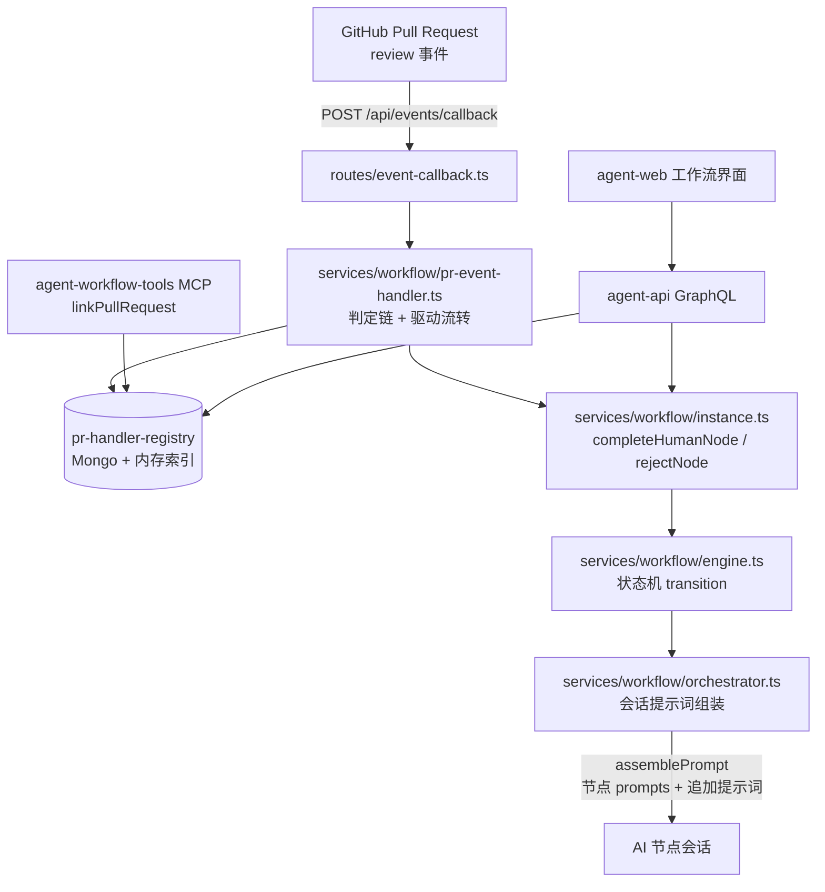
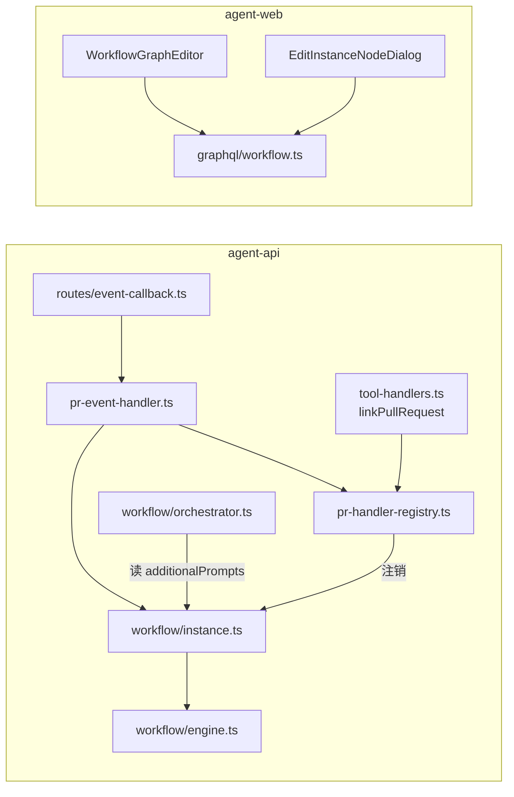
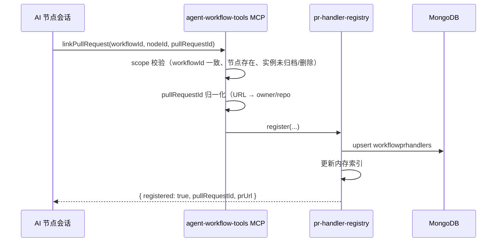
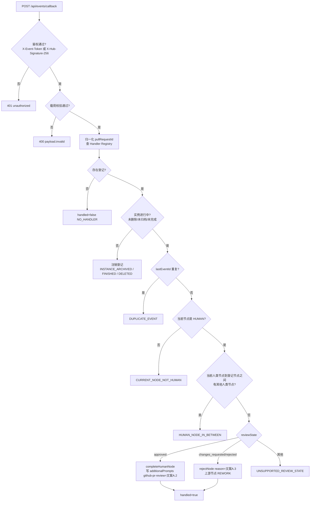
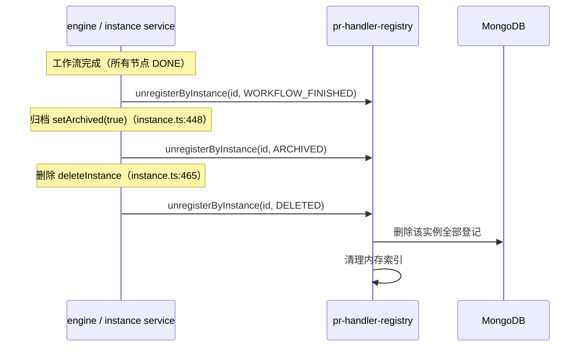

# 工作流 GitHub Pull Request 联动 - 技术提案

**功能名称**: 工作流 GitHub Pull Request 联动
**关联 PRD**: `docs/product/draft/20261023-workflow-github-pr-callback.md`
**技术提案版本**: v1.0
**创建日期**: 2026-10-23
**作者**: ZeroAsh Agent
**feat-branch**: `feat/workflow-github-pr-callback`

## 1. 概述

### 1.1 背景

工作流体系（`servers/agent-api/src/services/workflow/*`）已具备模板 → 已配置工作流 → 实例化的三级结构（`models/workflow-template.ts`、`models/configured-workflow.ts`、`models/workflow-instance.ts`）、节点状态机（`services/workflow/engine.ts`）、提示词组装（`services/workflow/orchestrator.ts:293` `assemblePrompt`）与随节点注入的平台 MCP 工具（`services/workflow/tool-handlers.ts`，`agent-workflow-tools`）；GitHub 侧已有帐号绑定与 gh 凭据体系（`services/github.ts`、`20261021-feat-github-workload`）。当前缺口：

1. **工作流与 Pull Request 无绑定关系**：AI 节点产出 PR 后只把地址写进产物文本，系统无法回答「这个 PR 属于哪个工作流、哪个节点」。
2. **PR 审核结果无法回流**：`routes/github.ts:51` 仅有 GitHub App 安装回调（浏览器重定向），不存在事件回调端点；审核结果只能由人回到工作流手工 `completeHumanNode` / `rejectNode`（`services/workflow/instance.ts:377/406`）。
3. **无工作流级补充上下文**：`assemblePrompt`（`orchestrator.ts:293-313`）只拼接系统提示、节点描述、节点 prompts 与上游产物黑板，没有 key-value 追加提示词通道，PR 协作指引与审核意见无处注入。
4. **人类节点无 PR 联动配置**：`templateNodeSchema` / `configuredNodeSchema` / `instanceNodeSchema` 均无「联动上游 Pull Request」设置。

### 1.2 目标

- 提供随工作流 node 注入的 MCP 工具 `linkPullRequest`，把「工作流实例 + 节点 + Pull Request」注册进 Handler Registry；随工作流完成、归档（及删除）自动注销。
- 人类节点新增「联动上游 Pull Request」设置，贯通模板 / 已配置工作流 / 实例化 / 实例节点编辑四层。
- 新增工作流追加提示词（key-value 字典，同一 key 只插入一次），在 AI 节点 `assemblePrompt` 时追加到上下文。
- 勾选「联动上游 Pull Request」（监听 Pull Request）的节点注入 key=`github-pr` 的 PR 工具使用指引提示词（文案见 PRD 附录 A.1）。
- agent-api 新增 event callback endpoint（pull request 类型）：按 PR review 状态驱动人类节点——approved 完成节点并向下传递评审意见，rejected 打回节点并附评审意见与 inline comment 提示。

### 1.3 范围

**做**：

- `agent-workflow-tools` MCP 新增 `linkPullRequest` 工具 + PR Handler Registry（持久化 + 内存索引 + 生命周期注销）；
- 人类节点 `linkUpstreamPullRequest` 设置（模型 / 契约 / GraphQL / MCP 管理工具 / 前端编辑器全链路）；
- 工作流 `additionalPrompts` 追加提示词（模型、拼接、读写接口、只读透出）；
- `POST /api/events/callback` 事件回调端点（鉴权、载荷校验、幂等、判定链、驱动流转）；
- 提示词常量三段（PRD 附录 A 文案定稿）；
- 单元 / API / E2E 测试。

**不做**：

- 其他代码托管平台（GitLab 等）的 PR 事件；
- 向 GitHub 反向写入（回评、批准、合并）；本期只消费 review 事件；
- 追加提示词的可视化编辑界面（写入方本期为 PR 联动与系统注入；GraphQL 提供读写接口，界面只读展示）；
- PR 内容抓取与 inline comment 逐条解析（仅在文案中提示审核人/Agent 检查 inline comment）；
- 存量数据迁移（新字段默认关闭）。

## 2. 技术架构

### 2.1 系统架构图



### 2.2 技术栈

| 层级 | 技术选型 | 说明 |
|------|---------|------|
| 后端 | Node.js 24 + TypeScript（strict/ESM）+ Express v5 + GraphQL-Yoga | 与 `servers/agent-api` 现状一致 |
| 数据 | MongoDB + Mongoose | Handler Registry 持久化、实例字段扩展 |
| 平台 MCP | 现有 `agent-workflow-tools` 平台 MCP server（`tool-handlers.ts`） | 新增 `linkPullRequest` 工具 |
| 回调鉴权 | 内部回调凭据（timing-safe）+ GitHub App Webhook 签名（HMAC-SHA256） | 参考 `routes/internal-cloud-host.ts` 鉴权与 `services/github.ts` App 凭据 |
| 前端 | React + TypeScript（`apps/agent-web`） | 节点编辑器开关、实例展示 |
| 测试 | Vitest（unit/API）+ 现有 E2E 套件 | 覆盖率 ≥ 80% |

### 2.3 模块划分



| 模块 | 职责 | 关键技术点 |
|------|------|-----------|
| `models/workflow-pr-handler.ts`（新增） | PR 联动登记持久化 | 归一化 `pullRequestId`、`(workflowInstanceId, nodeId, pullRequestId)` 唯一索引、`lastEventId` 幂等位 |
| `services/workflow/pr-handler-registry.ts`（新增） | 注册 / 查询 / 注销 / 启动重建 | Mongo 持久化 + 进程内 `Map<pullRequestId, handler[]>` 索引；注销原因枚举 |
| `services/workflow/pr-event-handler.ts`（新增） | 事件判定链与驱动 | 载荷校验、幂等、节点类型判定、DAG 联动链路判定、review 状态映射、per-instance 串行化 |
| `services/workflow/pr-prompts.ts`（新增） | 三段提示词常量 | `GITHUB_PR_PROMPT` / `prReviewPassedPrompt()` / `prReviewRejectedPrompt()` |
| `services/workflow/tool-handlers.ts`（改） | MCP 工具 `linkPullRequest` | `TOOL_DEFINITIONS` + `callWorkflowTool`，scope 一致性校验 |
| `services/workflow/instance.ts` / `engine.ts` / `orchestrator.ts`（改） | 追加提示词读写、完成/归档/删除注销、提示词拼接 | `setAdditionalPrompt`、`unregisterByInstance` 钩子、`assemblePrompt` 追加段 |
| `routes/event-callback.ts`（新增） | 事件回调 HTTP 入口 | 双鉴权、统一响应结构 |
| 前端 `WorkflowGraphEditor.tsx` / `EditInstanceNodeDialog.tsx` / `WorkflowNodeTree.tsx` / `graphql/workflow.ts`（改） | 设置编辑与展示 | HUMAN 节点开关、关联 PR 与追加提示词只读展示 |

## 3. API 设计

### 3.1 API 契约

契约先行：实现阶段第一件事更新 `contracts/workflow.graphql`、新增 `contracts/event-callback.openapi.yaml`，并按 `z-coding` 的「更新 Contract」流程评审。

#### 接口 1: 事件回调（新增 `contracts/event-callback.openapi.yaml`）

- **请求**
  - Method: POST
  - Path: `/api/events/callback`
  - Headers:
    - `Content-Type: application/json`
    - `X-Event-Token: <EVENT_CALLBACK_TOKEN>`（方式一：平台回调凭据，timing-safe 比较）
    - `X-Hub-Signature-256: sha256=<hex>`（方式二：GitHub App Webhook 签名，对原始 body 做 HMAC-SHA256）
  - Body:
    ```json
    {
      "eventType": "pull_request",
      "eventId": "gh:pull_request_review:987654321",
      "occurredAt": "2026-10-23T06:00:00Z",
      "payload": {
        "pullRequestId": "Deliay/z-agent-gear#264",
        "prUrl": "https://github.com/Deliay/z-agent-gear/pull/264",
        "action": "reviewed",
        "reviewState": "approved",
        "comment": "整体方案可行，提示词文案请补充 inline comment 的处理要求",
        "reviewer": "z-agent-bot",
        "submittedAt": "2026-10-23T06:00:00Z"
      }
    }
    ```

- **响应**
  - Status: 200（已处理 / 安全忽略，均 200）
    ```json
    {
      "handled": true,
      "action": "COMPLETE_HUMAN_NODE",
      "instanceId": "6adaee7d267f2330bef66ee4",
      "nodeId": "6adaee7d267f2330bef66ee6",
      "promptKey": "github-pr-review"
    }
    ```
    ```json
    { "handled": false, "reason": "HUMAN_NODE_IN_BETWEEN" }
    ```
    `reason` 枚举：`NO_HANDLER` / `INSTANCE_DELETED` / `INSTANCE_ARCHIVED` / `INSTANCE_FINISHED` / `CURRENT_NODE_NOT_HUMAN` / `HUMAN_NODE_IN_BETWEEN` / `DUPLICATE_EVENT` / `UNSUPPORTED_REVIEW_STATE`。
  - Status: 400（载荷非法）`{ "error": "payload.invalid" }`
  - Status: 401（鉴权失败）`{ "error": "unauthorized" }`

**reviewState 映射**：

| reviewState | 处理 |
|------|------|
| `approved` | `COMPLETE_HUMAN_NODE`：完成人类节点 + 写入追加提示词 `github-pr-review`（文案 A.2） |
| `changes_requested` / `rejected` / `dismissed` | `REJECT_HUMAN_NODE`：打回人类节点，打回内容 = 文案 A.3 |
| `commented` 等其他 | 忽略（`UNSUPPORTED_REVIEW_STATE`） |

#### 接口 2: GraphQL 契约变更（`contracts/workflow.graphql`）

```graphql
# 人类节点新增设置（模板 / 已配置 / 实例 三层同步）
type WorkflowTemplateNode { # 现有字段 ...
  linkUpstreamPullRequest: Boolean! }
input WorkflowTemplateNodeInput { # 现有字段 ...
  linkUpstreamPullRequest: Boolean }
type ConfiguredWorkflowNode { linkUpstreamPullRequest: Boolean! }
input ConfiguredWorkflowNodeInput { linkUpstreamPullRequest: Boolean }
type WorkflowNode { linkUpstreamPullRequest: Boolean! }
input WorkflowNodeUpdateInput { linkUpstreamPullRequest: Boolean }

# 追加提示词与 PR 联动透出
type WorkflowAdditionalPrompt { key: String!, value: String! }
type WorkflowPullRequestLink {
  pullRequestId: String!
  prUrl: String
  nodeId: String!
  nodeName: String
  registeredAt: DateTime!
}

type WorkflowInstance { # 现有字段 ...
  additionalPrompts: [WorkflowAdditionalPrompt!]!
  pullRequestLinks: [WorkflowPullRequestLink!]!
}

extend type Mutation {
  setWorkflowAdditionalPrompt(instanceId: ID!, key: String!, value: String!): WorkflowInstance!
  removeWorkflowAdditionalPrompt(instanceId: ID!, key: String!): WorkflowInstance!
}
```

> 注：`WorkflowInstance.additionalPrompts` / `pullRequestLinks` 必须在 `graphql/resolvers/index.ts` 登记类型级字段 resolver（Mongoose 空对象物化与手工合并键陷阱，见 `docs/engineering/backend-rules.md`）。

#### 接口 3: 工作流 MCP 工具（`agent-workflow-tools`，随工作流 node 注入）

```json
{
  "name": "linkPullRequest",
  "description": "将 GitHub Pull Request 关联到当前工作流实例与当前节点（注册到 PR 联动处理器）。工作流完成/归档后自动解除关联。同一节点重复调用视为更新。",
  "inputSchema": {
    "type": "object",
    "properties": {
      "workflowId": { "type": "string", "description": "工作流实例 ID（须与当前工具 scope 所属实例一致）" },
      "nodeId": { "type": "string", "description": "节点 ID（须存在于该实例）" },
      "pullRequestId": { "type": "string", "description": "Pull Request 标识：owner/repo#编号 或完整 PR URL" }
    },
    "required": ["pullRequestId"]
  }
}
```

> 对齐实现（v1.1）：`workflowId` / `nodeId` 为**可选**参数，缺省时由会话工具 scope 自动确定；显式传入时必须与 scope 一致，否则 `INVALID_PARAMS`。

- 返回：`{ "registered": true, "pullRequestId": "Deliay/z-agent-gear#264", "prUrl": "https://github.com/Deliay/z-agent-gear/pull/264" }`
- 错误：`WorkflowToolError('INVALID_PARAMS')`（PR 标识无法归一化、必填参数缺失、显式 workflowId/nodeId 与 scope 不一致）、`WorkflowToolError('INVALID_STATE')`（实例不存在/已归档/已删除/已完成）。

### 3.2 内部接口

| 接口 | 签名 | 说明 |
|------|------|------|
| 注册 | `prHandlerRegistry.register({userId, workflowInstanceId, nodeId, nodeKey, pullRequestId, prUrl, sessionId})` | upsert（同节点同 PR 覆盖），维护内存索引 |
| 按 PR 查询 | `prHandlerRegistry.findByPullRequestId(pullRequestId): PrHandler[]` | 回调判定入口 |
| 按实例注销 | `prHandlerRegistry.unregisterByInstance(workflowInstanceId, reason)` | `WORKFLOW_FINISHED` / `ARCHIVED` / `DELETED` |
| 实例联动列表 | `prHandlerRegistry.listByInstance(workflowInstanceId): PrHandler[]` | GraphQL `pullRequestLinks` 数据源 |
| 追加提示词写入 | `workflowInstanceService.setAdditionalPrompt(userId, instanceId, key, value)` / `removeAdditionalPrompt(...)` | 同 key 覆盖；供 GraphQL mutation 与 PR 事件处理器复用 |
| 节点流转复用 | `workflowInstanceService.completeHumanNode(userId, instanceId, nodeId, input?)`、`rejectNode(userId, instanceId, nodeId, reason)` | 事件驱动与人工操作共用，行为一致 |
| 提示词拼接扩展 | `orchestrator.assemblePrompt(instance, node, prompts)` | 末尾追加「追加提示词」段（见 5.2 实现点 3） |

## 4. 数据模型

### 4.1 数据库设计

#### 集合: `workflowprhandlers`（新增 `models/workflow-pr-handler.ts`）

| 字段 | 类型 | 说明 |
|------|------|------|
| userId | ObjectId | 归属用户（事件只影响本用户工作流） |
| workflowInstanceId | ObjectId | 工作流实例 |
| nodeId | String | 注册触发节点（调用工具的节点） |
| nodeKey | String | 节点 key（便于追溯） |
| pullRequestId | String | 归一化标识 `owner/repo#number`（比较大小写不敏感） |
| prUrl | String | Pull Request 地址（原始 URL） |
| registeredBySessionId | ObjectId | 注册时的会话 |
| lastEventId | String | 最近已处理事件 ID（幂等位） |
| lastEventAt | Date | 最近处理时间 |
| createdAt / updatedAt | Date | 时间戳 |

索引：`{ pullRequestId: 1 }`、`{ workflowInstanceId: 1 }`、唯一 `{ workflowInstanceId: 1, nodeId: 1, pullRequestId: 1 }`。

#### 集合: `workflowinstances` 字段变更（`models/workflow-instance.ts`）

| 字段 | 类型 | 说明 |
|------|------|------|
| nodes[].linkUpstreamPullRequest | Boolean，默认 `false` | 人类节点「联动上游 Pull Request」快照（`templateNodeSchema` / `configuredNodeSchema` 同名字段逐层传递） |
| additionalPrompts | Map\<String, String\>，默认 `{}` | 工作流追加提示词字典（key 去重，覆盖更新） |

> `additionalPrompts` 使用 Mongoose `Map` 而非嵌套子文档数组，GraphQL 侧由字段 resolver 归一化为 `[{key, value}]`，规避「嵌套子文档空对象物化导致非空字段报错」的既有陷阱（`docs/engineering/backend-rules.md`）。

### 4.2 缓存设计

- **进程内索引**：`Map<pullRequestId, PrHandler[]>`，仅作查询加速；进程重启后从 Mongo 全量重建（启动钩子中执行，量级为「未完成工作流 × 关联 PR」，可忽略）。
- **不引入新 Redis 结构**；事件幂等靠 `lastEventId` 落库，不依赖缓存 TTL。
- 回调处理按 `workflowInstanceId` 串行化（内存队列 + 落库串行），遵循「并发写入 per-key 串行化」规则。

## 5. 技术实现方案

### 5.1 核心流程

**（1）PR 关联注册（AI 节点侧）**



**（2）事件回调判定链（服务端）**



**（3）注销（生命周期）**



### 5.2 关键实现点

#### 实现点 1: `linkPullRequest` MCP 工具与 Handler Registry（需求 1）

- **描述**: 在随工作流 node 注入的 `agent-workflow-tools` 平台 MCP server 中新增 `linkPullRequest`，把「工作流实例 + 节点 + PR」注册进 Handler Registry；随工作流完成、归档、删除注销。
- **技术细节**:
  - `tool-handlers.ts`：`TOOL_DEFINITIONS`（:44-138）追加工具定义；`callWorkflowTool`（:241-331）追加 case；`loadScopeContext` 既有校验保证工具作用域为当前实例/节点，额外断言 `workflowId === scope.workflow.instanceId`。
  - `pr-handler-registry.ts`：`register` 为 upsert（唯一键 `workflowInstanceId + nodeId + pullRequestId`）；`findByPullRequestId` 大小写不敏感；`unregisterByInstance` 返回注销条数供日志与响应使用。
  - 注销钩子：`engine.ts` `apply('complete' | 'completeRework')`（:182-247）后判定「无未完成节点」（状态 ∉ `INITIALIZING/READY/RUNNING/REWORK/REJECT/FAILED`）→ `WORKFLOW_FINISHED`；`instance.ts setArchived`（:448-458）→ `ARCHIVED`；`deleteInstance`（:465-503）→ `DELETED`。重启后残留登记惰性清理（查询到实例已归档/删除时顺手注销）。
- **风险点**: 「工作流完成」当前无显式事件（实例状态是派生的），完成判定需在 `apply()` 内计算并只触发一次（以实例为粒度加一次性标记）；避免每次节点完成都全表扫描（用实例节点状态内存判定即可）。

#### 实现点 2: 人类节点「联动上游 Pull Request」（需求 2）

- **描述**: 模板 / 已配置工作流 / 实例化时，人类节点新增设置 `linkUpstreamPullRequest`（UI 文案「联动上游 Pull Request」，勾选即「监听 Pull Request」）。
- **技术细节**:
  - 模型三层字段：`models/workflow-template.ts templateNodeSchema`（:9-26）、`models/configured-workflow.ts configuredNodeSchema`（:16-33）、`models/workflow-instance.ts instanceNodeSchema`（:37-67）。
  - 校验与归一化：`services/workflow/template.ts validateTemplateGraph`（仅 `type==='HUMAN'` 允许为 true，否则报错）；`configured.ts normalizeConfiguredNodes`；`instance.ts normalizeNodes` / `updateNode`（仅 `INITIALIZING/READY` 状态的人类节点允许修改）。
  - 契约与接口：`contracts/workflow.graphql`、`graphql/schemas/workflow.ts`、`graphql/resolvers/workflow.ts`（`createWorkflowTemplate` / `configureWorkflow` / `instantiateWorkflow` / `updateWorkflowNode` 透传）、`services/workflow/admin-tools.ts ADMIN_TOOL_SCHEMAS`（AI 创建模板/配置/实例化的工具入参同步）。
  - 前端：`apps/agent-web/src/components/workflow/WorkflowGraphEditor.tsx`（HUMAN 节点表单加开关）、`EditInstanceNodeDialog.tsx`、`template-validation.ts`（`EditableNode` 增加字段）、`graphql/workflow.ts` fragment（`TEMPLATE_NODE_FIELDS` / `CONFIGURED_NODE_FIELDS` / `WORKFLOW_NODE_FIELDS`）。
  - 联动副作用：实例化或节点勾选变化时重算 `additionalPrompts['github-pr']`——存在任一勾选节点则写入 `GITHUB_PR_PROMPT`，全部取消则移除。
- **风险点**: 三层快照与实例可编辑并存，需明确「实例节点字段以实例化快照为准、可被 `updateNode` 覆盖」；与 `agentConfig` 的「AI-only」校验对称，避免 HUMAN/AI 字段互串。

#### 实现点 3: 工作流追加提示词（需求 3）

- **描述**: 实例级 key-value 追加提示词字典；AI 节点执行前拼接提示词时追加到上下文；同一 key 只插入一次。
- **技术细节**:
  - 存储：`workflowInstanceSchema.additionalPrompts: { type: Map, of: String, default: {} }`；同 key 写入即覆盖（天然「只插入一次」）。
  - 拼接：`orchestrator.ts assemblePrompt`（:293-313）在「## 上游产物」之后追加：
    ```text
    ## 追加提示词
    ### <key>
    <value>
    ```
    遍历 Map 以 key 排序保证稳定顺序；每个 key 只输出一段；value 按纯文本处理（不做指令解析）。
  - 读写接口：`workflowInstanceService.setAdditionalPrompt / removeAdditionalPrompt`；GraphQL mutation `setWorkflowAdditionalPrompt` / `removeWorkflowAdditionalPrompt` + `WorkflowInstance.additionalPrompts` 只读透出（字段 resolver 归一化并在 `resolvers/index.ts` 登记）。
  - 系统写入方：实现点 2 的 `github-pr` 注入、实现点 5 的 `github-pr-review` 注入。
- **风险点**: 追加提示词会进入所有 AI 节点上下文，需控制体积（本期两段固定文案 + 单条评审意见，量级可控）；`updateNode`/mutation 写入需与节点流转并发安全（复用 per-instance 串行化）。

#### 实现点 4: `github-pr` PR 工具使用指引提示词（需求 4）

- **描述**: 勾选「联动上游 Pull Request」的节点使工作流插入 key=`github-pr`、value=PR 工具使用指引的追加提示词。
- **技术细节**: 常量 `GITHUB_PR_PROMPT` 定义于 `services/workflow/pr-prompts.ts`，文案以 PRD 附录 A.1 为准，实现层在标题下补注工具调用名：

  ```text
  ## GitHub Pull Request 联动

  本工作流已启用 Pull Request 联动（监听 Pull Request）。当你在本节点产出或定位到 GitHub Pull Request 时，请使用随工作流注入的 MCP 工具 `agent-workflow-tools.linkPullRequest`，把本次 Pull Request 关联到当前工作流与当前节点：

  1. 关联时机：创建（或确认复用）Pull Request 后立即关联；关联前先用 `getCurrentNodeId` / `getNodeInfo` 确认当前工作流实例 ID 与节点 ID。
  2. 关联信息：workflowId（当前工作流实例 ID）、nodeId（当前节点 ID）、pullRequestId（Pull Request 标识：`owner/repo#编号` 或完整 PR 地址）。
  3. 关联效果：该 Pull Request 在 GitHub 上的审核结果会驱动工作流中联动的人类节点——审核通过则自动完成该人类节点，并把评审意见传递给下游；审核被拒绝则自动打回该人类节点，返工原因中附带评审意见并提醒检查 inline comment。
  4. 同一节点重复关联视为更新（以最后一次为准）；若更换了新的 Pull Request，请用新的 Pull Request 重新关联。
  5. 收到「Pull Request审核通过」或「Pull Request审核被拒绝」的追加提示词后：逐条落实评审意见（务必查看 pull request 的 inline comment），修改对应产物，并在 pull request 中逐条回复处理结果，便于审核人复审。
  6. 只关联确实存在、且属于本次工作的 Pull Request；不要关联无关或不存在的 Pull Request。
  ```
- **风险点**: 文案改动即行为改动，常量变更需随 PRD 附录 A 同步（提案与 PRD 同 commit 维护）。

#### 实现点 5: 事件回调端点与驱动逻辑（需求 5）

- **描述**: `POST /api/events/callback` 处理 pull request 类型事件，按 5.1（2）判定链驱动人类节点完成/打回。
- **技术细节**:
  - 路由：`routes/event-callback.ts`，在 `index.ts` 挂载于 `/api`（与 `routes/github.ts`、`routes/internal-cloud-host.ts` 并列）；zod 校验载荷。
  - 鉴权：`X-Event-Token` 与 `EVENT_CALLBACK_TOKEN` timing-safe 比较（参考 `routes/internal-cloud-host.ts:13-17`），或 `X-Hub-Signature-256` 对原始 body 做 HMAC-SHA256（`GITHUB_WEBHOOK_SECRET`）；任一通过即放行。
  - 判定链（`pr-event-handler.ts`）：
    1. 归一化 `pullRequestId`（`https://github.com/owner/repo/pull/123` → `owner/repo#123`）并查 Registry；
    2. 实例有效性（`deletedAt` / `archivedAt` / 全节点 DONE）→ 注销 + 忽略；
    3. 幂等：`handler.lastEventId === eventId` → `DUPLICATE_EVENT`；处理成功后写回 `lastEventId/lastEventAt`；
    4. 当前节点判定：实例 `status ∈ {READY, RUNNING}` 的节点须唯一且 `type === 'HUMAN'`，否则 `CURRENT_NODE_NOT_HUMAN`；
    5. 联动链路判定：以 `nodes[].dependsOn`（实例内为 nodeId 引用）构建 DAG，在「当前人类节点 ↔ handler.nodeId」之间的可达路径上（双向遍历）若存在其他 `HUMAN` 节点 → `HUMAN_NODE_IN_BETWEEN`；
    6. 驱动：`approved` → `setAdditionalPrompt('github-pr-review', A.2 文案)` + `completeHumanNode`（复用 `instance.ts:377`，自动处理 READY 补 start / RUNNING 直接 complete 的状态机语义）；`changes_requested/rejected/dismissed` → `rejectNode(reason=A.3 文案)`（`instance.ts:406`，人类节点 REJECT + 上游节点 REWORK 并收到打回原因）。
  - 并发：按 `workflowInstanceId` 串行化处理（backend-rules「并发写入 per-key 串行化」）；跨频道/重复投递假设乱序，靠幂等位兜底。
- **风险点**: `completeHumanNode` 是组合操作（可能触发下游 `start`），必须与人工操作互斥（串行化）；打回会触发上游返工会话（`onNodeRework` 重发打回原因），文案 A.3 的体积需控制；回调失败不得静默（返回明确 reason 并打日志）。

#### 实现点 6: 提示词常量定稿（PRD 附录 A.2 / A.3）

```text
# prReviewPassedPrompt(comment, prUrl, reviewer, submittedAt) → key=github-pr-review
Pull Request审核通过
{comment}
详情请查看pull request:{pr地址}
审核人：{reviewer}，审核时间：{submittedAt}
处理要求：
1. 请通读评审意见（含 pull request 的 inline comment）并逐条落实：如评审意见包含修改要求，在本节点及后续工作中完成修改，并在 pull request 中回复处理结果。
2. 若评审意见说明无需修改，按原计划继续推进后续工作。
```

```text
# prReviewRejectedPrompt(comment, prUrl, reviewer, submittedAt) → rejectNode reason
Pull Request审核被拒绝
{comment}
详情请查看pull request:{pr地址}
注意检查pr的inline comment
审核人：{reviewer}，审核时间：{submittedAt}
返工要求：
1. 逐条处理评审意见与 pull request 的 inline comment，修改对应产物；
2. 修改完成后更新原 pull request（追加提交）；如需改用新的 pull request，请重新关联到当前工作流与节点；
3. 在 pull request 中逐条回复处理结果，便于审核人复审。
```

## 6. 技术决策

### 6.1 决策列表

| 决策 | 选项 A | 选项 B | 最终选择 | 原因 |
|------|--------|--------|---------|------|
| Handler Registry 存储 | 仅进程内存 | Mongo 持久化 + 内存索引 | B | agent-api 可重启，纯内存会静默丢失联动（隐性死链路） |
| 回调鉴权 | 仅内部 token | 仅 GitHub Webhook 签名 | 两者皆支持（A ∨ B 通过即放行） | 保留非 GitHub 来源与联调能力，同时具备 GitHub 官方验签路径 |
| 事件入口形态 | GitHub 专用 webhook 路由 | 通用 event callback + eventType 分发 | B | 需求口径为 event callback endpoint，后续可扩展其他事件类型 |
| 审核被拒的流转语义 | 新增节点状态 | 复用 `rejectNode`（REJECT + 上游 REWORK） | B | 与人工打回同路径，前端/状态机零适配，打回原因传递现成 |
| 评审意见传递载体 | 产物黑板 | 追加提示词 key=`github-pr-review` | B | 需求口径「提示词结构」；key 去重避免重复注入；黑板是产物语义 |
| 「联动上游 PR / 监听 PR」口径 | 两个独立设置 | 统一为人类节点单一设置 `linkUpstreamPullRequest` | B | 避免两处配置不一致；勾选即监听，与需求两点表述对齐 |
| `github-pr` 指引注入点 | 节点 `prompts` 快照 | 工作流追加提示词（key 去重） | B | 多节点勾选只注入一次，复用需求 3 机制，实例化后可随勾选变化增删 |
| 「之间有人类节点」判定 | 按 stage 线性推断 | 依赖图（dependsOn DAG）可达性 | B | 工作流是 DAG，`rejectNode` 已用同一邻接做上游返工，口径一致 |
| 事件幂等 | 仅靠事件 ID 去重表 | handler 记录 `lastEventId` | B | 与登记同文档，读写一次完成，无新集合 |
| 并发控制 | 无 | per-instance 串行化 | B | backend-rules：并发写入需 per-key 串行化，节点流转是组合写 |

### 6.2 依赖与约束

| 类型 | 内容 | 说明 |
|------|------|------|
| 依赖 | `services/workflow/engine.ts` 状态机 | 事件驱动与人工操作共用 `transition`，不得绕过 |
| 依赖 | `services/workflow/instance.ts` 人类节点服务 | `completeHumanNode` / `rejectNode` 语义复用（含 READY 补 start） |
| 依赖 | GitHub App（`services/github.ts`）/ gh 凭据体系 | PR 由 Agent 经 gh 创建；本期不新增 GitHub API 调用 |
| 约束 | Contract-first | 先改 `contracts/workflow.graphql`、新增 `contracts/event-callback.openapi.yaml` 再实现 |
| 约束 | TDD | 红-绿-重构，先写测试再写实现 |
| 约束 | 环境变量 | 新增 `EVENT_CALLBACK_TOKEN`、`GITHUB_WEBHOOK_SECRET`（不入代码库、不打日志） |
| 约束 | 兼容性 | 存量数据默认 `linkUpstreamPullRequest=false`、`additionalPrompts={}`，无迁移脚本 |

## 7. 项目结构

```
z-agent-gear/
├── contracts/
│   ├── workflow.graphql                      # [改] 联动字段、追加提示词、PR 联动透出与 mutation
│   └── event-callback.openapi.yaml           # [新] 事件回调契约
├── servers/agent-api/src/
│   ├── index.ts                              # [改] 挂载 /api/events/callback、启动重建 Registry
│   ├── routes/event-callback.ts              # [新] 事件回调端点（鉴权 + 校验 + 分发）
│   ├── models/workflow-pr-handler.ts         # [新] PR 联动登记模型
│   ├── models/workflow-template.ts           # [改] templateNodeSchema.linkUpstreamPullRequest
│   ├── models/configured-workflow.ts         # [改] configuredNodeSchema.linkUpstreamPullRequest
│   ├── models/workflow-instance.ts           # [改] instanceNodeSchema.linkUpstreamPullRequest、additionalPrompts
│   ├── services/workflow/
│   │   ├── pr-handler-registry.ts            # [新] 注册/查询/注销/启动重建
│   │   ├── pr-event-handler.ts               # [新] 判定链与驱动流转
│   │   ├── pr-prompts.ts                     # [新] 三段提示词常量
│   │   ├── tool-handlers.ts                  # [改] linkPullRequest 工具
│   │   ├── admin-tools.ts                    # [改] 管理工具入参同步联动字段
│   │   ├── instance.ts                       # [改] 追加提示词读写、注销钩子、updateNode 字段
│   │   ├── engine.ts                         # [改] 工作流完成判定 → 注销
│   │   ├── orchestrator.ts                   # [改] assemblePrompt 追加提示词段
│   │   ├── template.ts / configured.ts       # [改] 校验与归一化
│   └── graphql/
│       ├── schemas/workflow.ts               # [改] 类型与入参字段
│       └── resolvers/workflow.ts / index.ts  # [改] 字段 resolver 与登记
├── apps/agent-web/src/
│   ├── components/workflow/WorkflowGraphEditor.tsx    # [改] 人类节点「联动上游 Pull Request」开关
│   ├── components/workflow/EditInstanceNodeDialog.tsx # [改] 实例节点编辑
│   ├── components/workflow/WorkflowNodeTree.tsx       # [改] 联动标记 / 关联 PR / 追加提示词展示
│   ├── components/workflow/template-validation.ts     # [改] EditableNode 字段
│   └── graphql/workflow.ts                            # [改] fragment 与 mutation
└── tests/                                       # [改] API / E2E 用例（见测试策略）
```

## 8. 测试策略

### 8.1 测试覆盖要求

- 单元测试覆盖率 ≥ 80%（`docs/engineering/common-rules.md`）。
- API 测试覆盖端点：`POST /api/events/callback`（全部 reason 分支）、GraphQL 新增字段/mutation、MCP `linkPullRequest`。
- 状态机语义变化（事件驱动 complete/reject）必须回填断言到既有状态机测试。

### 8.2 测试类型

| 类型 | 工具 | 覆盖范围 |
|------|------|---------|
| 单元测试 | Vitest | `pr-handler-registry`（注册覆盖/查询/注销/重启重建）、`pullRequestId` 归一化、`assemblePrompt` 追加段与同 key 去重、DAG 联动链路判定（含菱形依赖、多人类节点）、reviewState 映射、幂等位 |
| API 测试 | Vitest + 真实 Mongo/Redis | 回调鉴权（token/签名/失败）、载荷非法 400、`NO_HANDLER`/`INSTANCE_ARCHIVED`/`INSTANCE_FINISHED`/`CURRENT_NODE_NOT_HUMAN`/`HUMAN_NODE_IN_BETWEEN`/`DUPLICATE_EVENT`/`UNSUPPORTED_REVIEW_STATE`、approved → 人类节点 DONE + `github-pr-review` 注入、rejected → REJECT + 上游 REWORK 打回原因、`linkPullRequest` 工具作用域校验、GraphQL `additionalPrompts`/`pullRequestLinks` 与 mutation |
| E2E 测试 | 现有 E2E 套件 | 模板（人类节点勾选联动）→ 配置 → 实例化 → AI 节点含 `github-pr` 指引 → MCP 关联 PR → 注入 mock 事件：approved 自动完成并把评审意见带入下游 AI 上下文；rejected 自动打回并在返工会话中看到打回内容与 inline comment 提示；归档后事件被忽略 |

关键边界用例：重复事件、乱序事件（先 approved 后 rejected）、同 PR 多实例、工作流完成后事件、全部取消勾选后 `github-pr` 移除、同 key 覆盖更新。

## 9. 验收标准

- [ ] 技术方案评审通过、Contract 评审通过（`contracts/workflow.graphql`、`contracts/event-callback.openapi.yaml`）。
- [ ] `linkPullRequest` 工具随工作流 node 注入可用；登记在工作流完成/归档/删除后自动注销。
- [ ] 模板 / 已配置工作流 / 实例化 / 实例编辑四处均可配置「联动上游 Pull Request」，且仅人类节点可配。
- [ ] 追加提示词同 key 只插入一次，AI 节点上下文可见，实例详情可查看。
- [ ] 事件回调 approved / rejected 分别驱动人类节点完成 / 打回，文案与 PRD 附录 A 一致；不满足条件的事件安全忽略且 reason 可解释。
- [ ] 单元测试覆盖率 ≥ 80%，API 测试与 E2E 测试通过；未开启联动的工作流回归通过。

## 10. 相关文档

- [[../../../../docs/product/draft/20261023-workflow-github-pr-callback.md|关联 PRD：工作流 GitHub Pull Request 联动]]
- [[20260808-feat-agent-workflow.md]] — Agent 工作流
- [[20260811-feat-agent-workflow-phase2.md]] — Agent 工作流二期（工作流管理与实例化机制完善）
- [[20260821-feat-workflow-optimization.md]] — 工作流优化
- [[20261021-feat-github-workload.md]] — Github 工作负载与云主机 Git 项目设置
- [[20260709-feat-github-account-binding.md]] — GitHub 帐号绑定
- [[../common-rules.md]]、[[../backend-rules.md]] — 开发规范
