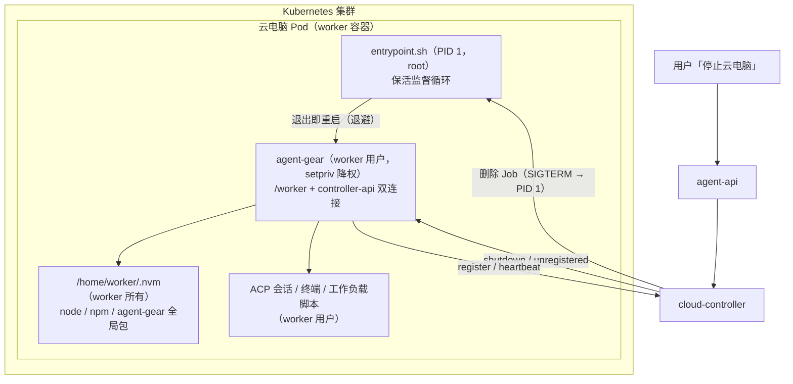
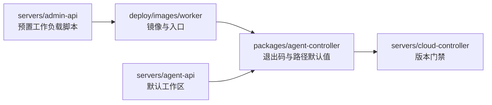
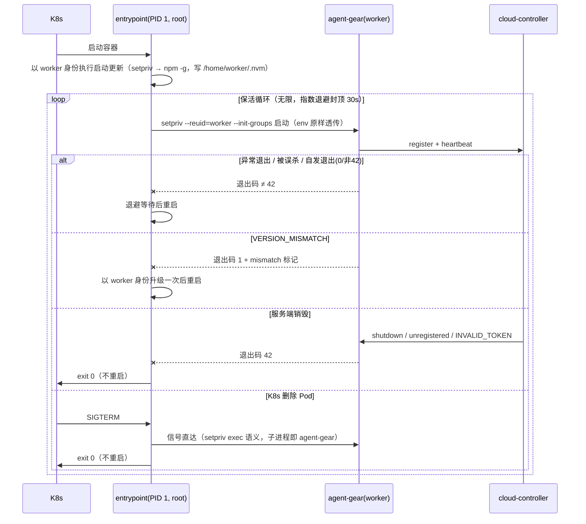

# 云电脑保活与 worker 用户 - 技术提案

**功能名称**: 云电脑保活与 worker 用户
**关联 PRD**: [[../../product/draft/20261025-cloud-host-keepalive.md]]
**技术提案版本**: v1.1
**创建日期**: 2026-10-25
**作者**: ZeroAsh
**feat-branch**: `feat/cloud-host-keepalive`

> 变更记录：
> - v1.1（2026-10-26）：按评审意见修订——nvm/Node/agent-gear 安装下放 worker 用户（per-user nvm，`/home/worker/.nvm`）；附 sudo 环境变量实证调研结论（§5.2 实现点 3a）；降权启动工具由 `sudo -u` 改为 `setpriv`（exec 语义、信号/退出码零失真）；dockerd 以 `-G worker` 暴露 socket。

## 1. 概述

### 1.1 背景

云电脑（harness 容器）由 cloud-controller 以 K8s Job 拉起，容器内 `agent-gear` 经 `/worker` namespace 回连。当前镜像入口 `deploy/images/worker/entrypoint.sh` 是「受监督但自杀式」的：`agent-gear` 正常退出或普通非零退出时入口同步退出，Pod 进入 Completed/Failed，status-sync 将容器迁移终态，整台云电脑被销毁。`restartPolicy: Never` + `backoffLimit: 0` 意味着 K8s 层也不会重启容器。

同时镜像未创建非 root 用户，容器内所有进程（agent-gear、ACP 子进程、终端、工作负载脚本）均以 root 运行，一次误 `kill`/`pkill` 即可摧毁整台云电脑。此外，当前镜像的 nvm/Node 以 root 身份安装到系统级目录（`/usr/local/nvm`），若简单降权运行，worker 用户将没有可用的 `node`/`npm` 命令，也无法用 nvm 自管理 Node 版本——Node 工具链的所有权必须随用户身份一并下放。

### 1.2 目标

- **保活**：在收到服务端销毁信号之前，entrypoint 对 `agent-gear` 的任何退出（0 / 非零 / 被 worker 误杀）都自动重启，无限次、带退避。
- **明确的终止出口**：仅两类事件终止保活——(a) 服务端 `shutdown` / `unregistered` / 握手被拒（token 已失效），(b) K8s 删除 Pod 下发的 SIGTERM/SIGINT。二者之外的退出一律重启。
- **worker 用户**：镜像创建 `worker` 用户（uid 1000）；**nvm/Node/agent-gear 全部以 worker 身份安装（per-user nvm，`/home/worker/.nvm`）**，worker 原生拥有 `node`/`npm`/`nvm` 命令与全局包写权限；日常进程（agent-gear 及其全部子进程）经 `setpriv` 降权为 worker；PID 1 监督循环保持 root，worker 默认无法 kill root 进程；worker 享有免密 sudo 以满足 apt 安装与系统级操作。

### 1.3 范围

**做**：
- `deploy/images/worker/`：entrypoint 保活循环改造、Dockerfile 创建 worker 用户并把 nvm/Node/全局 npm 包下放 worker 安装、entrypoint 测试与 BUILD.md 自验更新。
- `packages/agent-controller`：新增「服务端终止」专用退出码（`shutdown` / `unregistered` / `INVALID_TOKEN` 路径），默认工作区与 homedir 相关默认值适配 worker。
- `servers/agent-api` / `servers/admin-api`：默认工作区路径默认值（`/root/workspace` → `/home/worker/workspace`）、预置工作负载脚本 sudo 化（Docker / .NET / gh 等）。
- `servers/cloud-controller`：harness 版本门禁提升到支持 worker 运行的 agent-gear 版本；契约文档同步。
- `contracts/`：`cloud-controller-websocket.md` / `agent-controller-websocket.md` 补充退出码约定。

**不做**：
- 不改变 cloud-controller 容器状态机与销毁链路（destroy → post 批次 → shutdown → 删除 Job → exited）本身。
- 不引入 K8s 层重启（`restartPolicy` 保持 `Never`，保活全部在容器内完成）。
- 不做镜像内 secret 持久化、不处理存量运行中容器（云电脑容器为一次性 Job，重建即生效）。

## 2. 技术架构

### 2.1 系统架构图



### 2.2 技术栈

| 层级 | 技术选型 | 说明 |
|------|---------|------|
| 容器镜像 | Ubuntu 24.04 + per-user nvm/Node 22 + bash | nvm/Node/全局 npm 包归 worker 用户所有 |
| 入口监督 | Bash（entrypoint.sh） | PID 1 保活循环 + 信号转发（沿用现有结构改造） |
| 降权启动 | `setpriv`（util-linux，ubuntu 基础镜像自带） | exec 语义：环境/信号/退出码零失真（调研结论见 §5.2 实现点 3a） |
| 容器内控制器 | agent-gear（Node.js CLI） | 新增服务端终止退出码；以 worker 运行 |
| 编排 | cloud-controller（Express + Socket.IO + K8s Job） | 仅版本门禁与契约文档调整 |
| 测试 | Bash stub 测试（entrypoint.test.sh）+ Vitest | 沿用现有测试形态 |

### 2.3 模块划分



| 模块 | 职责 | 关键技术点 |
|------|------|-----------|
| worker 镜像 | 创建 worker 用户；nvm/Node/agent-gear 下放 worker 安装；PID 1 root 保活循环；setpriv 降权启动 | per-user nvm、`setpriv --init-groups`、退避重启、退出码分流 |
| agent-controller | 区分「服务端终止」与「异常退出」；homedir 默认值 | 退出码 42（SERVER_SHUTDOWN）、`DEFAULT_WORKSPACE` |
| cloud-controller | harness 注册版本门禁提升 | `MIN_HARNESS_WORKER_VERSION` |
| agent-api / admin-api | 默认工作区与预置脚本适配 | `/home/worker/workspace`、`sudo -n`、dockerd `-G worker` |

## 3. API 设计

本期无新增 REST/GraphQL 接口。行为契约为 Socket.IO 事件与**进程退出码约定**。

### 3.1 进程退出码约定（agent-gear ↔ entrypoint）

| 退出码 | 含义 | entrypoint 行为 |
|--------|------|----------------|
| `42`（新增常量 `EXIT_SERVER_SHUTDOWN`） | 服务端主动终止：收到 `shutdown` / `unregistered`，或握手被拒 `INVALID_TOKEN`（token 已失效 = 容器已被服务端注销） | 不重启，入口以 0 退出 |
| `0`（非 42 场景） | agent-gear 自发正常退出（含被 SIGTERM 命中后的正常收尾） | 退避后重启（保活） |
| 其它非零 | 异常退出；stderr 含 `VERSION_MISMATCH` 时维持「先升级一次再重启」 | 退避后重启（保活；VERSION_MISMATCH 走既有升级路径） |

- `VERSION_MISMATCH` 自愈路径保留：非零退出 + mismatch 标记 + 本轮未升级 + 未设 `ZAG_SKIP_AGENT_GEAR_UPDATE=1` → 以 worker 身份 `npm install -g agent-gear` 一次后重启；二次不匹配/升级失败仍按保活循环退避重启（不再整体退出）。
- `shutdown` 的失败类 reason（`version_mismatch:*` / `error:*` / 初始化失败，见 `isFailureShutdownReason`）维持退出码 1：此刻 token 已被 CAS 失效，entrypoint 重启后握手被拒 `INVALID_TOKEN` → 以 42 退出收敛，重启最多多发生一次，且被销毁链路的 Job 删除兜底。
- 契约同步：`contracts/agent-controller-websocket.md` 的 `shutdown` / `unregistered` 语义与 `contracts/cloud-controller-websocket.md` §2.8 增加退出码 42 约定段落。

### 3.2 内部接口

无新增内部接口。`POST /internal/containers` 报文不变；harness 注册门禁常量提升（见 §5.2）。

## 4. 数据模型

无数据库变更。`cloudcontainers`、预置工作负载定义（`cloudworkloads`）的 schema 均不变；仅预置脚本**内容**与路径默认值变化（admin-api 迁移新增一条刷新脚本内容的 migration）。

## 5. 技术实现方案

### 5.1 核心流程



### 5.2 关键实现点

#### 实现点 1: entrypoint 保活循环（`deploy/images/worker/entrypoint.sh`）

- **描述**: `supervise_agent_gear()` 从「仅 VERSION_MISMATCH 升级一次」改为「无限保活循环」。退出码 42 → `return 0`；其余退出码（含 0）→ 退避后 continue。`shutting_down`（信号 trap 置位）语义不变，优先级最高。
- **技术细节**:
  - 退避：1s → 2s → 5s → 10s → 30s 封顶；成功维持运行超过 60s 后重置退避（以启动时间戳判定，避免稳定运行很久后的一次崩溃还带着高退避）。
  - 重启日志：`[worker] agent-gear exited (code=N); restarting in Xs (attempt #M)`，仅逐行输出到 stdout，不落盘（沿用日志有界约束）。
  - VERSION_MISMATCH 升级路径整体保留（含 `upgrade_attempted` 单轮一次的语义：升级成功重启后清零计数）。
  - **所有 npm 操作与 agent-gear 启动均以 worker 身份执行**（setpriv 降权，见实现点 3c）：npm 全局前缀是 worker 自己的 nvm 版本目录（`/home/worker/.nvm/versions/node/v22.x`），worker 原生可写，无需 root。
- **风险点**: 配置损坏导致无限崩溃循环 —— 有界退避 + 日志可观测，云电脑由心跳离线巡检与人工/平台销毁兜底，资源消耗可忽略。

#### 实现点 2: 服务端终止退出码（`packages/agent-controller`）

- **描述**: 新增导出常量 `EXIT_SERVER_SHUTDOWN = 42`。以下路径统一改以 42 退出：
  - `socketio-client.ts`（idle/单连接模式）：`shutdown` 事件收尾（现 `process.exit(0)`）、`unregistered`（现 `process.exit(0)`）；握手 `error` 且 `code === 'INVALID_TOKEN'` 新增分支 → 42（当前落入通用 error → 1）。
  - `cloud-host/supervisor.ts`（双连接模式）：`shutdown(reason)` 中非失败类 reason → 42（现 0）；失败类 reason 维持 1（`resolveShutdownExitCode` 语义调整为 42/1 二分，`isFailureShutdownReason` 不变）。`unregistered` / 任一端 `INVALID_TOKEN` → 42。
- **技术细节**: 42 的选择避开 shell 保留段（126-129、128+n 信号段、255）与既有用码（1 通用、7 连接错误测试用）；写入 `agent-controller` 包导出并在契约文档登记。
- **风险点**: 旧镜像 entrypoint（无保活）+ 新 agent-gear：42 退出后容器照常结束，行为与现状等价（旧入口对任何退出都结束），兼容。新 entrypoint + 旧 agent-gear：服务端 shutdown 退出 0 → 被保活重启一次 → 握手 INVALID_TOKEN（token 已失效）旧版退出 1 → 再重启……直至 Job 删除（宽限期 ~10s + post 预算 ~90s 内收敛）。该组合只存在于镜像滚动更新窗口，可接受；版本门禁（实现点 5）进一步收窄。

#### 实现点 3a: sudo 环境变量行为调研结论（实证，回应评审问题）

在 ubuntu:24.04（sudo 1.9.15p5，默认 sudoers：`Defaults env_reset` + `Defaults secure_path="/usr/local/sbin:/usr/local/bin:/usr/sbin:/usr/bin:/sbin:/bin:/snap/bin"`）上以临时用户实测：

| 维度 | `sudo -u worker`（默认） | `sudo -u worker --preserve-env=PATH,...` | `runuser -u worker --` | `setpriv --reuid --regid --init-groups` |
|------|------------------------|------------------------------------------|------------------------|------------------------------------------|
| PATH | **被 secure_path 整体替换**，nvm 的 bin 目录丢失（worker 没有 node/npm） | 显式列出 PATH 可保留（实测生效） | 原样继承调用方 | 原样继承调用方 |
| HOME | 目标用户家目录（`/home/worker`） | 同左 | 目标用户家目录 | **保持调用方值**（需显式 `env HOME=/home/worker`） |
| `ZAG_*` / `NVM_DIR` 等业务 env | **全部丢弃** | 显式列出的保留 | 原样继承 | 原样继承 |
| USER/LOGNAME/SHELL | 目标用户 | 目标用户 | 目标用户 | 保持调用方值（需显式设置） |
| 进程模型 | fork+wait，sudo 进程驻留 | 同左 | fork+wait；**收到信号时中继给子进程，但自身死于信号，`wait` 拿到 143 而非子进程退出码** | **exec 直接替换**：子进程即目标进程，信号直达、`wait` 拿真实退出码 |
| 退出码透传（无信号路径） | 透传 | 透传 | 透传（实测 `exit 7` → 7） | 透传（实测 `exit 7` → 7） |
| 依赖 | 镜像已装 sudo | 同左 | util-linux（ubuntu 基础镜像自带） | util-linux（自带） |

**结论**：
1. 默认 `sudo -u worker` 下 PATH 被 `secure_path` 强制替换、`ZAG_*` 等业务环境变量全部丢弃——评审的担心成立：若 nvm/Node 留在 root 侧系统目录，worker 经 sudo 启动后**确实没有 nodejs 命令**。
2. `--preserve-env` 显式列举可以保留 PATH 与业务变量（实测可用），但环境策略面依赖 sudoers 行为，且 sudo 驻留父进程、信号路径下退出码失真。
3. 治本方案是评审指出的方向：**把 nvm/Node/agent-gear 的安装下放到 worker 用户**（per-user nvm），worker 天然拥有自己的 nodejs 命令与全局包写权限；降权启动工具改用 `setpriv`（exec 语义，环境/信号/退出码零失真，无策略面）。

#### 实现点 3b: Dockerfile——nvm/Node/agent-gear 下放 worker 用户安装

- **描述**: 保持使用 nvm（评审要求），但改为 **per-user 安装**：nvm 装到 `/home/worker/.nvm`，Node 与全部全局 npm 包（agent-gear、ACP 适配器）均以 worker 身份安装。
- **技术细节**:
  - ubuntu:24.04 自带 `ubuntu` 用户（uid 1000）：先 `userdel -r ubuntu`（忽略不存在），再 `useradd -m -s /bin/bash -u 1000 worker`。
  - 采用 Docker 标准做法：`USER worker` 层内执行 nvm 安装脚本、`nvm install --default "$NODE_VERSION"`、`nvm alias default`、`ln -sfn ... "$NVM_DIR/current"`、`npm config set registry`、`npm install -g agent-gear@... @agentclientprotocol/...`；`ENV NVM_DIR=/home/worker/.nvm`。全部构建期下载仍走内网代理 ARG，无 root 需求。
  - `ENV PATH=/home/worker/.nvm/current/bin:...` 为镜像级元数据，对任何运行身份生效——PID 1（root）与 worker 进程都直接从 ENV 继承到 node/npm/agent-gear 路径，**不依赖任何登录 shell 或 sudo 环境策略**。
  - `/etc/profile.d/nvm.sh` 改为按 `$HOME` 定位（`export NVM_DIR="$HOME/.nvm"`），worker 登录 shell 可 `nvm install` 自管理 Node 版本（per-user nvm 原生能力）；root 无 nvm 不source（snippet 自带 `-s` 判空）。
  - 安装层结束后 `USER root`：容器默认仍以 root 启动，PID 1 监督循环为 root（PID 1 若降权则 worker 可 kill 监督进程，保活失效）。
  - sudoers：`/etc/sudoers.d/90-worker` → `worker ALL=(ALL:ALL) NOPASSWD: ALL`（镜像已装 `sudo`），供 worker 交互/脚本内 apt 等提权使用。
- **风险点**: 镜像层顺序调整（先建用户再装工具链）；nvm 安装脚本写 `~/.bashrc` 属预期行为（worker 交互登录即可用 nvm）。

#### 实现点 3c: entrypoint 降权启动（`setpriv`）

- **描述**: PID 1（root）经 `setpriv` 以 worker 身份派生 npm/agent-gear 进程。
- **技术细节**:
  - 启动命令：`setpriv --reuid=1000 --regid=1000 --init-groups env HOME=/home/worker USER=worker LOGNAME=worker agent-gear`（setpriv 不重置环境，HOME/USER 需显式补；PATH/ZAG_*/NVM_* 等全部从 PID 1 原样继承——而 PID 1 的 PATH 来自镜像 ENV，已含 worker 的 nvm bin）。
  - `CHILD_PID` 记录的就是 agent-gear/npm 进程本体（exec 语义无中间进程）：现有 SIGTERM/SIGINT 转发逻辑（`kill -TERM "$CHILD_PID"`）语义不变、无失真；`wait "$CHILD_PID"` 拿到真实退出码，退出码 42 分流据此工作。
  - `run_agent_gear` 的 FIFO 重定向由 root shell 完成（fd 继承给子进程），FIFO/标记文件维持 root 拥有，worker 无需访问运行目录。
  - sudo 不用于派生主进程，仅保留给 worker 自身提权（apt 等）。
- **风险点**: `setpriv` 不读 PAM/limits——容器内无相关配置，无影响；`--init-groups` 依赖构建期 `/etc/group` 正确（构建期自验覆盖）。

#### 实现点 4: 默认路径与预置脚本适配（agent-controller / agent-api / admin-api）

- **描述**: homedir 相关默认值从 root 路径迁移到 worker 路径；预置工作负载脚本中的特权命令加 `sudo -n`。
- **技术细节**:
  - `agent-controller`：`DEFAULT_WORKSPACE` `/root/workspace` → `/home/worker/workspace`（`os.homedir()` 派生的 `~/.zag`、harness 配置目录随降权自动落 `/home/worker`，无需逐一改）。
  - `agent-api`：`cloudHostDefaultWorkspace` 默认 `/home/worker/workspace`；`controller-workspace.ts` 的空路径 fallback 同步。
  - `admin-api` 预置脚本（新增 migration 刷新内容）：
    - `007-preset-github`：`/root/workspaces/{repo}` → `/home/worker/workspaces/{repo}`；`apt-get` → `sudo -n apt-get`。
    - `002/003 docker`：`apt-get` → `sudo -n apt-get`；dockerd 启动改为 `sudo -n nohup dockerd -G worker ...`——**`-G worker` 使 `/var/run/docker.sock` 归属 worker 组**，worker（主组即 worker）即刻可用 `docker` CLI，无需把 worker 追加进 `docker` 组再等新进程重组生效；日志 `/var/log/dockerd.log` 经 sudo 写入。
    - dotnet apt 脚本（`DOTNET_APT_PACKAGE`）：`apt-get` → `sudo -n apt-get`。
    - `009-preset-harness-kimi-code` 等 `mkdir -p "${ZAG_DEFAULT_WORKSPACE:-/root/workspace}"` 的兜底路径同步为 `/home/worker/workspace`。
  - 脚本内统一兜底：`SUDO=sudo; command -v sudo >/dev/null || SUDO=`（兼容旧镜像无 sudo 的执行环境）。
- **风险点**: 路径硬编码散落（测试夹具、文档）——以 `/root/workspace` 全库检索逐一核对；存量文档（BUILD.md 历史段落、已发布 PRD）不改。

#### 实现点 5: harness 版本门禁（`servers/cloud-controller`）

- **描述**: `MIN_HARNESS_WORKER_VERSION` 提升到包含退出码 42 与 worker 适配的 agent-gear 版本（随 agent-gear 发版确定，如 `2.10.0`）；普通 idle 容器维持 `2.2.0`。`agentGearMinVersion` 校验口径不变。
- **技术细节**: 仅常量与单测锚点更新；`worker-version.ts` 纯函数不变。
- **风险点**: 镜像预装版本需同步提升（Dockerfile `agent-gear@2.9.x` → 新 minor 的 `x` 段），构建窗口内旧镜像 + 新门禁会导致 harness 注册被拒——发布顺序：先发 agent-gear，再构建镜像，最后发 cloud-controller。

#### 实现点 6: entrypoint 测试更新（`deploy/images/worker/entrypoint.test.sh`）

- **描述**: 沿用纯 Bash + PATH stub 形态，更新既有用例并新增保活用例。
- **技术细节**:
  - T-EP5/T-EP6 语义反转：普通非零退出 / 正常退出 → 断言**重启**（stub 计数 ≥2，配合「第二次退出 42」的 stub 模式收敛测试）。
  - 新增 T-EP9：退出码 42 → 不重启、入口 0。
  - 新增 T-EP10：连续崩溃 → 重启次数递增且退避生效（stub 记录时间戳）。
  - 新增 T-EP11：降权启动断言（stub `setpriv` 记录参数与 uid/gid 映射，断言以 worker 身份派生且 env 透传 HOME=/home/worker）。
  - T-EP7 信号用例扩展：降权后 SIGTERM 仍直达 agent-gear（setpriv exec 语义，stub 链验证转发）。
  - 构建期自验（BUILD.md）新增：`runuser -u worker -- node -v` / `runuser -u worker -- npm config get registry` / worker 侧 `sudo -n true` 可用。
- **风险点**: 退避测试不能慢——退避间隔支持环境变量覆盖（如 `ZAG_KEEPALIVE_BACKOFF_MS`，仅测试用，文档不公开）。

## 6. 技术决策

### 6.1 决策列表

| 决策 | 选项 A | 选项 B | 最终选择 | 原因 |
|------|--------|--------|---------|------|
| 保活实现位置 | K8s `restartPolicy: OnFailure` | 容器内 entrypoint 监督循环 | B | OnFailure 不覆盖退出码 0，且容器级重启丢失进程内状态语义不清；entrypoint 已有监督骨架，改造小、可精确区分「服务端终止」 |
| 自发正常退出（0）是否重启 | 不重启（维持现状语义） | 重启（仅 42 不重启） | B | 需求要求「明确销毁指令之前持续保活」，退出 0 不等于服务端指令；服务端指令统一由 42 表达 |
| 服务端终止信号载体 | 入口解析 stderr 文本 | 专用退出码 42 | B | 文本匹配脆弱；退出码是稳定进程契约，且向后兼容（旧入口对 42 按普通退出处理，行为等价现状） |
| PID 1 身份 | `USER worker`（全容器降权） | root 启动、业务进程降权 | B | PID 1 保活循环必须 root，否则 worker 可 kill 监督进程，保活形同虚设 |
| Node 工具链归属与安装身份 | root 安装到系统级 `/usr/local/nvm`，worker 共享只读 | **worker 安装 per-user nvm（`/home/worker/.nvm`）** | B | 评审意见：sudo 默认重置环境（secure_path 替换 PATH、业务 env 丢弃），root 侧安装会让 worker 失去 nodejs 命令；per-user nvm 让 worker 原生拥有 node/npm/nvm 与全局包写权限，可用 nvm 自管理版本（实证结论见 §5.2 实现点 3a） |
| 降权启动工具 | `sudo -u worker --preserve-env=...` | `setpriv --reuid --regid --init-groups` | B | 实测：sudo 驻留父进程且信号路径下 `wait` 退出码失真、env 依赖 sudoers 策略；setpriv exec 语义=子进程即目标进程，信号直达、退出码保真、env 原样透传零策略面（§5.2 实现点 3a） |
| worker 提权范围 | sudoers 仅放行 apt | NOPASSWD ALL | B | 需求要求「其余部分无限大权限」（dockerd、写系统目录等均需要）；root 进程保护由「默认不提权」达成，蓄意 `sudo kill` 视为用户对自己云电脑的处置权 |
| docker socket 授权 | worker 加 `docker` 组 | dockerd `-G worker` 启动 | B | 加组对已运行的 agent-gear 进程组列表不生效（需重启进程重组）；`-G worker` 让 socket 直归属 worker 主组，即刻可用 |

### 6.2 依赖与约束

| 类型 | 内容 | 说明 |
|------|------|------|
| 依赖 | 既有销毁链路（destroy → post → shutdown → 删除 Job） | 保活的唯一终止出口，不改动其状态机 |
| 依赖 | `hasSettledInit` 断线重连不重放 init（cloud-controller 既有能力） | 保活重启后已装工作负载不重复执行的关键前提 |
| 依赖 | agent-gear 新版本（退出码 42 + worker 适配） | 发布顺序：agent-gear → 镜像 → cloud-controller 门禁 |
| 约束 | `restartPolicy: Never` / `backoffLimit: 0` 不变 | K8s 层不引入重启 |
| 约束 | 日志有界：重启日志仅 stdout 逐行，不落盘 | 沿用 entrypoint 既有约束 |

## 7. 项目结构

```
deploy/images/worker/
├── Dockerfile              # +worker 用户；USER worker 层内 per-user nvm/Node/agent-gear 安装；sudoers
├── entrypoint.sh           # 保活循环 + 退出码分流 + setpriv 降权启动（npm 操作同以 worker 执行）
├── entrypoint.test.sh      # 用例更新与新增（T-EP5/6 语义反转、T-EP9~11）
└── BUILD.md                # 自验步骤更新（worker 身份与 nodejs 命令断言）
packages/agent-controller/src/
├── socketio-client.ts      # +EXIT_SERVER_SHUTDOWN；shutdown/unregistered/INVALID_TOKEN → 42
├── cloud-host/supervisor.ts# resolveShutdownExitCode 42/1 二分；DEFAULT_WORKSPACE 改 /home/worker/workspace
└── index.ts                # 导出 EXIT_SERVER_SHUTDOWN
servers/cloud-controller/src/services/
└── worker-version.ts       # MIN_HARNESS_WORKER_VERSION 提升
servers/agent-api/src/
├── config/index.ts         # cloudHostDefaultWorkspace 默认值
└── services/controller-workspace.ts # fallback 路径
servers/admin-api/src/migrations/
└── 0XX-worker-user-scripts.ts # 刷新 docker/dotnet/github/kimi 等预置脚本（sudo 化 + dockerd -G worker + 路径）
contracts/
├── agent-controller-websocket.md   # 退出码 42 约定
└── cloud-controller-websocket.md   # §2.8 补充退出码约定
```

## 8. 测试策略

### 8.1 测试覆盖要求

- entrypoint Bash 测试：保活/退出码/降权/信号全部用例通过（T-EP0~T-EP11）。
- agent-controller / cloud-controller / agent-api / admin-api 受影响模块单测（Vitest）全绿；退出码与版本门禁断言更新。
- 镜像构建后按 BUILD.md 自验：入口 PID 1 为 root、agent-gear 进程为 worker；`runuser -u worker -- node -v` / `agent-gear --version` 可用（per-user nvm）；worker 侧 `sudo -n true` 可用；保活手工验证（kill agent-gear 观察重启）。

### 8.2 测试类型

| 类型 | 工具 | 覆盖范围 |
|------|------|---------|
| 入口脚本测试 | 纯 Bash stub（entrypoint.test.sh） | 保活循环、退避、退出码 42、信号直达、setpriv 降权启动 |
| 单元测试 | Vitest | 退出码判定、版本门禁、路径默认值、预置脚本内容锚点 |
| 镜像自验 | BUILD.md 手工步骤 | 构建产物身份、worker 侧 nodejs 可用性与保活行为 |
| E2E | tests/e2e（既有 harness 流程） | 云电脑创建/初始化/停止全链路不回归 |

## 9. 部署方案

### 9.1 环境规划

| 环境 | 用途 | 部署方式 |
|------|------|---------|
| 内网构建机 | 构建并推送新 worker 镜像 | 按 BUILD.md（内网 Nexus 代理） |
| K8s 集群 | cloud-controller 更新版本门禁 | 既有部署流水线 |
| npm registry | agent-gear 新 minor 发布 | 既有发布流程 |

### 9.2 配置管理

- 无新增必填配置。`ZAG_KEEPALIVE_BACKOFF_MS`（测试用退避覆盖）不作为公开配置。
- 发布顺序约束：agent-gear（退出码 42）→ worker 镜像（保活 + worker 用户 + per-user nvm + 预装新版）→ cloud-controller（门禁提升）→ admin-api 迁移（脚本刷新）。

## 10. 验收标准

- [ ] 技术方案评审通过
- [ ] Contract 评审通过（退出码 42 约定入档）
- [ ] kill 云电脑内 agent-gear：容器不销毁，进程被保活拉起，init 不重放
- [ ] 「停止云电脑」/ 强制销毁：容器正常退出（42 路径或 SIGTERM 路径），不被重启
- [ ] 云电脑内日常进程为 worker；worker 原生拥有 node/npm/nvm（per-user nvm，可自管理 Node 版本与全局包）；`sudo -n apt-get install` 可用；worker 无法 kill root 的 PID 1 监督进程
- [ ] entrypoint 测试与受影响服务单测全绿；E2E 云电脑链路不回归

## 11. 相关文档

- 关联 PRD：[[../../product/draft/20261025-cloud-host-keepalive.md]]
- [[20261014-feat-cloud-agent-phase2.md]] — 云Agent二期（K8s 云端工作容器）
- [[20261017-feat-controller-version-requirement.md]] — 控制器版本门禁与自升级（VERSION_MISMATCH 自愈来源）
- [[20261025-fix-cloud-container-active-deadline.md]] — 云电脑取消 Job 最长运行时间限制
- 契约：`contracts/cloud-controller-websocket.md`、`contracts/agent-controller-websocket.md`
