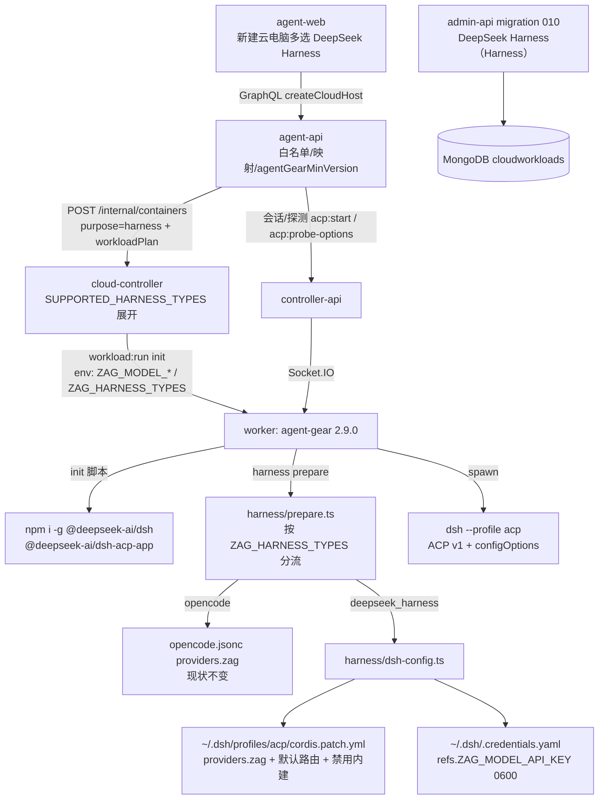
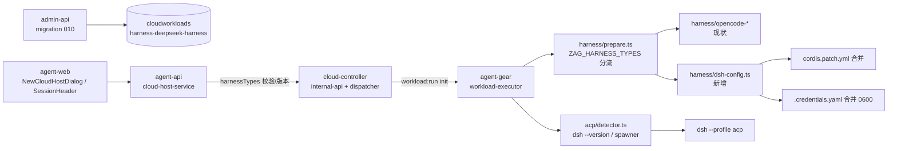
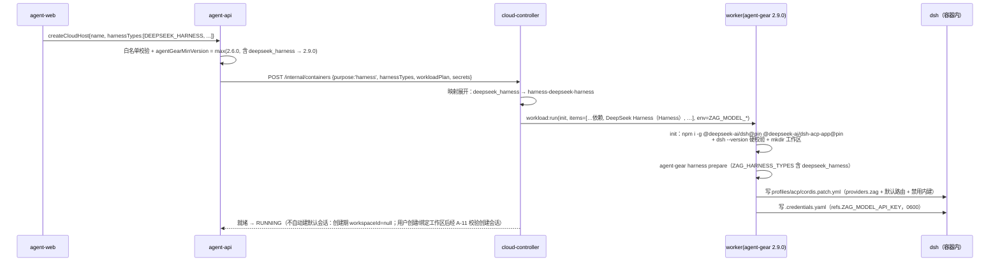
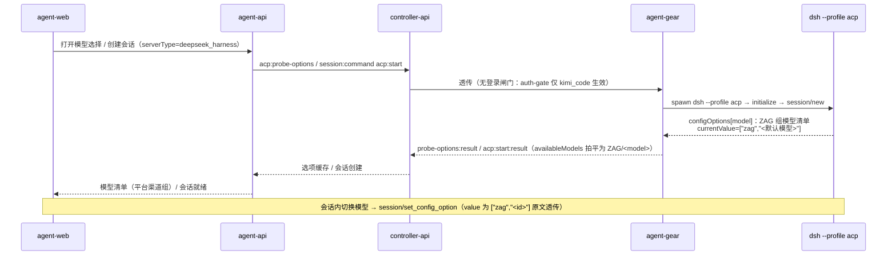

# 增加工作负载「DeepSeek Harness」（Harness）：DeepSeek Harness 接入与平台渠道模型注入 - 技术提案

**功能名称**: 工作负载「DeepSeek Harness」（Harness）与平台渠道模型默认注入
**关联 PRD**: [[../../product/draft/20261025-deepseek-harness.md]]
**技术提案版本**: v1.1
**创建日期**: 2026-10-25
**作者**: ZeroAsh
**feat-branch**: `feat/deepseek-harness`

> v1.1 修订（PR #284 评审）：核实并修正「默认会话自动创建」口径——自 `20261023-feat-cloud-container-optimization-phase2` 起，`createCloudHost` 不再预置默认工作区（`workspaceId=null` 落库），ready 回调的自动建会话分支（要求 `workspaceId` 非空）对新建云电脑不再触发；**就绪后不自动创建会话**（与 harness 数量无关），现存分支仅服务历史带工作区云电脑。本文相关段落（§3.1.1 / §3.2.3 / §5.1.1 / §8.2 / §9）已按最新代码行为修订。

## 1. 概述

### 1.1 背景

`20261020-feat-container-harness-support` 交付了云电脑（harness 容器）基线，`20261025-feat-kimi-code-harness` 把 harness 工具扩展到两个（OpenCode / Kimi Code）。当前事实：

- **harness 白名单两个**：`SUPPORTED_HARNESS_TYPES = ['opencode', 'kimi_code']`（`servers/cloud-controller/src/models/cloud-container.ts:27`）；`CloudWorkload.harnessType` 枚举 `['opencode', 'kimi_code', null]`（`servers/cloud-controller/src/models/cloud-workload.ts:51`）；`contracts/cloud-host.graphql` 的 `enum HarnessType { OPENCODE, KIMI_CODE }`。
- **预置工作负载两个**：admin-api migration `006-preset-harness-opencode`（固定版本 `@opencode/cli` + `opencode --version` 硬校验 + `agent-gear harness prepare` 写 `opencode.jsonc` 注入 ZAG 模型网关）与 `009-preset-harness-kimi-code`（固定版本 `@moonshot-ai/kimi-code` + 硬校验；不注入模型、使用前登录闸门）。
- **OpenCode 模型注入链路**：agent-api 经 `secrets{modelApiKey,modelBaseUrl,modelIds,modelContextLengths}` → cloud-controller `workload:run.env`（`ZAG_MODEL_*`）→ init 脚本内 `agent-gear harness prepare`（`packages/agent-controller/src/harness/prepare.ts`：env 校验 → `opencode --version` → `mkdir` 工作区 → `opencode-config.ts` 合并写 `~/.config/opencode/opencode.jsonc` 的 `providers.zag`，0600 原子写）。
- **ACP configOptions 通道已就绪**（`20261021-feat-acp-protocol-enhancement`）：`packages/agent-controller/src/acp/bridge.ts` `extractConfigOptions()` 解析 `session/new.configOptions`（含 **group 分组拍平**为 `组名/模型名`），`extractConfigModels()` 取 `category='model'` 的 select 项生成 `availableModels`（`id=option.value`）；模型切换走 `session/set_config_option` 配置项通道。
- **版本门禁按类型细分**：`servers/cloud-controller/src/services/worker-version.ts` `MIN_HARNESS_VERSION_BY_TYPE = { kimi_code: '2.8.0' }`，基线 `MIN_HARNESS_WORKER_VERSION = '2.6.0'`；agent-api 按 `harnessTypes` 取最大值随 `POST /internal/containers` 下发。
- **需求（上游）**：增加 DeepSeek harness 支持；工作负载初始化脚本 `npm install -g @deepseek-ai/dsh-acp-app`；拉起 ACP 会话指令 `dsh --profile acp`；**和 OpenCode 类似，默认注入我们自己渠道的模型给 dsh**（注入方式已调研并实测验证，见附录 A）。

因此本期两个交付面：① **DeepSeek Harness 预置 harness 工作负载**（第三个 harness 工具，与 OpenCode / Kimi Code 同级）；② **平台渠道模型注入**（`agent-gear harness prepare` 扩展：把 `ZAG_MODEL_*` 写入 DeepSeek Harness 的 profile 配置与凭据文件，默认路由指向 ZAG 渠道）。与 Kimi Code 不同：**无登录闸门**（dsh ACP `authenticate` 即时成功，模型凭据由 prepare 落盘）。

### 1.2 目标

- `HarnessType` 扩展 `DEEPSEEK_HARNESS`（slug `deepseek_harness`）：创建云电脑可选，与 `opencode` / `kimi_code` 同级多选；`SUPPORTED_HARNESS_TYPES`、`CloudWorkload.harnessType`、agent-api 映射同步扩展；预置展开映射 `deepseek_harness → harness-deepseek-harness`。
- admin-api migration `010-preset-harness-deepseek`：「DeepSeek Harness（Harness）」预置工作负载（`workloadKind='harness'`、`harnessType='deepseek_harness'`、init-only）：固定版本安装 `@deepseek-ai/dsh` + `@deepseek-ai/dsh-acp-app`（**实测：后者不提供 `dsh` bin，必须双包同装**，附录 A.1）+ `dsh --version` 硬校验 + 默认工作区 `mkdir -p` + `agent-gear harness prepare`（模型注入）。
- agent-gear **2.9.0**：`harness prepare` 按 `ZAG_HARNESS_TYPES` 分流——`opencode` 维持现状；`deepseek_harness` 执行 `dsh --version` 硬校验并写入：
  - `~/.dsh/profiles/acp/cordis.patch.yml`：`llm-pi-ai.providers.zag`（`apiKeyEnv: ZAG_MODEL_API_KEY`、`api: openai-completions`、`baseURL`、`models[{id, contextWindow?}]`）+ 禁用内建 `llm-deepseek` + 默认路由覆写（`acp` 与 `agent-default-model` 指向 `zag` 首个模型）；
  - `~/.dsh/.credentials.yaml`：`refs.ZAG_MODEL_API_KEY`（`version: 1`，0600，dsh 拒绝非属主独占可读的凭据文件）。
- ACP 接入：`AcpServerType` 扩展 `deepseek_harness`；detector `dsh --version`；spawner `{ command: 'dsh', args: ['--profile', 'acp'] }`。会话模型/分组/切换完全复用既有 configOptions 通道（实测 `session/new` 通告 ZAG 组模型，`currentValue` 为 ZAG 默认模型，附录 A.5）。
- 版本门禁细分：`MIN_HARNESS_VERSION_BY_TYPE += { deepseek_harness: '2.9.0' }`（仅 opencode 维持 2.6.0、含 kimi_code 2.8.0 口径不变）。
- 单元 / API（fetch 风格）/ E2E 测试全绿；OpenCode、Kimi Code 云电脑与普通主机零回归。

### 1.3 范围

**做**：

- `contracts/cloud-host.graphql`：`enum HarnessType += DEEPSEEK_HARNESS`（映射注释同步：`DEEPSEEK_HARNESS → deepseek_harness → harness-deepseek-harness`）。
- `contracts/agent-session.graphql`：`enum AcpServerType += deepseek_harness`。
- `contracts/cloud-controller-websocket.md`：展开映射与 `agentGearMinVersion` 口径增补（含 `deepseek_harness → 2.9.0`）。
- cloud-controller：`SUPPORTED_HARNESS_TYPES` 与 `CloudWorkload.harnessType` 枚举扩展；`MIN_HARNESS_VERSION_BY_TYPE` 增补。
- agent-api：`cloud-workload-reader.ts`（PRESET_KEYS / HARNESS_SLUGS）、`cloud-host-service.ts`（slug / 版本映射）、`models/cloud-host.ts`（HARNESS_TYPES）、`graphql/schemas/cloud-host.ts`（枚举）、`services/session.ts`（`harnessAcpTypes`）扩展。
- controller-api：`models/session.ts` 的 `acpServerType` 枚举扩展。
- admin-api migration `010-preset-harness-deepseek`（预置项 + init 脚本，幂等不覆盖管理员修改）。
- agent-gear 2.9.0：`harness/dsh-config.ts`（patch 与凭据写入）、`harness/prepare.ts`（按 `ZAG_HARNESS_TYPES` 分流）、`acp/detector.ts`（探测与 spawner）、`harness/env.ts`（`ZAG_HARNESS_TYPES` 解析，可选缺省）。
- agent-web：`graphql/types.ts`、`NewCloudHostDialog.tsx`（选项与标签）、`SessionHeader.tsx`（工具标签）。
- 测试：单测（dsh-config 合并/权限/幂等、prepare 分流、detector/spawner、映射与门禁）、tests/api（harnessTypes 白名单与展开、会话工具映射 `harnessAcpTypes`）、tests/e2e（创建/会话链路）。

**不做**：

- **不做登录闸门**：dsh ACP `authenticate` 即时成功、`authMethods=[]`（附录 A.4）；模型凭据由 prepare 落盘，无用户交互前置。
- 用户侧 DeepSeek 官方凭证录入入口（一期仅平台渠道模型注入）。
- dsh 内建官方渠道（`deepseek-official`）的保留/展示——一期经 patch 禁用（附录 A.6 实测）。
- 图像输入模态声明（dsh 手填模型默认纯文本；平台模型库暂无模态字段，二期随模型库扩展评估）。
- 推理档位（`reasoningEfforts`）与 `compat` 方言开关的前台/后台配置面（一期按附录 A.8 口径缺省不写，实现期对 ZAG 网关实测后按需补默认值）。
- 会话导入导出、统一存储（维持既有二期规划）；dsh 的 `session/list` 历史导入（维持现状，不新建入口）。
- 后台（admin-web/admin-api）harness 入口；Kimi Code 登录引导链路任何改动。

## 2. 技术架构

### 2.1 系统架构图



关键边界：

- **注入在 init、不在使用前**（与 OpenCode 同口径）：`010-preset-harness-deepseek` 的 init 脚本末位执行 `agent-gear harness prepare`；`ZAG_MODEL_*` 仅经 `workload:run.env` 下发（Job env 不含模型 secret，沿用既有口径）。
- **注入载体是 dsh 的两类文件**（附录 A 实测）：profile patch（`profiles/acp/cordis.patch.yml`，声明 ZAG provider 与默认路由）+ 凭据文件（`.credentials.yaml` 的 `refs`，0600）。dsh 凭据解析顺序为「凭据文件 > 启动 env > 项目 `.env` > `$DSH_HOME/.env`」；agent-gear 进程 env 不含 `ZAG_MODEL_API_KEY`（secret 只在 workload env），因此**必须写凭据文件**（D4）。
- **dsh ACP 是标准 ACP v1 + configOptions**：无 modes、无 elicitation；模型选项经 `session/new.configOptions` 通告（分组），切换经 `session/set_config_option`——agent-gear bridge 既有通道直接复用，**bridge 零改动**（附录 A.5/A.7）。
- **无登录闸门**：`harness:login` 事件族与 auth-gate 仅 `kimi_code` 生效，本期不动。

### 2.2 技术栈

| 层级 | 技术选型 | 说明 |
|------|---------|------|
| 前端 | React + TypeScript + Vite + Apollo Client | agent-web，harness 多选与工具标签扩展 |
| 后端 | Node.js + Express + GraphQL + Mongoose | agent-api（白名单/映射/门禁下发）、controller-api（枚举）、admin-api（migration 010）、cloud-controller（白名单/版本门禁） |
| Worker | Node.js（agent-gear 2.9.0） | prepare 分流、`dsh-config.ts` YAML 合并写入（新增依赖 `yaml`）、detector/spawner |
| 数据库 | MongoDB | `cloudworkloads`（预置项）；无新集合、无其他 schema 变更 |
| 协议 | Socket.IO + GraphQL + ACP v1（stdio JSON-RPC） | dsh ACP 标准面（initialize / session/new / set_config_option / prompt / cancel / close / list / resume） |
| 目标工具 | DeepSeek Harness `dsh`（固定 0.1.2-alpha.2） | `@deepseek-ai/dsh`（CLI/bin）+ `@deepseek-ai/dsh-acp-app`（acp profile 组合包） |

### 2.3 模块划分



| 模块 | 职责 | 关键技术点 |
|------|------|-----------|
| admin-api migration 010 | 预置工作负载写入 | 双包固定版本安装 + `dsh --version` 硬校验 + `agent-gear harness prepare`；幂等不覆盖 |
| cloud-controller | 白名单/枚举/版本门禁 | `SUPPORTED_HARNESS_TYPES` + `MIN_HARNESS_VERSION_BY_TYPE`；展开机制不动 |
| agent-api | 映射与门禁计算 | PRESET_KEYS / HARNESS_SLUGS / 版本映射 / 会话工具映射 `harnessAcpTypes` |
| agent-gear `harness/prepare.ts` | 按 `ZAG_HARNESS_TYPES` 分流 | 缺省回退 `['opencode']`（本地/旧场景零退化）；逐类型硬校验 + 写入，摘要不含 secret |
| agent-gear `harness/dsh-config.ts` | dsh 配置与凭据写入 | `yaml` Document 合并（保留其他条目/注释）、原子写（临时文件 + rename）、0600/0700 |
| agent-gear `acp/detector.ts` | 探测与拉起 | `detectDeepseekHarness()`（`dsh --version`）；`getSpawnerConfig('deepseek_harness') → { command: 'dsh', args: ['--profile', 'acp'] }` |
| agent-web | 选项与标签 | harness 多选第三项；会话头工具标签 |

## 3. API 设计

### 3.1 API 契约

#### 3.1.1 `contracts/cloud-host.graphql`（扩展）

```graphql
enum HarnessType {
  OPENCODE
  KIMI_CODE
  DEEPSEEK_HARNESS    # 本期新增：DeepSeek Harness（与 OpenCode / Kimi Code 同级）
}
```

- 映射注释同步：`DEEPSEEK_HARNESS → acpServerType deepseek_harness`；预置展开 `DEEPSEEK_HARNESS → harness-deepseek-harness`；`cloudHostCapabilities.supportedHarnesses` 仅在对应预置工作负载存在时列出该类型（既有口径）。
- 校验与错误文案不变：`harnessTypes` 去重后 ≥1、全部在白名单，否则 `unsupported harness type: <type>`；**默认会话自动创建已随云容器优化二期移除**（创建期不预置工作区 → ready 不自动建会话，现存分支仅服务历史带工作区云电脑；`createDefaultSession` 字段与 A-11「会话工具 ∈ 创建时所选 harnessTypes」校验口径不变）。

#### 3.1.2 `contracts/agent-session.graphql`（扩展）

```graphql
enum AcpServerType {
  opencode
  github_copilot
  claude_code
  gemini_cli
  codex
  mimo_code
  kimi_code
  deepseek_harness   # 本期新增
}
```

- 无新增 mutation/subscription；dsh 会话的模型通告/切换完全走既有 `availableModels` / configOptions 通道。
- `Session.features`（能力快照）：dsh 无 modes/commands/terminals/elicitation，按既有「Agent 声明 × 平台支持」矩阵自然归 unsupported，无需特例。

#### 3.1.3 `contracts/cloud-controller-websocket.md`（口径增补）

- `workloadPlan` 展开映射扩展：`{ opencode: 'harness-opencode', kimi_code: 'harness-kimi-code', deepseek_harness: 'harness-deepseek-harness' }`。
- `agentGearMinVersion` 按 `harnessTypes` 取最大：基线 2.6.0；含 `kimi_code` → 2.8.0；含 `deepseek_harness` → 2.9.0。
- `ZAG_HARNESS_TYPES` env 值域扩展（逗号分隔，如 `opencode,deepseek_harness`）。

**不在本期改动**：`contracts/agent-session-websocket.md`（无新事件族——无登录闸门）、`contracts/admin-cloud-container.graphql` / `contracts/admin-cloud-workload.graphql`（后台口径不动）、`contracts/billing-openai.openapi.yaml`（计费链路复用 OpenCode 云电脑口径：模型 Key 按 host 签发/撤销，`revoke-by-host` 不动）。

### 3.2 内部接口

#### 3.2.1 agent-gear `harness/dsh-config.ts`（新增）

```ts
/** dsh 注入结果摘要（不含任何 secret）。 */
export interface WriteDshConfigResult {
  /** 实际写入的 patch 文件路径（<dshHome>/profiles/acp/cordis.patch.yml）。 */
  patchPath: string;
  /** 实际写入的凭据文件路径（<dshHome>/.credentials.yaml）。 */
  credentialsPath: string;
  /** 是否为新建文件（patch / credentials 分别统计新建与否，摘要聚合）。 */
  created: boolean;
  /** 写入的模型数量。 */
  modelCount: number;
}

/**
 * 写入/合并 DeepSeek Harness 配置：
 * 1. <dshHome>/profiles/acp/cordis.patch.yml 合并四个条目（见 §5.3）：
 *    llm-deepseek(disabled) / llm-pi-ai(providers.zag) / agent-default-model / acp；
 * 2. <dshHome>/.credentials.yaml 合并 refs.ZAG_MODEL_API_KEY（version: 1）；
 * 3. 目录 0700、文件 0600（dsh 拒绝非属主独占可读的凭据文件）；临时文件 + rename 原子替换；
 * 4. 非法 YAML 直接报错（不覆盖既有配置，避免静默丢数据）。
 */
export async function writeDshConfig(options: {
  env: Pick<HarnessEnv, 'modelBaseUrl' | 'modelApiKey' | 'modelIds'> &
    Partial<Pick<HarnessEnv, 'modelContextLengths'>>;
  /** 覆盖 dsh home（测试/定制场景；缺省 $DSH_HOME 或 ~/.dsh）。 */
  dshHome?: string;
}): Promise<WriteDshConfigResult>;
```

#### 3.2.2 agent-gear `harness/prepare.ts`（分流）

```ts
/** prepare 目标类型：读 ZAG_HARNESS_TYPES（逗号分隔、去空去重、白名单过滤）；
 * 缺省/空串/全部非法 → ['opencode']（旧场景零退化）。 */
export function resolvePrepareTypes(env: NodeJS.ProcessEnv): Array<'opencode' | 'deepseek_harness'>;
```

- `opencode`：现有流程逐字不变（`verifyOpencodeCli` + `writeOpencodeConfig`）。
- `deepseek_harness`：`verifyDshCli(expectedVersion?)`（`dsh --version`，输出口径 `0.1.2-alpha.2`，附录 A.2）+ `writeDshConfig()`。
- 摘要输出逐类型一行（不含 secret）；任一类型失败整体非零退出。

#### 3.2.3 controller-api / agent-api（枚举与映射，纯扩展）

- `servers/controller-api/src/models/session.ts`：`acpServerType` 枚举追加 `deepseek_harness`。
- `servers/agent-api/src/services/cloud-workload-reader.ts`：`PRESET_KEYS += { DEEPSEEK_HARNESS: 'harness-deepseek-harness' }`、`HARNESS_SLUGS += { DEEPSEEK_HARNESS: 'deepseek_harness' }`。
- `servers/agent-api/src/services/cloud-host-service.ts`：slug 映射与版本映射（`DEEPSEEK_HARNESS: '2.9.0'`）。
- `servers/agent-api/src/services/session.ts`：`harnessAcpTypes += { DEEPSEEK_HARNESS: 'deepseek_harness' }`（A-11 会话工具白名单校验 + 历史默认会话补建映射；**缺该映射则 DeepSeek Harness 会话创建被 `unsupported harness type` 拒绝**）。

## 4. 数据模型

### 4.1 数据库设计

#### 集合: `cloudworkloads`（扩展 + 新增预置项）

| 字段 | 变更 |
|------|------|
| `harnessType` | 枚举 `['opencode', 'kimi_code', null]` → `['opencode', 'kimi_code', 'deepseek_harness', null]`（`servers/cloud-controller/src/models/cloud-workload.ts:51`） |

admin-api migration `010-preset-harness-deepseek`（幂等：presetKey 或精确 name 命中即跳过、不覆盖管理员修改，与 006/009 同口径）：

| 字段 | 值 |
|------|----|
| `name` | `DeepSeek Harness（Harness）` |
| `presetKey` | `harness-deepseek-harness` |
| `workloadKind` / `harnessType` | `harness` / `deepseek_harness` |
| `isPreset` / `paramSchema` / `dependsOnWorkloadIds` | `true` / `[]` / `[]` |
| `initScript` | 见 §5.3（双包固定版本安装 + `dsh --version` 硬校验 + 工作区 + `agent-gear harness prepare`） |

#### 其他集合（无 schema 变更）

- `cloudcontainers` / `cloudhosts`：`harnessTypes` 落库值域扩展 `deepseek_harness`（既有 `[String]` 字段）。
- `sessions`（controller-api）：`acpServerType` 枚举追加。
- **注入的模型配置与凭据不落库**：仅存在于容器内 `~/.dsh/`（随容器销毁）；平台侧模型 Key 生命周期沿用 OpenCode 云电脑口径（按 host 签发、`revoke-by-host` 撤销）。

### 4.2 缓存设计

- 无新增缓存。`acp:probe-options` 既有 5 分钟选项缓存口径不变（key `acp:options:<controllerId>:<serverType>`，`deepseek_harness` 自然成为新 key 后缀）。
- 模型 Key 撤销（`revoke-by-host`）与计费事件沿用 harness 既有回调链路，无分流改动。

## 5. 技术实现方案

### 5.1 核心流程

#### 5.1.1 创建含 DeepSeek Harness 的云电脑（工作负载展开 + 注入）



#### 5.1.2 探测可用模型 / 创建会话（configOptions 复用，无闸门）



- **失败语义**：探测失败维持既有 reject 降级（选项为空不阻断建会话）；`acp:start` 失败沿用既有 `success=false` 语义。无新增失败形态。
- **计费**：模型调用走 ZAG 网关（`baseURL` + 运行专用 Key），计费与 `revoke-by-host` 撤销沿用 OpenCode 云电脑链路。

### 5.2 关键实现点

#### 实现点 1: 预置工作负载「DeepSeek Harness（Harness）」（admin-api migration 010）

- **描述**: 写入预置项（presetKey `harness-deepseek-harness`、`workloadKind='harness'`、`harnessType='deepseek_harness'`、init-only、`paramSchema=[]`）；init 脚本（§5.3）双包固定版本安装 + `dsh --version` 硬校验 + `mkdir -p` 工作区 + `agent-gear harness prepare`。
- **技术细节**: **必须同时安装 `@deepseek-ai/dsh` 与 `@deepseek-ai/dsh-acp-app`**——实测 `@deepseek-ai/dsh-acp-app` 是 profile 组合包（无 `bin`），`dsh` bin 由 `@deepseek-ai/dsh` 提供（附录 A.1）；同版本同装后 acp profile 经 dsh host discovery 解析（实测本地 `node_modules` 同装可解析，全局同装布局相同，实现期核对，附录 A.9）。版本固定 `DSH_CLI_VERSION` / `DSH_ACP_APP_VERSION`（缺省 `0.1.2-alpha.2`，npm `latest` tag，附录 A.1），可同名 env 覆盖。
- **风险点**: dsh 处于 developer preview（官方明示存在兼容性破坏变更）——固定版本 + 硬校验 + 探测用例锁定行为；npm 安装源网络可达性（沿用既有 Aspire 下载代理口径）；Node 版本要求 `^22.19 || >=24`（worker 镜像 Node 24 满足，附录 A.1）。

#### 实现点 2: `harness/dsh-config.ts`（agent-gear 2.9.0，模型注入核心）

- **描述**: 写入/合并两个文件（结构见 §5.3）：
  1. `<dshHome>/profiles/acp/cordis.patch.yml`（patch 层，合并 4 个条目）；
  2. `<dshHome>/.credentials.yaml`（`refs.ZAG_MODEL_API_KEY`）。
- **技术细节**:
  - 合并语义：**按条目 `id` 替换我方条目、保留其他条目与注释**——dsh 官方明确「Cordis config override 替换完整 entry config」，因此必须整体重写 `llm-pi-ai`/`acp`/`agent-default-model`/`llm-deepseek` 四个 entry 的 config，同时保留文件中可能存在的其他 entry（附录 A.3）；使用 `yaml` 包的 Document API 做 AST 级合并（新增依赖 `yaml`，D11）。
  - 凭据文件：已存在时解析并仅替换 `refs.ZAG_MODEL_API_KEY`（保留其他 refs/records 与注释）；不存在时新建 `{version: 1, refs: {...}}`；非法 YAML 报错不覆盖（与 opencode-config 的「不静默丢数据」同口径）。
  - 权限：目录 0700、文件 0600（**dsh 凭据存储拒绝加载其他用户可读的文件**，附录 A.3）；同目录临时文件 + `rename` 原子替换（沿用 opencode-config 模式）。
  - `models` 条目：`{ id, name: id, contextWindow? }`——`contextWindow` 仅在 `ZAG_MODEL_CONTEXT_LENGTHS` 含该模型正整数时写入（与 opencode `limit.context` 同口径）；**缺省不写 `compat` / `reasoningEfforts` / `input`**（附录 A.8 口径，实现期对 ZAG 网关实测后按需补默认值）。
  - 默认模型：`modelIds[0]`（列表为空时不写 `agent-default-model`/`acp` 的 model 字段，仅写 provider——缺省回退 dsh 自有缺省路由但 ZAG 组无模型可选，与 opencode 空清单同口径「不引入新失败形态」）。
  - secret 只写入文件，不进入日志/错误/返回值（沿用 `redactSecrets`）。
- **风险点**: dsh 凭据文件格式版本（`version: 1`，旧扁平格式会被 dsh 启动时迁移——我方永远写 v1）；patch 层条目 id 冲突（我方 4 个 id 与官方组合一致，整体重写安全）；`dshHome` 解析（`$DSH_HOME` 缺省 `~/.dsh`，容器内未设置即 `~/.dsh`）。

#### 实现点 3: `harness/prepare.ts` 分流与 `harness/env.ts` 扩展

- **描述**: `resolvePrepareTypes()` 解析 `ZAG_HARNESS_TYPES`（容器 Job env 注入，逗号分隔）；逐类型执行硬校验与写入；摘要逐类型一行。
- **技术细节**: 缺省/空串/全部非法回退 `['opencode']`——旧 worker 镜像手工跑 `harness prepare`（无 ZAG_HARNESS_TYPES）行为与现状逐字一致；`kimi_code` 不在 prepare 白名单（无注入需求），出现即忽略（其 init 脚本本就不调 prepare）。
- **风险点**: 多 harness 同选时 prepare 被各 init 脚本调用多次——两类写入均幂等（版本一致重装跳过、配置按条目替换），重复执行无副作用（单测锚定）。

#### 实现点 4: ACP 探测与拉起（`acp/detector.ts` 与各服务枚举）

- **描述**: `detectDeepseekHarness()`（`dsh --version`，解析 `\d+\.\d+\.\d+(-[\w.]+)?` 预发布段保留）；`getSpawnerConfig('deepseek_harness') → { command: 'dsh', args: ['--profile', 'acp'] }`；`AcpDetector.detect()` 结果数组追加。各服务枚举/映射按 §3.2.3 扩展。
- **技术细节**: spawner 工作目录沿用会话 cwd（dsh 把启动目录作默认文件系统位置，`session/new` 的 `cwd` 为 ACP client 提供的绝对工作区，与既有 prober/spawner 行为一致）；dsh ACP 无 `authMethods`——`initialize` 后无需 `authenticate`（既有桥接对空 authMethods 直通）。
- **风险点**: `dsh --profile acp` 启动时长（组合加载）——探测/启动沿用既有超时（探测 20s/30s），实机偏慢时在实现期评估预热或超时口径（附录 A.9 核对项）；stdout 纯净性（官方契约：stdout 仅承载 JSON-RPC frame，`--help` 已验证不占用 stdio）。

#### 实现点 5: agent-web 选项与标签

- **描述**: `graphql/types.ts` `HarnessType += 'DEEPSEEK_HARNESS'`；`NewCloudHostDialog.tsx` 标签 `DEEPSEEK_HARNESS: 'DeepSeek Harness'`（多选第三项，既有校验/上限不动）；`SessionHeader.tsx` 工具标签 `deepseek_harness: 'DeepSeek Harness'`。
- **技术细节**: 模型选择 UI 复用既有「按来源分组」——dsh 通告的 ZAG 组经 bridge 拍平为 `ZAG/<model>`，来源推断（`model-source.ts` 库比对）与既有云电脑会话同口径。
- **风险点**: 存量 e2e 对 harness 选项数量的断言需同步；移动端多选布局回归。

#### 实现点 6: 版本与门禁

- **描述**: agent-gear 包版本 `2.8.0 → 2.9.0`（worker 镜像随 `@2.9.x`）；`MIN_HARNESS_VERSION_BY_TYPE += { deepseek_harness: '2.9.0' }`（`worker-version.ts`）；agent-api 版本映射同步（`cloud-host-service.ts`）。
- **技术细节**: 仅 `opencode` 维持 2.6.0、含 `kimi_code` 2.8.0 口径逐字不变；含 `deepseek_harness` 的运行要求 2.9.0（prepare 分流与 dsh-config 所在版本）；旧版 agent-gear 对本地 `deepseek_harness` 会话维持现状（无 detector/spawner 该类型即不可选，零退化）。
- **风险点**: 门禁拦截报错可读性（沿用 `version_mismatch:*` 语义）；`internal-api` A7 用例补齐（含 deepseek_harness → 2.9.0、混合类型取最大）。

#### 实现点 7: 兼容与回归面

- **描述**: OpenCode 全链路零改动（prepare 的 opencode 分支逐字保留）；Kimi Code 登录闸门零改动（`kimi_code` 不进入 prepare 白名单）；`harnessTypes=['opencode']` / `['kimi_code']` 的创建/展开/门禁行为与现状逐字一致；billing 链路零改动。
- **风险点**: `ZAG_HARNESS_TYPES` 在旧 agent-gear（2.6~2.8）上的行为——旧版 prepare 不解析该 env，opencode 分支照常执行，deepseek init 脚本中的 `agent-gear harness prepare` 在旧版上只做 opencode 注入（dsh 未注入）——由 2.9.0 门禁在注册前拦截，不会流入该状态。

### 5.3 预置脚本与注入文件（migration 010 内置，示意）

#### DeepSeek Harness（Harness）init 脚本（init-only，无 post 脚本）

```bash
#!/usr/bin/env bash
set -euo pipefail

export PATH="$HOME/.local/bin:$HOME/.npm-global/bin:$PATH"

# 1) 固定版本安装 / 版本收敛（缺失或版本不一致时重装，幂等）
#    实测：@deepseek-ai/dsh-acp-app 是 profile 组合包（无 bin），dsh bin 由 @deepseek-ai/dsh 提供
export DSH_CLI_VERSION="${DSH_CLI_VERSION:-0.1.2-alpha.2}"
export DSH_ACP_APP_VERSION="${DSH_ACP_APP_VERSION:-0.1.2-alpha.2}"
installed_version=""
if command -v dsh >/dev/null 2>&1; then
  installed_version="$(dsh --version 2>/dev/null | head -n 1 | awk '{print $NF}')" || installed_version=""
  installed_version="${installed_version#v}"
fi
if [ "${installed_version}" != "${DSH_CLI_VERSION}" ]; then
  echo "Installing DeepSeek Harness ${DSH_CLI_VERSION} + acp-app ${DSH_ACP_APP_VERSION} (installed: ${installed_version:-none})"
  npm install -g "@deepseek-ai/dsh@${DSH_CLI_VERSION}" "@deepseek-ai/dsh-acp-app@${DSH_ACP_APP_VERSION}"
fi

# 2) 硬校验：命令不可用或版本不一致均视为失败（安装成功但不可用 = 启动失败）
actual_version="$(dsh --version | head -n 1 | awk '{print $NF}')"
actual_version="${actual_version#v}"
if [ "${actual_version}" != "${DSH_CLI_VERSION}" ]; then
  echo "DeepSeek Harness version mismatch: expected ${DSH_CLI_VERSION}, got ${actual_version:-unknown}" >&2
  exit 1
fi

# 3) 默认工作区 + 平台渠道模型注入（cordis.patch.yml + .credentials.yaml）
mkdir -p "${ZAG_DEFAULT_WORKSPACE:-/root/workspace}"
agent-gear harness prepare
```

#### `~/.dsh/profiles/acp/cordis.patch.yml`（prepare 合并写入，我方 4 个条目整体重写）

```yaml
# 合并语义：按 id 替换以下 4 个条目，保留文件中其他条目与注释
- id: llm-deepseek
  disabled: true                      # 禁用内建官方渠道（模型选择只呈现 ZAG 渠道；附录 A.6 实测）
- id: llm-pi-ai
  config:
    providers:
      zag:                            # 平台渠道（ZAG 模型网关，OpenAI 兼容）
        displayName: ZAG
        apiKeyEnv: ZAG_MODEL_API_KEY  # 凭据引用（值在 .credentials.yaml refs）
        api: openai-completions
        baseURL: <ZAG_MODEL_BASE_URL>
        models:                       # 整体替换；contextWindow 来自 ZAG_MODEL_CONTEXT_LENGTHS
          - id: <model-id>
            name: <model-id>
            contextWindow: <n>        # 可选
- id: agent-default-model
  config:
    provider: zag
    model: <modelIds[0]>              # 组合级默认路由覆写
- id: acp
  name: '@deepseek-ai/dsh-acp'
  config:
    provider: zag                     # ACP 会话默认路由覆写（原 deepseek-official / deepseek-v4-flash）
    model: <modelIds[0]>
```

#### `~/.dsh/.credentials.yaml`（prepare 合并写入，0600）

```yaml
version: 1

refs:
  ZAG_MODEL_API_KEY: <ZAG_MODEL_API_KEY>   # 仅替换该 ref；保留其他 refs/records 与注释
```

> 凭据解析顺序（dsh 官方）：凭据文件 > 启动 env > 项目 `.env` > `$DSH_HOME/.env`。agent-gear 进程 env 不含 `ZAG_MODEL_API_KEY`（secret 仅经 `workload:run.env` 下发），故凭据文件是唯一可靠载体（D4，附录 A.3）。

## 6. 技术决策

### 6.1 决策列表

| # | 决策 | 选项 A | 选项 B | 最终选择 | 原因 |
|---|------|--------|--------|---------|------|
| D1 | 类型 slug | `deepseek` | `deepseek_harness` | B | 与 `kimi_code`（产品名 snake_case）一致；避免与 DeepSeek 模型渠道混淆；枚举/映射风格统一 |
| D2 | 安装包 | 仅 `@deepseek-ai/dsh-acp-app`（需求原文） | 双包同装 `@deepseek-ai/dsh` + acp-app | B | 实测 acp-app 无 `dsh` bin（profile 组合包）；bin 由 `@deepseek-ai/dsh` 提供（附录 A.1） |
| D3 | 注入载体 | 环境变量（`DEEPSEEK_API_KEY` 风格） | profile patch + 凭据文件 | B | dsh 的 provider/路由只能经 patch 声明；secret 不在 agent-gear 进程 env（仅 workload env），env 引用解析不到（附录 A.3/A.4） |
| D4 | 凭据位置 | `$DSH_HOME/.env` / 启动 env | `.credentials.yaml` refs（0600） | B | dsh 凭据解析顺序中凭据文件优先级最高且为官方 write-only 存储；0600 属主独占（dsh 强制）；与 opencode.jsonc 0600 同口径 |
| D5 | 默认路由 | 仅写 providers.zag，沿用 dsh 缺省 | 覆写 `acp` + `agent-default-model` 指向 zag 首模型 | B | dsh 缺省路由是 `deepseek-official/deepseek-v4-flash`（无凭据必失败）；实测覆写后 `currentValue=["zag",...]`（附录 A.5） |
| D6 | 内建官方渠道 | 保留 `deepseek-official` 组 | patch 禁用 `llm-deepseek` | B | 无凭据的官方渠道出现在选择中只会制造 MISSING_CREDENTIAL 失败；PRD 要求「不出现」；实测禁用后选择器仅 ZAG 组（附录 A.6）。回退：保留亦无功能阻塞 |
| D7 | prepare 形态 | 新命令 `harness prepare-dsh` | `harness prepare` 按 `ZAG_HARNESS_TYPES` 分流 | B | init 脚本统一调用同一命令（与 opencode 一致）；Job env 天然携带类型清单；缺省回退 opencode 零退化 |
| D8 | 登录闸门 | 复用 kimi auth-gate | 不做（无登录） | B | dsh ACP `authenticate` 即时成功、`authMethods=[]`；模型凭据 prepare 落盘（附录 A.4） |
| D9 | 版本门禁 | 全局提升 `MIN_HARNESS_WORKER_VERSION` | 按 harnessTypes 增补 `deepseek_harness: 2.9.0` | B | 与 kimi 2.8.0 同模式；仅 opencode / kimi 运行不受影响 |
| D10 | 模型上下文 | 不写 `contextWindow` | 按 `ZAG_MODEL_CONTEXT_LENGTHS` 写 `contextWindow` | B | 与 opencode `limit.context`（2.7.0 起）同口径；dsh 模型条目原生字段（附录 A.3） |
| D11 | YAML 合并实现 | 字符串模板整体重写 | 新增 `yaml` 依赖做 AST 合并 | B | 官方要求「override 替换完整 entry config」→ 必须保留其他 entry；凭据文件官方明确保留注释语义；与 jsonc-parser 模式对齐 |
| D12 | compat/推理方言 | 缺省写 `supportsDeveloperRole:false` 等 | 缺省不写，实现期对 ZAG 网关实测后按需补 | B | compat 是「对端点的断言」而非探测；盲目断言可能制造新失败（附录 A.8）；ZAG 网关为 OpenAI 兼容（billing-openai），先按实测结论收敛 |
| D13 | 安装版本 | 跟随 npm `latest`（浮动） | 固定 `0.1.2-alpha.2` + env 可覆盖 | B | dsh 为 developer preview（官方明示兼容性破坏变更）；与 OPENCODE/KIMI 固定版本口径一致 |
| D14 | 会话历史导入 | 本期接入 dsh `session/list` 导入 | 不做 | B | 维持既有二期规划；dsh 支持 list/resume 但平台导入链路不在本期范围 |

### 6.2 依赖与约束

| 类型 | 内容 | 说明 |
|------|------|------|
| 依赖 | 云电脑 harness 工作负载体系（多预设展开/留档/必须失败） | 第 3 个 harness 预置项 |
| 依赖 | OpenCode 模型注入链路（`ZAG_MODEL_*` → workload env → `harness prepare`） | dsh 注入复用同一 env 通道 |
| 依赖 | ACP configOptions 通道（bridge 分组拍平/模型切换） | dsh 会话模型能力零改动复用 |
| 依赖 | DeepSeek Harness 官方能力（`dsh` CLI、acp profile、cordis patch、credentials-local） | 附录 A 调研（已实测） |
| 约束 | 注入只在 init 阶段；不做使用前登录/交互前置 | 需求与 PRD 明确 |
| 约束 | 平台不存、不托管任何 dsh 侧凭据以外的用户凭证；日志/输出统一脱敏 | 安全口径 |
| 约束 | 一期仅平台渠道模型；内建官方渠道禁用 | PRD 明确 |
| 约束 | dsh developer preview：固定版本 + 硬校验 + 行为夹具锁定 | 附录 A.1 |
| 约束 | agent-gear 2.9.0 起才有 dsh prepare；门禁按 harnessTypes 细分 | 存量零影响 |
| 约束 | Node `^22.19 \|\| >=24`（dsh 要求）；worker 镜像 Node 24 满足 | 附录 A.1 |

## 7. 项目结构

```
contracts/
├── cloud-host.graphql                     # 扩展：enum HarnessType += DEEPSEEK_HARNESS（映射注释同步）
├── agent-session.graphql                  # 扩展：enum AcpServerType += deepseek_harness
└── cloud-controller-websocket.md          # 增补：harness-deepseek-harness 映射、agentGearMinVersion 含 deepseek_harness → 2.9.0

servers/admin-api/src/migrations/
├── 010-preset-harness-deepseek.ts         # 新增：「DeepSeek Harness（Harness）」预置工作负载（init-only，幂等）
└── 010-preset-harness-deepseek.test.ts    # 新增：幂等/不覆盖/脚本口径

servers/cloud-controller/src/
├── models/cloud-container.ts              # SUPPORTED_HARNESS_TYPES += 'deepseek_harness'
├── models/cloud-workload.ts               # harnessType 枚举 += 'deepseek_harness'
└── services/worker-version.ts             # MIN_HARNESS_VERSION_BY_TYPE += { deepseek_harness: '2.9.0' }

servers/agent-api/src/
├── models/cloud-host.ts                   # HARNESS_TYPES += 'DEEPSEEK_HARNESS'
├── graphql/schemas/cloud-host.ts          # 枚举 += DEEPSEEK_HARNESS
├── services/cloud-workload-reader.ts      # PRESET_KEYS / HARNESS_SLUGS += DEEPSEEK_HARNESS
├── services/cloud-host-service.ts         # slug / 版本映射 += DEEPSEEK_HARNESS → 2.9.0
└── services/session.ts                    # harnessAcpTypes += DEEPSEEK_HARNESS → deepseek_harness

servers/controller-api/src/
└── models/session.ts                      # acpServerType 枚举 += deepseek_harness

packages/agent-controller/src/             # agent-gear 2.9.0（package.json version + 依赖 yaml）
├── harness/dsh-config.ts                  # 新增：cordis.patch.yml / .credentials.yaml 合并写入（0600/0700，原子写）
├── harness/dsh-config.test.ts             # 新增：合并/权限/幂等/非法 YAML/空清单/上下文长度
├── harness/dsh-cli.ts                     # 新增：verifyDshCli（dsh --version 硬校验，版本一致性）
├── harness/prepare.ts                     # 扩展：ZAG_HARNESS_TYPES 分流（缺省回退 ['opencode']）
├── harness/env.ts                         # 扩展：resolvePrepareTypes（解析/白名单/回退）
├── acp/detector.ts                        # 扩展：detectDeepseekHarness + getSpawnerConfig('deepseek_harness')
└── commands/harness.ts                    # 描述更新（OpenCode → OpenCode / DeepSeek Harness）

apps/agent-web/src/
├── graphql/types.ts                       # HarnessType += 'DEEPSEEK_HARNESS'
├── components/cloud-host/NewCloudHostDialog.tsx   # 选项/标签 += DeepSeek Harness
└── components/session/SessionHeader.tsx           # 工具标签 += deepseek_harness

tests/api / tests/e2e                      # 见 §8（fetch 风格 API 测试 + 创建/会话 E2E）
```

## 8. 测试策略

### 8.1 测试覆盖要求

- 单元测试覆盖率 ≥ 80%（`dsh-config.ts` 合并全分支、`prepare` 分流、`resolvePrepareTypes`、detector/spawner、映射与门禁）。
- API 测试覆盖：harnessTypes 白名单/展开/门禁（含 deepseek_harness）、会话工具映射（`harnessAcpTypes`，A-11 校验）、`agentGearMinVersion` 计算。
- 回归：OpenCode / Kimi Code 云电脑全链路；`harnessTypes=['opencode']` / `['kimi_code']` 展开与门禁逐字一致。

### 8.2 测试类型

| 类型 | 工具 | 覆盖范围 |
|------|------|---------|
| 单元测试 | Vitest | `dsh-config`：patch 合并（我方 4 条目替换/他条目与注释保留/新建/非法 YAML 报错/原子写/0600·0700）、credentials 合并（refs 替换/records 保留/版本头/非法报错）、空清单/上下文长度写否；`prepare` 分流（缺省回退/多类型/未知类型过滤/kimi_code 忽略）；`verifyDshCli`（版本一致/不一致/无输出/命令缺失）；migration 010 幂等；映射与门禁（含混合类型取最大） |
| API 测试 | tests/api（fetch 风格 + fake controller） | 创建云电脑 `DEEPSEEK_HARNESS`（单选/多选就绪均不自动建会话、非法类型 400、A-11 会话工具白名单校验）；`agentGearMinVersion` 含 deepseek_harness → 2.9.0；workloadPlan 展开含 harness-deepseek-harness 且 required=true；探测/会话创建经 fake dsh（configOptions 夹具）返回 ZAG 组模型 |
| E2E 测试 | tests/e2e | 新建云电脑三选项展示与多选；仅选 DeepSeek Harness 就绪后不自动建会话、创建/绑定工作区后可创建会话；会话模型选择仅 ZAG 组且默认选中；OpenCode / Kimi Code 路径回归 |
| 实机核对 | Aspire 全栈 + 真实 dsh | 附录 A.9 核对清单逐项验证 |

### 8.3 调研核对清单（实现期，附录 A）

- [x] `@deepseek-ai/dsh-acp-app` 不提供 `dsh` bin；`dsh` bin 由 `@deepseek-ai/dsh` 提供（实测安装验证）
- [x] `dsh --version` 输出 `0.1.2-alpha.2`（纯版本号）；`dsh --profile acp --help` 正常退出不占 stdio
- [x] patch 写入 `profiles/acp/cordis.patch.yml` 生效（`--dump-config` 确认被组合采纳）
- [x] 注入后 `session/new.configOptions` 通告 ZAG 组模型、`currentValue` 为 ZAG 默认；禁用 `llm-deepseek` 后仅剩 ZAG 组
- [ ] 全局安装（`npm -g`）同装双包后 `dsh --profile acp` 的 bundle 解析（host discovery 的 `npm -g` 环节）
- [ ] ZAG 网关（billing-openai）对 pi-ai 请求形态的兼容：是否需要 `compat.supportsDeveloperRole: false` / `maxTokensField: max_tokens`
- [ ] ZAG 渠道推理模型是否需要 `compat.thinkingFormat: deepseek` 与 `reasoningEfforts` 声明
- [ ] `dsh --profile acp` 冷启动时长（对照探测 20s/30s 超时口径）
- [ ] 空 `ZAG_MODEL_IDS` 时 `session/new` 行为（与 opencode 空清单口径对齐）

## 9. 验收标准

- [ ] 技术方案评审通过
- [ ] Contract 评审通过（`cloud-host.graphql` / `agent-session.graphql` / `cloud-controller-websocket.md`）
- [ ] 创建云电脑可选 DeepSeek Harness（与 OpenCode / Kimi Code 同级、多选；就绪不自动建会话的现状不变，A-11 工具范围校验生效）
- [ ] 云电脑就绪后 DeepSeek Harness 可用；环境准备/注入失败启动失败并展示原因
- [ ] 就绪云电脑上创建会话无需登录、无需手工配置；模型选择仅 ZAG 组（平台渠道模型清单）且默认选中；内建官方渠道不出现
- [ ] 模型清单含模型最长上下文（`contextWindow` 与后台模型设置一致）
- [ ] 会话内模型切换（`set_config_option`）正常；同工具历史会话可继续
- [ ] 平台计费记录产生；模型 Key 随云电脑销毁撤销（`revoke-by-host`）
- [ ] OpenCode / Kimi Code 云电脑与普通主机零回归；Kimi 登录引导行为不变
- [ ] 注入凭证不出现于任何日志/错误/界面（脱敏核查）；`~/.dsh` 两个文件 0600
- [ ] 单元测试覆盖达标、API 测试通过、E2E 测试通过

## 10. 相关文档

- [[../../product/draft/20261025-deepseek-harness.md]] — 本期 PRD
- [[20261020-feat-container-harness-support.md]] — 容器启动任务支持 harness 类型（OpenCode 云电脑基线）
- [[20261025-feat-kimi-code-harness.md]] — 增加工作负载「Kimi Code」（Harness）（第二个 harness 与登录闸门基线）
- [[20261021-feat-acp-protocol-enhancement.md]] — ACP 协议增强（configOptions 能力透明化与模型来源分组）
- [[20261025-fix-opencode-model-context-length.md]] — 云电脑 OpenCode 模型上下文长度下发（harness prepare 参照）
- 开发规范：[[../common-rules.md]]、[[../backend-rules.md]]、[[../frontend-rules.md]]

---

## 附录 A：DeepSeek Harness（dsh）模型注入调研（2026-10-25，已实测验证）

调研来源：[deepseek-ai/deepseek-harness](https://github.com/deepseek-ai/deepseek-harness) 官方仓库及文档（[providers 配置指南](https://github.com/deepseek-ai/deepseek-harness/blob/master/docs/user/guide/providers.md)、[`@deepseek-ai/dsh-acp` 协议约定](https://github.com/deepseek-ai/deepseek-harness/blob/master/packages/acp/acp/README.md)、[`@deepseek-ai/dsh-credentials-local`](https://github.com/deepseek-ai/deepseek-harness/blob/master/packages/credentials/credentials-local/README.md)、[`@deepseek-ai/dsh-acp-app`](https://www.npmjs.com/package/@deepseek-ai/dsh-acp-app)），并在隔离目录实际安装与发起真实 ACP 会话验证。

### A.1 包与安装（实测）

| 项 | 结论 | 状态 |
|----|------|------|
| `dsh` bin 来源 | `@deepseek-ai/dsh`（`bin: { dsh: lib/bin.js }`）提供；`@deepseek-ai/dsh-acp-app` 是 **profile 组合包**（`cordis.patch.yml` + `dsh.bundle.patch` 声明），**无 bin**——需求原文的 `npm install -g @deepseek-ai/dsh-acp-app` 单独执行不会有 `dsh` 命令，**必须双包同装** | 实测（临时目录安装 388+124 包核对 `.bin` 与 package.json） |
| 版本 | 2026-10-25 npm：`@deepseek-ai/dsh-acp-app` latest `0.1.2-alpha.2`（另有 alpha/next 通道）；`@deepseek-ai/dsh` latest `0.2.1-rc.2`、存在 `0.1.2-alpha.2` | registry 核对；固定 `0.1.2-alpha.2` 双包同装（同代际） |
| Node 要求 | `^22.19.0 \|\| >=24.0.0`（官方用户指南） | worker 镜像 Node 24 满足 |
| 稳定性 | 官方明示 **developer preview**，存在兼容性破坏变更 | 固定版本 + 行为夹具锁定 |
| profile 解析 | `dsh --profile acp` 经 host discovery 解析已安装的 acp 组合包（实测同 `node_modules` 同装可解析；官方文档载明发现链含 `npm -g`） | 本地实测通过；全局同装为 A.9 核对项 |

### A.2 版本与启动（实测）

| 项 | 结论 | 状态 |
|----|------|------|
| `dsh --version` | 输出纯版本号 `0.1.2-alpha.2` | 实测 |
| `dsh --profile acp` | ACP stdio 服务；`--help` 写帮助即退出、不占 stdio（官方契约：stdout 仅承载换行分隔 JSON-RPC frame） | 实测 |
| `dsh --dump-config` / `--dump-default-config` | 打印组合 profile 树——可用于实现期调试与测试夹具固化 | 实测 |

### A.3 配置与凭据机制（官方文档 + 实测）

- **profile patch**：`$DSH_HOME/profiles/<profile>/cordis.patch.yml`（`$DSH_HOME` 缺省 `~/.dsh`；`--profile acp` → `profiles/acp/`）。patch 是「有序组合上的用户覆盖层」；**Cordis config override 替换完整 entry config**——编辑既有 override 时必须保留其他 providers/字段。`--dump-config` 实测确认用户 patch 层被组合采纳（标注 `patched by /tmp/dsh-home/profiles/acp/cordis.patch.yml`）。
- **provider 声明**（`llm-pi-ai` 适配器，基于 pi-ai）：`providers.<route>` 字典——`apiKeyEnv`（凭据**引用名**，非明文）、`api: openai-completions`、`baseURL`、`models[{id, name?, contextWindow?, maxTokens?, input?, compat?, reasoningEfforts?}]`、路由级 `compat` / `defaultInput` / `defaultContextWindow` / `headers` / `timeoutMs` / `retryPolicy`。手写路由（pi-ai 目录无此 key）需提供完整定义——与 OpenCode `providers.zag` 的 openai-compatible provider 完全同构。
- **默认路由**：组合内 `agent-default-model`（`{provider, model}`）与 acp 条目（`{provider, model}`，acp-app 出厂为 `deepseek-official` / `deepseek-v4-flash`，官方说明「后续 patch 可替换该完整 config」）。
- **凭据存储**：`$DSH_HOME/.credentials.yaml`——`version: 1` 文档，`refs.<引用名>: <值>`（另有 `records` 区）。解析顺序：**凭据文件 > 启动 env > 调用目录 `.env` > `$DSH_HOME/.env`**（凭据文件优先级最高）。文件必须属主独占可读（POSIX 下其他用户可读则拒绝加载并提示 `chmod 600`）；产品写入保留注释与未触碰条目。
- **`models` 语义**：数组**整体替换**目录，不逐项合并；`contextWindow` 为模型条目原生字段（缺省时路由 `defaultContextWindow` 兜底 262,144）。

### A.4 ACP 协议面（官方协议约定 + 实测 initialize）

| 项 | 结论 |
|----|------|
| 方法矩阵 | `initialize` / `authenticate`（即时成功，**无需认证**）/ `session/new` / `session/list` / `session/resume` / `session/close` / `session/set_config_option` / `session/prompt` / `session/cancel` / `session/update` / `session/request_permission` |
| 实测 `initialize` | `agentInfo.name=deepseek-harness-acp`；`authMethods=[]`；`sessionCapabilities: close/list/resume`；`promptCapabilities.image=false`（注入模型未声明图像模态时） |
| 不支持 | `session/load`、删除、fork、附加目录、SSE/ACP-transport MCP、**modes、commands、plans、terminals、客户端文件操作、elicitation** |
| 模型选项 | `session/new` 返回完整 configOptions；`category='model'` 的 select 通告**实时 LLM 目录**（分组）；`session/set_config_option` 更新 `model` / `reasoning_effort`（下一次模型步骤生效） |

### A.5 模型注入实测（真实 ACP 会话，2026-10-25）

按 §5.3 写入 patch 与凭据后，以 ACP v1 JSON-RPC 驱动真实 `dsh --profile acp`：

- `session/new.configOptions[0]`：`id=model`、`category=model`、`type=select`；`currentValue: "[\"zag\",\"zag-model-a\"]"`（**默认路由覆写生效**）；options 含 `group: "zag"`（name `ZAG`）下两个注入模型（`value` 为 `["zag","<id>"]` JSON 串）。
- 未禁用 `llm-deepseek` 时另有 `group: "deepseek-official"`（内建三模型，无凭据）——验证 D6 的必要性。
- 凭据文件 `refs.ZAG_MODEL_API_KEY`（0600）被正常加载（启动无凭据错误）。

**bridge 兼容性结论**：dsh 的 configOptions 形态与 agent-gear `extractConfigOptions()` 完全兼容——group 拍平为 `ZAG/<model>` 展示名、`id=option.value`（`["zag","<id>"]` 原文）可直接回传 `set_config_option`，**bridge 零改动**。

### A.6 内建官方渠道禁用（实测）

patch 追加 `- id: llm-deepseek\n  disabled: true`（acp-app 出厂 patch 即以此指令禁用 `session-title-llm`，同法可用）后重测：`session/new` 模型选择**仅余 ZAG 组**，`currentValue` 仍为 ZAG 默认模型。组合中 `llm-deepseek` 条目 id 经 `--dump-config` 确认。

### A.7 与平台既有通道的映射

| dsh 侧 | 平台侧 | 结论 |
|--------|--------|------|
| `configOptions[category=model]`（分组 select） | `extractConfigModels()` → `availableModels`（`ZAG/<model>`） | 直接兼容 |
| `currentValue` / `set_config_option` | 当前模型 / 模型切换（配置项通道） | 直接兼容 |
| 无 modes | `modes=[]`（能力快照 unsupported） | 既有零退化口径 |
| 无 elicitation | elicitation 通道 | 不涉及 |
| `session/resume` | 会话「继续」 | 复用既有 resume 链路（实现期核对 resume 恢复模型选择行为） |
| `request_permission` | 平台权限问询 | 复用既有权限通道（dsh 声明 permission 能力时按既有矩阵生效） |

### A.8 compat / 推理方言口径

pi-ai 按 URL 识别端点请求形态，未识别地址按 OpenAI 本体对待；多数 OpenAI 兼容网关拒绝 `developer` role 与 `max_completion_tokens`——官方建议对这类网关写 `compat.supportsDeveloperRoute: false` / `maxTokensField: max_tokens`；DeepSeek 系模型经 OpenAI 兼容网关时思考开关需 `compat.thinkingFormat: deepseek`。compat 是「对端点的断言」而非探测（官方明示），**一期缺省不写**，实现期对 ZAG 网关（billing-openai，OpenAI 兼容）实测后按需补默认值（D12）。

### A.9 实现期实机核对清单

见 §8.3（全局安装解析、ZAG 网关 compat、推理方言、冷启动时长、空清单行为）。
