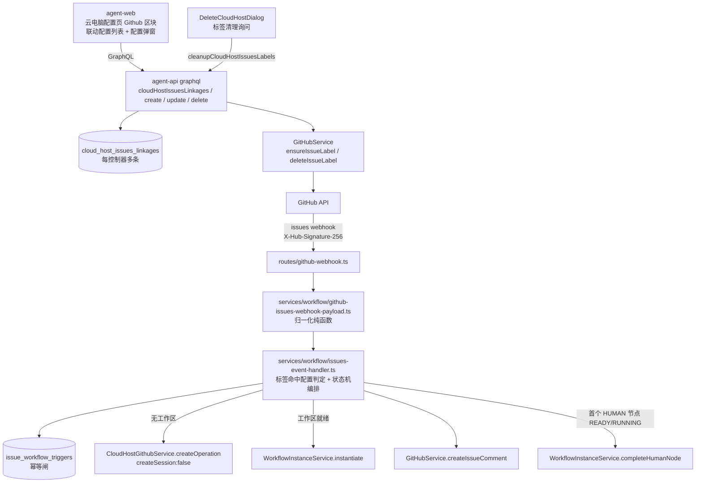
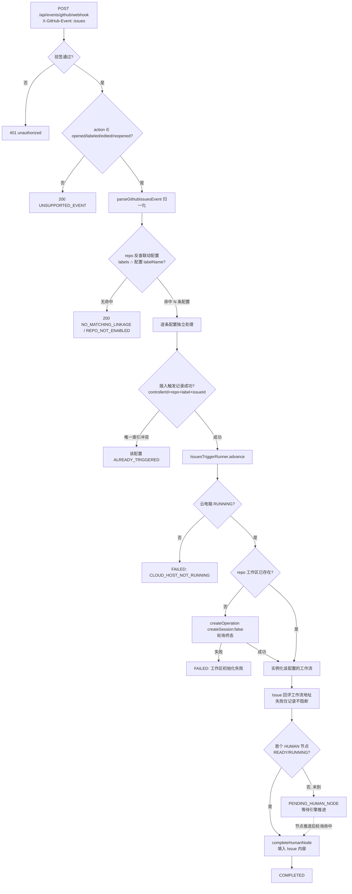
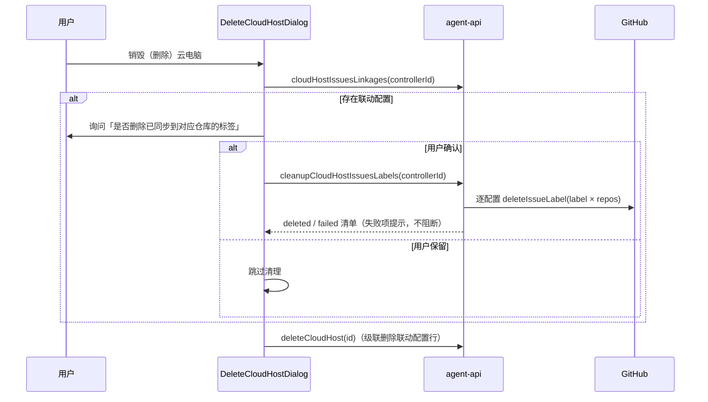

# 云电脑 GitHub Issues 联动工作流 - 技术提案

**功能名称**: 云电脑 GitHub Issues 联动工作流
**关联 PRD**: `docs/product/draft/20261025-github-issues-workflow.md`（v1.1）
**技术提案版本**: v1.1
**创建日期**: 2026-10-25
**作者**: ZeroAsh Agent
**feat-branch**: `feat/github-issues-workflow`

> v1.1 变更（对应 PR 评审意见）：联动设置由「每控制器一份（单工作流 + 固定标签 workflow-request）」改为「**联动配置列表**」——每条配置 = 一个已配置工作流 + 一个标签（默认 `start-{工作流名字}`，可修改，同云电脑内唯一）+ 一组仓库；确认时显式同步标签到仓库；新增销毁云电脑时的标签清理（用户确认后删除平台同步过的标签）；触发幂等键改为 `(controllerId, repoFullName, labelName, issueId)`。

## 1. 概述

### 1.1 背景

PRD 要求打通「GitHub Issue → 云电脑工作流」的自动触发链路。平台现有可复用基础：

1. **GitHub 原生 webhook 入口**（`servers/agent-api/src/routes/github-webhook.ts`）：`POST /api/events/github/webhook`，`X-Hub-Signature-256`（HMAC-SHA256，`GITHUB_WEBHOOK_SECRET`）验签，当前仅处理 `pull_request_review`。GitHub App 的 webhook 会投递其订阅的全部事件（含 `issues`），无需逐仓库手工配置。
2. **已配置工作流**（`models/configured-workflow.ts`）：`ConfiguredWorkflow{ userId, controllerId, nodes[] }`，按控制器归属——「为这台云电脑已配置完成的工作流」即 `configuredWorkflows(controllerId=云电脑控制器)`。
3. **云电脑 Github 项目设置**（`services/cloud-host-github-service.ts`）：`createOperation({ userId, controllerId, accountId, repoFullName, targetPath, createSession })` 三步编排（Github 工作负载 → Git 项目设置克隆仓库 → 会话创建），`ensureWorkspace` 幂等建立工作区；终态由 `cloud-host-workload-service` 轮询。
4. **工作流实例化与人类节点完成**（`services/workflow/instance.ts`）：`instantiate(userId, InstantiateWorkflowInput)`；`completeHumanNode(userId, instanceId, nodeId, input)` 对 READY 节点自动补 `start→complete`，`input` 作为「输入」产物写入黑板并向下游传递。
5. **GitHub 凭据**（`services/github.ts`）：`createRepoScopedToken` 铸造 installation token（`issues: write` 已具备），可创建、删除标签与评论。
6. **前端地址**：`config.frontendUrl`（`FRONTEND_URL`），工作流实例页路由为 `workflows/:id`。
7. **云电脑删除**：`DeleteCloudHostDialog`（`apps/agent-web/src/components/cloud-host/`）调用 `deleteCloudHost`，本期在其确认流程中扩展标签清理询问。

### 1.2 目标

- 云电脑设置新增「Github」区块：以列表维护多条 Issue 联动配置；添加配置弹窗依次完成「选工作流 → 标签名（默认 `start-{工作流名字}`，可修改）→ 多选仓库（显式提示标签将同步）」，确认后把标签同步到所选仓库（无则创建）；配置支持修改与删除。
- GitHub webhook 入口扩展处理 `issues` 事件（`opened` / `labeled` / `edited` / `reopened`），按「标签命中配置 + 仓库在配置列表 + 该 Issue 对该配置未曾触发」判定；同一 Issue 命中多条配置时各自独立触发。
- 触发后按状态机自动执行：工作区准备（无工作区时复用 Git 项目设置编排，不建会话）→ 实例化该配置的工作流并记录对应关系 → Issue 回评（含工作流地址）→ 首个 HUMAN 节点 READY/RUNNING 时自动完成并填入 Issue 内容与链接。
- 销毁云电脑时若存在联动配置，前端弹窗询问；用户确认后调用清理接口把平台同步过的标签从各仓库删除；删除云电脑时联动配置行级联删除（随之失效）。
- 幂等：同一 Issue 对同一（云电脑 × 仓库 × 标签）只触发一次；事件重复投递、重复打标安全消化。

### 1.3 范围

**做**：

- 数据模型：`CloudHostIssuesLinkage`（联动配置，每控制器多条；`(controllerId, labelName)` 唯一）、`IssueWorkflowTrigger`（触发记录，幂等与状态机载体）。
- GraphQL：`cloudHostIssuesLinkages` 列表查询；`createCloudHostIssuesLinkage` / `updateCloudHostIssuesLinkage` / `deleteCloudHostIssuesLinkage` / `cleanupCloudHostIssuesLabels` 变更；契约 `contracts/cloud-host.graphql` 扩展（或新增 `contracts/cloud-host-issues-linkage.graphql`，以既有契约拆分口径为准）。
- Webhook：`github-webhook.ts` 增加 `issues` 事件分支；新增 `services/workflow/github-issues-webhook-payload.ts`（归一化纯函数）与 `services/workflow/issues-event-handler.ts`（判定 + 触发编排）。
- GitHub API：`GitHubService` 新增 `ensureIssueLabel`（无则创建）、`deleteIssueLabel`（404 视为成功）、`createIssueComment`。
- 前端：云电脑配置页「Github」区块（配置列表 + 「加Issue联动配置」）与配置弹窗；`DeleteCloudHostDialog` 扩展标签清理询问。
- 单元测试与 API 测试（复用 T-PR / T-GHWH 套件基建）。

**不做**：

- 其他代码托管平台；`issue_comment` 等其他事件类型。
- Issue 内容变更后同步进已创建的工作流（PRD 明确「Issue 修改不影响工作流」）。
- 删除单条联动配置时删除仓库标签（标签清理由销毁云电脑的统一确认入口承担；单条配置删除后标签保留但不再触发）。
- 清理用户自行创建的同名标签（仅删除平台同步过的标签）。
- GitHub App webhook 订阅项的运维配置（App 侧勾选 `issues` 事件为一次性运维操作）。

## 2. 技术架构

### 2.1 系统架构图



### 2.2 技术栈

| 层级 | 技术选型 | 说明 |
|------|---------|------|
| 前端 | React 19 + TypeScript + Apollo Client + Tailwind v4 | 与 `apps/agent-web` 现状一致 |
| 后端 | Node.js 24 + TypeScript（strict/ESM）+ Express v5 + GraphQL-Yoga | 与 `servers/agent-api` 现状一致 |
| 数据库 | MongoDB（Mongoose） | 新增两个集合 |
| 验签 | `node:crypto` HMAC-SHA256 + timingSafeEqual | 复用 `github-webhook.ts` 既有 `isAuthorized` |
| 测试 | Vitest（单测）+ Aspire 真实服务（API 测试） | TDD 红-绿-重构 |

### 2.3 模块划分

| 模块 | 职责 | 关键技术点 |
|------|------|-----------|
| `models/cloud-host-issues-linkage.ts`（新增） | 联动配置存储 | `(controllerId, labelName)` 唯一索引；`repoFullNames` 去重落库 |
| `models/issue-workflow-trigger.ts`（新增） | 触发记录与状态机 | `(controllerId, repoFullName, labelName, issueId)` 唯一索引（幂等闸）；`status` 枚举 |
| `services/workflow/github-issues-webhook-payload.ts`（新增） | `issues` 报文 → `IssuesEventPayload` | 与 `github-webhook-payload.ts` 同风格手写校验；不支持的 action 返回 `null` |
| `services/workflow/issues-event-handler.ts`（新增） | 标签命中配置判定 + 状态机推进 | `KeyedMutex` 按 trigger 串行；工作区/实例化/回评/首人类节点自动完成 |
| `services/github.ts`（改） | 新增 `ensureIssueLabel` / `deleteIssueLabel` / `createIssueComment` | 复用 `createRepoScopedToken`；标签 422 already_exists 与删除 404 均视为成功 |
| `services/cloud-host-issues-linkage.ts`（新增） | 联动配置 CRUD + 标签同步/清理编排 | 校验（cloud 控制器 / 工作流含 HUMAN / 标签名 / 仓库授权）；同步失败汇总报错 |
| `routes/github-webhook.ts`（改） | 分发 `issues` 事件 | 与 `pull_request_review` 分支并列；忽略事件仍 200 `UNSUPPORTED_EVENT` |
| `graphql/schemas/cloud-host.ts` + `resolvers/cloud-host.ts`（改） | 联动配置 Query/Mutation | resolver 登记 `graphql/resolvers/index.ts` |
| `services/cloud-host-service.ts`（改） | 删除云电脑时级联删除联动配置行 | 不改变既有删除语义，仅追加相关行清理 |
| `apps/agent-web` 云电脑配置页与 `DeleteCloudHostDialog`（改） | 「Github」区块、配置弹窗、销毁清理询问 | 复用 `GET_GITHUB_ACCOUNTS`、`configuredWorkflows(controllerId)` |

## 3. API 设计

### 3.1 API 契约

契约变更：

- `contracts/cloud-host.graphql`（或新增 `cloud-host-issues-linkage.graphql`）：新增下述类型与操作；
- `contracts/event-callback.openapi.yaml`：`/api/events/github/webhook` 的 `X-GitHub-Event` 枚举补充 `issues`，说明 `issues` 事件的处理口径。

#### 接口 1: 查询联动配置列表（新增）

```graphql
type CloudHostIssuesLinkage {
  id: ID!
  controllerId: ID!
  configuredWorkflowId: ID!
  configuredWorkflowName: String!
  labelName: String!
  repoFullNames: [String!]!
  createdAt: String!
  updatedAt: String!
}

extend type Query {
  cloudHostIssuesLinkages(controllerId: ID!): [CloudHostIssuesLinkage!]!
}
```

- 仅归属本用户的云电脑可查；无配置返回 `[]`。

#### 接口 2: 添加 / 修改 / 删除联动配置（新增）

```graphql
input CloudHostIssuesLinkageInput {
  controllerId: ID!           # update 时忽略（以 id 定位）
  configuredWorkflowId: ID!
  labelName: String!
  repoFullNames: [String!]!   # 至少 1 个；去重后 ≤50
}

extend type Mutation {
  createCloudHostIssuesLinkage(input: CloudHostIssuesLinkageInput!): CloudHostIssuesLinkage!
  updateCloudHostIssuesLinkage(id: ID!, input: CloudHostIssuesLinkageInput!): CloudHostIssuesLinkage!
  deleteCloudHostIssuesLinkage(id: ID!): Boolean!
  cleanupCloudHostIssuesLabels(controllerId: ID!): CloudHostIssuesLabelCleanupResult!
}

type CloudHostIssuesLabelCleanupResult {
  deleted: [String!]!         # 已删除的 "repo#label"
  failed: [String!]!          # 失败的 "repo#label"
}
```

- 公共校验（错误文案进入 `toCloudHostGraphQLError` 白名单原样透传）：
  - 控制器须为当前用户的 `type=cloud` 主机，否则 `cloud host not found`；
  - 工作流须属于该控制器且 `nodes` 中至少一个 `type=HUMAN`，否则 `workflow must contain a human node`；
  - `labelName` trim 后非空、≤50 字符（GitHub 标签上限）、不含逗号，否则 `invalid label name`；
  - 同一 `controllerId` 内 `labelName` 唯一（大小写不敏感），冲突 → `label name already exists: <labelName>`（唯一索引兜底，11000 映射同文案）；
  - 每个 `repoFullName` 须在用户任一 GitHub 安装授权内，否则 `repo not authorized: <fullName>`；
  - `repoFullNames` 为空 → `at least one repo is required`。
- `create` / `update` 校验通过落库后，对每个所选仓库调用 `ensureIssueLabel(userId, repoFullName, labelName)`：单仓库失败不中断其余仓库，失败项汇总为 `label sync failed: <repo1,repo2>` 错误返回（配置已保存，前端提示后可重试——重试即重发同一变更，幂等）。`update` 修改了 `labelName` 时，**不同步删除旧标签**（旧标签随之失效不再触发，留待销毁清理或用户自处理），仅按新标签同步。
- `deleteCloudHostIssuesLinkage`：删除配置行；已触发记录与实例不受影响；仓库上已同步的标签保留。
- `cleanupCloudHostIssuesLabels`：遍历该控制器全部联动配置，对每个（配置标签 × 配置仓库）调用 `deleteIssueLabel`；逐项收集结果，404/已不存在视为删除成功；全部完成后**删除该控制器的联动配置行**；返回 `deleted/failed` 清单（个别失败不中断）。

#### 接口 3: GitHub webhook `issues` 事件（扩展既有入口）

- **请求**：`POST /api/events/github/webhook`，`X-GitHub-Event: issues`，`application/json` + `X-Hub-Signature-256` 验签（与现状一致）。
- **处理 action**：`opened` / `labeled` / `edited` / `reopened`；其余 action（`closed`、`assigned` 等）返回 200 `UNSUPPORTED_EVENT`。
- **归一化映射**：

  | GitHub 字段 | IssuesEventPayload 字段 | 说明 |
  |------|------|------|
  | `issue.id` | `issueId` | 跨重投稳定，幂等键组成部分 |
  | `issue.number` | `issueNumber` | 评论与展示用 |
  | `issue.title` / `issue.body` | `title` / `body` | body 可空，长度上限与既有事件载荷对齐（≤64000） |
  | `issue.html_url` | `issueUrl` | 人类节点输入与追溯 |
  | `issue.user.login` | `author` | 可为 null，缺省省略 |
  | `issue.labels[].name` | `labels` | 与联动配置 `labelName` 匹配（大小写不敏感） |
  | `repository.full_name` | `repoFullName` | 须为 `owner/repo` 两段 |

- **响应**：与既有端点同构 `{ handled, reason, results }`；受理 `handled:true`；安全忽略 `handled:false` + 具体 `reason`（`UNSUPPORTED_EVENT` / `NO_MATCHING_LINKAGE` / `REPO_NOT_ENABLED` / `ALREADY_TRIGGERED` / `CLOUD_HOST_NOT_RUNNING`）。多配置命中时 `results` 逐项给出每条配置的受理/忽略结果。

### 3.2 内部接口

| 接口 | 签名 | 说明 |
|------|------|------|
| 报文转换 | `parseGithubIssuesEvent(raw: Buffer): IssuesEventPayload \| null` | `null`=安全忽略；字段非法抛 `GithubWebhookPayloadError(detail)` |
| 事件处理 | `handleIssuesEvent(event: IssuesEventPayload): Promise<EventCallbackResponse>` | 标签命中配置判定 + 每条命中配置创建/推进触发记录 |
| 标签确保 | `GitHubService.ensureIssueLabel(userId: string, repoFullName: string, name: string): Promise<void>` | GET 标签存在即返回；否则 POST 创建（固定颜色与描述常量）；422 already_exists 视为成功 |
| 标签删除 | `GitHubService.deleteIssueLabel(userId: string, repoFullName: string, name: string): Promise<void>` | DELETE label；404 视为成功 |
| 评论发布 | `GitHubService.createIssueComment(userId: string, repoFullName: string, issueNumber: number, body: string): Promise<number>` | 返回 comment id 落库 |
| 状态机推进 | `IssuesTriggerRunner.advance(triggerId: string): Promise<void>` | 见 5.2 实现点 2 |

## 4. 数据模型

### 4.1 数据库设计

#### 集合: `cloud_host_issues_linkages`

| 字段 | 类型 | 说明 |
|------|------|------|
| `userId` | ObjectId(ref User) | 归属用户，索引 |
| `controllerId` | ObjectId(ref Controller) | 云电脑控制器，索引（每控制器**多条**） |
| `configuredWorkflowId` | ObjectId(ref ConfiguredWorkflow) | 该配置触发的工作流 |
| `labelName` | String | 触发标签（默认 `start-{工作流名字}`，用户可改；trim、≤50 字符） |
| `repoFullNames` | [String] | 启用仓库列表（保存前去重、trim、校验格式） |
| timestamps | | createdAt / updatedAt |

索引：`{ controllerId: 1, labelName: 1 }` **唯一**（同云电脑内标签名唯一，大小写不敏感口径在写入前归一）；`{ userId: 1 }`。

#### 集合: `issue_workflow_triggers`

| 字段 | 类型 | 说明 |
|------|------|------|
| `userId` | ObjectId(ref User) | 归属用户（取自联动配置） |
| `controllerId` | ObjectId(ref Controller) | 触发的云电脑 |
| `linkageId` | ObjectId | 命中配置引用（配置删除后留档） |
| `configuredWorkflowId` | ObjectId | 命中配置的工作流快照 |
| `labelName` | String | 命中标签快照 |
| `repoFullName` | String | 仓库 |
| `issueId` | String | GitHub issue 数字 ID |
| `issueNumber` | Number | issue 编号 |
| `issueTitle` / `issueUrl` / `issueAuthor` | String | 快照（触发时点内容） |
| `status` | String | `PENDING_WORKSPACE` / `PENDING_INSTANTIATE` / `PENDING_HUMAN_NODE` / `COMPLETED` / `FAILED` |
| `workspaceId` | ObjectId | 工作区就绪后回写 |
| `setupOperationId` | ObjectId | 工作区初始化编排引用（如有） |
| `workflowInstanceId` | ObjectId | 实例化后回写 |
| `humanNodeId` / `completedNodeId` | String | 待自动完成 / 已完成的首个人类节点 |
| `commentId` | Number | Issue 回评 id（成功后回写） |
| `failureReason` | String | FAILED 原因 |
| timestamps | | createdAt / updatedAt |

索引：`{ controllerId: 1, repoFullName: 1, labelName: 1, issueId: 1 }` **唯一**——「这个 Issue 对这条配置未曾创建过工作流」的权威幂等闸（以标签名为配置身份：配置删除后同名重建，历史 Issue 仍不重复触发），插入冲突即 `ALREADY_TRIGGERED`；`{ controllerId: 1, status: 1 }`（运行恢复扫描用）。

### 4.2 缓存设计

无新增缓存。联动配置读取走 DB（触发链路非高频）；webhook 判定单次查询（按 `repoFullNames` 反查候选配置后在内存比对标签）即可。

## 5. 技术实现方案

### 5.1 核心流程





### 5.2 关键实现点

#### 实现点 1: `issues` 事件归一化（`github-webhook-payload.ts` 同风格）

- **描述**: `parseGithubIssuesEvent` 把 `issues` 报文转换为 `IssuesEventPayload`。
- **技术细节**: 手写校验（不引入 zod），与 `pr-event-payload.ts` / `github-webhook-payload.ts` 同风格；`action` 不在受理集合返回 `null`；必填 `issue.id/number/title/html_url`、`repository.full_name`、`issue.labels`；`issue.body`/`issue.user` 可空省略；`full_name` 两段校验；`title ≤ 256`、`body ≤ 64000`。
- **风险点**: `edited` 事件可能去掉标签——判定以**当前** labels 为准，无命中即 `NO_MATCHING_LINKAGE`；去掉标签不影响已创建的工作流（PRD 约束）。

#### 实现点 2: 触发状态机（`issues-event-handler.ts` / `IssuesTriggerRunner`）

- **描述**: 以 `issue_workflow_triggers.status` 为载体的推进器，每步幂等、可重入；多配置命中时逐配置各建一条触发记录、独立推进。
- **技术细节**:
  - 命中判定：`CloudHostIssuesLinkage.find({ repoFullNames: event.repoFullName })` 取候选，内存中按 `issue.labels`（归一小写）与 `labelName` 比对；命中集为空 → `NO_MATCHING_LINKAGE`（repo 无任何配置时文案区分 `REPO_NOT_ENABLED` 仅在存在该云电脑配置但仓库不在列表的判定路径使用——统一实现为：候选为空报 `REPO_NOT_ENABLED`，候选有但标签不中报 `NO_MATCHING_LINKAGE`）。
  - `KeyedMutex`（`issues-trigger:{triggerId}`）串行化单触发记录推进；进程重启后经 `{ status: { $in: [PENDING_*] } }` 扫描恢复（启动时 + 定时 1s 轮询，复用 `cloud-host-workload-service` 的轮询范式）。
  - **工作区判定**：按 `controllerId + repoFullName` 查 `cloud_host_github_bindings` 与 `ControllerWorkspace`（路径 = `resolveClonePath(prefix, repoFullName)`，`prefix` 取云电脑默认工作区路径或 `/root/workspace`）。缺失时 `cloudHostGithubService.createOperation({ ..., targetPath: prefix, createSession: false })`（不建会话，避免与 PRD 之外的副作用），轮询 operation 终态后从 `ensureWorkspace` 结果取 `workspaceId`。
  - **实例化**：读取触发记录快照的 `configuredWorkflowId` 对应 `ConfiguredWorkflow`，按前端同口径映射 `nodes` → `InstantiateWorkflowInput{ source:'CONFIGURED', configuredWorkflowId, controllerId, workspaceId, name }`；`name = '{repo}#{issueNumber} {issueTitle}'` 截断 64 字。`workflowInstanceService.instantiate(linkage.userId, input)` 成功后回写 `workflowInstanceId`。配置已被删除时仍按快照实例化（PRD：删除配置不影响已触发）。
  - **回评**：`createIssueComment` 发布固定文案（见 5.3）；`commentId` 回写；失败仅记录、状态继续推进（PRD：评论失败不影响已创建工作流）。
  - **首个人类节点自动完成**：实例化后确定节点图中**执行序上第一个 `type=HUMAN` 的节点**（按 `dependsOn` 拓扑序取首个 HUMAN）；轮询实例（1s）直到该节点 `READY/RUNNING`（AI 上游节点可能先行执行），调用 `completeHumanNode(userId, instanceId, nodeId, input)`；`input` 为 Issue 内容拼装（见 5.3）。节点进入 `DONE` 后状态 `COMPLETED`。若工作流在到达该节点前被删除/归档 → `FAILED: workflow interrupted`。
  - 超时：工作区编排复用 `CLOUD_HOST_SETUP_STALE_MS` 口径；`PENDING_HUMAN_NODE` 上限 24h（工作流可能长时运行），超时标 `FAILED`。
- **风险点**: 引擎对 HUMAN 节点是「上游 DONE 自动激活 RUNNING」，`completeHumanNode` 对 READY 会补 start——两个入口均可完成；轮询判定须同时接受 READY/RUNNING，且只在 `DONE` 未达成时调用一次（调用前在锁内重读节点状态防并发双完成，`completeHumanNode` 对非法状态转移本身报错，捕获后重读确认幂等）。

#### 实现点 3: 联动配置服务（`cloud-host-issues-linkage.ts`）

- **描述**: 配置 CRUD 校验与标签同步/清理编排。
- **技术细节**:
  - 默认标签名生成：`start-{工作流名字}`，去除首尾空白、截断至 50 字符（前端预填，服务端不自动生成——以用户提交值为准）。
  - 写入前 `labelName` 归一（trim）；唯一性大小写不敏感（查询时 `collation` 或归一小写存 `labelNameLower` 冗余字段，取实现简洁者——采用冗余字段 `labelNameLower` 并以其参与唯一索引）。
  - `ensureIssueLabel` 使用固定颜色与描述常量（`ISSUES_LINKAGE_LABEL_COLOR` / `ISSUES_LINKAGE_LABEL_DESCRIPTION = '由 z-agent-gear 云电脑 Issues 联动同步'`），保证「平台同步过的标签」可识别；清理只删配置记录过的标签名，不触碰用户自建同名之外的其他标签。
  - `cleanupCloudHostIssuesLabels`：逐配置 `deleteIssueLabel(labelName × repoFullNames)`，收集 `deleted/failed`；完成后删除该控制器全部配置行；`deleteCloudHost` 内级联 `CloudHostIssuesLinkage.deleteMany({ controllerId })`（用户跳过清理时配置同样失效）。
- **风险点**: 配置行删除后触发记录保留 `linkageId/labelName` 快照，判定链不依赖配置行存在（仅新事件判定依赖）。

#### 实现点 4: 文案常量（`services/workflow/issues-prompts.ts` 新增）

- **Issue 回评**（占位符运行时替换）：

  ```text
  工作流已经触发创建，Issue 的后续修改将不会影响工作流的执行。
  工作流地址：{workflowUrl} ，点击查看。
  ```

  其中 `workflowUrl = \`${config.frontendUrl}/workflows/{workflowInstanceId}\``（`FRONTEND_URL` 环境变量配置）。

- **首个人类节点自动完成输入**：

  ```text
  来源：GitHub Issue {repoFullName}#{issueNumber}
  标题：{issueTitle}
  链接：{issueUrl}
  提交人：{issueAuthor}

  {issueBody}
  ```

#### 实现点 5: 前端「Github」设置区块与销毁询问（`apps/agent-web`）

- **描述**: 云电脑配置页新增「Github」区块（仅 `controller.type==='cloud'` 展示）：联动配置列表（每条：工作流名称、标签名、仓库 chips、编辑/删除）+「加Issue联动配置」按钮；弹窗 `IssuesLinkageDialog`（`components/cloud-host/`）分步完成配置；`DeleteCloudHostDialog` 扩展清理询问。
- **技术细节**:
  - 工作流选项：`configuredWorkflows(controllerId)` 过滤 `nodes.some(n => n.type === 'HUMAN')`；为空时展示「配置工作流」按钮（导航到既有工作流配置入口）并禁用确认。
  - 标签名：选中工作流后预填 `start-{工作流名字}`（截断 50）；用户手动编辑后切换工作流不再覆盖（dirty 标记）；失焦校验非空/≤50/不含逗号。
  - 仓库选项：`GET_GITHUB_ACCOUNTS` → `installations[].repos` 合并按 `fullName` 去重（与 `useGithubProjectForm` 同口径），多选勾选；确认按钮上方固定展示提示「确认后将把标签 `{labelName}` 同步到所选仓库」。
  - 提交 `createCloudHostIssuesLinkage`；服务端返回 `label sync failed: ...` 时展示失败仓库并保留弹窗数据可重试。
  - 编辑：同一弹窗预填（`labelName` 修改提示「旧标签将保留在仓库中但不再触发」）；删除：二次确认。
  - 销毁询问：`DeleteCloudHostDialog` 打开时查询 `cloudHostIssuesLinkages(controllerId)`，非空则展示「同时删除已同步到仓库的标签（N 条配置）」勾选项；勾选时先调 `cleanupCloudHostIssuesLabels`，返回 `failed` 非空时展示失败项但仍继续 `deleteCloudHost`；未勾选直接删除。
  - 移动端沿用既有对话框宽度约束，禁止横向溢出。
- **风险点**: 配置区块懒查询（进入配置页/打开弹窗才拉取），不进入 `HOME_OVERVIEW` 聚合；删除弹窗的查询失败时降级为不展示勾选项（不阻断删除）。

### 5.3 与安全相关的统一处理

- webhook 验签完全复用既有 `isAuthorized`；`issues` 分支与 `pull_request_review` 分支并列、互不干扰。
- Issue 标题/正文与标签名作为纯文本进入产物与提示词（与 PR 联动「追加提示词按文本处理」同口径）。
- token 仅在使用时铸造（`createRepoScopedToken`），不落库、不写日志（沿用 `sanitizeOperationError` 口径）。

## 6. 技术决策

### 6.1 决策列表

| 决策 | 选项 A | 选项 B | 最终选择 | 原因 |
|------|--------|--------|---------|------|
| 联动设置粒度 | 每控制器一份（单工作流+固定标签） | 每控制器多条配置（工作流+自定义标签+仓库） | B | 评审意见明确改为列表形态；多「标签→工作流」规则表达力更强 |
| 标签命名 | 固定 `workflow-request` | 默认 `start-{工作流名字}`，可修改 | B | 评审意见；标签自带工作流语义，GitHub 侧可辨 |
| 事件来源 | 每仓库手工配置 webhook | GitHub App webhook 自动投递 | B | App 已具备 `issues: write` 权限与统一 webhook 通道，零仓库侧配置 |
| webhook 入口 | 新增独立端点 | 扩展既有 `/api/events/github/webhook` | B | 验签与忽略语义完全一致，并列分支零干扰 |
| 触发幂等键 | `(repoFullName, issueId)` | `(controllerId, repoFullName, labelName, issueId)` | B | 多配置下同 Issue 可对不同配置各触发一次；以标签名为配置身份，配置删除重建不误触发历史 Issue |
| 工作区初始化 | 新写克隆编排 | 复用 `cloud-host-github-service.createOperation`（`createSession:false`） | B | 三步编排、凭据、路径权威拼接均已就绪；`createSession:false` 避免额外副作用 |
| 首人类节点等待 | 引擎事件订阅钩子 | 触发记录状态机 + 1s 轮询 | B | 与既有 setup runner 轮询范式一致；不侵入工作流引擎核心，回归面小 |
| 标签清理时机 | 删除单条配置即删标签 | 销毁云电脑时统一询问清理 | B | 评审意见；单条配置删除/改名的旧标签保留不触发，避免误删用户仍在用的入口 |
| 清理范围 | 仓库上同名标签全删 | 仅删配置记录过的（标签 × 仓库）组合 | B | PRD 约束：只删平台同步过的标签 |
| Issue 评论失败 | 整体失败回滚 | 记录后继续推进 | B | PRD 明确评论失败不影响已创建工作流 |

### 6.2 依赖与约束

| 类型 | 内容 | 说明 |
|------|------|------|
| 依赖 | `routes/github-webhook.ts` 验签与挂载顺序 | `issues` 分支同约束：全局 `express.json()` 之前挂载 |
| 依赖 | `CloudHostGithubService.createOperation` / `workflowInstanceService.instantiate` / `completeHumanNode` | 零改动复用 |
| 依赖 | `GitHubService.createRepoScopedToken`（`issues: write`） | 标签创建/删除与评论 |
| 依赖 | `config.frontendUrl`（`FRONTEND_URL`） | 回评工作流地址 |
| 约束 | GitHub App 订阅 `issues` 事件 | 一次性运维配置，未订阅时功能静默不触发（需在部署文档标注） |
| 约束 | GitHub 标签名上限 50 字符 | 前/后端同口径校验 |
| 约束 | TDD | 红-绿-重构，先写测试再写实现 |
| 约束 | 兼容性 | 不触碰 `pull_request_review` 既有行为；未配置联动零影响 |

## 7. 项目结构

```
z-agent-gear/
├── contracts/
│   ├── cloud-host.graphql                        # [改] CloudHostIssuesLinkage 类型与操作
│   └── event-callback.openapi.yaml               # [改] issues 事件说明
├── servers/agent-api/src/
│   ├── models/
│   │   ├── cloud-host-issues-linkage.ts          # [新] 联动配置（每控制器多条）
│   │   └── issue-workflow-trigger.ts             # [新] 触发记录状态机
│   ├── routes/github-webhook.ts                  # [改] issues 事件分支
│   ├── services/
│   │   ├── github.ts                             # [改] ensureIssueLabel / deleteIssueLabel / createIssueComment
│   │   ├── cloud-host-issues-linkage.ts          # [新] 配置 CRUD + 标签同步/清理编排
│   │   ├── cloud-host-service.ts                 # [改] 删除云电脑级联清理联动配置行
│   │   └── workflow/
│   │       ├── github-issues-webhook-payload.ts  # [新] issues 报文归一化
│   │       ├── issues-event-handler.ts           # [新] 命中判定 + 状态机编排
│   │       └── issues-prompts.ts                 # [新] 回评与节点输入文案常量
│   └── graphql/
│       ├── schemas/cloud-host.ts                 # [改]
│       └── resolvers/cloud-host.ts               # [改]（登记 resolvers/index.ts）
├── apps/agent-web/src/
│   └── components/cloud-host/
│       ├── CloudHostIssuesLinkageSection.tsx     # [新] 配置页 Github 区块（列表）
│       ├── IssuesLinkageDialog.tsx               # [新] 添加/编辑联动配置弹窗
│       └── DeleteCloudHostDialog.tsx             # [改] 销毁时标签清理询问
└── tests/api/src/agent-api/
    └── github-issues-webhook.test.ts             # [新] 黑盒 API 测试（T-GHI*）
```

## 8. 测试策略

### 8.1 测试覆盖要求

- 单元测试覆盖率 ≥ 80%（新增文件全分支覆盖）。
- API 测试覆盖：`POST /api/events/github/webhook`（issues 分支）、GraphQL 各操作全部分支。

### 8.2 测试类型

| 类型 | 工具 | 覆盖范围 |
|------|------|---------|
| 单元测试（归一化） | Vitest | 各必填字段缺失 detail；不受理 action → null；labels 提取；body/user 可空省略；full_name 非法 |
| 单元测试（事件处理） | Vitest | 命中判定（REPO_NOT_ENABLED / NO_MATCHING_LINKAGE / ALREADY_TRIGGERED）；多配置命中各触发一次；唯一索引冲突幂等；云电脑非 RUNNING → FAILED；配置已删除按快照继续；状态机各步推进与重入 |
| 单元测试（配置服务） | Vitest | 校验矩阵（非 cloud 控制器 / 工作流无 HUMAN / 标签名空/超长/含逗号/重复 / repo 未授权 / 空列表）；label sync 部分失败汇总报错；update 改名不同步删旧标签；cleanup 逐项收集 deleted/failed 并删除配置行；deleteCloudHost 级联清理 |
| 单元测试（前端） | Vitest + RTL | 弹窗工作流过滤（无 HUMAN 不展示）、无工作流展示「配置工作流」、标签默认预填与 dirty 不覆盖、仓库多选去重、同步提示展示、sync 失败提示与重试；DeleteCloudHostDialog 勾选清理与失败项展示、查询失败降级 |
| API 测试 | Vitest + Aspire 真实服务 | 验权 401；非法载荷 400；`issues`(labeled, 命中配置标签) 全链路：建配置 → 事件 → 工作区就绪 → 实例化 → 评论（mock GitHub API 层）→ 首人类节点自动完成；重复投递 `ALREADY_TRIGGERED`；同 Issue 双标签命中双配置各触发一次 |

关键边界用例：同一 issue 同标签重投、`edited` 摘掉标签、实例化成功评论失败、首人类节点前存在 AI 节点（延迟完成）、配置删除后历史 issue 不再触发。

## 9. 部署方案

### 9.1 环境规划

| 环境 | 用途 | 部署方式 |
|------|------|---------|
| 本地 | 开发联调 | Aspire 编排（`aspire start`） |
| 线上 | 生产 | 随 agent-api / agent-web 既有流水线 |

### 9.2 配置管理

| 配置项 | 说明 |
|------|------|
| `GITHUB_WEBHOOK_SECRET` | 既有，复用 |
| `FRONTEND_URL` | 既有（`config.frontendUrl`），回评工作流地址来源；须配置为外部可达地址 |
| GitHub App webhook 订阅 | 需勾选 `issues` 事件（一次性运维操作） |

## 10. 验收标准

- [ ] 技术方案评审通过、Contract 评审通过。
- [ ] 云电脑设置可见「Github」区块与配置列表，可添加（工作流 → 标签默认 `start-{工作流名字}` 可改 → 仓库多选并明示同步）/修改/删除配置；确认后所选仓库自动同步标签。
- [ ] 带配置标签的 Issue 触发全链路：工作区准备（必要时）→ 实例化 → 回评（含可点击工作流地址）→ 首个人类节点自动完成并携带 Issue 内容。
- [ ] 同一 Issue 对同一配置只触发一次；多标签命中多配置各触发一次；不满足条件的事件安全忽略且 reason 可追溯。
- [ ] 销毁云电脑时出现标签清理询问；确认后平台同步过的标签全部删除（失败项提示）；取消则保留。
- [ ] 未配置联动的云电脑与 `pull_request_review` 联动行为零回归。
- [ ] 单元测试与 API 测试通过。

## 11. 相关文档

- [[../../../../docs/product/draft/20261025-github-issues-workflow.md|关联 PRD：云电脑 GitHub Issues 联动工作流]]
- [[20261023-feat-workflow-github-pr-callback.md]] — 工作流 GitHub Pull Request 联动技术提案
- [[20261025-feat-github-native-webhook.md]] — GitHub 原生 Webhook 入口技术提案
- [[20261021-feat-github-workload.md]] — Github 工作负载与云主机 Git 项目设置技术提案
- [[../common-rules.md]]、[[../backend-rules.md]]、[[../frontend-rules.md]] — 开发规范
