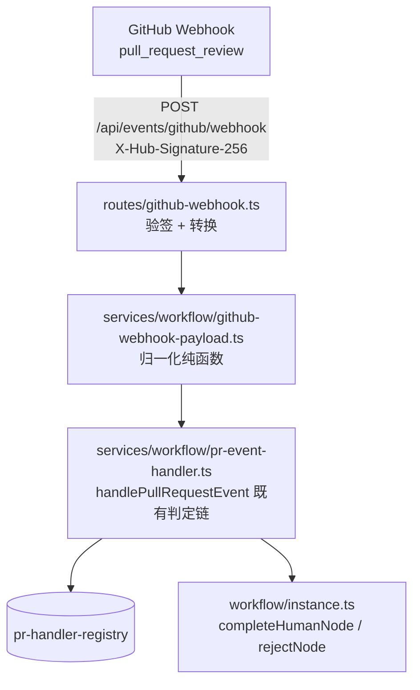
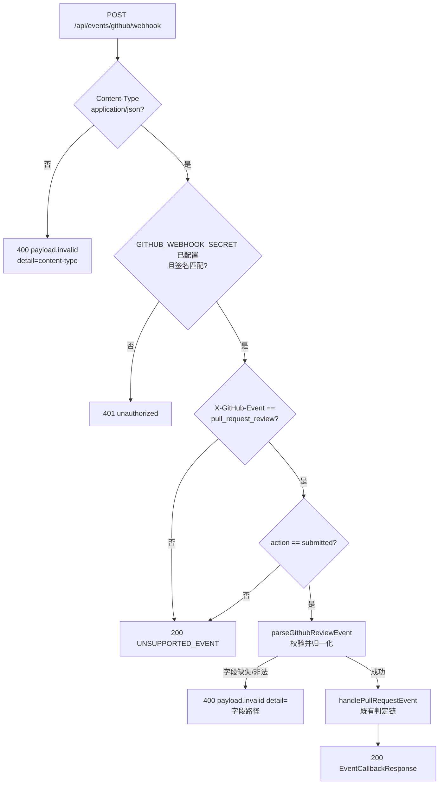

# GitHub 原生 Webhook 入口 - 技术提案

**功能名称**: GitHub 原生 Webhook 入口（Pull Request Review 直连）
**关联 PRD**: `docs/product/draft/20261023-workflow-github-pr-callback.md`
**技术提案版本**: v1.0
**创建日期**: 2026-10-25
**作者**: ZeroAsh Agent
**feat-branch**: `feat/github-native-webhook`

## 1. 概述

### 1.1 背景

工作流 GitHub Pull Request 联动（`20261023-feat-workflow-github-pr-callback`）已落地 `POST /api/events/callback` 事件回调端点（`servers/agent-api/src/routes/event-callback.ts`），按 review 状态驱动人类节点完成/打回。但该端点消费的是**平台自定义的归一化载荷**（`eventType/eventId/payload.{pullRequestId,reviewState,...}`，见 `services/workflow/pr-event-payload.ts`），GitHub 原生 webhook 的 `pull_request_review` 报文结构完全不同，且 GitHub webhook 无法设置自定义 header（`X-Event-Token`），导致仓库 `Settings → Webhooks` 无法直连——目前只能在每个被联动仓库放一个 GitHub Actions 中转 workflow，接入成本高。

### 1.2 目标

- 新增 `POST /api/events/github/webhook`，直接接收 GitHub 原生 webhook 报文（`application/json`）。
- 鉴权仅走 GitHub 官方验签：`X-Hub-Signature-256` 对原始字节做 HMAC-SHA256（`GITHUB_WEBHOOK_SECRET`）；未配置密钥时一律 401（默认拒绝）。
- 将 `pull_request_review`（action=`submitted`）事件归一化为既有 `EventCallbackPayload`，复用 `handlePullRequestEvent` 判定链驱动工作流，行为与 `/api/events/callback` 完全一致。
- 其他事件类型 / 其他 action / `ping` 安全忽略（HTTP 200，不驱动流转）。

### 1.3 范围

**做**：

- `services/workflow/github-webhook-payload.ts`：GitHub 原生报文 → 归一化载荷的纯函数转换（含字段校验）；
- `routes/github-webhook.ts`：HTTP 入口（验签、Content-Type 校验、转换、分发）；
- `contracts/event-callback.openapi.yaml`：新增路径契约；
- 单元测试（路由 + 转换函数）与 API 测试（黑盒，复用 T-PR* 套件基建）。

**不做**：

- `pull_request_review` 之外的事件类型（`pull_request`、`issue_comment` 等）；
- `application/x-www-form-urlencoded` 形式的 webhook 载荷（仅支持 `application/json`）；
- Webhook 的自动创建/注册（GitHub 侧配置为手工运维操作）；
- 对 `/api/events/callback` 既有行为的任何修改。

## 2. 技术架构

### 2.1 系统架构图



### 2.2 技术栈

| 层级 | 技术选型 | 说明 |
|------|---------|------|
| 后端 | Node.js 24 + TypeScript（strict/ESM）+ Express v5 | 与 `servers/agent-api` 现状一致 |
| 验签 | `node:crypto` HMAC-SHA256 + timingSafeEqual | 与 `routes/event-callback.ts` 同口径 |
| 测试 | Vitest | 单测同构 `routes/event-callback.test.ts` |

### 2.3 模块划分

| 模块 | 职责 | 关键技术点 |
|------|------|-----------|
| `services/workflow/github-webhook-payload.ts`（新增） | 原生报文 → `EventCallbackPayload` | 纯函数；字段缺失抛 `GithubWebhookPayloadError(detail)`；不支持的事件/action 返回 `null` 表示忽略 |
| `routes/github-webhook.ts`（新增） | HTTP 入口 | `express.raw` 取原始字节验签；忽略事件返回 200 `UNSUPPORTED_EVENT`；转换后复用 `handlePullRequestEvent` |
| `index.ts`（改） | 挂载路由 | 与 `eventCallbackRouter` 一样必须在全局 `express.json()` 之前挂载（验签需要原始字节） |

## 3. API 设计

### 3.1 API 契约

契约变更：在 `contracts/event-callback.openapi.yaml` 新增路径 `/api/events/github/webhook`。

#### 接口 1: GitHub 原生 Webhook（新增）

- **请求**
  - Method: POST
  - Path: `/api/events/github/webhook`
  - Headers:
    - `Content-Type: application/json`（必须；其他类型 400）
    - `X-Hub-Signature-256: sha256=<hex>`（必须；对原始 body 的 HMAC-SHA256）
    - `X-GitHub-Event: pull_request_review`（事件类型）
    - `X-GitHub-Delivery: <guid>`（投递 ID，仅记录日志，不参与幂等）
  - Body: GitHub 原生 `pull_request_review` 事件载荷（`action=submitted`）

- **归一化映射**：

  | GitHub 字段 | EventCallbackPayload 字段 | 说明 |
  |------|------|------|
  | `review.id` | `eventId` = `gh:pull_request_review:{review.id}` | review ID 跨重投稳定，复投走 `DUPLICATE_EVENT` |
  | `review.submitted_at` | `occurredAt` / `payload.submittedAt` | |
  | `repository.full_name` + `pull_request.number` | `payload.pullRequestId` = `{full_name}#{number}` | 与 Registry 归一化口径一致（大小写不敏感比较在下游） |
  | `pull_request.html_url` | `payload.prUrl` | |
  | —（固定） | `payload.action` = `reviewed` | |
  | `review.state` | `payload.reviewState` | `approved` / `changes_requested` / `commented` / `dismissed` 原样透传，映射语义由既有判定链负责 |
  | `review.body` | `payload.comment` | |
  | `review.user.login` | `payload.reviewer` | |

- **响应**
  - Status: 200（已处理 / 安全忽略）
    - 处理结果与 `/api/events/callback` 同构（`EventCallbackResponse`）；
    - 忽略的非关注事件：`{ "handled": false, "reason": "UNSUPPORTED_EVENT", "results": [] }`（含 `ping`、非 `pull_request_review` 事件、`pull_request_review` 的非 `submitted` action）。
  - Status: 400（载荷非法）`{ "error": "payload.invalid", "detail": "<字段路径>" }`
  - Status: 401（验签失败 / 未配置 `GITHUB_WEBHOOK_SECRET`）`{ "error": "unauthorized" }`

### 3.2 内部接口

| 接口 | 签名 | 说明 |
|------|------|------|
| 报文转换 | `parseGithubReviewEvent(raw: Buffer): EventCallbackPayload \| null` | `null` = 安全忽略；抛 `GithubWebhookPayloadError` = 400 |
| 事件驱动 | `handlePullRequestEvent(event)` | 既有，零改动复用 |

## 4. 数据模型

无新增集合与字段；幂等仍复用 `workflowprhandlers.lastEventId`（eventId 为 review ID，天然稳定）。

## 5. 技术实现方案

### 5.1 核心流程



### 5.2 关键实现点

#### 实现点 1: 归一化纯函数（`github-webhook-payload.ts`）

- **描述**: 把 GitHub `pull_request_review`（submitted）报文转换为 `EventCallbackPayload`。
- **技术细节**:
  - 与 `pr-event-payload.ts` 同风格的手写校验（不引入 zod）；JSON 解析失败抛 `GithubWebhookPayloadError('json')`。
  - 必填字段及 detail：`action`（须为 `submitted`，否则返回 `null` 忽略）、`review.id`（number → string）、`review.state`、`repository.full_name`、`pull_request.number`；可选：`review.body` / `review.user.login` / `review.submitted_at` / `pull_request.html_url`。
  - `full_name` 须为 `owner/repo` 两段，避免构造出非法 PR 标识；非法抛 detail=`repository.full_name`。
  - 长度约束与 `pr-event-payload.ts` 对齐（comment ≤ 64000 等），事件载荷进入提示词的面不变。
- **风险点**: `review.user` 可为 null（GitHub 已删除账号），`reviewer` 缺省省略即可；`review.body` 为 null 时省略 `comment`。

#### 实现点 2: HTTP 入口（`routes/github-webhook.ts`）

- **描述**: 验签 + 分发，同构 `event-callback.ts`。
- **技术细节**:
  - `express.raw({ type: 'application/json', limit: '1mb' })` 取原始字节；验签失败或未配置密钥 → 401。
  - 签名格式校验：`sha256=` 前缀 + hex，timing-safe 比较（复用既有 `timingSafeEquals` 写法）。
  - 非关注事件/action 与 `ping`：200 `{handled:false, reason:'UNSUPPORTED_EVENT', results:[]}`，不调用处理器。
  - `handlePullRequestEvent` 抛异常时与既有端点一致：200 `{handled:false, reason:'HANDLER_FAILED', results:[]}` 并打日志（GitHub 侧 5xx 会触发指数退避重投风暴，保持 200）。
  - 挂载：`index.ts` 在全局 `express.json()` 之前 `app.use('/api', githubWebhookRouter)`。
- **风险点**: 挂载顺序错误会导致 body 已被 JSON 解析、验签失败——单测以独立 express app 挂载验证，且 index.ts 中紧挨既有回调路由并保留注释。

## 6. 技术决策

### 6.1 决策列表

| 决策 | 选项 A | 选项 B | 最终选择 | 原因 |
|------|--------|--------|---------|------|
| 事件入口形态 | 复用 `/api/events/callback` 增加 GitHub 报文识别 | 独立 `/api/events/github/webhook` | B | 两个端点载荷契约与鉴权口径不同（自定义 token vs 纯 GitHub 验签），独立路径避免互相干扰与误判 |
| 鉴权方式 | 同时接受 X-Event-Token | 仅 X-Hub-Signature-256 | B | GitHub webhook 无法设置自定义 header；收窄鉴权面，token 不暴露给该路径 |
| 事件范围 | 同时处理 `pull_request` 事件 | 仅 `pull_request_review`(submitted) | B | PRD 口径为「审核结果驱动流转」；review 结论只来自 review 状态 |
| eventId 取值 | `X-GitHub-Delivery` GUID | `gh:pull_request_review:{review.id}` | B | Delivery GUID 每次重投都变，无法幂等；review.id 跨重投稳定 |
| 处理器复用 | 新写一套判定链 | 归一化后调用 `handlePullRequestEvent` | B | 行为与既有端点一致，零回归风险，测试基建设备全部复用 |
| 处理器异常响应 | 500 | 200 + HANDLER_FAILED | B | 与既有端点一致；避免 GitHub 重投风暴（幂等位可安全消化重投） |

### 6.2 依赖与约束

| 类型 | 内容 | 说明 |
|------|------|------|
| 依赖 | `services/workflow/pr-event-handler.ts` | 零改动复用 |
| 依赖 | `config.githubWebhookSecret`（`GITHUB_WEBHOOK_SECRET`） | 已存在，本期复用；与 `/api/events/callback` 共用同一密钥 |
| 约束 | 挂载顺序 | 必须在全局 `express.json()` 之前 |
| 约束 | TDD | 红-绿-重构，先写测试再写实现 |
| 约束 | 兼容性 | 不触碰 `/api/events/callback` 与既有任何接口 |

## 7. 项目结构

```
z-agent-gear/
├── contracts/
│   └── event-callback.openapi.yaml             # [改] 新增 /api/events/github/webhook 路径
├── servers/agent-api/src/
│   ├── index.ts                                # [改] 挂载 githubWebhookRouter（express.json 之前）
│   ├── routes/github-webhook.ts                # [新] GitHub 原生 webhook 入口
│   ├── routes/github-webhook.test.ts           # [新] 路由单测
│   └── services/workflow/
│       ├── github-webhook-payload.ts           # [新] 原生报文归一化纯函数
│       └── github-webhook-payload.test.ts      # [新] 转换单测
└── tests/api/src/agent-api/
    └── github-webhook.test.ts                  # [新] 黑盒 API 测试（T-GHWH*）
```

## 8. 测试策略

### 8.1 测试覆盖要求

- 单元测试覆盖率 ≥ 80%（新增文件全分支覆盖）。
- API 测试覆盖端点：`POST /api/events/github/webhook` 全部分支。

### 8.2 测试类型

| 类型 | 工具 | 覆盖范围 |
|------|------|---------|
| 单元测试（路由） | Vitest | 未配置密钥 401；无签名/错误签名 401；正确签名 200；非 JSON Content-Type 400；`ping`/其他事件/非 submitted action → `UNSUPPORTED_EVENT` 且不调用处理器；载荷非法 400 带 detail；approved 事件透传 `handlePullRequestEvent` 结果；处理器抛错 → 200 `HANDLER_FAILED`；归一化字段逐项断言（mock 处理器捕获入参） |
| 单元测试（转换函数） | Vitest | 各必填字段缺失 detail；`full_name` 非法；`review.user=null`/`body=null` 省略；非 submitted → null；eventId 稳定性 |
| API 测试 | Vitest + Aspire 真实服务 | 鉴权（无签名/错误/正确）；载荷非法 400；未登记 PR → `NO_HANDLER`；fake controller MCP 关联 PR 后 approved 驱动人类节点完成（复用 T-PR 套件基建）；`ping` 忽略 |

关键边界用例：重复投递（同一 review.id → `DUPLICATE_EVENT`）、`commented` 状态忽略（`UNSUPPORTED_REVIEW_STATE`）。

## 9. 验收标准

- [ ] 技术方案评审通过、Contract 评审通过。
- [ ] GitHub 仓库 `Settings → Webhooks` 配置 `application/json` + Secret + Pull request reviews 事件后可直连驱动工作流。
- [ ] 验签失败/未配置密钥一律 401；非关注事件安全忽略。
- [ ] approved / changes_requested 事件分别驱动人类节点完成 / 打回，与 `/api/events/callback` 行为一致。
- [ ] 单元测试通过；API 测试用例齐备。

## 10. 相关文档

- [[../../../../docs/product/draft/20261023-workflow-github-pr-callback.md|关联 PRD：工作流 GitHub Pull Request 联动]]
- [[20261023-feat-workflow-github-pr-callback.md]] — 工作流 GitHub Pull Request 联动技术提案
- [[../common-rules.md]]、[[../backend-rules.md]] — 开发规范
