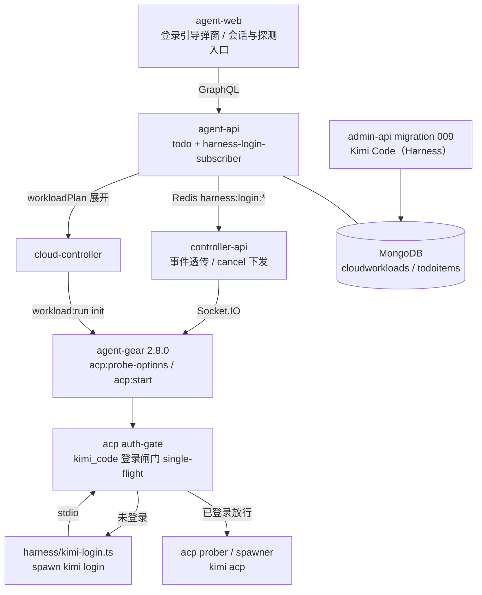
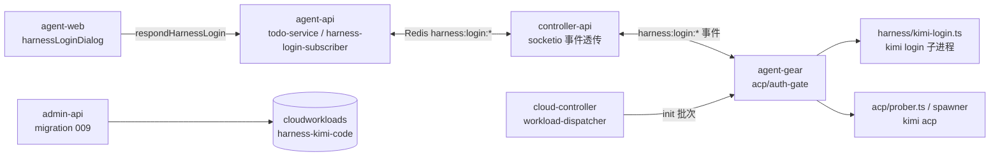
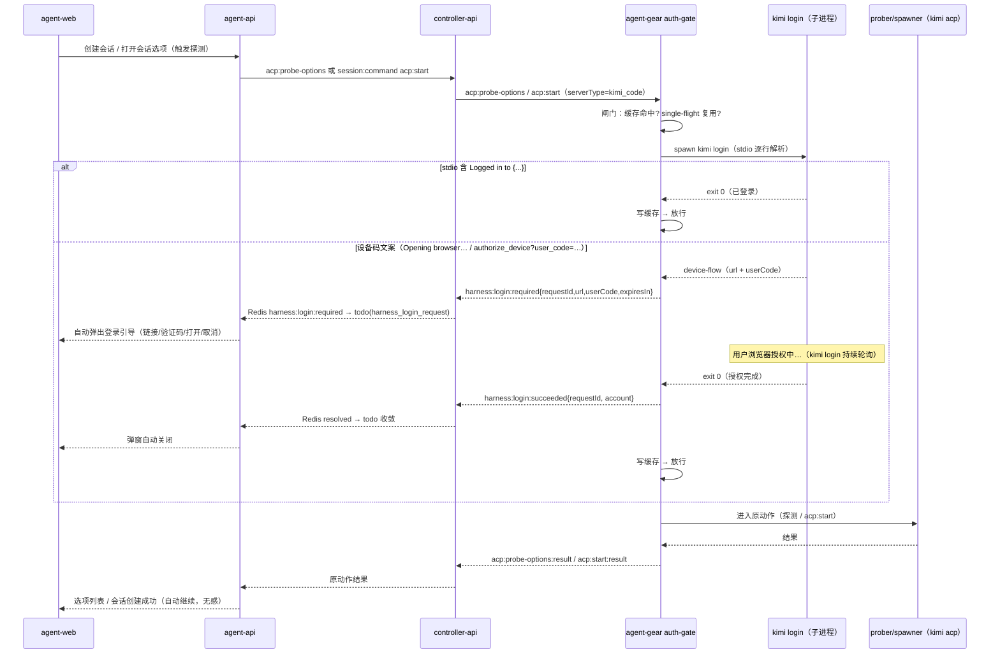
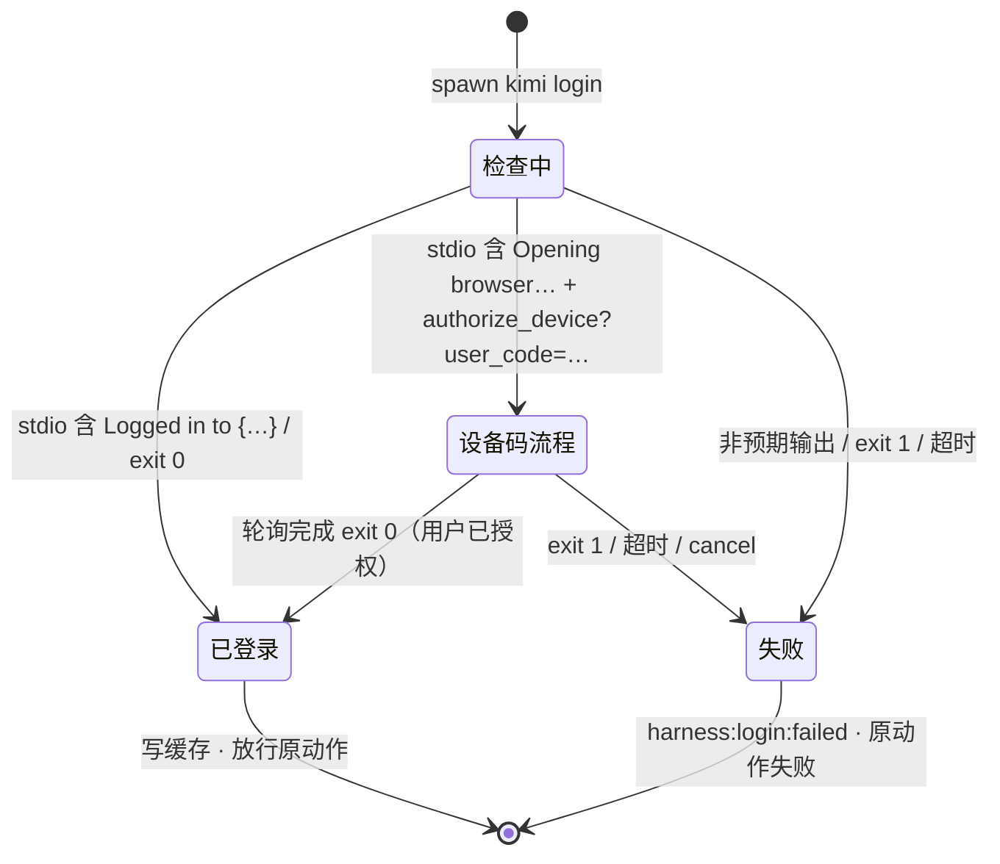
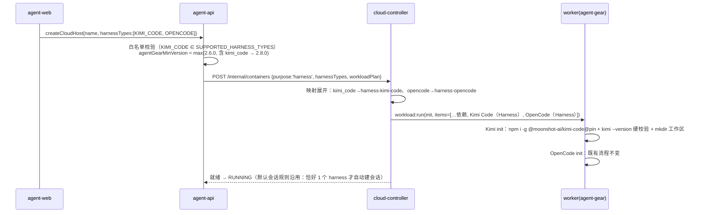

# 增加工作负载「Kimi Code」（Harness）：Kimi Code 接入与登录引导 - 技术提案

**功能名称**: 工作负载「Kimi Code」（Harness）与使用前登录引导
**关联 PRD**: [[../../product/draft/20261025-kimi-code-harness.md]]
**技术提案版本**: v1.0
**创建日期**: 2026-10-25
**作者**: ZeroAsh
**feat-branch**: `feat/kimi-code-harness`

## 1. 概述

### 1.1 背景

`20261020-feat-container-harness-support`（v5.0）交付了云电脑（harness 容器）基线：`purpose=harness` 全链路、`harnessTypes` 多选契约、预置 harness 工作负载展开、agent-gear 云主机模式双连接。当前事实：

- **harness 白名单仅 OpenCode**：`SUPPORTED_HARNESS_TYPES = ['opencode']`（`servers/cloud-controller/src/models/cloud-container.ts:27`）；`CloudWorkload.harnessType` 枚举 `['opencode', null]`（`servers/cloud-controller/src/models/cloud-workload.ts:51`）；`contracts/cloud-host.graphql` 的 `enum HarnessType { OPENCODE }`。
- **预置工作负载仅一个**：admin-api migration `006-preset-harness-opencode`（presetKey `harness-opencode`、`workloadKind='harness'`、`harnessType='opencode'`、init-only）：固定版本 `npm install -g @opencode/cli@<pin>` + `opencode --version` 硬校验 + `agent-gear harness prepare`（写 `opencode.jsonc` 注入 ZAG 模型网关）。
- **`kimi_code` 作为 ACP Server 已支持**（`20260721-feat-acp-mimo-kimi`）：`packages/agent-controller/src/acp/detector.ts` `detectKimiCode()` 执行 `kimi --version`；`getSpawnerConfig('kimi_code')` → `{ command: 'kimi', args: ['acp'] }`；`AcpServerType` 枚举已有 `kimi_code`（`contracts/agent-session.graphql`、`servers/*/src/models/session.ts`）。
- **「使用 harness」的拉起点只有两处**：① `acp:probe-options` 空实例探测（`packages/agent-controller/src/acp/prober.ts` `probeAcpServerOptions`：临时拉起 ACP 进程 `initialize` + `session/new` 收集 `modes`/`availableModels`，即「拉起 Kimi 探测可用模型」；任一环节失败（CLI 不存在 / **需要认证** / 超时）reject 后由调用方降级）；② `acp:start` / `acp:resume` 创建/继续会话（`packages/agent-controller/src/socketio-client.ts:656+`）。
- **Kimi Code 使用前必须登录**：Kimi Code CLI 靠用户的 Kimi 账号（Kimi Code OAuth 设备码或 Kimi 平台 API Key）授权；未登录时 `kimi acp` 的 `session/new` 不可用，探测/会话均失败且用户无从得知登录路径。官方非交互登录入口为 `kimi login`（RFC 8628 设备码流程，见附录 A）。
- 需求（上游）：增加工作负载「Kimi Code」类型 Harness（与 OpenCode 同级）；**使用 Harness 之前**（注意不是初始化工作负载，而是使用之前，如拉起 Kimi 探测可用模型、创建会话等）确认登录——执行 `kimi login`，stdio 出现「Logged in to {...}」即已登录；未登录则弹出提示框进入登录流程，让用户按照 stdio 中的链接进行登录。

因此本期两个交付面：① **Kimi Code 预置 harness 工作负载**（与 OpenCode 同级的第二个 harness 工具）；② **使用前登录闸门 + 登录引导**（agent-gear 拉起前确认登录，未登录时把 stdio 中的设备码链接/验证码推送到前端弹窗，授权完成后自动继续原动作）。

### 1.2 目标

- `HarnessType` 扩展 `KIMI_CODE`：创建云电脑可选 `kimi_code`（与 `opencode` 同级、多选），`SUPPORTED_HARNESS_TYPES`、`CloudWorkload.harnessType` 白名单同步扩展；预置工作负载展开映射 `kimi_code → harness-kimi-code`。
- admin-api migration `009-preset-harness-kimi-code`：「Kimi Code（Harness）」预置工作负载（`workloadKind='harness'`、`harnessType='kimi_code'`、init-only）：固定版本 `npm install -g @moonshot-ai/kimi-code@<pin>` + `kimi --version` 硬校验 + 默认工作区 `mkdir -p`；**不做登录、不注入平台模型配置**。
- agent-gear **2.8.0** 新增 Kimi 登录闸门：`acp:probe-options` 与 `acp:start`/`acp:resume`（`serverType='kimi_code'`）在拉起 `kimi acp` 之前执行登录检查（`kimi login` 子进程 + stdio 判定）；已登录直接继续；未登录进入设备码登录流程并推送 `harness:login:required`（含 stdio 中的 `url`/`userCode`），授权完成（进程 exit 0）后放行原动作并推送 `harness:login:succeeded`。
- 登录引导 UI：agent-web 全局单例弹窗（复用 elicitationDialog 的 todo+store 模式），展示登录链接/验证码/「打开登录链接」/「取消」；成功自动关闭、原动作自动继续；取消 → `harness:login:cancel` 中止。
- 并发去重：同一 controller + `kimi_code` 单飞行（single-flight）登录流程，多个使用动作共享一次结果、一个弹窗。
- 版本门禁细分：`purpose=harness` 的 `agentGearMinVersion` 按 `harnessTypes` 取最大值（含 `kimi_code` → `2.8.0`；仅 `opencode` 维持 `2.6.0`）。
- 单元 / API（fetch 风格）/ E2E 测试全绿；OpenCode 云电脑、普通主机、旧版本 agent-gear 零回归。

### 1.3 范围

**做**：

- `contracts/cloud-host.graphql`：`enum HarnessType { OPENCODE, KIMI_CODE }`（错误文案沿用 `unsupported harness type: <type>`）。
- cloud-controller：`SUPPORTED_HARNESS_TYPES` 扩展 `kimi_code`；`CloudWorkload.harnessType` 枚举扩展；workloadPlan 展开映射 `harness-kimi-code`（沿用多预设展开机制，本期即第 2 个 harness）。
- admin-api migration `009-preset-harness-kimi-code`（预置项 + init 脚本，幂等不覆盖管理员修改）。
- agent-gear 2.8.0：`harness/kimi-login.ts`（`kimi login` 子进程编排与 stdio 解析）、`acp/auth-gate.ts`（登录闸门 + single-flight + 等待超时）、`harness:login:*` socket 事件族。
- controller-api：`harness:login` 事件透传与 Redis 发布（`harness:login:required` / `harness:login:resolved`）；`harness:login:cancel` 命令下发（沿用 elicitation 链路模式）。
- agent-api：`todoitems` type 扩展 `harness_login_request`、`harness-login-subscriber`（订阅 Redis 收敛 todo）、`respondHarnessLogin(requestId, action)` mutation（取消）。
- agent-web：`stores/harnessLoginDialog.ts` + 登录引导弹窗（链接/验证码/打开/取消/有效期提示）、全局单例与自动关闭。
- 契约同步：`agent-session-websocket.md`（`harness:login` 事件族）、`agent-session.graphql`（TodoItem type / mutation）、`cloud-controller-websocket.md`（harnessTypes 展开与 `agentGearMinVersion` 口径）。
- 测试：单测（stdio 解析/闸门/映射/subscriber）、tests/api（fake controller 事件流）、tests/e2e（弹窗交互）、调研实机核对清单。

**不做**：

- **不在工作负载初始化阶段做登录**：init 脚本只装环境；登录确认只在「使用前」闸门执行（需求明确）。
- 平台模型网关注入 Kimi Code（`ZAG_MODEL_*` → kimi 配置）与 Kimi 模型的平台计费——模型口径随用户 Kimi 账号（登录后经 `session/new` 探测 `availableModels`），二期评估。
- 平台 API Key 录入登录方式（一期仅设备码 OAuth，涉密录入面二期评估）。
- 登录凭证托管/持久化/跨云电脑迁移（凭证随容器生命周期，重建重新登录）。
- 会话导入导出、统一存储（维持二期）。
- 后台（admin-web/admin-api）harness/登录入口。
- 其他未登录即不可用的 harness 工具接入（本期仅 `kimi_code`；闸门按 harness 类型可扩展）。

## 2. 技术架构

### 2.1 系统架构图



关键边界：

- **工作负载只装环境，不做登录**：`009-preset-harness-kimi-code` 与 OpenCode 同构（init-only），但**不含** `harness prepare`（本期不向 Kimi 注入平台模型配置）。
- **登录闸门在 agent-gear 拉起前**（容器/主机本地才有 `kimi` CLI 与登录凭证 `~/.kimi-code/`）：`acp:probe-options`（探测可用模型）与 `acp:start`/`acp:resume`（创建/继续会话）两处入口统一拦截，仅 `serverType='kimi_code'` 生效。
- **stdio 里的链接与验证码是唯一登录载体**：agent-gear 解析 `kimi login` 输出提取 `url`/`userCode`，事件链推送前端弹窗；平台不读、不存任何 Kimi 凭证（凭证写入容器内 `~/.kimi-code/`，即 `KIMI_CODE_HOME`）。
- **登录成功 = `kimi login` 进程 exit 0**（设备码轮询完成）：闸门放行原动作（探测/会话创建继续），弹窗自动关闭。
- **todo + 弹窗模式与 elicitation 同构**：`harness_login_request` 进 `todoitems`，agent-web 全局单例弹窗自动打开；取消经 `respondHarnessLogin` → `harness:login:cancel` 下发。

### 2.2 技术栈

| 层级 | 技术选型 | 说明 |
|------|---------|------|
| 前端 | React + TypeScript + Vite + Apollo Client | agent-web，复用 elicitationDialog 的 store/弹窗模式 |
| 后端 | Node.js + Express + GraphQL + Mongoose | agent-api（todo/subscriber/mutation）、controller-api（事件透传）、admin-api（migration 009） |
| Worker | Node.js（agent-gear 2.8.0） | 登录闸门、`kimi login` 子进程编排、stdio 解析 |
| 数据库 | MongoDB | `cloudworkloads`（预置项）、`todoitems`（`harness_login_request`）；无其他新集合 |
| 消息 | Redis Pub/Sub | `harness:login:required` / `harness:login:resolved`（沿用 elicitation 通道模式） |
| 协议 | Socket.IO + GraphQL | `harness:login:*` 事件族；todo 与 mutation 走 GraphQL |

### 2.3 模块划分



| 模块 | 职责 | 关键技术点 |
|------|------|-----------|
| admin-api migration 009 | 「Kimi Code（Harness）」预置工作负载 | 固定版本 npm 安装 + `kimi --version` 硬校验 + 幂等不覆盖 |
| cloud-controller 白名单/展开 | `harnessTypes` 白名单扩展、presetKey 映射 | `SUPPORTED_HARNESS_TYPES` + 映射表；多预设展开机制不动 |
| agent-gear `harness/kimi-login.ts` | `kimi login` 子进程编排、stdio 解析 | 判定 `Logged in to`（已登录）/ 设备码文案（未登录）；提取 url/userCode；脱敏 |
| agent-gear `acp/auth-gate.ts` | 使用前登录闸门 | 仅 `kimi_code`；single-flight；等待超时；放行后才进入探测/启动超时语义 |
| agent-gear socketio-client | `harness:login:*` 事件收发 | `required/succeeded/failed` 上行、`cancel` 下行 |
| controller-api | 事件透传与 Redis 发布 | 沿用 elicitation 通道模式；`harness:login:cancel` 命令下发 |
| agent-api | todo 生命周期 + 取消 mutation | `harness_login_request` todo；登录成功/失败收敛；并发 requestId 归并 |
| agent-web | 登录引导弹窗 | 全局单例；链接/验证码/打开/取消；成功自动关闭并继续原动作 |

## 3. API 设计

### 3.1 API 契约

#### 3.1.1 `contracts/cloud-host.graphql`（扩展）

```graphql
enum HarnessType {
  OPENCODE
  KIMI_CODE    # 本期新增：Kimi Code（与 OpenCode 同级）
}
```

- 校验与错误文案不变：`harnessTypes` 去重后 ≥1、全部在白名单，否则 `unsupported harness type: <type>`。
- **默认会话规则不变**：恰好 1 项时就绪后自动创建该 harness 对应 ACP 的会话；映射 `harnessType → acpServerType`：`OPENCODE → opencode`、`KIMI_CODE → kimi_code`。

#### 3.1.2 `contracts/agent-session-websocket.md`（新增 `harness:login` 事件族）

| 方向 | 事件 | 说明 |
|------|------|------|
| Controller → Server | `harness:login:required` | 未登录，进入设备码登录流程（携带 stdio 提取的链接/验证码） |
| Controller → Server | `harness:login:succeeded` | 登录成功（`kimi login` exit 0），闸门已放行 |
| Controller → Server | `harness:login:failed` | 登录失败/超时/被取消（附 reason） |
| Server → Controller | `harness:login:cancel` | 用户取消登录引导，中止 `kimi login` 进程 |

`harness:login:required` payload：

| 字段 | 类型 | 必填 | 说明 |
|------|------|------|------|
| `requestId` | `string` | 是 | 登录流程 ID（single-flight 归并键：`controllerId + serverType` 同时只有一个） |
| `controllerId` | `string` | 是 | 所属主机/云电脑 |
| `serverType` | `string` | 是 | 恒为 `kimi_code`（事件族按 harness 类型可扩展） |
| `trigger` | `string` | 是 | 触发动作：`probe-options` / `acp:start` / `acp:resume` |
| `url` | `string` | 是 | 登录链接（取自 stdio，逐字透传，如 `https://www.kimi.com/code/authorize_device?user_code=...`） |
| `userCode` | `string` | 是 | 验证码（取自 stdio，逐字透传） |
| `expiresInSeconds` | `int` | 否 | 设备码有效期（stdio `Code expires in 1800s.` 解析值；缺失按 1800） |

`succeeded`：`requestId`、`controllerId`、`account`（`Logged in to {...}` 中的账号信息，脱敏展示用）。
`failed`：`requestId`、`controllerId`、`reason`（`cancelled` / `timeout` / `error`）、`error`（可读摘要，已脱敏）。
`harness:login:cancel`：`requestId`。

语义（契约级）：

- 闸门拦截的原动作（`acp:probe-options` / `acp:start` / `acp:resume`）**挂起等待**，登录成功后自动继续并正常返回原结果；登录失败/取消则原动作以既有失败语义返回（探测 reject 降级、`acp:start:result success=false reason='auth'`）。
- 同一 `controllerId + serverType` 并发触发时共享同一 `requestId`：只发一次 `required`，登录结果对全部挂起动作生效。
- 登录等待时间**不计入**探测/启动的既有超时（探测 20s/30s、`acp:start` 超时在放行后才起算）。

#### 3.1.3 `contracts/agent-session.graphql`（TodoItem 与 mutation）

```graphql
enum TodoType {
  permission_request
  elicitation_request
  workflow_intervention
  harness_login_request    # 本期新增
}

type HarnessLoginRequestData {
  requestId: String!
  controllerId: ID!
  serverType: String!      # kimi_code
  trigger: String!         # probe-options | acp:start | acp:resume
  url: String!             # 登录链接（stdio 原文）
  userCode: String!        # 验证码（stdio 原文）
  expiresAt: String        # 设备码过期时间
}

type Mutation {
  # action 一期仅 cancel：取消登录引导（中止 kimi login，原动作失败返回）
  respondHarnessLogin(requestId: String!, action: HarnessLoginAction!): Boolean!
}

enum HarnessLoginAction { cancel }
```

- todo 生命周期：`required` → 创建（`harness_login_request`，未读自动弹窗）；`succeeded`/`failed`/用户取消 → 收敛终态（对应 elicitation 的 resolved 口径）。
- 过期兜底：`expiresAt` 之后 todo 自动收敛为 `expired` 并提示可重试（复用 elicitation 的过期收敛模式）。

#### 3.1.4 `contracts/cloud-controller-websocket.md`（口径增补）

- `workloadPlan` 展开映射扩展：`SUPPORTED_HARNESS_TYPES: { opencode: 'harness-opencode', kimi_code: 'harness-kimi-code' }`（白名单即映射键）。
- `agentGearMinVersion` 按 `harnessTypes` 细分：`max(基准 2.6.0, 含 kimi_code 时 2.8.0)`——仅 OpenCode 的运行维持 2.6.0 门禁不变；含 `kimi_code` 的运行要求 2.8.0（登录闸门所在版本）。
- `ZAG_HARNESS_TYPES` env 语义不变（逗号分隔，`opencode,kimi_code`）。

**不在本期改动**：`contracts/admin-cloud-container.graphql`、`contracts/admin-cloud-workload.graphql`（后台口径不动）、`contracts/billing-openai.openapi.yaml`（Kimi 不走平台计费）。

### 3.2 内部接口

#### 3.2.1 agent-gear ↔ controller-api（Socket.IO，`harness:login` 事件族）

见 §3.1.2。补充 agent-gear 内部接口：

```ts
// packages/agent-controller/src/harness/kimi-login.ts
export type KimiLoginOutcome =
  | { state: 'logged-in'; account?: string }                      // stdio 含 "Logged in to {...}"
  | { state: 'device-flow'; url: string; userCode: string;
      expiresInSeconds?: number }                                  // 设备码流程已发出，等待授权
  | { state: 'failed'; reason: 'cancelled' | 'timeout' | 'error'; error?: string };

export interface KimiLoginFlow {
  /** 登录检查 + （未登录时）等待授权完成；resolve 时 state 恒为 logged-in 或 failed */
  run(handlers: { onDeviceFlow(info): void }): Promise<KimiLoginOutcome>;
  cancel(): void;   // 杀掉 kimi login 进程（对应 harness:login:cancel）
}
```

#### 3.2.2 controller-api → agent-api（Redis Pub/Sub）

| 频道 | 载荷 | 说明 |
|------|------|------|
| `harness:login:required` | §3.1.2 required payload | 建/复用 todo |
| `harness:login:resolved` | `{ requestId, controllerId, userId, result: 'succeeded'\|'failed'\|'cancelled'\|'expired', account?, error? }` | 收敛 todo |

（与 `elicitation:request` / `elicitation:resolved` 同构；沿用 `servers/controller-api/src/services/acp-session-manager.ts` 的 publish 模式与 `servers/agent-api/src/services/elicitation-subscriber.ts` 的订阅模式。）

#### 3.2.3 agent-api → agent-gear（取消，经 controller-api）

`respondHarnessLogin(requestId, cancel)` → Redis/命令通道 → controller-api 按 `requestId` 找到挂起连接下发 `harness:login:cancel` → agent-gear `cancel()` 杀 `kimi login` 进程 → 原动作失败返回 + `harness:login:failed{reason:'cancelled'}`。

## 4. 数据模型

### 4.1 数据库设计

#### 集合: `cloudworkloads`（扩展 + 新增预置项）

| 字段 | 变更 |
|------|------|
| `harnessType` | 枚举 `['opencode', null]` → `['opencode', 'kimi_code', null]`（`servers/cloud-controller/src/models/cloud-workload.ts`） |

admin-api migration `009-preset-harness-kimi-code`（幂等：presetKey 或精确 name 命中即跳过、不覆盖管理员修改）：

| 字段 | 值 |
|------|----|
| `name` | `Kimi Code（Harness）` |
| `presetKey` | `harness-kimi-code` |
| `workloadKind` / `harnessType` | `harness` / `kimi_code` |
| `isPreset` / `paramSchema` / `dependsOnWorkloadIds` | `true` / `[]` / `[]` |
| `initScript` | 见 §5.3（固定版本安装 + 硬校验 + 默认工作区；无 post 脚本） |

#### 集合: `todoitems`（扩展）

| 字段 | 变更 |
|------|------|
| `type` | 枚举追加 `harness_login_request`（`servers/agent-api/src/models/todo-item.ts`） |
| 数据体 | `harnessLoginData: { requestId, controllerId, serverType, trigger, url, userCode, expiresAt }`（`requestId` 复用 elicitation 的 requestId 唯一索引口径，agent-api migration `009-todo-harness-login` 补充必要索引） |

#### 集合: `cloudcontainers` / `cloudhosts` / `sessions`（无变更）

- `harnessTypes` 落库值域扩展 `kimi_code`（既有 `[String]` 字段，无 schema 变更）。
- 登录凭证**不落库**：仅存在于容器内 `~/.kimi-code/`（`KIMI_CODE_HOME`），随容器销毁。

### 4.2 缓存设计

- **登录检查结果缓存**：`harness:auth:<controllerId>:kimi_code`（Redis，TTL 5 分钟）——`kimi login` 判定 `logged-in` 后写入；闸门命中缓存直接放行（避免每次使用动作都拉起子进程）。缓存不跨云电脑生命周期保证：宁可多查一次，不阻塞正确性。
- **single-flight 表**：agent-gear 内存 Map `key=controllerId+serverType → 进行中的登录流程`（进程内即可，登录流程只发生在控制器本机）。
- 模式/模型选项缓存（`acp:probe-options` 既有 5 分钟缓存）口径不变；登录成功后的重新探测自然回源。

## 5. 技术实现方案

### 5.1 核心流程

#### 5.1.1 使用前登录闸门（探测 / 创建会话）



- **取消**：弹窗「取消」/ 关闭 → `respondHarnessLogin(cancel)` → `harness:login:cancel` → `K` 进程被杀 → 原动作 `acp:start:result success=false reason='auth'`（探测维持 reject 降级）→ `harness:login:failed{reason:'cancelled'}` → 弹窗关闭并提示「Kimi Code 未登录」。
- **超时**：登录流程等待上限 `KIMI_LOGIN_WAIT_MS`（默认 15 分钟，须 ≤ 设备码有效期 1800s）；超时杀进程、`failed{reason:'timeout'}`、提示可重试。
- **并发**：同 `controllerId+serverType` 的第二个使用动作命中 single-flight，直接挂起共享结果；`required` 事件只发一次（前端弹窗单例）。

#### 5.1.2 登录检查状态机（stdio 判定）



判定口径（附录 A 调研核对项）：

| stdio 特征 | 判定 |
|-----------|------|
| `Logged in to {...}` | 已登录（需求口径；实现期实机核对） |
| `Opening browser for Kimi device login:` + `authorize_device?user_code=` | 未登录，提取 `url`（该行冒号后的链接）与 `userCode`（`user_code=` 值 / 下一行 code） |
| `Code expires in 1800s.` | 解析 `expiresInSeconds` |
| `Waiting for authorization to complete…` | 等待授权（保持进程存活，不重复输出 required） |
| 进程 exit 0 | 登录成功（放行） |
| 进程 exit 1 / 非上述输出 | 失败（可读错误，脱敏） |

#### 5.1.3 创建含 Kimi Code 的云电脑（工作负载展开）



### 5.2 关键实现点

#### 实现点 1: 预置工作负载「Kimi Code（Harness）」（admin-api migration 009）

- **描述**: 写入预置项（presetKey `harness-kimi-code`、`workloadKind='harness'`、`harnessType='kimi_code'`、init-only、`paramSchema=[]`）；`SUPPORTED_HARNESS_TYPES` 映射驱动展开（沿用多预设展开，执行序：被依赖项 → 各 harness 工作负载，每项 `required=true`）。
- **技术细节**: init 脚本（§5.3）固定版本 `npm install -g @moonshot-ai/kimi-code@${KIMI_CODE_CLI_VERSION:-<pin>}`（版本不一致强制重装，幂等）+ `kimi --version` 硬校验（安装返回 0 但不可用视为失败）+ `mkdir -p ${ZAG_DEFAULT_WORKSPACE:-/root/workspace}`。**不执行** `agent-gear harness prepare`（本期无 ZAG 模型注入）。migration 幂等不覆盖管理员修改（与 006 同口径）。
- **风险点**: npm 包名/最低 Node 版本核对（`@moonshot-ai/kimi-code`、Node ≥22.19，worker 镜像 Node 24 满足，见附录 A）；安装源网络可达性（沿用既有 Aspire 下载代理口径）。

#### 实现点 2: harnessType 白名单与展开（cloud-controller / agent-api）

- **描述**: `SUPPORTED_HARNESS_TYPES` 扩展 `kimi_code`（`cloud-container.ts:27`）；`CloudWorkload.harnessType` 枚举扩展（`cloud-workload.ts:51`）；`HarnessType.KIMI_CODE`（`contracts/cloud-host.graphql` 与 agent-api GraphQL schema）；映射表 `{ opencode: 'harness-opencode', kimi_code: 'harness-kimi-code' }`；harnessType→acpServerType 映射 `{ opencode:'opencode', kimi_code:'kimi_code' }`（默认会话创建）。
- **技术细节**: 白名单即映射键（一处定义）；`harnessTypes` 校验/去重/错误文案沿用；默认会话「恰好 1 项」规则零改动。
- **风险点**: 存量 `['opencode']` 记录回归；错误文案 `unsupported harness type` 用例补齐。

#### 实现点 3: `harness/kimi-login.ts`（agent-gear 2.8.0，登录检查与流程编排）

- **描述**: spawn `kimi login`（无 TTY、stdio 管道），逐行解析 stdout+stderr 按 §5.1.2 判定；`onDeviceFlow` 回调上抛 `url`/`userCode`/`expiresInSeconds`；`run()` 在进程 exit 0 时 resolve `logged-in`，exit 1/超时/取消 resolve `failed`；`cancel()` 杀进程（SIGTERM→SIGKILL 兜底）。
- **技术细节**: 只在**首次**出现设备码行时上抛一次（`Waiting for authorization to complete…` 重复出现不重复上抛）；账号信息（`Logged in to {...}`）脱敏后随 `succeeded` 透出；输出/错误统一 `redactSecrets`（沿用既有脱敏 helper）；子进程与解析器不落任何凭证到日志。
- **风险点**: stdio 文案随 Kimi Code 版本漂移——判定特征按「关键词 + URL 正则」宽松匹配，未知输出归 `failed('error')` 并附原始摘要（脱敏）；解析口径由单测夹具锁定（附录 A 核对后更新夹具）。

#### 实现点 4: `acp/auth-gate.ts`（使用前登录闸门）

- **描述**: 在 `socketio-client.ts` 的 `acp:probe-options`（634 行）与 `acp:start`/`acp:resume`（656 行+）处理器最前拦截：`serverType==='kimi_code'` 时先过闸门；已登录（含 5 分钟缓存）直接放行；否则启动登录流程并挂起原动作。
- **技术细节**: single-flight（`controllerId+serverType` 归并）；`KIMI_LOGIN_WAIT_MS` 默认 15 分钟；登录等待**不计入**探测/启动既有超时（放行后才进入原超时语义）；登录失败/取消时原动作按既有失败语义返回（probe reject 降级 / `acp:start:result success=false reason='auth'`）；仅 `kimi_code` 生效，其他 serverType 零开销直通。
- **风险点**: 挂起动作的资源占用（等待期间不持有进程/句柄）；断线重连后挂起动作的收敛（沿用 `settlePendingOnDisconnect` 模式统一 reject + `failed{reason:'error'}`）。

#### 实现点 5: `harness:login:*` 事件链（agent-gear / controller-api / agent-api）

- **描述**: agent-gear 上行 `required/succeeded/failed`、下行 `cancel`（§3.1.2）；controller-api socketio 转发并发布 Redis `harness:login:required`/`harness:login:resolved`；agent-api `harness-login-subscriber` 订阅并收敛 `harness_login_request` todo（创建/终态）。
- **技术细节**: 沿用 elicitation 链路（`acp:elicitation` → Redis `elicitation:*` → `elicitation-subscriber`）的通道与收敛模式；`requestId` 幂等（重复 `required` 不重复建 todo，重复 `resolved` 幂等）。
- **风险点**: 通道时序（required 先于 todo 落库的可见性）；旧 controller-api/旧 agent-gear 不识别事件时静默忽略（向前兼容）。

#### 实现点 6: agent-web 登录引导弹窗

- **描述**: `stores/harnessLoginDialog.ts`（单例 store）+ 弹窗组件：说明文案、登录链接（可点击跳转 + 复制）、「打开登录链接」按钮、验证码（可复制）、有效期提示、等待授权状态、「取消」。`harness_login_request` todo 未读时自动打开（复用 elicitationDialog 的自动弹出模式）；`succeeded`/`failed` 自动关闭；取消调用 `respondHarnessLogin(requestId, cancel)`。
- **技术细节**: 全局单例（同 controller 并发 todo 归并为同一弹窗）；链接/验证码逐字展示（stdio 原文）；成功后无需用户操作——原动作（探测/建会话）在链路内自动继续，前端只感知既有结果。
- **风险点**: 弹窗与动作上下文错位（探测在创建会话对话框内触发，弹窗须全局置顶不被对话框遮挡）；移动端布局回归。

#### 实现点 7: 版本与门禁

- **描述**: agent-gear 包版本 `2.7.1 → 2.8.0`（worker 镜像随 `@2.8.x`）；`purpose=harness` 的 `agentGearMinVersion` 按 `harnessTypes` 取最大值：仅 `opencode` 维持 `2.6.0`，含 `kimi_code` → `2.8.0`。本地主机（普通连接）旧版 agent-gear 无闸门、行为不变（`kimi_code` 会话维持现状）；新版对本地 `kimi_code` 同样过闸门（同一机制自然生效）。
- **技术细节**: `MIN_HARNESS_WORKER_VERSION` 基线不动；`agentGearMinVersion` 由 agent-api 按 `harnessTypes` 计算后随 `POST /internal/containers` 下发（`cloud-controller` 既有门禁校验）。
- **风险点**: 含 `kimi_code` 的运行被 2.8.0 门禁拦截的报错须可读（沿用 `version_mismatch:*` 语义）。

#### 实现点 8: 兼容与回归面

- **描述**: OpenCode 全链路零改动（`harness prepare`/`opencode.jsonc`/ZAG 模型凭证/计费分流不动）；`harnessTypes=['opencode']` 的创建/展开/门禁行为与现状逐字一致；todo 枚举扩展对既有 `permission_request`/`elicitation_request`/`workflow_intervention` 零影响。
- **风险点**: 存量 e2e 对弹窗/列表断言的连带影响（新增全局弹窗须只在 `harness_login_request` 未读时出现）。

### 5.3 预置脚本（migration 009 内置，示意）

#### Kimi Code（Harness）init 脚本（init-only，无 post 脚本）

```bash
#!/usr/bin/env bash
set -euo pipefail

export PATH="$HOME/.local/bin:$HOME/.npm-global/bin:$PATH"

# 1) 固定版本安装 / 版本收敛（镜像未预装；缺失或版本不一致时强制重装，幂等）
export KIMI_CODE_CLI_VERSION="${KIMI_CODE_CLI_VERSION:-<pin>}"
installed_version=""
if command -v kimi >/dev/null 2>&1; then
  installed_version="$(kimi --version 2>/dev/null | head -n 1 | awk '{print $NF}')" || installed_version=""
  installed_version="${installed_version#v}"
fi
if [ "${installed_version}" != "${KIMI_CODE_CLI_VERSION}" ]; then
  echo "Installing Kimi Code CLI ${KIMI_CODE_CLI_VERSION} (installed: ${installed_version:-none})"
  npm install -g "@moonshot-ai/kimi-code@${KIMI_CODE_CLI_VERSION}"
fi

# 2) 硬校验：命令不可用或版本不一致均视为失败（安装成功但不可用 = 启动失败）
actual_version="$(kimi --version | head -n 1 | awk '{print $NF}')"
actual_version="${actual_version#v}"
if [ "${actual_version}" != "${KIMI_CODE_CLI_VERSION}" ]; then
  echo "Kimi Code CLI version mismatch: expected ${KIMI_CODE_CLI_VERSION}, got ${actual_version:-unknown}" >&2
  exit 1
fi

# 3) 默认工作区（本期不注入平台模型配置、不做登录）
mkdir -p "${ZAG_DEFAULT_WORKSPACE:-/root/workspace}"
```

> 登录**不属于** init（需求明确「不是初始化工作负载，而是使用之前」）：init 完成仅代表「Kimi Code 装好可用」；首次使用前由登录闸门引导登录。
> `<pin>` 在实现期按调研（附录 A）固定到经验证的 Kimi Code 版本，可用同名 env 覆盖（与 `OPENCODE_CLI_VERSION` 同口径）。

## 6. 技术决策

### 6.1 决策列表

| # | 决策 | 选项 A | 选项 B | 最终选择 | 原因 |
|---|------|--------|--------|---------|------|
| D1 | 登录检查方式 | 读 `~/.kimi-code` 凭证文件 | `kimi login` 子进程按 stdio 判定 | B | 官方非交互入口；判定口径与需求一致；不依赖私有存储格式 |
| D2 | 闸门位置 | agent-api 预检命令 | agent-gear 拉起前拦截 | B | 拉起点唯一（探测/会话两处），容器内才有 CLI 与凭证；覆盖所有使用动作 |
| D3 | 登录等待位置 | 计入探测/启动超时 | 闸门独立等待，放行后才算原超时 | B | 登录可能长达数分钟，不应被 20~30s 探测超时误杀 |
| D4 | 交互通道 | 会话消息/系统通知 | todo + 全局弹窗（elicitation 同构） | B | 使用动作可能发生在无会话时（探测）；单例弹窗 + 自动收敛模式成熟 |
| D5 | 弹窗文案数据源 | 前端自行拼链接 | stdio 逐字透传（url/userCode） | B | 需求要求「按 stdio 中的链接」；避免前端拼接漂移 |
| D6 | 模型来源与计费 | 注入 ZAG 模型网关并计费 | Kimi 账号自探测，平台不计费 | B | 需求核心是登录（账号能力）；计费口径本期明确不介入，二期评估 |
| D7 | 登录方式 | 同时支持平台 API Key 录入 | 仅设备码 OAuth | B | 需求明确设备码流程；API Key 涉密录入面另议 |
| D8 | 凭证生命周期 | 托管/持久化到平台 | 仅存容器内，随销毁失效 | B | 安全最小化；平台不碰用户凭证 |
| D9 | 并发 | 每个动作各自登录 | single-flight 归并（同 controller+harness） | B | 设备码一次授权应解锁所有动作；避免重复弹窗 |
| D10 | 安装方式 | 官方 install.sh | npm 固定版本安装 | B | 可固定版本、可校验、与 OpenCode 工作负载同口径 |
| D11 | 版本门禁 | 全局提升 MIN_HARNESS_WORKER_VERSION | 按 harnessTypes 取最大 | B | 仅 OpenCode 运行不受影响；含 kimi 才要求 2.8.0 |
| D12 | 登录缓存 | 每次使用都跑 `kimi login` | 短 TTL 缓存（5 分钟）+ single-flight | B | 已登录场景秒级放行（PRD 性能要求）；宁可多查不误放行 |
| D13 | 旧版本兼容 | 强制要求新版本 | 旧 agent-gear 无闸门、行为不变 | B | 向前兼容；本地主机存量零影响 |
| D14 | 登录检查时机 | 工作负载 init 时登录 | 使用前闸门 | B | 需求明确「不是初始化工作负载，而是使用之前」；init 无人机交互通道 |

### 6.2 依赖与约束

| 类型 | 内容 | 说明 |
|------|------|------|
| 依赖 | 云电脑 harness 工作负载体系（多预设展开/留档/必须失败） | 第 2 个 harness 预置项 |
| 依赖 | 主机/会话/ACP 体系（`acp:probe-options`、`acp:start`、探测缓存） | 闸门挂载点 |
| 依赖 | elicitation todo/弹窗模式（todoitems + store + 自动弹出） | 登录引导复用 |
| 依赖 | Kimi Code CLI 官方能力（`kimi login` 设备码、`kimi acp`、`~/.kimi-code`） | 附录 A 调研 |
| 约束 | 登录确认只在使用前，不在 init | 需求明确 |
| 约束 | 平台不存、不托管任何 Kimi 凭证；日志/输出统一脱敏 | 安全口径 |
| 约束 | 仅设备码 OAuth；不提供 API Key 录入 | 一期范围 |
| 约束 | Kimi 模型不走平台计费/网关 | 与 OpenCode 口径不同，PRD 明确 |
| 约束 | agent-gear 2.8.0 起才有闸门；门禁按 harnessTypes 细分 | 存量零影响 |
| 约束 | 登录等待 ≤ 设备码有效期（1800s），默认 15 分钟 | `KIMI_LOGIN_WAIT_MS` |

## 7. 项目结构

```
contracts/
├── cloud-host.graphql                     # 扩展：enum HarnessType + KIMI_CODE
├── agent-session-websocket.md             # 新增：harness:login 事件族（required/succeeded/failed/cancel）
├── agent-session.graphql                  # 扩展：TodoType.harness_login_request / HarnessLoginRequestData / respondHarnessLogin
└── cloud-controller-websocket.md          # 增补：harness-kimi-code 映射、agentGearMinVersion 按 harnessTypes 取最大

servers/admin-api/src/migrations/
└── 009-preset-harness-kimi-code.ts        # 新增：「Kimi Code（Harness）」预置工作负载（init-only，幂等）

servers/cloud-controller/src/
├── models/cloud-container.ts              # SUPPORTED_HARNESS_TYPES += 'kimi_code'
├── models/cloud-workload.ts               # harnessType 枚举 += 'kimi_code'
└── services/workload-dispatcher.ts        # 映射表 += harness-kimi-code（展开机制不动）

servers/agent-api/src/
├── models/todo-item.ts                    # type 枚举 += harness_login_request
├── services/harness-login-subscriber.ts   # 新增：Redis harness:login:* → todo 收敛
├── services/todo-service.ts               # 扩展：harness_login_request 生命周期/过期收敛
├── graphql/schemas/todo.ts                # 扩展：HarnessLoginRequestData / respondHarnessLogin
└── migrations/009-todo-harness-login.ts   # 新增：type 值域/索引

servers/controller-api/src/services/
├── socketio.ts                            # harness:login:* 透传 + Redis 发布
└── session-command.ts                     # harness:login:cancel 下发

packages/agent-controller/src/             # agent-gear 2.8.0
├── harness/kimi-login.ts                  # 新增：kimi login 子进程编排 + stdio 解析（状态机见 §5.1.2）
├── acp/auth-gate.ts                       # 新增：使用前登录闸门（single-flight / 缓存 / 独立等待）
└── socketio-client.ts                     # 扩展：acp:probe-options / acp:start / acp:resume 前置闸门 + harness:login:* 事件

apps/agent-web/src/
├── stores/harnessLoginDialog.ts           # 新增：登录引导单例 store（自动弹出/收敛）
└── components/harness/HarnessLoginDialog.tsx  # 新增：登录链接/验证码/打开/取消

tests/api / tests/e2e                      # 见 §8（fetch 风格 API 测试 + 弹窗 E2E）
```

## 8. 测试策略

### 8.1 测试覆盖要求

- 单元测试覆盖率 ≥ 80%（`kimi-login.ts` stdio 解析全分支、`auth-gate.ts` single-flight/缓存/超时/取消、白名单与映射、todo 收敛）。
- API 测试覆盖：`harness:login` 事件流（required→succeeded/failed/cancel）、todo 生命周期、`respondHarnessLogin`、harnessTypes 白名单与默认会话映射。
- 回归：OpenCode 云电脑全链路、`harnessTypes=['opencode']` 展开与门禁（含「仅 opencode 时 `agentGearMinVersion` 仍 2.6.0」断言）。

### 8.2 测试类型

| 类型 | 工具 | 覆盖范围 |
|------|------|---------|
| 单元测试 | Vitest | `kimi-login` stdio 夹具（已登录/设备码/未知输出/exit 1/超时/取消/重复行去重）；auth-gate（kimi-only 生效、single-flight 归并、缓存命中/过期、独立等待超时、断线收敛）；migration 009 幂等；subscriber/todo 收敛幂等 |
| API 测试 | tests/api（fetch 风格 + fake controller） | probe/start 未登录 → `harness:login:required` → todo；授权完成 → 原动作自动继续；取消 → 原动作失败 + todo 终态；并发双动作单弹窗；`agentGearMinVersion` 按 harnessTypes 计算 |
| E2E 测试 | tests/e2e | 登录引导弹窗（链接/验证码逐字展示、打开链接、复制、取消）；成功自动关闭且会话创建继续；过期提示重试；OpenCode 路径无弹窗回归 |
| 实机核对 | Aspire 全栈 + 真实 `kimi login` | 附录 A 调研核对清单逐项验证（输出文案逐字、exit code、`kimi acp` 未登录行为） |

### 8.3 调研核对清单（实现期，附录 A）

- [ ] 已登录时 `kimi login` 输出含「Logged in to {...}」且 exit 0
- [ ] 未登录时输出设备码四行文案（链接/验证码/有效期/等待行）与需求原文逐字一致
- [ ] `kimi login` 授权完成后 exit 0，凭证写入 `~/.kimi-code/` 并被 `kimi acp` 自动加载
- [ ] 未登录时 `kimi acp` 的 `session/new` 失败形态（确认闸门必要性与失败文案）
- [ ] npm 包 `@moonshot-ai/kimi-code` 安装与 `kimi --version` 输出格式、最低 Node 版本

## 9. 验收标准

- [ ] 技术方案评审通过
- [ ] Contract 评审通过（`cloud-host.graphql` / `agent-session-websocket.md` / `agent-session.graphql` / `cloud-controller-websocket.md`）
- [ ] 创建云电脑可选 Kimi Code（与 OpenCode 同级、多选、默认会话规则不变）
- [ ] 云电脑就绪后 Kimi Code 可用；环境准备失败启动失败并展示原因
- [ ] 已登录使用无感知；未登录使用弹出登录引导（链接/验证码与 stdio 逐字一致）
- [ ] 浏览器授权完成后弹窗自动关闭、原动作自动继续；取消/过期语义符合 PRD
- [ ] 并发使用动作单弹窗共享登录结果；OpenCode 与普通主机零回归
- [ ] 平台不存储任何 Kimi 凭证（日志/输出脱敏核查）
- [ ] 单元测试覆盖达标、API 测试通过、E2E 测试通过

## 10. 相关文档

- [[../../product/draft/20261025-kimi-code-harness.md]] — 本期 PRD
- [[20261020-feat-container-harness-support.md]] — 容器启动任务支持 harness 类型（OpenCode 云电脑基线）
- [[20260721-feat-acp-mimo-kimi.md]] — ACP Server 支持 MiMo Code / Kimi Code CLI（`kimi_code` 探测/拉起基线）
- [[20261021-feat-acp-protocol-enhancement.md]] — ACP 协议增强（能力透明化与模型来源分组）
- [[20261025-fix-opencode-model-context-length.md]] — 云电脑 OpenCode 模型上下文长度下发（harness prepare 参照）
- 开发规范：[[../common-rules.md]]、[[../backend-rules.md]]、[[../frontend-rules.md]]

---

## 附录 A：Kimi Code 登录行为调研（实现期核对）

来源：https://github.com/MoonshotAI/kimi-code 与官方文档（moonshotai.github.io/kimi-code，2026-10 调研）。

| 项 | 调研结论 | 状态 |
|----|---------|------|
| 登录方式 | TUI `/login`（Kimi Code OAuth 设备码 或 Kimi 平台 API Key）；非交互 `kimi login`（RFC 8628 设备码流程） | 文档确认 |
| `kimi login` 行为 | 发起设备授权请求，**向 stderr 打印验证 URL 与 user code**，随后轮询直至浏览器侧授权完成；Ctrl-C 取消；exit 0 成功、1 失败/取消 | 文档确认 |
| 设备码文案 | 需求原文给出四行（`Opening browser for Kimi device login: <url>` / `If the browser did not open, paste the URL above and enter code: <code>` / `Code expires in 1800s.` / `Waiting for authorization to complete…`） | **实现期逐字核对** |
| 已登录判定 | 需求初步结论：输出「Logged in to {...}」即已登录 | **实现期实机核对**（解析器按关键词宽松匹配，夹具随核对结果更新） |
| 凭证存储 | 与 TUI `/login` 相同位置（`~/.kimi-code/`，可用 `KIMI_CODE_HOME` 重定位），`kimi` 启动自动加载；`/logout` 清除 | 文档确认 |
| ACP 模式 | `kimi acp`（stdin/stdout JSON-RPC）；官方口径「Log in once… no extra login needed」——**登录是 ACP 可用前提** | 文档确认 |
| 安装 | npm：`npm install -g @moonshot-ai/kimi-code`（Node ≥ 22.19.0；worker 镜像 Node 24 满足）；另有官方 install.sh（不固定版本，不采用） | 文档确认 |
| 版本查询 | `kimi --version`（与 detector 既有硬校验一致） | 代码已用（`acp/detector.ts`） |
