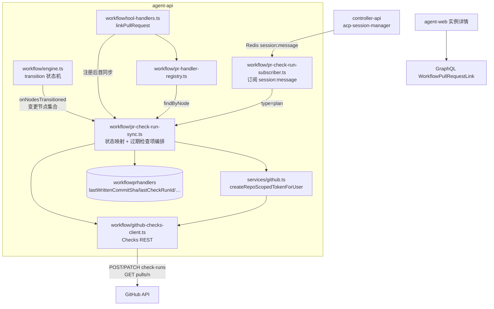
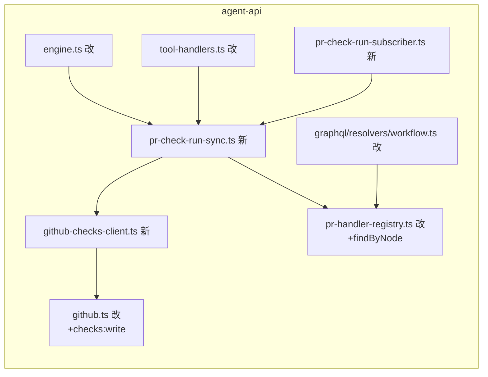
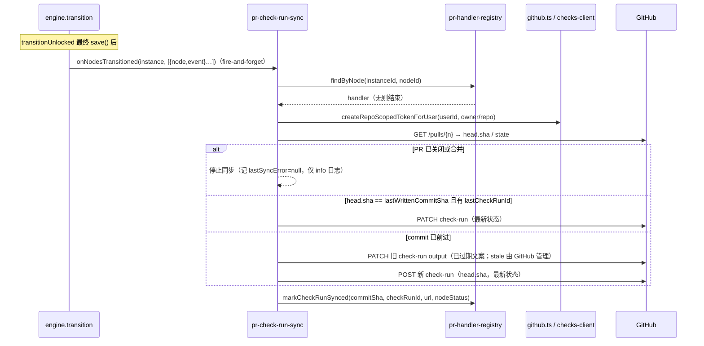
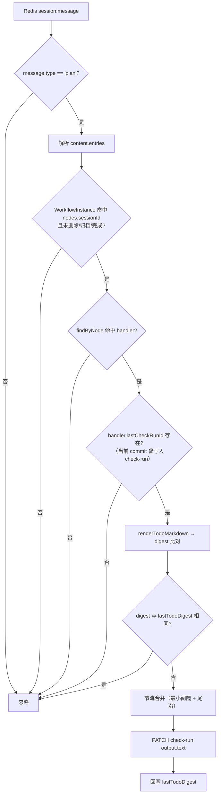

# 工作流节点状态通过 GitHub Check Runs 同步 - 技术提案

**功能名称**: 工作流节点状态通过 GitHub Check Runs 同步
**关联 PRD**: `docs/product/draft/20261025-workflow-check-runs-sync.md`
**技术提案版本**: v1.0
**创建日期**: 2026-10-25
**作者**: ZeroAsh Agent
**feat-branch**: `feat/workflow-check-runs-sync`

## 1. 概述

### 1.1 背景

工作流 GitHub PR 联动已上线（`20261023-feat-workflow-github-pr-callback`）：`agent-workflow-tools.linkPullRequest` 把「工作流实例 + 节点 + PR」登记进 `services/workflow/pr-handler-registry.ts`（Mongo `workflowprhandlers` 持久化 + 启动重建），工作流完成/归档/删除自动注销；`routes/event-callback.ts` 与 `routes/github-webhook.ts` 把 PR review 结论驱动到人类节点。当前缺口：**工作流 → GitHub 方向没有进度投影**，审核人在 PR 页面看不到节点状态与任务进展。具体现状：

1. **节点状态变化无对外出口**：`services/workflow/engine.ts` `transition()` 是唯一状态转移入口（start/complete/reject/rework/completeRework/resume/fail/resumeFailed/restart 九事件），hooks（`EngineHooks`）只覆盖 start/rework/resume/done/restart/finished，`fail`、`reject` 等转移无 hook，外部系统无法感知完整状态流。
2. **todo panel 更新只在站内流转**：controller-api `acp-session-manager.ts:368` 把 ACP `sessionUpdate='plan'` 落库为 `AcpMessage(type='plan')` 并经 Redis `session:message` 频道扇出；agent-api 仅 `session-sse.ts:69` 按 SSE 连接订阅转发前端，**没有中央订阅点**可供工作流领域消费。
3. **GitHub 凭据缺 Checks 权限**：`services/github.ts:207` `createRepoScopedToken` 的权限集（actions/contents/deployments/environments/issues/pull_requests/workflows write）不含 `checks`，无法调用 Checks API。

GitHub Checks API（<https://docs.github.com/en/rest/checks/runs?apiVersion=2026-03-10>）支持创建/更新 check-run（`status` ∈ queued/in_progress/completed，`conclusion` ∈ success/failure/action_required/…），是节点进度投影的官方载体。**`stale` 是 GitHub 保留结论**：官方文档明确「You cannot change a check run conclusion to `stale`, only GitHub can set this」，应用侧写入会 422；旧提交上的检查项由 GitHub 在新提交推送后自行置 stale。

### 1.2 目标

- **节点状态 → check-run**：节点绑定 PR 即同步当前状态；节点每次状态变化，把最新 check-run 写到 PR 最新远端 commit（`GET /pulls/{n}` 取 `head.sha`）；handler 记录上次写入的 commit 与 check-run id；commit 前进时旧 check-run 仅 PATCH `output.title/summary` 标记「已过期：PR 已有新提交」（`conclusion=stale` 由 GitHub 管理，应用不可写），新 commit 上创建新 check-run；commit 未变则原地 PATCH 更新。
- **todo panel → check-run 子项**：agent-api 新增中央订阅消费 `session:message` 中 `type='plan'` 的消息，满足「会话属于工作流节点 ∧ 节点绑定 PR ∧ 当前 commit 已写入 check-run」时，PATCH check-run `output` 为最新任务清单（completed/in_progress/pending → 完成/进行中/等待中），带 digest 去重与节流合并。
- **只读投影、故障不回流**：同步失败只记录 `lastSyncError` 并告警，绝不抛进引擎/会话链路；不引入 GitHub → 工作流的新驱动语义。

### 1.3 范围

**做**：

- `WorkflowPrHandler` 模型扩展（上次写入 commit、check-run id、同步状态、todo digest）；
- GitHub Checks 客户端（创建/更新 check-run、取 PR head、installation token 解析与缓存、`checks:write` 权限补齐）；
- 引擎新增 `onNodesTransitioned` hook（覆盖全部转移事件的变更节点集合），check-run 同步服务注册消费；
- `linkPullRequest` 注册后首同步；
- todo panel 中央订阅器与 `output` 渲染/节流；
- GraphQL `WorkflowPullRequestLink` 透出同步状态 + 前端只读展示；
- 单元 / API / E2E 测试。

**不做**：

- 其他代码托管平台（GitLab 等）；
- GitHub → 工作流方向的新事件驱动（既有 review 联动不变）；
- check-run `annotations`（代码行级标注）与 `actions`（按钮回调）；
- 从 GitHub 侧删除历史 check-run（stale 即终态）；
- 工作流归档/删除后清理 GitHub 侧已写入的 check-run（保持最终状态）。

## 2. 技术架构

### 2.1 系统架构图



### 2.2 技术栈

| 层级 | 技术选型 | 说明 |
|------|---------|------|
| 后端 | Node.js 24 + TypeScript（strict/ESM）+ Express v5 + GraphQL-Yoga | 与 `servers/agent-api` 现状一致 |
| 数据 | MongoDB + Mongoose | `workflowprhandlers` 字段扩展 |
| 消息 | Redis Pub/Sub（既有 `session:message` 频道） | todo panel 中央订阅 |
| GitHub | REST Checks API + App installation token | 复用 `services/github.ts` JWT/凭据体系 |
| 前端 | React + TypeScript（`apps/agent-web`） | 实例详情只读展示同步状态 |
| 测试 | Vitest（unit/API）+ 现有 E2E 套件 | 覆盖率 ≥ 80% |

### 2.3 模块划分



| 模块 | 职责 | 关键技术点 |
|------|------|-----------|
| `services/workflow/github-checks-client.ts`（新） | Checks REST 封装 | `createCheckRun` / `updateCheckRun` / `getPullRequestHead`；统一错误收敛（不泄露 token 与响应体细节） |
| `services/github.ts`（改） | 凭据供给 | `createRepoScopedToken` 权限 + `checks: write`；新增 `createRepoScopedTokenForUser(userId, repoFullName)`（遍历用户帐号找授权 installation）；进程内 token 缓存（到期前 5 分钟作废） |
| `services/workflow/pr-check-run-sync.ts`（新） | 同步编排 | 状态映射纯函数、过期检查项编排、todo 渲染与 digest/节流、per-handler KeyedMutex、capture-then-execute |
| `services/workflow/engine.ts`（改） | 变更捕获 | `EngineHooks.onNodesTransitioned`；`transitionUnlocked` 收集 status 变化节点，最终 `save()` 后调用（hook 内不得阻塞） |
| `services/workflow/pr-handler-registry.ts`（改） | 查询扩展 | 新增 `findByNode(instanceId, nodeId)`；同步回写方法 `markCheckRunSynced / markSyncError` |
| `services/workflow/pr-check-run-subscriber.ts`（新） | todo 入口 | 启动时 Redis duplicate 订阅 `session:message`，过滤 `type='plan'`，解析 entries 并做四条件判定 |
| `services/workflow/tool-handlers.ts`（改） | 首同步触发 | `linkPullRequest` 注册成功后 fire-and-forget 首同步 |
| `models/workflow-pr-handler.ts`（改） | 同步状态持久化 | 见 4.1 |
| `contracts/workflow.graphql` + `graphql/*` + `apps/agent-web`（改） | 透出与展示 | `WorkflowPullRequestLink` 增同步字段，节点详情只读展示 |

## 3. API 设计

### 3.1 API 契约

契约先行：实现第一件事更新 `contracts/workflow.graphql`（透出字段），本期**无新增自有 HTTP 端点**（同步方向为 agent-api → GitHub 出站调用）。

#### 接口 1: GitHub Checks REST（外部 API 消费口径）

| 用途 | 方法与路径 | 关键参数 |
|------|-----------|---------|
| 创建 check-run | `POST /repos/{owner}/{repo}/check-runs` | `name`、`head_sha`、`external_id`、`status`（queued/in_progress/completed）、`conclusion`、`started_at`、`completed_at`、`output{title,summary,text}` |
| 更新 check-run | `PATCH /repos/{owner}/{repo}/check-runs/{check_run_id}` | 同上可写子集；旧检查项过期 = 仅 PATCH `output{title,summary}`（`conclusion=stale` 仅 GitHub 可写，应用写入返回 422） |
| 取 PR head | `GET /repos/{owner}/{repo}/pulls/{pull_number}` | 响应取 `head.sha`、`state`、`merged` |

约束：`Accept: application/vnd.github+json`、`X-GitHub-Api-Version: 2026-03-10`；需要 `checks:write` 权限（installation token）；响应体不进日志（可能夹带内部信息）；HTTP 403/404/422 与网络错误统一收敛为 `GitHubChecksError`（code + 可展示短文案）。

**check-run 身份约定**：

- `name`：`ZAG 工作流 · {节点名称}`（PRD 附录 A.1）；
- `external_id`：`{workflowInstanceId}:{nodeId}`（幂等追溯与排查用）；
- `output.title`：`{节点名称} · {状态文案}`；`output.summary`：工作流名称 + 阶段 + 最近同步时间；`output.text`：任务清单 markdown（见实现点 4）。

#### 接口 2: GraphQL 契约变更（`contracts/workflow.graphql`）

```graphql
type WorkflowPullRequestLink { # 现有字段（pullRequestId/prUrl/nodeId/nodeName/registeredAt）...
  checkRunUrl: String        # 最近写入的 check-run 地址
  lastSyncedCommitSha: String # 上次写入的 commit
  lastSyncAt: DateTime        # 最近同步时间
  lastSyncError: String       # 最近同步失败提示（可展示短文案，不含凭据）
}
```

> 注：`WorkflowInstance.pullRequestLinks` 已在 `graphql/resolvers/index.ts` 登记类型级 resolver，本期仅扩展其映射字段，遵守 backend-rules 嵌套字段规范。

### 3.2 内部接口

| 接口 | 签名 | 说明 |
|------|------|------|
| 按节点查登记 | `prHandlerRegistry.findByNode(workflowInstanceId, nodeId): HandlerDoc \| null` | 状态同步与 todo 同步共用入口 |
| 同步回写 | `prHandlerRegistry.markCheckRunSynced(id, {commitSha, checkRunId, checkRunUrl, nodeStatus, at})` / `markSyncError(id, message)` | 更新上次写入 commit / check-run id / 同步状态 |
| 状态同步 | `prCheckRunSync.syncNodeStatus(instance, node): Promise<void>` | 全条件判定 + 过期检查项编排；永不抛出 |
| todo 同步 | `prCheckRunSync.syncTodoPanel(sessionId, entries): Promise<void>` | 四条件判定 + digest/节流；永不抛出 |
| 状态映射 | `mapNodeStatusToCheckRun(status): { status, conclusion?, label }`（纯函数） | 见 5.2 实现点 2 映射表 |
| 清单渲染 | `renderTodoMarkdown(entries): string`（纯函数） | 三态标记 + 汇总行 |
| token 供给 | `githubService.createRepoScopedTokenForUser(userId, repoFullName): { token, expiresAt }` | 遍历用户 GitHubAccount，命中授权 installation 后复用既有签发逻辑 |
| 引擎 hook | `EngineHooks.onNodesTransitioned?(instance, changes: { node, event }[])` | 每次 transition 最终 save 后调用一次，含级联变更 |

## 4. 数据模型

### 4.1 数据库设计

#### 集合: `workflowprhandlers` 字段变更（`models/workflow-pr-handler.ts`）

| 字段 | 类型 | 说明 |
|------|------|------|
| lastWrittenCommitSha | String，默认 null | 上次写入 check-run 的 commit（需求口径「记录上次写入的commit」） |
| lastCheckRunId | Number，默认 null | 当前有效 check-run id（PATCH 目标） |
| lastCheckRunUrl | String，默认 null | 最近写入的 check-run 页面地址（GraphQL 透出） |
| lastSyncedNodeStatus | String，默认 null | 最近已同步的节点状态（幂等比对） |
| lastSyncAt | Date，默认 null | 最近同步时间 |
| lastSyncError | String，默认 null | 最近失败短文案（成功时清空；截断 200 字符） |
| lastTodoDigest | String，默认 null | 最近一次 todo 渲染内容的 sha1（内容未变跳过写入） |

不新增索引（查询路径仍是既有 `workflowInstanceId` / `pullRequestIdLower` 索引）。存量行新字段为 null，等价于「从未同步」，下次状态变化自然补齐，**无需迁移脚本**。

### 4.2 缓存设计

- **installation token 进程内缓存**：`Map<`${accountId}:${repoFullName}`, { token, expiresAt }>`，到期前 5 分钟作废；token 不落库、不进日志（与 `cloud-host-github-service` 同口径）。
- **todo 节流状态进程内缓存**：`Map<checkRunId, { lastSentAt, pendingRender, timer }>`；进程重启后由 digest 落库兜底幂等，缓存丢失仅导致一次额外 PATCH，可接受。
- 不引入新 Redis 结构；并发控制复用进程内 `KeyedMutex`（per-handler 串行，与 registry 既有 `registerMutex` 同口径，单实例部署假设不变）。

## 5. 技术实现方案

### 5.1 核心流程

**（1）节点状态 → check-run（绑定首同步与状态变化同步）**



`linkPullRequest` 注册成功后立即以同样路径做首同步（节点当前状态），保证「绑定即出现检查项」。

**（2）todo panel → check-run 子项**



### 5.2 关键实现点

#### 实现点 1: GitHub Checks 客户端与凭据（`github-checks-client.ts` 新、`github.ts` 改）

- **描述**: 出站调用 GitHub Checks API 的最小封装与 token 供给。
- **技术细节**:
  - `github-checks-client.ts`：`createCheckRun(token, repo, payload)` / `updateCheckRun(token, repo, checkRunId, payload)` / `getPullRequestHead(token, repo, pullNumber): { sha, state, merged }`；统一 `fetch` 封装（超时 10s、AbortController），非 2xx 收敛为 `GitHubChecksError`（`FORBIDDEN` / `NOT_FOUND` / `RATE_LIMITED` / `UPSTREAM`），错误文案不含响应体与 token。
  - `github.ts`：`createRepoScopedToken` 的 permissions 增加 `checks: 'write'`（与 App 安装授权对齐，**部署前置条件：GitHub App 设置需开启 Checks: write**，未开启时 GitHub 返回 403，同步降级为失败提示）；新增 `createRepoScopedTokenForUser(userId, repoFullName)`：`GitHubAccount.find({ userId })` 逐帐号尝试既有签发逻辑，首个命中授权 installation 的帐号胜出；全部未命中抛 `repository is not authorized`。
  - token 缓存：`Map` 进程内缓存 + 到期前 5 分钟作废；拒绝把 token 写入任何日志/错误/DB。
- **风险点**: App 权限未开 = 全量 403，必须有可观测的失败提示（`lastSyncError` + 实例详情展示）；`createRepoScopedToken` 同时被云主机凭据端点使用，权限扩张会一并下发给云主机——与「权限对齐 App 安装授权」既有口径一致，可接受。

#### 实现点 2: 引擎变更捕获与状态映射（`engine.ts` 改、同步服务注册）

- **描述**: 现有 `EngineHooks` 无 `fail`/`reject` 等 hook，新增 `onNodesTransitioned(instance, changes)` 覆盖全事件。
- **技术细节**:
  - `transitionUnlocked` 在 `apply()` 前快照 `Map<nodeId, status>`，最终 `save()` 后 diff 出变化节点（含级联，如 complete 触发的下游 start、reject 触发的上游 rework），调用 `hooks.onNodesTransitioned?.(instance, changes)`；同步服务的 hook 实现**只做入队**（fire-and-forget，`.catch` 仅 `console.warn`），网络 I/O 不进 transition 锁，不阻塞工作流流转。
  - 状态映射纯函数（节点状态 → check-run）：

    | 节点状态 | check status | conclusion | 状态文案 |
    |------|------|------|------|
    | INITIALIZING / READY | `queued` | — | 排队中 |
    | RUNNING | `in_progress` | — | 执行中 |
    | REWORK | `in_progress` | — | 返工中 |
    | DONE | `completed` | `success` | 已完成 |
    | REJECT | `completed` | `action_required` | 被打回，待处理 |
    | FAILED | `completed` | `failure` | 执行失败 |

  - 过期检查项编排：取 `head.sha` 与 `handler.lastWrittenCommitSha` 比对——相同且有 `lastCheckRunId` → PATCH 原 check-run；不同 → 先尽力 PATCH 旧 check-run 的 `output.title=「{节点名} · 已过期：PR 已有新提交」`（旧 id 存在时，**不写 `status`/`conclusion`**；失败不阻断后续 create），再在新 sha 上 POST 新 check-run；旧检查项的 `conclusion=stale` 由 GitHub 自动管理。`lastSyncedNodeStatus === 当前状态 && sha 未变` 时跳过（幂等）。
  - **capture-then-execute**：触发时捕获 handler 快照（id/commit/checkRunId），执行中不依赖登记仍在库——避免「complete → DONE 同步」与工作流完成注销（`unregisterByInstance`）的竞态丢最后一次状态；todo 路径则以「登记在库」为条件（注销后不再刷新子项）。
- **风险点**: `onNodesTransitioned` 在最终 save 后调用，此时实例可能紧接着被归档/删除——同步读取 handler 时以快照 + 读库兜底，GitHub 侧失败只记 error；级联变化集合必须与 `apply` 递归语义一致（以最终落库状态为准做 diff）。

#### 实现点 3: todo panel 中央订阅器（`pr-check-run-subscriber.ts` 新）

- **描述**: agent-api 首个 `session:message` 中央订阅点（现有订阅均按 SSE 连接建立）。
- **技术细节**:
  - 启动时在 `index.ts` 与 `prHandlerRegistry.rebuild()` 并列注册；`getRedisClient().duplicate()` 订阅 `session:message`；消息格式与 `session-sse.ts:74` 一致（`{ sessionId, message }`，`message.type='plan'`、`message.content` 为 ACP plan 原始 JSON 字符串）。
  - 解析：`content.entries: [{ content, status, priority? }]`，status ∈ `pending | in_progress | completed`；非法结构直接丢弃并 warn（Agent 可控载荷不可信，参考 elicitation 截断口径，单条 content 截断 500 字符、entries 上限 100 条）。
  - 四条件判定（与 PRD 功能点 2 对齐）：实例命中且活跃（`deletedAt/archivedAt/finishedAt` 均空）→ 节点命中 → handler 命中 → `lastCheckRunId` 非空。
  - 渲染（`renderTodoMarkdown`，对应 PRD 附录 A.3）：
    ```text
    **任务清单**（2/5 完成 · 更新于 HH:mm:ss）
    - [x] 已完成任务
    - 🔄 进行中任务
    - [ ] 等待中任务
    ```
    三态映射：`completed → - [x]`（完成）、`in_progress → - 🔄`（进行中）、`pending → - [ ]`（等待中）。
  - 节流：per check-run 最小间隔 3s，尾沿合并（窗口内多次更新只发最后一次）；digest（渲染文本 sha1）相同跳过；回写 `lastTodoDigest`。
- **风险点**: `session:message` 为全量会话频道，订阅器必须轻量（先 type 过滤再查库）；查库路径走 `nodes.sessionId` 查询（`orchestrator.handleSessionIdled` 既有同口径用法），非工作流会话零写入。

#### 实现点 4: 透出与展示（`contracts/workflow.graphql`、`graphql/resolvers/workflow.ts`、`apps/agent-web`）

- **描述**: `WorkflowPullRequestLink` 增 `checkRunUrl / lastSyncedCommitSha / lastSyncAt / lastSyncError` 四字段；前端实例节点详情的 PR 联动区只读展示检查项链接、最近同步时间与失败提示。
- **技术细节**: resolver 侧从 registry `listByInstance` 行直接映射（字段 resolver 已登记，仅扩映射）；前端 `WorkflowNodeTree.tsx` 联动标记旁加「检查项」链接与错误 tooltip，无新交互。
- **风险点**: 失败文案必须经白名单收敛（403→「检查项写入权限不足」、404→「仓库或 PR 不可见」、限流→「GitHub 限流，稍后自动重试」），不透出上游原文。

## 6. 技术决策

### 6.1 决策列表

| 决策 | 选项 A | 选项 B | 最终选择 | 原因 |
|------|--------|--------|---------|------|
| 进度投影载体 | PR comment / labels | GitHub check-runs | B | 需求指定 Checks API；状态/结论/子项语义原生匹配 |
| 状态变化捕获 | 复用现有 hooks | 新增 `onNodesTransitioned`（diff 全事件） | B | 现有 hooks 缺 fail/reject；唯一转移入口 diff 保证无遗漏 |
| 网络 I/O 与实例锁 | transition 锁内同步调用 | hook 入队 fire-and-forget | B | GitHub 调用耗时不可控，不得阻塞工作流流转 |
| 完成/归档竞态 | 执行时强依赖登记在库 | capture-then-execute | B | 保住 DONE 终态同步；todo 刷新仍以登记在库为条件 |
| todo 捕获点 | controller-api 直推 | agent-api 订阅 `session:message` | B | 工作流领域在 agent-api；复用既有频道，controller-api 零改动 |
| commit 前进处理 | 总是新建 check-run | 同 sha 原地 PATCH，新 sha 建新 + 旧 output 标记已过期（stale 由 GitHub 设置） | B | 避免重复检查项刷屏；满足「记录上次写入 commit，旧的可识别为已过期」 |
| token 供给 | 新增 token 类型 | 复用 `createRepoScopedToken` + `checks:write` | B | 权限口径与 App 授权对齐，单一签发路径 |
| 高频 todo 写入控制 | 每次即写 | digest 去重 + 3s 尾沿节流 | B | 防限流与刷屏；digest 落库跨重启幂等 |
| 同步失败处理 | 抛出重试 | 记 `lastSyncError` + 告警不阻断 | B | 只读投影语义，工作流可用性优先 |

### 6.2 依赖与约束

| 类型 | 内容 | 说明 |
|------|------|------|
| 依赖 | `workflow/engine.ts` 状态机 | 状态来源唯一入口，不绕过 |
| 依赖 | `workflow/pr-handler-registry.ts` | 绑定关系与生命周期注销复用，不新增绑定通道 |
| 依赖 | GitHub App 开启 Checks: write 权限 | **部署前置条件**，未开启则同步降级为失败提示 |
| 依赖 | Redis `session:message` 频道（controller-api 发布） | 消息格式以 `session-sse.ts:74` 现状为准 |
| 约束 | Contract-first | 先改 `contracts/workflow.graphql` 再实现 |
| 约束 | TDD | 红-绿-重构，先写测试再写实现 |
| 约束 | 兼容性 | 存量 handler 行新字段为 null 即「未同步」，无迁移；未绑定 PR 的工作流零行为变化 |
| 约束 | 安全 | token 不落库/日志/错误文案；GitHub 响应体不进日志；失败文案白名单化 |

## 7. 项目结构

```
z-agent-gear/
├── contracts/
│   └── workflow.graphql                          # [改] WorkflowPullRequestLink 同步字段
├── servers/agent-api/src/
│   ├── index.ts                                  # [改] 启动注册 pr-check-run-subscriber
│   ├── models/workflow-pr-handler.ts             # [改] lastWrittenCommitSha/lastCheckRunId/lastCheckRunUrl/lastSyncedNodeStatus/lastSyncAt/lastSyncError/lastTodoDigest
│   ├── services/github.ts                        # [改] checks:write + createRepoScopedTokenForUser + token 缓存
│   ├── services/workflow/
│   │   ├── github-checks-client.ts               # [新] Checks REST 封装（含错误收敛）
│   │   ├── pr-check-run-sync.ts                  # [新] 状态映射/过期检查项编排/todo 渲染与节流
│   │   ├── pr-check-run-sync.test.ts             # [新]
│   │   ├── pr-check-run-subscriber.ts            # [新] session:message 中央订阅
│   │   ├── pr-check-run-subscriber.test.ts       # [新]
│   │   ├── engine.ts                             # [改] onNodesTransitioned hook
│   │   ├── engine.test.ts                        # [改] 变更集合断言
│   │   ├── pr-handler-registry.ts                # [改] findByNode / markCheckRunSynced / markSyncError
│   │   ├── pr-handler-registry.test.ts           # [改]
│   │   └── tool-handlers.ts                      # [改] linkPullRequest 首同步触发
│   └── graphql/
│       ├── schemas/workflow.ts                   # [改] 字段定义
│       └── resolvers/workflow.ts                 # [改] pullRequestLinks 映射
├── apps/agent-web/src/
│   ├── components/workflow/WorkflowNodeTree.tsx  # [改] 检查项链接/同步时间/失败提示
│   └── graphql/workflow.ts                       # [改] fragment 字段
└── tests/                                        # [改] API / E2E 用例（见测试策略）
```

## 8. 测试策略

### 8.1 测试覆盖要求

- 单元测试覆盖率 ≥ 80%（`docs/engineering/common-rules.md`）。
- 引擎 hook 语义变化（`onNodesTransitioned`）必须回填断言到既有状态机测试（`engine.test.ts`）。
- GitHub 出站调用一律 mock `fetch`，测试数据对齐真实 Checks API 响应结构。

### 8.2 测试类型

| 类型 | 工具 | 覆盖范围 |
|------|------|---------|
| 单元测试 | Vitest | `mapNodeStatusToCheckRun` 全状态映射；`renderTodoMarkdown` 三态/汇总/截断；digest 去重；节流尾沿合并；过期检查项编排（同 sha PATCH / 新 sha 旧 output 标记已过期 + create（不写 stale）/ 无旧 id 直接 create / 旧项 PATCH 失败不阻断 create）；`getPullRequestHead` 关闭/合并分支；token 缓存到期与命中；错误收敛（403/404/422/网络） |
| API 测试 | Vitest + 真实 Mongo/Redis | 引擎各事件触发 `onNodesTransitioned` 变更集合（含 complete 级联 start、reject 级联 rework）；`linkPullRequest` 注册后首同步；subscriber 四条件判定（非工作流会话/未绑定/无 check-run/非法载荷零写入）；`markCheckRunSynced`/`markSyncError` 回写；GraphQL `pullRequestLinks` 新字段透出 |
| E2E 测试 | 现有 E2E 套件 + mock GitHub server | 绑定 PR → mock GitHub 收到首同步 create；节点完成 → 同 sha PATCH success；追加提交后状态变化 → 旧 check-run output 标记已过期 + 新 sha create；plan 更新 → output.text 刷新且节流生效；归档后不再写入 |

关键边界用例：重复状态（`lastSyncedNodeStatus` 幂等跳过）、PR 关闭后停止同步、403 权限不足记 `lastSyncError` 且不阻断流转、空清单渲染、handler 换绑 PR 后同步目标切换。

## 9. 验收标准

- [ ] 技术方案评审通过、Contract 评审通过（`contracts/workflow.graphql`）。
- [ ] 节点绑定 PR 后 GitHub 出现对应 check-run，状态与节点一致；状态变化秒级同步。
- [ ] PR 新提交后：旧提交 check-run 由 GitHub 置 stale 且 output.title 标记「已过期：PR 已有新提交」，新提交上为最新 check-run，handler 记录上次写入 commit。
- [ ] todo panel 更新满足四条件时 check-run 子项刷新（完成/进行中/等待中），digest/节流生效。
- [ ] 同步失败仅记 `lastSyncError` 并可见于实例详情，工作流流转不受影响；未绑定 PR 的工作流零回归。
- [ ] 单元测试覆盖率 ≥ 80%，API 测试与 E2E 测试通过。

## 10. 相关文档

- [[../../../../docs/product/draft/20261025-workflow-check-runs-sync.md|关联 PRD：工作流节点状态通过 GitHub Check Runs 同步]]
- [[20261023-feat-workflow-github-pr-callback.md]] — 工作流 GitHub Pull Request 联动
- [[20261025-feat-github-native-webhook.md]] — GitHub 原生 Webhook 入口
- [[20260709-feat-github-account-binding.md]] — GitHub 帐号绑定
- [[20261021-feat-github-workload.md]] — Github 工作负载与云主机 Git 项目设置
- GitHub Checks API：<https://docs.github.com/en/rest/checks/runs?apiVersion=2026-03-10>
- [[../common-rules.md]]、[[../backend-rules.md]] — 开发规范
