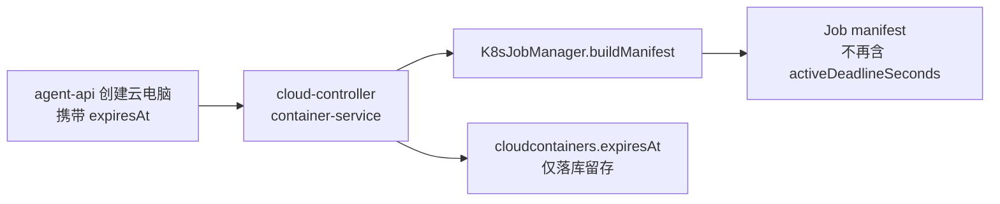
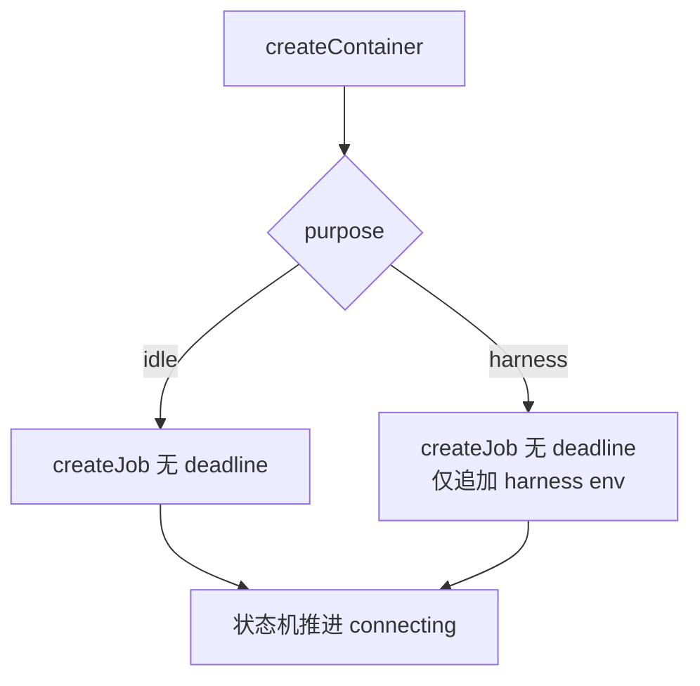

# 云电脑取消 Job 最长运行时间限制 - 技术提案

**功能名称**: 云电脑最长运行时间无限制
**关联 PRD**: [[../../product/shipping/20261025-cloud-container-unlimited-lifetime.md]]
**技术提案版本**: v1.0
**创建日期**: 2026-10-25
**作者**: ZeroAsh
**feat-branch**: `fix/cloud-container-active-deadline`

## 1. 概述

### 1.1 背景

`cloud-controller` 以 K8s Job 拉起工作容器，Job manifest 始终写入 `activeDeadlineSeconds`：idle 容器缺省 `JOB_ACTIVE_DEADLINE_SECONDS=86400`（24h 兜底），harness（云电脑）由 `expiresAt` 经 `computeActiveDeadlineSeconds` 换算（`max(60, floor((expiresAt-now)/1000))`）。到达 deadline 后 K8s 直接杀死 Pod（`DeadlineExceeded`），运行中的云电脑被意外销毁。

### 1.2 目标

- Job manifest 不再设置 `activeDeadlineSeconds`（不设置即为无限制），容器不会被 K8s 因到期强制销毁。
- `expiresAt` 仍照常接收、校验与落库（计费模型 Key 到期等业务继续使用），仅不再映射为 Job 硬截止。

### 1.3 范围

- 仅 `servers/cloud-controller`：Job manifest 构建、容器创建链路、相关单测。
- 契约文档 `contracts/cloud-controller-websocket.md` 附录 A 措辞更新。
- 不变更 harness 必填字段、不变更 `ttlSecondsAfterFinished=600`（仅对已完成 Job 生效的回收策略保留）。

## 2. 技术架构

### 2.1 系统架构图

### 2.2 技术栈

无变更（Node.js 24 + TypeScript + @kubernetes/client-node + Vitest）。

### 2.3 模块划分

- `services/k8s-client.ts`：`K8sJobManifest.spec` 移除 `activeDeadlineSeconds` 字段。
- `services/k8s-job-manager.ts`：移除 `JOB_ACTIVE_DEADLINE_SECONDS`、`computeActiveDeadlineSeconds`、`CreateJobInput.activeDeadlineSeconds` 及 manifest 写入。
- `services/container-service.ts`：创建 Job 不再传 `activeDeadlineSeconds`；`expiresAt` 落库行为不变。

## 3. API 设计

### 3.1 API 契约

`POST /internal/containers` 请求形状不变；harness `expiresAt` 仍为必填。语义变化：不再换算为 Job `activeDeadlineSeconds`（更新 `contracts/cloud-controller-websocket.md` 附录 A）。

### 3.2 内部接口

- `K8sJobManifest.spec.activeDeadlineSeconds` 删除。
- `CreateJobInput.activeDeadlineSeconds` 删除。
- `computeActiveDeadlineSeconds` / `JOB_ACTIVE_DEADLINE_SECONDS` 删除（无其他消费方）。

## 4. 数据模型

无 schema 变更。`cloudcontainers.expiresAt` 保留（注释更新：不再用于 Job 硬截止）。

## 5. 技术实现方案

### 5.1 核心流程

### 5.2 关键实现点

- 移除 manifest 字段后，K8s 对 Job 无运行时间上限；回收依赖既有链路：主动销毁（post 批次 + shutdown + 删除 Job）、超时巡检、心跳离线巡检、工作负载看门狗。
- `ttlSecondsAfterFinished=600` 保留：Pod 异常退出导致 Job 完成后仍会在 10 分钟内被 K8s 清理。

## 6. 技术决策

### 6.1 决策列表

| 编号 | 决策 | 理由 |
|------|------|------|
| D1 | 完全移除 `activeDeadlineSeconds` 而非调大数值 | 需求为「无限制」；任何有限值都会在到期时杀容器 |
| D2 | 保留 `expiresAt` 必填与落库 | 计费模型 Key 到期等业务仍消费该字段，避免契约破坏 |
| D3 | 保留 `ttlSecondsAfterFinished` | 只清理已完成 Job，不影响活跃容器 |

### 6.2 依赖与约束

- 残留风险兜底：失联/超时巡检仍回收异常容器；健康在线容器不再有时间上限（符合需求）。

## 7. 项目结构

仅修改：

- `servers/cloud-controller/src/services/k8s-client.ts`
- `servers/cloud-controller/src/services/k8s-job-manager.ts`
- `servers/cloud-controller/src/services/container-service.ts`
- 对应单测与注释；`contracts/cloud-controller-websocket.md`；`servers/cloud-controller/AGENTS.md`

## 8. 测试策略

按需求方要求不走 TDD，直接更新受影响单测：

- `k8s-job-manager.test.ts`：T-K5 移除 deadline 断言、删除 T-CC22 与 harness deadline 用例、T-CC8 更新为「manifest 不含 activeDeadlineSeconds」。
- `container-service.test.ts` / `internal-api.test.ts`：移除 deadline 换算断言，改为断言 manifest 不含该字段。
- 全量 `npm test` + `npm run build` 回归。

## 9. 验收标准

- `buildManifest` 产物 `spec` 无 `activeDeadlineSeconds`。
- harness 创建仍强制校验 `expiresAt` 并落库。
- cloud-controller 全部单测与 `tsc` 构建通过。

## 10. 相关文档

- [[../../product/shipping/20261025-cloud-container-unlimited-lifetime.md]]
- [[../../../contracts/cloud-controller-websocket.md]]
