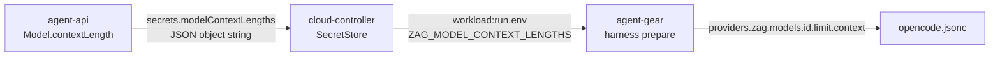

# 云电脑 OpenCode 模型上下文长度下发修复 - 技术提案

**功能名称**: 云电脑 OpenCode 模型上下文长度下发
**关联 PRD**: [[../../product/draft/20261025-opencode-model-context-length.md]]
**技术提案版本**: v1.1
**创建日期**: 2026-10-25
**作者**: ZeroAsh
**feat-branch**: `fix/opencode-model-context-length`

> v1.1 变更：修正 opencode 配置为 OpenCode v2 形态——顶层键 `provider` → `providers`，provider 条目
> `npm`/`options` → `package`/`settings`（`@opencode/ai/providers/openai-compatible`）；v1.0 写入的 `provider`
> 为 v1 遗留键，在 OpenCode 2.x 配置 schema 中已废弃。agent-gear 包版本相应 `2.7.0 → 2.7.1`。

## 1. 概述

### 1.1 背景

云容器优化二期在 `Model.contextLength` 上落库了模型最长上下文，并经计费网关 `/v1/models` 的 `context_length` 透出。但云电脑 OpenCode 的 `providers.zag` 配置（`agent-gear harness prepare` 写入）只含模型 ID 清单（`ZAG_MODEL_IDS`），不含上下文长度，OpenCode 对每个模型按自身默认上下文窗口工作，与后台配置脱节。

### 1.2 目标

复用既有「模型清单快照」下发链路，把各模型的 `contextLength` 一并下发到 opencode 配置的 `providers.zag.models.<id>.limit.context`；未设置 `contextLength` 的模型不写 `limit`。

### 1.3 范围

- agent-api：创建云电脑时构建 `modelId → contextLength` 映射并放入 harness secrets。
- cloud-controller：secrets 透传 + `workload:run.env` 注入新变量。
- agent-controller（agent-gear）：`harness prepare` 解析新变量并写入 opencode 配置。
- 契约 `contracts/cloud-controller-websocket.md` 同步。
- 不做：存量云电脑热更新、后台界面变更。

## 2. 技术架构

### 2.1 系统架构图



### 2.2 技术栈

既有栈，无新增依赖。

### 2.3 模块划分

| 模块 | 变更 |
|------|------|
| `servers/agent-api/src/services/cloud-host-service.ts` | 构建 `modelContextLengths` JSON |
| `servers/agent-api/src/services/cloud-controller-client.ts` | secrets 类型加字段 |
| `servers/cloud-controller/src/services/secret-store.ts` | `HarnessSecrets` 加字段 |
| `servers/cloud-controller/src/routes/internal-api.ts` | 解析可选 `secrets.modelContextLengths` |
| `servers/cloud-controller/src/services/workload-dispatcher.ts` | `buildHarnessEnv` 注入 `ZAG_MODEL_CONTEXT_LENGTHS` |
| `packages/agent-controller/src/harness/env.ts` | 解析可选 `ZAG_MODEL_CONTEXT_LENGTHS` |
| `packages/agent-controller/src/harness/opencode-config.ts` | `buildZagProvider` 写 `limit.context` |

## 3. API 设计

### 3.1 API 契约

`contracts/cloud-controller-websocket.md`：

- 附录 A.2.2 `secrets` 增加**可选**字段 `modelContextLengths`（JSON object string，如 `{"model-a":128000}`，值必须为正整数）；缺省/空串表示无上下文信息。
- §2.9 云电脑初始化 env 增加 `ZAG_MODEL_CONTEXT_LENGTHS`（同样 JSON object string，仅在 secrets 携带时下发）。

### 3.2 内部接口

opencode 配置模型条目：

```jsonc
{
  "providers": {
    "zag": {
      "models": {
        "model-a": { "name": "model-a", "limit": { "context": 128000 } },
        "model-b": { "name": "model-b" }
      }
    }
  }
}
```

## 4. 数据模型

无 schema 变更（`Model.contextLength` 已存在）。secrets 依旧只存内存、不落库。

## 5. 技术实现方案

### 5.1 核心流程

1. agent-api `cloud-host-service`：复用 `modelService.findAll()` 结果，对启用模型收集 `name → contextLength`（仅正整数；同名模型保留首个非空值），`JSON.stringify` 为 `secrets.modelContextLengths`（无有效条目时为 `{}`）。
2. cloud-controller `internal-api`：`secrets.modelContextLengths` 为可选字段（滚动升级期间旧 agent-api 不下发），非空字符串才透传；不纳入「secrets 各字段非空」必填校验。
3. cloud-controller `workload-dispatcher.buildHarnessEnv`：`secrets.modelContextLengths` 非空时注入 `ZAG_MODEL_CONTEXT_LENGTHS`；缺失不下发（旧 worker 无影响）。
4. agent-gear `env.ts`：`ZAG_MODEL_CONTEXT_LENGTHS` 可选；缺省/空串 → `{}`；存在时必须是「值为正整数」的 JSON object，非法时报 `HarnessEnvError`（只含变量名，不回显值）。
5. agent-gear `opencode-config.ts buildZagProvider`：模型在映射中有正整数上下文时写 `{ name, limit: { context } }`，否则保持 `{ name }`。

### 5.2 关键实现点

- **向后兼容**：新 env 全程可选——旧 agent-api/旧 cloud-controller/旧 worker 任意组合均不产生错误（旧 worker 忽略新 env，新 worker 容忍缺省）。
- **版本**：agent-gear 包版本 `2.6.0 → 2.7.0`（v1.1 修正 v2 配置形态后 `2.7.1`）；worker 镜像 `agent-gear@2.6.x → @2.7.x`。`MIN_HARNESS_WORKER_VERSION` 不提升（缺失仅表现为不写 `limit`，优雅降级）。
- secret 约束不变：`modelContextLengths` 不含密钥，但仍遵循不落库、不打印。

## 6. 技术决策

### 6.1 决策列表

| # | 决策 | 理由 |
|---|------|------|
| D1 | 新字段走 secrets → env 链路（与 modelIds 同通道） | 复用既有快照口径，避免 worker 初始化期多一次网络请求 |
| D2 | env 为 JSON object string 而非拼接进 `ZAG_MODEL_IDS` | 不破坏既有 `ZAG_MODEL_IDS` 解析；旧 worker 完全无感 |
| D3 | 全链路可选、缺省 `{}` | 滚动升级兼容，任一组件未升级均优雅降级 |

### 6.2 依赖与约束

- opencode provider 模型条目支持 `limit.context`（OpenCode 配置 schema 既有能力）。

## 7. 项目结构

见 2.3 模块划分，无新增文件。

## 8. 测试策略

- agent-controller：`env.test.ts`（缺省/合法/非法 JSON/非正整数值）、`opencode-config.test.ts`（`limit.context` 写入与缺省不写）、`prepare.test.ts` 不受影响。
- cloud-controller：`internal-api.test.ts`（可选字段透传/缺省接受）、`workload-dispatcher.test.ts`（env 注入与缺省不注入）、`secret-store.test.ts`。
- agent-api：`cloud-host-service.test.ts`（secrets 携带 `modelContextLengths`）。
- API 集成测试：`tests/api/src/cloud-controller/internal-api.test.ts` 如断言 secrets 全量校验则同步。

## 9. 验收标准

- 后台配置 `contextLength` 后新建云电脑，`~/.config/opencode/opencode.jsonc` 的 `providers.zag.models.<id>` 含 `limit.context`。
- 未配置的模型条目不含 `limit`。
- 三个包 `npm run build` + `npm test` 全绿。

## 10. 相关文档

- [[20261023-feat-cloud-container-optimization-phase2.md]] — Model.contextLength 落地
- [[20261020-feat-container-harness-support.md]] — harness prepare 与模型清单快照链路
