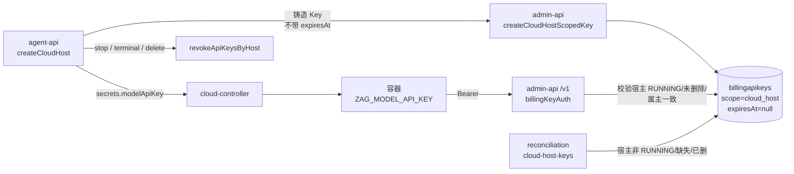
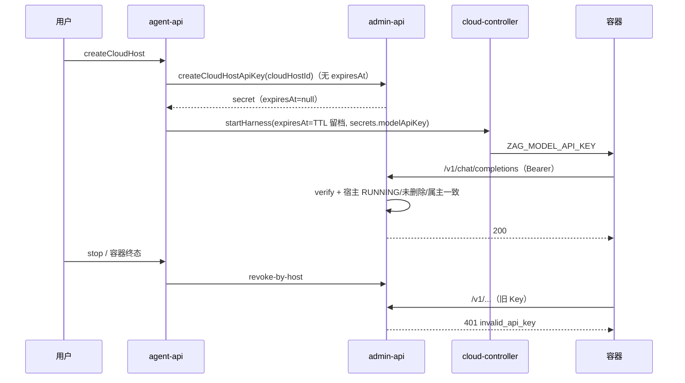

# 云电脑 LLM API Key 随容器回收 - 技术提案

**功能名称**: 云电脑模型 Key 生命周期与容器对齐
**关联 PRD**: 无（线上问题紧急修复，承接 [[20261025-fix-cloud-container-active-deadline.md]]）
**技术提案版本**: v1.0
**创建日期**: 2026-10-26
**作者**: ZeroAsh
**feat-branch**: `fix/cloud-host-key-lifecycle`

## 1. 概述

### 1.1 背景

云电脑（harness）创建时，agent-api 以 `HARNESS_CONTAINER_TTL_SECONDS`（默认 `86400`，即 24h）计算 `expiresAt = now + TTL`，并把它同时用于：

1. 铸造 `scope=cloud_host` 的运行专用模型 Key（注入容器 `ZAG_MODEL_API_KEY`，调用 admin-api `/v1` 计费网关）；
2. 传递给 cloud-controller 并落库 `cloudcontainers.expiresAt`（仅留档）。

上一期 [[20261025-fix-cloud-container-active-deadline.md]] 已移除 Job 的 `activeDeadlineSeconds`，容器最长运行时间不再受限；但模型 Key 仍按创建时刻 +24h 硬过期，且没有续期/重铸通道。结果是**容器仍在运行、宿主机状态仍为 `RUNNING` 时，第 25 小时起所有 LLM 调用开始返回 `401 invalid_api_key`**。

### 1.2 目标

- 云电脑模型 Key 的有效性只由**容器/宿主生命周期**决定：宿主 `RUNNING` 即可用，容器停止/失败/删除即失效。
- 新铸造的云电脑 Key 不再写入固定 `expiresAt`。
- 存量仍在运行的云电脑 Key 通过一次性迁移清除 `expiresAt`，避免升级后仍按旧 24h 到期。

### 1.3 范围

- `servers/agent-api`：铸造模型 Key 时不再传 `expiresAt`；容器记录的 `expiresAt` 保持不变（继续作为 TTL 留档）。
- `servers/admin-api`：云电脑 Key 铸造不再要求/落库有效期；网关与对账口径改为「以宿主状态为准」；新增迁移清理存量有效期。
- 契约与文档：`contracts/billing-openai.openapi.yaml`、`contracts/admin-billing.graphql`、`contracts/billing.graphql`、`contracts/cloud-controller-websocket.md`、相关 `AGENTS.md`。
- 不做：不删除 `expiresAt` 字段与 GraphQL 字段（历史数据/前端兼容）；不改变账号级 Key 行为；不改变容器 `expiresAt` 留档与 `HARNESS_CONTAINER_TTL_SECONDS` 配置。

## 2. 技术架构

### 2.1 系统架构图



### 2.2 技术栈

无变更（Node.js 24 + TypeScript + Mongoose + Vitest）。

### 2.3 模块划分

| 模块 | 职责 | 关键技术点 |
|------|------|-----------|
| `agent-api/services/cloud-host-service.ts` | 创建云电脑 | 模型 Key 不再计算 `expiresAt`；容器 `expiresAt` 保留 |
| `agent-api/services/billing-client.ts` | 内部 REST 客户端 | `createCloudHostApiKey` 去掉 `expiresAt` 入参 |
| `admin-api/services/billing/api-key-service.ts` | Key 铸造/校验 | `createCloudHostScopedKey` 不再接收 `expiresAt`，落库 `null` |
| `admin-api/routes/internal-billing.ts` | `/internal/billing/api-keys` | `expiresAt` 变为可选且忽略（兼容滚动发布） |
| `admin-api/middleware/billing-key-auth.ts` | `/v1` 鉴权 | 无 `expiresAt` 的 Key 放行；有值且过期仍拒绝（历史数据兜底） |
| `admin-api/services/billing/reconciliation.ts` | 对账兜底 | 移除 `missing_expiry` 撤销原因，保留 `expired` |
| `admin-api/migrations/010-clear-cloud-host-key-expiry.ts` | 数据迁移 | 清空 active 云电脑 Key 的 `expiresAt` |

## 3. API 设计

### 3.1 API 契约

`POST /internal/billing/api-keys`（admin-api 内部 REST，agent-api 调用）：

- 请求字段 `scope=cloud_host` 时，`cloudHostId` 仍必填；`expiresAt` **降级为可选且不生效**：
  - 未提供 → 直接铸造无有效期 Key；
  - 提供且可解析为 ISO 时间 → 接受但忽略（不落库），仅用于兼容旧版 agent-api 滚动发布；
  - 提供但不可解析 → 仍返回 `400 INVALID_BODY`（避免静默吞掉脏输入）。
- 响应 `apiKey.expiresAt` 对新 Key 恒为 `null`。

GraphQL `BillingApiKey.expiresAt` / `AdminBillingApiKey.expiresAt` 保留（可空），语义改为「历史遗留有效期，仅展示，不再作为失效依据」。

### 3.2 内部接口

- `agent-api → admin-api`：`POST /internal/billing/api-keys`，请求体不再包含 `expiresAt`。
- `agent-api → cloud-controller`：`POST /internal/containers`，`expiresAt`（容器 TTL 留档）保持不变。
- 回收链路不变：`POST /internal/billing/api-keys/revoke-by-host`。

## 4. 数据模型

### 4.1 数据库设计

集合 `billingapikeys`（`BillingApiKey`）：

| 字段 | 类型 | 说明 |
|------|------|------|
| `scope` | `'account' \| 'cloud_host'` | 不变 |
| `cloudHostId` | `ObjectId \| null` | `scope=cloud_host` 时必填 |
| `expiresAt` | `Date \| null` | **新 Key 恒为 `null`**；字段保留以兼容历史数据 |

迁移 `010-clear-cloud-host-key-expiry`：

```js
BillingApiKey.updateMany(
  { scope: 'cloud_host', status: 'active', expiresAt: { $ne: null } },
  { $set: { expiresAt: null } },
);
```

### 4.2 缓存设计

无变更（Key 校验仍为前缀索引 + bcrypt，`lastUsedAt` 更新逻辑不变）。

## 5. 技术实现方案

### 5.1 核心流程



### 5.2 关键实现点

#### 实现点 1：铸造时不再写有效期（admin-api）

- `ApiKeyService.create()` 删除 `expiresAt` 入参与 `API Key 有效期非法` 校验分支，`cloud_host` Key 一律落库 `expiresAt: null`。
- `createCloudHostScopedKey()` 只保留 `cloudHostId` 合法性校验与「先铸后撤」串行化，行为不变。
- `verify()` 保持「有 `expiresAt` 且过期则失效」的判定（对历史数据兜底），新 Key 为 `null` 不受影响。

#### 实现点 2：网关放行无有效期 Key（admin-api）

- `isCloudHostKeyUsable()` 的过期判断改为「`expiresAt` 存在且已过期才拒绝」；宿主存在性/软删除/`RUNNING`/属主一致性校验全部保留。
- 即真正的失效开关是容器状态，而非时间。

#### 实现点 3：对账兜底不再误杀（admin-api）

- `reconcileCloudHostKeys()` 移除 `missing_expiry` 撤销原因（否则新 Key 首次对账即被撤销）。
- 保留 `expired`（仅历史数据）、`cloud_host_not_running`、`cloud_host_deleted`、`cloud_host_missing`，继续承担「停止/删除编排漏撤」与「TTL 自然退出」的兜底回收。

#### 实现点 4：存量 Key 平滑迁移（admin-api）

- 新迁移 `010-clear-cloud-host-key-expiry` 在启动时清空 active 云电脑 Key 的 `expiresAt`，保证升级前已创建、仍在运行的容器不会被旧的 24h 定时器打断。
- 只清 `status=active`；已撤销 Key 无需处理。

#### 实现点 5：agent-api 停止传递有效期

- `cloud-host-service.createCloudHost` 不再为模型 Key 计算/传递 `expiresAt`；容器 TTL 留档的计算与下发保持不变。
- `billing-client.createCloudHostApiKey` 入参与请求体同步移除 `expiresAt`。

#### 风险点

- **滚动发布顺序**：新版 admin-api 兼容旧版 agent-api（可选 `expiresAt`），新版 agent-api 依赖新版 admin-api（不再传 `expiresAt`）。因此需**先发布 admin-api，再发布 agent-api**（docker compose 全量重启无此问题）。
- **泄露 Key 的窗口**：Key 不再自然过期，泄露后仅能通过「停止/删除云电脑」或对账撤销失效；这是「随容器回收」的预期取舍，宿主状态校验与属主绑定仍在网关实时生效。

## 6. 技术决策

### 6.1 决策列表

| 决策 | 选项 A | 选项 B | 最终选择 | 原因 |
|------|--------|--------|---------|------|
| 失效依据 | 保留 24h TTL | 完全由宿主状态决定 | B | 容器已无最长运行时间，Key 不应先于容器失效 |
| `expiresAt` 字段 | 删除字段 | 保留可空、新 Key 写 `null` | B | 避免破坏历史数据、GraphQL 字段与前端兼容 |
| 存量 Key | 等待下次创建自动修复 | 一次性迁移清空 | B | 紧急止损，避免运行中的容器升级后仍按时到期 |
| 网关对过期值 | 直接忽略 | 有值且过期仍拒绝 | B | 对异常/历史数据保留防御，新 Key 无值不受影响 |

### 6.2 依赖与约束

| 类型 | 内容 | 说明 |
|------|------|------|
| 约束 | 容器 `expiresAt` 仍由 `HARNESS_CONTAINER_TTL_SECONDS` 计算并留档 | 本期不改变其语义，也不再被 Key 使用 |
| 约束 | 回收依赖 stop/terminal/delete + 对账兜底 | 现有链路已覆盖，无需新增接口 |
| 依赖 | admin-api 迁移 runner | 迁移失败只记录日志、下次启动重试 |

## 7. 项目结构

```
servers/
├── agent-api/src/
│   └── services/
│       ├── cloud-host-service.ts        # 不再为模型 Key 计算 expiresAt
│       └── billing-client.ts            # 移除 expiresAt 入参
└── admin-api/src/
    ├── migrations/
    │   ├── 010-clear-cloud-host-key-expiry.ts
    │   └── 010-clear-cloud-host-key-expiry.test.ts
    ├── middleware/billing-key-auth.ts   # 无有效期 Key 放行
    ├── routes/internal-billing.ts       # expiresAt 可选且忽略
    └── services/billing/
        ├── api-key-service.ts
        ├── reconciliation.ts
        └── *.test.ts
```

## 8. 测试策略

### 8.1 测试覆盖要求

- 仅运行单元测试（本期按用户要求不跑 API/E2E）。
- 覆盖：铸造不落有效期、网关放行无有效期 Key、历史过期 Key 仍拒绝、对账不误杀无有效期 Key、迁移清空存量有效期、agent-api 调用参数不再含 `expiresAt`。

### 8.2 测试类型

| 类型 | 工具 | 覆盖范围 |
|------|------|---------|
| 单元测试 | Vitest | `servers/admin-api`、`servers/agent-api` 相关 service/route/middleware/migration |

## 9. 验收标准

- [x] 技术方案完成
- [ ] 契约与文档同步
- [ ] 代码实现完成
- [ ] 单元测试通过（admin-api + agent-api）
- [ ] PR 合并到 `release`

## 10. 相关文档

- [[20261025-fix-cloud-container-active-deadline.md]] — 容器取消最长运行时间
- [[20261020-feat-container-harness-support.md]] — 云电脑 harness 与运行专用 Key
- `contracts/billing-openai.openapi.yaml`
- `contracts/admin-billing.graphql`
- `contracts/cloud-controller-websocket.md`
