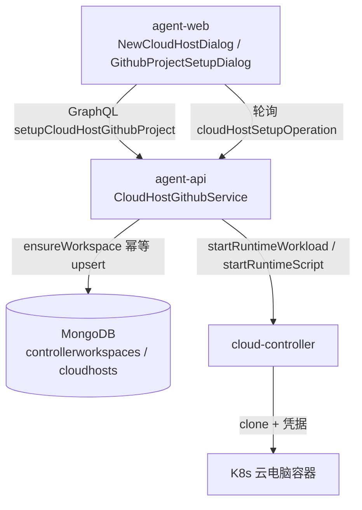
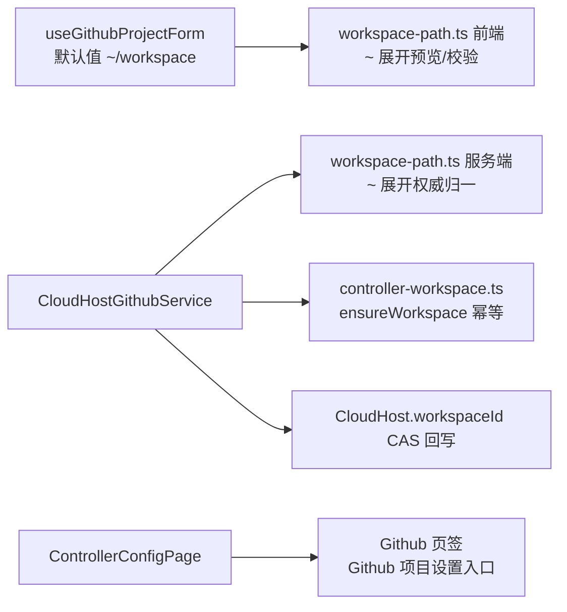
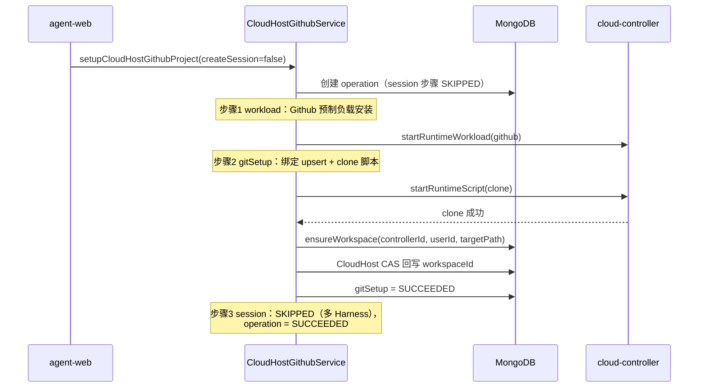

# 默认工作区优化 - 技术提案

**功能名称**: 默认工作区优化
**关联 PRD**: [[../../product/draft/20261026-default-workspace-optimization.md]]
**技术提案版本**: v1.1
**创建日期**: 2026-10-26
**作者**: z-agent-bot
**feat-branch**: `feat/default-workspace-optimization`
**变更记录**: v1.1（2026-10-26 合并期对齐）——需求总分支并入 main 的「云电脑保活与 worker 用户」（PR #307）后，容器用户主目录由 `/root` 收口为 `/home/worker`：`~` 展开目标与默认工作区默认值统一为 `/home/worker/workspace`，本提案的路径示例与常量口径同步对齐；v1.0 初版。

## 1. 概述

### 1.1 背景

来源 Issue：[Deliay/z-agent-gear#304 默认工作区优化](https://github.com/Deliay/z-agent-gear/issues/304)。云容器优化二期后创建云电脑不再预置 `/home/worker/workspace`，默认工作区仅由「Git 项目设置」创建。线上遗留三个问题：

1. **BUG（工作区未初始化）**：新建云电脑勾选「配置 Github 项目」时前端按 `createSession = harnessTypes.length === 1` 发起 setup（`apps/agent-web/src/hooks/useCloudHostProvisioning.ts`）。多 Harness 场景 `createSession=false`，`CloudHostGithubService.createOperation` 把 session 步骤直接记为 `SKIPPED`（`servers/agent-api/src/services/cloud-host-github-service.ts:130`），而 `ensureWorkspace` + `CloudHost.workspaceId` CAS 回写只存在于 `runSessionStep`——仓库已 clone，但工作区从未创建，`hasDefaultWorkspace` 恒为 false。
2. **入口分散**：「Github 项目设置」按钮位于云电脑配置页「工作负载」页签（`apps/agent-web/src/pages/ControllerConfigPage.tsx:117-128`），与同配置页的「Github」页签（Issues 联动）分离。
3. **前缀默认值不友好**：无默认工作区时前缀地址为空（`useGithubProjectForm.ts:124-126` 的 `hasDefaultWorkspace === false` 分支），新建云电脑流程兜底为 `/home/worker/workspace`；且前后端路径校验仅接受 `/` 开头的绝对路径，不识别 `~`。

### 1.2 目标

1. 工作区初始化与会话创建解耦：Git 项目设置 clone 成功后无条件 `ensureWorkspace` 并回写 `CloudHost.workspaceId`，`createSession=false` 不再跳过工作区初始化。
2. 「Github 项目设置」入口从「工作负载」页签迁移至云电脑配置页「Github」页签，可用条件（RUNNING 且未删除）不变。
3. 「前缀地址（工作根目录）」默认值调整为 `~/workspace`；前后端路径归一化支持 `~` 展开为容器用户主目录（`/home/worker`）。

### 1.3 范围

**做**：
- agent-api：`cloud-host-github-service` 工作区初始化解耦；`workspace-path` 支持 `~` 展开；契约注释同步。
- agent-web：配置页入口迁移；`useGithubProjectForm` 默认值；`lib/workspace-path` 预览与校验支持 `~`。
- 契约：`contracts/cloud-host.graphql` 注释修订（无字段增删、无行为不兼容变更）。
- 测试：单元 + API 集成 + E2E 覆盖。

**不做**：
- 不改变「创建期不预置默认工作区」策略；不改变多 Harness 不自动建会话的行为。
- 不迁移侧边栏工作区 TreeSection 的「Github 项目设置」快捷入口（不属于「云电脑配置」范畴，PRD 已声明）。
- 不调整设置进度对话框的步骤结构（保持三步：工作负载设置 → Git 项目设置 → 会话创建）。

## 2. 技术架构

### 2.1 系统架构图



### 2.2 技术栈

| 层级 | 技术选型 | 说明 |
|------|---------|------|
| 前端 | React 19 + TypeScript + Apollo Client | agent-web，入口迁移与表单默认值 |
| 后端 | Node.js + Express + GraphQL-Yoga + Mongoose | agent-api，编排与路径归一 |
| 数据库 | MongoDB | controllerworkspaces / cloudhosts / cloud_host_setup_operations |
| 其他 | cloud-controller + K8s | 容器内 clone 执行（本期不改动） |

### 2.3 模块划分



| 模块 | 职责 | 关键技术点 |
|------|------|-----------|
| `CloudHostGithubService` | Git 项目设置三步编排 | 工作区初始化移出 session 步骤 |
| `workspace-path`（前后端两份） | 前缀归一与 clone 路径拼接 | `~` 展开规则双端一致 |
| `ControllerConfigPage` | 云电脑配置页签容器 | 入口从 workloads 页签迁至 github 页签 |
| `useGithubProjectForm` | 表单状态与默认值 | 默认 `~/workspace` |

## 3. API 设计

### 3.1 API 契约

契约文件 `contracts/cloud-host.graphql` 仅修订注释，字段与类型不变：

#### `SetupCloudHostGithubProjectInput.targetPath`（注释修订）

```graphql
input SetupCloudHostGithubProjectInput {
  controllerId: ID!
  accountId: ID!
  repoFullName: String!
  # 语义：clone 前缀地址（工作根目录），不是最终目录。
  # 最终目录 = <targetPath>/<repoFullName>，由服务端用 path.posix.join 权威拼接。
  # 支持 ~ 或 ~/ 开头：服务端展开为容器用户主目录（/home/worker）后再归一。
  targetPath: String!
  workloadIds: [ID!]
  # false 时 session 步骤记 SKIPPED（多 Harness）；工作区初始化不受影响，缺省 true
  createSession: Boolean = true
}
```

#### `CloudHost.hasDefaultWorkspace`（注释修订）

```graphql
type CloudHost {
  # 是否已创建默认工作区（workspaceId != null）；创建期恒为 false，Git 项目设置 clone
  # 成功后即创建默认工作区并回写 workspaceId（与 createSession 开关及会话创建成败无关）。
  # 用于区分「未创建工作区」与「默认会话创建失败」。
  hasDefaultWorkspace: Boolean!
}
```

#### `SetupCloudHostGithubProjectInput.createSession`（注释修订）

`false 时 session 步骤记 SKIPPED（多 Harness 不自动创建会话）；工作区初始化照常执行。缺省 true。`

### 3.2 内部接口

无新增内部接口。复用：

- `controllerWorkspaceService.ensureWorkspace(controllerId, userId, path)`：按路径幂等 upsert，不触发 10 个工作区上限。
- `CloudHost.updateOne({_id, workspaceId: null}, {$set: {workspaceId}})`：CAS 回写，不覆盖既有绑定（沿用 U-1 不变量）。

## 4. 数据模型

### 4.1 数据库设计

无 schema 变更。涉及集合行为说明：

#### 集合: `controllerworkspaces`

| 字段 | 类型 | 说明 |
|------|------|------|
| path | String | clone 最终目录（`~` 已在服务端展开为绝对路径后落库） |
| name | String | 路径末段（ensureWorkspace 既有逻辑） |

#### 集合: `cloudhosts`

| 字段 | 类型 | 说明 |
|------|------|------|
| workspaceId | ObjectId/null | Git 项目设置 clone 成功后 CAS 回写；createSession=false 场景同样回写 |

#### 集合: `cloud_host_setup_operations`

| 字段 | 类型 | 说明 |
|------|------|------|
| steps | Array | 保持三步 key 不变（workload / gitSetup / session）；工作区初始化并入 gitSetup 收尾，不新增步骤 |

### 4.2 缓存设计

无缓存变更。

## 5. 技术实现方案

### 5.1 核心流程



### 5.2 关键实现点

#### 实现点 1: 工作区初始化与会话创建解耦（BUG 修复）

- **描述**: `CloudHostGithubService.runGitSetupStep` 在 clone 轮询成功后、`gitSetup` 标记 SUCCEEDED 之前，调用 `ensureWorkspace` 并对 `CloudHost` 做 `{_id, workspaceId: null}` CAS 回写。`runSessionStep` 内既有的 ensureWorkspace + CAS 回写保留作为兜底（幂等，CAS 未命中即 no-op），会话创建逻辑不变。
- **技术细节**:
  - `ensureWorkspace` 为幂等 upsert，重试（retry 将 FAILED 步骤重置 PENDING）不会产生重复工作区。
  - 工作区初始化失败 → `gitSetup` 步骤 FAILED 并使 operation FAILED，前端可重试；clone 本身幂等（`GITHUB_SETUP_SCRIPT` 对已存在目录做 `git pull --ff-only`）。
  - `run()` 中 session 步骤 SKIPPED 分支无需改动，自然落到 operation SUCCEEDED。
  - 单测断言三件套：`createSession=false` 时 ensureWorkspace 被调用、`CloudHost.updateOne` CAS 回写被调用、session 步骤仍为 SKIPPED（参照本仓库 AGENTS.md「重构时断言所有关键副作用」教训）。
- **风险点**: 若 ensureWorkspace 在 clone 成功后才执行且失败，会出现「仓库已 clone 但无工作区」的中间态——与现状一致且可重试收敛，可接受。

#### 实现点 2: 「Github 项目设置」入口迁移

- **描述**: `ControllerConfigPage.tsx` 的 `workloadsSection` 移除按钮与 `setGithubSetupOpen` 触发；`githubSection` 增加「Github 项目设置」按钮（置于 `CloudHostIssuesLinkageSection` 之上），`GithubProjectSetupDialog` 挂载点（`dialogs`）不变。
- **技术细节**:
  - 可用条件保持 `cloudHost.status === 'RUNNING' && !cloudHost.deletedAt`，禁用态提示与现状一致。
  - 桌面端与移动端两套布局的 `github` 分支共用 `githubSection`，一处改动两端生效。
  - 同步更新 `ControllerConfigPage.test.tsx`：工作负载页签不再出现入口、Github 页签出现入口、非 RUNNING 禁用。
- **风险点**: 侧边栏 TreeSection 入口保持不变，需在测试中防回归（Sidebar.test.tsx 现有断言不动）。

#### 实现点 3: 前缀地址默认 `~/workspace` 与 `~` 展开

- **描述**: `useGithubProjectForm` 默认值规则改为：有默认工作区预填 `defaultWorkspace`；否则（含新建云电脑流程）预填 `~/workspace`。前端 `lib/workspace-path.ts` 与服务端 `services/workspace-path.ts` 同步支持 `~` 展开：输入以 `~` 或 `~/` 开头时展开为 `/home/worker` 前缀后再按既有规则归一。
- **技术细节**:
  - 展开常量：容器用户主目录 `/home/worker`（与 agent-controller `DEFAULT_WORKSPACE = '/home/worker/workspace'`、`ZAG_DEFAULT_WORKSPACE` 同源约定）；服务端 `normalizeWorkspacePrefix('~/workspace') === '/home/worker/workspace'`。
  - 校验顺序保持：空 → 非法字符（`\0`/反斜杠）→ 起始字符（`/` 或 `~`）→ `..` 分段拒绝。`~` 仅允许出现在首字符，`/a/~` 之类的输入按普通分段处理（不展开也不拒绝，与 shell 不同但更简单、可预测）。
  - `~` 单独提交展开为 `/home/worker`；`~/` 展开为 `/home/worker`；`~/workspace/` 归一为 `/home/worker/workspace`。
  - 前端错误文案「前缀地址必须以 / 开头」调整为「前缀地址必须以 / 或 ~ 开头」；服务端 `PREFIX_ERRORS.notAbsolute` 同步。
  - 最终 clone 地址预览（`previewClonePath`/`finalClonePath`）展示展开后的绝对路径。
  - placeholder 由 `例如：/workspace` / `/home/worker/workspace` 统一为 `~/workspace`。
- **风险点**: 存量输入均为绝对路径，`~` 支持为纯增量；服务端权威归一保证旧客户端提交绝对路径行为不变。

## 6. 技术决策

### 6.1 决策列表

| 决策 | 选项 A | 选项 B | 最终选择 | 原因 |
|------|--------|--------|---------|------|
| 工作区初始化落点 | gitSetup 成功后执行 | 新增独立 workspace 步骤 | 选项 A | 进度对话框三步结构不变、无契约/ UI 步骤改动；重试幂等 |
| `~` 展开位置 | 服务端权威展开 | 容器脚本运行时展开 | 选项 A | operation/binding/工作区路径一致落库为绝对路径；前端预览同规则 |
| 有默认工作区时的预填 | 仍预填 `defaultWorkspace` | 一律 `~/workspace` | 选项 A | 尊重用户既有根目录布局；`~/workspace` 作为无工作区/新建流程的默认值 |
| Github 入口目标页 | 云电脑配置「Github」页签 | 全局设置页 GitHub 绑定区 | 选项 A | 对话框依赖具体云电脑上下文（controllerId/cloudHost），配置页内迁移成本与心智成本最低 |

### 6.2 依赖与约束

| 类型 | 内容 | 说明 |
|------|------|------|
| 依赖 | `ensureWorkspace` 幂等 upsert | 既有能力，无改动 |
| 依赖 | 容器 HOME = `/home/worker` 约定 | 与 agent-controller `DEFAULT_WORKSPACE` 同源 |
| 约束 | 禁止 rebase/squash，仅 merge | z-git 规范 |
| 约束 | TDD 红-绿-重构 | 先写失败测试再实现 |

## 7. 项目结构

```
apps/agent-web/src/
├── hooks/useGithubProjectForm.ts                 # 默认值 ~/workspace
├── lib/workspace-path.ts                         # ~ 展开预览/校验（+ 单测）
├── pages/ControllerConfigPage.tsx                # 入口迁移至 Github 页签
├── components/cloud-host/GithubProjectSetupDialog.tsx  # placeholder/文案
└── components/cloud-host/NewCloudHostDialog.tsx  # placeholder/文案
servers/agent-api/src/
├── services/cloud-host-github-service.ts         # gitSetup 收尾初始化工作区
├── services/workspace-path.ts                    # ~ 展开权威归一（+ 单测）
└── graphql/schemas/cloud-host.ts                 # 注释同步（如有内联注释）
contracts/cloud-host.graphql                      # 注释修订
tests/api/src/agent-api/cloud-host.test.ts        # createSession=false 工作区断言
tests/e2e/src/cloud-host.spec.ts                  # 入口迁移与默认值场景
```

## 8. 测试策略

### 8.1 测试覆盖要求

- 单元测试覆盖率：改动文件的核心分支全覆盖（路径归一、编排分支、表单默认值）。
- API 测试覆盖的端点：`setupCloudHostGithubProject`（createSession=true/false）、`retryCloudHostSetupOperation`（gitSetup 失败重试幂等）。

### 8.2 测试类型

| 类型 | 工具 | 覆盖范围 |
|------|------|---------|
| 单元测试 | Vitest | agent-api `workspace-path.test.ts`（~ 展开/拒绝矩阵）、`cloud-host-github-service.test.ts`（createSession=false 初始化工作区 + CAS 回写 + session SKIPPED）；agent-web `lib/workspace-path.test.ts`、`useGithubProjectForm` 默认值、`ControllerConfigPage` 入口迁移 |
| API 集成测试 | tests/api（Vitest + 真实 MongoDB） | setup 全流程 createSession=false → 工作区落库 + workspaceId 回写 |
| E2E 测试 | tests/e2e（Playwright） | 新建云电脑勾选 Github 项目默认前缀 `~/workspace`；Github 页签发起设置；工作负载页签无入口 |

## 9. 部署方案

### 9.1 环境规划

| 环境 | 用途 | 部署方式 |
|------|------|---------|
| 本地 | 开发/测试 | `aspire start` 全量编排 |
| 线上 | 生产 | 随主干发布，无新增配置项 |

### 9.2 配置管理

无新增配置项；`~` 展开目标 `/home/worker` 为代码常量（与 `DEFAULT_WORKSPACE` 约定一致）。

## 10. 验收标准

- [ ] 技术方案评审通过
- [ ] Contract 评审通过（注释修订）
- [ ] 代码实现完成
- [ ] 单元测试覆盖达标
- [ ] API 测试通过
- [ ] E2E 测试通过
- [ ] 多 Harness + Github 项目场景下工作区正确初始化（Issue #304-1 复现用例通过）
- [ ] 「工作负载」页签无 Github 项目设置入口、Github 页签可发起（Issue #304-2）
- [ ] 前缀地址默认 `~/workspace` 且可直接提交成功（Issue #304-3）

## 11. 相关文档

- 关联 PRD：[[../../product/draft/20261026-default-workspace-optimization.md]]
- 关联 Contract：`contracts/cloud-host.graphql`
- 上游 Issue：https://github.com/Deliay/z-agent-gear/issues/304
- 相关提案：[[20261023-feat-cloud-container-optimization-phase2.md]]（创建期不预置默认工作区）、[[20261021-feat-github-workload.md]]（Git 项目设置编排）
- 开发规范：[[../common-rules.md]]、[[../backend-rules.md]]、[[../frontend-rules.md]]
