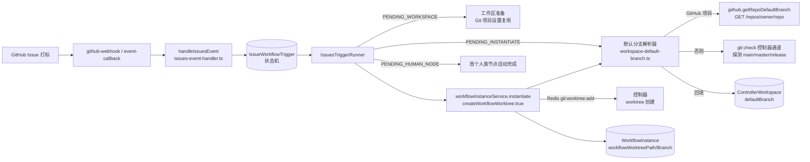
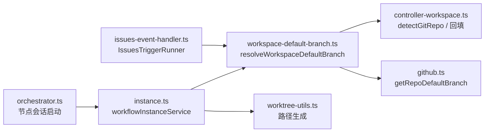
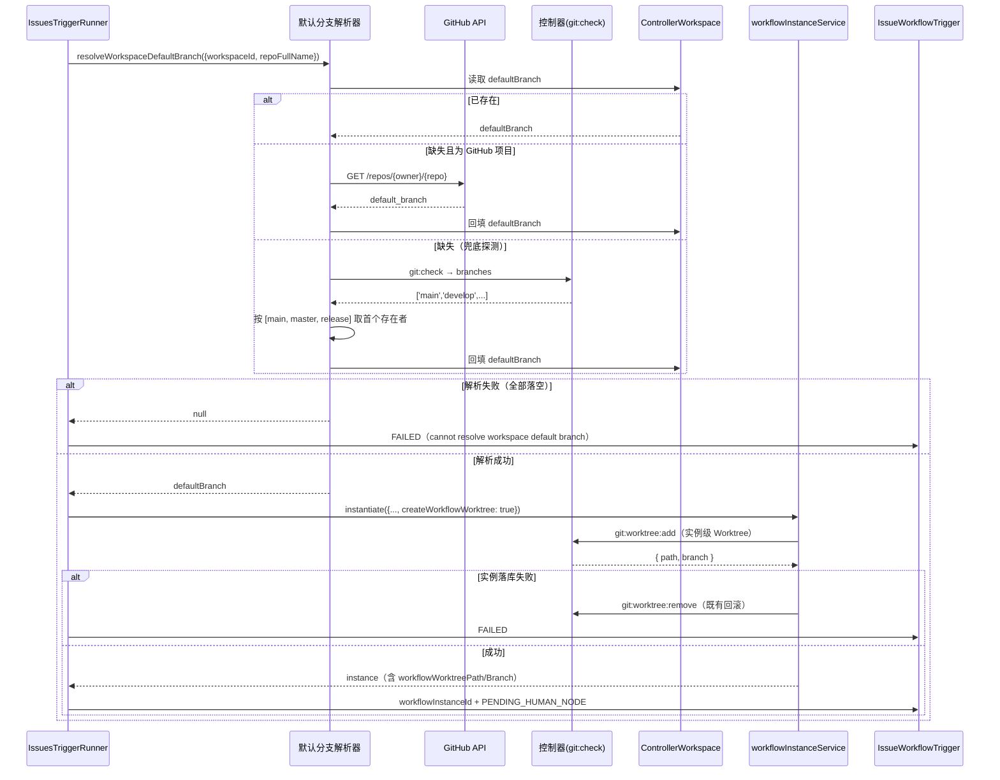
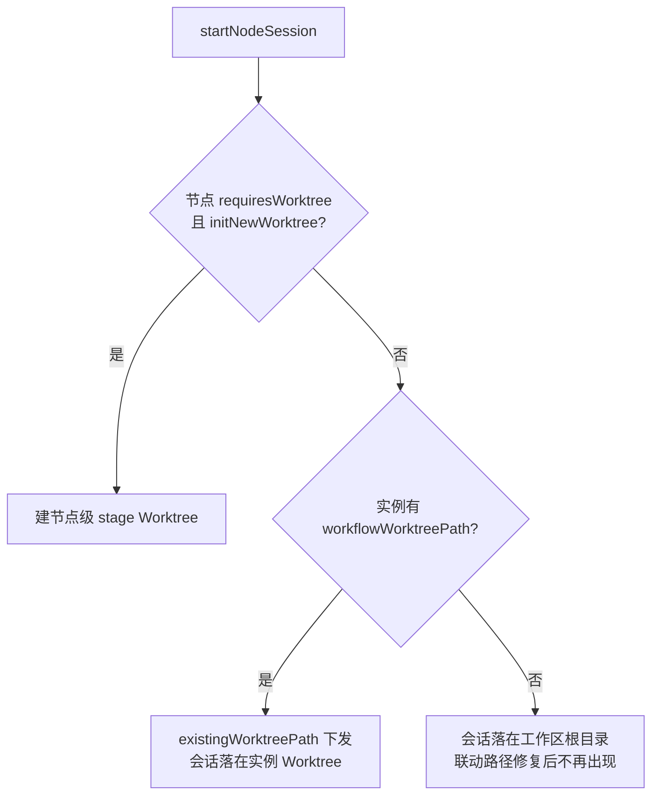

# GitHub Issues 联动工作流强制 Worktree 隔离 - 技术提案

**功能名称**: GitHub Issues 联动工作流强制 Worktree 隔离
**关联 PRD**: [[../../../product/draft/20261026-issues-workflow-force-worktree.md]]
**技术提案版本**: v1.1
**创建日期**: 2026-10-26
**作者**: ZeroAsh Agent
**feat-branch**: `fix/issues-workflow-force-worktree`

> v1.1 变更：按评审意见，将「`defaultBranch` 缺失时 fast fail」改为「自动探测并回填默认分支」——新增默认分支解析器：GitHub 项目优先经 GitHub API 获取仓库默认分支并回填 `ControllerWorkspace.defaultBranch`；否则按 `[main, master, release]` 顺序（存在的优先）经既有 `git:check` 通道探测回填；仅当全部落空时才失败。解析器同时接入 `workflowInstanceService.instantiate`，一并修复手工/既有路径「`defaultBranch` 缺失即报错或静默失去 Worktree」的历史问题。

## 1. 概述

### 1.1 背景

云电脑 GitHub Issues 联动（见 [[20261025-feat-github-issues-workflow.md]]）中，`IssuesTriggerRunner`（`servers/agent-api/src/services/workflow/issues-event-handler.ts`）在 `PENDING_INSTANTIATE` 阶段调用 `workflowInstanceService.instantiate()` 实例化工作流。

问题根因有两层：

1. **实例级 Worktree 未开启**：`createInstance()` 调用 `instantiate()` 时未传 `createWorkflowWorktree`（`InstantiateWorkflowInput.createWorkflowWorktree`，缺省 falsy），因此 `instantiate()` 内 `if (input.createWorkflowWorktree && workspace.defaultBranch)` 分支不会执行，实例不落 `workflowWorktreePath` / `workflowWorktreeBranch`。
2. **节点级 Worktree 依赖配置勾选**：`mapConfiguredNodes()` 原样映射 `requiresWorktree: Boolean(node.requiresWorktree)`，而 orchestrator 判定 `enableWorktree = requiresWorktree && agentConfig.initNewWorktree`。联动配置的工作流若未勾选，节点会话既不建节点级 Worktree，又因实例无 `workflowWorktreePath` 可回退，最终 `existingWorktreePath` 为 `undefined`，会话 cwd 落在**工作区根目录（主分支）**。

对比手工入口：`InstantiateWorkflowDialog.tsx` 提供「为工作流创建独立 Worktree」勾选（`createWorkflowWorktree`，Git 仓库时默认引导勾选），而 Issues 联动全程无人工介入，无任何环节补上该标记。

**附带的历史问题（本次一并修复）**：`ControllerWorkspace.defaultBranch` 目前只能由用户手工设置（`controllerWorkspaceService.setDefaultBranch`），没有自动识别手段。一旦缺失，`instance.ts` 中 `needsWorktree && !workspace.defaultBranch` 直接抛错（「该工作流包含需要 Worktree 隔离的节点，但工作区不是 Git 仓库……」），`createWorkflowWorktree && workspace.defaultBranch` 则**静默跳过** Worktree 创建——用户只能手工补齐后重试。

### 1.2 目标

- Issues 联动触发的工作流实例**强制创建实例级 Worktree**（`createWorkflowWorktree: true`），实例内所有未单独配置节点级隔离的 AI 节点会话经 `existingWorktreePath` 在实例 Worktree 中执行，主分支零改动。
- 新增**默认分支解析器**：`defaultBranch` 缺失时自动探测并回填——GitHub 项目优先经 GitHub API 获取仓库默认分支；否则按 `[main, master, release]` 顺序（存在的优先）经既有 `git:check` 控制器通道探测本地分支；命中即持久化到 `ControllerWorkspace.defaultBranch`。
- 解析器同时接入 `workflowInstanceService.instantiate()`，**修复历史问题**：`needsWorktree` 校验与 `createWorkflowWorktree` 分支不再因 `defaultBranch` 缺失而直接报错/静默跳过。
- 仅当解析器完全无法识别默认分支（非 Git 仓库、候选分支均不存在且 GitHub API 不可用）时，触发/实例化才失败并给出可读原因，**不静默降级**到主分支执行。
- 节点级 `requiresWorktree` / `agentConfig.initNewWorktree` 语义保持不变；手工实例化入口勾选行为不变。

### 1.3 范围

**做**：

- `issues-event-handler.ts`：联动实例化强制 `createWorkflowWorktree: true`；实例化前经解析器确保 `defaultBranch`，解析失败则 fail 触发记录；
- 新增默认分支解析器 `services/workspace-default-branch.ts`（GitHub API 优先 + 候选顺序探测 + 回填）；
- `github.ts`：新增 `getRepoDefaultBranch(userId, repoFullName)`（复用既有 repo-scoped token，`GET /repos/{owner}/{repo}` 取 `default_branch`）；
- `instance.ts`：`instantiate()` 接入解析器，替代 `needsWorktree && !workspace.defaultBranch` 的抛错与 `createWorkflowWorktree && workspace.defaultBranch` 的静默跳过（历史问题修复）；
- 对应单元测试（TDD）。

**不做**：

- 不改动手工实例化入口（GraphQL `instantiateWorkflow` / 前端弹窗）的勾选语义与 UI；
- 不强制节点级 `requiresWorktree` / `initNewWorktree`（保持已配置工作流语义）；
- 不改动其他实例化来源（模板实例化、MCP admin-tools 直建等）的 Worktree 默认值，如有需要另行立项（其经 `instantiate()` 同样享受解析器修复）；
- 无 GraphQL 契约变更、无数据模型 schema 变更（仅新增 `defaultBranch` 的自动写入路径）。

## 2. 技术架构

### 2.1 系统架构图



### 2.2 技术栈

| 层级 | 技术选型 | 说明 |
|------|---------|------|
| 后端 | Node.js 24 + TypeScript（ESM strict）+ Express v5 + GraphQL-Yoga | agent-api，本次唯一改动服务 |
| 数据库 | MongoDB（Mongoose） | 复用现有集合与字段，无 schema 变更 |
| 控制器通信 | Redis 命令通道（`git:check` / `git:worktree:add` / `git:worktree:remove`） | 探测与 Worktree 创建/回滚全部复用既有链路 |
| GitHub API | 既有 repo-scoped installation token（`github.ts repoToken`） | 新增只读 `GET /repos/{owner}/{repo}`，权限已在 App 授权内 |
| 测试 | Vitest | `issues-event-handler.test.ts` / `instance.test.ts` / 新增 `workspace-default-branch.test.ts` |

### 2.3 模块划分



| 模块 | 职责 | 关键技术点 |
|------|------|-----------|
| `workspace-default-branch.ts`（新增） | 默认分支解析：已存即返回 → GitHub API → 候选顺序探测 → 回填 | 纯服务函数；候选清单常量 `['main','master','release']` |
| `IssuesTriggerRunner.instantiateWorkflow/createInstance` | 联动实例化入口 | 解析器确保默认分支；强制 `createWorkflowWorktree: true` |
| `workflowInstanceService.instantiate` | 统一实例化（历史问题修复点） | 用解析结果替代直接抛错/静默跳过；Worktree 创建/回滚既有逻辑不改 |
| `github.getRepoDefaultBranch`（新增方法） | 取仓库默认分支 | 复用 `repoToken`；失败/404 返回 `null` 交由候选探测兜底 |
| `orchestrator.startNodeSession` | 节点会话工作目录决策 | 既有优先级（节点级 > 实例级 > 根目录）不改 |

## 3. API 设计

### 3.1 API 契约

无对外契约变更。`InstantiateWorkflowInput.createWorkflowWorktree`（`graphql/schemas/workflow.ts`）与 `ControllerWorkspace.defaultBranch` 均已存在，本次仅新增内部调用与自动写入路径。

### 3.2 内部接口

新增默认分支解析器（`services/workspace-default-branch.ts`）：

```ts
/** 候选主分支清单：按顺序，存在的优先 */
export const DEFAULT_BRANCH_CANDIDATES = ['main', 'master', 'release'] as const;

/**
 * 解析工作区默认分支：
 * 1. workspace.defaultBranch 已存在 → 直接返回；
 * 2. repoFullName 存在（GitHub 项目）→ github.getRepoDefaultBranch，命中即回填并返回；
 * 3. 否则经 controllerWorkspaceService.detectGitRepo（git:check）取 branches，
 *    按 DEFAULT_BRANCH_CANDIDATES 顺序取第一个存在者，回填并返回；
 * 4. 全部落空 → 返回 null（调用方决定失败文案）。
 */
export async function resolveWorkspaceDefaultBranch(input: {
  userId: string;
  controllerId: string;
  workspaceId: string;
  repoFullName?: string | null;
}): Promise<string | null>;
```

`github.ts` 新增：

```ts
/** 取仓库默认分支（GET /repos/{owner}/{repo} → default_branch）；任何失败返回 null，不抛出 */
async getRepoDefaultBranch(userId: string, repoFullName: string): Promise<string | null>;
```

`IssuesTriggerRunner.instantiateWorkflow` 调用链（替换原 fast-fail 设计）：

```ts
const defaultBranch = await resolveWorkspaceDefaultBranch({
  userId, controllerId, workspaceId,
  repoFullName: String(trigger.repoFullName ?? ''),
});
if (!defaultBranch) {
  await this.fail(trigger._id, 'cannot resolve workspace default branch (not a git repository?)');
  return;
}
// createInstance 内：
await workflowInstanceService.instantiate(ctx.userId, {
  source: 'CONFIGURED',
  // ...
  createWorkflowWorktree: true, // 联动触发强制实例级 Worktree
});
```

`workflowInstanceService.instantiate()` 内部（历史问题修复）：

```ts
// 原：needsWorktree && !workspace.defaultBranch → throw；createWorkflowWorktree && workspace.defaultBranch → 静默跳过
// 改：needsWorktree || input.createWorkflowWorktree 时，先经解析器确保默认分支；
//     解析失败 → needsWorktree 场景抛原错误文案，createWorkflowWorktree 场景抛错（联动路径已被前置拦截，此处为兜底）
```

## 4. 数据模型

### 4.1 数据库设计

无 schema 变更。复用既有字段，仅新增自动写入路径：

#### 集合: `controllerworkspaces`（既有）

| 字段 | 类型 | 说明 |
|------|------|------|
| defaultBranch | String | 新增自动写入：解析器命中后回填持久化，后续直接复用不重复探测 |

#### 集合: `issueworkflowtriggers`（既有）

| 字段 | 类型 | 说明 |
|------|------|------|
| status | String | 复用 `FAILED` 终态承载「默认分支无法识别」的失败 |
| failureReason | String | 记录可读失败原因 |

#### 集合: `workflowinstances`（既有）

| 字段 | 类型 | 说明 |
|------|------|------|
| workflowWorktreePath | String | 修复后联动实例必然落值 |
| workflowWorktreeBranch | String | 同上 |

### 4.2 缓存设计

无缓存变更。`detectGitRepo` 既有 `git:branches:{controllerId}:{pathMd5}` Redis 缓存行为不变；Worktree 创建经既有 Redis 命令通道下发控制器。

## 5. 技术实现方案

### 5.1 核心流程



节点会话启动时（既有逻辑，修复后自然生效）：



### 5.2 关键实现点

#### 实现点 1: `createInstance` 强制 `createWorkflowWorktree: true`

- **描述**: `issues-event-handler.ts` 的 `createInstance()` 在调用 `workflowInstanceService.instantiate()` 时显式传 `createWorkflowWorktree: true`。
- **技术细节**: 仅改动该调用点；`instantiate()` 内部的 Worktree 创建（随机 8 位 hex 后缀天然去重）与失败回滚（`removeWorkflowWorktree`）均为既有能力，直接复用。
- **风险点**: Worktree 创建依赖控制器在线；创建失败会 throw → `instantiateWorkflow` catch → `fail(trigger)`，触发记录 FAILED 且不留半成品实例，语义符合 PRD「明确失败」。

#### 实现点 2: 默认分支解析器（评审意见：替代 fast fail）

- **描述**: 新增 `services/workspace-default-branch.ts` 的 `resolveWorkspaceDefaultBranch()`。解析顺序：`defaultBranch` 已存 → GitHub API（`repoFullName` 存在时）→ `git:check` 候选探测（`['main','master','release']` 顺序，存在的优先）→ `null`。命中即经 `ControllerWorkspace.findByIdAndUpdate` 回填持久化。
- **技术细节**: 本地探测复用 `controllerWorkspaceService.detectGitRepo()`（既有 `git:check` 通道返回 `{ isGitRepo, currentBranch, branches }`，自带 Redis 缓存与 `isGitRepo` 回填），**不新增控制器命令**；仅取 `branches` 与候选清单的交集首个，不使用 `currentBranch` 臆测（避免把 `develop`/`detached` 当主分支）。
- **风险点**: `detectGitRepo` 最长 30s 轮询等待控制器响应，仅在 `defaultBranch` 缺失时触发，且回填后一次性；控制器离线时探测返回失败 → 联动触发 FAILED（原因可读），符合预期。

#### 实现点 3: `github.getRepoDefaultBranch`（GitHub 项目优先通道）

- **描述**: `github.ts` 新增只读方法，`repoToken()` 取 repo-scoped installation token → `GET /repos/{owner}/{repo}` → 返回 `default_branch`。
- **技术细节**: 任何异常（无绑定、404、网络错误）一律返回 `null` 交候选探测兜底，不抛出；权限在既有 App 授权范围内（metadata/contents read），token 不落库不写日志（沿用既有规约）。
- **风险点**: 安装授权被移除时返回 `null`，探测兜底仍可用本地分支判定，行为可接受。

#### 实现点 4: `instantiate()` 接入解析器（历史问题修复）

- **描述**: `instance.ts` 中 `needsWorktree && !workspace.defaultBranch` 的直接抛错、`input.createWorkflowWorktree && workspace.defaultBranch` 的静默跳过，统一改为：当 `needsWorktree || input.createWorkflowWorktree` 且 `workspace.defaultBranch` 缺失时，先调用解析器（手工路径无 `repoFullName`，走候选探测）；解析成功则继续（校验与 Worktree 创建用解析结果），解析失败才抛原错误文案（needsWorktree 场景）或抛出「无法解析工作区默认分支」错误（createWorkflowWorktree 场景，不再静默跳过）。
- **技术细节**: `instantiate` 内工作区对象已载入，解析器调用在「4. requiresWorktree git 校验」之前完成并就地更新局部 `workspace.defaultBranch`，后续逻辑零改动；`workspaceId` 必存在（既有归属校验）。
- **风险点**: 行为变更——手工实例化勾选 Worktree 但工作区缺 `defaultBranch` 时，从「静默不建」变为「自动探测后建立」。这正是评审要求的历史问题修复方向；探测失败时从静默变报错，属预期收紧。

#### 实现点 5: 节点级隔离语义保持不变

- **描述**: `mapConfiguredNodes()` 不强制覆写 `requiresWorktree` / `agentConfig.initNewWorktree`。节点级已勾选隔离的 AI 节点仍建自己的 stage Worktree（`<instance-slug>/<stage-slug>`）；未勾选的节点经 `existingWorktreePath` 落在实例级 Worktree。两类节点都不触碰主分支。
- **技术细节**: `orchestrator.startNodeSession` 的优先级（节点级 > 实例级 > 根目录）不变。
- **风险点**: 无；这是选择实例级强制而非节点级强制的原因（见 6.1）。

## 6. 技术决策

### 6.1 决策列表

| 决策 | 选项 A | 选项 B | 最终选择 | 原因 |
|------|--------|--------|---------|------|
| 隔离粒度 | 实例级 Worktree（`createWorkflowWorktree: true`） | 强制节点级（覆写 `requiresWorktree`/`initNewWorktree`） | 选项 A | 与手工入口「为工作流创建独立 Worktree」语义对齐；整实例一个副本更符合「一个 Issue 一条改动线」；不篡改用户已配置工作流的节点语义 |
| `defaultBranch` 缺失处理 | fast fail（v1.0 方案） | 自动探测回填：GitHub 项目 API 优先，否则按 `[main, master, release]` 顺序探测 | 选项 B | 评审意见：免除手工设置主分支的隐形成本，联动无人工干预也能可靠隔离；一并修复 instantiate 的历史问题 |
| 默认分支来源优先级 | GitHub API 优先，候选探测兜底 | 候选探测优先，API 兜底 | GitHub API 优先 | GitHub 项目的远端默认分支是权威来源（可与本地 clone 的 HEAD 分支不一致之外的场景对齐）；非 GitHub 项目天然落到候选探测 |
| 历史问题修复范围 | 仅联动路径自行解析 | 解析器接入 `instantiate()`，全入口受益 | 选项 B | 同一缺失场景在手工/模板路径同样 fast fail 或静默失去隔离，评审要求一并解决 |
| 生效范围（Worktree 强制） | 仅 Issues 联动调用点 | `instantiate()` 内对 `source=CONFIGURED` 默认开启 | 选项 A | 最小爆炸半径；手工入口勾选语义不变，无回归 |
| 存量触发记录 | 迁移补偿 | 不处理 | 不处理 | 存量 PENDING 记录极少且可重试；已 COMPLETED 实例不回头改 |

### 6.2 依赖与约束

| 类型 | 内容 | 说明 |
|------|------|------|
| 依赖 | `workflowInstanceService.instantiate` 的 Worktree 创建/回滚能力 | 既有，见 [[20260829-fix-workflow-worktree-session-start.md]] |
| 依赖 | 控制器 `git:check` / `git:worktree:add` 命令通道 | 既有（Redis relay），不新增控制器命令 |
| 依赖 | GitHub repo-scoped token（`github.ts repoToken`） | 既有，见 [[20261021-feat-github-workload.md]] |
| 约束 | 候选主分支清单固定 `['main','master','release']`，顺序即优先级 | 评审意见指定 |
| 约束 | 禁止 rebase/squash，仅 merge（z-git） | 分支管理 |
| 约束 | TDD 红-绿-重构 | 先补失败测试再改实现 |

## 7. 项目结构

```
servers/agent-api/
└── src/
    ├── services/
    │   ├── workspace-default-branch.ts        # 新增：默认分支解析器（GitHub API 优先 + 候选顺序探测 + 回填）
    │   ├── workspace-default-branch.test.ts   # 新增：解析器单测
    │   ├── github.ts                          # 改：新增 getRepoDefaultBranch
    │   ├── controller-workspace.ts            # 不改（复用 detectGitRepo / findByIdAndUpdate）
    │   └── workflow/
    │       ├── issues-event-handler.ts        # 改：createInstance 传 createWorkflowWorktree:true；实例化前经解析器确保默认分支
    │       ├── issues-event-handler.test.ts   # 改：新增/更新用例（TDD）
    │       ├── instance.ts                    # 改：instantiate 接入解析器，替代抛错/静默跳过（历史问题修复）
    │       ├── instance.test.ts               # 改：新增/更新用例（TDD）
    │       ├── orchestrator.ts                # 不改（existingWorktreePath 既有回退逻辑）
    │       └── worktree-utils.ts              # 不改
```

## 8. 测试策略

### 8.1 测试覆盖要求

- 单元测试：新增 `workspace-default-branch.test.ts`；更新 `issues-event-handler.test.ts` 与 `instance.test.ts`；既有用例全绿；
- 本修复不改变 GraphQL 契约，无需新增契约测试；E2E 依赖真实 GitHub/云电脑环境，既有 E2E-33 联动用例在验收环境回归。

### 8.2 测试类型

| 类型 | 工具 | 覆盖范围 |
|------|------|---------|
| 单元测试（TDD） | Vitest | 默认分支解析器、`IssuesTriggerRunner.instantiateWorkflow/createInstance`、`workflowInstanceService.instantiate`、`github.getRepoDefaultBranch` |

新增/更新用例：

**`workspace-default-branch.test.ts`（新增）**：

1. `defaultBranch` 已存在 → 直接返回，不调用 GitHub API 与 `detectGitRepo`；
2. 缺失 + 有 `repoFullName` + API 命中 → 返回 API 结果并回填 `ControllerWorkspace`；
3. 缺失 + API 失败/无 `repoFullName` → `detectGitRepo` 探测，`branches=['develop','master']` 时返回 `master`（候选顺序：main 不存在则取 master）并回填；
4. `branches` 仅 `['release']` → 返回 `release`；`branches` 三者全无 / `isGitRepo=false` → 返回 `null` 且不回填；
5. 探测命中后再次调用 → 直接返回已回填值，不重复探测。

**`issues-event-handler.test.ts`（更新）**：

6. `createInstance` 调用 `instantiate()` 时携带 `createWorkflowWorktree: true`；
7. 工作区 `defaultBranch` 缺失 + GitHub 项目 → 解析器回填后实例化成功，触发记录推进 `PENDING_HUMAN_NODE`；
8. 解析器返回 `null` → 触发记录 `FAILED`、`failureReason` 可读，且 `instantiate()` 未被调用（无 Worktree 残留）；
9. `instantiate()` 抛错（Worktree 创建失败）→ 触发记录 `FAILED`（既有行为回归）；
10. 既有用例（无 HUMAN 节点直接 COMPLETED、ALREADY_TRIGGERED 幂等等）全部保持通过。

**`instance.test.ts`（更新）**：

11. `needsWorktree` 且 `defaultBranch` 缺失但可探测回填 → 实例化成功（不再抛错）；
12. `createWorkflowWorktree: true` 且 `defaultBranch` 缺失 → 探测回填后创建实例级 Worktree（不再静默跳过）；
13. 探测失败 → `needsWorktree` 场景抛原错误文案；`createWorkflowWorktree` 场景报错（不静默）。

**`github` 相关**：

14. `getRepoDefaultBranch` 成功返回 `default_branch`；token 失败/404/网络异常返回 `null` 不抛出。

## 9. 验收标准

- [ ] 技术方案评审通过
- [ ] 单元测试新增用例先红后绿，全套测试通过（`servers/agent-api`）
- [ ] 联动触发的工作流实例持有 `workflowWorktreePath`/`workflowWorktreeBranch`，节点会话 cwd 在实例 Worktree 内
- [ ] 工作区 `defaultBranch` 缺失时：GitHub 项目经 API 回填，非 GitHub 项目按 `main → master → release` 探测回填；回填持久化且后续复用
- [ ] 默认分支完全无法识别时触发 FAILED、原因可读、主分支零改动；无静默降级
- [ ] 手工实例化勾选/不勾选「为工作流创建独立 Worktree」行为与修复前一致；`defaultBranch` 缺失的历史 fast fail/静默跳过场景改为自动探测
- [ ] 节点级已配置隔离的工作流经联动触发时节点级隔离仍生效

## 10. 相关文档

- [[../../../product/draft/20261026-issues-workflow-force-worktree.md]] — 关联 PRD
- [[20261025-feat-github-issues-workflow.md]] — 云电脑 GitHub Issues 联动工作流（被修复能力）
- [[20260829-fix-workflow-worktree-session-start.md]] — 工作流 Worktree 节点会话启动失败修复
- [[20260817-feat-session-lifecycle-and-worktree-management.md]] — 会话生命周期与 Worktree 管理增强
- [[20261021-feat-github-workload.md]] — Github 工作负载与云主机 Git 项目设置（repo-scoped token 来源）
- [[../common-rules.md]]、[[../backend-rules.md]] — 开发规范
