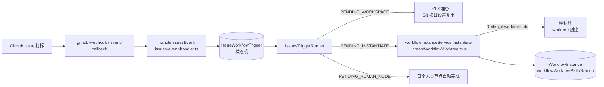
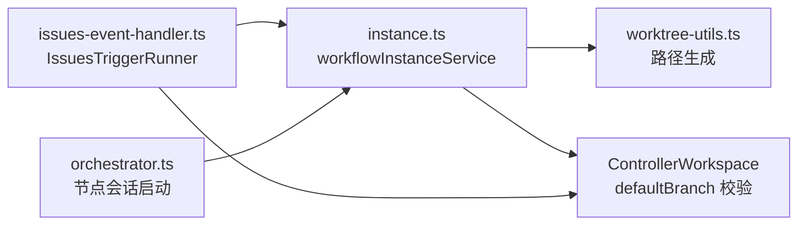
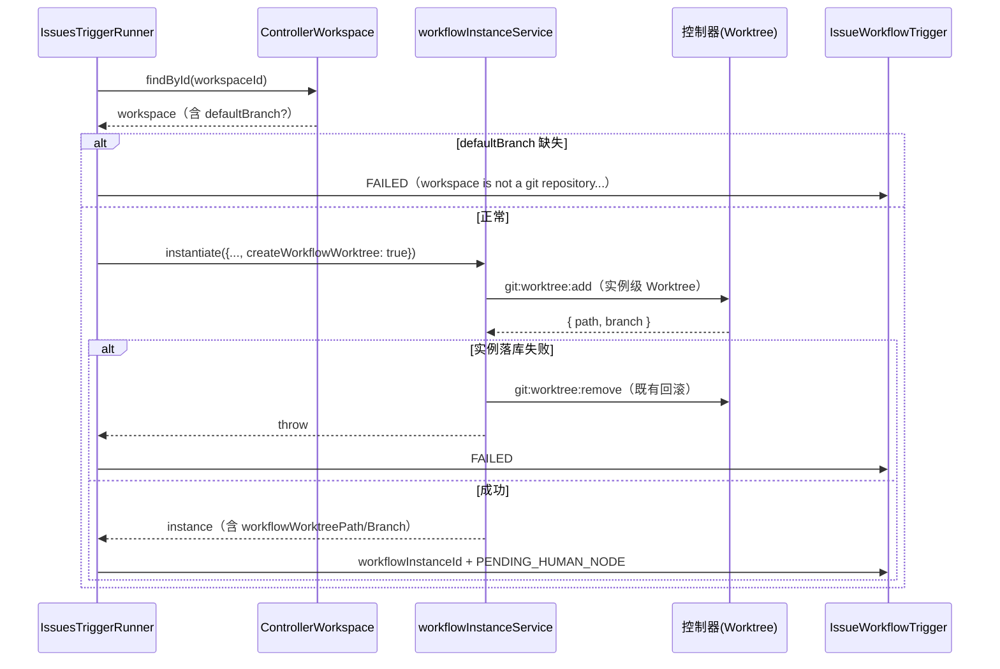
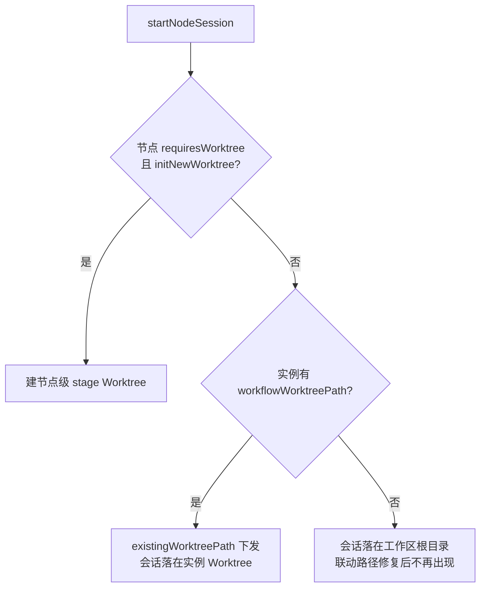

# GitHub Issues 联动工作流强制 Worktree 隔离 - 技术提案

**功能名称**: GitHub Issues 联动工作流强制 Worktree 隔离
**关联 PRD**: [[../../../product/draft/20261026-issues-workflow-force-worktree.md]]
**技术提案版本**: v1.0
**创建日期**: 2026-10-26
**作者**: ZeroAsh Agent
**feat-branch**: `fix/issues-workflow-force-worktree`

## 1. 概述

### 1.1 背景

云电脑 GitHub Issues 联动（见 [[20261025-feat-github-issues-workflow.md]]）中，`IssuesTriggerRunner`（`servers/agent-api/src/services/workflow/issues-event-handler.ts`）在 `PENDING_INSTANTIATE` 阶段调用 `workflowInstanceService.instantiate()` 实例化工作流。

问题根因有两层：

1. **实例级 Worktree 未开启**：`createInstance()` 调用 `instantiate()` 时未传 `createWorkflowWorktree`（`InstantiateWorkflowInput.createWorkflowWorktree`，缺省 falsy），因此 `instantiate()` 内 `if (input.createWorkflowWorktree && workspace.defaultBranch)` 分支不会执行，实例不落 `workflowWorktreePath` / `workflowWorktreeBranch`。
2. **节点级 Worktree 依赖配置勾选**：`mapConfiguredNodes()` 原样映射 `requiresWorktree: Boolean(node.requiresWorktree)`，而 orchestrator 判定 `enableWorktree = requiresWorktree && agentConfig.initNewWorktree`。联动配置的工作流若未勾选，节点会话既不建节点级 Worktree，又因实例无 `workflowWorktreePath` 可回退，最终 `existingWorktreePath` 为 `undefined`，会话 cwd 落在**工作区根目录（主分支）**。

对比手工入口：`InstantiateWorkflowDialog.tsx` 提供「为工作流创建独立 Worktree」勾选（`createWorkflowWorktree`，Git 仓库时默认引导勾选），而 Issues 联动全程无人工介入，无任何环节补上该标记。

### 1.2 目标

- Issues 联动触发的工作流实例**强制创建实例级 Worktree**（`createWorkflowWorktree: true`），实例内所有未单独配置节点级隔离的 AI 节点会话经 `existingWorktreePath` 在实例 Worktree 中执行，主分支零改动。
- 工作区无 `defaultBranch`（非 Git 仓库/未同步分支信息）时，触发记录快速失败（`FAILED` + 可读原因），**不静默降级**到主分支执行。
- 节点级 `requiresWorktree` / `agentConfig.initNewWorktree` 语义保持不变；手工实例化入口行为不变。

### 1.3 范围

**做**：

- `issues-event-handler.ts`：联动实例化强制 `createWorkflowWorktree: true`；实例化前校验工作区 `defaultBranch`，缺失则 fail 触发记录；
- 对应单元测试（TDD）。

**不做**：

- 不改动手工实例化入口（GraphQL `instantiateWorkflow` / 前端弹窗）的勾选语义；
- 不强制节点级 `requiresWorktree` / `initNewWorktree`（保持已配置工作流语义）；
- 不改动其他实例化来源（模板实例化、MCP admin-tools 直建等），如有需要另行立项；
- 无 GraphQL 契约变更、无数据模型变更。

## 2. 技术架构

### 2.1 系统架构图



### 2.2 技术栈

| 层级 | 技术选型 | 说明 |
|------|---------|------|
| 后端 | Node.js 24 + TypeScript（ESM strict）+ Express v5 + GraphQL-Yoga | agent-api，本次唯一改动服务 |
| 数据库 | MongoDB（Mongoose） | 复用现有集合，无 schema 变更 |
| 控制器通信 | Redis 命令通道（`git:worktree:add` / `git:worktree:remove`） | 实例级 Worktree 创建/回滚复用既有链路 |
| 测试 | Vitest | `issues-event-handler.test.ts` 扩展 |

### 2.3 模块划分



| 模块 | 职责 | 关键技术点 |
|------|------|-----------|
| `IssuesTriggerRunner.instantiateWorkflow/createInstance` | 联动实例化入口 | 强制传 `createWorkflowWorktree: true`；前置校验 `defaultBranch` 并 fail |
| `workflowInstanceService.instantiate` | 统一实例化 | 既有逻辑：建 Worktree → 失败回滚 → 快照落库，不改 |
| `orchestrator.startNodeSession` | 节点会话工作目录决策 | 既有逻辑：节点级 worktree 优先，其次 `existingWorktreePath = instance.workflowWorktreePath`，不改 |

## 3. API 设计

### 3.1 API 契约

无对外契约变更。`InstantiateWorkflowInput.createWorkflowWorktree`（`contracts/agent-session.graphql` / `graphql/schemas/workflow.ts` 中 `InstantiateWorkflowInput.createWorkflowWorktree: Boolean`）已存在，本次仅由内部调用方（Issues 联动）显式置 `true`。

### 3.2 内部接口

`IssuesTriggerRunner.createInstance` 调用签名不变，入参 `instantiate()` 的 input 增加字段：

```ts
await workflowInstanceService.instantiate(ctx.userId, {
  source: 'CONFIGURED',
  configuredWorkflowId: ctx.configuredWorkflowId,
  controllerId: ctx.controllerId,
  workspaceId: ctx.workspaceId,
  name: buildTriggerInstanceName(/* ... */),
  nodes: ctx.nodes,
  createWorkflowWorktree: true, // 新增：联动触发强制实例级 Worktree
});
```

失败原因文案（写入 `IssueWorkflowTrigger.failureReason`，经 `sanitizeOperationError`）：

- 工作区无默认分支：`workspace is not a git repository (no default branch), cannot create workflow worktree`

## 4. 数据模型

### 4.1 数据库设计

无 schema 变更。复用既有字段：

#### 集合: `issueworkflowtriggers`（既有）

| 字段 | 类型 | 说明 |
|------|------|------|
| status | String | 复用 `FAILED` 终态承载「无法建立 Worktree」的失败 |
| failureReason | String | 记录可读失败原因 |

#### 集合: `workflowinstances`（既有）

| 字段 | 类型 | 说明 |
|------|------|------|
| workflowWorktreePath | String | 修复后联动实例必然落值（Git 工作区前提下） |
| workflowWorktreeBranch | String | 同上 |

### 4.2 缓存设计

无缓存变更。Worktree 创建经既有 Redis 命令通道下发控制器。

## 5. 技术实现方案

### 5.1 核心流程



节点会话启动时（既有逻辑，修复后自然生效）：



### 5.2 关键实现点

#### 实现点 1: `createInstance` 强制 `createWorkflowWorktree: true`

- **描述**: `issues-event-handler.ts` 的 `createInstance()` 在调用 `workflowInstanceService.instantiate()` 时显式传 `createWorkflowWorktree: true`。
- **技术细节**: 仅改动该调用点；`instantiate()` 内部的 Worktree 创建（`createWorkflowWorktree` 私有方法，随机 8 位 hex 后缀天然去重）与失败回滚（`removeWorkflowWorktree`）均为既有能力，直接复用。
- **风险点**: Worktree 创建依赖控制器在线；创建失败会 throw → `instantiateWorkflow` catch → `fail(trigger)`，触发记录 FAILED 且不留半成品实例，语义符合 PRD「明确失败」。

#### 实现点 2: 无 `defaultBranch` 快速失败（防静默降级）

- **描述**: `instantiate()` 内 `if (input.createWorkflowWorktree && workspace.defaultBranch)` 对工作区非 Git 仓库是**静默跳过**——这在联动路径不可接受。在 `instantiateWorkflow()` 中实例化前置校验：按 `workspaceId` 读 `ControllerWorkspace`，`defaultBranch` 缺失时直接 `fail(trigger._id, 'workspace is not a git repository (no default branch), cannot create workflow worktree')` 并返回。
- **技术细节**: 联动工作区由「Git 项目设置」建立（clone 后 `ensureWorkspace`），正常必有 `defaultBranch`；该校验是防御分支信息未同步/工作区异常的兜底。注意校验失败发生在 `instantiate()` 之前，不会产生任何 Worktree 残留。
- **风险点**: 若存在「工作区已 clone 但 defaultBranch 字段未回写」的时序窗口，可能误 fail；需在实现时确认 `ensureWorkspace`/工作区同步已保证 `defaultBranch` 落库（必要时在 `prepareWorkspace` 阶段补齐校验而非此处）。

#### 实现点 3: 节点级隔离语义保持不变

- **描述**: `mapConfiguredNodes()` 不强制覆写 `requiresWorktree` / `agentConfig.initNewWorktree`。节点级已勾选隔离的 AI 节点仍建自己的 stage Worktree（`<instance-slug>/<stage-slug>`）；未勾选的节点经 `existingWorktreePath` 落在实例级 Worktree。两类节点都不触碰主分支。
- **技术细节**: `orchestrator.startNodeSession` 的优先级（节点级 > 实例级 > 根目录）不变。
- **风险点**: 无；这是选择实例级强制而非节点级强制的原因（见 6.1）。

## 6. 技术决策

### 6.1 决策列表

| 决策 | 选项 A | 选项 B | 最终选择 | 原因 |
|------|--------|--------|---------|------|
| 隔离粒度 | 实例级 Worktree（`createWorkflowWorktree: true`） | 强制节点级（覆写 `requiresWorktree`/`initNewWorktree`） | 选项 A | 与手工入口「为工作流创建独立 Worktree」语义对齐；整实例一个副本更符合「一个 Issue 一条改动线」；不篡改用户已配置工作流的节点语义 |
| 非 Git 工作区处理 | 静默跳过（沿用 `instantiate` 现状） | 前置校验 + 触发 FAILED | 选项 B | PRD 硬约束：任何情况下不得在未知情时跑在主分支；失败需可追溯 |
| 生效范围 | 仅 Issues 联动调用点 | `instantiate()` 内对 `source=CONFIGURED` 默认开启 | 选项 A | 最小爆炸半径；手工入口勾选语义不变，无回归 |
| 存量触发记录 | 迁移补偿 | 不处理 | 不处理 | 存量 PENDING 记录极少且可重试；已 COMPLETED 实例不回头改 |

### 6.2 依赖与约束

| 类型 | 内容 | 说明 |
|------|------|------|
| 依赖 | `workflowInstanceService.instantiate` 的 Worktree 创建/回滚能力 | 既有，见 [[20260829-fix-workflow-worktree-session-start.md]] |
| 依赖 | 控制器 `git:worktree:add` 命令通道 | 既有（Redis relay） |
| 约束 | 禁止 rebase/squash，仅 merge（z-git） | 分支管理 |
| 约束 | TDD 红-绿-重构 | 先补失败测试再改实现 |

## 7. 项目结构

```
servers/agent-api/
└── src/services/workflow/
    ├── issues-event-handler.ts        # 改：createInstance 传 createWorkflowWorktree:true；instantiateWorkflow 前置 defaultBranch 校验
    ├── issues-event-handler.test.ts   # 改：新增/更新用例（TDD）
    ├── instance.ts                    # 不改（复用既有 Worktree 创建/回滚）
    ├── orchestrator.ts                # 不改（existingWorktreePath 既有回退逻辑）
    └── worktree-utils.ts              # 不改
```

## 8. 测试策略

### 8.1 测试覆盖要求

- 单元测试：`issues-event-handler.test.ts` 覆盖下列用例，既有用例全绿；
- 本修复不改变 GraphQL 契约，无需新增契约测试；E2E 依赖真实 GitHub/云电脑环境，既有 E2E-33 联动用例在验收环境回归。

### 8.2 测试类型

| 类型 | 工具 | 覆盖范围 |
|------|------|---------|
| 单元测试（TDD） | Vitest | `IssuesTriggerRunner.instantiateWorkflow/createInstance` |

新增/更新用例：

1. `createInstance` 调用 `instantiate()` 时携带 `createWorkflowWorktree: true`（断言调用入参）；
2. 工作区存在且有 `defaultBranch` → 实例化成功，触发记录推进到 `PENDING_HUMAN_NODE`，`workflowInstanceId` 回写；
3. 工作区无 `defaultBranch` → 触发记录 `FAILED`，`failureReason` 含 `not a git repository`，且 `instantiate()` 未被调用（无 Worktree 残留）；
4. `instantiate()` 抛错（Worktree 创建失败）→ 触发记录 `FAILED`（既有行为回归）；
5. 既有用例（无 HUMAN 节点直接 COMPLETED、ALREADY_TRIGGERED 幂等等）全部保持通过。

## 9. 验收标准

- [ ] 技术方案评审通过
- [ ] 单元测试新增用例先红后绿，全套测试通过（`servers/agent-api`）
- [ ] 联动触发的工作流实例持有 `workflowWorktreePath`/`workflowWorktreeBranch`，节点会话 cwd 在实例 Worktree 内
- [ ] 工作区无 `defaultBranch` 时触发 FAILED 且原因可读、主分支零改动
- [ ] 手工实例化勾选/不勾选「为工作流创建独立 Worktree」行为与修复前一致
- [ ] 节点级已配置隔离的工作流经联动触发时节点级隔离仍生效

## 10. 相关文档

- [[../../../product/draft/20261026-issues-workflow-force-worktree.md]] — 关联 PRD
- [[20261025-feat-github-issues-workflow.md]] — 云电脑 GitHub Issues 联动工作流（被修复能力）
- [[20260829-fix-workflow-worktree-session-start.md]] — 工作流 Worktree 节点会话启动失败修复
- [[20260817-feat-session-lifecycle-and-worktree-management.md]] — 会话生命周期与 Worktree 管理增强
- [[../common-rules.md]]、[[../backend-rules.md]] — 开发规范
