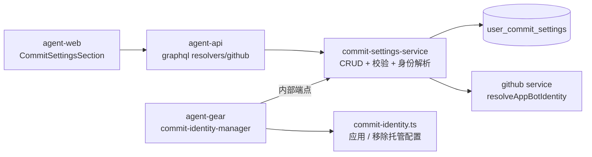
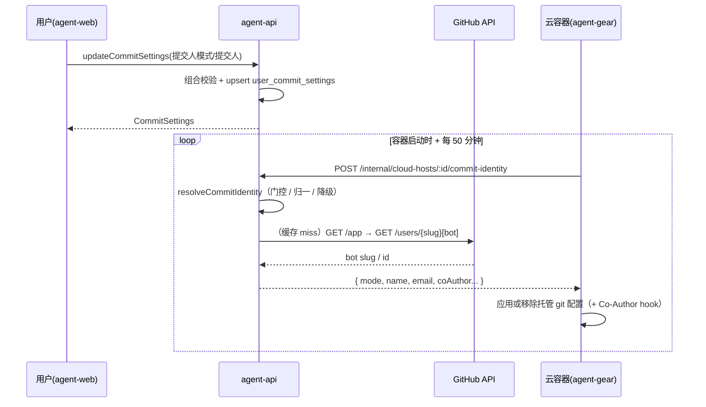

# 云容器 Commit 提交人设置 - 技术提案

**功能名称**: Commit 设置（云容器提交人模式与提交人）
**关联 PRD**: `docs/product/draft/20261027-commit-author-settings.md`
**技术提案版本**: v1.0
**创建日期**: 2026-10-27
**作者**: ZeroAsh Agent
**feat-branch**: `feat/commit-author-settings`

## 1. 概述

### 1.1 背景

PRD 要求在设置页「GitHub 绑定」下方新增「Commit 设置」区块（仅对云容器生效）：「提交人模式」（仅Agent / Co-Author / 仅人类 / 未设置，默认未设置）×「提交人」（Github帐号 / 自定义 / 未设置），Co-Author / 仅人类 要求提交人已设置。

现状链路（`20261021-feat-github-workload`）：

- Github 凭据由容器内凭据管理器（`packages/agent-controller/src/github/credential-manager.ts`）经 `POST /internal/cloud-hosts/:controllerId/github-credential` 申请并写入 gh 配置（`gh auth login --with-token` + `gh auth setup-git`），每 50 分钟续期；凭据接口双鉴权（`INTERNAL_API_TOKEN` 或云主机 Controller key），无绑定时返回 404（`no-binding` 正常跳过）。
- 容器内 git 提交身份（`user.name` / `user.email`）从未配置，commit 归属不受控。
- 云容器内 agent-gear 以 worker 用户运行（`20261025-feat-cloud-host-keepalive`），全局 git 配置落在 `/home/worker/.gitconfig`。

### 1.2 目标

- 用户级 Commit 设置落库与 GraphQL 契约（查询 / 保存 / 服务端权威校验）。
- agent-api 解析「最终提交身份」（模式门控、帐号归属、bot 身份解析与缓存），经内部端点下发到云容器。
- agent-gear 容器内以「托管 git 配置文件（include.path）+ Co-Author hook」方式幂等应用 / 移除提交身份；「未设置」零残留、行为与上线前一致。
- 旧版本 worker 无此能力，优雅降级为「未设置」行为，服务端不设版本门禁。

### 1.3 范围

**做**：

- agent-api：`UserCommitSetting` 模型 + 唯一索引迁移、`commitSettings` / `updateCommitSettings` GraphQL、身份解析 service、`commit-identity` 内部下发端点、bot 身份解析（GitHub API + 缓存）。
- agent-gear（packages/agent-controller）：commit-identity 应用器（托管 gitconfig include + prepare-commit-msg hook）与周期同步管理器。
- agent-web：设置页「Commit 设置」区块。
- 契约：`contracts/github.graphql` 扩展。
- 测试：单元 + API + 前端组件（TDD）。

**不做**：

- 本地控制器环境的 git 身份管理（PRD 明示仅云容器）。
- 历史 commit 重写、仓库级（`--local`）身份配置、Commit 模板定制。
- GitHub Enterprise。

## 2. 技术架构

### 2.1 系统架构图

```mermaid
graph TD
    subgraph 前台
        AW[agent-web<br/>设置页 Commit 设置区块]
    end
    subgraph 用户侧后端
        AA[agent-api<br/>GraphQL resolver + commit-settings-service]
        GH[github service 扩展<br/>resolveAppBotIdentity]
        DB[(MongoDB<br/>user_commit_settings / github_accounts /<br/>cloud_host_github_bindings / cloudcontainers 只读)]
        RD[(Redis<br/>bot 身份缓存)]
    end
    subgraph 云容器
        AG[agent-gear<br/>commit-identity-manager]
        GC[git 全局配置<br/>~/.gitconfig + include ~/.zag/commit-identity.gitconfig]
        HK[~/.zag/git-hooks/prepare-commit-msg<br/>Co-Author trailer]
    end
    AW -->|commitSettings / updateCommitSettings| AA
    AA --> DB
    AA --> GH
    GH -->|GET /app, GET /users/{slug}[bot]| GITHUB[github.com]
    GH --> RD
    AG -->|POST /internal/cloud-hosts/:id/commit-identity| AA
    AG --> GC
    AG --> HK
```

### 2.2 技术栈

| 层级 | 技术选型 | 说明 |
|------|---------|------|
| 前端 | React + TypeScript + Vite + Apollo Client（apps/agent-web） | 新增 `CommitSettingsSection` 组件 |
| 后端 | Node.js + Express + GraphQL-Yoga + Mongoose（servers/agent-api） | 模型 / 契约 / 解析 / 内部端点 |
| 缓存 | Redis（agent-api 既有连接） | bot 身份缓存 |
| 容器执行器 | Node.js 24 + TypeScript（packages/agent-controller） | git 身份托管应用与周期同步 |
| Git 平台 | GitHub App（既有 JWT 能力，`GitHubService.createAppJwt`） | bot 身份来源；裸 fetch，不引 octokit |

### 2.3 模块划分



| 模块 | 职责 | 关键技术点 |
|------|------|-----------|
| commit-settings-service | 设置 CRUD、组合校验、`resolveCommitIdentity(controllerId)` | 模式 × 提交人一致性、帐号归属、agent_only 负载门控、解绑降级 |
| github service 扩展 | bot 身份解析与缓存 | App JWT → `GET /app` 取 slug → `GET /users/{slug}[bot]` 取 id；Redis 24h |
| internal-cloud-host 路由扩展 | 容器按 controllerId 取回解析结果 | 复用 github-credential 双鉴权；永不 404，`unset` 兜底 |
| agent-gear commit-identity | 应用 / 移除托管 git 配置与 hook | include.path 托管文件、exact-trailer 幂等、卸载零残留 |
| commit-identity-manager | 拉取节奏与失败退避 | 与 credential-manager 同构（启动即拉 + 50 分钟周期、401/403 退避、定时器 unref） |
| agent-web | 设置区块 UI | 模式-提交人联动校验、帐号下拉、自定义输入、保存反馈 |

## 3. API 设计

### 3.1 API 契约

`contracts/github.graphql` 扩展（新增 Commit 设置段）：

```graphql
enum CommitterMode {
  AGENT_ONLY
  CO_AUTHOR
  HUMAN_ONLY
  UNSET
}

enum CommitterType {
  GITHUB_ACCOUNT
  CUSTOM
  UNSET
}

type CommitSettings {
  committerMode: CommitterMode!
  committerType: CommitterType!
  # committerType = GITHUB_ACCOUNT 时为所选已绑定非 org 帐号 id，其余为 null
  githubAccountId: ID
  # committerType = CUSTOM 时为自定义用户名/邮箱（对应 git user/email），其余为 null
  customName: String
  customEmail: String
}

input CommitSettingsInput {
  committerMode: CommitterMode!
  committerType: CommitterType!
  githubAccountId: ID
  customName: String
  customEmail: String
}

extend type Query {
  """当前用户的 Commit 设置（仅对云容器环境生效）；从未保存返回双 UNSET 默认值"""
  commitSettings: CommitSettings!
}

extend type Mutation {
  """保存 Commit 设置；非法组合返回白名单错误文案"""
  updateCommitSettings(input: CommitSettingsInput!): CommitSettings!
}
```

**服务端权威校验**（错误文案白名单，前端原样映射）：

| 规则 | 错误文案 |
|------|---------|
| `committerMode ∈ {CO_AUTHOR, HUMAN_ONLY}` 且 `committerType = UNSET` | `committer is required for the selected mode` |
| `committerType = GITHUB_ACCOUNT`：`githubAccountId` 缺失或不属于当前用户 | `invalid github account` |
| `committerType = CUSTOM`：`customName` trim 后为空 / 超 100 字符 / 含换行或 NUL；或 `customEmail` 为空 / 超 254 / 邮箱格式非法 | `invalid custom committer` |
| `committerMode = UNSET` 或 `committerType = UNSET` | 冗余字段归一清空（见 §4.1） |

#### 接口示例: updateCommitSettings

- **请求**
  - GraphQL Mutation `updateCommitSettings`
  - Body:
    ```json
    {
      "input": {
        "committerMode": "CO_AUTHOR",
        "committerType": "GITHUB_ACCOUNT",
        "githubAccountId": "66f..."
      }
    }
    ```
- **响应**
  - 200:
    ```json
    {
      "committerMode": "CO_AUTHOR",
      "committerType": "GITHUB_ACCOUNT",
      "githubAccountId": "66f...",
      "customName": null,
      "customEmail": null
    }
    ```
  - 校验失败：GraphQL errors，message 为上表白名单文案。

### 3.2 内部接口

`POST /internal/cloud-hosts/:controllerId/commit-identity`（挂载于 `routes/internal-cloud-host.ts`，与 `github-credential` 并列）：

- **鉴权**：与 github-credential 完全相同的双鉴权（`INTERNAL_API_TOKEN` 或该云主机 Controller key）；越权 / 非法凭据 401/403。
- **行为**：调用 `commitSettingsService.resolveCommitIdentity(controllerId)`，永不返回 404；无法下发有效身份时一律 `mode: 'unset'`（容器据此移除托管配置，行为同未设置）。
- **响应** `200`：
  ```json
  {
    "mode": "agent_only | co_author | human_only | unset",
    "name": "提交人用户名（unset 时缺省）",
    "email": "提交人邮箱（unset 时缺省）",
    "coAuthorName": "bot 用户名（仅 co_author）",
    "coAuthorEmail": "bot 邮箱（仅 co_author）"
  }
  ```

**`resolveCommitIdentity` 解析逻辑**（agent-api 权威）：

1. 按 controllerId 查云主机（`CloudHost`；不存在 / 已软删 → `unset`）→ 得 userId；
2. 查 `user_commit_settings`；从未保存 → `unset`；
3. 提交人归一校验：
   - `github_account`：帐号必须仍存在且归属该用户（解绑 / 越权 → `unset`）；
   - `custom`：字段缺失 / 非法 → `unset`；
4. 模式门控：
   - `agent_only`：要求该主机已勾选 / 安装 Github 负载——判定为 `cloud_host_github_bindings` 存在，或 `cloudcontainers.installedWorkloads[].name === 'Github'`（创建期勾选 / runtime 安装；agent-api 已有 cloudcontainers 只读 model）——未命中 → `unset`；身份 = bot；
   - `human_only`：身份 = 提交人；
   - `co_author`：身份 = 提交人 + coAuthor = bot；
5. bot 身份解析失败（GitHub API 异常）→ 本次按 `unset` 返回并告警，下个周期重试（不阻断其余链路）。

**身份取值**：

| 身份 | name | email |
|------|------|-------|
| bot | `{appSlug}[bot]` | `{botUserId}+{appSlug}[bot]@users.noreply.github.com` |
| Github 帐号提交人 | `githubLogin` | `{githubUserId}+{githubLogin}@users.noreply.github.com` |
| 自定义提交人 | `customName` | `customEmail` |

**bot 身份解析**（github service 新增 `resolveAppBotIdentity`）：`createAppJwt()` → `GET /app` 取 `slug` → `GET /users/{slug}[bot]` 取 `id`；结果缓存 Redis `github:app-bot-identity`（TTL 24h，进程内兜底），失败短缓存 60s 防击穿。GitHub noreply 邮箱保证 commit 可关联真实帐号 / bot 且不暴露真实邮箱。

## 4. 数据模型

### 4.1 数据库设计

#### 表/集合: user_commit_settings（agent-api，新增 `models/user-commit-setting.ts`）

| 字段 | 类型 | 说明 |
|------|------|------|
| userId | String，唯一索引 | 归属（对齐 `GitHubAccount.userId` 的 String 口径） |
| committerMode | `enum('agent_only','co_author','human_only','unset')`，default `unset` | 提交人模式 |
| committerType | `enum('github_account','custom','unset')`，default `unset` | 提交人类型 |
| githubAccountId | ObjectId? | `committerType=github_account` 时必填，ref GitHubAccount |
| customName | String? | ≤100，禁换行 / NUL |
| customEmail | String? | ≤254，邮箱格式 |
| createdAt / updatedAt | Date | timestamps |

归一规则：`committerType=unset` 时清空 `githubAccountId/customName/customEmail`；`committerType=github_account` 时清空 `customName/customEmail`；`committerType=custom` 时清空 `githubAccountId`。保存按 userId upsert。

唯一索引经迁移显式创建（沿用 `006-todo-elicitation-request-id-index` 先例）：新增 `servers/agent-api/src/migrations/011-user-commit-settings-index.ts`。

### 4.2 缓存设计

| 缓存 | key | TTL | 说明 |
|------|-----|-----|------|
| bot 身份 | `github:app-bot-identity`（Redis） | 24h（失败 60s） | App 级常量，极少变化 |
| commit-identity 端点 | 不缓存 | — | 容器 50 分钟周期拉取，量级小 |

## 5. 技术实现方案

### 5.1 核心流程



### 5.2 关键实现点

#### 实现点 1: 托管 git 配置文件（include.path）

- **描述**: agent-gear 新增 `src/github/commit-identity.ts`，通过 git 原生 `include.path` 机制应用 / 移除提交身份，不直接改写用户 `~/.gitconfig` 的 `[user]`。
- **技术细节**:
  - 应用（mode ≠ unset）：写 `~/.zag/commit-identity.gitconfig`（内容 `[user] name/email`，权限 0600），随后确保 `git config --global include.path ~/.zag/commit-identity.gitconfig`（幂等设置）；git 原生优先级保证仓库级 `.git/config` 仍可覆盖。
  - 移除（mode = unset）：仅当全局 `include.path` 当前值恰为托管路径时 `--unset`，再删除托管文件；用户其他 git 配置零触碰 → 严格满足「未设置 = 上线前行为」。
  - `git` 子进程经 spawn 执行（worker 用户上下文），失败抛可读错误，不含任何 secret。
- **风险点**: 容器文件系统为 ephemeral，配置随容器销毁自然消失；重复应用幂等。

#### 实现点 2: Co-Author hook

- **描述**: `co_author` 模式经全局 `core.hooksPath` + `prepare-commit-msg` hook 追加 bot 署名 trailer，对所有 harness（OpenCode / Kimi Code / DeepSeek）与手工 `git commit` 统一生效。
- **技术细节**:
  - 写 `~/.zag/git-hooks/prepare-commit-msg`（0755，首行标记注释 `# zag-managed`），trailer 在写入时固化为字面量：
    ```bash
    #!/bin/sh
    # zag-managed: append Co-authored-by trailer (idempotent)
    MSG="$1"
    TRAILER='Co-authored-by: zag-bot[bot] <123456+zag-bot[bot]@users.noreply.github.com>'
    grep -qF "$TRAILER" "$MSG" 2>/dev/null && exit 0
    git interpret-trailers --in-place --trailer "$TRAILER" "$MSG" 2>/dev/null \
      || printf '\n%s\n' "$TRAILER" >> "$MSG"
    ```
  - 设置 `git config --global core.hooksPath ~/.zag/git-hooks`；切换到其他模式 / 未设置时，仅当当前值恰为托管路径才移除，并删除带标记的 hook 文件。
  - 幂等：exact-trailer `grep -qF` 防重复追加；`--amend` / 重复提交不产生叠加署名。
- **风险点**: `core.hooksPath` 会覆盖仓库本地 hooks 目录——云容器为平台独占环境、无用户预置 hooks，可接受；已在 PRD/文档明示仅云容器生效。

#### 实现点 3: commit-identity-manager（容器侧同步节奏）

- **描述**: agent-gear 新增 `src/github/commit-identity-manager.ts`，与 `credential-manager.ts` 同构；supervisor 启动 / 停止时同步接入。
- **技术细节**:
  - env 复用凭据管理器三件套（`ZAG_AGENT_API_ENDPOINT` / `ZAG_CONTROLLER_ID` / `ZAG_HOST_KEY`），缺失仅 warn 不阻塞云主机；
  - `start()` 立即拉取一次，之后每 50 分钟周期拉取（定时器 `unref()`）；并发合并为一次请求；401/403 按 1/2/4 分钟退避（≤3 次）；网络 / 解析失败保留现状待下周期重试，不崩溃；
  - 与凭据管理器相互独立：提交身份不依赖 gh 凭据 / Git 项目绑定存在（Co-Author / 仅人类 不要求 Github 负载）；
  - 版本：agent-gear `2.11.0`；旧 worker 无此模块即「未设置」行为，服务端不设版本门禁。
- **风险点**: 生效延迟最长一个同步周期（50 分钟）——PRD 已接受分钟级延迟。

#### 实现点 4: agent-web 设置区块

- **描述**: `components/settings/CommitSettingsSection.tsx`，挂载于 `SettingsPage` 的 `github-section` 内 `GithubBindingSection` 下方。
- **技术细节**:
  - 数据源：`GET_GITHUB_ACCOUNTS`（帐号下拉，GitHubAccount 即 OAuth 授权用户身份，org 仅为 installation 的 `accountType`，天然不出现）+ 新增 `GET_COMMIT_SETTINGS` / `UPDATE_COMMIT_SETTINGS`；
  - 头部常驻提示「设置只对云容器环境生效」；模式 / 提交人选择器 + 条件渲染（Github帐号 → 下拉；自定义 → 用户名 + 邮箱）；
  - 前端联动拦截（Co-Author / 仅人类 + 未设置提交人禁用保存并提示）与服务端白名单错误映射（`committer is required for the selected mode` → 「请先设置提交人」等）；
  - 保存成功 toast「对云容器环境生效，已运行的云电脑稍后自动更新」。

#### 实现点 5: agent_only 门控与降级

- **描述**: 「勾选了 github 负载」的服务端判定与全链路降级语义。
- **技术细节**: 绑定存在或 `installedWorkloads` 含 `Github` 才下发 bot 身份；其余（含未勾选负载、帐号解绑、设置数据非法、bot 解析失败）一律 `unset`——容器移除 / 不应用托管配置，行为与上线前一致。

## 6. 技术决策

### 6.1 决策列表

| 决策 | 选项 A | 选项 B | 最终选择 | 原因 |
|------|--------|--------|---------|------|
| 身份下发通路 | 随 `github-credential` 响应扩展 | 独立 `commit-identity` 端点 | B | 凭据端点无绑定时 404，而 Co-Author / 仅人类 不要求绑定 / 负载；独立端点语义干净、`unset` 兜底永不 404 |
| 容器内配置方式 | 直接改写 `~/.gitconfig` 的 `[user]` | `include.path` 托管文件 | B | 卸载零残留、不破坏既有配置，天然满足「未设置 = 上线前行为」 |
| Co-Author 落地 | 提示词约定 Agent 自行署名 | `prepare-commit-msg` hook 统一追加 | B | harness 不可知、幂等、可审计，不依赖 Agent 自觉 |
| bot 身份来源 | 配置项硬编码 | GitHub API 解析 + 缓存 | B | 与 App 实际身份一致、免配置；24h 缓存控频 |
| 提交人邮箱 | GitHub 帐号真实邮箱 | GitHub noreply（`{id}+{login}@users.noreply.github.com`） | B | 不暴露真实邮箱，commit 仍可关联帐号 |
| 生效时机 | 仅新建容器生效 | 启动 + 50 分钟周期同步 | B | PRD 要求已运行容器生效且可回退 |
| 版本门禁 | 提升 MIN_HARNESS_WORKER_VERSION | 不设门禁，旧 worker 降级 | B | 缺失身份不产生错误，强制升级代价大于收益 |

### 6.2 依赖与约束

| 类型 | 内容 | 说明 |
|------|------|------|
| 依赖 | 凭据链路 env（`ZAG_AGENT_API_ENDPOINT` / `ZAG_CONTROLLER_ID` / `ZAG_HOST_KEY`） | commit-identity 端点鉴权复用 |
| 依赖 | github service 既有 App JWT 能力（`createAppJwt`） | bot 身份解析 |
| 依赖 | `cloudcontainers` 只读 model / `cloud_host_github_bindings` | agent_only 负载门控 |
| 约束 | 仅云容器；仅 github.com；未设置零残留 | PRD 约束 |
| 约束 | 生效延迟 ≤1 个同步周期（50 分钟） | PRD 接受分钟级延迟 |

## 7. 项目结构

```
servers/agent-api/src/models/user-commit-setting.ts               # 设置模型
servers/agent-api/src/migrations/011-user-commit-settings-index.ts# userId 唯一索引迁移
servers/agent-api/src/services/commit-settings-service.ts         # CRUD + 校验 + resolveCommitIdentity
servers/agent-api/src/services/github.ts                          # + resolveAppBotIdentity（Redis 缓存）
servers/agent-api/src/routes/internal-cloud-host.ts               # + POST /:controllerId/commit-identity
servers/agent-api/src/graphql/schemas/github.ts                   # + CommitSettings 类型/枚举
servers/agent-api/src/graphql/resolvers/github.ts                 # + commitSettings / updateCommitSettings
packages/agent-controller/src/github/commit-identity.ts           # 托管 gitconfig include + hook 应用/移除
packages/agent-controller/src/github/commit-identity-manager.ts   # 拉取节奏 / 退避（50 分钟周期）
packages/agent-controller/src/cloud-host/supervisor.ts            # 启动 / 停止接入
packages/agent-controller/package.json                            # 版本 2.11.0
apps/agent-web/src/components/settings/CommitSettingsSection.tsx  # 设置区块
apps/agent-web/src/pages/SettingsPage.tsx                         # github-section 内挂载
apps/agent-web/src/graphql/queries.ts / mutations.ts              # + GET_COMMIT_SETTINGS / UPDATE_COMMIT_SETTINGS
contracts/github.graphql                                          # 契约扩展
tests/api/src/agent-api/github.test.ts                            # GraphQL + 内部端点覆盖（GitHub API 走 mock-github-server）
```

## 8. 测试策略

### 8.1 测试覆盖要求

- 遵循 TDD（红-绿-重构）。
- 单元测试（vitest）：
  - agent-api `commit-settings-service`：模式 × 提交人全组合校验矩阵、`resolveCommitIdentity`（负载门控 / 解绑降级 / bot 失败降级 / 归一清空）；
  - agent-gear `commit-identity`：应用 / 移除幂等（spawn mock：include.path 仅托管值才 unset、exact-trailer 去重）、`commit-identity-manager` 节奏与退避（fetch / timer mock，对齐 credential-manager 测试口径）；
- API 测试（tests/api，vitest + supertest）：`commitSettings` 默认值 / `updateCommitSettings` 白名单错误与越权帐号 / `commit-identity` 端点鉴权失败与 unset 兜底 / agent_only 门控；
- 前端组件测试：`CommitSettingsSection` 渲染、模式-提交人联动拦截、帐号下拉、自定义校验、保存反馈（对齐 `GithubBindingSection` 既有测试风格）。

### 8.2 测试类型

| 类型 | 工具 | 覆盖范围 |
|------|------|---------|
| 单元测试 | vitest（各包既有框架） | 校验矩阵、身份解析、托管配置应用 / 移除、同步节奏 |
| API 测试 | tests/api（vitest + supertest + mock-github-server） | GraphQL 契约与内部端点 |
| 组件测试 | vitest + React Testing Library（apps/agent-web） | 设置区块交互 |

## 9. 部署方案

### 9.1 环境规划

| 环境 | 用途 | 部署方式 |
|------|------|---------|
| 开发 | Aspire 编排全量服务 | `aspire start` |
| 生产 | 随常规发布 | agent-api / agent-web 滚动更新；agent-gear 2.11.0 随镜像与容器内自更新下发 |

### 9.2 配置管理

- 无新增环境变量（容器侧复用凭据管理器 env；服务端复用 GitHub App 配置与 Redis 连接）；
- agent-gear 版本 `2.11.0`，不设强制版本门禁（旧 worker 降级为「未设置」行为）。

## 10. 验收标准

- [ ] 技术方案评审通过
- [ ] Contract 评审通过（`contracts/github.graphql`）
- [ ] 设置可保存 / 读取；非法组合（Co-Author / 仅人类 + 未设置提交人、越权帐号、非法自定义输入）服务端与前端双重拦截
- [ ] 云容器内 commit 身份按模式生效：`agent_only` = bot；`human_only` = 用户；`co_author` = 用户 + bot Co-Author trailer
- [ ] `agent_only` 在未勾选 / 未安装 Github 负载的容器不配置身份
- [ ] 从未设置或切回「未设置」：容器内无托管配置残留（include.path / 托管文件 / hook 均移除或从未写入），行为与上线前一致
- [ ] bot 与 Github 帐号提交人均使用 GitHub noreply 邮箱形式
- [ ] 已运行容器在 1 个同步周期（≤50 分钟）内自动生效
- [ ] 旧版本 worker 不受影响（行为即未设置）
- [ ] 单元 / API / 组件测试通过

## 11. 相关文档

- 关联 PRD：`docs/product/draft/20261027-commit-author-settings.md`
- [[20261021-feat-github-workload.md]] — Github 工作负载与凭据下发链路
- [[20260709-feat-github-account-binding.md]] — GitHub 帐号绑定（帐号 / installation 模型）
- [[20261025-feat-cloud-host-keepalive.md]] — 云容器 worker 用户与 agent-gear 自更新
- `contracts/github.graphql`、`contracts/cloud-host.graphql`
