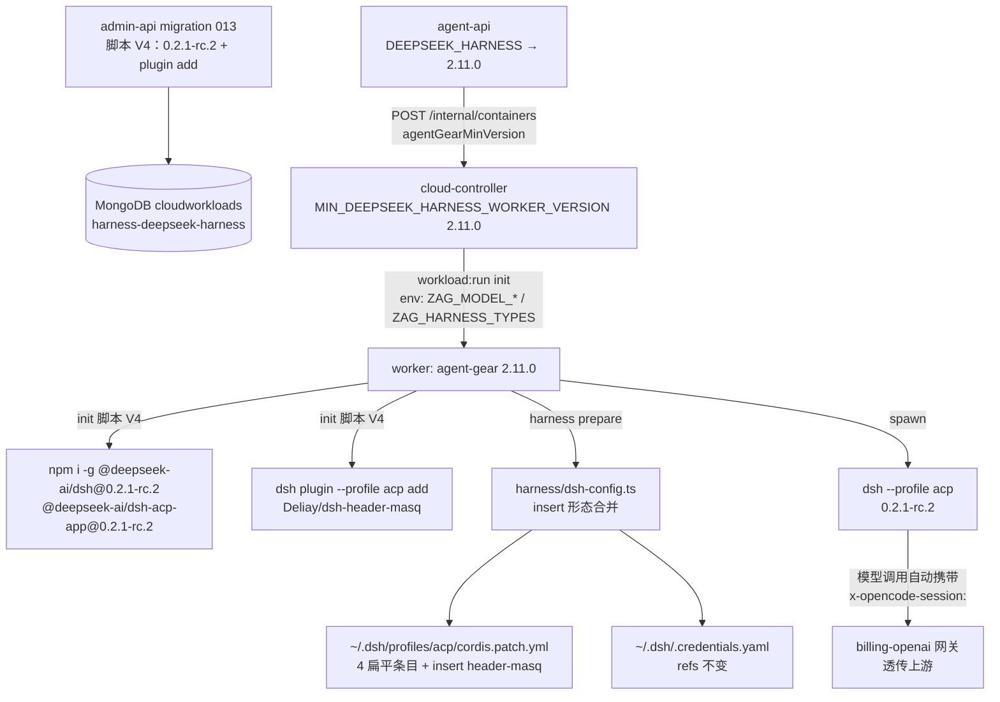
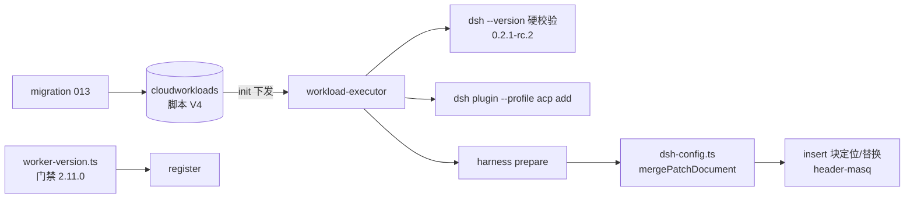
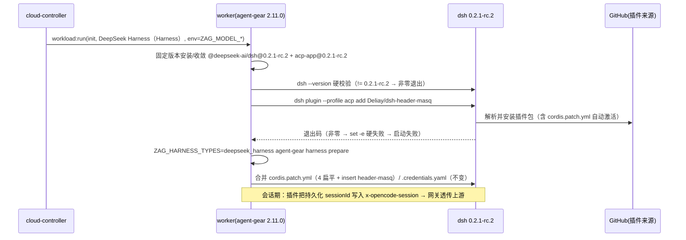
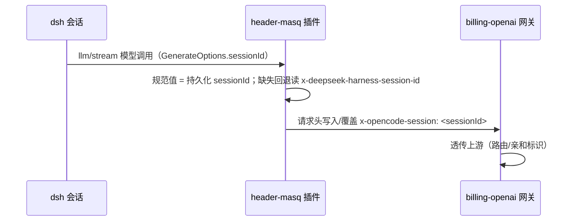

# DeepSeek Harness 会话标识请求头注入（dsh-header-masq 插件预置） - 技术提案

**功能名称**: DeepSeek Harness 云电脑会话标识请求头注入（dsh-header-masq 插件）
**关联 PRD**: [[../../product/draft/20261027-dsh-header-masq.md]]
**技术提案版本**: v1.0
**创建日期**: 2026-10-27
**作者**: ZeroAsh
**feat-branch**: `feat/dsh-header-masq`

## 1. 概述

### 1.1 背景

`20261025-feat-deepseek-harness` 交付了 DeepSeek Harness 云电脑基线（预置工作负载 010 双包固定版本安装 + `agent-gear harness prepare` 注入 `profiles/acp/cordis.patch.yml` 与 `.credentials.yaml`），随后 011（prepare 按类型限定）与 012（worker 用户脚本 sudo 化、工作区 `/home/worker/workspace`）两次刷新预置脚本。当前事实：

- **预置脚本现状**（`harness-deepseek-harness`，live 版本 = 012 的 `HARNESS_DEEPSEEK_SCRIPT_V2`）：固定版本 `DSH_CLI_VERSION=DSH_ACP_APP_VERSION=0.1.2-alpha.2` 双包同装 → `dsh --version` 硬校验 → `mkdir -p ${ZAG_DEFAULT_WORKSPACE:-/home/worker/workspace}` → `ZAG_HARNESS_TYPES=deepseek_harness agent-gear harness prepare`。
- **会话标识头约定**：`contracts/billing-openai.openapi.yaml` 载明计费网关「下游请求头会透传给上游供应商（用于 `x-opencode-session` 等路由标识）」（`servers/admin-api/src/routes/billing-openai.ts:42` 同口径）。OpenCode 原生发送 `x-opencode-session`；**DSH 原生不发送**。
- **`dsh-config.ts` 受管条目**：`DSH_PATCH_ENTRY_IDS = ['llm-deepseek', 'llm-pi-ai', 'agent-default-model', 'acp']` 共 4 个**扁平**条目（`{id, ...}` 顶层形态），按 `id` 定位整体替换 config、保留其他条目与注释（`packages/agent-controller/src/harness/dsh-config.ts`）。
- **需求（上游）**：dsh 增加插件 `Deliay/dsh-header-masq`；工作负载中增加命令 `dsh plugin --profile acp add Deliay/dsh-header-masq`；`cordis.patch.yml` 增加 **insert 形态**配置（`- insert: [{id: header-masq, name: dsh-header-masq, config: {source, targets, fallbackToSessionId, debug}}]`）。
- **插件调研结论**（附录 A，官方 README）：`dsh-header-masq` 在模型调用时把持久化会话 ID 写入 `x-opencode-session` 请求头，同会话固定、新会话变化、重启续聊不变；**兼容范围 `dsh >=0.2.1-rc.2 <0.3.0`**——当前固定版本 `0.1.2-alpha.2` **不满足**，必须随本期升级。

因此本期三个交付面：① **预置脚本升级**（固定版本 `0.1.2-alpha.2 → 0.2.1-rc.2` + 插件安装步骤与硬校验，migration 013 刷新存量）；② **agent-gear 2.11.0**（`dsh-config.ts` 扩展 insert 形态第 5 受管条目，prepare 注入 header-masq 配置）；③ **版本门禁**（`deepseek_harness` 2.9.0 → 2.11.0）。

### 1.2 目标

- admin-api migration `013-preset-harness-deepseek-header-masq`：DeepSeek Harness 预置脚本 V4——固定版本升级 `0.2.1-rc.2`（双包同装不变）+ `dsh plugin --profile acp add Deliay/dsh-header-masq` 安装步骤（`set -euo pipefail` 下非零退出即硬失败）；存量脚本按 V1/V2/V3 精确匹配刷新，管理员定制跳过（沿用 011/012 口径）。
- agent-gear **2.11.0**：`harness/dsh-config.ts` 受管条目扩展 insert 形态——`header-masq` 条目按 id 定位 insert 块并整体替换（幂等），配置为需求给定四键（`source` / `targets` / `fallbackToSessionId` / `debug`）；原子写、0600/0700、secret 口径均不变。
- 版本门禁：`MIN_HARNESS_VERSION_BY_TYPE.deepseek_harness` → `2.11.0`（cloud-controller），agent-api `agentGearMinVersion` 映射同步；worker 镜像 `agent-gear@2.10.x` → `2.11.x`。
- 单元 / API 测试全绿；OpenCode、Kimi Code 与普通主机零回归；DSH 0.2.1-rc.2 升级回归经实机核对清单收敛（附录 B）。

### 1.3 范围

**做**：

- `packages/agent-controller`（agent-gear 2.11.0）：`harness/dsh-config.ts` insert 形态合并扩展 + 单测；`package.json` 版本 `2.10.1 → 2.11.0`。
- `servers/admin-api`：migration `013-preset-harness-deepseek-header-masq`（新脚本常量 + 存量刷新 + 单测）。
- `servers/cloud-controller`：`worker-version.ts` `MIN_DEEPSEEK_HARNESS_WORKER_VERSION` → `2.11.0` + 单测。
- `servers/agent-api`：`cloud-host-service.ts` `DEEPSEEK_HARNESS → 2.11.0` 版本映射。
- `contracts/cloud-controller-websocket.md`：`agentGearMinVersion` 口径增补（含 `deepseek_harness → 2.11.0`）。
- `deploy/images/worker/Dockerfile`：`agent-gear@2.10.x` → `agent-gear@2.11.x`（下次镜像构建生效；存量容器由 entrypoint 每轮自更新到最新 2.x）。
- 各 AGENTS.md 版本/口径段同步（`packages/agent-controller/AGENTS.md` 等，随实现期更新）。

**不做**：

- 插件配置的用户侧/后台自定义入口（一期平台统一口径，需求给定值）。
- `hosts` 白名单配置（需求未含；插件缺省 `[]` = 所有主机，符合云电脑场景）。
- OpenCode / Kimi Code 链路任何改动；计费口径本身不变（仅补齐会话标识头）。
- DSH 其他插件的预置与插件管理面（列表/卸载/版本管理 UI）。
- dsh 0.2.1-rc.2 新能力的接入评估（本期仅消费插件兼容所需的最低升级）。

## 2. 技术架构

### 2.1 系统架构图



关键边界：

- **插件安装在 init、配置注入在 prepare**：`dsh plugin add` 由预置脚本执行（插件包落盘到 profile）；`header-masq` 的**配置**由 `agent-gear harness prepare`（`dsh-config.ts`）写入 `cordis.patch.yml`——保持 `dsh-config.ts` 是 patch 文件**唯一写入口**（原子写/权限/AST 合并/脱敏单测均在其上）。
- **版本升级是插件兼容的前置**：插件声明 `dsh >=0.2.1-rc.2 <0.3.0`（附录 A.1）；固定版本整体升级后 `dsh --version` 硬校验口径不变（预发布段精确比较）。
- **门禁先于注册副作用**：含 `deepseek_harness` 的云电脑要求 worker `>=2.11.0`，旧版 prepare 不写 header-masq 配置的云电脑在注册即被拒（沿用 `version_mismatch:*` 语义）。

### 2.2 技术栈

| 层级 | 技术选型 | 说明 |
|------|---------|------|
| Worker | Node.js（agent-gear 2.11.0） | `dsh-config.ts` YAML AST 合并扩展（insert 形态）；既有 `yaml` 依赖复用 |
| 后端 | Node.js + Express + Mongoose | admin-api（migration 013）、cloud-controller（版本门禁）、agent-api（版本映射） |
| 数据库 | MongoDB | `cloudworkloads` 预置脚本刷新；无 schema 变更 |
| 目标工具 | DeepSeek Harness `dsh`（固定 `0.2.1-rc.2`） | 双包同装不变；`dsh plugin --profile acp add` 安装 GitHub 来源插件 |
| 插件 | `Deliay/dsh-header-masq`（GitHub） | 会话标识请求头桥接（附录 A） |

### 2.3 模块划分



| 模块 | 职责 | 关键技术点 |
|------|------|-----------|
| admin-api migration 013 | 预置脚本 V4 写入/刷新 | 版本升级 + plugin add 步骤；V1/V2/V3 精确匹配刷新、定制跳过 |
| agent-gear `harness/dsh-config.ts` | patch 合并扩展 | insert 形态条目按内层 id 定位、整体替换、幂等；原子写/0600 不变 |
| cloud-controller `worker-version.ts` | 版本门禁 | `MIN_DEEPSEEK_HARNESS_WORKER_VERSION` 2.9.0 → 2.11.0 |
| agent-api `cloud-host-service.ts` | 版本映射 | `DEEPSEEK_HARNESS → 2.11.0` |
| worker 镜像 Dockerfile | 预装版本 | `agent-gear@2.11.x`（entrypoint 自更新兜底存量） |

## 3. API 设计

### 3.1 API 契约

本期**无 GraphQL / OpenAPI 契约变更**；仅 `contracts/cloud-controller-websocket.md` 口径增补：

- `agentGearMinVersion` 按 `harnessTypes` 取最大：基线 `2.10.0`；含 `kimi_code` → 基线之上不变；含 `deepseek_harness` → `2.11.0`（原 2.9.0 口径替换）。
- `ZAG_HARNESS_TYPES` 值域不变；DeepSeek Harness 预置脚本内容属实现细节，不入契约。

### 3.2 内部接口

#### 3.2.1 agent-gear `harness/dsh-config.ts`（扩展）

受管条目由「4 个扁平条目」扩展为「4 扁平 + 1 insert」：

```ts
/** 扁平受管条目（现状不变）：llm-deepseek / llm-pi-ai / agent-default-model / acp。 */
export const DSH_PATCH_ENTRY_IDS = [...] as const; // 4 项，不变

/** insert 形态受管条目 id（位于顶层 { insert: [...] } 块内）。 */
export const DSH_PATCH_INSERT_ENTRY_IDS = ['header-masq'] as const;
```

- 合并语义扩展（`mergePatchDocument`）：
  - 扁平条目定位逻辑不变（顶层 map 的 `id` 命中）；
  - insert 条目定位：遍历顶层 map 中 `insert` 为 seq 的块，内层条目 `id === 'header-masq'` 命中即**整体替换该 insert 块**（我方 insert 块恰好一个内层条目）；未命中则在顶层数组**末尾追加**；
  - 重复执行结果逐字一致（幂等），其他条目与注释逐字保留（既有口径不变）；
  - `entryCount` 4 → 5（摘要口径同步）。
- 写入内容（需求给定值，`hosts` 缺省不写 = 所有主机）：

```yaml
- insert:
    - id: header-masq
      name: dsh-header-masq
      config:
        source: x-deepseek-harness-session-id
        targets:
          - x-opencode-session
        fallbackToSessionId: true
        debug: false
```

#### 3.2.2 admin-api migration `013-preset-harness-deepseek-header-masq`

```ts
export const name = '013-preset-harness-deepseek-header-masq';
/** 新版固定版本（插件兼容下限，附录 A.1）。 */
export const DSH_CLI_VERSION_V4 = '0.2.1-rc.2';
export const DSH_ACP_APP_VERSION_V4 = '0.2.1-rc.2';
/** 脚本 V4：012 V2 基础上替换固定版本 + 插入 plugin add 步骤（见 §5.3）。 */
export const HARNESS_DEEPSEEK_SCRIPT_V3 = `...`;
export async function run(): Promise<void>;
```

- 刷新口径（沿用 011/012）：`presetKey='harness-deepseek-harness'` 命中后——`initScript === V4` 跳过；`∈ [010 V1, 010 V2, 012 V2]` 刷新为 V4；其余视为管理员定制，告警且不覆盖；预置项缺失时按 V4 创建（与 012 `refresh()` 同构）。

## 4. 数据模型

### 4.1 数据库设计

**无 schema 变更**。仅 `cloudworkloads` 预置项 `harness-deepseek-harness` 的 `initScript` 由 migration 013 刷新为 V4（见 §5.3）。

### 4.2 缓存设计

无新增缓存。`acp:probe-options` 5 分钟选项缓存等既有口径不变。

## 5. 技术实现方案

### 5.1 核心流程

#### 5.1.1 含 DeepSeek Harness 云电脑的初始化（脚本 V4）



- **失败语义**：插件安装/配置注入失败 → init 脚本非零退出 → harness 必须工作负载失败 → 容器强制注销并展示原因（既有链路，零改动）。
- **幂等**：脚本重放时版本一致跳过安装；`dsh plugin add` 重跑行为与 prepare 重复写入的幂等性均为实现期核对项（附录 B），prepare 侧幂等由单测锚定。

#### 5.1.2 会话期请求头注入（插件行为，附录 A.2）



### 5.2 关键实现点

#### 实现点 1: 预置脚本 V4（migration 013）

- **描述**: 在 012 V2 基础上两处变更：固定版本 `0.1.2-alpha.2 → 0.2.1-rc.2`（双包）；`dsh --version` 硬校验后插入插件安装步骤。
- **技术细节**: 插件安装依赖 `set -euo pipefail` 做硬校验（非零退出即失败）；`dsh plugin add` 的包解析形态（`Deliay/dsh-header-masq` 简写是否等价 `github:Deliay/dsh-header-masq`）为附录 B 核对项，实现期按实测写定最终命令文本。
- **风险点**: 插件来源为 GitHub——容器到 github.com 的出口可达性（既有 Github 工作负载已有同依赖先例；Aspire 下载代理口径可复用评估）；dsh developer preview 跨版本升级（0.1.2-alpha.2 → 0.2.1-rc.2）的 ACP 回归（附录 B 清单）。

#### 实现点 2: `dsh-config.ts` insert 形态合并（agent-gear 2.11.0）

- **描述**: `mergePatchDocument` 扩展 insert 块处理；`buildEntry` 增补 header-masq 构造；`WriteDshConfigResult.entryCount` 口径 4 → 5。
- **技术细节**: insert 块定位键为「顶层 map 的 `insert` seq 内层条目 `id`」；命中整体替换（`doc.setIn([index], ...)` 等价形态）、未命中末尾追加；**不得**把 insert 块误判为扁平条目（顶层无 `id`），否则重跑追加重复块（单测锚定「连续两次写入结果逐字一致」）。
- **风险点**: 插件包自带 `cordis.patch.yml` 自动激活与用户 patch 层 insert 条目并存时的组合行为（重复 id 是否冲突）——以 `--dump-config` 实测收敛（附录 B）；若冲突，回退口径为「用户 patch 不写 insert 块、仅依赖插件自带激活 + 默认配置」（默认配置恰与需求四键一致，见附录 A.3），届时需求「显式配置」改经插件层验证。

#### 实现点 3: 版本门禁与发布

- **描述**: agent-gear `2.10.1 → 2.11.0`；`MIN_DEEPSEEK_HARNESS_WORKER_VERSION` / agent-api 映射 → `2.11.0`；worker 镜像 `agent-gear@2.11.x`。
- **技术细节**: 仅 `deepseek_harness` 上调；`opencode`（2.10.0 基线）与 `kimi_code`（2.8.0 常量、基线之下）口径逐字不变；`harnessMinVersion` 取最大逻辑不变。存量容器由 entrypoint 每轮 `npm install -g agent-gear`（latest）自更新获得 2.11.0（沿用保活自更新链路）。
- **风险点**: 2.11.0 发布前旧镜像 + 旧 npm latest 的窗口期——门禁常量随服务端先发会导致含 deepseek 云电脑注册被拒；沿用既有「agent-gear 先发版、服务端后上线」的发布顺序（与 2.9.0/2.10.0 一致）。

#### 实现点 4: 兼容与回归面

- **描述**: OpenCode / Kimi Code 全链路零改动；`dsh-config.ts` 扁平 4 条目合并行为逐字保留；非 deepseek 的 `ZAG_HARNESS_TYPES` 分流不受影响。
- **风险点**: DSH 0.2.1-rc.2 的 configOptions 模型通告/会话 resume 行为回归——附录 B 清单逐项实机核对后才可合并。

### 5.3 预置脚本 V4（migration 013 内置，相对 012 V2 的 diff 示意）

```bash
#!/usr/bin/env bash
set -euo pipefail

SUDO=sudo; command -v sudo >/dev/null || SUDO=
export PATH="$HOME/.local/bin:$HOME/.npm-global/bin:$PATH"

# 1) 固定版本安装 / 版本收敛（0.1.2-alpha.2 → 0.2.1-rc.2：dsh-header-masq 兼容下限，附录 A.1）
export DSH_CLI_VERSION="${DSH_CLI_VERSION:-0.2.1-rc.2}"
export DSH_ACP_APP_VERSION="${DSH_ACP_APP_VERSION:-0.2.1-rc.2}"
# …安装/收敛逻辑不变…

# 2) dsh --version 硬校验（不变）

# 3) 会话标识插件安装（本期新增；非零退出即启动失败）
dsh plugin --profile acp add Deliay/dsh-header-masq

# 4) 默认工作区 + 平台渠道模型注入 + header-masq 配置注入（prepare 2.11.0）
mkdir -p "${ZAG_DEFAULT_WORKSPACE:-/home/worker/workspace}"
ZAG_HARNESS_TYPES=deepseek_harness agent-gear harness prepare
```

> 最终文本以实现期实测为准（插件包解析形态、`add` 重跑输出），脚本结构（安装 → 硬校验 → 插件 → prepare）不变。

## 6. 技术决策

### 6.1 决策列表

| # | 决策 | 选项 A | 选项 B | 最终选择 | 原因 |
|---|------|--------|--------|---------|------|
| D1 | 插件安装位置 | init 脚本（`dsh plugin add`） | agent-gear prepare 内执行 | A | 需求原文明确「工作负载中增加命令」；安装是一次性环境准备，与 CLI 安装同层；prepare 保持纯配置写入（无子进程网络依赖） |
| D2 | header-masq 配置写入口 | init 脚本 shell 追加 | `dsh-config.ts` 合并（第 5 受管条目） | B | `dsh-config.ts` 是 patch 唯一写入口（原子写/0600/AST 合并/幂等单测）；shell 追加无法做到按 id 幂等替换 |
| D3 | dsh 固定版本 | 维持 0.1.2-alpha.2 | 升级 0.2.1-rc.2（双包） | B | 插件兼容范围 `>=0.2.1-rc.2 <0.3.0`（附录 A.1）；0.2.1-rc.2 为插件 README 标注的目标版本，双包同代际版本均存在（npm 实测） |
| D4 | insert 条目合并粒度 | 定位内层条目仅替换 config | 整体替换 insert 块 | B | 我方 insert 块恰一个内层条目；整体替换语义与扁平条目「整体替换 config」对齐，实现与测试都更简单 |
| D5 | 版本门禁 | 不上调（旧 worker 靠插件默认配置兜底） | `deepseek_harness → 2.11.0` | B | 「显式配置注入」是需求项；门禁服务端唯一裁决是既有惯例（kimi 2.8.0 / deepseek 2.9.0 同模式）；避免新旧 worker 行为分裂 |
| D6 | `hosts` 白名单 | 配置为网关主机 | 不写（缺省 [] = 所有主机） | B | 需求配置未含 hosts；云电脑内 dsh 只访问平台网关，白名单无收益；保持与需求逐项一致 |
| D7 | 存量云电脑 | 下发 runtime 批次补装 | 不处理（创建期注入，重建获得） | B | 脚本只在 init 执行是既有口径；013 对管理员定制脚本不覆盖（沿用预置工作负载惯例） |

### 6.2 依赖与约束

| 类型 | 内容 | 说明 |
|------|------|------|
| 依赖 | DeepSeek Harness 云电脑基线（010/011/012） | 本期在其脚本与 prepare 上扩展 |
| 依赖 | `dsh-header-masq` 插件公开可用（GitHub `Deliay/dsh-header-masq`） | 行为与固定性保证见附录 A |
| 依赖 | 容器到 github.com 出口可达 | 插件安装来源为 GitHub（既有 Github 工作负载同依赖） |
| 依赖 | agent-gear 2.11.0 先发版 | 门禁 2.11.0 生效的前置（发布顺序约束） |
| 约束 | 注入只在 init 阶段；无用户交互前置 | PRD 明确 |
| 约束 | 配置四键与需求逐项一致；`hosts` 缺省不写 | 需求口径 |
| 约束 | 扁平 4 条目合并、凭据写入、0600/0700、脱敏口径零回归 | 兼容约束 |
| 约束 | dsh developer preview 跨版本升级需附录 B 全清单核对 | 稳定性约束 |

## 7. 项目结构

```
packages/agent-controller/                  # agent-gear 2.10.1 → 2.11.0
├── package.json                            # version 2.11.0
└── src/harness/
    ├── dsh-config.ts                       # 扩展：DSH_PATCH_INSERT_ENTRY_IDS + insert 块合并（entryCount 5）
    ├── dsh-config.test.ts                  # 扩展：insert 追加/替换/幂等/他条目与注释保留/非法 YAML
    ├── dsh-config.atomic-failure.test.ts   # 扩展：insert 条目原子写回归
    └── prepare.ts                          # 摘要口径（entryCount）联动，无逻辑分叉

servers/admin-api/src/migrations/
├── 013-preset-harness-deepseek-header-masq.ts        # 新增：脚本 V4 + 存量刷新
└── 013-preset-harness-deepseek-header-masq.test.ts   # 新增：刷新矩阵（V1/V2/V3→V4、定制跳过、缺失创建）

servers/cloud-controller/src/services/
└── worker-version.ts                       # MIN_DEEPSEEK_HARNESS_WORKER_VERSION 2.9.0 → 2.11.0（+ 单测）

servers/agent-api/src/services/
└── cloud-host-service.ts                   # 版本映射 DEEPSEEK_HARNESS → 2.11.0

contracts/
└── cloud-controller-websocket.md           # agentGearMinVersion 口径增补（deepseek_harness → 2.11.0）

deploy/images/worker/
└── Dockerfile                              # agent-gear@2.10.x → 2.11.x

tests/api/src/cloud-controller/             # internal-api：agentGearMinVersion 含 deepseek → 2.11.0
```

## 8. 测试策略

### 8.1 测试覆盖要求

- 单元测试覆盖率 ≥ 80%（`dsh-config.ts` insert 合并全分支、migration 013 刷新矩阵、版本门禁）。
- API 测试：`agentGearMinVersion` 含 `deepseek_harness → 2.11.0`、混合类型取最大。
- 回归：OpenCode / Kimi Code 云电脑全链路；`harnessTypes=['opencode']` 展开与门禁逐字一致。

### 8.2 测试类型

| 类型 | 工具 | 覆盖范围 |
|------|------|---------|
| 单元测试 | Vitest | `dsh-config`：insert 块追加/按内层 id 替换/连续两次写入逐字一致/扁平 4 条目零回归/他条目与注释保留/非法 YAML 报错/0600·0700；migration 013：V1/V2/V3→V4、已 V4 跳过、管理员定制告警跳过、缺失按 V4 创建；`worker-version`：deepseek 2.11.0、混合取最大 |
| API 测试 | tests/api（fetch 风格 + fake controller） | 创建含 `DEEPSEEK_HARNESS` 云电脑 `agentGearMinVersion=2.11.0`；不含 deepseek 组合维持 2.10.0 |
| E2E 测试 | tests/e2e | 预置脚本静态断言（含 `dsh plugin --profile acp add Deliay/dsh-header-masq` 与固定版本 0.2.1-rc.2，与既有 harness 脚本断言同模式） |
| 实机核对 | Aspire 全栈 + 真实 dsh 0.2.1-rc.2 | 附录 B 核对清单逐项验证 |

## 9. 验收标准

- [ ] 技术方案评审通过
- [ ] Contract 增补评审通过（`cloud-controller-websocket.md`）
- [ ] 预置脚本 V4 落库：固定版本 0.2.1-rc.2 + 插件安装步骤；migration 013 刷新矩阵行为正确
- [ ] 新建 DeepSeek Harness 云电脑就绪后 `cordis.patch.yml` 含 insert `header-masq` 条目且配置四键与需求一致
- [ ] 就绪云电脑 DeepSeek Harness 会话的模型调用携带 `x-opencode-session`；同会话固定、新会话变化、重启续聊不变（实机核对）
- [ ] 插件安装/配置注入失败 → 云电脑启动失败并展示原因；初始化重复执行幂等
- [ ] 含 `deepseek_harness` 云电脑门禁 2.11.0；OpenCode / Kimi Code 与普通主机零回归
- [ ] 注入过程无 secret 入日志；`~/.dsh` 两个文件 0600 口径不变
- [ ] 单元 / API / E2E 测试全绿

## 10. 相关文档

- [[../../product/draft/20261027-dsh-header-masq.md]] — 本期 PRD
- [[20261025-feat-deepseek-harness.md]] — DeepSeek Harness 接入基线（预置 010 + prepare 注入）
- [[20261025-feat-cloud-host-keepalive.md]] — 云电脑保活与 worker 用户（012 脚本 sudo 化与 entrypoint 自更新）
- [[20261025-fix-opencode-model-context-length.md]] — harness prepare 参照
- 插件仓库：[Deliay/dsh-header-masq](https://github.com/Deliay/dsh-header-masq)
- 开发规范：[[../common-rules.md]]、[[../backend-rules.md]]

---

## 附录 A：dsh-header-masq 插件调研（2026-10-27，官方 README）

来源：[Deliay/dsh-header-masq README](https://github.com/Deliay/dsh-header-masq)。

### A.1 兼容性（关键约束）

| 项 | 结论 |
|----|------|
| DSH 版本 | **`>=0.2.1-rc.2 <0.3.0`**（目标版本 0.2.1-rc.2）——当前预置固定版本 `0.1.2-alpha.2` 不满足，**本期必须升级** |
| Node | `>=20`（worker 镜像 Node 24 满足） |
| 运行时依赖 | 仅 `globalThis.fetch`、`llm/stream` 事件、Cordis `ctx.effect`；不导入 DSH 内部模块 |
| 版本可用性 | npm 实测（2026-10-27）：`@deepseek-ai/dsh` 与 `@deepseek-ai/dsh-acp-app` 均存在 `0.2.1-rc.2`（`dsh` 的 `latest` tag = `0.2.1-rc.2`） |
| 安装形态 | README：`dsh plugin --profile web add github:Deliay/dsh-header-masq`（GitHub 来源）；需求命令使用 `Deliay/dsh-header-masq` 简写 + `--profile acp`——简写解析与 acp profile 加载为附录 B 核对项 |
| 激活方式 | 插件包自带 `cordis.patch.yml`，安装后自动激活；重启引擎生效 |

### A.2 行为与固定性保证

- 模型调用流中把该次调用的**持久化 `sessionId`** 写入 `x-opencode-session`；拿不到活动 `sessionId` 时读取来源头 `x-deepseek-harness-session-id` 写同值；目标头已存在则覆盖（不残留旧会话值）。
- 固定性：同一会话各轮（含标题生成/压缩/重试）完全一致；新会话新值；进程重启后续聊同会话不变（基于持久化 Session id，非随机数）。
- 卸载恢复原始 `fetch` 与监听，不覆盖后装补丁。
- 适配器差异背景：`x-deepseek-harness-session-id` 仅 `dsh-llm-deepseek` 适配器发送；`dsh-llm-pi-ai`（我方 ZAG provider 所在）不发送——插件以 `llm/stream` 的 `GenerateOptions.sessionId` 为规范值正是为此。

### A.3 配置键（插件 README；缺省值与需求口径对照）

| 键 | 插件缺省 | 需求配置 | 说明 |
|----|---------|---------|------|
| `source` | `x-deepseek-harness-session-id` | 同缺省 | 无活动 sessionId 时读取的请求头 |
| `targets` | `[x-opencode-session]` | 同缺省 | 写入的目标头清单 |
| `fallbackToSessionId` | `true` | 同缺省 | 以持久化 sessionId 为规范值 |
| `hosts` | `[]` | 不写 | 目标主机白名单；空 = 所有主机（D6） |
| `debug` | `false` | 同缺省 | 每次映射写 info 日志 |

> 缺省值恰与需求四键一致，但需求要求**显式写入** patch（可审计、防插件缺省漂移），故仍由 prepare 注入（D5 门禁同理）。

## 附录 B：实现期实机核对清单

- [ ] dsh `0.2.1-rc.2`（对照 0.1.2-alpha.2）ACP 回归：`session/new.configOptions` ZAG 组通告与 `currentValue`、`set_config_option` 切换、`session/resume`、`--dump-config` 可用性
- [ ] `dsh plugin --profile acp add Deliay/dsh-header-masq`：简写解析（是否等价 `github:` 前缀）、重跑幂等与退出码、acp profile 下插件加载
- [ ] 插件自带 `cordis.patch.yml` 自动激活 与 用户 patch insert `header-masq` 并存的组合行为（`--dump-config` 确认唯一条目且配置为我方值；冲突时按实现点 2 回退口径收敛）
- [ ] 全局安装双包 `0.2.1-rc.2` 后 `dsh --profile acp` 的 bundle 解析（延续上期 A.9 核对项）
- [ ] 端到端：真实会话模型调用抓包/网关日志确认 `x-opencode-session` 同会话固定、新会话变化、重启续聊不变
- [ ] 容器到 github.com 出口可达性（插件安装）；必要时复用 Aspire 下载代理口径
