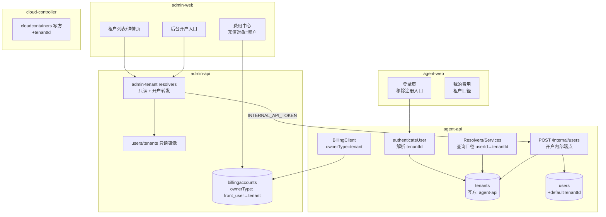
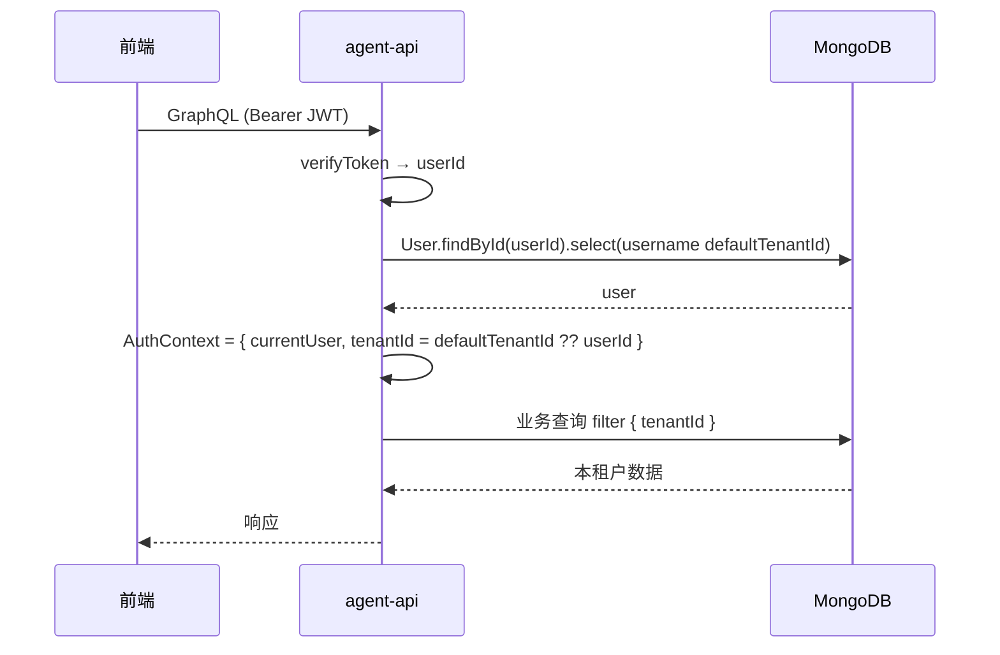
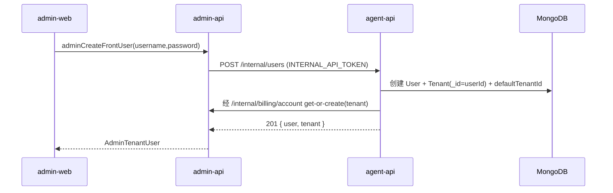
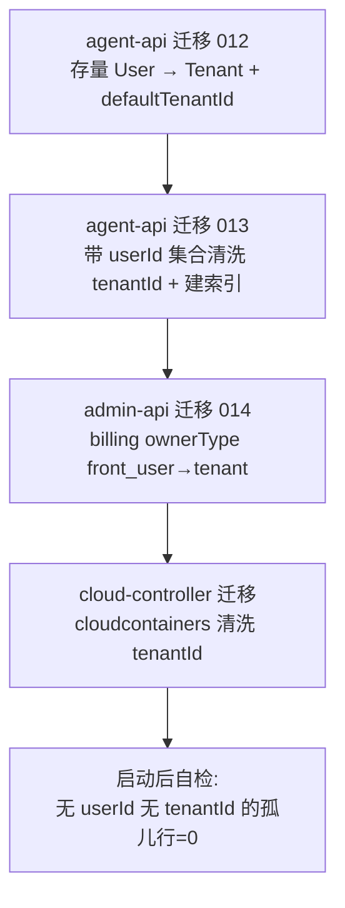

# 多租户一期 - 技术提案

**功能名称**: 多租户一期（帐号体系转换与数据按租户隔离）
**关联 PRD**: `docs/product/draft/20261027-multi-tenant-phase1.md`（v1.0）
**技术提案版本**: v1.0
**创建日期**: 2026-10-27
**作者**: z-agent-bot
**feat-branch**: `feat/multi-tenant-phase1`

## 1. 概述

### 1.1 背景

平台当前为单帐号模式：`User` 直接持有全部资源（sessions、controllers、cloudhosts、mcp_servers 等 20+ 集合均以 `userId` 归属），计费账户 `billingaccounts.ownerType='front_user'`、`ownerId=userId`。PRD 要求一期完成四件事：

1. **帐号体系转换**：为每个存量帐号创建同名个人专属租户（不可删除、不可添加成员），帐号放置其中；余额迁移到租户，计费全部改用租户口径，后台充值对象变为租户。
2. **数据权限控制**：所有带 `userId` 的 collection 清洗出相同 id 值的 `tenantId`，查询口径由 `userId` 切换为 `tenantId`；后台（admin-api 全局视角）本期除外。
3. **注册关闭**：前台移除 `signup` 与注册页，新账户由后台开户。
4. **后台租户/账户管理**：后台列出全部租户并查看其用户（只读，不可操作）。

核心简化：个人专属租户的 **tenantId 与 userId 同值**（Tenant 文档 `_id` 直接复用 User `_id`），使得余额迁移只改 `ownerType` 不改 `ownerId`、数据清洗只新增字段不改值、查询切换零映射成本，且为二期多人租户预留扩展位。

### 1.2 目标

- 新增 `tenants` 集合与 `Tenant` 模型（agent-api 为写方）；每个 User 落库即拥有 `type='personal'` 的同名租户。
- `AuthContext` 增加 `tenantId`；前台全部服务/Resolver 的归属查询与写入由 `userId` 切换为 `tenantId`，存量查询行为不变（一期内 tenantId==userId）。
- `billingaccounts` / `billingapikeys` 的 `ownerType` 由 `front_user` 迁移为 `tenant`，`ownerId` 不变；`/internal/billing/*`、前后台计费 GraphQL 契约同步演进；充值对象在后台 UI 呈现为租户。
- 前台关闭注册：契约删除 `signup`、agent-api 移除 resolver、agent-web 移除 `/register` 路由与入口链接。
- 后台新增租户管理：租户列表/详情（含成员用户列表、余额），只读；新增后台开户 mutation（经 agent-api 内部端点创建，保持 users 集合写方单一）。

### 1.3 范围

**做**：

- agent-api：`tenants` 模型与迁移、`User.defaultTenantId`、AuthContext/中间件 tenantId 解析、全部带 `userId` 集合的 `tenantId` 清洗迁移与查询切换、`signup` 移除、`POST /internal/users` 开户内部端点、`me` 附带租户信息。
- admin-api：`tenants`/`users` 只读镜像模型、`admin-tenant.graphql` 契约实现（列表/详情/开户）、计费 `ownerType` 迁移（`front_user→tenant`）、后台充值入口按租户呈现。
- cloud-controller：`cloudcontainers` 写入与查询补 `tenantId`（该集合写方在 cloud-controller）。
- contracts：`auth.graphql`（删 signup、`User.tenant`）、新增 `admin-tenant.graphql`、`billing.graphql` / `admin-billing.graphql`（`BillingOwnerType` 增 `tenant`）、内部 REST 说明。
- agent-web：移除注册页与入口；admin-web：新增租户列表/详情页与开户入口、充值对象切换为租户。

**不做**：

- 多人租户、成员邀请、角色权限、租户切换（二期及以后）；
- 个人专属租户的删除/加成员能力（PRD 明确禁止）；
- admin-api 全局管理面的租户隔离（PRD 明确本期除外）；
- `providers`/`models`（`scope='user'` 且无 `userId` 字段，现状为全体前台用户共享一份用户级配置）的租户化归属——遵循需求「仅清洗带 userId 的 collection」口径，本期维持现状，列入二期治理（见 §6.1 决策 D5）；
- 已签发 JWT 的强制失效与重签（tenantId 不进入 token，见 §6.1 决策 D2）。

## 2. 技术架构

### 2.1 系统架构图



### 2.2 技术栈

| 层级 | 技术选型 | 说明 |
|------|---------|------|
| 后端 | Node.js 24 + TypeScript strict + Express 5 + graphql-yoga | agent-api / admin-api / cloud-controller 现状一致 |
| 数据库 | MongoDB（Mongoose） | 迁移走各服务既有 `migrations/runner`（启动时执行、幂等、带 `.test.ts`） |
| 前端 | React 19 + TypeScript + Vite + Apollo Client | agent-web / admin-web 既有页面模式 |
| 测试 | Vitest + tests/api + tests/e2e | TDD 红-绿-重构 |

### 2.3 模块划分

| 模块 | 职责 | 关键技术点 |
|------|------|-----------|
| agent-api `models/tenant.ts`（新增） | 租户模型 | `_id` 复用 user `_id`（personal）；`type: personal/team`；`memberUserIds`；唯一索引按 `name`（personal 租户名=用户名，users.username 本已唯一） |
| agent-api 迁移 `012-tenant-foundation` | 存量用户建租户 + 回填 `defaultTenantId` | 幂等（已存在跳过）；批处理；失败可重跑 |
| agent-api 迁移 `013-tenant-id-backfill` | 全部带 `userId` 集合补 `tenantId` 与索引 | 逐集合 `updateMany({userId 存在, tenantId 缺失}, {$set: tenantId=userId})`；新增 `{tenantId:1,...}` 索引替换/并行既有 userId 索引 |
| agent-api `middleware/auth.ts` + `AuthContext` | 解析并下发 `tenantId` | `tenantId = user.defaultTenantId ?? userId`（一期恒等）；helper `requireTenantId(context)` |
| agent-api 各 service/resolver | 查询与写入口径切换 | 全量 grep `userId` 过滤点逐一替换为 `tenantId`；写入同时落 `userId`（保留回滚与追溯）与 `tenantId` |
| agent-api `routes/internal-users.ts`（新增） | 后台开户内部端点 | Bearer `INTERNAL_API_TOKEN`；创建 User+Tenant+（经 billing-client）零余额租户账户；幂等键为用户名 |
| admin-api 迁移 `014-billing-owner-tenant` | `ownerType: front_user→tenant` | `updateMany` 幂等；枚举扩展；`ownerId` 不变 |
| admin-api `graphql/resolvers/tenant.ts`（新增） | 租户列表/详情/开户 | 只读镜像查询 users/tenants + billingaccounts 聚合余额；开户转发 `POST /internal/users` |
| cloud-controller `models/cloud-container.ts` | `cloudcontainers` 补 `tenantId` | 写入口径与 agent-api `startHarness` 下发参数对齐；迁移由 cloud-controller 侧执行 |
| agent-web | 移除注册 | 删 `RegisterPage`、`/register` 路由、登录页注册链接 |
| admin-web | 租户管理页 + 开户 + 充值对象切换 | 新页面 `TenantsPage`/`TenantDetailPage`；`BillingPage` 充值入口改为按租户检索 |

## 3. API 设计

### 3.1 API 契约

#### 契约 1: `contracts/auth.graphql`（变更）

- **删除** `Mutation.signup`（硬关闭注册；未登录调用任何注册路径均不复存在）。
- `User` 增加只读租户信息：

```graphql
type Tenant {
  id: ID!
  name: String!
  type: TenantType! # personal | team
}

type User {
  id: ID!
  username: String!
  tenant: Tenant!  # 当前用户归属租户（一期恒为个人专属租户）
  createdAt: String!
}

type Query {
  me: User
}

type Mutation {
  login(username: String!, password: String!): AuthPayload!
}
```

#### 契约 2: `contracts/admin-tenant.graphql`（新增）

```graphql
# 后台租户与账户管理（多租户一期）
# 鉴权：全部需要 admin JWT；租户与用户为只读视图，开户为唯一写操作。

type AdminTenant {
  id: ID!
  name: String!
  type: TenantType!        # personal | team（一期仅 personal）
  memberCount: Int!
  balance: Float           # 租户计费账户可用余额（credits），无账户为 null
  createdAt: String!
}

type AdminTenantUser {
  id: ID!
  username: String!
  createdAt: String!
}

type AdminTenantDetail {
  id: ID!
  name: String!
  type: TenantType!
  users: [AdminTenantUser!]!   # 只读列表
  createdAt: String!
}

type Query {
  adminTenants(keyword: String, page: Int, pageSize: Int): [AdminTenant!]!
  adminTenant(id: ID!): AdminTenantDetail
}

type Mutation {
  # 后台开户：创建前台账户，自动生成同名个人专属租户与零余额租户费用账户
  adminCreateFrontUser(username: String!, password: String!): AdminTenantUser!
}
```

错误口径：用户名重复 `Username already taken`、用户名长度 2-20、密码 ≥6（与既有 signup 校验一致）。

#### 契约 3: `contracts/billing.graphql` / `contracts/admin-billing.graphql`（变更）

```graphql
enum BillingOwnerType {
  front_user   # 已废弃：存量行由迁移转为 tenant，仅作历史兼容保留读
  admin_user
  tenant       # 新增：前台租户账户
}
```

- `adminBillingAccounts(ownerType:)` 支持按 `tenant` 过滤；`rechargeBillingAccount(accountId:)` 语义不变（入参 accountId 本身已指向租户账户，后台 UI 由「按帐号检索」改为「按租户检索」）。
- 内部 REST `GET /internal/billing/account?ownerType&ownerId&ownerName`：agent-api 调用方改传 `ownerType=tenant`、`ownerId=tenantId`、`ownerName=租户名`；兼容期内服务端对 `front_user` 读取自动按同 id 的 `tenant` 行解析（迁移已保证 ownerId 不变）。

### 3.2 内部接口

#### `POST /internal/users`（agent-api 新增，供 admin-api 开户）

- **鉴权**: Bearer `INTERNAL_API_TOKEN`（与既有 `/internal/*` 一致）。
- **请求**: `{ "username": "...", "password": "..." }`
- **响应**:
  - 201 `{ user: { id, username, createdAt }, tenant: { id, name, type } }`
  - 400 `{ error: 'INVALID_BODY' }`（校验失败，message 附具体规则）
  - 409 `{ error: 'USERNAME_TAKEN' }`
- **事务语义**: 单文档序列——创建 User → 创建 Tenant(`_id=user._id`) → 回填 `user.defaultTenantId` → 经 `/internal/billing/account` get-or-create 租户账户（`ownerType=tenant`）。任一步失败向前回滚已建文档；按用户名幂等（重复提交返回既有用户，不重复建租户）。
- **错误体**统一 `{ error: '<UPPER_CODE>' }`，内部异常只记服务端日志（与 `internal-billing.ts` 口径一致）。

## 4. 数据模型

### 4.1 数据库设计

#### 集合: `tenants`（新增，agent-api 写方；admin-api 只读镜像）

| 字段 | 类型 | 说明 |
|------|------|------|
| `_id` | ObjectId | personal 租户直接复用 User `_id`（tenantId==userId） |
| `name` | String | 租户名，personal=用户名；唯一索引 |
| `type` | String | `personal` \| `team`（一期仅 personal；personal 不可删除/不可加成员由服务层硬约束） |
| `memberUserIds` | [ObjectId] | 成员列表，personal 恒为 `[ownerUserId]` |
| `createdAt/updatedAt` | Date | timestamps |

#### 集合: `users`（变更）

| 字段 | 类型 | 说明 |
|------|------|------|
| `defaultTenantId` | ObjectId | 新增，指向其 personal 租户；一期恒等于 `_id` |

#### 集合: 带 `userId` 的既有集合（统一变更）

逐集合新增 `tenantId: { type, required: true, index: true }`（类型对齐各集合现有 `userId` 类型：String 或 ObjectId），存量行清洗为与 `userId` 同值：

| 服务 | 集合 | 备注 |
|------|------|------|
| agent-api | sessions, controllers, controllerkeys, controllerworkspaces, gateways, mcp_servers, mcp_session_endpoints, cloudhosts, cloud_host_github_bindings, cloud_host_issues_linkages, cloud_host_setup_operations, configuredworkflows, workflowinstances, workflowprhandlers, workflowtemplates, issueworkflowtriggers, todoitems, user_commit_settings, githubaccounts | `userId` 索引并存或替换为 `tenantId` 索引（唯一索引如 `mcp_servers.{userId,name}` 同步扩展为 `{tenantId,name}`） |
| cloud-controller | cloudcontainers | 写方在 cloud-controller，`tenantId` 由 agent-api 拉起时下发 |
| admin-api | billingaccounts, billingapikeys | 不加 `tenantId` 字段，改走 `ownerType='tenant'` + `ownerId=tenantId`（口径等价，避免双写） |

> `acpmessages` 无 `userId`（经 sessionId 归属 Session），隔离由 Session 级 tenantId 校验承担，不新增字段。
> `providers`/`models`（scope=user）无 `userId`，本期不动（见决策 D5）。

#### 集合: `billingaccounts`（admin-api 迁移）

- `ownerType` 枚举扩展 `tenant`；迁移将全部 `front_user` 行 `updateMany` 为 `tenant`；`ownerId`（=userId=tenantId）、余额、流水、冻结、`appliedLedgerIds`、`invoiceSeq` 全部不变——**余额零改动即完成迁移**。

### 4.2 缓存设计

- 租户解析无新增缓存：`authenticateUser` 已按请求查 `User`，`tenantId` 随用户文档一次读出（`select('username defaultTenantId')`），不引入 Redis 依赖。
- 既有的计费/模型/选项缓存 key 不含 owner 口径切换影响（billing api key 缓存以 key 为主体），无需改造。

## 5. 技术实现方案

### 5.1 核心流程

登录与租户上下文解析（每次请求）：



后台开户：



数据迁移（发布时自动执行）：



### 5.2 关键实现点

#### 实现点 1: 查询口径切换的完备性

- **描述**: 前台所有数据访问必须以 `tenantId` 过滤。
- **技术细节**: 以 `grep -rn "userId" servers/agent-api/src/{services,graphql}` 全量枚举过滤点，逐一替换为 `requireTenantId(context)` 取值；`respondPermission`/`respondElicitation` 等终态写入不变量（filter 含 `userId`）同步改为 `tenantId`（值相同，语义升级）；跨租户访问统一抛 `Not found`（不泄露存在性，对齐 PRD 安全要求）。
- **风险点**: 遗漏某个过滤点即形成越权或串租户——以「逐集合 checklist + 每集合至少一条隔离 API 测试」兜底；`TodoService` 等已有「缺 userId 拒绝写入」防御的位置改为「缺 tenantId 拒绝写入」。

#### 实现点 2: 迁移幂等与可重跑

- **描述**: 三类迁移（建租户、清洗 tenantId、计费 ownerType）必须可重跑、可部分恢复。
- **技术细节**: 全部用 `{tenantId: {$exists:false}}` / `{ownerType:'front_user'}` 等条件化 `updateMany`/`insertMany(ordered:false)`；沿既有 runner 模式（启动时执行、记录 applied、附 `.test.ts`）；资金迁移只改枚举值不动金额，天然零差错。
- **风险点**: 大集合 `updateMany` 时长——批量分批执行并记录进度日志；sessions/todoitems 量级评估后决定是否需要后台任务化（一期数据量下单次 `updateMany` 可接受）。

#### 实现点 3: 注册硬关闭

- **描述**: 契约、resolver、前端三层同时移除。
- **技术细节**: `contracts/auth.graphql` 删 `signup`；agent-api `resolvers/auth.ts` 删实现；agent-web 删 `RegisterPage.tsx`、`/register` 路由、`LoginPage` 注册链接；schema 先行的契约式开发保证前端编译期即暴露遗漏引用。
- **风险点**: agent-web 内对 `signup` 的其余引用（测试/mock）需同步清理。

#### 实现点 4: 计费口径切换

- **描述**: 余额迁移 = `ownerType` 枚举改写；前后台读写口径统一为 `tenant`。
- **技术细节**: admin-api 迁移 014；`billing-client.ts` 全部 `ownerType:'front_user'` 改 `'tenant'`，`ownerName` 传租户名；`adminBillingAccounts`/`rechargeBillingAccount` 机械不变，admin-web 充值入口由按帐号检索改为按租户检索（`adminTenants` 选租户 → 取其计费账户 → 既有充值 mutation）；兼容期内部接口对 `front_user` 读请求按同 id `tenant` 行解析。
- **风险点**: 发布窗口内旧 agent-api 仍传 `front_user`——兼容解析兜底；欠费止损、冻结、API Key 等既有资金规则逻辑零改动（accountId 不变）。

## 6. 技术决策

### 6.1 决策列表

| 决策 | 选项 A | 选项 B | 最终选择 | 原因 |
|------|--------|--------|---------|------|
| D1 tenantId 取值 | 独立生成新 ObjectId | 复用 userId（Tenant._id=User._id） | B | 数据清洗只增字段不改值；余额 ownerId 不变；查询切换零映射；二期团队租户再用独立 id |
| D2 tenantId 传递 | 签发进 JWT | 中间件每次按 User 解析 | B | 已发 token 不失效；未来换租/多租户不落 token 语义负担；一次 select 成本可忽略 |
| D3 users 集合写权 | admin-api 直接写库 | agent-api 开 `/internal/users`，admin-api 转发 | B | 遵守「写方各自单一」（对照 cloudhosts 只读镜像惯例）；用户名校验/密码散列逻辑不双份 |
| D4 注册关闭方式 | feature flag 软关闭 | 契约+resolver+前端硬移除 | B | PRD 要求硬关闭；无运行时分支残留 |
| D5 providers/models 租户化 | 本期补 tenantId 并归一到某租户 | 本期维持 scope=user 共享现状，二期治理 | B | 需求口径仅清洗带 userId 集合；现状本为全员共享（无归属字段），强行归一会造成他方配置丢失；PRD 数据隔离清单不覆盖 |
| D6 存量 userId 字段 | 清洗后删除 | 保留双写一段时期 | B | 回滚安全；二期再评估下线 |

### 6.2 依赖与约束

| 类型 | 内容 | 说明 |
|------|------|------|
| 依赖 | 费用中心（`20261018-feat-credits-billing`） | ownerType 迁移以其账户/账单/收据体系为基础 |
| 依赖 | admin 鉴权（`admin-auth.graphql`） | 租户管理与开户复用 admin JWT |
| 约束 | 迁移在各自服务启动时执行完成再对外服务 | 与既有 migrations runner 一致；发布顺序：admin-api（兼容解析）→ agent-api → cloud-controller |
| 约束 | 个人专属租户约束由服务层硬保证 | 无删除/加成员 API，契约层即不存在入口 |

## 7. 项目结构

```
servers/agent-api/src/
├── models/tenant.ts                    # 新增 Tenant
├── models/user.ts                      # +defaultTenantId
├── middleware/auth.ts                  # 解析 tenantId 入 AuthContext
├── routes/internal-users.ts            # 新增开户内部端点
├── migrations/012-tenant-foundation.ts(+test)    # 新增
├── migrations/013-tenant-id-backfill.ts(+test)   # 新增
└── services/...                        # 查询口径 userId→tenantId 全量切换
servers/admin-api/src/
├── models/tenant.ts, models/user.ts    # 只读镜像
├── graphql/{schemas,resolvers}/tenant.ts         # 新增
├── migrations/014-billing-owner-tenant.ts(+test) # 新增
└── services/billing/...                # ownerType=tenant 口径
servers/cloud-controller/src/models/cloud-container.ts  # +tenantId
apps/agent-web/src/                     # 移除 RegisterPage 与路由/入口
apps/admin-web/src/pages/               # TenantsPage / TenantDetailPage 新增
contracts/auth.graphql                  # 删 signup、User.tenant
contracts/admin-tenant.graphql          # 新增
contracts/billing.graphql, admin-billing.graphql  # BillingOwnerType+tenant
```

## 8. 测试策略

### 8.1 测试覆盖要求

- 迁移均有 `.test.ts`（既有 runner 模式）：012 建租户幂等/重跑、013 逐集合清洗与索引、014 ownerType 改写与金额不变断言。
- 每个带 tenantId 的集合至少一条 API 级隔离用例（租户 A 写入 → 租户 B 列表/详情/修改/删除不可达，返回 `Not found`）。
- 认证与开户：登录后 `me.tenant` 正确；`signup` 契约不存在；`adminCreateFrontUser` 成功/重名/非法参数/未鉴权；开户后新用户可登录且租户账户余额 0。
- 计费：迁移后余额核对（抽样用户 ownerId 行余额不变）；后台按租户充值到账；云电脑创建扣费走 tenant 账户；`front_user` 兼容解析。
- 前端：登录页无注册入口；admin-web 租户列表/详情只读渲染、开户表单校验。

### 8.2 测试类型

| 类型 | 工具 | 覆盖范围 |
|------|------|---------|
| 单元测试 | Vitest | 迁移、tenant 解析 helper、开户端点、口径切换后的 service |
| API 测试 | tests/api（Vitest + 编排环境） | auth/tenant/admin-tenant/billing 契约用例（T-MT 系列） |
| E2E 测试 | tests/e2e（Playwright） | 老用户升级登录无感知、前台无注册、后台开户→新用户登录、后台按租户充值 |

## 9. 部署方案

### 9.1 环境规划

| 环境 | 用途 | 部署方式 |
|------|------|---------|
| 本地编排 | 开发与 TDD | `aspire start` 全量服务 |
| 生产 | 发布 | 顺序：admin-api → agent-api → cloud-controller → 前端 |

### 9.2 配置管理

- 无新增环境变量；`INTERNAL_API_TOKEN` 复用既有值（admin-api 增加对 agent-api `/internal/users` 的调用地址配置，沿用既有 agent-api 内部地址配置项）。

## 10. 验收标准

- [ ] 技术方案评审通过
- [ ] Contract（auth / admin-tenant / billing×2 / 内部 REST）评审通过
- [ ] 迁移 012/013/014 幂等可重跑，存量用户全部有同名租户、全部带 userId 行有同值 tenantId、计费 ownerType 全量 tenant 且金额不变
- [ ] 租户隔离 API 测试逐集合通过；跨租户访问统一 `Not found`
- [ ] 前台无任何注册通道；后台开户→登录→同名租户→零余额账户全链路通过
- [ ] 后台租户列表/详情只读可用，按租户充值到账
- [ ] API 测试通过、E2E 测试通过

## 11. 相关文档

- 关联 PRD：[[../../product/draft/20261027-multi-tenant-phase1.md]]
- 需求来源：[GitHub Issue #329 — 多租户一期](https://github.com/Deliay/z-agent-gear/issues/329)
- 计费基础：[[20261018-feat-credits-billing.md]]
- 开发规范：[[../common-rules.md]]、[[../backend-rules.md]]、[[../frontend-rules.md]]
