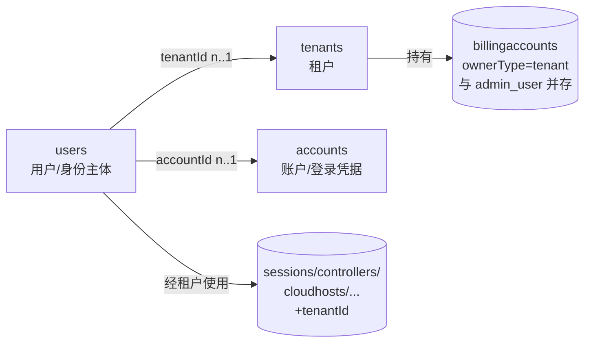
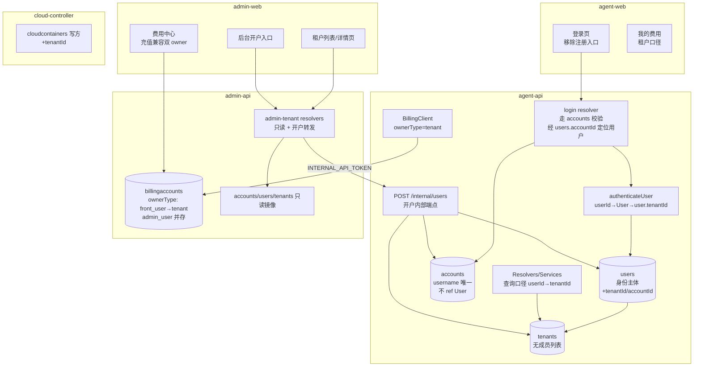
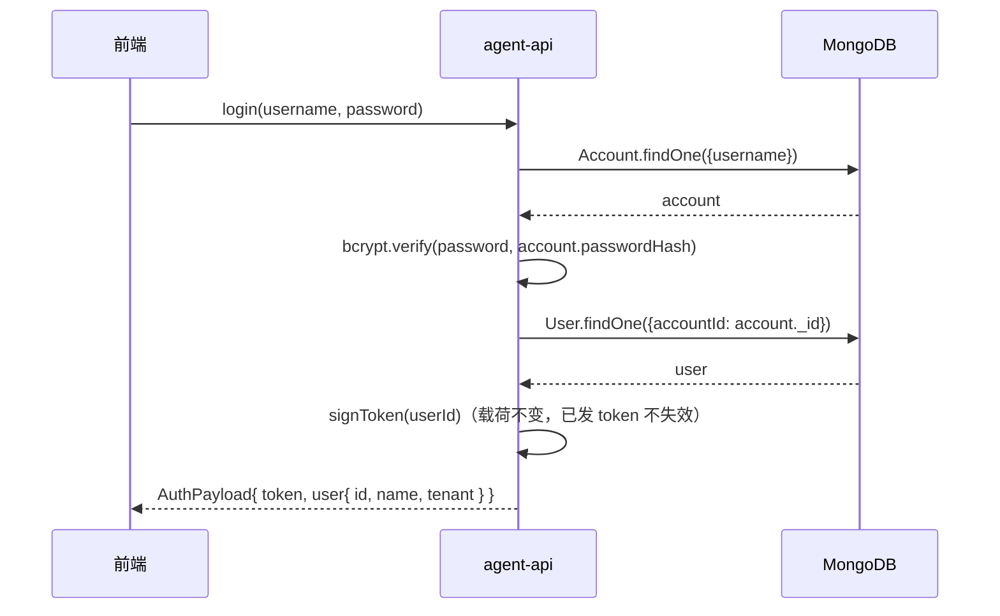
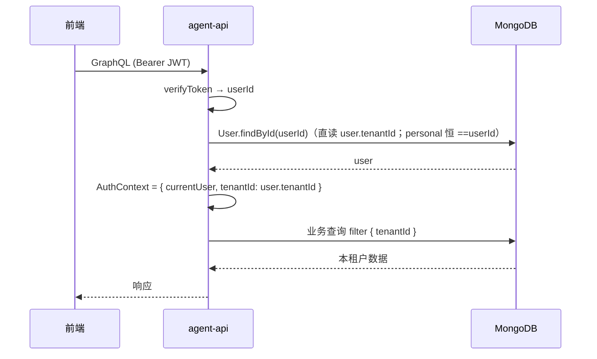
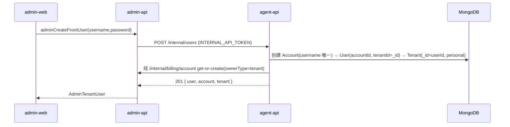
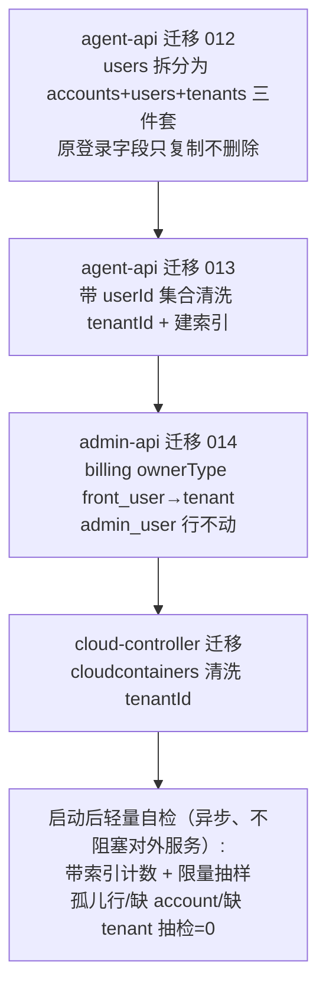

# 多租户一期 - 技术提案

**功能名称**: 多租户一期（三层帐号体系与数据按租户隔离）
**关联 PRD**: `docs/product/draft/20261027-multi-tenant-phase1.md`（v1.1）
**技术提案版本**: v1.2
**创建日期**: 2026-10-27
**作者**: z-agent-bot
**feat-branch**: `feat/multi-tenant-phase1`
**版本说明**:
- v1.0（2026-10-27）初版。
- v1.1（2026-10-27，评审返工，[PR #330](https://github.com/Deliay/z-agent-gear/pull/330) CHANGES_REQUESTED）按评审意见「租户可以有多个成员；整体设计为 租户(tenant)→用户(user)、账户(account)→用户(user)；增加 account 建模，将原 user 登录部分整合到 account」重构数据模型与全文：新增 `accounts` 集合承载登录（原 `users.username/passwordHash` 迁入）、`users` 瘦身为身份主体、`tenants.memberUserIds` 一对多成员关联（一期 personal 租户单成员）；认证链路改为「账户登录 → 用户 → 租户成员解析」；迁移 012 改为三件套拆分迁移；决策表新增 D7/D8。
- v1.2（2026-10-27，评审返工，[PR #330](https://github.com/Deliay/z-agent-gear/pull/330) CHANGES_REQUESTED ×2）按评审意见修订：① 关联方向反转——移除 `tenants.memberUserIds`，改为 `users.tenantId` 引用租户（tenant→users 一对多经用户侧外键承载）；移除 `accounts.userId`，改为 `users.accountId` 引用账户（account→users 一对多，account 上不再 ref User）；② `users` 暂保留 `username/passwordHash` 原字段（迁移 012 只复制到 `accounts`、不删除原字段，后续期次再下线）；③ 后台不做多租户设计，计费系统兼容「后台账户（admin_user）支出」与「租户（tenant）支出」双 owner——`front_user→tenant` 迁移仅触及前台行、admin_user 计费链路零改动，费用中心保持计费账户视角、支持两类账户检索与充值；④ 启动自检轻量化（带索引计数 + 限量抽样 + 异步执行），校验耗时不随数据量线性增长。同步修订 §1/§2.3/§3/§4/§5/§6/§7/§8/§10。

## 1. 概述

### 1.1 背景

平台当前为单帐号模式：`users` 集合同时承载登录凭据（`username/passwordHash`）与身份，`sessions`、`controllers`、`cloudhosts` 等 20+ 集合以 `userId` 归属，计费账户 `billingaccounts.ownerType='front_user'`、`ownerId=userId`。评审要求按三层关联重构：



- **账户（account）**：登录凭据实体，仅 `username`+`passwordHash`，**不引用用户**；账户与用户的关系由用户侧承载（account→users 一对多：一个账户可关联多个用户，一期一账户恒关联一个用户）。
- **用户（user）**：身份主体，经 `tenantId` 引用所属租户（tenant→users 一对多由用户侧外键承载）、经 `accountId` 引用其登录账户；承载 `name` 与个人偏好（`globalPermissionTimeoutAction`）；原登录字段 `username/passwordHash` 一期暂保留（迁移只复制不删除），运行时不再使用。
- **租户（tenant）**：组织归属主体，不持有成员列表；成员关系由 `users.tenantId` 承载（tenant→users 1..n）。一期仅 `type='personal'` 个人专属租户——单成员、不可删除、不可添加成员（服务层硬约束），模型本身支持多成员，为二期团队租户预留。

核心简化仍然成立：personal 租户 `_id` 复用所属 User `_id`（`user.tenantId == userId`），余额迁移只改 `ownerType` 不改 `ownerId`、数据清洗只新增字段不改值。

### 1.2 目标

- 新增 `accounts`、`tenants` 两个集合（agent-api 为写方）；`users` 新增 `name/tenantId/accountId` 成为身份主体（原登录字段暂保留、运行时弃用）；存量用户无损迁移为「账户+用户+个人专属租户」三件套。
- 认证链路三层化：`login` 走 `accounts` 校验（经 `users.accountId` 定位用户）；token 载荷仍为 `userId`（已发 token 不失效）；中间件直读 `user.tenantId` 入 `AuthContext`。
- 前台全部服务/Resolver 的归属查询与写入由 `userId` 切换为 `tenantId`；`billingaccounts`/`billingapikeys` 的 `ownerType` 由 `front_user` 迁移为 `tenant`（`ownerId` 不变）。
- 计费系统兼容双 owner：`admin_user`（后台账户支出）计费链路零改动，与 `tenant`（租户支出）并存；后台费用中心保持计费账户视角，可对两类计费账户检索与充值。
- 前台关闭注册：契约删除 `signup`、agent-api 移除 resolver、agent-web 移除 `/register` 路由与入口链接。
- 后台新增租户管理：租户列表/详情（含成员用户列表、余额），只读；后台开户（创建账户+用户+个人租户+零余额租户计费账户）。后台管理面自身不做多租户设计：admin_users 不建租户、无租户隔离。

### 1.3 范围

**做**：

- agent-api：`accounts`/`tenants` 模型与迁移、`users` 增 `name/tenantId/accountId`（原登录字段暂保留）、AuthContext/中间件 tenantId 解析（直读 `user.tenantId`）、全部带 `userId` 集合的 `tenantId` 清洗迁移与查询切换、`signup` 移除、`POST /internal/users` 开户内部端点、`me` 附带租户信息。
- admin-api：`accounts`/`users`/`tenants` 只读镜像模型、`admin-tenant.graphql` 契约实现（列表/详情/开户）、计费 `ownerType` 迁移（仅 `front_user→tenant`，`admin_user` 行不动）、后台充值入口兼容租户与后台账户两类计费账户。
- cloud-controller：`cloudcontainers` 写入与查询补 `tenantId`（该集合写方在 cloud-controller）。
- contracts：`auth.graphql`（删 signup、`User.tenant`/`User.name`）、新增 `admin-tenant.graphql`、`billing.graphql` / `admin-billing.graphql`（`BillingOwnerType` 增 `tenant` 并与 `admin_user` 并存）、内部 REST 说明。
- agent-web：移除注册页与入口；admin-web：新增租户列表/详情页与开户入口、费用中心充值兼容两类计费账户。

**不做**：

- **后台（管理面）的多租户设计**（评审明确）：admin_users 不建租户、不按租户划分、无租户隔离；后台对租户与账户仅提供只读视图与开户转发；
- **后台计费中心的多租户化改造**：费用中心保持计费账户视角，`tenant` 仅作为新增 owner 类型与 `admin_user` 并存，不把后台计费链路整体切换到租户口径；
- 多人租户的成员管理（邀请/移除/角色）、多登录方式（第三方登录绑定）、租户切换（模型预留，二期及以后）；
- 个人专属租户的删除/加成员能力（PRD 明确禁止）；
- `users.username/passwordHash` 原登录字段的删除（评审明确暂保留，迁移只复制不删除，后续期次再下线）；
- admin-api 全局管理面的租户隔离（PRD 明确本期除外）；
- `providers`/`models`（`scope='user'` 且无 `userId` 字段，现状为全体前台用户共享一份用户级配置）的租户化归属——遵循需求「仅清洗带 userId 的 collection」口径，本期维持现状，列入二期治理（见 §6.1 决策 D5）；
- 已签发 JWT 的强制失效与重签（token 载荷不变，见 §6.1 决策 D2）。

## 2. 技术架构

### 2.1 系统架构图



### 2.2 技术栈

| 层级 | 技术选型 | 说明 |
|------|---------|------|
| 后端 | Node.js 24 + TypeScript strict + Express 5 + graphql-yoga | agent-api / admin-api / cloud-controller 现状一致 |
| 数据库 | MongoDB（Mongoose） | 迁移走各服务既有 `migrations/runner`（启动时执行、幂等、带 `.test.ts`） |
| 前端 | React 19 + TypeScript + Vite + Apollo Client | agent-web / admin-web 既有页面模式 |
| 测试 | Vitest + tests/api + tests/e2e | TDD 红-绿-重构 |

### 2.3 模块划分

| 模块 | 职责 | 关键技术点 |
|------|------|-----------|
| agent-api `models/account.ts`（新增） | 账户模型（登录凭据） | `username` 唯一（规则沿用原 users：2-20 字符）、`passwordHash`；**不含 userId**（account→users 一对多由 `users.accountId` 承载）；bcrypt 散列不变 |
| agent-api `models/user.ts`（变更） | 用户模型三层化 | 新增 `name`（展示名，迁移时=原 username）、`tenantId`（引用租户，索引）、`accountId`（引用账户）；**暂保留** `username`/`passwordHash`（迁移不删除、运行时弃用，后续期次下线） |
| agent-api `models/tenant.ts`（新增） | 租户模型 | personal 租户 `_id` 复用 owner user `_id`；`type: personal/team`；**无成员列表**（成员关系由 `users.tenantId` 承载）；`name` 唯一索引（personal=用户名，原 users.username 已唯一） |
| agent-api 迁移 `012-account-user-tenant` | 存量 users 三件套拆分 | 逐 user：创建 `accounts`（**复制** username/passwordHash，新 _id）→ 更新 `users`（`$set` name=username、tenantId=user._id、accountId=account._id；**不 $unset 原登录字段**）→ 创建 `tenants`（_id=user._id，type=personal，name=username）；幂等（按 accounts/tenants/user.tenantId 存在性跳过）、可重跑、批处理 |
| agent-api 迁移 `013-tenant-id-backfill` | 全部带 `userId` 集合补 `tenantId` 与索引 | 逐集合 `updateMany({userId 存在, tenantId 缺失}, {$set: tenantId=userId})`；新增 `{tenantId:1,...}` 索引（唯一索引同步扩展，如 `mcp_servers.{userId,name}`→`{tenantId,name}`） |
| agent-api `middleware/auth.ts` + `AuthContext` | 解析并下发 `tenantId` | token→userId→`User.findById`→直读 `user.tenantId`（一期 personal 恒 `==userId`，带一级回退 `tenantId=userId`）；helper `requireTenantId(context)` |
| agent-api 各 service/resolver | 查询与写入口径切换 | 全量 grep `userId` 过滤点逐一替换为 `tenantId`；写入同时落 `userId`（保留回滚与追溯）与 `tenantId` |
| agent-api `routes/internal-users.ts`（新增） | 后台开户内部端点 | Bearer `INTERNAL_API_TOKEN`；创建 Account→User→Tenant 三件套 + 经 billing-client get-or-create 零余额租户账户；按 username 幂等 |
| admin-api 迁移 `014-billing-owner-tenant` | `ownerType: front_user→tenant` | `updateMany` 幂等，仅改 `front_user` 行；枚举扩展 `tenant` 与 `admin_user` 并存；`ownerId` 不变 |
| admin-api `graphql/resolvers/tenant.ts`（新增） | 租户列表/详情/开户 | 只读镜像查询 tenants + users（`User.find({tenantId})`）+ accounts（经 `users.accountId` 取登录名）+ billingaccounts 聚合余额；开户转发 `POST /internal/users` |
| cloud-controller `models/cloud-container.ts` | `cloudcontainers` 补 `tenantId` | 写入口径与 agent-api `startHarness` 下发参数对齐；迁移由 cloud-controller 侧执行 |
| agent-web | 移除注册 | 删 `RegisterPage`、`/register` 路由、登录页注册链接 |
| admin-web | 租户管理页 + 开户 + 充值兼容双 owner | 新页面 `TenantsPage`/`TenantDetailPage`；`BillingPage` 充值入口**保持计费账户视角**：同时支持按租户（tenant）与按后台账户（admin_user）检索计费账户并充值 |

## 3. API 设计

### 3.1 API 契约

#### 契约 1: `contracts/auth.graphql`（变更）

- **删除** `Mutation.signup`（硬关闭注册）。
- `login` 入参不变（username/password），语义变为「账户登录」；返回的 `User` 为身份主体视图。
- `User` 调整：移除对登录字段的任何暴露（原本也未暴露），新增 `name` 与 `tenant`：

```graphql
type Tenant {
  id: ID!
  name: String!
  type: TenantType! # personal | team
  memberCount: Int! # 租户成员数（tenant→user 一对多；一期 personal 恒为 1）
}

type User {
  id: ID!
  name: String!    # 展示名（迁移后=原用户名）
  tenant: Tenant!  # 当前用户归属租户（一期恒为个人专属租户）
  createdAt: String!
}

type AuthPayload {
  token: String!
  user: User!
}

type Query {
  me: User
}

type Mutation {
  login(username: String!, password: String!): AuthPayload!
}
```

> 账户（Account）不在前台契约暴露独立类型；登录即账户校验，`me` 返回用户视图。用户名唯一性由 `accounts.username` 承载。

#### 契约 2: `contracts/admin-tenant.graphql`（新增）

```graphql
# 后台租户与账户管理（前台租户的只读视图 + 开户）
# 后台不做多租户设计：admin_users 不建租户、管理面无租户隔离；本契约仅提供对前台租户/账户的只读盘点与开户转发。
# 鉴权：全部需要 admin JWT；租户与用户为只读视图，开户为唯一写操作。
# 模型口径：tenant→users 一对多（users.tenantId 承载）；account→users 一对多（users.accountId 承载登录关联）。

type AdminTenant {
  id: ID!
  name: String!
  type: TenantType!        # personal | team（一期仅 personal）
  memberCount: Int!
  balance: Float           # 租户计费账户可用余额（credits），无账户为 null
  createdAt: String!
}

type AdminTenantUser {
  id: ID!                  # 用户 id
  name: String!            # 用户展示名
  username: String!        # 登录账户名（取自其 account）
  createdAt: String!
}

type AdminTenantDetail {
  id: ID!
  name: String!
  type: TenantType!
  users: [AdminTenantUser!]!   # 只读列表（按 users.tenantId 查询，tenant→users 1..n）
  createdAt: String!
}

type Query {
  adminTenants(keyword: String, page: Int, pageSize: Int): [AdminTenant!]!
  adminTenant(id: ID!): AdminTenantDetail
}

type Mutation {
  # 后台开户：创建登录账户+用户+同名个人专属租户+零余额租户费用账户
  adminCreateFrontUser(username: String!, password: String!): AdminTenantUser!
}
```

错误口径：用户名重复 `Username already taken`、用户名长度 2-20、密码 ≥6（与原 signup 校验一致，规则收敛到 accounts）。

#### 契约 3: `contracts/billing.graphql` / `contracts/admin-billing.graphql`（变更）

```graphql
enum BillingOwnerType {
  front_user   # 已废弃：存量前台行由迁移转为 tenant，仅作历史兼容保留读
  admin_user   # 后台账户计费：保持原样，与 tenant 并存
  tenant       # 新增：前台租户计费账户
}
```

- **双 owner 兼容（评审要求）**：计费系统同时承载「后台账户（admin_user）支出」与「租户（tenant）支出」两类计费账户；`admin_user` 行的数据、查询、充值、扣费、对账链路零改动。
- `adminBillingAccounts(ownerType:)` 支持按 `admin_user` / `tenant` 过滤（兼容并存）；`rechargeBillingAccount(accountId:)` 语义不变——充值以计费账户为主体，对两类账户均可充值。
- admin-web 费用中心**保持计费账户视角**、不做多租户化改造：检索/详情/充值均按计费账户进行；新增「按租户检索定位其计费账户」入口（`adminTenants` 选租户 → 取其 tenant 计费账户 → 既有充值 mutation），既有按后台账户（admin_user）检索与充值能力原样保留。
- 内部 REST `GET /internal/billing/account?ownerType&ownerId&ownerName`：agent-api 调用方改传 `ownerType=tenant`、`ownerId=tenantId`、`ownerName=租户名`；兼容期内服务端对 `front_user` 读取自动按同 id 的 `tenant` 行解析（迁移已保证 ownerId 不变）。

> 命名澄清：本提案中「账户/account」指登录账户（`accounts` 集合）；计费侧「账户」一律称「计费账户」（`billingaccounts`）。两者无语义关联。

### 3.2 内部接口

#### `POST /internal/users`（agent-api 新增，供 admin-api 开户）

- **鉴权**: Bearer `INTERNAL_API_TOKEN`（与既有 `/internal/*` 一致）。
- **请求**: `{ "username": "...", "password": "..." }`
- **响应**:
  - 201 `{ user: { id, name, createdAt }, account: { id, username }, tenant: { id, name, type } }`
  - 400 `{ error: 'INVALID_BODY' }`（message 附具体规则）
  - 409 `{ error: 'USERNAME_TAKEN' }`
- **事务语义**（顺序执行，失败向前回滚已建文档）：
  1. 校验 username/password 规则；
  2. 创建 `accounts`（`username` 唯一、`passwordHash`）——唯一索引冲突即 409；
  3. 创建 `users`（`name=username`、`accountId=account._id`、`tenantId=<新 user _id>`——personal 租户 id 复用 user id）；
  4. 创建 `tenants`（`_id=user._id`、`name=username`、`type='personal'`）；
  5. 经 `/internal/billing/account` get-or-create 租户计费账户（`ownerType=tenant`、`ownerId=tenantId`、`ownerName=租户名`）。
- **幂等**：按 username 幂等——重复提交若三件套已完整存在则返回既有视图（200），不重复创建；半完成状态按缺失步骤补齐（以 `accounts.username` / `users.accountId` / `tenants._id` 存在性判缺）。
- **错误体**统一 `{ error: '<UPPER_CODE>' }`，内部异常只记服务端日志（与 `internal-billing.ts` 口径一致）。

## 4. 数据模型

### 4.1 数据库设计

#### 集合: `accounts`（新增，agent-api 写方；admin-api 只读镜像）

| 字段 | 类型 | 说明 |
|------|------|------|
| `_id` | ObjectId | 账户 id（独立生成） |
| `username` | String | 登录名，唯一索引；2-20 字符（沿用原 users 规则） |
| `passwordHash` | String | bcrypt 散列，规则不变 |
| `createdAt/updatedAt` | Date | timestamps |

> **不设 `userId`**（评审意见）：account→users 为一对多，关联由 `users.accountId` 承载，account 上不 ref User；一个账户未来可关联多个用户（一期恒关联一个）。

#### 集合: `users`（变更，agent-api 写方；admin-api 只读镜像）

| 字段 | 类型 | 说明 |
|------|------|------|
| `_id` | ObjectId | 不变（存量 id 稳定，全部 `userId` 引用零改动） |
| `name` | String | **新增**：展示名（迁移时=原 username） |
| `tenantId` | ObjectId(ref: Tenant) | **新增**：所属租户（user→tenant，n..1；tenant→users 一对多由此承载），索引；personal 场景恒等于 `_id` |
| `accountId` | ObjectId(ref: Account) | **新增**：登录账户（user→account，n..1；account→users 一对多由此承载），索引 |
| `username`/`passwordHash` | String | **暂保留**（评审意见）：迁移 012 只复制到 `accounts`、不删除原字段；运行时不再使用，后续期次再下线（届时连同 `username` 唯一索引一并移除） |
| `globalPermissionTimeoutAction` | String | 不变 |
| `createdAt/updatedAt` | Date | 不变 |

#### 集合: `tenants`（新增，agent-api 写方；admin-api 只读镜像）

| 字段 | 类型 | 说明 |
|------|------|------|
| `_id` | ObjectId | personal 租户复用 owner user `_id`（tenantId==userId）；未来 team 租户独立生成 |
| `name` | String | 租户名（personal=用户名）；唯一索引 |
| `type` | String | `personal` \| `team`（一期仅 personal） |
| `createdAt/updatedAt` | Date | timestamps |

> **不设 `memberUserIds`**（评审意见）：tenants 不引用 users，成员关系反转为由 user 引用 tenant（`users.tenantId`）；成员列表查询 `User.find({tenantId})`；不可删除/不可加成员由服务层硬约束（无对应 API）。

#### 集合: 带 `userId` 的既有集合（统一变更）

逐集合新增 `tenantId: { type, required: true, index: true }`（类型对齐各集合现有 `userId` 类型：String 或 ObjectId），存量行清洗为与 `userId` 同值（personal 租户 id==userId）：

| 服务 | 集合 | 备注 |
|------|------|------|
| agent-api | sessions, controllers, controllerkeys, controllerworkspaces, gateways, mcp_servers, mcp_session_endpoints, cloudhosts, cloud_host_github_bindings, cloud_host_issues_linkages, cloud_host_setup_operations, configuredworkflows, workflowinstances, workflowprhandlers, workflowtemplates, issueworkflowtriggers, todoitems, user_commit_settings, githubaccounts | 唯一索引如 `mcp_servers.{userId,name}` 同步扩展为 `{tenantId,name}` |
| cloud-controller | cloudcontainers | 写方在 cloud-controller，`tenantId` 由 agent-api 拉起时下发 |
| admin-api | billingaccounts, billingapikeys | 不加 `tenantId` 字段，改走 `ownerType='tenant'` + `ownerId=tenantId`（口径等价，避免双写） |

> `acpmessages` 无 `userId`（经 sessionId 归属 Session），隔离由 Session 级 tenantId 校验承担，不新增字段。
> `providers`/`models`（scope=user）无 `userId`，本期不动（见决策 D5）。

#### 集合: `billingaccounts`（admin-api 迁移）

- `ownerType` 枚举扩展 `tenant`，与 `admin_user` **并存**；迁移仅将 `front_user` 行 `updateMany` 为 `tenant`——`admin_user` 行完全不动；`ownerId`（=userId=personal tenantId）、余额、流水、冻结、`appliedLedgerIds`、`invoiceSeq` 全部不变——**余额零改动即完成迁移**。
- **双 owner 兼容**（评审意见）：`admin_user`（后台账户支出）与 `tenant`（租户支出）共用同一套账户/账单/收据/预留/对账机制，按 `ownerType` 区分归属；后台费用中心对两类计费账户的查询、充值、扣费、对账行为一致。

### 4.2 缓存设计

- 认证解析不新增缓存：`authenticateUser` 已按请求查库；tenantId 直读 `user.tenantId`（一次 findById 同时取得用户与租户归属，零额外查询）；不引入 Redis 依赖。后续支持团队租户时再评估请求级缓存。
- 既有的计费/模型/选项缓存 key 不含 owner 口径切换影响，无需改造。

## 5. 技术实现方案

### 5.1 核心流程

登录（账户承载认证）：



请求期租户上下文解析：



后台开户（三件套 + 计费账户）：



数据迁移（发布时自动执行）：



> **自检轻量化**（评审意见「自检需要考虑数据量，避免启动时间过长」）：迁移自身逐行幂等校验已保证完整性；启动后自检只做轻量冒烟——使用带索引的 `countDocuments` 与 `find().limit(100)` 抽样，并放入后台异步执行（不阻塞服务就绪），校验耗时不随数据量线性增长；需要全量核对时运行离线脚本而非启动自检。

### 5.2 关键实现点

#### 实现点 1: 查询口径切换的完备性

- **描述**: 前台所有数据访问必须以 `tenantId` 过滤。
- **技术细节**: 以 `grep -rn "userId" servers/agent-api/src/{services,graphql}` 全量枚举过滤点，逐一替换为 `requireTenantId(context)` 取值；`respondPermission`/`respondElicitation` 等终态写入不变量（filter 含 `userId`）同步改为 `tenantId`（值相同，语义升级）；跨租户访问统一抛 `Not found`（不泄露存在性）。
- **风险点**: 遗漏某个过滤点即形成越权或串租户——以「逐集合 checklist + 每集合至少一条隔离 API 测试」兜底；`TodoService` 等已有「缺 userId 拒绝写入」防御的位置改为「缺 tenantId 拒绝写入」。

#### 实现点 2: 三件套迁移的原子感与幂等

- **描述**: 迁移 012 把每个存量 user 拆为 accounts+users+tenants，必须可重跑、不得出现半迁移状态。
- **技术细节**: 按 user 粒度三步骤顺序执行：① 创建 `accounts`（**复制** username/passwordHash，新 _id）；② 更新 `users`（`$set` name=username、tenantId=user._id、accountId=account._id——**不 $unset 原登录字段**，评审明确暂保留）；③ 创建 `tenants`（_id=user._id、name=username、type=personal）。每步以目标状态存在性（`accounts.username` / `users.tenantId` 已设置 / `tenants._id`）为幂等判据，重跑只补齐缺失步骤；迁移完成后校验：无账户的用户数=0、无租户的用户数=0、用户名唯一冲突=0；批处理 + 进度日志。
- **风险点**: `users.username` 唯一索引与原字段一期**保留不下线**（评审明确暂保留，后续期次随字段一并移除）；迁移中途失败的行在重跑时补齐，不影响已成功行。
- **回滚策略**: 迁移只新增文档与字段、不删除任何原数据（原登录字段原地保留），回滚代码即可回到单帐号模式（accounts/tenants 与新字段闲置无副作用）；`accounts`/`tenants` 集合的清理由后续期次评估。

#### 实现点 3: 注册硬关闭

- **描述**: 契约、resolver、前端三层同时移除。
- **技术细节**: `contracts/auth.graphql` 删 `signup`；agent-api `resolvers/auth.ts` 删实现；agent-web 删 `RegisterPage.tsx`、`/register` 路由、`LoginPage` 注册链接；schema 先行的契约式开发保证前端编译期即暴露遗漏引用。
- **风险点**: agent-web 内对 `signup` 的其余引用（测试/mock）需同步清理。

#### 实现点 4: 计费口径切换（兼容后台账户计费）

- **描述**: 前台余额迁移 = `ownerType: front_user→tenant` 枚举改写；计费系统同时兼容「后台账户（admin_user）支出」与「租户（tenant）支出」两类计费账户（评审要求）。
- **技术细节**: admin-api 迁移 014 仅改写 `front_user` 行、`admin_user` 行不动；agent-api `billing-client.ts` 全部 `ownerType:'front_user'` 改 `'tenant'`，`ownerName` 传租户名；admin-web 费用中心保持计费账户视角、不做多租户化改造——新增「按租户检索定位其计费账户」入口（`adminTenants` 选租户 → 取其 tenant 计费账户 → 既有充值 mutation），既有按后台账户（admin_user）检索与充值原样保留；兼容期内部接口对 `front_user` 读请求按同 id `tenant` 行解析。
- **风险点**: 发布窗口内旧 agent-api 仍传 `front_user`——兼容解析兜底；`admin_user` 计费链路（查询/充值/扣费/对账）零改动并以回归测试兜底；欠费止损、冻结、API Key 等既有资金规则逻辑零改动（accountId 不变）。

#### 实现点 5: 三层模型的写方单一日志

- **描述**: `accounts`/`users`/`tenants` 写方仅 agent-api（含 `/internal/users`）；admin-api 一律只读镜像。
- **技术细节**: admin-api 新增三个只读镜像模型（schema 注释标注「与 agent-api 同步演进」，沿用 `cloud-host.ts` 镜像惯例）；成员列表展开：`User.find({tenantId})` → 按 `users.accountId` 关联 `accounts` 聚合出登录名。

## 6. 技术决策

### 6.1 决策列表

| 决策 | 选项 A | 选项 B | 最终选择 | 原因 |
|------|--------|--------|---------|------|
| D1 personal 租户 id 取值 | 独立生成新 ObjectId | 复用 userId（Tenant._id=User._id） | B | 数据清洗只增字段不改值；余额 ownerId 不变；查询切换零映射；team 租户二期用独立 id |
| D2 tenantId 传递 | 签发进 JWT | 中间件每次按 User 解析 | B | 已发 token 不失效；未来多租户/换租不落 token 语义负担；一次直取成本可忽略 |
| D3 accounts/users/tenants 写权 | admin-api 直接写库 | agent-api 开 `/internal/users`，admin-api 转发 | B | 遵守「写方各自单一」（对照 cloudhosts 只读镜像惯例）；用户名/密码校验不双份 |
| D4 注册关闭方式 | feature flag 软关闭 | 契约+resolver+前端硬移除 | B | PRD 要求硬关闭；无运行时分支残留 |
| D5 providers/models 租户化 | 本期补 tenantId 并归一到某租户 | 本期维持 scope=user 共享现状，二期治理 | B | 需求口径仅清洗带 userId 集合；现状本为全员共享（无归属字段），强行归一会造成他方配置丢失 |
| D6 存量 userId 字段 | 清洗后删除 | 保留双写一段时期 | B | 回滚安全；二期再评估下线 |
| D7 登录凭据归属 | user 保留 username/passwordHash 作为唯一登录点 | 新增 accounts 集合承载登录；users 经 `accountId` 关联（account→users 一对多，account 不 ref User） | B | **评审要求**：账户独立建模且不在 account 上 ref User，为后续多登录方式与一个账户关联多用户预留；users 原登录字段暂保留不下线 |
| D8 租户成员关系建模 | `tenants.memberUserIds` 内嵌数组 | `users.tenantId` 引用租户（tenant→users 一对多由用户侧外键承载） | B | **评审要求**：tenants 不引用 users、反转为由 user 引用 tenant；成员查询 `User.find({tenantId})` 走索引；二期团队租户直接复用同一外键 |
| D9 后台多租户设计 | 后台计费中心切换为租户口径 | 后台不做多租户设计；计费系统兼容 admin_user 与 tenant 双 owner | B | **评审要求**：后台不需要多租户设计；费用中心保持计费账户视角，后台账户支出与租户支出并存、链路互不干扰 |
| D10 原登录字段处理 | 迁移 012 `$unset` users.username/passwordHash 并 dropIndex | 暂保留原字段与唯一索引，迁移只复制不删除 | B | **评审要求**：暂保留、迁移脚本不删除；回滚零成本（原字段原地未动），后续期次统一下线 |

### 6.2 依赖与约束

| 类型 | 内容 | 说明 |
|------|------|------|
| 依赖 | 费用中心（`20261018-feat-credits-billing`） | ownerType 迁移以其账户/账单/收据体系为基础 |
| 依赖 | admin 鉴权（`admin-auth.graphql`） | 租户管理与开户复用 admin JWT |
| 约束 | 迁移在各自服务启动时执行完成再对外服务 | 与既有 migrations runner 一致；发布顺序：admin-api（兼容解析）→ agent-api → cloud-controller |
| 约束 | personal 租户约束由服务层硬保证 | 无删除/加成员 API，契约层即不存在入口 |
| 约束 | 用户名唯一性由 `accounts.username` 唯一索引承载 | 开户/未来新增登录方式都经此约束 |
| 约束 | 后台不做多租户设计 | admin_users 无租户、不隔离；费用中心保持计费账户视角，兼容 admin_user 与 tenant 双 owner（评审要求） |
| 约束 | 启动自检轻量化 | 带索引计数 + 限量抽样 + 异步执行，启动耗时不随数据量线性增长（评审要求） |

## 7. 项目结构

```
servers/agent-api/src/
├── models/account.ts                   # 新增 Account（登录凭据，不 ref User）
├── models/user.ts                      # +name/tenantId/accountId；原登录字段暂保留
├── models/tenant.ts                    # 新增 Tenant（无成员列表，成员由 users.tenantId 承载）
├── middleware/auth.ts                  # 直读 user.tenantId 入 AuthContext
├── graphql/resolvers/auth.ts           # login 走 accounts（经 users.accountId 定位用户）；删 signup
├── routes/internal-users.ts            # 新增开户内部端点
├── migrations/012-account-user-tenant.ts(+test)  # 三件套拆分迁移（只复制不删除）
├── migrations/013-tenant-id-backfill.ts(+test)   # tenantId 清洗
└── services/...                        # 查询口径 userId→tenantId 全量切换
servers/admin-api/src/
├── models/account.ts, user.ts, tenant.ts         # 只读镜像
├── graphql/{schemas,resolvers}/tenant.ts         # 新增（成员按 users.tenantId 查询）
├── migrations/014-billing-owner-tenant.ts(+test) # ownerType 迁移（仅 front_user→tenant）
└── services/billing/...                # ownerType 双 owner 兼容（admin_user/tenant）
servers/cloud-controller/src/models/cloud-container.ts  # +tenantId
apps/agent-web/src/                     # 移除 RegisterPage 与路由/入口
apps/admin-web/src/pages/               # TenantsPage / TenantDetailPage 新增；BillingPage 充值兼容双 owner
contracts/auth.graphql                  # 删 signup、User.name/tenant、Tenant 类型
contracts/admin-tenant.graphql          # 新增
contracts/billing.graphql, admin-billing.graphql  # BillingOwnerType+tenant（与 admin_user 并存）
```

## 8. 测试策略

### 8.1 测试覆盖要求

- 迁移均有 `.test.ts`（既有 runner 模式）：
  - 012：逐 user 三件套齐全（account 可验密、user 有 tenantId/accountId 且 tenantId==userId、**原登录字段保留未删**、personal 租户单成员）；幂等重跑；半完成状态补齐；用户名冲突计数为 0。
  - 013：逐集合清洗与索引；014：ownerType 仅 `front_user→tenant` 改写、`admin_user` 行不动与金额不变断言。
  - 启动自检：轻量冒烟（带索引计数 + 限量抽样 + 异步），构造大数据量夹具验证自检耗时有上界、不阻塞服务就绪。
- 认证：原用户名密码登录成功（account 路径，经 `users.accountId` 定位用户）；token 载荷 userId 不变；`me` 返回 `name`+`tenant`；`signup` 契约不存在。
- 每个带 tenantId 的集合至少一条 API 级隔离用例（租户 A 写入 → 租户 B 列表/详情/修改/删除不可达，返回 `Not found`）。
- 开户：`adminCreateFrontUser` 成功/重名/非法参数/未鉴权；开户后新账户可登录、`me.tenant` 为同名 personal 租户、租户计费账户余额 0；重复提交幂等。
- 计费：迁移后余额核对（抽样 ownerId 行余额不变）；后台按租户充值到账；云电脑创建扣费走 tenant 计费账户；`front_user` 兼容解析；**admin_user 双 owner 回归**——admin_user 计费账户的查询/充值/扣费/对账与升级前一致，与 tenant 账户互不影响。
- 前端：登录页无注册入口；admin-web 租户列表/详情只读渲染、开户表单校验、费用中心两类计费账户均可检索与充值。

### 8.2 测试类型

| 类型 | 工具 | 覆盖范围 |
|------|------|---------|
| 单元测试 | Vitest | 迁移、tenant 解析 helper、开户端点、login 走 accounts、口径切换后的 service |
| API 测试 | tests/api（Vitest + 编排环境） | auth/tenant/admin-tenant/billing 契约用例（T-MT 系列） |
| E2E 测试 | tests/e2e（Playwright） | 老用户升级登录无感知、前台无注册、后台开户→新账户登录、后台按租户充值 |

## 9. 部署方案

### 9.1 环境规划

| 环境 | 用途 | 部署方式 |
|------|------|---------|
| 本地编排 | 开发与 TDD | `aspire start` 全量服务 |
| 生产 | 发布 | 顺序：admin-api（兼容解析先行）→ agent-api → cloud-controller → 前端 |

### 9.2 配置管理

- 无新增环境变量；`INTERNAL_API_TOKEN` 复用既有值（admin-api 增加对 agent-api `/internal/users` 的调用地址配置，沿用既有 agent-api 内部地址配置项）。

## 10. 验收标准

- [ ] 技术方案评审通过
- [ ] Contract（auth / admin-tenant / billing×2 / 内部 REST）评审通过
- [ ] 迁移 012/013/014 幂等可重跑：存量用户三件套齐全（账户可登录、user.tenantId/accountId 就绪且原登录字段保留、personal 租户单成员）、全部带 userId 行有同值 tenantId、计费 ownerType 前台全量 tenant 且金额不变、admin_user 行零改动
- [ ] 启动自检轻量异步，耗时不随数据量线性增长
- [ ] 租户隔离 API 测试逐集合通过；跨租户访问统一 `Not found`
- [ ] 前台无任何注册通道；后台开户→登录→同名租户→零余额计费账户全链路通过
- [ ] 后台租户列表/详情只读可用；费用中心兼容双 owner——租户与后台账户（admin_user）计费账户均可检索、充值，admin_user 计费行为与升级前一致
- [ ] API 测试通过、E2E 测试通过

## 11. 相关文档

- 关联 PRD：[[../../product/draft/20261027-multi-tenant-phase1.md]]
- 需求来源：[GitHub Issue #329 — 多租户一期](https://github.com/Deliay/z-agent-gear/issues/329)
- 评审记录：[PR #330](https://github.com/Deliay/z-agent-gear/pull/330)（v1.0 CHANGES_REQUESTED → v1.1 三层模型重构；v1.1 CHANGES_REQUESTED → v1.2 关联方向反转为 users.tenantId/accountId、原登录字段暂保留、后台不做多租户与计费双 owner 兼容、自检轻量化）
- 计费基础：[[20261018-feat-credits-billing.md]]
- 开发规范：[[../common-rules.md]]、[[../backend-rules.md]]、[[../frontend-rules.md]]
