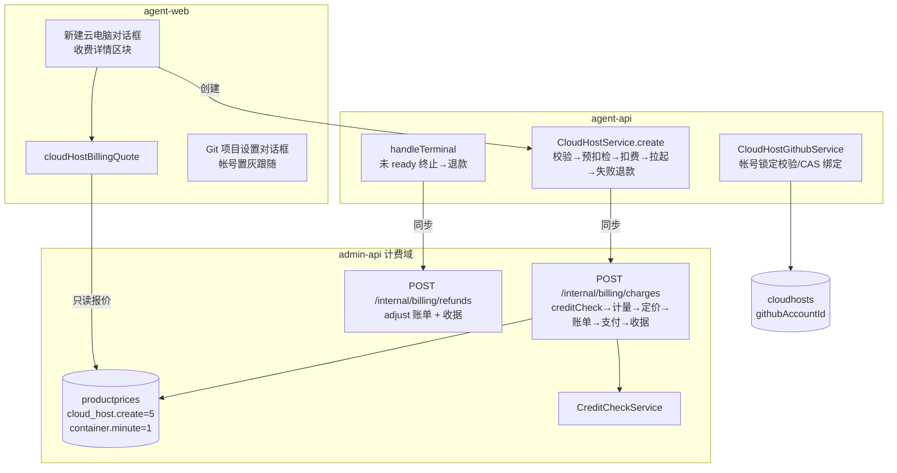
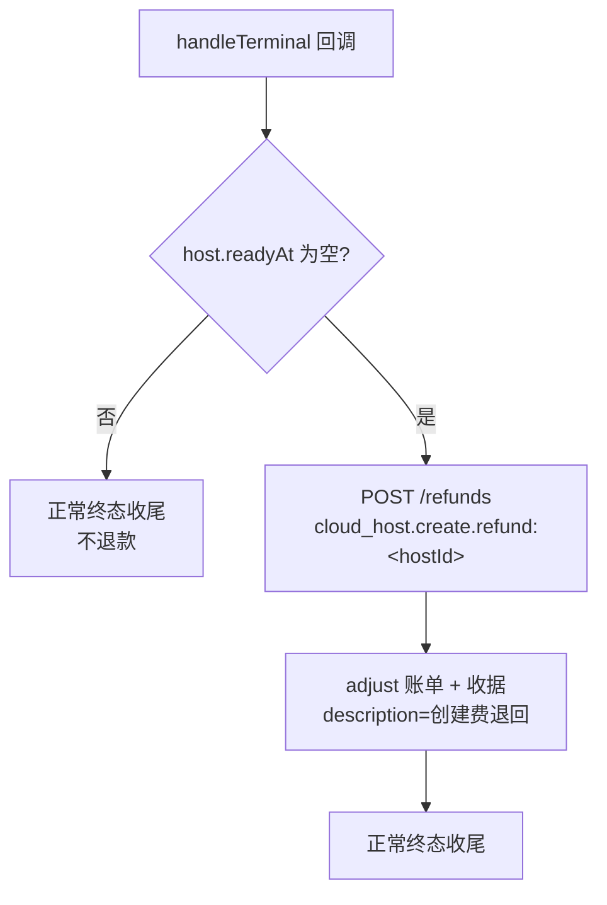
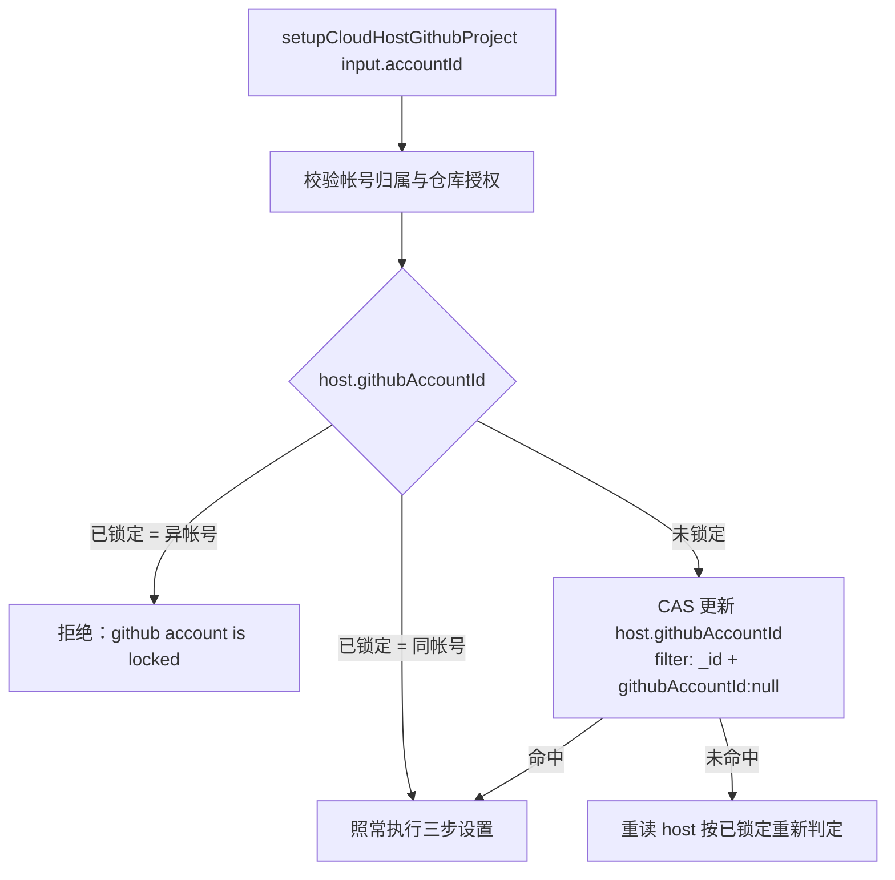

# 用户开放无限制云电脑支持 - 技术提案

**功能名称**: 用户开放无限制云电脑支持
**关联 PRD**: `docs/product/draft/20261027-unlimited-cloud-hosts.md`（v1.0）
**技术提案版本**: v1.0
**创建日期**: 2026-10-27
**作者**: z-agent-bot
**feat-branch**: `feat/unlimited-cloud-hosts`

## 1. 概述

### 1.1 背景

费用中心（Credits 计费）已上线：容器就绪起按 `container.minute`（1 credit/分钟）经「保证金 + 周期实扣」预留计费，统一预扣费检查 `CreditCheckService` 是唯一额度判定入口，事件/账单/收据链路完备（见 [[20261018-feat-credits-billing.md]]）。云电脑当前仍是灰度形态：

1. **创建免费**：`CloudHostService.create` 只做能力/名称/负载校验与计费账户 get-or-create，无任何创建扣费。
2. **每用户限 1 台**：`cloudHostService.create` 内 `activeCount >= maxPerUser` 拦截（`config.cloudHostMaxPerUser` 默认 1），DB 侧有部分唯一索引 `uniq_active_cloud_host_per_user`（迁移 `005-cloud-host-active-unique-index`）兜底；前端 Sidebar 存在活跃实例时禁用「新建云电脑」。
3. **Github 帐号每次设置可换**：`cloud_host_github_bindings` 按 `controllerId` 唯一 upsert（`CloudHostGithubService.runGitSetupStep`），每次「Git 项目设置」可传任意 `accountId`，云电脑与帐号无固定关系，与「一台云电脑只能持有一个帐号凭据」的凭据管理器语义错配。

本提案按 PRD 落地四件事：创建同步扣费 5 credits、创建对话框收费报价、放开数量限制、Github 帐号锁定到云电脑。

### 1.2 目标

- **创建收费闭环**：点击创建 → 统一预扣费检查（不足即拒）→ 一次性扣费 5 credits（价目 `cloud_host.create`，同步走「计量→定价→账单→支付→收据」管线，幂等）→ 拉起失败（未 ready 即终止）自动退款留痕。
- **收费透出**：新增 `cloudHostBillingQuote` 查询（创建费/分钟费率/当前可用余额），创建对话框据此渲染收费详情，降级不阻断。
- **放开数量**：移除 `maxPerUser` 计数门禁与 `uniq_active_cloud_host_per_user` 索引（新迁移下线），前端解除新建禁用。
- **帐号锁定**：`cloudhosts.githubAccountId`（null=未选定）；创建输入可携带（勾选 Github 项目时前端必传）；未锁定时首次「Git 项目设置」CAS 绑定；锁定后异帐号设置拒绝、前端置灰。

### 1.3 范围

**做**：

- admin-api：一次性扣费/退款内部接口（`/internal/billing/charges`、`/internal/billing/refunds`），价目 `cloud_host.create` 初始化，报价只读接口。
- agent-api：创建编排接入扣费与退款、移除数量门禁与配置、迁移 `011` 下线唯一索引、`CloudHost.githubAccountId` 落库与锁定校验、`cloudHostBillingQuote` GraphQL。
- agent-web：创建对话框收费详情区块、Sidebar 解除新建禁用、「Git 项目设置」帐号置灰跟随。
- contracts：`cloud-host.graphql` 变更、`billing-internal`（内部 REST）说明。

**不做**：

- 运行期分钟计费口径变更（`container.minute`、保证金、欠费 10 分钟强拆均不动）；
- 创建费的 admin 后台价目编辑界面（沿用 `productprices` 价目档机制，默认值 + 既有调价通道）；
- Github 帐号解绑后的换绑能力（PRD 明确不解锁）；
- 本地/自定义主机任何费用与数量语义。

## 2. 技术架构

### 2.1 系统架构图



### 2.2 技术栈

| 层级 | 技术选型 | 说明 |
|------|---------|------|
| 后端 | Node.js 24 + TypeScript strict + Express 5 + graphql-yoga 5 | 与现有 admin-api / agent-api 一致 |
| 数据库 | MongoDB（Mongoose 9） | 复用现有实例；金额整数最小单位 |
| 前端 | React 19 + TypeScript + Vite + Apollo Client | agent-web 既有对话框/ hooks 模式 |
| 测试 | Vitest + React Testing Library + 现有 tests/api、tests/e2e | TDD 红-绿-重构 |

### 2.3 模块划分

| 模块 | 职责 | 关键技术点 |
|------|------|-----------|
| admin-api `services/billing/one-time-charge.ts`（新增） | 一次性同步扣费与退款 | `creditCheck` → metering → pricing（单价快照）→ invoice → payment → receipt 同事务性步骤序列；`idempotentKey` 唯一幂等；退款为 `adjust` 正向账单 + 收据，`refund:<key>` 幂等 |
| admin-api `routes/internal-billing.ts` | 新增 `/charges`、`/refunds`、`/price-quote` | Bearer `INTERNAL_API_TOKEN`；入参校验；稳定脱敏错误码 |
| agent-api `services/cloud-host-service.ts` | 创建编排接入扣费/退款；移除数量门禁 | 扣费在 `startHarness` 前、落库后开始；回滚路径补退款；terminal 未 ready 退款 |
| agent-api `services/cloud-host-github-service.ts` | 帐号锁定 | 锁定后异帐号拒绝；未锁定 CAS `{_id, githubAccountId:null}` 绑定 |
| agent-api `migrations/011-drop-cloud-host-active-unique-index.ts` | 下线 `uniq_active_cloud_host_per_user` | `dropIndex` 幂等（不存在跳过） |
| agent-web `components/cloud-host/NewCloudHostDialog.tsx` | 收费详情区块 | 报价查询渲染；余额不足提示；失败降级 |
| agent-web `hooks/useGithubProjectForm.ts` + `GithubProjectSetupDialog` | 帐号置灰跟随 | `cloudHost.githubAccountId` 非空即禁用并锁定选项 |

## 3. API 设计

### 3.1 API 契约

契约变更集中在 `contracts/cloud-host.graphql`；内部 REST 补充进 `contracts/` 既有内部接口文档口径（`admin-billing.graphql` 头注 / 实现对齐）。

#### `contracts/cloud-host.graphql` 变更

```graphql
# CloudHost 增加：
type CloudHost {
  # ...既有字段...
  # 云电脑锁定的 Github 帐号；null = 未选定（可在首次 Git 项目设置时选定一次）
  githubAccountId: ID
}

input CreateCloudHostInput {
  name: String!
  harnessTypes: [HarnessType!]!
  workloadIds: [ID!]
  createDefaultSession: Boolean = true
  # 可选：创建时锁定 Github 帐号（勾选「配置 Github 项目」时前端必传）；
  # 必须是当前用户已绑定帐号；缺省 = 创建时未选定
  githubAccountId: ID
}

# 新增收费报价
type CloudHostBillingQuote {
  # 创建一次性花费（credits）
  createCredits: Float!
  # 运行每分钟花费（credits）
  perMinuteCredits: Float!
  # 当前用户可用余额（credits；计费不可用为 null，前端降级展示）
  availableBalance: Float
}

extend type Query {
  # ...既有...
  cloudHostBillingQuote: CloudHostBillingQuote!
}
```

头注生命周期段同步修订：删除「每用户同时最多 1 个实例」表述，补「创建收取一次性创建费（不足拒绝）」「Github 帐号跟随云电脑、选定后不可修改」。

#### `SetupCloudHostGithubProjectInput.accountId` 语义修订

不变更字段形状，头注补充语义：云电脑已锁定帐号时必须等于锁定帐号（否则 `github account is locked`）；未锁定时本次设置将其锁定。

#### admin-api 内部 REST（`/internal/billing/*` 扩展）

| Method | Path | Body | 返回 | 说明 |
|--------|------|------|------|------|
| POST | `/internal/billing/charges` | `{accountId, productId, quantity, idempotentKey, refType, refId, description}` | `{invoice, receipt, charged: true}` / 409 `{code:'INSUFFICIENT_BALANCE', available}` | 同步一次性扣费：先 `creditCheck(reject-on-insufficient)`，通过后内联走完整管线；`idempotentKey` 唯一索引幂等（重复请求返回首个结果） |
| POST | `/internal/billing/refunds` | `{idempotentKey, refundKey, reason}` | `{invoice, receipt}` | 按原扣费 `idempotentKey` 退款：`adjust` 正向账单 + 收据；`refundKey` 幂等；原扣费不存在/已退款均幂等返回 |
| GET | `/internal/billing/price-quote` | `productIds=a,b` | `[{productId, unitPrice, currency:'credits'}]` | 当前生效价目只读报价（供 agent-api 聚合 `cloudHostBillingQuote`） |

错误口径：`INSUFFICIENT_BALANCE`（余额不足，409）、`ACCOUNT_FROZEN`（403）、参数非法 400；agent-api 侧映射为 `insufficient balance` / `billing service unavailable` 契约文案（加入 `CLOUD_HOST_PUBLIC_ERRORS` 白名单）。

### 3.2 内部接口

```ts
// agent-api services/billing-client.ts 新增
createCharge(input: {
  accountId: string; productId: 'cloud_host.create'; quantity: 1;
  idempotentKey: string;            // cloud_host.create:<cloudHostId>
  refType: 'cloud_host'; refId: string; description: string;
}): Promise<{ charged: true }>;      // 409 → InsufficientBalanceError（含 available）

refundCharge(input: {
  idempotentKey: string;            // 原扣费 key
  refundKey: string;                // cloud_host.create.refund:<cloudHostId>
  reason: string;
}): Promise<void>;                   // 幂等，best-effort 调用方 catch 告警

getPriceQuote(productIds: string[]): Promise<Array<{ productId: string; unitPrice: number }>>;
```

## 4. 数据模型

### 4.1 数据库设计

#### 变更：`cloudhosts` 集合（agent-api `models/cloud-host.ts`）

| 字段 | 类型 | 说明 |
|------|------|------|
| githubAccountId | ObjectId \| null | 锁定的 Github 帐号（ref `GitHubAccount`）；`required:false, default:null`；存量文档天然 null（未选定） |

#### 变更：`productprices` 集合（admin-api）

新增价目档（启动初始化，沿用 `container.minute` 的 upsert 模式）：

| productId | pricingModel | unitPrice | 说明 |
|-----------|-------------|-----------|------|
| `cloud_host.create` | `per_unit` | 500（分位，= 5 credits） | 创建云电脑一次性费用；`DEFAULT_CLOUD_HOST_CREATE_CENTS` 常量兜底，价目档存在时不覆盖既有调价 |

#### 迁移：`011-drop-cloud-host-active-unique-index`（agent-api）

`cloudhosts.dropIndex('uniq_active_cloud_host_per_user')`，索引不存在时跳过（幂等）；删除后不再有任何 DB 级每用户数量约束。同步删除迁移 `005` 的索引创建逻辑不做回改（历史迁移只读，下线由 011 表达）。

#### 不变更

- `cloud_host_github_bindings`：`accountId` 字段已存在，锁定一致性由服务层校验保证（同一 controllerId 的 binding.accountId 此后恒定）。
- billing 域全部集合：一次性扣费复用 `billinginvoices`（`type:'charge', category:'container', refType:'cloud_host'`）/ `billingreceipts` / `billingledgers` / `meteringrecords`（`productId:'cloud_host.create', quantity:1`），无 schema 变更。

### 4.2 缓存设计

无新增缓存。报价为单次 `productprices` 查询 + `billingaccounts` 单文档读，直连即可。

## 5. 技术实现方案

### 5.1 核心流程

#### 创建云电脑（扣费 + 拉起 + 失败退款）

```mermaid
sequenceDiagram
    participant W as agent-web
    participant A as agent-api CloudHostService
    participant B as admin-api /internal/billing
    participant C as cloud-controller

    W->>A: createCloudHost(input)
    A->>A: 校验名称/harness/负载计划/githubAccountId 归属
    A->>B: getAccount（既有）
    A->>B: POST /charges（cloud_host.create, idem=cloud_host.create:&lt;hostId&gt;）
    alt 余额不足
        B-->>A: 409 INSUFFICIENT_BALANCE
        A-->>W: insufficient balance（含可用余额，前端提示充值）
    else 扣费成功（账单+收据）
        A->>A: ControllerKey/Controller/CloudHost(STARTING)/模型 Key
        A->>C: startHarness
        alt 启动请求失败
            A->>B: POST /refunds（refundKey 幂等）
            A->>A: 既有逆序回滚
            A-->>W: control plane unavailable（费用已退回）
        else 启动受理
            A-->>W: CloudHost(STARTING)
            Note over A,C: 之后未 ready 即 FAILED/STOPPED → handleTerminal 退款
        end
    end
```

#### 拉起失败退款（terminal 兜底）



#### Git 项目设置（帐号锁定）



### 5.2 关键实现点

#### 实现点 1: 一次性同步扣费（admin-api `one-time-charge.ts`）

- **管线内联**：与事件驱动的异步管线同一组构件（metering → pricing 单价快照 → invoice seq → payment 拆池 → receipt），但在单次请求内同步完成；`meteringrecords` 照常落（`productId=cloud_host.create, quantity=1`），保证「任一笔扣费可回溯到计量事实」口径不破。
- **准入**：扣费前 `creditCheck({policy:'reject-on-insufficient', estimatedCredits: unitPrice×quantity})`；不足返回 409 + `available`，不产生任何记录（PRD：无账单）。
- **幂等**：`idempotentKey`（`cloud_host.create:<hostId>`）写 `billingpayments.idempotentKey` 唯一索引；重复请求命中首个 payment 直接返回原 invoice/receipt（创建编排重试/双击安全）。
- **退款**：`refunds` 生成 `type:'adjust'` 正向账单（category `container`，refType `cloud_host`，description 带原 hostId 与原因）+ 收据；`refundKey` 幂等；原扣费不存在时记录告警并幂等成功（终端回调重试安全）。
- 金额整数分位运算（5 credits = 500），与既有 `money.ts` 一致。

#### 实现点 2: 创建编排接入（agent-api `cloud-host-service.ts`）

- 扣费时机：`getAccount` 之后、任何重资源动作之前（ControllerKey/Controller/CloudHost 落库之前先扣费？否——先扣费后落库会出现「扣了费但没有 host 记录」，退款路径失去 ref 可读性。**顺序定为**：预生成 `cloudHostId` → 扣费（refId=hostId）→ 既有落库与 `startHarness`；`startHarness` 抛错或 `containerStarted=false` 的 catch 分支在既有 `rollback` 前先 `refundCharge`（best-effort，失败仅告警——由对账/人工兜底，不阻塞回滚）。
- **删除数量门禁**：移除 `activeCount >= maxPerUser` 检查、`config.cloudHostMaxPerUser` 配置项与 `too many cloud hosts` 两处映射（含 11000 索引冲突分支）；保留 `userMutex` 创建串行化（防并发双击产生重复扣费窗口，语义从「限 1 台」退化为「创建串行」）。
- `githubAccountId`：`validateInput` 增加校验——必须 `mongoose.isValidObjectId` 且 `GitHubAccount.findOne({_id, userId})` 命中（否则 `Github 账号不存在或不属于当前用户`，沿用既有文案）；落库进 `CloudHost.create`。
- `handleTerminalLocked`：终态收尾处 `readyAt == null` 时追加 `refundCharge`（best-effort，幂等键保证重复回调/重复退款安全）；`handleReady` 路径不涉及。
- 报价 resolver：`cloudHostBillingQuote` 聚合 `getPriceQuote(['cloud_host.create','container.minute'])`（分位→credits 换算）与 `getAccount('front_user', userId).availableBalance`；计费不可用时 `availableBalance=null`、价格回退默认常量（5 / 1），保证对话框可用。

#### 实现点 3: Github 帐号锁定（`cloud-host-github-service.ts`）

- `createOperation` 在帐号归属/仓库授权校验之后、mutex 内 RUNNING 检查之前执行锁定判定（见 5.1 流程图）；CAS 未命中重读一次再判，杜绝并发首次设置绑定不同帐号。
- 锁定后 `CloudHostGithubBinding` upsert 的 `accountId` 与锁定值恒定一致，凭据接口 `/internal/cloud-hosts/:controllerId/github-credential` 无需变更（天然单帐号）。
- 新契约错误文案 `github account is locked` 加入 `CLOUD_HOST_PUBLIC_ERRORS`；前端不依赖该文案（置灰前置拦截），仅作兜底透传。
- 存量云电脑 `githubAccountId` 为 null：首次设置走 CAS 绑定分支，行为即 PRD「创建后补选一次」。

#### 实现点 4: 前端（agent-web）

- `NewCloudHostDialog`：新增「收费详情」区块（创建花费 X credits / 运行消费 Y credit/分钟 / 欠费 10 分钟强拆提示）；打开对话框查询 `cloudHostBillingQuote`（`cache-and-network`）；`availableBalance < createCredits` 时展示余额不足与充值引导文案但**不前置禁用**（服务端权威判定）；查询失败降级为通用提示，不阻断提交。勾选「配置 Github 项目」时提交体携带 `githubAccountId`（`useCloudHostProvisioning` 编排透传，未勾选不携带保持旧报文形状）。
- `Sidebar`：移除「存在 STARTING/RUNNING/STOPPING 云电脑时禁用新建入口」与「每用户同时最多 1 个云电脑实例」提示；`too many cloud hosts` 文案映射删除。
- `GithubProjectSetupDialog` / `useGithubProjectForm`：宿主 `cloudHost.githubAccountId` 非空时帐号下拉禁用、值固定为该帐号并附说明文案；仓库列表本就从所选帐号派生，锁定后天然只含该帐号仓库；未锁定（null）时保持可选，提交后宿主锁定（后续打开即置灰）。

#### 实现点 5: 文档同步

- `servers/agent-api/AGENTS.md`：移除「每用户同时最多 1 个实例」与 `uniq_active_cloud_host_per_user` 描述，补创建扣费/退款与 `githubAccountId` 锁定口径。
- `apps/agent-web/AGENTS.md`：更新新建入口禁用规则、`too many cloud hosts` 映射、Github 设置表单帐号锁定描述。

## 6. 技术决策

### 6.1 决策列表

| # | 决策 | 选项 A | 选项 B | 最终选择 | 原因 |
|---|------|--------|--------|---------|------|
| D-1 | 创建扣费通道 | 同步内部 REST（`/charges` 内联管线） | 新增 `container.created` 事件走 RabbitMQ 异步管线 | A | 创建需要即时「余额不足拒绝」反馈，异步事件无法同步拒绝；同步接口仍复用同一套管线构件与幂等键，口径不分裂 |
| D-2 | 扣费与启动顺序 | 先扣费，`startHarness` 失败退款；未 ready 终止退款 | 先启动，就绪时随保证金一并收创建费 | A | 就绪才收费则「点击创建」到就绪窗口内余额可被其他消费挤占，出现免费拉起；先扣费 + 失败退款保证「无机器不收费、有机器必收费」 |
| D-3 | 数量限制移除方式 | 删除配置与检查、迁移下线唯一索引 | 保留配置调大/置 0 表示无限制 | A | PRD 明确无限制开放；保留隐形开关会持续产生测试/文档双口径；欠费强拆与计费已是资源滥用的真正闸门 |
| D-4 | 帐号绑定时机 | 创建输入可携带 + 未锁定首次设置 CAS 绑定 | 仅创建输入绑定，创建后不可再选 | A | PRD 要求「未选择创建后依然可以选择一个」；CAS 绑定覆盖两种路径且并发安全 |
| D-5 | 帐号锁定的强制层 | 服务层校验 + 前端置灰 | 仅前端置灰 | A（服务层为准） | 前端置灰是体验，服务层 CAS/拒绝是安全边界（防绕过提交） |
| D-6 | 报价透出 | 新增 `cloudHostBillingQuote`（价格 + 余额聚合） | 前端硬编码 5/1 | A | 「展示数值与实际扣费一致」必须数据源同源；余额展示支持余额不足引导 |

### 6.2 依赖与约束

| 类型 | 内容 | 说明 |
|------|------|------|
| 依赖 | 费用中心计费域（creditCheck/invoicing/payment/receipt/metering/pricing） | 一次性扣费复用全部既有构件 |
| 依赖 | `billingClient`（agent-api → admin-api 内部 REST） | 新增三个方法，沿用超时/脱敏错误模式 |
| 约束 | 计费侧不回查业务库 | 扣费入参携带全部事实（productId/quantity/refId/description） |
| 约束 | 金额整数分位运算 | 与 `money.ts` 一致 |
| 约束 | 存量云电脑兼容 | `githubAccountId=null` 走首次绑定；创建费不补收 |
| 约束 | 契约错误文案白名单 | 新增 `insufficient balance`、`github account is locked` 入 `CLOUD_HOST_PUBLIC_ERRORS` |

## 7. 项目结构

```
servers/admin-api/src/
├── services/billing/
│   ├── one-time-charge.ts          # 新增：同步一次性扣费 + 退款（复用 metering/pricing/invoicing/payment/receipt）
│   └── pricing.ts                  # 初始化增加 cloud_host.create 价目档（默认 500 分）
└── routes/internal-billing.ts      # 新增 POST /charges、POST /refunds、GET /price-quote

servers/agent-api/src/
├── models/cloud-host.ts            # + githubAccountId；移除唯一索引声明注释口径
├── migrations/011-drop-cloud-host-active-unique-index.ts   # 新增
├── config/index.ts                 # 移除 cloudHostMaxPerUser
├── services/
│   ├── billing-client.ts           # + createCharge/refundCharge/getPriceQuote + InsufficientBalanceError
│   ├── cloud-host-service.ts       # 扣费/退款编排；移除数量门禁；githubAccountId 校验落库；terminal 未 ready 退款
│   └── cloud-host-github-service.ts# 帐号锁定判定与 CAS 绑定
└── graphql/
    ├── schemas/cloud-host.ts       # + githubAccountId / CreateCloudHostInput.githubAccountId / CloudHostBillingQuote
    └── resolvers/cloud-host.ts     # + cloudHostBillingQuote

apps/agent-web/src/
├── components/cloud-host/
│   ├── NewCloudHostDialog.tsx      # 收费详情区块 + 余额不足提示
│   └── GithubProjectSetupDialog.tsx# 帐号置灰跟随
├── hooks/
│   ├── useCloudHostProvisioning.ts # 编排透传 githubAccountId
│   └── useGithubProjectForm.ts     # 锁定帐号注入与禁用态
├── components/Sidebar.tsx          # 移除新建禁用与数量提示
└── graphql/cloud-host.ts           # 查询/变更同步

contracts/
└── cloud-host.graphql              # 字段、报价类型、头注语义修订
```

## 8. 测试策略

### 8.1 测试覆盖要求

- 单元测试覆盖率：新增/变更服务 ≥ 85%（资金路径 `one-time-charge.ts` ≥ 90%）。
- API 测试覆盖：`createCloudHost`（扣费成功/余额不足/退款）、`cloudHostBillingQuote`、`setupCloudHostGithubProject`（锁定/异帐号拒绝/首绑）、`/internal/billing/charges|refunds|price-quote`。

### 8.2 测试类型

| 类型 | 工具 | 覆盖范围 |
|------|------|---------|
| 单元测试（TDD 红-绿-重构） | Vitest + InMemory/mock | ① 扣费幂等（同 idempotentKey 重复请求返回首单）；② 余额不足 409 无任何记录；③ 退款幂等与「未 ready 终止」触发；④ 创建编排：扣费在落库/启动前、启动失败退款且回滚；⑤ 无数量限制可连续创建多台；⑥ 帐号锁定：CAS 首绑、异帐号拒绝、同帐号放行、存量 null 兼容；⑦ 迁移 011 幂等 |
| 集成测试 | Vitest + MongoMemoryServer | 扣费→invoice/receipt/ledger 链路完整可回溯；terminal 退款留痕 |
| 前端测试 | Vitest + RTL | 收费区块渲染/降级/余额不足提示；Sidebar 不再禁用；帐号置灰与未锁定可选 |
| API 测试 | 现有 tests/api 约定 | 契约一致性与鉴权（401） |
| E2E | 现有 tests/e2e 约定 | 充值→创建扣 5 credits 见收据→第二台并行创建成功→余额不足创建被拒→Git 项目设置帐号置灰 |

## 9. 部署方案

### 9.1 环境规划

| 环境 | 用途 | 部署方式 |
|------|------|---------|
| 本地/开发 | 开发自测 | Aspire `aspire start`（无新增资源） |
| 测试 | 集成/E2E | 现有 docker-compose manifest 流程 |

### 9.2 配置管理

| 配置项 | 默认值 | 说明 |
|--------|-------|------|
| `DEFAULT_CLOUD_HOST_CREATE_CENTS` | 500 | 创建费默认价（分位）；价目档已存在时不覆盖 |
| `CLOUD_HOST_MAX_PER_USER` | — | **移除**（无限制开放） |

迁移 `011` 随服务启动执行；`productprices` 新价目档启动 upsert（只增不覆盖）。

## 10. 验收标准

- [ ] 技术方案评审通过
- [ ] Contract 评审通过（`cloud-host.graphql` 变更 + 内部 REST 口径）
- [ ] 代码实现完成（扣费/退款/报价/数量放开/帐号锁定/前端三处）
- [ ] 单元测试覆盖达标（含幂等与并发用例）
- [ ] API 测试通过
- [ ] E2E 测试通过（PRD §1.3 成功标准逐条演示）
- [ ] 文档同步完成（两处 AGENTS.md 口径更新）

## 11. 相关文档

- [[../../product/draft/20261027-unlimited-cloud-hosts.md]] — 关联 PRD（v1.0）
- [[20261018-feat-credits-billing.md]] — 费用中心技术提案（计费管线与统一预扣费检查来源）
- [[20261021-feat-github-workload.md]] — Github 工作负载与 Git 项目设置（凭据最小化与绑定来源）
- [[20261022-feat-cloud-container-optimization-phase1.md]] — 云容器优化一期（创建编排来源）
- [[../common-rules.md]] / [[../backend-rules.md]] / [[../frontend-rules.md]] — 开发规范
- [[../AGENTS.md]] — 工程文档管理规范
