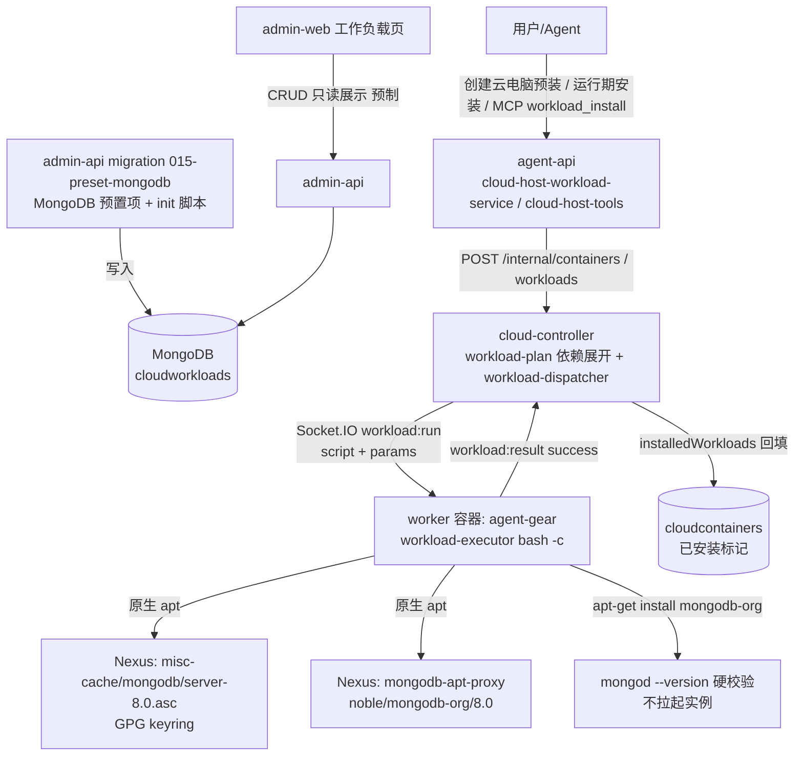
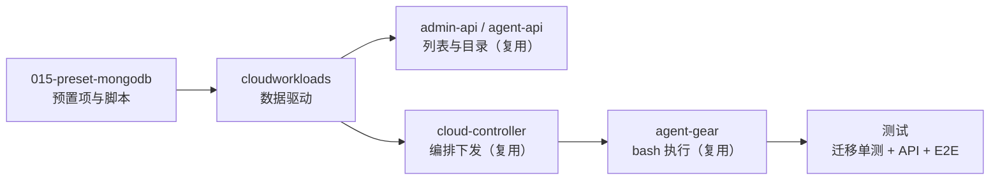
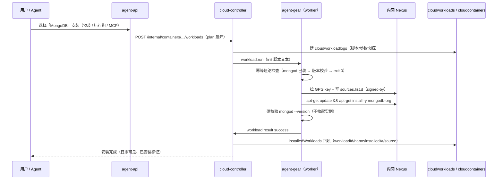

# 增加工作负载「MongoDB」：原生 apt 安装 MongoDB 8.0 - 技术提案

**功能名称**: 工作负载「MongoDB」（原生 apt 安装）
**关联 PRD**: [[../../product/draft/20261028-mongodb-workload.md]]
**技术提案版本**: v1.1
**创建日期**: 2026-10-28
**作者**: ZeroAsh
**feat-branch**: `feat/mongodb-workload`

> v1.1 修订（返工口径）：移除「安装后拉起 mongod 实例」的口径——工作负载**只负责安装与安装成功校验**（`mongod --version` 通过即视为安装成功），**不拉起 mongod 实例**、不做服务托管；MongoDB 服务由用户按需自行启动。§1.2/§1.3/§2/§5/§6/§8/§9 已按此口径修订（脚本删除 `runuser ... mongod --fork` 拉起与 `mongosh ping`，硬校验收敛为 `mongod --version`）。

## 1. 概述

### 1.1 背景

工作负载体系现状（详见 `20261017-feat-cloud-controller-workload` / `20261018-feat-workload-phase1`）：

- **数据模型单一事实源**：MongoDB 集合 `cloudworkloads`（admin-api `servers/admin-api/src/models/cloud-workload.ts` 为写方；agent-api / cloud-controller 为只读镜像）。字段含 `name`（唯一）、`initScript` / `postScript`、`paramSchema[]`、`dependsOnWorkloadIds`、`presetKey`（预制稳定标识）、`isPreset`、`workloadKind: 'standard' | 'harness'`、`harnessType`。
- **预制负载 = admin-api 迁移 seed**：无按负载拆分的脚本文件/注册表；预制项由 `servers/admin-api/src/migrations/NNN-*.ts` 内嵌 bash 脚本写入 `cloudworkloads`，在 `servers/admin-api/src/index.ts` 的 `runMigrations([...])` 注册（幂等、失败不阻断启动）。迁移只补缺、**不覆盖管理员修改**。
- **执行链路**：cloud-controller 经 Socket.IO `workload:run` 把脚本文本下发到工作容器内 agent-gear（`packages/agent-controller/src/workload-executor.ts`：`bash -c <script>`、串行、单条超时、必须项失败短路），结果经 `workload:result` 回传并在 `cloudcontainers.installedWorkloads` 落「已安装」标记。
- **脚本正典形态**（`012-worker-user-scripts.ts` 确立）：`#!/usr/bin/env bash` + `set -euo pipefail` + `SUDO=sudo; command -v sudo >/dev/null || SUDO=` 前导、`${SUDO} apt-get`、root 写入 `${SUDO} tee`——适配 worker 镜像（Ubuntu 24.04）以 `worker` uid 运行 + 免密 sudo。
- **已有先例**：`007-preset-github.ts`（「Github」标准预制负载：内网 Nexus apt 代理 + keyring + `apt-get install -y gh` + `gh --version` 硬校验）与 `001-preset-workloads.ts`（「Docker」：apt 安装 + `nohup dockerd` 拉起 + 就绪等待）。

**需求（上游 Issue #341）**：增加工作负载 mongodb，最好使用原生使用 apt；apt 源 gpg `https://nexus.internal.fffdan.com/repository/misc-cache/mongodb/server-8.0.asc`、apt `https://nexus.internal.fffdan.com/repository/mongodb-apt-proxy`；`sudo apt-get update && sudo apt-get install -y mongodb-org`。

因此本期交付物是**一个标准预制工作负载**：admin-api 迁移 seed 写入「MongoDB」（`presetKey='mongodb'`），init 脚本按 012 正典形态以原生 apt 经内网 Nexus 代理安装 `mongodb-org` 8.0、以 `mongod --version` 硬校验安装成功（**不拉起 mongod 实例**，服务由用户按需自行启动）。**全链路数据驱动，零契约、零协议、零前后端代码改动**。

### 1.2 目标

- admin-api 迁移 `015-preset-mongodb`：写入预制工作负载「MongoDB」（`presetKey='mongodb'`、`isPreset=true`、`workloadKind='standard'`、无参数、无依赖、init-only），幂等不覆盖管理员修改。
- init 脚本（012 sudo 正典形态）：
  - 原生 apt 安装：需求指定的内网 GPG key + Nexus `mongodb-apt-proxy` 源（`{codename}/mongodb-org/8.0 multiverse`）→ `apt-get update && apt-get install -y mongodb-org`，全程不回退公网；
  - 安装成功硬校验：`mongod --version` 输出版本信息即视为成功（**不拉起 mongod 实例**、不做服务托管，服务由用户按需自行启动）；
  - 幂等：已安装（`command -v mongod` 命中）短路成功；重复执行不重复安装、不破坏既有安装、不影响运行中的服务。
- 全链路自动呈现（零代码改动）：后台工作负载列表（「预制」徽章）、创建云电脑「预装工作负载」、云主机工作负载目录与运行期安装、MCP `workload_list` / `workload_install`。
- 测试收口：迁移单测新增；`tests/api` / `tests/e2e` 预制项计数与名称断言 8→9 同步更新；既有测试零回归。

### 1.3 范围

**做**：

- `servers/admin-api/src/migrations/015-preset-mongodb.ts`（预置项 + init 脚本）+ `servers/admin-api/src/index.ts` 注册。
- `servers/admin-api/src/migrations/015-preset-mongodb.test.ts` 迁移单测。
- 测试断言更新：`tests/api/src/admin-api/cloud-workload.test.ts`（T-IA 预制项 8→9）、`tests/e2e/src/admin-cloud-workload.spec.ts`（T-E16 名称清单与「预制」徽章计数）。
- 可选补强：`tests/api/src/agent-api/cloud-host-workload.test.ts` 断言「MongoDB」出现在 `cloudHostWorkloads` / `cloudHostWorkloadCatalog`。

**不做**：

- 契约/GraphQL/WebSocket 协议任何变更（`CloudWorkload`、`CloudHostWorkload*`、`workload:run` 均无需扩展）。
- 前后端代码改动（列表、参数表单、依赖选择、日志查看全部数据驱动）。
- 安装参数（版本/端口/dbPath/鉴权等）——一期零参数，参数化留待后续需求。
- **不拉起 mongod 实例**：脚本无任何服务启动动作（无 fork/nohup/runuser/systemd 拉起），不做服务托管与开机自启；服务由用户按需自行启动。
- MongoDB 副本集/分片/鉴权配置、服务运行管理、数据持久化到容器外、备份恢复。
- worker 镜像（`deploy/images/worker`）改动——`mongodb-org` 不预装，完全下沉工作负载脚本按需安装（四期瘦身口径）。

## 2. 技术架构

### 2.1 系统架构图



关键边界：

- **本期唯一写入点**：迁移 `015-preset-mongodb` 向 `cloudworkloads` 写一个预制文档；其余全部为既有链路的自然呈现。
- **脚本执行环境**：worker 镜像 Ubuntu 24.04（apt 系、无 systemd）、`worker` uid + 免密 sudo、内网 Nexus 代理为唯一软件来源。

### 2.2 技术栈

| 层级 | 技术选型 | 说明 |
|------|---------|------|
| 预置项写入 | admin-api 迁移（TS 内嵌 bash） | 与 001/007/009/010 等预制负载同模式，`runMigrations` 注册 |
| 软件安装 | 原生 apt（`mongodb-org` 8.0） | 需求指定；内网 Nexus 代理 + GPG signed-by 校验 |
| 成功硬校验 | `mongod --version` | 安装成功但校验不通过视为失败；**不拉起实例** |
| 执行链路 | cloud-controller `workload:run` + agent-gear `workload-executor` | 零改动复用 |
| 测试 | vitest（迁移单测）+ tests/api + tests/e2e（Playwright） | 预制项计数与名称断言收口 |

### 2.3 模块划分



| 模块 | 职责 | 关键技术点 |
|------|------|-----------|
| `015-preset-mongodb.ts` | 写入「MongoDB」预制工作负载 | presetKey/name 双重幂等跳过、不覆盖管理员修改；init 脚本 012 正典形态 |
| init 脚本 | 原生 apt 安装 mongodb-org 8.0 + 成功硬校验 | 内网源、GPG 校验、幂等短路、`mongod --version` 硬校验（不拉起实例） |
| 既有执行/展示链路 | 安装、留档、已安装标记、失败语义 | 零改动 |
| 测试 | 迁移行为 + 预制项清单断言 | 8→9 同步、幂等回归 |

## 3. API 设计

### 3.1 API 契约

**零契约变更。** 「MongoDB」作为 `workloadKind='standard'` 的预制工作负载，完全由既有契约的数据驱动呈现：

| 既有入口 | 契约位置 | 本期变化 |
|---------|---------|---------|
| 后台工作负载 CRUD / 列表 | `contracts/admin-cloud-workload.graphql`（`CloudWorkload` / `adminCloudWorkloads`） | 数据多一条「MongoDB」（`isPreset=true`），无字段变化 |
| 创建云电脑预装选择 | `CloudWorkloadSelectionInput { workloadId, params, required }` | 可选「MongoDB」（无参数），无字段变化 |
| 运行期安装 / 已安装展示 | `contracts/admin-cloud-container.graphql`（`installedWorkloads`）、`contracts/cloud-host.graphql`（`cloudHostWorkloads` / `cloudHostWorkloadCatalog` / `installCloudHostWorkload`） | 列表多一条，无字段变化 |
| Agent 工具 | `agent-cloud-host-tools.workload_list` / `workload_install` | 列表多一条，无字段变化 |

### 3.2 内部接口

`contracts/cloud-controller-websocket.md` §2.9/§2.10 的 `workload:run` / `workload:result` 不变（items 仍为 `logId/workloadId/workloadName/script/params/required/timeoutMs`）；cloud-controller 内部 `POST /internal/containers/:containerId/workloads` 不变。`paramSchema=[]` 时既有参数校验与 `WORKLOAD_PARAM_*` 注入自然为空。

## 4. 数据模型

### 4.1 数据库设计

#### 集合: `cloudworkloads`（新增 1 个预制文档）

| 字段 | 值 | 说明 |
|------|------|------|
| `name` | `'MongoDB'` | 唯一；展示名 |
| `presetKey` | `'mongodb'` | 预制稳定标识（部分唯一索引覆盖） |
| `isPreset` | `true` | 后台展示「预制」徽章 |
| `workloadKind` | `'standard'` | 标准工作负载（非 harness） |
| `harnessType` | `null` | — |
| `initScript` | 见 §5.2 | 012 sudo 正典形态 bash |
| `postScript` | `null` | init-only（对照 Github 负载） |
| `paramSchema` | `[]` | 一期零参数 |
| `dependsOnWorkloadIds` | `[]` | 无依赖（对照 Github 负载） |

### 4.2 缓存设计

无新增缓存。既有工作负载目录读取路径（agent-api `CloudWorkloadCatalog`、`installedMap()`）不变。

## 5. 技术实现方案

### 5.1 核心流程



### 5.2 关键实现点

#### 实现点 1: init 脚本（012 sudo 正典形态 + 原生 apt + 版本硬校验）

- **描述**：`MONGODB_INIT_SCRIPT` 全量如下（实现期以实测微调为准，形态不变）：

```bash
#!/usr/bin/env bash
set -euo pipefail
SUDO=sudo
command -v sudo >/dev/null 2>&1 || SUDO=

# 幂等：已安装 → 版本校验通过即直接成功（不重复安装、不动既有环境）
if command -v mongod >/dev/null 2>&1; then
  mongod --version
  exit 0
fi

# 内网 apt 源（需求指定地址；GPG signed-by 校验；不回退公网）
${SUDO} install -m 0755 -d /etc/apt/keyrings
curl -fsSL https://nexus.internal.fffdan.com/repository/misc-cache/mongodb/server-8.0.asc \
  | ${SUDO} tee /etc/apt/keyrings/mongodb-server-8.0.asc >/dev/null
${SUDO} chmod a+r /etc/apt/keyrings/mongodb-server-8.0.asc
. /etc/os-release
printf '%s\n' \
  "deb [ signed-by=/etc/apt/keyrings/mongodb-server-8.0.asc ] https://nexus.internal.fffdan.com/repository/mongodb-apt-proxy ${VERSION_CODENAME}/mongodb-org/8.0 multiverse" \
  | ${SUDO} tee /etc/apt/sources.list.d/mongodb-org-8.0.list >/dev/null

${SUDO} apt-get update
${SUDO} apt-get install -y mongodb-org

# 硬校验：版本通过即安装成功（不拉起 mongod 实例，服务由用户按需自行启动）
mongod --version
```

- **技术细节**：
  - `signed-by` 直接指向 armored `.asc`（apt 原生支持）；源路径 `${VERSION_CODENAME}/mongodb-org/8.0 multiverse`（worker 镜像 Ubuntu 24.04 → `noble`；codename 取自 `/etc/os-release` 保持健壮）。
  - `mongodb-org` 元包安装 `mongodb-org-server`（提供 `mongod`）等组件；`apt-get install -y mongodb-org` 即满足需求原文命令口径。
  - **脚本无任何服务启动动作**（无 `--fork`/`nohup`/`runuser`/`systemctl`）：工作负载只负责安装与 `mongod --version` 校验，MongoDB 服务由用户按需自行启动（返工口径）。
- **风险点**：`apt-get install` 触发包 postinst 在无 systemd 环境下尝试启动服务可能打印 service 相关告警——以 `set -e` 不中断为准（实现期实测确认；必要时 `RUNLEVEL=1` 或忽略 service 告警口径微调，不改变「不拉起实例」结论）。

#### 实现点 2: 幂等口径（双重）

- **描述**：① 脚本内短路（`command -v mongod` 命中 → `mongod --version` 校验 → exit 0）；② `apt-get install` 对已装包天然幂等。迁移层幂等见实现点 3。脚本全程无服务启动动作，用户已在运行的 MongoDB 服务完全不受触碰。
- **技术细节**：已安装状态下重复执行秒级返回；不重复安装、不破坏既有安装与运行中的服务。
- **风险点**：环境存在手工安装的 mongod 时短路成功即返回，不接管不破坏（PRD 异常表口径）。

#### 实现点 3: 迁移 `015-preset-mongodb`（seed 幂等、不覆盖管理员修改）

- **描述**：`run()` 顺序 `CloudWorkload.findOne({ presetKey: 'mongodb' })` → `findOne({ name: 'MongoDB' })`，命中即 `console.warn` 跳过；均空才 `CloudWorkload.create({...})`。注册进 `servers/admin-api/src/index.ts` 的 `runMigrations([...])`（注释行「015-preset-mongodb——写入 MongoDB 工作负载预置项」）。
- **技术细节**：结构与 `007-preset-github.ts` 逐节对齐（导出 `name` / `MONGODB_PRESET_KEY` / `MONGODB_PRESET_NAME` / `MONGODB_INIT_SCRIPT` / `run()`）；脚本直接以 012 正典形态编写（不再走 `withSudo` 后补形态）。
- **风险点**：迁移编号冲突——当前 `admin-api` 迁移已占用至 `014`，`015` 为下一个空位；若实现期主分支新增迁移需顺延并同步测试引用。

#### 实现点 4: 测试断言收口（8→9）

- **描述**：既有断言硬编码预制项清单：`tests/api/src/admin-api/cloud-workload.test.ts`（T-IA「eight preset workloads」、`presetIds` 长度 8）与 `tests/e2e/src/admin-cloud-workload.spec.ts`（T-E16「eight preset workloads」、名称清单、「预制」徽章计数）——加「MongoDB」后同步为 9。
- **技术细节**：E2E 名称清单为 `.sort()` 后全量比对，注意「MongoDB」排序位置；`cloud-host.spec.ts`「预装工作负载」如含名称断言一并核对。
- **风险点**：遗漏断言导致基线腐化（common-rules「状态机语义演进要回填测试断言」教训）——实现期全局检索 `preset` 计数类断言。

## 6. 技术决策

### 6.1 决策列表

| 决策 | 选项 A | 选项 B | 最终选择 | 原因 |
|------|--------|--------|---------|------|
| D1 安装方式 | 原生 apt（mongodb-org） | Docker 嵌套 / 二进制分发 | **A** | 需求明确「最好使用原生使用 apt」；apt 有 GPG 校验、升级路径统一 |
| D2 软件源 | 需求指定内网 Nexus 代理 | 公网 repo.mongodb.org | **A** | 平台既有口径（Github/Docker/.NET 负载均走 Nexus 代理）；不回退公网 |
| D3 版本口径 | 固定 8.0 轨道（源即版本） | 参数化版本 | **A（一期）** | 需求给出的源即 `server-8.0`；零参数最小可用，参数化留待后续 |
| D4 安装后动作 | 仅 `mongod --version` 硬校验（不拉起实例） | 拉起 mongod + 就绪探测 | **A** | 返工口径：工作负载只负责安装与校验；服务由用户按需自行启动 |
| D5 成功判定 | `mongod --version` 通过 | `mongosh ping` / 端口探测（隐含实例在跑） | **A** | 返工口径：仅需版本校验通过；避免与用户自管的服务实例产生耦合 |
| D6 脚本形态 | 直接 012 sudo 正典形态 | 007 原始形态 + 012 后补 | **A** | 012 已确立正典；新脚本无需历史包袱 |
| D7 数据/访问口径 | 软件默认（bindIp 127.0.0.1、无鉴权、容器内落盘） | 开放监听/鉴权配置 | **A（一期）** | 最小可用、默认即安全；远程访问可经既有端口转发能力，鉴权/持久化留待需求 |
| D8 预置形态 | admin-api 迁移 seed | 管理员手工录入 | **A** | 预制负载统一口径（可升级、可测试、多环境一致） |

### 6.2 依赖与约束

| 类型 | 内容 | 说明 |
|------|------|------|
| 依赖 | 内网 Nexus（`misc-cache/mongodb/server-8.0.asc`、`mongodb-apt-proxy`） | 安装期可达；不可达时安装失败并展示原因（可重试） |
| 依赖 | 既有工作负载链路（seed / plan / dispatcher / executor / installedWorkloads） | 零改动复用 |
| 约束 | worker 容器 Ubuntu 24.04、worker uid + 免密 sudo | 脚本 012 正典形态 |
| 约束 | 迁移只补缺不覆盖管理员修改 | presetKey/name 双重跳过 |
| 约束 | **不拉起 mongod 实例**（返工口径） | 脚本无服务启动/托管动作，硬校验仅 `mongod --version` |
| 约束 | 单条 init 脚本超时预算（默认 300s） | 内网 apt 安装量级满足；不引入公网下载 |

## 7. 项目结构

```
servers/admin-api/src/
├── migrations/
│   ├── 015-preset-mongodb.ts        # 新增：MongoDB 预制工作负载 seed
│   └── 015-preset-mongodb.test.ts   # 新增：迁移单测
└── index.ts                          # 修改：runMigrations 注册 015

tests/
├── api/src/admin-api/cloud-workload.test.ts        # 修改：预制项 8→9
├── api/src/agent-api/cloud-host-workload.test.ts   # 可选：MongoDB 出现在目录/列表
└── e2e/src/admin-cloud-workload.spec.ts            # 修改：T-E16 清单与徽章 8→9
```

## 8. 测试策略

### 8.1 测试覆盖要求

- 迁移单测覆盖：写入字段全量断言、重复执行幂等（T-MIG1/T-MIG2 口径）、同名非预制跳过（T-MIG3 口径）。
- API 测试覆盖：`adminCloudWorkloads` 预制项清单（9 项含「MongoDB」）、`cloudHostWorkloads` / `cloudHostWorkloadCatalog` 可见性。
- E2E 覆盖：后台工作负载列表「MongoDB」+「预制」徽章计数 9。

### 8.2 测试类型

| 类型 | 工具 | 覆盖范围 |
|------|------|---------|
| 迁移单测 | vitest（mock `CloudWorkload`） | `015-preset-mongodb.test.ts`：create 参数（name/presetKey/isPreset/workloadKind/paramSchema=[]/dependsOn=[]/postScript=null）、幂等跳过、同名跳过、脚本形态（`SUDO` 前导、`${SUDO} apt-get`、`${SUDO} tee`、无公网源、`mongod --version` 硬校验、**无任何实例拉起动作**） |
| API 测试 | tests/api（Aspire 全量 + `MONGODB_URI`） | `cloud-workload.test.ts` T-IA 预制项 8→9 与 ID 幂等；`cloud-host-workload.test.ts` 目录可见 `installed=false` |
| E2E 测试 | Playwright | `admin-cloud-workload.spec.ts` T-E16 名称清单与「预制」徽章 8→9 |
| 实测（人工/验收） | 云电脑真实安装 | 创建预装 + 运行期安装各一遍：`mongod --version` 通过、安装流程结束后无 mongod 进程（不拉起实例）、重复安装幂等、失败重试（见 §9） |

## 9. 验收标准

- [ ] 技术方案评审通过
- [ ] 迁移 `015-preset-mongodb` 单测全绿（含幂等/同名跳过/脚本形态）
- [ ] 后台工作负载列表出现「MongoDB」（「预制」徽章），预制项计数 9 的 API/E2E 断言全绿
- [ ] 创建云电脑勾选「MongoDB」预装 → 就绪后标记已安装，容器内 `mongod --version` 输出版本信息
- [ ] 运行期安装（界面 / MCP `workload_install`）成功，`workload_list` 可见且 `installed=true`
- [ ] 安装流程**不**拉起 mongod 实例（安装结束后无 MongoDB 服务进程）；用户可按需自行启动服务
- [ ] 重复执行安装幂等成功：不重复安装、不破坏既有安装，用户已在运行的服务不受影响
- [ ] 安装失败场景（如 apt 源不可达）失败原因可见、重试可恢复
- [ ] 既有预制工作负载与云电脑/会话功能零回归（tests/api + tests/e2e 全绿）

## 10. 相关文档

- [[../../product/draft/20261028-mongodb-workload.md]] — 本期 PRD
- [[20261018-feat-workload-phase1.md]] — 工作负载一期（参数、依赖与预制工作负载）
- [[20261021-feat-github-workload.md]] — Github 工作负载（标准预制负载 + 内网 apt 代理先例）
- [[20261018-feat-workload-phase4.md]] — 工作负载四期（worker 基础镜像瘦身：负载下沉按需安装）
- [[20261025-feat-cloud-host-keepalive.md]] — 云电脑保活与 worker 用户（sudo 形态 / 免密 sudo）
- [[20261022-feat-workload-optimization.md]] — 工作负载优化（展示与 MCP 列出/安装）
- [[../common-rules.md]] — 通用开发规范
