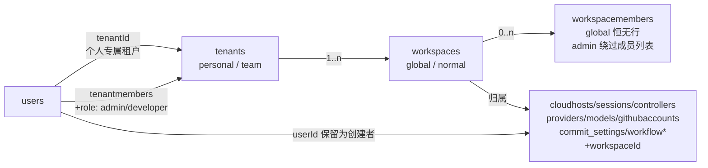
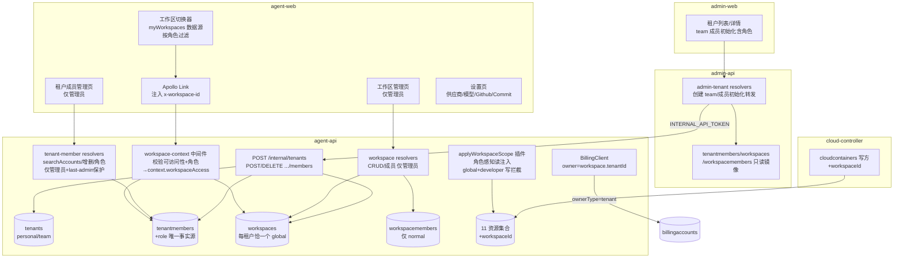
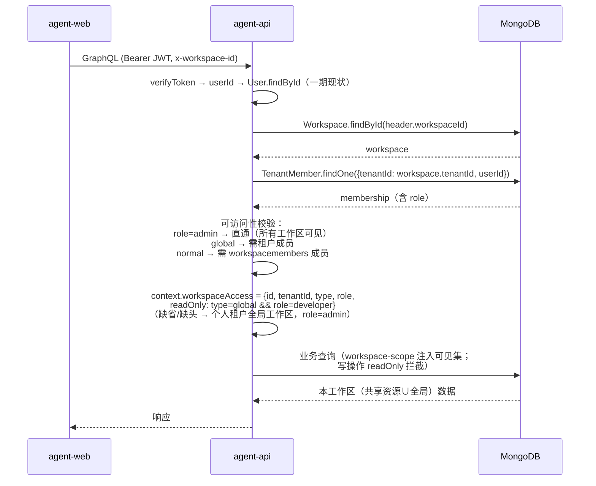
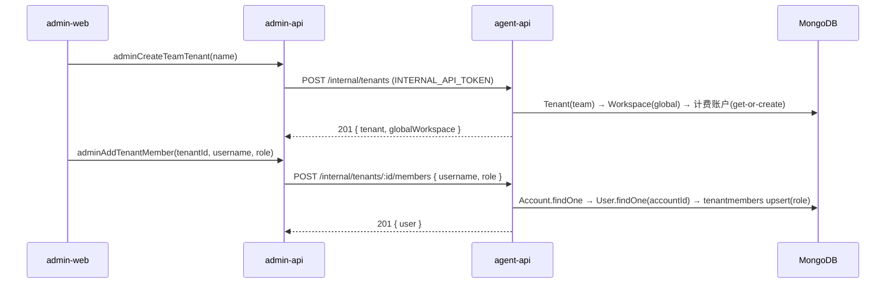
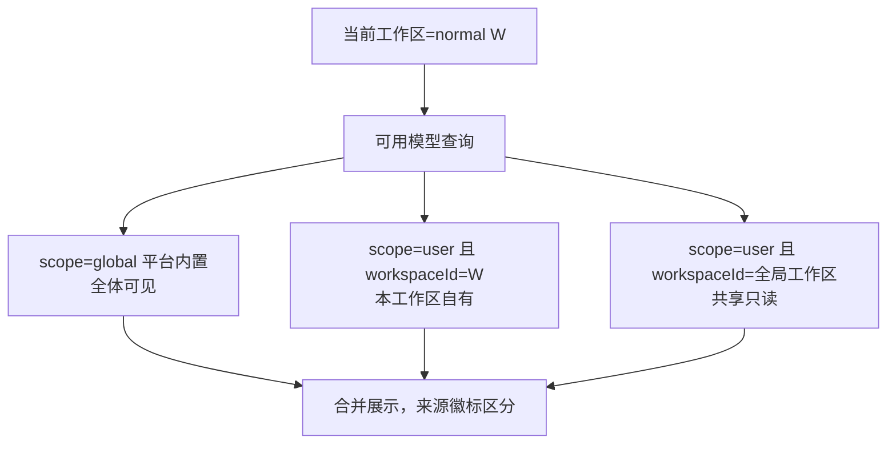
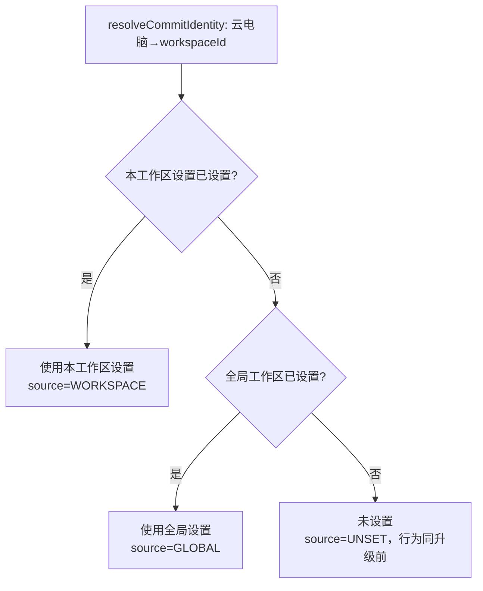
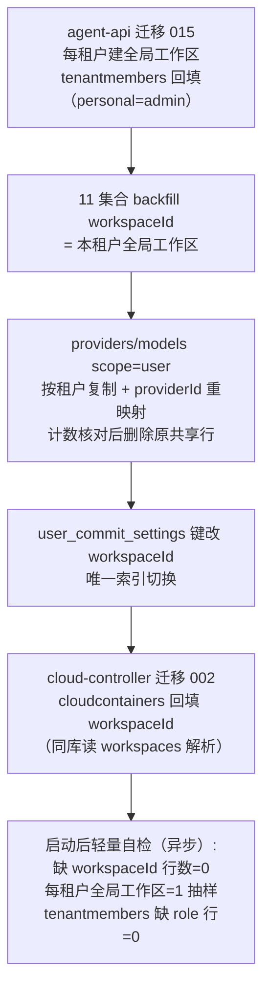

# 多租户二期 - 技术提案

**功能名称**: 多租户二期（Team 类型租户与租户内工作区共享）
**关联 PRD**: `docs/product/draft/20261028-multi-tenant-phase2.md`（v1.1）
**技术提案版本**: v1.1
**创建日期**: 2026-10-28
**作者**: z-agent-bot
**feat-branch**: `feat/multi-tenant-phase2`
**版本说明**:
- v1.0（2026-10-28）初版。
- v1.1（2026-10-28，评审返工）按评审意见「增加租户成员管理和角色」引入租户级角色：`tenantmembers` 新增 `role`（admin/developer）；权限矩阵收敛为——管理员：管理租户下所有资源、所有工作区对其可见（绕过成员列表）、可改变其他成员角色、可创建工作区、可按帐号名搜索账户并添加租户成员；开发：无法创建工作区、可读写删除自己所在普通工作区下的资源、对全局工作区只读。移除 v1.0 的「0 成员工作区认领」（改由管理员直管）；personal 租户唯一成员恒 admin；每租户至少一名管理员（last-admin 保护）；新增 `searchAccounts`/`addTenantMember`/`removeTenantMember`/`changeTenantMemberRole`/`myTenants` 前台契约与 `TenantRole` 透出；workspace-scope 插件角色感知（admin 可见集=租户全部工作区，global+developer 写拦截）。同步修订 §1/§2/§3/§4/§5/§6/§8/§10。

## 1. 概述

### 1.1 背景

多租户一期（[[20261027-feat-multi-tenant-phase1.md]]）已落地三层帐号模型：`accounts`（登录凭据）→ `users`（身份主体，`accountId`/`tenantId` 外键）→ `tenants`（一期仅 `type='personal'`，`_id` 复用 userId，成员关系由 `users.tenantId` 承载）；19 个带 `userId` 集合复制新增同值 `tenantId`，查询为 `tenantId + userId` 双条件（`services/tenant-scope.ts` 插件注入），数据在租户内仍跟随创建者本人。

二期（[Issue #338](https://github.com/Deliay/z-agent-gear/issues/338) + 评审意见）要求：① 支持 Team 类型租户，后台创建并可添加**已存在账户**为成员；② **租户成员分角色**——管理员（管理租户下所有资源、所有工作区对其可见、可改变其他成员角色、可创建工作区、可按帐号名搜索用户（account）并增加租户成员）与开发（无法创建工作区、可读写删除自己所在非全局工作区下的资源、对全局工作区只读）；③ 新增「工作区（Workspace）」概念管理租户内资源——每租户默认一个「全局工作区」（不可删除/改名、无成员列表），仅 team 租户管理员可创建普通工作区（0..n 成员）；④ 普通工作区的容器/会话可使用全局工作区的模型、Github 绑定等资源；⑤ 工作区设置（如 Commit 设置）按「本工作区 → 全局工作区 → 未设置」继承。



> **命名澄清**：本期新增的 `Workspace`（集合 `workspaces`）是**租户级资源分组**概念；既有 `ControllerWorkspace`（集合 `controllerworkspaces`，控制器/云电脑上的 Git 项目目录）是另一概念、不在本期工作区资源清单内，维持一期口径，仅经其所属控制器间接获得工作区边界。产品文案中后者称「项目工作区」以示区分。

### 1.2 目标

- Team 租户落地：后台可创建 `type='team'` 租户、按登录名添加/移除成员并**指定角色**；`tenantmembers` 成为全部租户的成员关系唯一事实源（personal 恒 1 行且 role=admin）。
- **租户角色体系**：`role=admin`——管理租户下所有资源、所有工作区可见（绕过工作区成员列表）、改变其他成员角色、创建工作区、按帐号名搜索账户并添加租户成员；`role=developer`——无法创建工作区、读写删除自己所在普通工作区下的资源、全局工作区只读。每租户至少保留一名管理员（last-admin 保护）。
- 工作区模型落地：每租户恰好一个全局工作区（`type='global'`，名「全局工作区」，服务层硬约束不可删除/改名）；team 租户**管理员**可创建/改名/删除普通工作区并管理成员（0..n，0 成员工作区由管理员直管）。
- 11 个资源集合工作区化：复制新增 `workspaceId`（保留 `userId` 作创建者/审计），可见性从「tenantId+userId 双条件」切换为「工作区成员或租户管理员判定」；存量数据全部归入本租户全局工作区。
- 共享与继承：供应商/可用模型/Github 绑定的读口径为「当前工作区 ∪ 本租户全局工作区」；全局工作区写操作仅管理员；Commit 设置三段继承（本工作区 → 全局 → 未设置）。
- 工作区上下文：前台经 `x-workspace-id` 请求头携带当前工作区，服务端鉴权解析并判定角色与只读性；缺省回退个人全局工作区（兼容旧客户端与内部调用）。
- 计费口径：一切消费按「工作区所属租户」计（`ownerType=tenant`、`ownerId=workspace.tenantId`）；team 租户创建即获零余额计费账户。
- 个人用户零感知：personal 租户有且仅有全局工作区、唯一成员恒为管理员，存量行为逐条保持。

### 1.3 范围

**做**：

- agent-api：`tenantmembers`（含 `role`）/`workspaces`/`workspacemembers` 模型与迁移 015；`x-workspace-id` 上下文解析与角色/只读判定；工作区 CRUD/成员管理 GraphQL（仅管理员）；租户成员管理 GraphQL（`searchAccounts`/`addTenantMember`/`removeTenantMember`/`changeTenantMemberRole`/`myTenants`，仅管理员，last-admin 保护）；11 集合 `workspaceId` 化与角色感知的 workspace-scope 查询插件；providers/models 存量 scope=user 行按租户复制；Commit 设置键改 workspaceId 与继承链；计费 owner 按工作区租户解析；内部端点 `POST /internal/tenants`、`POST/DELETE /internal/tenants/:id/members[/:userId]`（含 role）；`startHarness` 下发 `workspaceId`。
- admin-api：三个新集合只读镜像；`admin-tenant.graphql` 扩展（创建 team 租户、成员添加/移除含角色转发、租户详情经 tenantmembers、工作区只读视图）；provider/model 镜像模型补 `workspaceId/tenantId` 可选字段。
- cloud-controller：`cloudcontainers` 补 `workspaceId`（写方），迁移 002 回填。
- contracts：新增 `workspace.graphql`；变更 `admin-tenant.graphql`、`llm.graphql`、`github.graphql`、`cloud-host.graphql`、`workflow.graphql`。
- agent-web：工作区切换器（按租户分组、按角色过滤、选择持久化）、GraphQL 链路注入 `x-workspace-id`、租户成员管理页与工作区管理页（仅管理员）、设置页随工作区上下文（Commit 设置展示来源；全局上下文对开发只读）；admin-web：租户类型展示与 team 成员初始化（含角色）。

**不做**：

- 更细粒度的自定义权限/角色与工作区级角色（PRD 约束：租户角色仅 admin/developer 两级，工作区成员无角色之分）；
- 资源跨工作区移动（创建即定归属，后续期次评估）；
- 租户删除（任何类型，同一期口径）；personal 租户的删除/加成员/多工作区/角色变更（PRD 禁止，唯一成员恒 admin）；
- 系统内置工作流模板的工作区化（PRD 明确不属于工作区，保持全局可用）；
- 未列入清单集合的工作区化：`mcp_servers`、`mcp_session_endpoints`、`gateways`、`controllerworkspaces`、`todoitems`、`acpmessages`、`cloud_host_github_bindings`、`cloud_host_setup_operations`、`cloud_host_issues_linkages`、`issueworkflowtriggers`、`workflowprhandlers` 维持一期 `tenantId+userId` 口径（其中 controller 从属型集合经控制器/云电脑间接获得边界）；
- 后台管理面多租户化（同一期口径：admin_users 无租户、不隔离；后台对 team 租户的成员维护定位为「开通初始化」，日常成员管理由租户管理员在前台进行）；
- controller-api 的会话同步副本结构变更（工作区边界在 agent-api 查询层承担）；
- `users.username/passwordHash` 原登录字段下线（沿用一期「暂保留」决议）。

## 2. 技术架构

### 2.1 系统架构图



### 2.2 技术栈

| 层级 | 技术选型 | 说明 |
|------|---------|------|
| 后端 | Node.js 24 + TypeScript strict + Express 5 + graphql-yoga | agent-api / admin-api / cloud-controller 现状一致 |
| 数据库 | MongoDB（Mongoose） | 迁移走各服务既有 `migrations/runner`（启动执行、幂等、带 `.test.ts`） |
| 前端 | React 19 + TypeScript + Vite + Apollo Client | agent-web / admin-web 既有页面模式；`x-workspace-id` 经 Apollo Link 注入 |
| 测试 | Vitest + tests/api + tests/e2e | TDD 红-绿-重构 |

### 2.3 模块划分

| 模块 | 职责 | 关键技术点 |
|------|------|-----------|
| agent-api `models/tenant-member.ts`（新增） | 租户成员关系（集合 `tenantmembers`） | `{tenantId,userId}` 唯一；**`role: admin/developer`**（personal 恒 admin）；覆盖全部租户；成员数/成员列表/角色判定的唯一事实源；`users.tenantId` 保留为个人租户指针不动 |
| agent-api `models/workspace.ts`（新增） | 工作区（集合 `workspaces`） | `{tenantId,name}` 唯一；部分唯一索引 `{tenantId}`（`type='global'`）保证每租户恰一个全局工作区；`createdBy` 记录创建者（全局为 null） |
| agent-api `models/workspace-member.ts`（新增） | 工作区成员（集合 `workspacemembers`） | `{workspaceId,userId}` 唯一；冗余 `tenantId` 便于校验与级联清理；**global 工作区恒无成员行**；admin 不依赖本集合（绕过成员列表） |
| agent-api `services/workspace-service.ts`（新增） | 工作区 CRUD/成员/可见性 | 全局工作区硬约束；**写操作仅租户管理员**；删除保护=11 资源集合计数全 0；`accessibleWorkspaces(userId)` 按角色展开（admin=租户全部，developer=global+成员工作区） |
| agent-api `services/tenant-member-service.ts`（新增） | 租户成员管理 | searchAccounts（按 username 模糊搜索 accounts，限 team 管理员调用）；add/remove/changeRole；**last-admin 保护**（移除/降级前计数管理员>1）；personal 租户一切写操作拒绝 |
| agent-api `middleware/auth.ts` + `AuthContext`（变更） | 工作区上下文解析 | 解析 `x-workspace-id` → 校验存在 → 取 `tenantmembers.role` → 可访问性（admin 直通；global 需租户成员；normal 需工作区成员）→ `context.workspaceAccess={id,tenantId,type,role,readOnly}`，`readOnly = type==='global' && role==='developer'`；缺省/缺头回退个人租户全局工作区（role=admin，readOnly=false） |
| agent-api `services/workspace-scope.ts`（新增） | Mongoose 插件，工作区可见性 | 对照 `tenant-scope.ts`：读注入角色感知的 `workspaceId` 可见集、写强制 `workspaceId` 存在且上下文非只读；与 tenant-scope 共存 |
| agent-api 迁移 `015-team-workspaces` | 存量数据工作区化 | 每租户建全局工作区 → tenantmembers 回填（**personal 行 role=admin**）→ 11 集合 backfill `workspaceId` → providers/models scope=user 按租户复制（含 providerId 重映射、原件删除）→ `user_commit_settings` 键改 workspaceId；全程幂等可重跑 |
| agent-api `services/commit-settings-service.ts`（变更） | Commit 设置继承链 | 查询键 userId→workspaceId；`resolveCommitIdentity`：本工作区 → 全局工作区 → unset；写操作校验 `!context.workspaceAccess.readOnly`；GraphQL 透出 `source` |
| agent-api `services/billing-client.ts`（变更） | 计费 owner 解析 | `ownerType=tenant`、`ownerId=context.workspaceAccess.tenantId`（缺省上下文=个人全局工作区，与一期口径等价） |
| agent-api `routes/internal-tenants.ts`（新增） | 后台 team 租户/成员初始化内部端点 | Bearer `INTERNAL_API_TOKEN`；创建 team 租户+全局工作区+零余额计费账户；按 username 加成员（账户须存在，**含 role**，缺省 developer）；last-admin 保护同样生效 |
| admin-api `graphql/resolvers/tenant.ts`（变更） | team 创建/成员初始化转发 | 详情成员列表改走 tenantmembers 镜像（透出 role）；新增工作区只读视图；转发 `/internal/tenants*` |
| cloud-controller `models/cloud-container.ts` + 迁移 002 | `cloudcontainers` 补 `workspaceId` | 写入口径对齐 `startHarness` 下发；回填经同库 `workspaces` 解析 `tenantId→全局工作区` |
| agent-web | 工作区切换器/成员管理/上下文注入 | localStorage 持久化选择；Apollo Link 注入 `x-workspace-id`；切换器与权限按 `myRole` 渲染（开发无管理入口、全局上下文只读）；个人用户单工作区时隐藏切换器 |
| admin-web | team 租户初始化 | 租户列表类型列、详情页成员添加（指定角色）/移除、工作区只读列表 |

**权限矩阵**（服务端强制，前端仅做展示收敛）：

| 操作 | 租户管理员 | 开发（工作区成员） | 开发（非成员） |
|------|-----------|------------------|---------------|
| 全局工作区读 | ✔ | ✔ | ✔ |
| 全局工作区写（含设置） | ✔ | ✘（`global workspace is read-only`） | ✘ |
| 普通工作区读/写/删资源 | ✔（任意工作区） | ✔（仅所在工作区） | ✘（`Not found`） |
| 创建/改名/删除工作区、工作区成员管理 | ✔ | ✘ | ✘ |
| 租户成员增删、角色变更、帐号搜索 | ✔ | ✘ | ✘ |

## 3. API 设计

### 3.1 API 契约

#### 契约 1: `contracts/workspace.graphql`（新增）

```graphql
# 租户内工作区与租户成员管理（租户级资源分组；与「项目工作区」ControllerWorkspace 是不同概念）
# 角色：租户成员分 admin / developer（tenantmembers.role）。
#   admin     —— 管理租户下所有资源；所有工作区对其可见（绕过成员列表）；
#               可改变其他成员角色、创建工作区、按帐号名搜索账户并添加租户成员；
#   developer —— 无法创建工作区；可读写删除自己所在普通工作区下的资源；全局工作区只读。
# 约束：personal 租户唯一成员恒 admin 且不可变更；每租户至少保留一名 admin（last-admin 保护）。
# 上下文：各资源契约的列表/创建均在「当前工作区」下进行（x-workspace-id 头，见 auth 中间件）。

enum WorkspaceType {
  global
  normal
}

enum TenantRole {
  admin
  developer
}

type Workspace {
  id: ID!
  name: String!
  type: WorkspaceType!
  tenant: Tenant!        # 复用 auth.graphql 的 Tenant 类型
  memberCount: Int!      # normal=成员数；global=租户成员数（语义=全员）
  myRole: TenantRole!    # 当前用户在本工作区所属租户的角色
  readOnly: Boolean!     # 当前用户对本工作区是否只读（type=global 且 myRole=developer）
  createdAt: String!
}

type WorkspaceMember {
  id: ID!                # 用户 id
  name: String!          # 用户展示名
  username: String!      # 登录账户名
  role: TenantRole       # 仅租户成员列表（tenantMembers）透出；工作区成员无角色之分
  createdAt: String!     # 加入时间
}

type TenantMembership {
  tenant: Tenant!
  role: TenantRole!      # 当前用户在该租户的角色（切换器/权限渲染数据源）
}

type AccountSummary {
  username: String!      # 登录账户名（添加成员的依据）
  name: String!          # 用户展示名
  userId: ID!
}

extend type Query {
  # 我可访问的全部工作区：admin=个人全局+各团队全部工作区；developer=个人全局+各团队全局+已加入的 normal
  myWorkspaces: [Workspace!]!
  # 我的租户成员关系（角色渲染数据源）
  myTenants: [TenantMembership!]!
  # normal 工作区成员列表（admin 或本工作区成员可见）；global 工作区恒返回 []
  workspaceMembers(workspaceId: ID!): [WorkspaceMember!]!
  # 租户成员列表（含角色；需为本租户成员）
  tenantMembers(tenantId: ID!): [WorkspaceMember!]!
  # 按帐号名模糊搜索已存在账户（添加成员用；限任一 team 租户的 admin 调用）
  searchAccounts(keyword: String!): [AccountSummary!]!
}

extend type Mutation {
  # 仅 team 租户 admin；创建者不占用成员行（admin 天然可管）
  createWorkspace(name: String!): Workspace!
  renameWorkspace(id: ID!, name: String!): Workspace!
  # 删除保护：工作区内仍持有资源时拒绝
  deleteWorkspace(id: ID!): Boolean!
  # 工作区成员管理：仅 team 租户 admin；成员仅能从本租户成员中选取；global 工作区调用被拒绝
  addWorkspaceMember(workspaceId: ID!, userId: ID!): Workspace!
  removeWorkspaceMember(workspaceId: ID!, userId: ID!): Workspace!
  # 租户成员管理：仅本租户 admin；username 必须指向已存在账户；last-admin 保护
  addTenantMember(tenantId: ID!, username: String!, role: TenantRole): WorkspaceMember!
  removeTenantMember(tenantId: ID!, userId: ID!): Boolean!
  changeTenantMemberRole(tenantId: ID!, userId: ID!, role: TenantRole!): WorkspaceMember!
}
```

错误口径（GraphQL errors message，沿用既有白名单风格）：`workspace not found`、`workspace name already exists`、`global workspace is immutable`、`global workspace is read-only`、`personal tenant cannot create workspaces`、`personal tenant is immutable`、`workspace is not empty`、`not a workspace member`、`not a tenant admin`、`user is not a tenant member`、`account not found`、`already a member`、`not a member`、`last admin cannot be removed`、`last admin cannot be demoted`。

#### 契约 2: `contracts/admin-tenant.graphql`（变更）

```graphql
type AdminWorkspace {
  id: ID!
  name: String!
  type: WorkspaceType!   # global | normal
  memberCount: Int!
  createdAt: String!
}

type AdminTenantUser {
  id: ID!
  name: String!
  username: String!
  role: TenantRole!      # 新增
  createdAt: String!
}

type AdminTenantDetail {
  id: ID!
  name: String!
  type: TenantType!
  users: [AdminTenantUser!]!      # 口径变更：改经 tenantmembers 展开（含 role；personal 恒 1 且 admin）
  workspaces: [AdminWorkspace!]!  # 新增：只读
  createdAt: String!
}

extend type Mutation {
  # 创建 team 租户（自动获得全局工作区与零余额租户计费账户）
  adminCreateTeamTenant(name: String!): AdminTenant!
  # 成员初始化：成员必须是已存在账户（按登录名）；仅 team 租户；role 缺省 developer
  adminAddTenantMember(tenantId: ID!, username: String!, role: TenantRole): AdminTenantUser!
  # 移除成员：仅 team 租户；last-admin 保护同样生效
  adminRemoveTenantMember(tenantId: ID!, userId: ID!): Boolean!
}
```

错误口径：`tenant name already exists`、`account not found`、`already a member`、`not a member`、`personal tenant is immutable`、`last admin cannot be removed`。

#### 契约 3: `contracts/llm.graphql`（变更）

- `Provider` / `Model` 新增 `workspaceId: ID`（`scope=global` 平台内置行恒为 null；`scope=user` 行为所属工作区 id）。
- `scope=user` 行的**读口径**：`workspaceId ∈ {当前工作区, 本租户全局工作区}`（普通工作区可共享全局资源，PRD 功能点 7）；**写口径**（增删改/排序/启停）：仅当前工作区自己的行，且全局工作区上下文要求 admin（developer 只读拒绝）——管理全局资源需管理员切换到全局工作区上下文。
- 同租户内 `scope=user` 行唯一性按 `(workspaceId, name)` 判定；不同工作区（含全局）允许同名并存，前端以来源徽标区分。

#### 契约 4: `contracts/github.graphql`（变更）

```graphql
enum CommitSettingsSource {
  WORKSPACE   # 本工作区已设置
  GLOBAL      # 继承自全局工作区
  UNSET       # 两级均未设置（行为与升级前一致）
}

type CommitSettings {
  committerMode: CommitterMode!
  committerType: CommitterType!
  githubAccount: GitHubAccount
  customName: String
  customEmail: String
  source: CommitSettingsSource!   # 新增：生效值来源
  readOnly: Boolean!              # 新增：当前上下文是否只读（全局工作区且开发角色）
}
```

- `commitSettings` 查询：返回**当前工作区**的生效设置与 `source`（继承链：本工作区已设置 → 全局已设置 → unset）。
- `updateCommitSettings`：只写当前工作区自己的设置行；全局工作区上下文且 developer 角色时拒绝（`global workspace is read-only`）。
- `GitHubAccount` 新增 `workspaceId: ID!`；绑定列表读口径 = 当前工作区 ∪ 全局工作区；绑定/解绑写操作仅作用于当前工作区且受只读拦截。

#### 契约 5: `contracts/cloud-host.graphql`（变更）

- `CloudHost` 新增 `workspaceId: ID!`。
- `createCloudHost` 归属当前工作区（不入参，服务端取上下文）；developer 在全局工作区上下文创建被拒绝（只读）；创建费与运行计费按**工作区所属租户**扣减。
- 列表/详情/停止/删除按当前工作区过滤（admin 在任意工作区上下文均可操作该工作区主机）；非成员工作区的主机一律 `Not found`。

#### 契约 6: `contracts/workflow.graphql`（变更）

- `WorkflowTemplate` 新增 `workspaceId: ID`（`isBuiltin=true` 系统内置模板恒为 null，对全体用户可用——PRD 明确不属于工作区）；自定义模板归属创建时工作区。
- `ConfiguredWorkflow` / `WorkflowInstance` 新增 `workspaceId: ID!`：已配置工作流跟随其控制器的工作区（服务端推导，保持与控制器一致）；实例继承自已配置工作流。
- 列表按当前工作区过滤；内置模板例外全局可见；写操作受全局只读拦截。

### 3.2 内部接口

#### `POST /internal/tenants`（agent-api 新增，供 admin-api 创建 team 租户）

- **鉴权**: Bearer `INTERNAL_API_TOKEN`。
- **请求**: `{ "name": "..." }`
- **响应**: 201 `{ tenant: { id, name, type: "team" }, globalWorkspace: { id, name, type: "global" } }`；400 `INVALID_BODY`；409 `TENANT_NAME_TAKEN`。
- **事务语义**（顺序执行，失败向前回滚）：① 创建 `tenants`（`type='team'`，独立 `_id`）→ ② 创建全局 `workspaces`（name=全局工作区）→ ③ 经 `/internal/billing/account` get-or-create 零余额租户计费账户（`ownerType=tenant`、`ownerId=tenantId`）。
- **幂等**：按 name 幂等——已存在同名 team 租户且全局工作区齐全时返回既有视图（200）。

#### `POST /internal/tenants/:tenantId/members`（添加成员，含角色）

- **请求**: `{ "username": "...", "role": "admin" | "developer" }`（role 缺省 `developer`）
- **响应**: 201/200 `{ user: { id, name, username, role } }`；400 `PERSONAL_TENANT_IMMUTABLE` / `INVALID_ROLE`；404 `ACCOUNT_NOT_FOUND` / `TENANT_NOT_FOUND`；200 幂等（已是成员，不改动既有角色）。
- **语义**: `Account.findOne({username})` → `User.findOne({accountId})` → `tenantmembers` upsert `{tenantId,userId,role}`。用户的个人租户（`users.tenantId`）不变。

#### `DELETE /internal/tenants/:tenantId/members/:userId`（移除成员）

- **响应**: 200；400 `PERSONAL_TENANT_IMMUTABLE`；404 `NOT_MEMBER`；409 `LAST_ADMIN`（最后一名管理员不可移除）。
- **语义**: 删除 `tenantmembers` 行 + 该用户在本租户全部 `workspacemembers` 行；其创建的资源保留在原工作区。

#### `startHarness` 下发与 `commit-identity` 继承

- agent-api → cloud-controller `startHarness` 参数新增 `workspaceId`（与 `tenantId` 并列），`cloudcontainers` 落库。
- `POST /internal/cloud-hosts/:controllerId/commit-identity`：解析链改为「云电脑 → 其 workspaceId → 本工作区设置 →（unset 则）本租户全局工作区设置 → unset」，其余五步门控与 bot 降级逻辑不变。

## 4. 数据模型

### 4.1 数据库设计

#### 集合: `tenantmembers`（新增，agent-api 写方；admin-api 只读镜像）

| 字段 | 类型 | 说明 |
|------|------|------|
| `_id` | ObjectId | |
| `tenantId` | ObjectId(ref: Tenant) | 索引 |
| `userId` | ObjectId(ref: User) | 索引 |
| `role` | String | `admin` \| `developer`；personal 恒 `admin`；team 成员由后台初始化/租户管理员变更 |
| `createdBy` | String | 操作来源（admin 用户 id / 租户管理员 userId / 'migration'） |
| `createdAt/updatedAt` | Date | timestamps |

唯一索引 `{tenantId,userId}`。**覆盖全部租户**（personal 恒 1 行 role=admin，迁移回填；开户/team 加成员都写本集合）；成员数、成员列表、角色判定、`Tenant.memberCount` 统一经本集合。`users.tenantId` 保留为「个人租户指针」（AuthContext 现状零改动）。

#### 集合: `workspaces`（新增，agent-api 写方；admin-api 只读镜像）

| 字段 | 类型 | 说明 |
|------|------|------|
| `_id` | ObjectId | 独立生成 |
| `tenantId` | ObjectId(ref: Tenant) | 索引 |
| `name` | String | 全局恒「全局工作区」；同租户内唯一 |
| `type` | String | `global` \| `normal` |
| `createdBy` | ObjectId(ref: User) | normal 记录创建者（admin）；global 为 null |
| `createdAt/updatedAt` | Date | timestamps |

索引：`{tenantId,name}` 唯一；**部分唯一索引 `{tenantId:1}`（`partialFilterExpression:{type:'global'}`）** 保证每租户恰一个全局工作区。不可删除/改名 global 由服务层硬约束（契约层即无入口之外的防御）。

#### 集合: `workspacemembers`（新增，agent-api 写方；admin-api 只读镜像）

| 字段 | 类型 | 说明 |
|------|------|------|
| `_id` | ObjectId | |
| `workspaceId` | ObjectId(ref: Workspace) | 索引 |
| `tenantId` | ObjectId(ref: Tenant) | 冗余（校验成员须为本租户成员、级联清理） |
| `userId` | ObjectId(ref: User) | 索引 |
| `createdAt/updatedAt` | Date | timestamps |

唯一索引 `{workspaceId,userId}`。**global 工作区恒无成员行**——「租户全员可见」由类型语义承担，不物化成员行（避免成员变更双写）；**admin 不依赖本集合**（所有工作区对 admin 可见，成员列表仅约束 developer）。

#### 集合: 11 个资源集合复制新增 `workspaceId`（保留 `userId` 作创建者）

| 服务 | 集合 | 备注 |
|------|------|------|
| agent-api | cloudhosts, sessions, controllers, controllerkeys | `controllerkeys.workspaceId` 在创建 key 时落当前工作区；controller 注册时从 key 继承；云电脑/ github 类型控制器继承云电脑的 workspaceId；sessions 创建时继承其控制器/云电脑的 workspaceId（引擎内部建会话继承 workflow instance 的） |
| agent-api | providers, models | 仅 `scope='user'` 行加 `tenantId+workspaceId`；`scope='global'` 行不动（workspaceId 恒 null）。唯一索引 `providers.{scope,name}` → user 域改为 `{tenantId,workspaceId,name}`；`models.{providerId,name}` 不变（provider 已带工作区） |
| agent-api | githubaccounts | 唯一索引 `{tenantId,userId,githubUserId}` → `{tenantId,workspaceId,githubUserId}`；`userId` 保留为创建者 |
| agent-api | user_commit_settings | 键由 userId 改 workspaceId：唯一索引 `{tenantId,userId}` → `{workspaceId}` 唯一；`userId` 保留为最近编辑者（审计） |
| agent-api | workflowinstances, configuredworkflows, workflowtemplates | 仅自定义模板行加 workspaceId；内置模板行（`userId=null,isBuiltin=true`）workspaceId 恒 null、全局可见 |
| cloud-controller | cloudcontainers | 写方在 cloud-controller，`workspaceId` 由 `startHarness` 下发 |

统一模式与一期一致：**复制新增 `workspaceId`（required after migration，`userId` 字段与其语义全部保留）**；新增 `{tenantId,workspaceId}` 复合索引。可见性过滤从 `userId` 切换到「workspaceId + 角色」（见 §5.2 实现点 1）。

#### providers/models 存量复制策略（一期决策 D5 的二期落地）

迁移前 `scope='user'` 行是**全体前台用户共享一份**（无归属字段）。迁移时**按租户复制**：对每个租户，把每条 user 域 provider 复制为其全局工作区下的新行（`tenantId+workspaceId` 注入），并把对应 models 的 `providerId` 重映射到新 provider 行；复制完成且计数核对一致后**删除原共享行**（保留会造成无 workspaceId 的孤儿，新查询口径下不可见且无意义）。个人租户单成员且为管理员 ⇒ 每个用户升级后看到的供应商/模型与升级前完全一致且可维护；此后各租户独立维护、互不影响。删除前的兜底：迁移先打印复制/删除计数日志，核对不等即中止（不删原件），可重跑。

### 4.2 缓存设计

- **可访问工作区集合与角色**：`accessibleWorkspaces(userId)`（tenantmembers ⨝ workspaces ⨝ workspacemembers，按角色展开）为**请求级**缓存（挂 `AuthContext`，一次请求只算一次，与 `modelLibraryPromise` 同模式）；不引入 Redis（成员/角色变更即时生效，无失效难题）。
- Commit 身份的 bot 身份缓存（`github:app-bot-identity`）等既有缓存不变；缓存 key 不含工作区维度，无需改造。

## 5. 技术实现方案

### 5.1 核心流程

请求期工作区上下文与角色解析：



后台开通 team 租户与成员初始化（含角色）：



租户管理员前台管理成员：

```mermaid
flowchart TD
    A[team 租户 admin] --> B{管理动作}
    B -->|添加成员| C[searchAccounts 按帐号名搜索<br/>→ addTenantMember(username, role)]
    B -->|变更角色| D[changeTenantMemberRole]
    B -->|移除成员| E[removeTenantMember]
    D --> F{last-admin 保护<br/>目标为最后一名 admin?}
    E --> F
    F -->|是| G[拒绝：last admin cannot be demoted/removed]
    F -->|否| H[tenantmembers 变更生效<br/>移除时级联清理 workspacemembers]
```

普通工作区使用全局共享资源（以拉起会话选模型为例）：



Commit 设置三段继承：



数据迁移（发布时自动执行）：



### 5.2 关键实现点

#### 实现点 1: workspace-scope 查询插件与角色感知可见集

- **描述**: 对照一期 `tenant-scope.ts` 新增 `applyWorkspaceScope(schema)`：读操作在查询编译前注入角色感知的 `workspaceId` 可见集约束；写操作强制 `workspaceId` 存在且当前上下文对该工作区非只读。
- **技术细节**:
  - 可见集计算（`accessibleWorkspaces(userId)`）：`role=admin` 的租户 → 该租户**全部工作区**；`role=developer` 的租户 → 全局工作区 ∪ `workspacemembers` 中其加入的普通工作区；personal 租户 → 全局工作区（role 恒 admin）。
  - 可见集分两类用途：**独占型资源**（cloudhosts/sessions/controllers/controllerkeys/workflowinstances/configuredworkflows/workflowtemplates 自定义行）——列表与详情过滤 = 当前工作区（admin 可切到任意工作区上下文）；**共享型资源**（providers/models/githubaccounts）——读过滤 = `{workspaceId: {$in: [当前工作区, 本租户全局工作区]}}`，写仅当前工作区。
  - **只读拦截**：`context.workspaceAccess.readOnly===true`（全局工作区+developer）时，一切写操作（save/insertMany/update/delete）在插件层拒绝 `global workspace is read-only`。
  - 与 tenant-scope 共存：tenantId 注入保留（冗余隔离维度与既有索引复用），workspaceId+role 为新增主判定维度；`userId` 不再作为这 11 集合的可见性过滤（保留为创建者字段，用于展示与审计）。
  - 跨工作区访问统一抛 `Not found`（不泄露存在性），含详情人/改/删。
  - 插件同步钩子写法、T-ISO 式互校矩阵（新增 T-WS：11 集合 × 真实 Mongoose 查询中间件 × 角色两档）沿用一期模式。
- **风险点**: 遗漏过滤点即越权——以「逐集合 checklist + 每集合至少一条工作区隔离 API 测试 + 全局只读写拦截用例」兜底；工作流引擎内部创建的节点会话必须继承 instance 的 workspaceId（引擎不走 GraphQL 上下文，引擎内部写绕过 readOnly 拦截——引擎以服务身份运行，会话归属 instance 的工作区即可，权限在入口 GraphQL 已判定）。

#### 实现点 2: 迁移 015 的幂等、复制与删除安全性

- **描述**: 迁移步骤链：全局工作区创建 → tenantmembers 回填（personal 行 role=admin）→ 11 集合 backfill → providers/models 按租户复制（含 providerId 重映射）→ user_commit_settings 键改与索引切换。
- **技术细节**: 每步以目标状态存在性为幂等判据（workspace 存在性/tenantmembers 存在性/`workspaceId` 缺失过滤），可重跑；批处理 + 进度日志；providers/models 复制后**计数核对（每租户复制数 == 原共享行数）一致才删除原共享行**，不等即中止不删；索引切换遵循「先建新索引、验证、再删旧唯一索引」。
- **风险点**: providers/models 是唯一涉及**删除存量行**的步骤（一期均为只增不删）—— mitigation：计数门禁 + 发布前对 providers/models 做 mongodump 快照；回滚策略为代码回滚 + 快照恢复（其余步骤只增不删，代码回滚即安全）。
- **自检轻量化**（一期评审口径沿用）：启动后异步自检——带索引 count（缺 workspaceId 行数=0、每租户 global 数=1、tenantmembers 缺 role 行=0）+ `limit(100)` 抽样，不阻塞服务就绪。

#### 实现点 3: 工作区上下文、角色判定与计费 owner 切换

- **描述**: `x-workspace-id` 头解析入 `AuthContext.workspaceAccess`（含 role/readOnly）；计费（云电脑创建扣费、模型 Key 铸造、用量上报）owner 由 `context.workspaceAccess.tenantId` 承担。
- **技术细节**: 缺头/内部调用回退「个人租户全局工作区」（`tenantId=userId` 解析全局工作区一次查询，role=admin、readOnly=false）——与一期口径完全等价，保证旧客户端与 controller 内部链路零改动；billing-client 签名由隐式 tenantId 改为显式 ownerTenantId 入参（调用方全部收敛到 workspace 解析一处）。
- **风险点**: 团队工作区消费误扣个人租户——API 测试覆盖「team 工作区创建云电脑 → 扣 team 租户余额、个人余额不变」。

#### 实现点 4: 控制器/会话的 workspaceId 继承链

- **描述**: 控制器与会话不直接暴露工作区入参，归属由创建来源服务端推导。
- **技术细节**: 本地控制器——`ControllerKey` 创建时落当前工作区（developer 在全局上下文创建 key 被只读拦截），控制器注册（agent-controller 持 key 注册，无用户上下文）时从 key 继承；云电脑控制器——继承云电脑 workspaceId；会话——创建时取控制器/云电脑的 workspaceId（落库前后各复查一次，对齐既有竞态口径）；工作流节点会话——继承 workflow instance。
- **风险点**: 历史 key/controller 迁移后恒在全局工作区（与一期个人口径等价）；github 类型控制器（Issues 联动）继承云电脑工作区，确保触发链路可见性与云电脑一致。

#### 实现点 5: 全局工作区硬约束、角色权限与 last-admin 保护

- **描述**: global 工作区的「不可删除/改名/无成员行」、工作区管理的「仅 admin」与租户成员管理的「仅 admin + last-admin 保护」在服务层硬保证。
- **技术细节**: workspace-service 所有变更入口先判 `type==='global'` 直接抛 `global workspace is immutable`；再判 `role==='admin'`（否则 `not a tenant admin`）；`createWorkspace` 校验调用者租户 `type==='team'`（personal 抛 `personal tenant cannot create workspaces`）；`deleteWorkspace` 并行计数 11 集合（`{workspaceId}` 任一 >0 即拒绝 `workspace is not empty`）。tenant-member-service 一切写入口判 `role==='admin'`；移除/降级前 `countDocuments({tenantId, role:'admin'})>1` 否则抛 `last admin cannot be removed/demoted`；personal 租户一切写操作抛 `personal tenant is immutable`。
- **风险点**: 删除保护计数与资源创建并发——接受 TOCTOU 窗口（删除后新资源创建失败止于校验），与既有删除类口径一致；last-admin 判定的并发（两名 admin 同时降级对方）——以 `findOneAndUpdate({role:'admin' 且 adminCount>1 条件预查})` + 变更后复检（若导致 adminCount=0 则回滚并抛错）兜底，接受极端并发下的最终一致。

#### 实现点 6: MCP 管理工具集与首页聚合的工作区口径

- **描述**: `agent-workflow-admin-tools` / `agent-workflow-tools`（MCP）与 `homeOverview` 的可见范围切换为会话所属工作区。
- **技术细节**: MCP 工具经 sessionId 反查 `Session.workspaceId` 作为过滤口径（模板/已配置工作流/实例列表同步收敛）；`homeOverview` 聚合的 controllers/sessions 等改按当前工作区过滤（resolver 层取上下文，不新增 service）。

## 6. 技术决策

### 6.1 决策列表

| 决策 | 选项 A | 选项 B | 最终选择 | 原因 |
|------|--------|--------|---------|------|
| D1 team 成员关系建模 | `users.tenantId` 改数组/加 `users.teamTenantIds` | 新增 `tenantmembers` 集合覆盖全部租户，成员关系唯一事实源 | B | 遵循一期 D8「外键反向承载、租户不持成员列表」评审口径；用户可同时属个人租户+多团队，单值字段无法承载；personal 恒 1 行保持成员查询单一路径 |
| D2 工作区成员建模 | workspaces 内嵌 `memberUserIds` 数组 | 新增 `workspacemembers` 集合 | B | 同一期 D8 口径；「我加入的工作区」（切换器数据源）按 userId 走索引，内嵌数组需反查全集合 |
| D3 全局工作区「全员可见」实现 | 物化全员成员行，随租户成员变更同步 | global 恒无成员行，全员语义由类型承担 | B | 避免成员增删的双写一致性负担；可见性判定一次类型分支即可 |
| D4 当前工作区传递 | 每个 GraphQL 操作加 workspaceId 入参 | 签发进 JWT | `x-workspace-id` 请求头 + 中间件解析 | 入参方式改动面巨大且易漏；JWT 方式切换工作区需重签、已发 token 语义负担（一期 D2 同款理由）；头部集中解析一处校验，缺省回退个人全局工作区天然兼容旧客户端 |
| D5 资源可见性维度 | 保留 userId 过滤 + 叠加 workspaceId | 可见性切 workspaceId+role，userId 保留为创建者 | B | PRD 明确「工作区成员可查看和操作本工作区资源（无论谁创建）」；一期保留 userId 是「维持上线前行为」的过渡，本期即按场景放开 |
| D6 providers/models 存量处置 | 归一到某一租户 | 维持共享（不打工作区标） | 按租户复制到各全局工作区后删除原件 | A 造成他方配置丢失；B 与「供应商设置/可用模型属工作区资源」直接冲突；复制后个人租户单成员（admin）体感零变化 |
| D7 0 成员工作区管理 | 任何租户成员可认领（把自己加入） | 管理员直管（admin 绕过成员列表，所有工作区可见） | B | **评审意见（v1.1）**：「所有 workspace 对管理员都可见」使认领机制失去必要——0 成员工作区由 admin 直接管理并补充成员；权限模型更单一 |
| D8 工作区删除 | 级联删除资源 | 非空拒绝删除 | B | 防误删团队资产；清空动作由管理员显式完成 |
| D9 会话/控制器 workspaceId | 查询时经控制器 join 推导 | 冗余落库 workspaceId | B | 与一期「复制新增 tenantId」同模式：列表过滤走索引、无 join；创建时服务端推导保证一致 |
| D10 Commit 设置存储 | 新建 workspace_commit_settings 集合 | 原地演进 user_commit_settings（键改 workspaceId，userId 留作审计） | B | 集合语义连续（每行=一个工作区的设置）、配置零迁移丢失；改名集合收益仅命名整洁 |
| D11 角色建模（v1.1 新增） | 独立 roles 集合/自定义权限表 | `tenantmembers.role` 两级枚举（admin/developer） | B | **评审意见**明确两级角色语义；枚举字段随成员关系同行存储，角色判定与成员查询同一次 IO；更细粒度权限 PRD 明确不做 |
| D12 全局工作区开发只读实现（v1.1 新增） | 各 resolver 分散判定 | 中间件一次判定 `readOnly`，workspace-scope 插件统一写拦截 | B | 单一拦截点无遗漏风险；契约透出 `readOnly` 供前端收敛展示，服务端强制为准 |
| D13 帐号搜索鉴权（v1.1 新增） | 全体登录用户可搜 | 限「在任一 team 租户为 admin」的用户 | B | 搜索接口会暴露账户存在性，收敛到确有添加成员职责的角色；结果仅含 username/name/userId 最小集 |

### 6.2 依赖与约束

| 类型 | 内容 | 说明 |
|------|------|------|
| 依赖 | 多租户一期（`20261027-feat-multi-tenant-phase1`） | 三层帐号模型、tenant-scope 插件、租户口径计费为基础 |
| 依赖 | Commit 设置（`20261027-feat-commit-author-settings`） | 继承链在其 resolveCommitIdentity 上扩展 |
| 依赖 | 费用中心（`20261018-feat-credits-billing`） | team 租户计费账户复用 ownerType=tenant 体系 |
| 约束 | 「全局工作区」名称固定、每租户恰一个 | 部分唯一索引 + 服务层硬约束双保险 |
| 约束 | 角色仅两级且为租户级 | admin/developer；工作区成员无角色之分（评审口径）；每租户至少一名 admin |
| 约束 | 成员关系单一日志 | tenantmembers/workspacemembers 写方仅 agent-api（含内部端点），admin-api 只读镜像 |
| 约束 | 后台不做多租户设计 | 同一期口径；admin 侧仅新增 team 开通/成员初始化转发 |
| 约束 | 兼容旧客户端与内部调用 | 缺 `x-workspace-id` 头回退个人全局工作区（role=admin），行为与一期等价 |
| 约束 | 迁移只增不删为例外管理 | 仅 providers/models 原共享行删除，须计数门禁 + 快照兜底 |

## 7. 项目结构

```
servers/agent-api/src/
├── models/tenant-member.ts               # 新增 tenantmembers（含 role）
├── models/workspace.ts                   # 新增 workspaces（global/normal）
├── models/workspace-member.ts            # 新增 workspacemembers
├── models/...（11 资源集合）              # 复制新增 workspaceId + applyWorkspaceScope
├── middleware/auth.ts                    # x-workspace-id 解析、角色与只读判定
├── services/workspace-service.ts         # 新增 CRUD/成员/可见集/删除保护（仅 admin 写）
├── services/tenant-member-service.ts     # 新增 searchAccounts/增删/角色变更/last-admin 保护
├── services/workspace-scope.ts           # 新增 Mongoose 插件（角色感知，对照 tenant-scope）
├── services/commit-settings-service.ts   # 键改 workspaceId + 三段继承 + 只读拦截
├── services/billing-client.ts            # owner=workspace.tenantId
├── graphql/{schemas,resolvers}/workspace.ts  # 新增（工作区+租户成员管理）
├── routes/internal-tenants.ts            # 新增 team 租户/成员初始化内部端点（含 role）
└── migrations/015-team-workspaces.ts(+test)  # 工作区化迁移
servers/admin-api/src/
├── models/tenant-member.ts, workspace.ts, workspace-member.ts  # 只读镜像
├── models/provider.ts, model.ts          # 镜像补 workspaceId/tenantId 可选字段
└── graphql/resolvers/tenant.ts           # team 创建/成员初始化转发（含 role）+ 工作区只读视图
servers/cloud-controller/src/
├── models/cloud-container.ts             # +workspaceId
└── migrations/002-cloudcontainers-workspace-id.ts(+test)
apps/agent-web/src/                       # 工作区切换器/x-workspace-id 注入/成员管理页/工作区管理页/设置页只读与来源徽标
apps/admin-web/src/pages/                 # 租户类型列、team 成员初始化（指定角色）、工作区只读列表
contracts/workspace.graphql               # 新增（Workspace/TenantRole/成员管理/searchAccounts）
contracts/admin-tenant.graphql            # team 创建/成员初始化含 role/AdminWorkspace
contracts/llm.graphql, github.graphql, cloud-host.graphql, workflow.graphql  # workspaceId/source/readOnly 透出
```

## 8. 测试策略

### 8.1 测试覆盖要求

- 迁移 015/002 均有 `.test.ts`：每租户恰一个全局工作区；tenantmembers 回填 personal 恒 1 行且 role=admin；11 集合 backfill 无遗漏；providers/models 每租户复制数核对与原件删除门禁（计数不等不删）；user_commit_settings 键改后查询等价；幂等重跑。
- T-WS 矩阵（对照一期 T-ISO）：11 集合逐一走真实 Mongoose 查询中间件 ×（admin/developer）两档——普通工作区：非成员开发读写不可达（`Not found`）、成员开发可达、admin 任意工作区可达；全局工作区：developer 可读、写一律 `global workspace is read-only`，admin 可写；跨租户不可达。
- 角色权限 API：developer 创建工作区/成员管理/角色变更/searchAccounts 拒绝；admin 全通；last-admin 移除/降级拒绝；personal 租户一切成员/角色写操作拒绝；searchAccounts 非 admin 拒绝且结果最小集。
- 共享读口径：普通工作区上下文下 providers/models/githubaccounts 列表 = 本工作区 ∪ 全局；developer 写全局资源在普通上下文与全局上下文均被拒绝。
- Commit 继承链：三段矩阵（本设/全局设/均未设）×（云电脑归属普通/全局工作区）；`source` 与 `readOnly` 透出正确。
- 团队管理 API：创建 team（重名 409）、加成员（不存在账户 404、重复幂等不覆盖角色、personal 400、role 缺省 developer）、移成员（立即失去访问、资源保留、last-admin 409）、租户详情成员列表经 tenantmembers 含 role。
- 计费：team 工作区创建云电脑扣 team 租户、个人余额不变；余额不足拦截口径不变。
- 兼容回归：缺 `x-workspace-id` 头时全部行为与一期一致（personal 全局工作区 + admin 等价）；个人用户 API/E2E 回归零差异。

### 8.2 测试类型

| 类型 | 工具 | 覆盖范围 |
|------|------|---------|
| 单元测试 | Vitest | 迁移、workspace-service（硬约束/删除保护）、tenant-member-service（last-admin/搜索鉴权）、workspace-scope 插件（角色两档）、继承链、内部端点 |
| API 测试 | tests/api（Vitest + 编排环境） | workspace/tenant-member/admin-tenant/llm/github/cloud-host/workflow 契约用例（T-MT2 系列） |
| E2E 测试 | tests/e2e（Playwright） | 后台开通 team→指定 admin→admin 登录建工作区+搜索加成员→developer 登录在成员工作区读写、全局只读→团队计费；个人用户零感知回归 |

## 9. 部署方案

### 9.1 环境规划

| 环境 | 用途 | 部署方式 |
|------|------|---------|
| 本地编排 | 开发与 TDD | `aspire start` 全量服务 |
| 生产 | 发布 | 顺序：admin-api（镜像先行）→ agent-api（迁移 015）→ cloud-controller（迁移 002）→ 前端 |

### 9.2 配置管理

- 无新增环境变量；`INTERNAL_API_TOKEN` 与 admin-api 的 agent-api 内部地址配置复用既有值。
- 发布前对 `providers`/`models` 集合做 mongodump 快照（迁移唯一删除步骤的兜底）。

## 10. 验收标准

- [ ] 技术方案评审通过
- [ ] Contract（workspace / admin-tenant / llm / github / cloud-host / workflow / 内部 REST）评审通过
- [ ] 迁移 015/002 幂等可重跑：每租户恰一个全局工作区、存量资源 100% 归入全局工作区、tenantmembers 回填且 personal 恒 admin、providers/models 按租户复制且计数核对一致、个人用户升级前后体感一致
- [ ] T-WS 工作区隔离矩阵逐集合 × 角色两档通过；非成员访问统一 `Not found`；全局工作区 developer 只读、admin 可写、租户全员可见
- [ ] 角色权限：developer 无法创建工作区/管理成员/变更角色/搜索账户；admin 全部可行；last-admin 保护生效
- [ ] 共享读口径（本工作区 ∪ 全局）与 Commit 三段继承按矩阵通过
- [ ] 后台创建 team 租户、按登录名加/移成员并指定角色全链路通过；personal 租户一切成员/多工作区/角色操作被拒绝
- [ ] 团队工作区消费计入团队租户；个人余额不受影响；后台充值可用
- [ ] 缺省上下文（无 x-workspace-id）行为与一期等价；系统内置工作流模板全工作区可用
- [ ] API 测试通过、E2E 测试通过

## 11. 相关文档

- 关联 PRD：[[../../product/draft/20261028-multi-tenant-phase2.md]]
- 需求来源：[GitHub Issue #338 — 多租户二期](https://github.com/Deliay/z-agent-gear/issues/338)
- 前置提案：[[20261027-feat-multi-tenant-phase1.md]]（三层帐号模型、tenant-scope 插件、迁移 012/013/014 口径）
- 关联提案：[[20261027-feat-commit-author-settings.md]]（Commit 设置继承链基础）、[[20261018-feat-credits-billing.md]]（租户口径计费基础）
- 开发规范：[[../common-rules.md]]、[[../backend-rules.md]]、[[../frontend-rules.md]]
