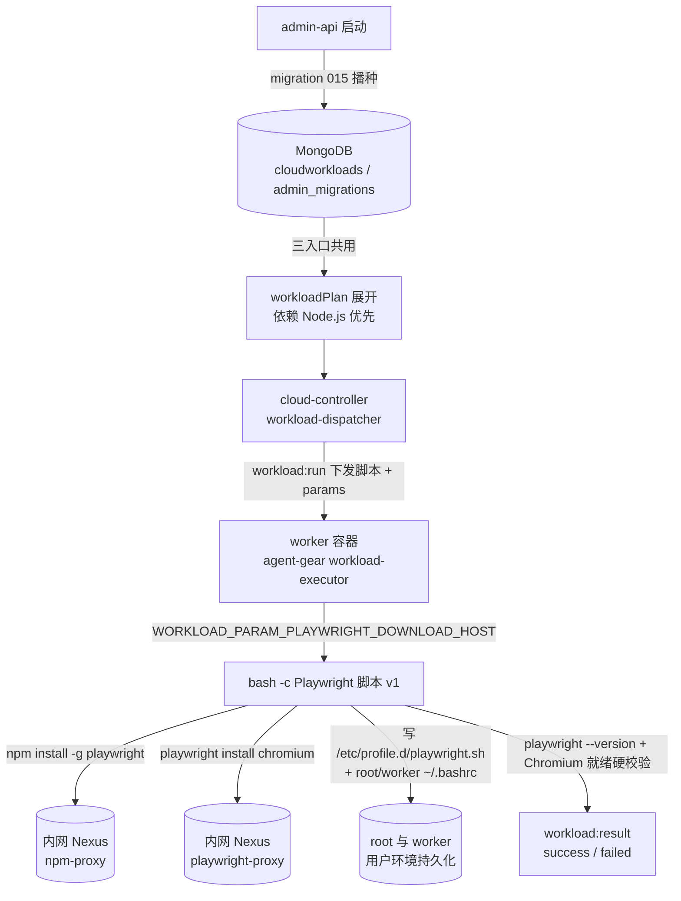
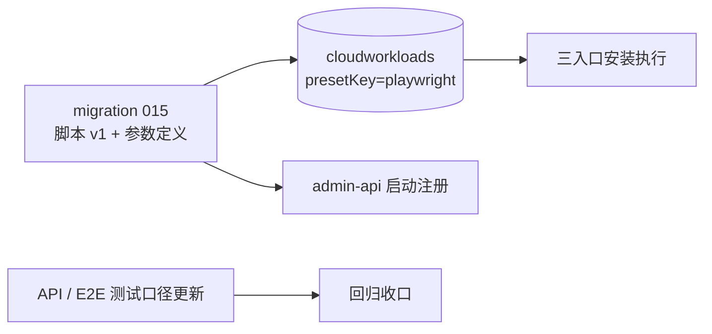
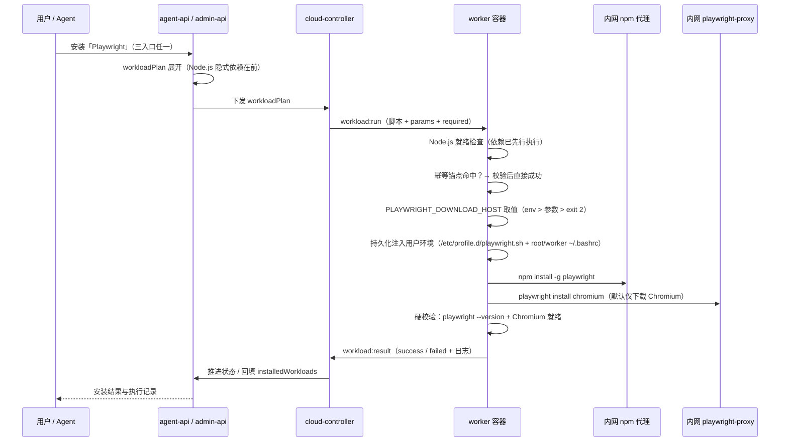

# 增加工作负载「Playwright」 - 技术提案

**功能名称**: 增加工作负载「Playwright」
**关联 PRD**: `docs/product/draft/20261028-playwright-workload.md`
**技术提案版本**: v1.1
**创建日期**: 2026-10-28
**作者**: ZeroAsh Agent
**feat-branch**: `feat/playwright-workload`

> v1.1 修订（2026-10-29，评审意见）：① 安装脚本将 `PLAYWRIGHT_DOWNLOAD_HOST` 持久化写入 root 与 worker 用户环境（`/etc/profile.d/playwright.sh` + 双用户 `~/.bashrc`）；② 默认只安装 Chromium（`playwright install chromium`），Firefox / WebKit 按需补装。

## 1. 概述

### 1.1 背景

需求来源：GitHub Issue #342「工作负载增加 playwright」，期望在云主机工作负载体系中新增「Playwright」工作负载，安装口径为两条命令：

```bash
npm install -g playwright
PLAYWRIGHT_DOWNLOAD_HOST=https://nexus.internal.fffdan.com/repository/playwright-proxy/ playwright install
```

即：经内网 npm 代理全局安装 `playwright` 包，并以内网 Nexus `playwright-proxy` 代理作为浏览器下载源执行 `playwright install`。Issue 原口径为下载全部内置浏览器（Chromium / Firefox / WebKit）；经评审（v1.1）调整为**默认仅下载 Chromium**、下载地址持久化注入用户环境，Firefox / WebKit 按需补装，详见 §6.1 决策 4/8。

平台工作负载体系已具备本需求所需的全部底座（见 [[20261017-feat-cloud-controller-workload]]、[[20261018-feat-workload-phase1]]）：

- 预制工作负载经 admin-api 一次性迁移播种进 `cloudworkloads`（`isPreset + presetKey`），启动挂载 / 拉起后安装 / MCP 安装三入口共用同一执行通道（`workload:run` / `workload:result`）；
- 参数经 `WORKLOAD_PARAM_<KEY_UPPER>` 注入脚本，依赖经 `dependsOnWorkloadIds` 自动展开；
- 「下载源参数化 + 内网代理」已有成熟先例：Docker CE apt 源参数（迁移 003）、Aspire CLI 下载地址参数（迁移 004）。

因此本期只需**新增一个预制工作负载**：以一条幂等初始化脚本承载 Issue 给出的安装口径，把浏览器下载地址做成参数（默认值 = 内网 `playwright-proxy`），并补齐测试口径。**无契约变更、无 worker 镜像变更**。

### 1.2 目标

- 新增「Playwright」预制工作负载（`presetKey='playwright'`）：安装后容器内 `playwright` 命令可用且 Chromium 浏览器就绪，可直接运行基于 Chromium 的 Playwright 测试；Firefox / WebKit 由用户/Agent 按需 `playwright install firefox|webkit` 补装。
- 浏览器下载地址参数化（`playwright_download_host`，默认 `https://nexus.internal.fffdan.com/repository/playwright-proxy/`），脚本内不写死来源地址；保留 `PLAYWRIGHT_DOWNLOAD_HOST` 环境变量覆盖能力。
- 安装时将解析后的 `PLAYWRIGHT_DOWNLOAD_HOST` 持久化注入 **root 与 worker 两个用户**的环境（写 `/etc/profile.d/playwright.sh` + 双用户 `~/.bashrc`），后续按需补装浏览器自动沿用内网代理。
- npm 包安装沿用 `NPM_REGISTRY` 约定（默认内网 npm 代理），默认配置下安装全程不触公网。
- 脚本幂等、结尾硬校验（安装返回 0 但实际不可用视为失败）；自动补齐「Node.js」依赖。
- 迁移只增不改：不覆盖管理员定制；升级后自动出现在工作负载列表（三入口一致）。

### 1.3 范围

**做**：

- `servers/admin-api/src/migrations/015-preset-playwright.ts`（含 `PLAYWRIGHT_SCRIPT_V1` 与 `playwright_download_host` 参数定义）及其单测；
- `servers/admin-api/src/index.ts` 注册 015 迁移；
- `tests/api/src/admin-api/cloud-workload.test.ts` 预制工作负载断言更新（八个 → 九个）与 Playwright 脚本内容回归断言；
- `tests/e2e/src/admin-cloud-workload.spec.ts` T-E16 预制徽标计数与名称断言更新。

**不做**：

- 不改 GraphQL 契约与 `contracts/cloud-controller-websocket.md`（`paramSchema` TEXT 类型与 §2.9 参数注入约定直接承载新参数）；
- 不改 worker 镜像（`deploy/images/worker/Dockerfile` / `entrypoint.sh`）——脚本是库内数据，无需重建镜像；不改版本门禁（`MIN_WORKER_VERSION` 现状已满足参数注入要求）；
- 不改任何既有预制工作负载（Docker / Node.js / .NET / Aspire / Github / Harness 系）；
- 不做浏览器子集选择参数、Playwright 版本固定参数（PRD §5.2 约束，后续按需扩展）；默认只装 Chromium 属脚本固定行为，非参数；
- 不改「必须」失败语义与依赖展开逻辑。

## 2. 技术架构

### 2.1 系统架构图



### 2.2 技术栈

| 层级 | 技术选型 | 说明 |
|------|---------|------|
| 工作负载脚本 | Bash | 经 `workload:run` 下发，`bash -c` 执行，`set -euo pipefail` |
| 参数注入 | agent-gear `WORKLOAD_PARAM_<KEY_UPPER>` | 契约 §2.9 参数注入约定，无需新增字段 |
| 一次性迁移 | admin-api migrations（`admin_migrations` 账本） | 新增 015 批次，沿用 runner 语义（随启动执行、失败不阻断） |
| 包/浏览器下载 | 内网 Nexus `npm-proxy` / `playwright-proxy` | 沿用 `NPM_REGISTRY` 约定与 004 下载源参数化模式 |
| 单元测试 | vitest + mock `CloudWorkload` | 沿用 004/007 迁移测试模式 |

### 2.3 模块划分



| 模块 | 职责 | 关键技术点 |
|------|------|-----------|
| `migrations/015-preset-playwright.ts` | 播种「Playwright」预制工作负载（脚本 + 参数 + 依赖） | presetKey/name 双路径防重、只增不改、幂等 |
| `PLAYWRIGHT_SCRIPT_V1` | 安装 playwright 包与 Chromium 并硬校验、持久化下载地址到用户环境 | 幂等锚点、下载地址三段取值优先级、`/etc/profile.d` + 双用户 `~/.bashrc` 注入、结尾硬校验 |
| `index.ts` 注册处 | 随启动执行迁移、失败不阻断 | `runMigrations([...])` 追加在既有批次之后 |
| `tests/api/.../cloud-workload.test.ts` | 预制项存在性与脚本内容回归 | 九个预制项、不写死地址、bash -n |
| `tests/e2e/.../admin-cloud-workload.spec.ts` | 预制徽标计数与名称清单 | T-E16 更新 |

## 3. API 设计

### 3.1 API 契约

**无契约变更**：

- GraphQL `CloudWorkload.paramSchema` 既有字段（`key/label/type/options/defaultValue`）直接承载 `playwright_download_host`（TEXT，`key` 满足 `^[a-z][a-z0-9_]{0,31}$`，值 ≤1024）；
- `contracts/cloud-controller-websocket.md` §2.9 `workload:run.items[].params` → `WORKLOAD_PARAM_<KEY_UPPER>` 注入约定直接支持（`playwright_download_host` → `WORKLOAD_PARAM_PLAYWRIGHT_DOWNLOAD_HOST`，TEXT 原样注入）；
- `POST /internal/containers`（启动挂载）与 `POST /internal/containers/:containerId/workloads`（拉起后安装）的 `workloadPlan` / 校验口径均不变；MCP `workload_list` / `workload_install` 因 `workloadKind='standard'` 自动纳入可见范围。

### 3.2 内部接口

- `migrations/runner.ts` 的 `Migration` 接口（`name` + `run`）不变；`servers/admin-api/src/index.ts` 的 `runMigrations([...])` 列表追加 `migration015PresetPlaywright`；
- 015 导出 `name`、`PLAYWRIGHT_PRESET_KEY`、`PLAYWRIGHT_PRESET_NAME`、`PLAYWRIGHT_SCRIPT_V1`、`PLAYWRIGHT_DOWNLOAD_HOST_PARAM`，供单测与后续迁移做「未定制」比对。

## 4. 数据模型

### 4.1 数据库设计

无 schema 变更，仅新增数据：

#### 集合: `cloudworkloads`（新增一条预制文档）

| 字段 | 值 | 说明 |
|------|------|------|
| name | `Playwright` | 唯一（1~64） |
| presetKey | `playwright` | 预制稳定标识，部分唯一索引 |
| isPreset | `true` | UI「预制」徽标 |
| workloadKind | `standard` | MCP `workload_list` 只列 standard，自动可见 |
| initScript | `PLAYWRIGHT_SCRIPT_V1` | ≤16 KiB，见 §5.2 实现点 2 |
| postScript | `null` | 无清理脚本 |
| paramSchema | `[{key: 'playwright_download_host', label: 'Playwright 浏览器下载地址', type: 'text', options: [], defaultValue: 'https://nexus.internal.fffdan.com/repository/playwright-proxy/'}]` | 默认值唯一来源 |
| dependsOnWorkloadIds | `[<Node.js 预制项 id>]` | 隐式依赖，展开顺序在前 |
| harnessType | `null` | 非 harness |

#### 集合: `admin_migrations`

新增账本记录 `{ name: '015-preset-playwright', executedAt }`，沿用「已执行跳过、失败下轮重试」语义。

### 4.2 缓存设计

无缓存变更。浏览器缓存落容器内默认位置（`PLAYWRIGHT_BROWSERS_PATH` 未设置时为 `$HOME/.cache/ms-playwright`），脚本不写死该路径、按环境变量取值。

## 5. 技术实现方案

### 5.1 核心流程



### 5.2 关键实现点

#### 实现点 1: 一次性迁移 `015-preset-playwright`

- **描述**: 播种「Playwright」预制工作负载，形态复刻 `001-preset-workloads.ts` 的 `PresetDefinition`（`presetKey/name/initScript/paramSchema/dependsOnNames`）。
- **技术细节**:
  - `export const name = '015-preset-playwright'`；编号 015 为当前主干下一个可用编号（014 为 `014-billing-owner-tenant`）。**若并行需求已占用 015，落地时以主干实际占用顺延编号**，迁移名与文件名同步调整。
  - 查重口径与 001 一致：先按 `presetKey='playwright'` 查，再按精确 `name='Playwright'` 防御性复查；命中即跳过（不覆盖管理员修改/删除，只 `console.warn`）；两者都不存在才 `CloudWorkload.create(...)`。
  - `dependsOnNames: ['Node.js']` 解析为 `dependsOnWorkloadIds`（同 001 的 `findExistingId` 语义）；展开后为隐式依赖（`implicit=true`、`required=false`），安装失败不阻断容器。
  - 导出 `PLAYWRIGHT_SCRIPT_V1` 与 `PLAYWRIGHT_DOWNLOAD_HOST_PARAM` 供单测断言与后续「未定制」刷新比对。
- **风险点**: 与并行的工作负载新增需求（如 MongoDB）撞迁移编号——用编号顺延规避，无逻辑冲突。

#### 实现点 2: `PLAYWRIGHT_SCRIPT_V1` 初始化脚本

- **描述**: 自包含幂等脚本，承载 Issue #342 的安装口径（`npm install -g playwright` + `PLAYWRIGHT_DOWNLOAD_HOST=... playwright install chromium`），并把下载地址持久化注入 root 与 worker 用户环境，结尾硬校验。
- **技术细节**（脚本全文）:

  ```bash
  #!/usr/bin/env bash
  set -euo pipefail

  # 工作负载以 worker 用户执行；写系统级/ root 级文件经 sudo（同 012 口径）
  SUDO=sudo; command -v sudo >/dev/null || SUDO=

  # Node.js 就绪检查（「Node.js」预制工作负载为隐式依赖，先行执行）
  command -v node >/dev/null 2>&1 || { echo "Node.js 未就绪，Playwright 无法初始化" >&2; exit 1; }
  command -v npm >/dev/null 2>&1 || { echo "npm 未就绪，Playwright 无法初始化" >&2; exit 1; }

  BROWSERS_CACHE="${PLAYWRIGHT_BROWSERS_PATH:-$HOME/.cache/ms-playwright}"

  # 已安装幂等分支：工具可用且浏览器已就绪则直接校验成功
  if command -v playwright >/dev/null 2>&1 && [ -d "$BROWSERS_CACHE" ] && [ -n "$(ls -A "$BROWSERS_CACHE" 2>/dev/null)" ]; then
    playwright --version
    exit 0
  fi

  # 浏览器下载地址取值优先级：显式环境变量 PLAYWRIGHT_DOWNLOAD_HOST（最高）
  # > 工作负载参数 WORKLOAD_PARAM_PLAYWRIGHT_DOWNLOAD_HOST > 空（需安装时快速失败）
  PLAYWRIGHT_DOWNLOAD_HOST="${PLAYWRIGHT_DOWNLOAD_HOST:-${WORKLOAD_PARAM_PLAYWRIGHT_DOWNLOAD_HOST:-}}"
  if [ -z "$PLAYWRIGHT_DOWNLOAD_HOST" ]; then
    echo "Playwright 浏览器下载地址未设置：请在「Playwright」工作负载参数中填写 playwright_download_host（形如 https://<nexus-host>/repository/playwright-proxy/）后重试" >&2
    exit 2
  fi

  # 持久化下载地址到用户环境：/etc/profile.d/playwright.sh（登录 shell 全局生效）
  # + root/worker 各自 ~/.bashrc（交互 shell 生效），后续按需补装浏览器自动沿用内网代理。
  # 采用幂等标记块（# >>> playwright download host >>>），重装/改地址时先清旧块再写新块。
  ENV_LINE="export PLAYWRIGHT_DOWNLOAD_HOST=\"$PLAYWRIGHT_DOWNLOAD_HOST\""
  printf '%s\n' "$ENV_LINE" | ${SUDO} tee /etc/profile.d/playwright.sh >/dev/null
  ${SUDO} chmod 644 /etc/profile.d/playwright.sh
  for RC in /root/.bashrc /home/worker/.bashrc; do
    if [ -f "$RC" ] || ${SUDO} test -f "$RC"; then
      ${SUDO} sed -i '/^# >>> playwright download host >>>$/,/^# <<< playwright download host <<<$/{ /^# >>> playwright download host >>>$/d; /^# <<< playwright download host <<<$/d; /export PLAYWRIGHT_DOWNLOAD_HOST=/d; }' "$RC" 2>/dev/null || true
      printf '\n# >>> playwright download host >>>\n%s\n# <<< playwright download host <<<\n' "$ENV_LINE" | ${SUDO} tee -a "$RC" >/dev/null
    fi
  done
  export PLAYWRIGHT_DOWNLOAD_HOST="$PLAYWRIGHT_DOWNLOAD_HOST"

  # npm 包来源沿用 NPM_REGISTRY 约定（内网 npm 代理）
  REGISTRY="${NPM_REGISTRY:-https://nexus.internal.fffdan.com/repository/npm-proxy/}"
  npm config set registry "$REGISTRY"
  npm install -g playwright

  # 默认仅安装 Chromium（控制体积与耗时）；Firefox/WebKit 按需 playwright install firefox|webkit 补装
  PLAYWRIGHT_DOWNLOAD_HOST="$PLAYWRIGHT_DOWNLOAD_HOST" playwright install chromium

  # 必须校验成功，避免“安装返回 0 但实际不可用”
  playwright --version
  ls "$BROWSERS_CACHE" 2>/dev/null | grep -q '^chromium-' || {
    echo "Playwright Chromium 未就绪：$BROWSERS_CACHE 下未找到 chromium-* 目录" >&2
    exit 1
  }
  ```

  - **幂等锚点**：`playwright` 命令可用 + 浏览器缓存非空 → `playwright --version` 校验后 `exit 0`；锚点判定在取值之前，已安装但地址为空时直接成功（同 004 口径）。
  - **脚本内不内置 `playwright_download_host` 具体地址**（默认值唯一来源是 `PLAYWRIGHT_DOWNLOAD_HOST_PARAM`，同 004 决策）；`NPM_REGISTRY` 保留默认值是沿用 `NODEJS_SCRIPT` 既有写法。
  - **下载地址持久化（评审意见）**：安装时把解析后的地址写入 `/etc/profile.d/playwright.sh`（对所有用户登录 shell 生效，覆盖 root 与 worker）并追加到 `/root/.bashrc`、`/home/worker/.bashrc`（交互 shell 生效）；采用标记块幂等重写，重装或管理员调整参数后旧地址被替换而非堆积。写 `/etc` 与 `/root` 文件经 `${SUDO}`（同 012 `withSudo` 口径），`sudo` 缺失时降级为直接写（脚本以 root 执行的场景）。
  - `playwright install` 固定带 `chromium` 参数：默认只下载 Chromium（评审意见：默认不装全量三件，控制体积与耗时）；Firefox / WebKit 由用户/Agent 事后按需补装，因下载地址已持久化，补装自动走内网代理、无需手工传 env。
  - 浏览器缓存路径不写死：`PLAYWRIGHT_BROWSERS_PATH` env > `$HOME/.cache/ms-playwright`；结尾硬校验按 `chromium-*` 目录存在性判定（默认口径下不再要求缓存含 Firefox/WebKit）。
- **风险点**:
  - Chromium 单件约百余 MB，经内网代理下载较快；300s 默认超时更宽裕。standard 工作负载 `required=false`，失败不注销容器，用户可重试或改走拉起后安装；运维可按环境上调该 env（见 §6.1 决策 6）。
  - 浏览器运行依赖系统库：一期按 Issue 口径仅 `playwright install`；实现期以「无头启动 Chromium 跑通一次冒烟」验证系统库是否就绪，若缺失则在同一脚本内补 `playwright install-deps`（apt 走内网源）并更新本提案（见 §6.1 决策 7）。
  - `/root/.bashrc` 或 `/home/worker/.bashrc` 不存在时跳过写该文件（`/etc/profile.d/playwright.sh` 仍保证登录 shell 生效）；`sed` 清块失败不阻断安装（`|| true`），最坏情形为重复追加同值 export，不改变语义。

#### 实现点 3: 注册与测试口径更新

- **描述**: `index.ts` 的 `runMigrations([...])` 追加 015；API/E2E 测试的预制项计数与内容断言更新。
- **技术细节**:
  - `tests/api/src/admin-api/cloud-workload.test.ts`：`T-IA: exposes the eight preset workloads...` 更新为九个并补 `Playwright`（含「同名预制项只应存在一个」「重复查询 ID 集合稳定」既有不变量）；新增脚本内容断言（含 `WORKLOAD_PARAM_PLAYWRIGHT_DOWNLOAD_HOST` 取值、`npm install -g playwright`、`playwright install chromium`、`/etc/profile.d/playwright.sh` 与 `/root/.bashrc`/`/home/worker/.bashrc` 持久化写入、结尾 `playwright --version` 硬校验、不含硬编码下载地址）。
  - `tests/e2e/src/admin-cloud-workload.spec.ts` T-E16：「预制」徽章计数 8 → 9、名称清单补 `Playwright`。
- **风险点**: 无。

## 6. 技术决策

### 6.1 决策列表

| 决策 | 选项 A | 选项 B | 最终选择 | 原因 |
|------|--------|--------|---------|------|
| 浏览器下载地址 | 脚本写死（Issue 原文地址） | 参数默认值 + env 覆盖 | B | 遵循 003/004 既定口径：默认地址只放参数定义、可见可按次调整；脚本内不内置来源地址 |
| Node.js 来源 | 脚本自带 Node 安装 | 依赖「Node.js」预制工作负载 | B | 复用既有能力，`dependsOnNames` 自动展开，避免两套 Node 安装逻辑互相踩踏 |
| 工作负载类型 | harness | standard | standard | Playwright 是运行环境工具而非 Harness；standard 才会出现在 MCP `workload_list` 与三入口安装 |
| 浏览器范围 | `browsers` 多选参数 | 固定 `playwright install chromium` 默认仅 Chromium | B | 评审意见：默认不预装全量三件、控制体积与耗时；Firefox/WebKit 按需补装；子集选择留待后续按需扩展（PRD §5.2） |
| Playwright 版本 | 版本固定参数 | 跟随 npm 上游最新 | B | Issue 口径为 `npm install -g playwright` 不锁版本；后续需要复现性时再加 `playwright_version` 参数 |
| 单条超时 | 调大 `WORKLOAD_INIT_TIMEOUT_MS` 默认值 | 保持 300s 默认 | B | 不改全局默认；浏览器下载经内网代理较快，且 `required=false` 失败可重试，运维可按环境上调 |
| 系统依赖 | 一期就带 `playwright install-deps` | 按 Issue 口径仅 `playwright install`，实现期实测裁决 | B | 遵守 Issue 最小口径；以浏览器冒烟实测为准，缺失再补装并在实现 PR 中更新提案 |
| 下载地址持久化（评审修订） | 仅安装进程内 env 生效 | 写入 `/etc/profile.d/playwright.sh` + root/worker `~/.bashrc` | B | 评审意见：`PLAYWRIGHT_DOWNLOAD_HOST` 须注入 root 与 worker 用户环境，后续补装浏览器自动沿用内网代理 |

### 6.2 依赖与约束

| 类型 | 内容 | 说明 |
|------|------|------|
| 依赖 | 工作负载体系（迁移 runner、`workload:run` 通道、参数注入、依赖展开） | 已上线，零改动复用 |
| 依赖 | 内网 Nexus `npm-proxy` / `playwright-proxy` | npm 包与浏览器下载来源；`playwright-proxy` 由运维维护（Issue 指定地址，实施前确认可达） |
| 约束 | 迁移只增不改 | 不覆盖管理员定制/删除，同 001/004 口径 |
| 约束 | 无契约/镜像/门禁变更 | 脚本是库内数据；参数注入能力 `MIN_WORKER_VERSION≥2.3.0` 早已满足 |
| 约束 | 迁移编号与并行需求协调 | 015 被占用则顺延（§5.2 实现点 1） |

## 7. 项目结构

```
servers/admin-api/src/
├── index.ts                                  # runMigrations 追加 015
└── migrations/
    ├── 015-preset-playwright.ts              # 新增：预制工作负载播种
    └── 015-preset-playwright.test.ts         # 新增：迁移单测
tests/
├── api/src/admin-api/cloud-workload.test.ts  # 更新：九个预制项 + Playwright 脚本断言
└── e2e/src/admin-cloud-workload.spec.ts      # 更新：T-E16 计数 8→9 + 名称清单
```

## 8. 测试策略

### 8.1 测试覆盖要求

- 015 迁移单测覆盖全部分支（创建/跳过/防御路径），先行红-绿-重构（TDD）；
- API 测试覆盖预制项存在性、幂等与脚本内容不变量；
- E2E 覆盖 UI 预制徽标与名称清单。

### 8.2 测试类型

| 类型 | 工具 | 覆盖范围 |
|------|------|---------|
| 单元（迁移） | vitest | T-MIG-PW1 播种字段全量断言（presetKey/isPreset/standard/参数默认值/依赖 Node.js）；T-MIG-PW2 已存在（presetKey 命中）跳过不覆盖；T-MIG-PW3 仅 name 命中告警跳过；T-MIG-PW4 幂等重跑不重复写入 |
| 单元（脚本不变量） | vitest + bash -n | T-MIG-PW5 `PLAYWRIGHT_SCRIPT_V1` 语法通过 `bash -n`；含 `npm install -g playwright`、`playwright install chromium`、`WORKLOAD_PARAM_PLAYWRIGHT_DOWNLOAD_HOST` 三段取值、`/etc/profile.d/playwright.sh` 与 root/worker `~/.bashrc` 持久化写入、结尾 `playwright --version` 硬校验与 `chromium-*` 就绪检查；不含硬编码 `playwright-proxy` 地址 |
| API 集成 | vitest（Aspire 编排） | `tests/api/src/admin-api/cloud-workload.test.ts`：九个预制项存在且 ID 稳定（幂等）、Playwright 参数/依赖/脚本内容回归（T-IA 系列更新） |
| E2E | Playwright（Aspire 编排） | `tests/e2e/src/admin-cloud-workload.spec.ts` T-E16：预制徽标计数 9、名称清单含 Playwright |

> 测试运行遵循 `tests/api` / `tests/e2e` 的 AGENTS.md：只用 Aspire 编排、禁止裸 docker；重跑从 `aspire start` 重来。

## 9. 验收标准

- [ ] 技术方案评审通过
- [ ] 无契约变更评审确认（paramSchema / §2.9 注入约定承载）
- [ ] 迁移 015 播种成功：列表出现「Playwright」预制项（只增不改、幂等）
- [ ] 安装后 `playwright --version` 可用且 Chromium 就绪，可直接运行基于 Chromium 的 Playwright 测试
- [ ] 安装后 root 与 worker 用户环境均可读到 `PLAYWRIGHT_DOWNLOAD_HOST`；两用户补装 Firefox/WebKit 自动走内网代理
- [ ] 默认配置安装全程走内网代理（npm-proxy + playwright-proxy），不触公网
- [ ] `playwright_download_host` 参数可见可调；缺失时快速失败且指引含地址形态
- [ ] 重复安装幂等；工具/Chromium 任一缺失时整体判失败且原因可读
- [ ] 单元测试覆盖达标（T-MIG-PW1~PW5）、API 测试通过（九个预制项口径）、E2E 通过（T-E16）

## 10. 相关文档

- 关联 PRD：`docs/product/draft/20261028-playwright-workload.md`（Issue #342）
- [[20261018-feat-workload-phase1]] — 工作负载一期（参数、依赖与预制工作负载）
- [[20261019-feat-aspire-workload-proxy]] — Aspire 工作负载下载代理（下载源参数化模式先例）
- [[20261018-fix-docker-ce-apt-source]] — Docker CE 软件源地址补齐（下载源参数化模式先例）
- [[20261021-feat-github-workload]] — Github 工作负载与云主机 Git 项目设置
- [[20261025-feat-cloud-host-keepalive]] — 云电脑保活与 worker 用户（预置脚本执行环境）
- 契约：`contracts/admin-cloud-workload.graphql`、`contracts/cloud-controller-websocket.md`（§2.9 参数注入约定）
- 开发规范：`docs/engineering/common-rules.md`、`servers/admin-api` 迁移约定（`migrations/runner.ts`）
