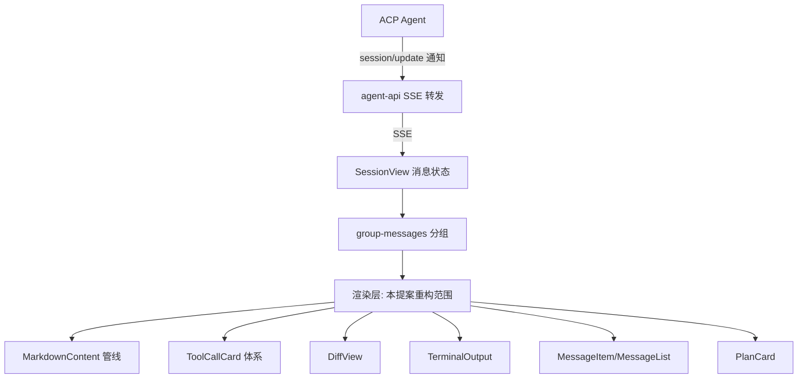
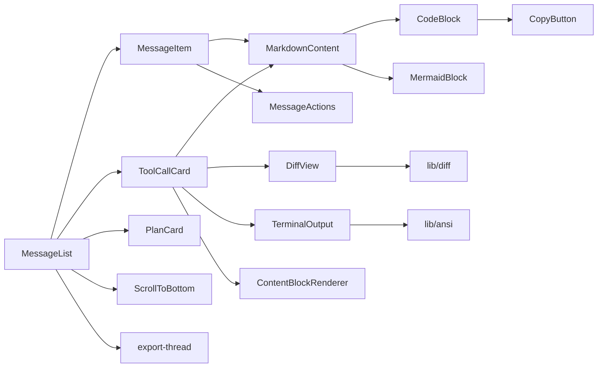
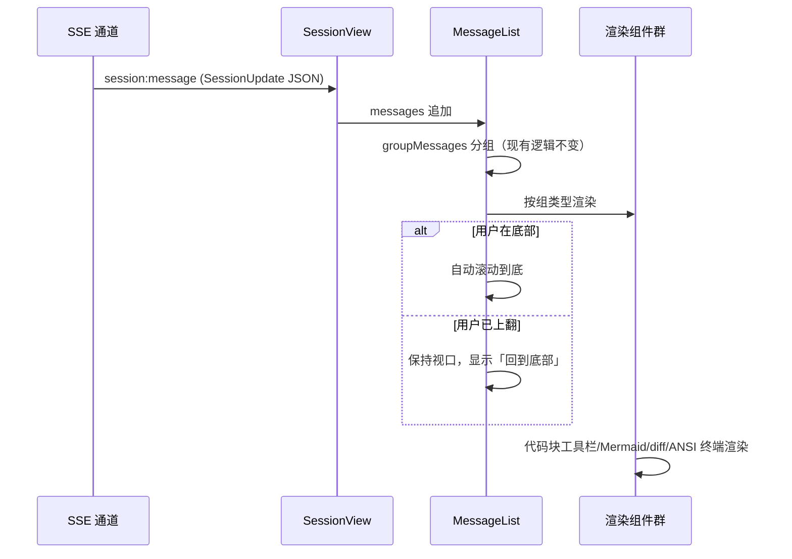

# 重构对话渲染 - 技术提案

**功能名称**: 对话渲染能力重构
**关联 PRD**: [docs/product/draft/20261028-conversation-rendering.md](../../product/draft/20261028-conversation-rendering.md)
**技术提案版本**: v1.0
**创建日期**: 2026-10-28
**作者**: z-agent-gear 工作流
**feat-branch**: `prd/conversation-rendering`（需求总分支；实现分支 `feat/conversation-rendering-impl`，参考 [[../git.md]] 与仓库 `prd/<slug>` + `feat/<slug>-impl` 惯例）

## 1. 概述

### 1.1 背景

GitHub Issue [Deliay/z-agent-gear#332](https://github.com/Deliay/z-agent-gear/issues/332) 要求参考 [zed](https://github.com/zed-industries/zed) 补齐对话渲染能力缺失。经对 zed 仓库 `crates/acp_thread`（ACP 数据处理）与 `crates/agent_ui/src/conversation_view`（渲染层）的调研，zed 的关键做法：

- **统一条目模型**：`AgentThreadEntry` 将用户消息、助手消息（消息/思考 chunk 按 messageId 合并）、工具调用、计划等统一为条目流。
- **Markdown 渲染**（`render_agent_markdown`）：代码块带语言标识 + 悬停复制按钮 + 悬停换行按钮 + 横向滚动；```mermaid 块渲染为可缩放图形（可切回源码）；行内代码跨度（如 `src/main.rs:42`）解析为可点击文件链接；链接点击统一处理。
- **工具调用渲染**：按 `ToolKind` 映射图标（read/edit/delete/move/search/execute/think/fetch/switch_mode）；状态体系覆盖 pending/waiting_for_confirmation/in_progress/completed/failed/rejected/canceled；`rawInput` 以 markdown 形式可折叠查看（"View Raw Input"）；`ToolCallContent` 按 content/diff/terminal 分类型渲染；diff 按文件 + hunk 分组并带语法高亮。
- **终端渲染**：真实终端视图，保留 ANSI 颜色。
- **消息操作**：右键菜单 Copy / Copy as Markdown / Copy This Agent Response / Open Thread as Markdown。
- **计划渲染**：完成项删除线 + 完成计数汇总。
- **滚动**：列表跟随底部，用户上翻时暂停跟随。

当前实现（`apps/agent-web/src/components/session/`）的差距：

| 领域 | 现状 | 差距 |
|------|------|------|
| 代码块 | Prism 高亮，无操作按钮 | 无复制/换行/语言标签 |
| Mermaid | 普通代码块 | 不渲染图形 |
| 差异 | `DiffView` 逐行对比（非 diff 算法，插入/删除即错位） | 无真实 diff、无行号、无语法高亮 |
| 终端 | `TerminalOutput` 剥离 ANSI 后统一绿色 | 颜色/粗体丢失 |
| 工具调用 | 文字 label，仅部分 kind 有专门渲染，无 rawInput 查看 | 无图标体系、状态不全、原始数据不可见 |
| ContentBlock | 仅 text（image 走 MessageItem 特例） | image/audio/resource_link/resource 未覆盖 |
| 消息操作 | 无 | 无复制/导出 |
| 滚动 | 新消息强制 scrollToBottom | 上翻阅读被打断，无回到底部按钮 |
| 计划 | 图标 + 计数 | 无完成删除线 |

### 1.2 目标

1. 渲染层能力对齐 zed ACP 渲染：Markdown 增强（代码块工具栏、Mermaid）、真实差异渲染、ANSI 终端渲染、工具调用图标与状态体系、ContentBlock 全类型、消息复制与导出、滚动导航、计划展示增强。
2. 纯前端重构，不改动 ACP 协议交互、消息存储结构与后端契约。
3. 全部新能力有单元测试覆盖，关键路径有 E2E 覆盖。

### 1.3 范围

**做**（apps/agent-web 会话对话渲染层）：

- Markdown 渲染管线重构（代码块工具栏、Mermaid 懒加载渲染、行内代码跨度样式）
- `DiffView` 重构为真实 diff 渲染
- `TerminalOutput` 重构为 ANSI 颜色渲染
- `ToolCallCard` 与工具调用体系增强（图标、状态、rawInput/rawOutput 折叠、ContentBlock 全类型）
- `MessageItem` 消息操作（复制 Markdown / 复制纯文本）
- 对话导出为 Markdown 文件
- `MessageList` 滚动导航（跟随暂停/恢复 + 回到底部按钮）
- `PlanCard` 展示增强（删除线、计数口径）

**不做**：

- 检查点恢复、消息编辑重发、消息排队、回复评分（依赖协议/后端能力）
- 行内代码跨度的「点击打开文件」（Web 端无编辑器可跳转，本期仅做样式识别，不绑跳转）
- ACP SDK 升级与协议字段变更
- 后端、契约、存储的任何改动

## 2. 技术架构

### 2.1 系统架构图

本次改动完全位于 `agent-web` 前端渲染层，数据流不变：



### 2.2 技术栈

| 层级 | 技术选型 | 说明 |
|------|---------|------|
| 前端框架 | React 19 + TypeScript (strict) | 现有 |
| 构建 | Vite | 现有；Mermaid 走动态 import 分包 |
| 样式 | Tailwind CSS v4 | 现有 |
| Markdown | react-markdown + remark-gfm | 现有，继续沿用 |
| 语法高亮 | react-syntax-highlighter (Prism) | 现有，继续沿用 |
| 差异算法 | jsdiff（`diff` 包） | 新增依赖 |
| ANSI 渲染 | ansi-to-html | 新增依赖 |
| 图形渲染 | mermaid | 新增依赖，动态导入懒加载 |
| 测试 | Vitest + React Testing Library | 现有 |

### 2.3 模块划分



| 模块 | 职责 | 关键技术点 |
|------|------|-----------|
| `components/session/markdown/CodeBlock.tsx` | 代码块容器：语言标签 + 复制 + 换行切换 + 横向滚动 | navigator.clipboard、hover 显示 |
| `components/session/markdown/MermaidBlock.tsx` | ```mermaid 块渲染 | `import('mermaid')` 懒加载、失败回退、主题跟随 |
| `components/session/MarkdownContent.tsx` | 重构：接线 CodeBlock/MermaidBlock | react-markdown components 覆写 |
| `lib/diff.ts` | 行级 diff 计算 | jsdiff `diffLines`，输出 same/added/removed 行序列与行号 |
| `components/session/DiffView.tsx` | 真实 diff 渲染 | 双列行号、语义色、逐行 Prism 高亮 |
| `lib/ansi.ts` | ANSI → 安全 HTML | ansi-to-html（escapeXML），过滤光标控制序列 |
| `components/session/TerminalOutput.tsx` | 终端输出渲染 | dangerouslySetInnerHTML + 已转义 HTML |
| `components/session/tool-call-icons.ts` | ToolKind → lucide 图标映射 | 语义化 |
| `components/session/ContentBlockRenderer.tsx` | ToolCallContent/ContentBlock 全类型渲染 | text/image/audio/resource_link/resource |
| `components/session/MessageActions.tsx` | 消息悬停操作 | 复制 Markdown / 复制纯文本 |
| `lib/export-thread.ts` | 对话导出 Markdown | 纯前端生成 Blob 下载 |
| `components/session/ScrollToBottomButton.tsx` | 回到底部浮动按钮 | 底部锚点可见性检测 |
| `components/session/MessageList.tsx` | 跟随暂停/恢复逻辑改造 | 不卸载、不阻断流式 |

## 3. API 设计

### 3.1 API 契约

**无新增或变更契约**。本提案为纯前端渲染重构，数据来源仍为现有 `GET_SESSION_MESSAGES` 分页查询与 SSE `session:message` 推送，消息体为 ACP `SessionUpdate` JSON，字段口径不变。

### 3.2 内部接口

纯前端模块间接口（TypeScript 类型）：

```ts
// lib/diff.ts
export interface DiffLine {
  type: 'same' | 'added' | 'removed';
  text: string;
  oldLineNumber?: number;  // removed/same 有
  newLineNumber?: number;  // added/same 有
}
export function computeDiff(oldText: string, newText: string): DiffLine[];

// lib/ansi.ts
export function ansiToHtml(raw: string): string; // 返回已转义的安全 HTML

// lib/export-thread.ts
export interface ExportMessage { direction: string; content: string | Record<string, unknown>; createdAt: string; }
export function threadToMarkdown(messages: ExportMessage[]): string;
export function downloadThreadMarkdown(filename: string, markdown: string): void;
```

## 4. 数据模型

### 4.1 数据库设计

无变更。

### 4.2 缓存设计

无新增缓存。Mermaid 渲染结果按「源码 hash + 主题」做组件内 memo，避免流式追加时整页重算；diff 计算结果按 oldText/newText 引用 memo。

## 5. 技术实现方案

### 5.1 核心流程



### 5.2 关键实现点

#### 实现点 1: Markdown 代码块工具栏（CodeBlock）

- **描述**: `MarkdownContent` 的 `components.pre` 覆写中识别围栏代码块（含 mermaid 分流），渲染 `CodeBlock`：顶栏左侧语言标签（无语言显示 `text`），右侧 hover 显示「复制」「换行」图标按钮；主体为 Prism 高亮内容，默认 `overflow-x-auto`，换行态切 `whitespace-pre-wrap break-all`。
- **技术细节**:
  - react-markdown 的 `pre`/`code` 组合覆写：从 `code` 的 `className` 提取 `language-(\w+)`，将高亮渲染下沉到 `CodeBlock`，`pre` 仅作透明容器，避免嵌套滚动。
  - 复制：`navigator.clipboard.writeText`，成功 toast「已复制」（sonner，现有）；`clipboard` 不可用或 reject 时 toast「复制失败」。
  - 换行状态：`useState` 于 CodeBlock 实例，仅影响当前块。
  - 窄面板遵循 frontend-rules 三件套：工具栏 `shrink-0`、内容 `min-w-0`、换行态 `break-all`。
- **风险点**: `react-syntax-highlighter` 的 Prism 包体积大——维持现有全量引入方式不变（本提案不做包体积治理）。

#### 实现点 2: Mermaid 图形渲染（MermaidBlock）

- **描述**: `language-mermaid` 代码块分流到 `MermaidBlock`：动态 `import('mermaid')` 初始化（`startOnLoad: false`，主题随 dark/light），`mermaid.render` 生成 SVG 注入；工具栏提供「缩放 +/−/重置」与「查看源码/查看图形」切换；渲染异常回退 `CodeBlock`。
- **技术细节**:
  - 懒加载：`const mermaid = await import('mermaid')`，Vite 自动分包；加载中显示骨架。
  - 主题：`document.documentElement.classList` 的 dark 判定（与现有 ThemeToggle 一致），`mermaid.initialize({ theme: 'dark' | 'default' })`，主题切换时触发重渲染（key 含主题）。
  - 缩放：CSS transform scale + 平移容器，步进 0.25，范围 0.5–3。
  - 错误兜底：`mermaid.render` reject / parse 错误时渲染原代码块，不抛错阻断列表。
  - XSS：SVG 注入前经 `mermaid` 自带安全输出（`securityLevel: 'strict'`）。
- **风险点**: mermaid 包体积（gzip ~500KB+）——通过动态导入隔离，仅会话页出现 mermaid 块时才加载；移动端首次渲染大图形有耗时，加载态兜底。

#### 实现点 3: 真实差异渲染（lib/diff + DiffView 重构）

- **描述**: 以 jsdiff `diffLines` 替换现有逐行对比：`computeDiff(oldText, newText)` 输出带新旧行号的 `DiffLine[]`；`DiffView` 渲染双行号列（旧/新）、`−`/`+` 标记、语义色（added=success、removed=destructive），added/same 行内容经 Prism 按语言高亮；保留文件头（路径 + 「新建文件」徽标）与最大高度滚动。
- **技术细节**:
  - `diffLines(oldText, newText)` 返回 `{added, removed, value, count}` 块序列，展开为行并维护 oldLine/newLine 计数器生成行号。
  - 语言推断：从 `filePath` 扩展名映射 Prism 语言（`lib/language-from-path.ts`，覆盖 ts/tsx/js/jsx/py/rs/go/java/css/json/md/yaml 等常见扩展名，未知回退纯文本）。
  - 高亮叠加：对 added/same 行调 `Prism.tokenize` 生成 token  span；removed 行纯文本（删除内容无需高亮，降低计算量）。
  - 性能：diff 结果与 tokenize 结果按输入引用 `useMemo`；超过 2000 行的 diff 截断展示并提示「差异过长，仅展示前 2000 行」。
- **风险点**: 现有 `DiffView.test.tsx` 断言旧行对比行为——按 TDD 先改测试（红），再替换实现（绿），再清理（重构）。

#### 实现点 4: 终端 ANSI 颜色渲染（lib/ansi + TerminalOutput 重构）

- **描述**: `TerminalOutput` 由「剥离 ANSI + 统一绿色」改为「解析 ANSI 颜色/粗体 → 安全 HTML 渲染」；光标移动、清屏等非展示控制序列继续过滤。
- **技术细节**:
  - `ansi-to-html`（`escapeXML: true`）转义后输出 `<span style="color:...">` HTML，经 `dangerouslySetInnerHTML` 注入；注入内容已由库转义，不引入 XSS 面。
  - 预处理保留现有 `\r\n`→`\n` 归一与 OSC/光标序列剥离正则。
  - 配色映射到主题：ansi-to-html 默认色板在深色容器上可读；容器维持深色底（`bg-gray-950`），浅色主题下终端区仍深色（终端语义如此）。
  - 保持 `maxHeight` 滚动与空行 `&nbsp;` 行为。
- **风险点**: ansi-to-html 多年未大版本更新但稳定（广泛应用）；若评估后不引入依赖，备选为自研 SGR 颜色子集解析（约 100 行）——决策见 §6.1。

#### 实现点 5: 工具调用卡片体系增强

- **描述**:
  - 图标体系：`tool-call-icons.ts` 映射 `ToolKind` → lucide 图标（read=FileSearch、edit=FilePen、delete=Trash2、move=ArrowRightLeft、search=Search、execute=TerminalSquare、think=Brain、fetch=Globe、switch_mode=ArrowRightLeft、other=Hammer），卡片标题前置图标。
  - 状态体系：保留 AcpCard 的 active/completed/failed 语义色，新增 `pending`（pending 状态，弱化样式）与「等待确认」提示位（ACP v1 状态仅 4 种，waiting_for_confirmation 由 PermissionDialog 流程承载，卡片层仅预留映射）。
  - 原始输入/输出：卡片底部「查看原始输入」折叠区（默认折叠），内容为 `rawInput` 的 JSON 美化代码块（复用 CodeBlock，language=json）；`rawOutput` 同理。zed 的 "View Raw Input" 同款交互。
  - ContentBlock 全类型：`ContentBlockRenderer` 处理 `content` 项——text（MarkdownContent）、image（`` 限高）、audio（`<audio controls>`）、resource_link（链接卡片，点击新窗口打开）、resource（嵌入资源：text 资源渲染 markdown，blob 资源展示 uri 占位）；`diff` 项走新 DiffView；`terminal` 项走 TerminalOutput。
- **技术细节**:
  - 现有 kind 特化渲染（edit/execute/delete/move/search/think/read/fetch/sub_agent）保留，仅补齐：title 前图标、rawInput 折叠区、content 全类型。
  - `group-messages.ts` 分组逻辑不变。
- **风险点**: rawInput 可能很大——JSON 美化后超 500 行截断并提示。

#### 实现点 6: 消息操作与对话导出

- **描述**: `MessageItem`（agent 消息）hover 显示操作条：「复制 Markdown」（原始 text）、「复制纯文本」（渲染后 innerText 口径）；`SessionHeader` 或消息列表工具区新增「导出对话为 Markdown」：遍历消息生成结构化 Markdown（用户/助手/思考/工具调用/计划分节，附时间戳），Blob 下载为 `session-{id}-{date}.md`。
- **技术细节**:
  - 复制纯文本：对渲染 DOM 取 `innerText`（保持块级换行），非 markdown 源码。
  - 导出格式参考 zed `to_markdown`：用户消息 `## User`、助手 `## Assistant`、思考包 `<thinking>` 注释块、工具调用 `### Tool: {title}` + 状态 + 代码块化输入输出。
  - 导出在客户端完成，无后端交互；失败 toast。
- **风险点**: 长对话导出字符串构建为 O(n)，千级消息无压力；图片消息导出为占位说明（不内嵌 base64）。

#### 实现点 7: 滚动导航（MessageList 改造 + ScrollToBottomButton）

- **描述**: 跟随策略由「消息数变化即 scrollToBottom」改为「仅当视口位于底部锚点附近时跟随」；上翻超过阈值暂停跟随并显示右下角浮动按钮（带「新消息」圆点提示）；点击平滑回底并恢复跟随。
- **技术细节**:
  - 以 `IntersectionObserver` 观测底部锚点 `messagesEndRef` 可见性作为「在底部」判定（阈值 0.9），替代 scrollTop 估算。
  - 保留：初始加载滚到底、prepend 历史时滚动位置恢复（现有 scrollStateRef 机制不动）。
  - 按钮：fixed 于列表容器右下，不在底部时出现，带未读提示（暂停跟随期间有新消息即显示圆点）。
  - 移动端同交互。
- **风险点**: 现有 `MessageList.test.tsx` 覆盖自动滚动断言——按 TDD 先更新测试。

#### 实现点 8: PlanCard 展示增强

- **描述**: 完成条目内容加删除线（`line-through text-muted-foreground`）；摘要口径对齐 zed `plan_summary_label`：全部完成显示「全部完成」，部分完成显示「x/y」，未开始显示「N 项任务」。
- **技术细节**: 纯展示层改动，`PlanCard` 内部调整；`PlanFloatingCard` 同步摘要口径。
- **风险点**: 无。

## 6. 技术决策

### 6.1 决策列表

| 决策 | 选项 A | 选项 B | 最终选择 | 原因 |
|------|--------|--------|---------|------|
| diff 算法 | jsdiff `diffLines` | 自研 Myers | A | 成熟稳定（周下载千万级）、API 简单、MIT；自研易出边界 bug |
| ANSI 渲染 | ansi-to-html | xterm.js | A | 静态输出渲染无需终端模拟器；xterm.js 体积与复杂度为交互终端设计 |
| ANSI 渲染备选 | 引入 ansi-to-html 依赖 | 自研 SGR 颜色子集 | A | 库输出已转义、色板完整；自研仅作依赖评估不通过时的备选 |
| Mermaid | mermaid 动态导入 | 不渲染/外链图片 | A | zed 同款体验；动态导入隔离体积 |
| 语法高亮 | 维持 react-syntax-highlighter(Prism) | 迁移 shiki | A | 已有依赖与主题，迁移成本与收益不匹配 |
| diff 行高亮 | added/same 行 Prism tokenize | 不高亮仅色块 | A | 与 zed diff 高亮体验对齐；removed 行不高亮控制成本 |
| 消息复制入口 | hover 操作条 | 右键菜单 | A | Web 习惯 + 移动端可达；右键菜单移动端无入口 |
| 导出对话 | 前端生成 Blob 下载 | 后端生成文件 | A | 数据全部在前端，无需后端介入 |

### 6.2 依赖与约束

| 类型 | 内容 | 说明 |
|------|------|------|
| 依赖 | `diff`（jsdiff）、`ansi-to-html`、`mermaid` | 均为 agent-web 运行时依赖，mermaid 动态导入 |
| 依赖 | 现有 `@agentclientprotocol/sdk` SessionUpdate 数据 | 字段口径不变 |
| 约束 | 不改后端与契约 | 纯前端重构 |
| 约束 | frontend-rules.md 溢出三件套、Apollo 轮询陷阱 | 所有新组件遵循 |
| 约束 | 移动端布局不横向溢出 | E2E 断言 `scrollWidth - clientWidth ≤ 1` |

## 7. 项目结构

```
apps/agent-web/src/
├── components/session/
│   ├── MarkdownContent.tsx          # 重构：接线 CodeBlock/MermaidBlock
│   ├── markdown/
│   │   ├── CodeBlock.tsx            # 新增：代码块工具栏
│   │   ├── MermaidBlock.tsx         # 新增：Mermaid 图形
│   │   └── __tests__/
│   ├── DiffView.tsx                 # 重构：真实 diff + 行号 + 高亮
│   ├── TerminalOutput.tsx           # 重构：ANSI 颜色渲染
│   ├── ToolCallCard.tsx             # 增强：图标 + rawInput/rawOutput 折叠 + content 全类型
│   ├── tool-call-icons.ts           # 新增：ToolKind → 图标映射
│   ├── ContentBlockRenderer.tsx     # 新增：ContentBlock 全类型渲染
│   ├── MessageItem.tsx              # 增强：hover 操作条
│   ├── MessageActions.tsx           # 新增：复制 Markdown/纯文本
│   ├── MessageList.tsx              # 增强：跟随暂停/恢复
│   ├── ScrollToBottomButton.tsx     # 新增：回到底部按钮
│   ├── PlanCard.tsx                 # 增强：删除线 + 摘要口径
│   └── __tests__/                   # 新增/更新对应测试
├── lib/
│   ├── diff.ts                      # 新增：computeDiff
│   ├── ansi.ts                      # 新增：ansiToHtml
│   ├── language-from-path.ts        # 新增：扩展名 → Prism 语言
│   ├── export-thread.ts             # 新增：对话导出 Markdown
│   └── __tests__/
└── pages/SessionPage.tsx            # 增强：导出入口挂载
```

## 8. 测试策略

### 8.1 测试覆盖要求

- 新增 lib 纯函数（diff/ansi/export-thread/language-from-path）单元测试覆盖率 100%（分支全覆盖）。
- 新增组件（CodeBlock/MermaidBlock/ContentBlockRenderer/MessageActions/ScrollToBottomButton）RTL 渲染与交互测试。
- 重构组件（DiffView/TerminalOutput/MessageList/MessageItem/ToolCallCard/PlanCard）先红后绿：更新既有测试至新行为，再实现。

### 8.2 测试类型

| 类型 | 工具 | 覆盖范围 |
|------|------|---------|
| 单元测试 | Vitest | lib 纯函数：diff 对齐（插入/删除/修改/空输入/大文件截断）、ANSI 转 HTML（颜色/粗体/控制序列过滤/XSS 转义）、导出 markdown 结构、扩展名映射 |
| 组件测试 | Vitest + RTL | CodeBlock 复制/换行/语言标签；MermaidBlock 渲染/失败回退/主题；ToolCallCard 图标/rawInput 折叠/content 类型；MessageActions 复制交互；MessageList 跟随暂停/恢复与回底按钮；PlanCard 删除线与摘要 |
| E2E | tests/e2e（z-test） | 会话页端到端：代码块复制按钮出现且可点、mermaid 块渲染出 SVG、diff 展示行号、上翻后新消息不打断、回到底部按钮出现/消失、窄视口无横向溢出 |

## 9. 部署方案

### 9.1 环境规划

| 环境 | 用途 | 部署方式 |
|------|------|---------|
| 本地 | 开发调试 | `aspire start` 编排（现有） |
| 主干 | 合并即发布 | 现有流水线，无新增配置 |

### 9.2 配置管理

无新增配置项。新增依赖经 `apps/agent-web/package.json` 引入；mermaid 分包由 Vite 动态导入自动生成，无需手工配置。

## 10. 验收标准

- [ ] 技术方案评审通过
- [ ] 契约评审确认无变更（纯前端）
- [ ] 代码实现完成（8 个实现点）
- [ ] lib 纯函数单元测试覆盖达标
- [ ] 组件测试通过（含重构组件先红后绿记录）
- [ ] E2E 测试通过
- [ ] PRD 功能点验收标准逐项核对通过

## 11. 相关文档

- 关联 PRD：[[../../product/draft/20261028-conversation-rendering.md]]
- 需求来源：[GitHub Issue #332](https://github.com/Deliay/z-agent-gear/issues/332)
- 参考实现：[zed acp_thread 数据处理](https://github.com/zed-industries/zed/blob/main/crates/acp_thread/src/acp_thread.rs)、[zed conversation_view 渲染](https://github.com/zed-industries/zed/blob/main/crates/agent_ui/src/conversation_view/thread_view.rs)、[zed markdown crate](https://github.com/zed-industries/zed/blob/main/crates/markdown/src/markdown.rs)
- 开发规范：[[../common-rules.md]]、[[../frontend-rules.md]]
