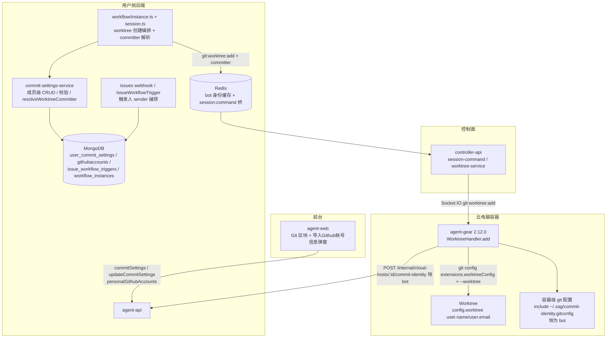
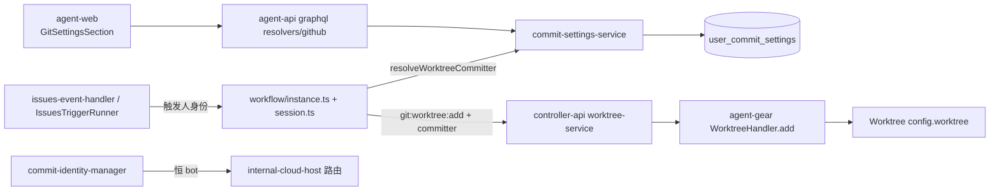
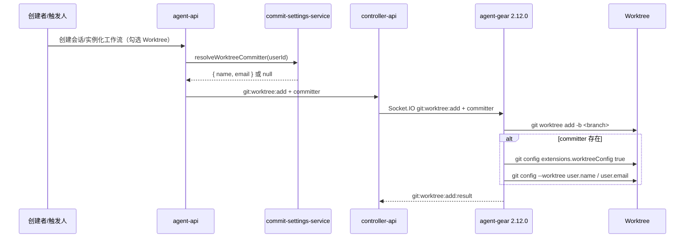
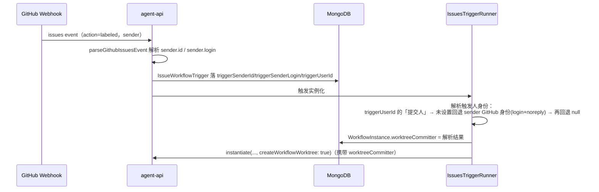
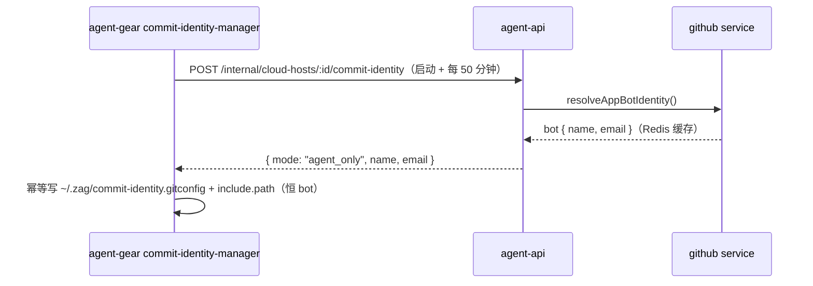

# Commit 作者设置优化 - 技术提案

**功能名称**: Commit 作者设置优化（成员独立提交人、「Git」区块与提交身份下发）
**关联 PRD**: `docs/product/draft/20261029-commit-author-settings-optimization.md`
**技术提案版本**: v1.0
**创建日期**: 2026-10-29
**作者**: ZeroAsh Agent
**feat-branch**: `feat/commit-author-settings-optimization`

## 1. 概述

### 1.1 背景

来源：GitHub Issue Deliay/z-agent-gear#368「Commit作者设置优化」。现行实现（`20261027-feat-commit-author-settings` + `20261028-feat-multi-tenant-phase2`）：

- `user_commit_settings` 以 **workspaceId 为键**（团队共享），`commit-settings-service` 按「本工作区 → 本租户全局工作区 → unset」三段继承解析；
- 「提交人模式」（`agent_only` / `co_author` / `human_only` / `unset`）×「提交人」（`github_account` / `custom` / `unset`）落库于 `CommitSettings`，UI 为设置页「Commit 设置」区块（`CommitSettingsSection`）；
- 提交身份**按容器全局下发**：`POST /internal/cloud-hosts/:controllerId/commit-identity`（`resolveCommitIdentity` 五步门控）→ 容器内 `CommitIdentityManager` 每 50 分钟拉取 → `~/.zag/commit-identity.gitconfig` + 全局 `include.path`（`co_author` 另挂 `prepare-commit-msg` hook）；
- Worktree 创建链：agent-api（`instance.ts` / `session.ts` 发 `git:worktree:add`）→ Redis `session:command` → controller-api（`worktree-service.handleAdd`）→ agent-gear（`WorktreeHandler.add` = `git worktree add`）；
- Issue 联动：`github-issues-webhook` → `IssuesEventPayload`（**只解析 `issue.user`，不解析 `sender`**）→ `IssueWorkflowTrigger`（无触发人字段）→ `IssuesTriggerRunner.createInstance` 强制 `createWorkflowWorktree: true`。

问题：workspace 共享键让成员无法个性化署名；单一容器级身份无法区分「云电脑自身」与「某成员的会话/工作流」；issue 拉起的工作流无法归属到触发人。

### 1.2 目标

- 提交人设置改为**成员独立**（键回归 userId，去除 workspace 共享/继承），UI 迁入新的「Git」区块；`CommitterMode` 与 `CommitterType.GITHUB_ACCOUNT` 下线。
- 存量数据**无损迁移**（迁移 017）：`github_account` → `custom` 等价转换、共享行归属重键、索引切换。
- 提交身份**按上下文下发**：
  - 云电脑级（非 Worktree）：**恒为 bot**（`resolveAppBotIdentity`），无视个人设置；
  - Worktree 级：`git:worktree:add` 载荷携带 `committer`，agent-gear 在 worktree 初始化后写 `extensions.worktreeConfig` + `--worktree user.name/user.email`；
  - 来源：会话/工作流 = 创建者（`WorkflowInstance.userId` / `Session` 创建者）的「提交人」；Issue 拉起的工作流 = 触发人（加触发标签者），未设置回退其 GitHub 身份（login + noreply），再回退 bot。
- agent-gear 升级 2.12.0（worktree committer 能力），worker 镜像与 harness 版本门禁同步。

### 1.3 范围

**做**：

- agent-api：`user_commit_settings` 重键与字段收敛 + 迁移 017、`commit-settings-service` 重写（成员级 CRUD / 校验 / `resolveWorktreeCommitter`）、`commit-identity` 端点恒 bot、`personalGithubAccounts` 查询、issues webhook `sender` 捕获与 `IssueWorkflowTrigger.trigger*` 字段、`WorkflowInstance.worktreeCommitter` 快照、`git:worktree:add` 载荷扩展。
- controller-api：`session-command` / `worktree-service` 透传 `committer`。
- agent-gear（packages/agent-controller）：`WorktreeHandler.add` 写 worktree 级 git user；`commit-identity-manager`/`commit-identity` 保持全局身份应用（内容恒 bot）。
- agent-web：「Git」区块（`GitSettingsSection`）+「导入Github帐号信息」弹窗（`ImportGithubAccountDialog`），移除 `CommitSettingsSection`。
- 契约：`contracts/github.graphql` 收敛、`contracts/agent-session-websocket.md` `git:worktree:add` 载荷扩展。
- 测试：单元 + 迁移 + API + 前端组件 + E2E（TDD）。

**不做**：

- 本地控制器环境的 git 身份管理（PRD 明示仅云电脑）；
- 仓库级（`--local`）身份、历史 commit 重写、Commit 模板定制、GitHub Enterprise；
- 拉取 GitHub 资料显示名（导入/迁移口径统一用 login + noreply，见 6.1 决策 3）；
- 「提交人模式」（Co-Author trailer 等）的替代形态——按 PRD 口径整体下线（见 6.1 决策 2）。

## 2. 技术架构

### 2.1 系统架构图



### 2.2 技术栈

| 层级 | 技术选型 | 说明 |
|------|---------|------|
| 前端 | React + TypeScript + Vite + Apollo Client（apps/agent-web） | `GitSettingsSection` + `ImportGithubAccountDialog` |
| 后端 | Node.js + Express + GraphQL-Yoga + Mongoose（servers/agent-api） | 模型 / 契约 / 服务 / 迁移 / 内部端点 |
| 控制面 | Node.js + Express + Socket.IO（servers/controller-api） | `session:command` 白名单透传 committer |
| 容器执行器 | Node.js + TypeScript（packages/agent-controller，agent-gear 2.12.0） | WorktreeHandler worktree 级 git user |
| 平台 | GitHub App（既有 JWT 能力） | bot 身份（`resolveAppBotIdentity`）、issue webhook sender |

### 2.3 模块划分



| 模块 | 职责 | 关键技术点 |
|------|------|-----------|
| commit-settings-service | 成员级设置 CRUD、校验白名单、`resolveWorktreeCommitter(userId)` | 键回归 userId；`custom` 校验沿用（trim / ≤100 / ≤254 / 无 `\n\r\0` / 邮箱正则） |
| commit-identity 端点 | 云电脑级身份下发 | 恒返回 bot（`resolveAppBotIdentity`），保留 `{mode,...}` 包络兼容 2.11.x 容器；双鉴权 / 永不 404 不变 |
| worktree 创建编排 | `git:worktree:add` 载荷携带 `committer` | `instance.createWorkflowWorktree` / `session.create` 解析并透传；`WorkflowInstance.worktreeCommitter` 快照 |
| issues 触发链 | 触发人捕获与身份解析 | `IssuesEventPayload.sender` → `GitHubAccount.githubUserId` 匹配 → `triggerUserId`；未设置回退 GitHub 身份 |
| agent-gear WorktreeHandler | worktree 初始化后写 worktree 级 user | `extensions.worktreeConfig` + `git config --worktree user.name/user.email`，缺省不写 |
| agent-web | 「Git」区块 + 导入弹窗 | `personalGithubAccounts` 数据源、填充后可编辑、成员级保存 |

## 3. API 设计

### 3.1 API 契约

`contracts/github.graphql` 收敛（Commit 设置段整体替换）：

```graphql
"""提交人类型：仅自定义 / 未设置（GITHUB_ACCOUNT 已移除）"""
enum CommitterType {
  CUSTOM
  UNSET
}

"""成员级提交人设置（原 CommitSettings：移除 committerMode / githubAccountId / source / readOnly）"""
type CommitSettings {
  committerType: CommitterType!
  customName: String
  customEmail: String
}

input CommitSettingsInput {
  committerType: CommitterType!
  customName: String
  customEmail: String
}

extend type Query {
  """当前成员的提交人设置"""
  commitSettings: CommitSettings!
  """当前账户对应的个人租户绑定的全部 GitHub 帐号（「导入Github帐号信息」弹窗数据源）"""
  personalGithubAccounts: [GitHubAccount!]!
}

extend type Mutation {
  updateCommitSettings(input: CommitSettingsInput!): CommitSettings!
}
```

删除项：`CommitterMode`、`CommitSettingsSource`、`CommitSettings.githubAccountId`、`CommitSettings.readOnly`、`CommitSettingsInput.githubAccountId`；`GitHubAccount` 类型不变（导入弹窗仅用 `id / githubUserId / githubLogin / githubAvatarUrl`）。

校验错误白名单收敛为一条：`invalid custom committer`（`committer is required for the selected mode`、`invalid github account` 随模式与 Github帐号 类型一并移除）。

### 3.2 内部接口

**`POST /internal/cloud-hosts/:controllerId/commit-identity`（agent-api，保持不变的契约形状）**

- 双鉴权（`INTERNAL_API_TOKEN` 或本机 Controller key）与「永不 404」语义不变；
- 响应恒为 bot 身份（云电脑下发 =「无视配置，下发 bot 单独的 git user 配置」）：

```json
{ "mode": "agent_only", "name": "zag-app[bot]", "email": "<botUserId>+zag-app[bot]@users.noreply.github.com" }
```

- bot 解析失败兜底 `{ "mode": "unset" }`（容器不写身份，语义与现状一致）；
- 保留 `mode` 包络的原因：存量 2.11.x 容器的 `CommitIdentityManager.consume()` 按 `mode` 分支，`agent_only` + name/email 即「写全局 git user」，与新语义完全一致，零改造兼容（见 6.1 决策 5）。

**`git:worktree:add` 载荷扩展（agent-api → Redis `session:command` → controller-api → agent-gear Socket.IO）**

```jsonc
{
  "type": "git:worktree:add",
  "requestId": "...",
  "controllerId": "...",
  "repoPath": "...",
  "worktreePath": "...",
  "branch": "...",
  "committer": { "name": "Deliay", "email": "admin@remiliascarlet.com" } // 可选；缺省 = 不写 worktree 身份（沿用容器级 bot）
}
```

- 三段透传：`servers/agent-api/src/services/workflow/instance.ts` / `session.ts` publish → `servers/controller-api/src/services/session-command.ts` + `worktree-service.handleAdd` → `packages/agent-controller/src/socketio-client.ts` → `WorktreeHandler.add(repoPath, worktreePath, branch, committer?)`；
- 契约 `contracts/agent-session-websocket.md` §3.12 `git:worktree:add` 载荷同步增补（旧 worker 忽略新增字段 → 优雅降级）。

## 4. 数据模型

### 4.1 数据库设计

#### 集合: `user_commit_settings`（重键 + 字段收敛）

| 字段 | 类型 | 说明 |
|------|------|------|
| userId | String, required | **成员归属**（唯一键 `uniq_user_commit_setting`）；不再承载「最近编辑者」语义 |
| committerType | enum `['custom','unset']`, default `'unset'` | 移除 `'github_account'` |
| customName | String ≤100 | 自定义用户名 |
| customEmail | String ≤254 | 自定义邮箱 |
| tenantId | String | 成员所属租户（写入时取自成员，信息留档） |

- 索引切换：**先建** `{ userId: 1 }` unique `uniq_user_commit_setting`，**后删** `{ workspaceId: 1 }` unique `uniq_workspace_commit_setting`（沿用迁移 015 的「先建后删」安全序）；
- 移除字段：`committerMode`、`githubAccountId`、`workspaceId`（迁移 017 清洗）；
- 移除 `applyWorkspaceScope` 插件与「三段继承」逻辑；查询一律按显式 `userId` 点查（不再依赖 ALS 工作区上下文），保留 `tenantId` 留档但不参与查询条件。

#### 集合: `issue_workflow_triggers`（增补触发人快照）

| 字段 | 类型 | 说明 |
|------|------|------|
| triggerSenderId | Number, default null | GitHub `sender.id` |
| triggerSenderLogin | String, default null | GitHub `sender.login` |
| triggerUserId | ObjectId ref User, default null | 经 `GitHubAccount.githubUserId` 匹配到的平台成员；未匹配为 null |

#### 集合: `workflow_instances`（增补 worktree 提交人快照）

| 字段 | 类型 | 说明 |
|------|------|------|
| worktreeCommitterName | String, default null | 实例化时解析的 worktree 提交人用户名 |
| worktreeCommitterEmail | String, default null | 同上邮箱；两者皆 null = 不下发（沿用 bot） |

快照语义：实例化（或 issue 触发实例化）时解析一次，实例级与节点级 worktree 均复用；成员中途改设置不影响已创建的 Worktree（与 PRD 边界一致）。

### 4.2 缓存设计

- bot 身份缓存沿用：Redis `github:app-bot-identity`（成功 24h / 失败哨兵 60s）+ 进程内 Map；
- 无新增缓存：成员设置为点查，`resolveWorktreeCommitter` 直查 `user_commit_settings`（读多写少，量级极低）。

## 5. 技术实现方案

### 5.1 核心流程

**（1）Worktree 提交人下发**



容器内命令序列（与需求给定完全一致，已在 git 2.x 实测：`extensions.worktreeConfig` 落共享配置、`--worktree` 落 `.git/worktrees/<name>/config.worktree`、主仓身份不受影响）：

```bash
git config extensions.worktreeConfig true
git config --worktree user.name "Deliay"
git config --worktree user.email "admin@remiliascarlet.com"
```

**（2）Issue 触发人身份解析**



**（3）云电脑级恒 bot**



### 5.2 关键实现点

#### 实现点 1: commit-settings-service 重写

- `getCommitSettings(userId)` / `updateCommitSettings(userId, input)`：键为 userId（upsert），移除工作区上下文、`source`/`readOnly`、模式组合校验；
- 校验白名单仅 `invalid custom committer`：`custom` 要求 trim 后 name ∈ (0,100]、email ≤254、无 `\n\r\0`、邮箱正则 `/^[^\s@]+@[^\s@]+\.[^\s@]+$/`；`unset` 清空 custom 字段；
- 新增 `resolveWorktreeCommitter(userId): Promise<{name,email}|null>`：点查设置 → `custom` 且校验通过则返回，否则 null；
- 移除 `resolveCommitIdentity` 五步门控与 `hasGithubWorkload` 判定，改为 `resolveCloudHostIdentity()` = bot 恒定（bot 失败 `{mode:'unset'}`）。

#### 实现点 2: worktree 创建链 committer 透传

- `workflow/instance.ts`：`instantiate` 时解析 `worktreeCommitter`（issue 覆盖 > 创建者 `resolveWorktreeCommitter`），落 `WorkflowInstance`；`createWorkflowWorktree()` 读快照放入 `git:worktree:add` 载荷；节点级 worktree（`orchestrator.startNodeSession` → `session.create`）显式传入实例快照；
- `session.ts create()`：独立会话解析会话创建者的 `resolveWorktreeCommitter`；支持调用方显式传入（工作流节点场景）；
- `session-command.ts` / `worktree-service.ts`：`git:worktree:add` payload 类型增 `committer?: { name: string; email: string }` 透传（白名单不变，不引入任意 git 命令通道）；
- 旧 worker（<2.12.0）忽略未知字段 → 该 worktree 不写身份、沿用容器级 bot（优雅降级）。

#### 实现点 3: agent-gear WorktreeHandler 写 worktree 级身份

- `WorktreeHandler.add(repoPath, worktreePath, branch, committer?)`：`git worktree add` 成功后，若 `committer` 存在，以 `git -C <worktreePath>` 依次执行三条命令（对 name/email 做 shell 转义，沿用 `renderGitConfig` 的转义口径）；单条失败记 warn 不阻断 worktree 创建（结果仍 success，身份缺失可接受）；
- `extensions.worktreeConfig` 写入幂等（重复 set 同值无副作用）；`--worktree` 值仅影响该 worktree（实测验证，主仓与兄弟 worktree 不受污染）；
- `commit-identity.ts` / `commit-identity-manager.ts` 保持现状（服务端恒下发 `agent_only`+bot；`co_author` 代码路径保留但不再被触发，后续清理可选）。

#### 实现点 4: Issue 触发人捕获

- `github-issues-webhook-payload.ts`：`IssuesEventPayload` 增 `sender?: { id: number; login: string }`（`labeled` 动作的 sender 即加标签人；兼容缺失）；
- `issues-event-handler.ts`：命中触发标签时 `GitHubAccount.findOne({ githubUserId: sender.id })` → `triggerUserId`（其 `userId`），与 `triggerSenderId/Login` 一并落 `IssueWorkflowTrigger`；
- `IssuesTriggerRunner.createInstance`：身份优先级 `triggerUserId` 的「提交人」→ sender 的 GitHub 身份（`login` + `<senderId>+<login>@users.noreply.github.com`）→ null；写入 `WorkflowInstance.worktreeCommitter` 并传给 `instantiate`。

#### 实现点 5: 契约与前端

- `contracts/github.graphql` 按 3.1 收敛；`contracts/agent-session-websocket.md` `git:worktree:add` 增 `committer`；
- agent-web：`SettingsPage` 移除 `<CommitSettingsSection />` 与 github-section 挂载，新增 NAV_ITEM `git-section`（label「Git」）与 `<GitSettingsSection />`；`ImportGithubAccountDialog` 复用 `WorkspaceMembersDialog` 式「列表 + 选择」结构（`components/settings/`），数据源 `personalGithubAccounts`；选择后填充 `customName = githubLogin`、`customEmail = <githubUserId>+<login>@users.noreply.github.com`（可编辑）；
- `personalGithubAccounts` resolver：`User.accountId` → 同账户 users → `tenants.type='personal'`（`_id` 复用 owner userId）→ `GitHubAccount.find({ tenantId: { $in: personalTenantIds } })`；
- graphql 文档（`queries.ts` / `mutations.ts` / `types.ts`）同步收敛。

#### 实现点 6: 迁移 017（`017-commit-settings-per-member.ts`）

四步链（沿用 015 的「先建后删 + 批量 bulkWrite + 计数门禁」风格）：

1. **github_account → custom 等价转换**：`committerType='github_account'` 的行按 `githubAccountId` 取 `GitHubAccount`，写 `customName=githubLogin`、`customEmail=<githubUserId>+<login>@users.noreply.github.com`（与现行 `resolveCommitter` 生效值逐字一致）；帐号缺失/取值失败 → 转 `unset` 并清空字段；
2. **归属重键**：行 → workspace → tenant；`type='personal'` → owner = `tenantId`（personal 租户 `_id` 复用 owner userId）；`type='team'` → owner = 行内 `userId`（最近编辑人）；`workspaceId` 为空的旧式行 owner 不变。同 owner 多行碰撞 → 保留 `updatedAt` 最新的非 unset 行，其余删除并计数；
3. **字段清洗**：unset 行清空 custom 字段；unset 且无历史价值的行保留（显式「未设置」）；`$unset` `committerMode` / `githubAccountId` / `workspaceId`；`tenantId` 按 owner 成员刷新；
4. **索引切换**：先建 `{userId:1}` unique `uniq_user_commit_setting`，后删 `uniq_workspace_commit_setting`。

幂等：以 `_migrations` 已执行记录 + 各步幂等过滤（如 `committerType:'github_account'` 残留计数为 0）保障可重入。

#### 实现点 7: 版本与镜像

- agent-gear 版本 2.12.0（worktree committer 能力），`deploy/images/worker/Dockerfile` `agent-gear@2.12.x`；
- harness 版本门禁提升至 2.12.0（`cloud-controller` 门禁口径，覆盖 `2.10.0 / deepseek 2.11.0` 现值），保证新拉起容器具备 worktree 身份能力；存量容器由保活自更新收敛，期间优雅降级。

## 6. 技术决策

### 6.1 决策列表

| # | 决策点 | 选项 A | 选项 B | 最终选择 | 原因 |
|---|--------|--------|--------|---------|------|
| 1 | 提交人设置键 | 保留 workspaceId + 三段继承 | 键回归 userId（成员独立） | B | 需求「团队内成员每人都可以有自己的个性化提交设定、也没有全局设置了」；身份本质是个人属性 |
| 2 | 提交人模式去留 | 保留四选一并适配新下发 | 整体下线 | B | 新下发规则按上下文固定（云电脑=bot、worktree=人），模式无剩余语义；需求全文未提模式 |
| 3 | 导入/迁移的「名字和邮箱」口径 | 拉取 GitHub 资料显示名 | login + noreply（与现行 Github帐号 生效值一致） | B | 与迁移「获得对应的用户名和邮箱」口径一致、无外部 API 依赖、移除 Github帐号 类型零行为变化 |
| 4 | Issue 触发人未设置提交人 | 回退 bot | 回退 GitHub 身份（login + noreply） | B | 触发人可从 sender 直接取得身份，最大化归属可追溯；再不可得才 bot |
| 5 | commit-identity 响应形状 | 简化为 `{name,email}` | 保留 `{mode,...}` 包络恒 `agent_only` | B | 存量 2.11.x 容器 consume() 按 mode 分支，`agent_only` 语义与「恒 bot」完全一致，免版本耦合 |
| 6 | worktree 身份下发通道 | 新增 `git:config` 白名单命令 | 扩展 `git:worktree:add` 载荷 | B | 与 worktree 初始化原子完成、一次往返；三段透传改动最小 |
| 7 | 身份解析时机 | 每次 worktree 创建实时解析 | 实例化/会话创建时快照落库 | B | 可审计、issue 覆盖易传递、节点级 worktree 复用一致；与 PRD「以创建时设置为准」一致 |
| 8 | `co_author` 容器 hook | 删除 | 服务端不再下发、容器实现保留 | B | 最小改动半径；包络兼容保留 consume 分支，后续版本清理 |
| 9 | 版本门禁 | 不变（纯优雅降级） | harness 门禁提升 2.12.0 | B | worktree 身份是本需求主链路，避免旧容器静默缺失；保活自更新双保险 |

### 6.2 依赖与约束

| 类型 | 内容 | 说明 |
|------|------|------|
| 依赖 | GitHub 帐号绑定（已上线） | `personalGithubAccounts` 数据源（`githubaccounts`） |
| 依赖 | Git Worktree 支持（已上线） | `git:worktree:add` 链与 `WorktreeHandler` |
| 依赖 | GitHub Issues 联动工作流（已上线） | `IssueWorkflowTrigger` / `IssuesTriggerRunner` 扩展点 |
| 依赖 | 多租户一期/二期（已上线） | 账户→个人租户→Github帐号 链路；取代「Commit 三段继承」口径 |
| 约束 | 仅云电脑环境 | 本地控制器不下发任何提交身份 |
| 约束 | `session:command` 保持封闭白名单 | 不开任意 git 命令通道 |
| 约束 | 迁移可重入、先建后删索引 | 沿用 015 迁移纪律 |

## 7. 项目结构

```
contracts/
├── github.graphql                                  # Commit 设置段收敛 + personalGithubAccounts
└── agent-session-websocket.md                      # git:worktree:add 载荷 +committer
servers/agent-api/src/
├── models/user-commit-setting.ts                   # 键回归 userId、字段收敛
├── models/issue-workflow-trigger.ts                # + triggerSenderId/triggerSenderLogin/triggerUserId
├── models/workflow-instance.ts                     # + worktreeCommitterName/Email
├── migrations/017-commit-settings-per-member.ts    # 新增（含 017-*.test.ts）
├── services/commit-settings-service.ts             # 重写（成员级 + resolveWorktreeCommitter）
├── services/workflow/instance.ts                   # worktreeCommitter 快照 + committer 载荷
├── services/workflow/orchestrator.ts               # 节点会话透传快照
├── services/workflow/github-issues-webhook-payload.ts # + sender
├── services/workflow/issues-event-handler.ts       # 触发人匹配落库
├── services/workflow/issues-trigger-runner.ts      # 触发人身份优先级
├── services/session.ts                             # 会话创建者/显式 committer
├── routes/internal-cloud-host.ts                   # commit-identity 恒 bot（形状不变）
└── graphql/{schemas,resolvers}/github.ts           # 契约收敛 + personalGithubAccounts
servers/controller-api/src/services/
├── session-command.ts                              # git:worktree:add payload +committer
└── worktree-service.ts                             # 透传 committer
packages/agent-controller/src/
├── worktree-handler.ts                             # add() 写 worktree 级 user（2.12.0）
└── socketio-client.ts                              # 事件载荷透传 committer
deploy/images/worker/Dockerfile                     # agent-gear@2.12.x
servers/cloud-controller/                           # harness 版本门禁 2.12.0
apps/agent-web/src/
├── pages/SettingsPage.tsx                          # 「Git」NAV + 区块挂载调整
├── components/settings/GitSettingsSection.tsx      # 新增（替代 CommitSettingsSection）
├── components/settings/ImportGithubAccountDialog.tsx # 新增
└── graphql/{queries,mutations,types}.ts            # 文档收敛
tests/api/src/agent-api/{github,workflow-issues,multi-tenant}.test.ts
tests/e2e/src/settings-git.spec.ts                  # 新增（替代 settings-commit-author.spec.ts 口径）
```

## 8. 测试策略

TDD（红-绿-重构）先行；单测随模块 `*.test.ts` 共置。

### 8.1 测试矩阵

| 测试 ID | 覆盖点 | 位置 |
|---------|--------|------|
| T-CS-P1~P5 | 成员级 CRUD / 校验白名单 / `resolveWorktreeCommitter` 三态（custom/unset/非法） | `commit-settings-service.test.ts`（重写 T-CS*） |
| T-MIG-CS1~CS6 | 017：github→custom 等价、帐号缺失→unset、personal/team 归属映射、碰撞合并、索引先建后删、幂等重入 | `017-commit-settings-per-member.test.ts` |
| T-IC-B1~B3 | commit-identity 恒 bot / bot 失败 unset 兜底 / 双鉴权与永不 404 不变 | `internal-cloud-host.test.ts` |
| T-WTC1~T-WTC4 | WorktreeHandler committer：三命令序列、缺省不写、转义、单条失败不阻断 | `worktree-handler.test.ts` |
| T-WF-C1~C4 | 实例快照、节点会话复用、独立会话创建者解析、issue 覆盖优先级 | workflow / session 单测 |
| T-GH-S1~S3 | issues payload sender 解析、`triggerUserId` 匹配、未匹配回退 GitHub 身份 | issues-event-handler 单测 |
| T-FE-G1~G3 | GitSettingsSection（保存/校验/未设置）、ImportGithubAccountDialog（列表/填充/空态） | `apps/agent-web/src/components/settings/__tests__/` |
| T-CS-API* / T-IC-API* | GraphQL 契约形状、`personalGithubAccounts`、错误白名单 | `tests/api/src/agent-api/github.test.ts` |
| T-MT / T-WS 回归 | 移除共享口径后的隔离与只读回归（Commit 相关断言改写） | `tests/api` 既有用例 |
| E2E-GIT1~GIT4 | 设置页「Git」区块全流程、导入弹窗、迁移后等价、worktree 署名（mock） | `tests/e2e/src/settings-git.spec.ts` |

### 8.2 测试类型

| 类型 | 工具 | 覆盖范围 |
|------|------|---------|
| 单元/迁移 | vitest | 服务、迁移、WorktreeHandler、issues 链 |
| 前端组件 | vitest + testing-library | GitSettingsSection / ImportGithubAccountDialog |
| 集成 API | tests/api（真库） | 契约、端点、迁移后数据形态 |
| E2E | tests/e2e（Playwright） | 设置页与导入交互（mock GraphQL）、口径回归 |

## 9. 验收标准

- [ ] 技术方案评审通过
- [ ] Contract 评审通过（`github.graphql` 收敛、`git:worktree:add` +committer）
- [ ] 代码实现完成（agent-api / controller-api / agent-gear / agent-web / 门禁与镜像）
- [ ] 迁移 017 通过单测与真库验证：存量 Github帐号署名逐字等价、归属重键正确、索引切换无损
- [ ] API 测试通过（含成员级隔离、恒 bot 端点、personalGithubAccounts）
- [ ] E2E 测试通过（Git 区块、导入弹窗、下发口径）
- [ ] PRD 1.3 成功标准逐条可验证

## 10. 相关文档

- 关联 PRD：`docs/product/draft/20261029-commit-author-settings-optimization.md`
- 前序提案：`docs/engineering/proposals/20261027-feat-commit-author-settings.md`（本提案取代其模式/共享/下发口径）
- 多租户二期：`docs/engineering/proposals/20261028-feat-multi-tenant-phase2.md`（「Commit 三段继承」被取代）
- Issue 联动：`docs/engineering/proposals/20261025-feat-github-issues-workflow.md`、`20261026-fix-issues-workflow-force-worktree.md`
- Worktree：`docs/engineering/proposals/20260523-feat-git-worktree-support.md`
- 开发规范：`docs/engineering/{common,backend,frontend}-rules.md`
- 需求来源：https://github.com/Deliay/z-agent-gear/issues/368
