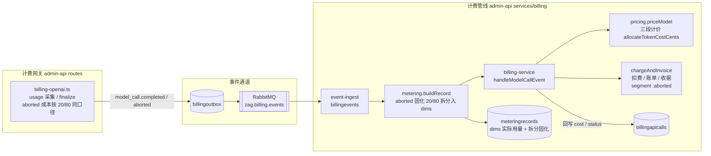
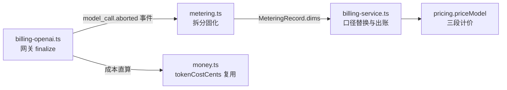
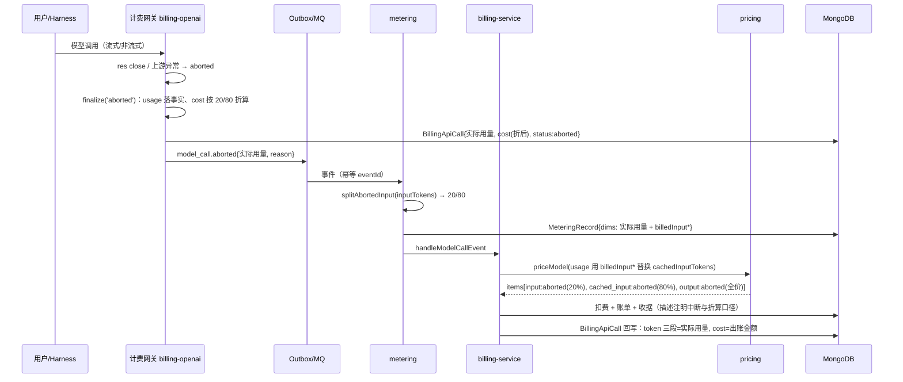

# 调用中断的 token 计费优化 - 技术提案

**功能名称**: 中断调用 token 计费优化
**关联 PRD**: `docs/product/draft/20261029-interrupted-call-token-billing.md`
**技术提案版本**: v1.0
**创建日期**: 2026-10-29
**作者**: ZeroAsh Agent
**feat-branch**: `feat/interrupted-call-token-billing`

## 1. 概述

### 1.1 背景

现行计费链路（`20261018-feat-credits-billing`）：

1. **计费网关**（`servers/admin-api/src/routes/billing-openai.ts`）采集 usage（`inputTokens` / `cachedInputTokens` / `outputTokens`），调用结束或中断时 `finalize('completed' | 'aborted')` 落 `BillingApiCall` 并经 outbox 发 `model_call.completed` / `model_call.aborted` 事件（`aborted` 带 `reason: client_aborted | upstream_error`）；
2. **计量**（`servers/admin-api/src/services/billing/metering.ts` `buildRecord`）把事件转成 `MeteringRecord`，`dims` 记录三段实际用量（`cachedInputTokens ⊆ inputTokens`），用量缺失按估算兜底（`estimated`）；
3. **定价**（`servers/admin-api/src/services/billing/pricing.ts` `priceModel`）按价目三段费率（`inputPerMillion` / `cachedInputPerMillion` / `outputPerMillion`，分/百万 token）整单分配出 `input` / `cached_input` / `output` 三条明细；
4. **出账**（`servers/admin-api/src/services/billing/billing-service.ts` `handleModelCallEvent`）扣费、开票、收据，并把金额回写 `BillingApiCall.cost`；中断调用仅在 `InvoiceItem.segment` 加 `:aborted` 后缀、描述注明中断原因，**金额与完成调用同价**。

PRD（Issue #355）要求修订口径：**中断的请求，输入 token 按 20% 未缓存 + 80% 已缓存计费，输出依然是全价**。现行三段计价结构天然支持该拆分（`cached_input` 段费率已存在），无需新增费率维度。

### 1.2 目标

- 中断调用（`model_call.aborted`）计价时，输入 token 按固定比例拆为 **20% 未缓存 + 80% 缓存** 两段分别计价；输出 token 全价不变。
- **实际用量（事实）与计费口径（解释）分离**：`BillingApiCall` / 事件 payload / `dims` 的 token 三段保持实际用量，拆分结果仅用于计价并固化在计量记录中，保证「重放『事件 → 计量 → 定价』金额一致」不变量。
- 网关审计成本（`billingapicalls.cost`）、管线出账金额、对账比对三处口径一致。
- 正常完成调用计费零回归。

### 1.3 范围

**做**：

- admin-api 计费域：网关 `finalize` 成本口径、`metering` 拆分固化、`billing-service` 定价口径替换与回写修正、账单描述标注。
- 契约口径描述更新（`billing-openai.openapi.yaml`、`billing.graphql` / `admin-billing.graphql` 注释、`billing-events.asyncapi.yaml` 备注），零结构变更。
- 单元测试 + API 测试（TDD）。

**不做**：

- 不追溯历史已出账单；不做存量账单/收据/计量记录迁移。
- 不改价目结构与费率字段（复用既有 `cachedInputPerMillion`）。
- 20/80 比例不做配置化（常量固化，见 §6 决策）。
- 不区分中断原因（`client_aborted` / `upstream_error` 同口径）。
- 前端零改动（`segmentLabel` 已把 `segment.includes('aborted')` 显示为「中断」，输入两段拆分天然落在既有 `input` / `cached_input` 明细上）。
- 调用前预检（`estimateCost` 保守上界）不变——中断只会降低实付，不破坏上界性质。

## 2. 技术架构

### 2.1 系统架构图



### 2.2 技术栈

| 层级 | 技术选型 | 说明 |
|------|---------|------|
| 计费网关 | Node.js + Express（admin-api `/v1`） | OpenAI 兼容调用入口，用量采集与中断检测 |
| 计费管线 | Node.js（admin-api services/billing） | 事件 → 计量 → 定价 → 扣费出账 |
| 事件通道 | Outbox + RabbitMQ | at-least-once、幂等可重放 |
| 数据库 | MongoDB | `billingapicalls` / `billingevents` / `meteringrecords` / `productprices` / `billinginvoices` 等 |

### 2.3 模块划分



| 模块 | 职责 | 关键技术点 |
|------|------|-----------|
| `routes/billing-openai.ts` | usage 采集、中断检测、`finalize` 落事实 + 成本 | aborted 成本与管线同口径 |
| `services/billing/usage-split.ts`（新增） | 中断输入拆分唯一规则源 | `ABORTED_INPUT_CACHED_RATIO = 0.8`、取整无损 |
| `services/billing/metering.ts` | 事件 → 计量事实 | aborted 在 `dims` 固化拆分结果 |
| `services/billing/billing-service.ts` | 定价 → 扣费出账 → 回写 | 定价口径替换、回写保持事实用量 |
| `services/billing/pricing.ts` | 三段计价 | 零改动（拆分经 usage 参数传入） |

## 3. API 设计

### 3.1 API 契约

**零结构变更**，仅更新口径描述（遵循契约式开发，在实现前先行修订）：

- `contracts/billing-openai.openapi.yaml`：计费说明由「中断调用按已产生用量出账（标注中断）」修订为「中断调用按已产生用量出账（标注中断），输入 token 按 20% 未缓存 + 80% 已缓存计价、输出 token 全价」；usage 形状（`prompt_tokens` / `completion_tokens` / `prompt_tokens_details.cached_tokens`）不变。
- `contracts/billing.graphql` / `contracts/admin-billing.graphql`：
  - `InvoiceItem.segment` 注释补充：中断调用为 `input:aborted`（20% 未缓存）/ `cached_input:aborted`（80% 缓存）/ `output:aborted`（全价）；
  - `BillingApiCall` 注释明确：`inputTokens` / `cachedInputTokens` / `outputTokens` 为**实际用量**，`cost` 为按计价口径折算后的金额。
- `contracts/billing-events.asyncapi.yaml`：`ModelCallEvent` payload **不变**（事实用量），description 增补「aborted 事件的输入在计量/定价侧按 20/80 拆分计价」备注。

### 3.2 内部接口

无变化：`/internal/billing/*`（charges / refunds / price-quote）、对账补投接口均不感知拆分（拆分在计量/定价层内部完成）。

## 4. 数据模型

### 4.1 数据库设计

#### 集合: `meteringrecords`（`dims` 扩展，无迁移脚本——`dims` 为 Mixed）

| 字段 | 类型 | 说明 |
|------|------|------|
| `dims.aborted` | Boolean | 仅 `model_call.aborted` 计量记录为 `true` |
| `dims.billedInputNonCachedTokens` | Number | 计费口径：未缓存输入数量（20% 侧，取整余量归入此段） |
| `dims.billedInputCachedTokens` | Number | 计费口径：缓存输入数量（80% 侧，`round`） |

- `dims.inputTokens` / `dims.cachedInputTokens` / `dims.outputTokens` / `dims.estimated` 语义不变，继续保存**实际用量**；
- `quantity = inputTokens + outputTokens` 不变（事实口径）；
- 存量记录无新增字段（见 §6 决策 4 的回落行为）。

其余集合零结构变更：

- `billingapicalls`：token 三段保持实际用量，`cost` 语义不变（金额）；
- `billinginvoices.items`：复用既有 `segment` 取值 + `:aborted` 后缀，单价快照机制不变；
- `productprices` / `models.pricing`：三段费率结构不变，`cachedInputPerMillion` 复用为 80% 段单价。

### 4.2 缓存设计

无新增缓存。

## 5. 技术实现方案

### 5.1 核心流程



### 5.2 关键实现点

#### 实现点 1: 拆分规则唯一源 `usage-split.ts`

- **描述**: 新增 `servers/admin-api/src/services/billing/usage-split.ts`，导出常量 `ABORTED_INPUT_CACHED_RATIO = 0.8` 与函数 `splitAbortedInput(inputTokens): { nonCachedTokens; cachedTokens }`，供计量、出账、网关三处共用，杜绝口径漂移。
- **技术细节**:
  - `cachedTokens = Math.round(inputTokens × 0.8)`，`nonCachedTokens = inputTokens − cachedTokens`——**不重不漏**：两段之和恰为输入总量；取整余量归入未缓存段（更保守、少让利方向）；
  - 边界：`inputTokens = 0` → 两段为 0；`inputTokens = 1` → `cached=1, nonCached=0`（为 0 的段不产生明细，`priceModel` 既有 `.filter(item => quantity>0 || amount>0)` 处理）；
  - 入参先 `Math.max(0, toInt(...))` 归一。
- **风险点**: 无（纯函数）。

#### 实现点 2: 计量层固化拆分（保证重放一致）

- **描述**: `metering.ts buildRecord` 对 `model_call.aborted` 事件，在 `dims` 中除实际用量外追加 `aborted: true` 与 `billedInputNonCachedTokens` / `billedInputCachedTokens`（实现点 1 的结果）。
- **技术细节**: 「计量是事实、定价是解释」（`20261018-feat-credits-billing` 实现点 2）要求重放金额与历史一致；拆分结果固化进事实记录后，`事件 → 计量 → 定价` 重放永远得到同一金额，不受未来比例调整影响。`model_call.completed` 记录不写这些字段。
- **风险点**: `dims` 兼容旧记录（无字段）需回落（实现点 3）。

#### 实现点 3: 出账层口径替换与回写修正

- **描述**: `billing-service.handleModelCallEvent`：
  1. 取 usage 供 `priceModel` 时，若 `aborted && dims.billedInput*` 存在，则 `cachedInputTokens` 用 `billedInputCachedTokens` 替换（未缓存段 = `inputTokens − cached` 自然得到 20%）；否则维持现口径（存量/异常记录回落旧行为）；
  2. **回写 `BillingApiCall` 的 token 三段必须保持实际用量**（现有代码把传给 `priceModel` 的 `usage` 直接回写，若不修正会把拆分值写成事实）——回写改为 `dims` 的实际三段，`cost` 写折后 `priced.amountCents`；
  3. 描述文案：`模型调用（中断：<reason>，输入按 20% 未缓存 + 80% 缓存计价[，估算]） <modelId>`；
  4. `segment: aborted ? \`${item.segment}:aborted\` : item.segment` 保留——中断调用明细呈现 `input:aborted`（20%）+ `cached_input:aborted`（80%）+ `output:aborted`（全价）。
- **风险点**: 回写字段语义混淆（事实 vs 口径）是本需求最主要的数据正确性风险，以测试 T-AB3/T-AB4 锁定。

#### 实现点 4: 网关 `finalize` 成本同口径

- **描述**: `billing-openai.ts finalize` 为 `BillingApiCall.cost` 直算审计成本（随后会被管线出账金额覆盖，但对账 `reconciliation` 会比对 `billingapicalls.cost` 与账单金额）。`status === 'aborted'` 时成本按 `splitAbortedInput` 结果 + `tokenCostCents` 计算，与管线折后金额同口径；`completed` 路径不动。
- **技术细节**: 网关逐段 `ceil` 与管线 `allocateTokenCostCents` 整单分配存在±1 分级差异（现状即如此，reconciliation 已容忍）；本需求不改取整策略，仅保证折算口径一致。
- **风险点**: 三处（网关成本 / 出账金额 / 对账）口径不一致会放大对账差异告警。

#### 实现点 5: 幂等与估算叠加

- **描述**: 拆分发生在计量层且只依赖事件 payload，天然幂等（`eventId` 唯一 + `idempotentKey` 防重复扣费不变）；`estimated`（用量缺失估算）与 `aborted` 叠加时，估算出的 `inputTokens` 同样按 20/80 拆分，`estimated` 标注保留。
- **风险点**: 无新增。

## 6. 技术决策

### 6.1 决策列表

| 决策 | 选项 A | 选项 B | 最终选择 | 原因 |
|------|--------|--------|---------|------|
| 拆分固化位置 | 计量层 `dims` 固化拆分结果 | 定价层按比例即时计算 | **A** | 保「重放金额与历史一致」不变量；未来调整比例不影响历史重放；定价层保持纯三段计价 |
| 与实际缓存比例的关系 | 固定 20/80 **覆盖**实际 `cachedInputTokens` | 实际缓存部分保持缓存价、仅未缓存部分再按 20/80 折 | **A** | Issue 口径「输入token按照20%的未缓存+80%已缓存计费」即按输入总量固定拆分；口径简单可解释 |
| 适用的中断原因 | 全部 `aborted`（client_aborted / upstream_error 同口径） | 仅用户主动中断 | **A** | 现网关不区分用户停止与断开（均为 `client_aborted`），Issue 未要求区分；保持确定性简单 |
| 取整规则 | `cached = round(0.8×input)`，余量归未缓存段 | floor / 各段独立取整 | **A** | 不重不漏（两段和恰为总量）；余量归贵的段，保守少让利 |
| 比例配置化 | 常量 `ABORTED_INPUT_CACHED_RATIO` | 后台可配 | **A** | 单一需求口径，KISS；如未来需调价走版本化迭代 |
| 历史账单 | 不追溯 | 对存量 aborted 账单退差价 | **A** | PRD 明确不追溯；避免批量调账风险 |
| 存量 `dims`（无拆分字段）重定价 | 回落按实际 `cachedInputTokens`（旧行为） | 补算拆分 | **A** | 存量记录已按全价出账，回落保持金额一致，符合不追溯 |

### 6.2 依赖与约束

| 类型 | 内容 | 说明 |
|------|------|------|
| 依赖 | 费用中心三段费率（`cachedInputPerMillion`） | 复用既有价目维度，零结构变更 |
| 依赖 | outbox/MQ 事件链路与幂等机制 | 不改动 |
| 约束 | 输出必须全价 | 不参与拆分 |
| 约束 | 实际用量不得被口径值污染 | 回写与事件 payload 保持事实（实现点 3） |
| 约束 | 金额整数「分」、不足 0.01 credits 按 0.01 计 | 沿用 `money.ts` 既有取整 |

## 7. 项目结构

```
servers/admin-api/src/
├── routes/
│   └── billing-openai.ts            # finalize aborted 成本口径（实现点 4）
└── services/billing/
    ├── usage-split.ts               # 新增：拆分规则唯一源（实现点 1）
    ├── usage-split.test.ts          # 新增：T-AB1
    ├── metering.ts                  # aborted 拆分固化入 dims（实现点 2）
    ├── metering.test.ts             # 扩展：T-AB2
    ├── billing-service.ts           # 口径替换 + 回写修正 + 描述（实现点 3）
    ├── billing-flow.test.ts         # 扩展：T-AB3/T-AB4/T-AB6/T-AB7
    └── pricing.test.ts              # 扩展：拆分输入的三段计价断言

contracts/
├── billing-openai.openapi.yaml      # 计费口径描述更新
├── billing.graphql                  # segment / BillingApiCall 注释更新
├── admin-billing.graphql            # 同上
└── billing-events.asyncapi.yaml     # payload 备注更新

tests/api/src/admin-api/
├── billing-gateway.test.ts          # 扩展：aborted 成本口径用例
└── billing.test.ts                  # 扩展：中断调用账单明细用例
```

## 8. 测试策略

### 8.1 测试覆盖要求

采用 TDD（红-绿-重构）：先写失败用例再实现。计费域单元测试覆盖率不低于现状；拆分规则与出账口径分支 100% 覆盖。

### 8.2 测试类型

| 类型 | 工具 | 覆盖范围 |
|------|------|---------|
| 单元测试 | vitest（colocated `*.test.ts`） | 拆分规则、计量固化、出账口径、网关成本 |
| API 测试 | tests/api（admin-api billing） | 端到端出账口径与明细断言 |
| 回归 | 现有用例全量 | 正常完成调用金额零变化 |

核心用例（TDD 清单）：

| 用例 | 断言 |
|------|------|
| T-AB1 | `splitAbortedInput`：0/1/5/大数输入下两段和恰为总量、80% 段取整、余量归未缓存段 |
| T-AB2 | `metering` aborted 记录 `dims` 含 `aborted` 与 `billedInput*`；completed 记录不写；`quantity` 与实际用量一致 |
| T-AB3 | `handleModelCallEvent` aborted：发票 items 为 `input:aborted`(20%)+`cached_input:aborted`(80%)+`output:aborted`，金额=折后，`BillingApiCall` 回写实际用量 + 折后 cost |
| T-AB4 | 正常 completed 调用：金额、items、回写与拆分前完全一致（回归） |
| T-AB5 | 网关 `finalize('aborted')` 成本与管线折后同口径 |
| T-AB6 | `estimated` + `aborted` 叠加：估算输入同样 20/80、标注保留 |
| T-AB7 | `isBillable:false` / 零用量 / `dims` 无拆分字段（存量）回落行为不变 |
| API-AB1 | tests/api：中断调用账单明细 20/80 拆分与「中断」标注、描述含折算口径 |
| API-AB2 | tests/api：正常调用金额回归断言 |

## 9. 部署方案

- 无新配置项、无迁移脚本、无中间件变更；发布即生效（仅对**上线后发生**的中断调用按新口径计价）。
- 灰度口径：上线后首个中断调用账单人工核对 20/80 明细与金额；`reconciliation` 对账任务持续监控 `billingapicalls.cost` 与账单金额差异。

## 10. 验收标准

- [ ] 技术方案评审通过
- [ ] Contract 口径描述更新评审通过（零结构变更）
- [ ] 代码实现完成（拆分唯一源 / 计量固化 / 出账口径 / 网关成本）
- [ ] 单元测试覆盖达标（T-AB1~T-AB7）
- [ ] API 测试通过（API-AB1~API-AB2）
- [ ] 正常完成调用计费回归零变化
- [ ] 对账无新增差异告警

## 11. 相关文档

- [[../../product/draft/20261029-interrupted-call-token-billing.md]] — 关联 PRD
- [[20261018-feat-credits-billing.md]] — 费用中心（Credits 计费）技术提案（计费链路基线）
- [GitHub Issue #355 调用中断的token计费优化](https://github.com/Deliay/z-agent-gear/issues/355)
- [[../common-rules.md]] — 通用开发规范
