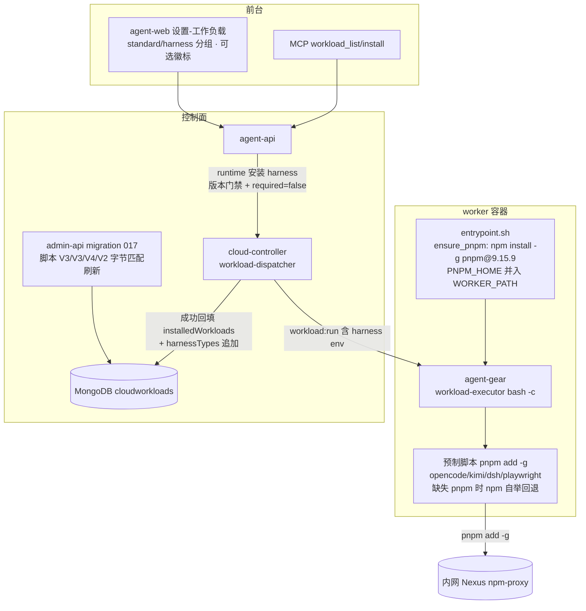
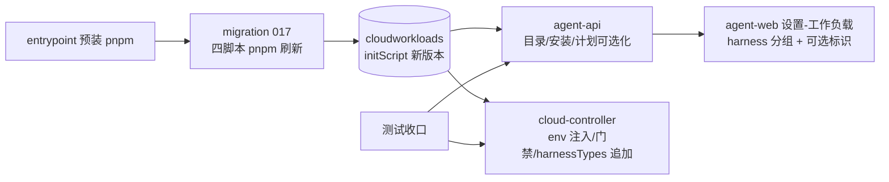
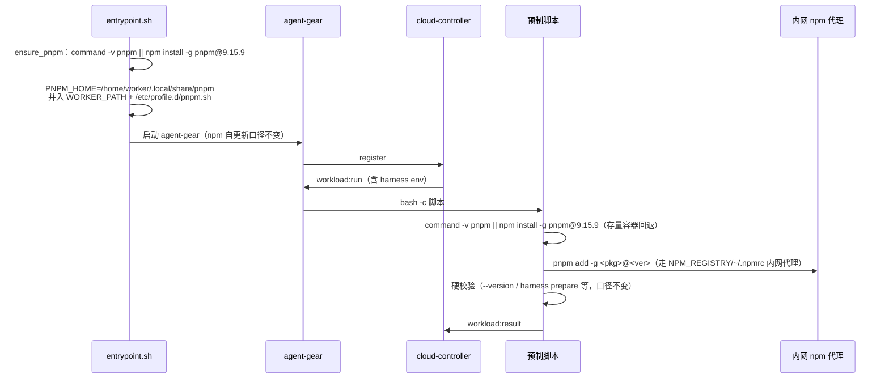
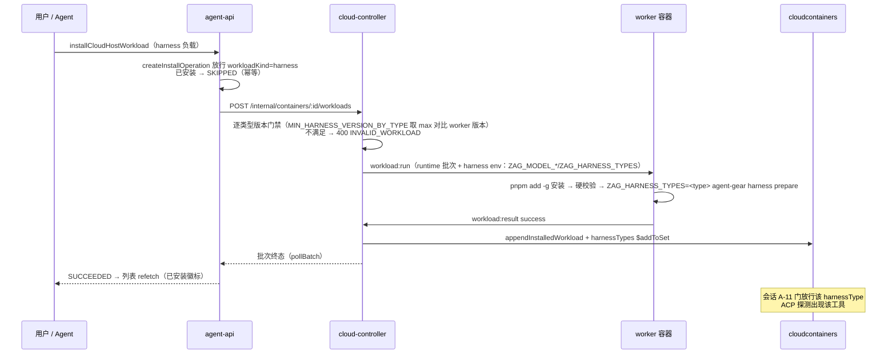
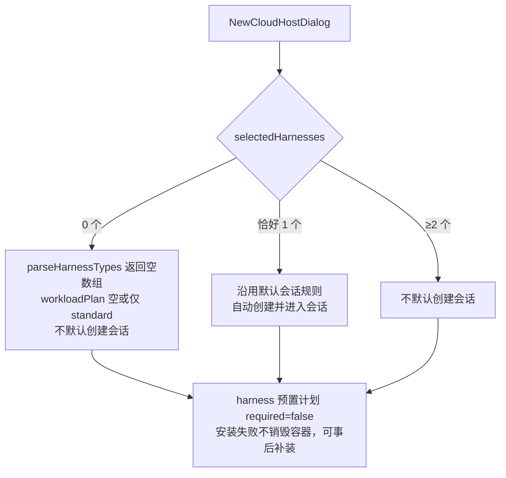

# 云电脑组件安装切换 pnpm 与工作负载 Harness 可选化 - 技术提案

**功能名称**: 云电脑组件安装切换 pnpm、设置-工作负载显示可选 harness
**关联 PRD**: `docs/product/draft/20261029-pnpm-workload-and-harness-optional.md`
**技术提案版本**: v1.0
**创建日期**: 2026-10-29
**作者**: ZeroAsh Agent
**feat-branch**: `feat/pnpm-workload-and-harness-optional`

## 1. 概述

### 1.1 背景

需求来源：GitHub Issue #369「云电脑npm全局安装的工作负载改为pnpm」，两部分诉求：

1. **组件安装切换 pnpm**：云电脑中很多组件（harness 与其他工作负载）目前经 npm 全局安装，现在改为 pnpm——容器 entrypoint 预装 pnpm（Issue 给出的引导口径 `npm install -g pnpm`），后续使用 pnpm 安装 opencode / kimi-code / deepseek harness 或其他工作负载。
2. **设置-工作负载显示 harness**：前台已运行云电脑的「设置 → 工作负载」部分需要显示 harness——可以后期自己装需要的 harness，这部分 harness 是**可选**、而不是必须的工作负载步骤。

现状（代码事实）：

- **npm 全局安装落点**：worker 镜像 `deploy/images/worker/Dockerfile:120`（`npm install -g agent-gear@2.11.x`）与 `entrypoint.sh:57`（自更新 `npm install -g agent-gear`，属引导链、不在本期靶面）；预制工作负载脚本——`006-preset-harness-opencode.ts`（`npm install -g "@opencode/cli@…"`）、`009-preset-harness-kimi-code.ts`（`npm install -g "@moonshot-ai/kimi-code@…"`）、`013-preset-harness-deepseek-header-masq.ts`（双包 `npm install -g "@deepseek-ai/dsh@…" "@deepseek-ai/dsh-acp-app@…"`，且因 `dsh plugin` 转发 pnpm 而在脚本内引导 `npm install -g "pnpm@9.15.9"`）、`015-preset-playwright.ts`（`npm install -g playwright`）、`001-preset-workloads.ts:66`（`pnpm|yarn|bun) npm install -g "$pm"`，包管理器自举）。**镜像未预装 pnpm**（BUILD.md:215）。
- **harness 是创建即安装的必须步骤**：`cloud-host-workload-plan.ts:120-125` 把 harness 预置固定放前且 `required: true`（硬失败强制注销）；创建表单强制「至少选择一种 Harness」（`NewCloudHostDialog.tsx:156`），`parseHarnessTypes` 空数组抛 `at least one harness type is required`（`cloud-host-service.ts:107-110`）。
- **harness 不出现在设置-工作负载**：`cloud-workload-catalog.ts:26` `listStandard()` 只查 `workloadKind:'standard'`；`createInstallOperation` 对 harness 负载抛 `Workload not found`（`cloud-host-workload-service.ts:197`）；前端 `CloudHostWorkloadsSection` 已有 HARNESS 分组渲染代码但数据恒为空。
- **会话约束**：`session.ts:172-177`（A-11）会话 ACP 工具须落在云电脑 `harnessTypes` 映射内（`allowed.length > 0` 时强制）；`harnessTypes` 仅在创建时写入（`container-service.ts:415` Job env `ZAG_HARNESS_TYPES`、`buildHarnessEnv` 按容器读模型实时组装批次 env）。

### 1.2 目标

- worker 容器 entrypoint **预装 pnpm**（幂等、缺失自举），预制工作负载脚本（OpenCode / Kimi Code / DeepSeek Harness / Playwright）的全局安装统一切换为 `pnpm add -g`；安装来源（内网 npm 代理）、硬校验与幂等口径完全不变；存量容器（无 pnpm）经脚本内自举回退兼容。
- 设置-工作负载暴露 harness：`cloudHostWorkloads` 与 MCP `workload_list` 返回 harness 负载（前端按 `workloadKind` 分组、标识「可选」）；`installCloudHostWorkload` / `workload_install` 放行 harness 运行期安装。
- harness 运行期安装闭环：runtime 批次与 init 同口径注入 harness env（`ZAG_MODEL_*` 等，`harness prepare` 依赖）；逐 harness 类型版本门禁校验；安装成功后 `cloudcontainers.harnessTypes` 追加该类型（会话 A-11 门与设置页展示同步生效）。
- harness 可选化：创建允许 **0 个** harness（`parseHarnessTypes` 放宽、创建表单去强制）；harness 预置计划 `required: true → false`（可选、非必须工作负载，安装失败不再硬失败销毁容器）。
- 无 GraphQL 契约字段变更（仅注释与 `cloud-controller-websocket.md` 契约注记修订）；无数据模型 schema 变更。

### 1.3 范围

**做**：

- `deploy/images/worker/entrypoint.sh`：`ensure_pnpm()` 预装 + PNPM_HOME/PATH 接线；`entrypoint.test.sh` 新增用例；
- `servers/admin-api/src/migrations/017-workload-pnpm-scripts.ts` 及单测：四条预制脚本 pnpm 刷新（OpenCode V2→V3、Kimi V2→V3、DeepSeek V3→V4、Playwright V1→V2，字节匹配刷新）；
- `servers/agent-api`：`cloud-workload-catalog` 全量目录、`cloud-host-workload-service`（列表映射真实 kind、`createInstallOperation` 放行 harness）、`cloud-host-service`（`parseHarnessTypes` 允许 0 个）、`cloud-host-workload-plan`（harness `required=false`）、`cloud-host-tools`（MCP 口径随列表自动一致）；
- `servers/cloud-controller`：`startRuntimeBatch` harness env 注入、runtime 安装 harness 的版本门禁、`appendInstalledWorkload` 追加 `harnessTypes`；
- `apps/agent-web`：`CloudHostWorkloadsSection` harness 分组与「可选」标识、`NewCloudHostDialog` 去必选校验；
- 契约注记修订：`contracts/cloud-host.graphql`、`contracts/cloud-controller-websocket.md`（A.2.2 / A.2.5）；
- 测试收口：迁移单测、entrypoint 单测、agent-api/cloud-controller 单测、agent-web 组件测试、`tests/api` / `tests/e2e` 口径更新。

**不做**：

- 不切换 agent-gear（镜像预装 `Dockerfile:120` 与自更新 `entrypoint.sh:57`）的 npm 安装——它是容器引导与保活自更新关键链路、不属于「工作负载」，npm 同时保留为 pnpm 自举通道（§6.1 决策 3）；
- 不改 `001-preset-workloads.ts` 的 `pnpm|yarn|bun) npm install -g "$pm"`（包管理器自举通道，pnpm 无法自举自身，§6.1 决策 4）；
- 不改 agent-web 前台「连接控制器」命令模板（`command-template.ts` 的 `npx` / `npm install -g agent-gear` 指引，面向本地控制器，非云电脑工作负载）；
- 不做 harness 卸载入口（已安装不提供卸载，口径不变）；不做 harness 版本选择参数；
- 不改「必须工作负载」既有语义（standard 的 `required` 口径、依赖展开、超时、执行记录均不变）；
- 不改 MCP 工具协议（`workload_list` / `workload_install` 入参出参形态不变，仅列表内容纳入 harness）。

## 2. 技术架构

### 2.1 系统架构图



### 2.2 技术栈

| 层级 | 技术选型 | 说明 |
|------|---------|------|
| 包管理器 | pnpm（固定 `9.15.9`） | npm 仅用于 pnpm 自举（Issue 引导口径）；全局安装统一 `pnpm add -g` |
| 全局 bin 接线 | `PNPM_HOME=/home/worker/.local/share/pnpm` + PATH | entrypoint `WORKER_PATH` 显式并入 + `/etc/profile.d/pnpm.sh` + `pnpm setup`（交互 shell），§6.1 决策 2 |
| 脚本刷新 | admin-api migrations（字节匹配刷新） | 沿用 011/012/013 口径：仅当库内文本等于已知历史版本才替换，管理员定制不覆盖 |
| 运行期安装 | `POST /internal/containers/:id/workloads` → `workload:run` | 三入口共用执行通道；本期扩展 harness 负载放行与 env 注入 |
| 单元测试 | vitest + bash -n | 迁移/服务/调度器/组件测试同既有模式 |

### 2.3 模块划分



| 模块 | 职责 | 关键技术点 |
|------|------|-----------|
| `entrypoint.sh` `ensure_pnpm` | 预装 pnpm 并接线全局 bin | 幂等（`command -v pnpm`）、失败仅告警不阻断、`WORKER_PATH` 并入 PNPM_HOME |
| `migrations/017-workload-pnpm-scripts.ts` | 四条预制脚本切 `pnpm add -g` | 字节匹配刷新、缺失 pnpm 自举回退、只增不改 |
| `cloud-workload-catalog` / `cloud-host-workload-service` | 列表含 harness、安装放行 harness | `listAll()`、真实 `workloadKind` 映射、`createInstallOperation` 门调整 |
| `cloud-host-workload-plan` / `cloud-host-service` | harness 可选化 | `required=false`、`parseHarnessTypes` 允许 0 个 |
| `workload-dispatcher` / `internal-api` | runtime harness 安装配套 | runtime 批次 harness env、逐类型版本门禁、`appendInstalledWorkload` 追加 `harnessTypes` |
| `CloudHostWorkloadsSection` / `NewCloudHostDialog` | 设置-工作负载 harness 展示与创建可选 | 分组/徽标/安装入口、去「至少一个」校验 |

## 3. API 设计

### 3.1 API 契约

**无 GraphQL 字段变更**，仅注释与口径修订：

- `contracts/cloud-host.graphql`
  - `CloudHostCreateInput.harnessTypes`：注释修订为「**可为空数组**（harness 为可选工作负载，可在云电脑设置-工作负载中后期补装）；恰好 1 个时沿用默认会话规则」；
  - `cloudHostWorkloads`：注释修订为「返回 standard **与 harness** 全量可安装工作负载；harness 条目为可选（非必须）工作负载，`installed` 口径一致」；
  - `cloudHostWorkloadCatalog`：维持 **standard 目录**（创建期 harness 选择仍走 `harnessTypes` 多选，避免双入口，§6.1 决策 10）；
  - `installCloudHostWorkload` / `InstallCloudHostWorkloadInput`：注释修订为「支持 `workloadKind=HARNESS` 负载（可选、幂等、不提供卸载）」。
- `contracts/cloud-controller-websocket.md`
  - **A.2.2**：`harnessTypes` 允许空数组（0 个 harness 云电脑）；`workloadPlan` 允许为空（省略或空数组，0 harness + 0 standard 场景）——放宽「显式非空」约束；
  - **A.2.5**（在线容器 runtime 安装）增补：
    1. `workloadId` 可为 harness 负载（`workloadKind=harness`）；安装成功后容器读模型 `harnessTypes` **追加**该负载的 `harnessType`（去重，仅成功结果）；
    2. runtime 批次与 init 批次同口径注入「云电脑初始化 env」（§2.9：`ZAG_HARNESS_TYPES`/`ZAG_MODEL_*`/`ZAG_DEFAULT_WORKSPACE` 等，purpose=harness 时）；env 缺失（如 secret 不完整）时安装判失败并返回可读原因；
    3. harness 负载安装前做**逐类型版本门禁**：`MIN_HARNESS_VERSION_BY_TYPE`（`kimi_code: 2.8.0`、`deepseek_harness: 2.11.0`）与 `MIN_HARNESS_WORKER_VERSION`（2.10.0）取最大值对比在线 worker 版本，不满足 `400 INVALID_WORKLOAD`（可读原因）；
  - 附录读模型注记：`harnessTypes` 为「创建时选定 ∪ 运行期成功安装的 harness 负载」。
- `contracts/admin-cloud-workload.graphql`：**无变更**（`workloadKind` / `harnessType` 字段已存在）。

### 3.2 内部接口

- `cloud-workload-catalog.ts` 新增 `listAll()`（`CloudWorkload.find({})`，含 harness），`listStandard()` 保留（`cloudHostWorkloadCatalog` 继续使用）；
- `cloud-host-workload-service.list()` 改用 `listAll()` 并映射真实 `workloadKind`（现硬编码 `'STANDARD'`）；`createInstallOperation` 的 `workloadKind !== 'standard'` 拒绝调整为「`standard | harness` 放行，其余拒绝」；
- `workload-dispatcher.startRuntimeBatch`：`emitRun` 前经 `resolveRunEnv(container)` 解析 env（与 init 的 `resolveRunEnv` 同源），purpose=harness 且解析失败时抛可读错误（不再下发 `undefined` env）；
- `workload-dispatcher.appendInstalledWorkload`（或同点扩展）：成功回填时若负载 `harnessType` 非空且未在 `container.harnessTypes` 中，`$addToSet` 追加；
- `internal-api.ts` runtime 安装路由：harness 负载的逐类型版本门禁校验；
- `migrations/017` 导出 `HARNESS_OPENCODE_SCRIPT_V3` / `HARNESS_KIMI_CODE_SCRIPT_V3` / `HARNESS_DEEPSEEK_SCRIPT_V4` / `PLAYWRIGHT_SCRIPT_V2` / `PNPM_VERSION` 供单测与后续刷新比对。

## 4. 数据模型

### 4.1 数据库设计

**无 schema 变更**，仅数据刷新与运行态追加：

#### 集合: `cloudworkloads`（脚本文本刷新，字节匹配）

| 负载 | 现行脚本 | 刷新后 | 变更点 |
|------|---------|--------|--------|
| OpenCode（Harness） | `HARNESS_OPENCODE_SCRIPT_V2`（012） | `HARNESS_OPENCODE_SCRIPT_V3` | `npm install -g "@opencode/cli@…"` → `pnpm add -g`；前置 pnpm 自举回退 |
| Kimi Code（Harness） | `HARNESS_KIMI_CODE_SCRIPT_V2`（012） | `HARNESS_KIMI_CODE_SCRIPT_V3` | 同上（`@moonshot-ai/kimi-code`） |
| DeepSeek Harness（Harness） | `HARNESS_DEEPSEEK_SCRIPT_V3`（013） | `HARNESS_DEEPSEEK_SCRIPT_V4` | 双包安装切 `pnpm add -g`；脚本内 pnpm 自举（`npm install -g pnpm@9.15.9`）收敛为统一回退块；`dsh plugin` 与 `.npmrc` 注入不变 |
| Playwright | `PLAYWRIGHT_SCRIPT_V1`（015） | `PLAYWRIGHT_SCRIPT_V2` | `npm install -g playwright` → `pnpm add -g playwright`；`playwright install chromium` 与硬校验不变 |
| Node.js / 其他 | `NODEJS_SCRIPT`（001）等 | **不刷新** | `pnpm\|yarn\|bun) npm install -g "$pm"` 是包管理器自举通道（§6.1 决策 4） |

刷新语义与 011/012/013 一致：仅当库内文本**字节等于**已知历史版本才替换；管理员定制/删除不覆盖（`console.warn` 跳过）。

#### 集合: `cloudcontainers`（运行态追加，无 schema 变更）

- `harnessTypes: string[]`：创建时写入（现状）∪ **运行期成功安装 harness 负载后追加**（去重）；驱动会话 A-11 门（`session.ts:172-177`）与设置页展示；
- `installedWorkloads[]`：口径不变（成功 + init + 非 system），harness 负载同样回填（`source: start|user|mcp`）。

#### 集合: `admin_migrations`

新增账本记录 `{ name: '017-workload-pnpm-scripts', executedAt }`（编号若被并行需求占用则顺延，§6.1 决策 12）。

### 4.2 缓存设计

无缓存 schema 变更。注意 `acpServerOptions` Redis 缓存（`acp:options:<controllerId>:<type>`，5 分钟 TTL）：新装 harness 的 options 首次查询自然未命中缓存、实时探测；如实现期发现 `acpCapabilities` 存在可用性缓存，则在 harness 安装成功后主动失效（`DEL acp:options:*` 对应 key），不改 TTL 口径。

## 5. 技术实现方案

### 5.1 核心流程

#### 流程 1：预装 pnpm 与工作负载安装（切换后）



#### 流程 2：运行中补装 harness（设置-工作负载 / MCP）



#### 流程 3：创建云电脑（harness 可选）



### 5.2 关键实现点

#### 实现点 1: entrypoint 预装 pnpm 与全局 bin 接线

- **描述**: `deploy/images/worker/entrypoint.sh` 新增 `ensure_pnpm()`，在启动自更新之前执行，保证任何工作负载脚本下发前 pnpm 就绪。
- **技术细节**:
  - 预装命令（Issue 引导口径 + 固定版本）：`command -v pnpm >/dev/null 2>&1 || run_as_worker_exec npm install -g pnpm@9.15.9`（经 `run_as_worker` 写 worker 的 per-user nvm 前缀；registry 沿用 `NPM_REGISTRY`/`~/.npmrc` 内网代理）；
  - 全局 bin 接线（§6.1 决策 2）：`run_as_worker` 环境显式 `PNPM_HOME=/home/worker/.local/share/pnpm`，`WORKER_PATH="$WORKER_NVM_DIR/current/bin:$PNPM_HOME:/usr/local/sbin:…"`（`entrypoint.sh:24`）；追加 `/etc/profile.d/pnpm.sh`（`export PNPM_HOME=…` + `PATH` 追加，登录 shell 全局生效，同 Playwright 的 `playwright.sh` 模式）并执行 `run_as_worker_exec pnpm setup`（交互 shell）；幂等标记块重写；
  - 失败语义：pnpm 预装失败**仅告警不阻断**（与 agent-gear 自更新同口径），脚本侧自举回退兜底；`ZAG_SKIP_AGENT_GEAR_UPDATE=1` 不影响 pnpm 预装；
  - `entrypoint.test.sh` 新增用例：T-EP9 预装幂等（已存在不重复安装）、T-EP10 预装失败仅告警且保活链路正常（沿用 PATH stub 模式）。
- **风险点**: pnpm 安装本身依赖 npm 与内网 registry 可达——失败时工作负载脚本会再次尝试自举（双保险）；`WORKER_PATH` 变更影响所有 `run_as_worker` 调用，新增目录仅追加、不改变既有顺序。

#### 实现点 2: 迁移 017——预制脚本 pnpm 刷新（字节匹配）

- **描述**: 一次性迁移 `017-workload-pnpm-scripts.ts` 把四条现行预制脚本的全局安装行切为 `pnpm add -g`，并统一「缺失 pnpm 自举回退」块。
- **技术细节**:
  - 版本链与导出：`HARNESS_OPENCODE_SCRIPT_V2 → V3`、`HARNESS_KIMI_CODE_SCRIPT_V2 → V3`、`HARNESS_DEEPSEEK_SCRIPT_V3 → V4`、`PLAYWRIGHT_SCRIPT_V1 → V2`；`export const PNPM_VERSION = '9.15.9'`；
  - 刷新谓词（同 011/012/013）：按 `presetKey` 定位，库内 `initScript` **字节等于**对应已知旧版本常量才替换；不等（管理员定制）则 `console.warn` 跳过；重跑幂等（已是新版本则无操作）；
  - 脚本内统一回退块（新旧镜像/容器通用）：
    ```bash
    if ! command -v pnpm >/dev/null 2>&1; then
      echo "Installing pnpm ${PNPM_VERSION}"
      npm install -g "pnpm@${PNPM_VERSION}"
    fi
    ```
    DeepSeek V4 中既有的 pnpm 引导（013 `PNPM_VERSION_V4`）收敛为该块（行为等价，去掉「仅 dsh 场景」的局部语义）；
  - 安装行形态：`pnpm add -g "@opencode/cli@${OPENCODE_CLI_VERSION}"` 等（包名与版本 pin 全部不变）；`NPM_REGISTRY` 约定不变（pnpm 读同一 `~/.npmrc` registry 配置，必要时脚本内 `pnpm config set registry` 同步兜底）；
  - 硬校验、幂等锚点、`harness prepare`、`dsh plugin`、`/etc/profile.d` 注入等其余逻辑**逐字不动**。
- **风险点**: 迁移编号 017 与并行需求冲突则顺延（§6.1 决策 12）；`pnpm add -g` 与 npm 的 bin 链接形态差异由决策 2 的接线兜住，脚本硬校验（`--version`）覆盖「装了但不可用」。

#### 实现点 3: 设置-工作负载与 MCP 暴露 harness

- **描述**: harness 负载进入 `cloudHostWorkloads` 与 MCP `workload_list` 列表，并放行安装。
- **技术细节**:
  - `cloud-workload-catalog.ts`：新增 `listAll()`；`cloud-host-workload-service.list()` 改用之并映射真实 `workloadKind`（`'STANDARD' | 'HARNESS'`，现硬编码 `'STANDARD'`）；`listCatalog()` 维持 `listStandard()`；
  - `createInstallOperation`（`cloud-host-workload-service.ts:197`）：`workloadKind !== 'standard'` 的拒绝改为白名单 `['standard','harness']`，其余仍 `Workload not found`；已安装 → SKIPPED 幂等分支不变；
  - MCP `workload_list`（`cloud-host-tools.ts`）经同一 `list()` 自动含 harness（含 `installed` 标记），`workload_install` 复用 `createInstallOperation` 自动放行——与界面口径一致（PRD 验收）；
  - 前端 `CloudHostWorkloadsSection`：HARNESS 分组（现有渲染代码激活）组标题「云电脑（Harness）」；harness 条目追加「可选」徽标（与「预制」「已安装」徽标并列）；安装按钮/参数表单/进度弹窗复用现状（`workloadKind=HARNESS` 时安装按钮同样受 `installed || !hostRunning` 禁用约束）。
- **风险点**: 无协议变化；分组渲染代码已存在，主要为数据面放开。

#### 实现点 4: harness 运行期安装配套（env、门禁、harnessTypes 追加）

- **描述**: 使「后期补装 harness」与「创建时预装」能力等价：模型配置注入可用、版本门禁生效、会话门放行。
- **技术细节**:
  - **runtime 批次 harness env**：`startRuntimeBatch`（`workload-dispatcher.ts:437`）当前 `emitRun(..., undefined, ...)` 不带 env；改为与 init 同源 `resolveRunEnv(container)`（purpose=harness 批次注入 `ZAG_HARNESS_TYPES`/`ZAG_MODEL_*`/`ZAG_DEFAULT_WORKSPACE` 等，§2.9），解析失败（secret 缺失/配置不完整）时判失败并返回可读原因，不下发半套配置（T-CC13 口径沿用）。这是 `harness prepare`（`readHarnessEnv()` 必需 `ZAG_MODEL_BASE_URL/ZAG_MODEL_API_KEY/ZAG_MODEL_IDS/ZAG_DEFAULT_WORKSPACE`）在运行期安装可用的前提；
  - **逐类型版本门禁**：`internal-api.ts` runtime 安装路由对 `workloadKind=harness` 的负载取 `max(MIN_HARNESS_VERSION_BY_TYPE[harnessType], MIN_HARNESS_WORKER_VERSION)` 与在线 worker 版本（socketio-gateway 注册信息）比对，不满足 `400 INVALID_WORKLOAD` 可读原因；无法获取 worker 版本时按「已通过注册门禁」放行并告警留痕（契约注记）；
  - **harnessTypes 追加**：`appendInstalledWorkload`（`workload-dispatcher.ts:656-694`，成功 + init + 非 system 的唯一回填点）同点扩展：负载 `harnessType` 非空时对 `cloudcontainers.harnessTypes` `$addToSet`（去重；standard 负载不动）。写点在 cloud-controller（agent-api 的 cloud-container 为只读镜像，§6.1 决策 8）。效果：会话 A-11 门（`session.ts:172-177`）放行该类型、设置页 `harnessTypes` 展示更新、后续批次 `buildHarnessEnv` 的 `ZAG_HARNESS_TYPES` 自动涵盖；
  - **边界口径**：0-harness 云电脑（`harnessTypes=[]`）时 A-11 的 `allowed.length > 0` 不生效（不限制）；补装首个 harness 后收窄为该类型集合——与「可创建会话的工具范围 = 已启用 harness」的既有口径一致。
- **风险点**: Job env `ZAG_HARNESS_TYPES`（`container-service.ts:415`）仍为创建期快照——经核对 agent-gear 仅 `harness prepare` 消费该变量（`harness/env.ts`），ACP 探测为动态探测、会话门在 agent-api 侧按 `harnessTypes` 读模型判定，故无需重注入 Job env；实现期以「补装后创建该类型会话 + ACP 列表可见」实测收口。

#### 实现点 5: harness 可选化（创建 0 个 + required=false）

- **描述**: 解除「创建必须至少一个 harness」与「harness 硬失败」两个强制语义。
- **技术细节**:
  - `cloud-host-service.parseHarnessTypes`（`cloud-host-service.ts:107-110`）：空数组不再抛 `at least one harness type is required`，返回 `[]`（白名单/去重逻辑不变）；
  - `cloud-host-workload-plan.resolveCreateWorkloadPlan`（`cloud-host-workload-plan.ts:120-125`）：harness 预置 `required: true → false`（`implicit` 与顺序不变）——harness 安装失败不再触发 `markMustFailure`/`forceDestroy`，容器照常就绪，可事后补装（PRD「harness 永远是可选工作负载」）；
  - A.2.2 放宽：`harnessTypes` 允许空数组、`workloadPlan` 允许空（`resolveContainerPlan` 已支持空计划：无 init 脚本直接 online）；
  - 前端 `NewCloudHostDialog`：删除 `selectedHarnesses.length === 0 ? '请至少选择一种 Harness' : null` 校验（`NewCloudHostDialog.tsx:156`），追加提示文案「可不选，之后在设置-工作负载中补装」；默认会话规则提示不变（恰好 1 个自动建会话）；`useCloudHostProvisioning` 的 `createSession: harnessTypes.length === 1` 逻辑不变；
  - `resolveAgentGearMinVersion`（空数组 → 基线 2.10.0）行为不变。
- **风险点**: `required=false` 使「创建时勾选但安装失败」从硬失败变为就绪可用——与旧 PRD（[[20261020-feat-container-harness-support]]）「环境准备失败则启动失败」口径不同，属本需求明确的口径变更（评审重点确认项）。

#### 实现点 6: 测试口径更新

- **描述**: 各层测试随语义更新，覆盖新增分支。
- **技术细节**:
  - `017-workload-pnpm-scripts.test.ts`：T-MIG-PN1~PN5（见 §8）；
  - `tests/api/src/admin-api/cloud-workload.test.ts`：脚本内容断言从 `npm install -g` 切 `pnpm add -g` 形态（含回退块、不含 `npm install -g "@opencode` 等旧形态）；预制项数量不变（10 个）；
  - `tests/api` 新增：`cloudHostWorkloads` 含 harness 条目（kind 映射）、`installCloudHostWorkload` 对 harness 安装成功且幂等 SKIPPED、`workload_list` 含 harness；
  - `tests/e2e`：设置-工作负载 HARNESS 分组与「可选」徽标、创建 0-harness 云电脑成功、补装 harness 后可创建会话；T-E16 预制徽标计数不变；
  - agent-web 组件测试：`CloudHostWorkloadsSection`（分组/徽标/安装禁用）、`NewCloudHostDialog`（0 个通过、提示文案）；agent-api/cloud-controller 单测见 §8。
- **风险点**: 无。

## 6. 技术决策

### 6.1 决策列表

| # | 决策 | 选项 A | 选项 B | 最终选择 | 原因 |
|---|------|--------|--------|---------|------|
| 1 | pnpm 引导版本 | `npm install -g pnpm`（Issue 原文，跟随上游） | 固定 `pnpm@9.15.9` | B | 沿用 013 既有「固定版本引导安装」口径（`PNPM_VERSION_V4`），规避上游破坏性变更；回退块与 entrypoint 同版本 |
| 2 | pnpm 全局 bin 接线 | `PNPM_HOME` + PATH（entrypoint `WORKER_PATH` + `/etc/profile.d` + `pnpm setup`） | `pnpm config set global-bin-dir` 指向 nvm `current/bin` | A | B 零 PATH 改动但产物落 nvm 版本目录，随 `nvm install --default`（Node.js 工作负载）切换丢失；A 为 pnpm 标准口径、跨 Node 版本稳健 |
| 3 | agent-gear 安装是否切 pnpm | 一并切换（镜像预装 + 自更新） | 保持 npm | B | Issue 靶面为「工作负载」（标题即「npm全局安装的工作负载改为pnpm」）；agent-gear 是容器引导与保活自更新关键链路、非工作负载；npm 同时保留为 pnpm 自举通道 |
| 4 | 001 Node.js 脚本 `npm install -g "$pm"` | 切 pnpm | 保持 npm 自举 | B | 包管理器自举通道（装 pnpm 自身只能经 npm，即 Issue 的引导口径）；默认参数 `['npm']` 场景无感 |
| 5 | harness 创建期硬失败 | 保持 `required=true` | `required=false` | B | Issue「harness 是可选，而不是必须的工作负载步骤」；安装失败不销毁容器、可事后补装（口径变更，评审确认） |
| 6 | 创建 harness 必选 ≥1 | 保持 | 允许 0 个 | B | Issue「可以后期自己装需要的 harness」；配合设置-工作负载补装入口形成完整闭环 |
| 7 | runtime 安装 harness 的模型 env | 脚本内自行获取 | runtime 批次注入 harness env（同 init） | B | `harness prepare` 必需 `ZAG_MODEL_*`（`readHarnessEnv`）；复用 `resolveRunEnv` 单一来源，失败可读可重试 |
| 8 | `harnessTypes` 追加写点 | agent-api 在安装完成后写 | cloud-controller `appendInstalledWorkload` 同点写 | B | 已安装回填唯一写点在 cloud-controller，agent-api 为只读镜像；原子同点避免「已安装但未入列」窗口 |
| 9 | MCP `workload_list` 是否含 harness | 仅界面显示 | 与界面一致含 harness | B | PRD 验收「Agent 侧列出的可安装负载与界面一致」；复用同一 `list()` |
| 10 | 创建对话框「预装工作负载」catalog 含 harness | 含 | 不含（创建走 `harnessTypes` 选择器） | B | 避免双入口与默认会话规则歧义；harness 创建期选择保留产品语义（选 1 个自动建会话） |
| 11 | 既有脚本刷新方式 | 直接覆盖 | 字节匹配刷新（011/012/013 口径） | B | 不覆盖管理员定制/删除；只增不改是迁移体系既定约束 |
| 12 | 迁移编号 | 固定 017 | 被并行需求占用则顺延 | B | 沿用 MongoDB/Playwright 并行撞号的既有协调裁决模式 |
| 13 | runtime harness 版本门禁 | 不校验（靠注册门禁） | 逐类型校验（`MIN_HARNESS_VERSION_BY_TYPE` 取 max） | B | 注册门禁按创建期 `agentGearMinVersion`，运行期新增类型（如 deepseek 2.11.0）需补校验；无法取版本时放行并留痕 |

### 6.2 依赖与约束

| 类型 | 内容 | 说明 |
|------|------|------|
| 依赖 | 工作负载体系（迁移 runner、`workload:run` 通道、参数注入、依赖展开、执行记录） | 零协议改动复用 |
| 依赖 | 内网 Nexus npm 代理（`NPM_REGISTRY`） | pnpm 与 npm 共用同一 registry 配置 |
| 依赖 | agent-gear `harness prepare`（opencode/deepseek 配置注入） | runtime 安装经批次 env 注入保障 |
| 约束 | 存量云电脑兼容 | 旧镜像容器无 pnpm：脚本自举回退 `npm install -g pnpm@9.15.9`；新预装仅对新容器生效 |
| 约束 | npm 保留范围 | 仅 pnpm 自举与 agent-gear（镜像预装/自更新）；工作负载全局安装一律 pnpm |
| 约束 | 已安装不提供卸载 | harness 同口径（`installedWorkloads` 只增） |
| 约束 | 迁移只增不改 | 字节匹配刷新，管理员定制不覆盖 |

## 7. 项目结构

```
deploy/images/worker/
├── entrypoint.sh                           # 更新：ensure_pnpm + PNPM_HOME/WORKER_PATH 接线
└── entrypoint.test.sh                      # 更新：T-EP9/T-EP10
servers/admin-api/src/
├── index.ts                                # 更新：runMigrations 追加 017
└── migrations/
    ├── 017-workload-pnpm-scripts.ts        # 新增：四脚本 pnpm 刷新（字节匹配）
    └── 017-workload-pnpm-scripts.test.ts   # 新增：T-MIG-PN1~PN5
servers/agent-api/src/
├── services/cloud-workload-catalog.ts      # 更新：listAll()
├── services/cloud-host-workload-service.ts # 更新：list 映射真实 kind、createInstallOperation 放行 harness
├── services/cloud-host-workload-plan.ts    # 更新：harness required=false
└── services/cloud-host-service.ts          # 更新：parseHarnessTypes 允许 0 个
servers/cloud-controller/src/
├── services/workload-dispatcher.ts         # 更新：runtime 批次 harness env、appendInstalledWorkload 追加 harnessTypes
└── routes/internal-api.ts                  # 更新：runtime harness 版本门禁
apps/agent-web/src/
├── components/cloud-host/CloudHostWorkloadsSection.tsx  # 更新：harness 分组 + 「可选」徽标
└── components/cloud-host/NewCloudHostDialog.tsx         # 更新：去「至少一个」校验 + 提示文案
contracts/
├── cloud-host.graphql                      # 注释修订
└── cloud-controller-websocket.md           # A.2.2 / A.2.5 口径修订
tests/
├── api/src/admin-api/cloud-workload.test.ts    # 更新：pnpm 脚本断言、harness 列表/安装口径
└── e2e/src/…                                    # 更新：设置-工作负载 harness 展示、0-harness 创建、补装建会话
```

## 8. 测试策略

### 8.1 测试覆盖要求

- 迁移 017 单测先行（TDD 红-绿-重构），覆盖创建/字节匹配刷新/定制保留/幂等全分支；
- agent-api / cloud-controller 服务与调度器单测覆盖 harness 放行、env 注入、门禁、`harnessTypes` 追加新分支；
- API / E2E 覆盖「设置-工作负载显示 harness 并可安装」「创建 0-harness」「补装后建会话」端到端口径。

### 8.2 测试类型

| 类型 | 工具 | 覆盖范围 |
|------|------|---------|
| 单元（迁移） | vitest + bash -n | T-MIG-PN1 四脚本播种字段与 pnpm 形态（`pnpm add -g` + 回退块 + 版本 pin 不变）；T-MIG-PN2 已是新版本跳过；T-MIG-PN3 管理员定制（文本不匹配）不覆盖；T-MIG-PN4 幂等重跑无副作用；T-MIG-PN5 `bash -n` 语法与「不含旧 `npm install -g "@…` 安装形态」断言 |
| 单元（entrypoint） | bash 测试桩 | T-EP9 `ensure_pnpm` 幂等（已装不重复）；T-EP10 预装失败仅告警、保活与 agent-gear 链路不受影响 |
| 单元（agent-api） | vitest | T-AH1 `list()` 含 harness 且 kind 映射真实值；T-AH2 `createInstallOperation` 放行 harness / 拒绝未知 kind / 已安装 SKIPPED；T-AH3 `parseHarnessTypes` 空数组返回 `[]`；T-AH4 `resolveCreateWorkloadPlan` harness `required=false` 顺序不变 |
| 单元（cloud-controller） | vitest | T-CC-R1 `startRuntimeBatch` purpose=harness 注入 harness env（与 init 同源）；T-CC-R2 env 解析失败判可读错误；T-CC-R3 `appendInstalledWorkload` harnessType 追加（去重、standard 不动）；T-CC-R4 runtime harness 版本门禁（满足/不满足/版本未知放行留痕） |
| 单元（agent-web） | vitest + RTL | harness 分组渲染与「可选」徽标、安装按钮禁用口径、`NewCloudHostDialog` 0-harness 提交通过与提示文案 |
| API 集成 | vitest（Aspire 编排） | `cloudHostWorkloads` 含 harness（含 `installed` 标记）；`installCloudHostWorkload` harness 安装 → SUCCEEDED → 幂等 SKIPPED；`workload_list` 含 harness；预制项脚本内容 pnpm 断言（数量 10 不变） |
| E2E | Playwright（Aspire 编排） | 设置-工作负载 HARNESS 分组 + 可选徽标；创建 0-harness 云电脑就绪；补装 harness 后 ACP 可见并创建会话；T-E16 计数不变 |

> 测试运行遵循 `tests/api` / `tests/e2e` 的 AGENTS.md：只用 Aspire 编排、禁止裸 docker；重跑从 `aspire start` 重来。

## 9. 验收标准

- [ ] 技术方案评审通过（重点确认 §6.1 决策 3/5/6 的口径变更）
- [ ] 契约修订评审通过（A.2.2 / A.2.5 注记、cloud-host.graphql 注释）
- [ ] 新容器 entrypoint 预装 pnpm 成功且 `pnpm` 可直接使用；预装失败仅告警不阻断
- [ ] OpenCode / Kimi Code / DeepSeek Harness / Playwright 安装脚本经 `pnpm add -g` 安装，工具硬校验通过、来源走内网代理
- [ ] 存量容器（无 pnpm）经脚本自举回退安装成功
- [ ] 设置-工作负载显示 harness 条目（分组 + 「可选」标识），可发起安装、进度/失败可读、已安装幂等 SKIPPED
- [ ] MCP `workload_list` 与界面一致（含 harness），`workload_install` 可安装 harness
- [ ] 运行期安装 harness 成功后：`harnessTypes` 追加、ACP 列表可见、可创建该类型会话（模型注入/登录引导等既有体验不变）
- [ ] runtime harness 版本门禁生效（不满足可读拒绝）
- [ ] 创建云电脑允许 0 个 harness；harness 安装失败不再销毁容器（required=false）
- [ ] 单元测试覆盖达标（T-MIG-PN1~PN5、T-EP9/10、T-AH*、T-CC-R*）、API 测试通过、E2E 通过

## 10. 相关文档

- 关联 PRD：`docs/product/draft/20261029-pnpm-workload-and-harness-optional.md`（Issue #369）
- [[20261020-feat-container-harness-support]] — 容器启动任务支持 harness 类型（harnessTypes/会话口径来源，本期放宽必选与硬失败语义）
- [[20261025-feat-kimi-code-harness]] / [[20261025-feat-deepseek-harness]] — harness 预置脚本与 `harness prepare` 口径
- [[20261027-feat-dsh-header-masq]] — DeepSeek 脚本刷新与 pnpm 引导先例（`PNPM_VERSION_V4`）
- [[20261028-feat-playwright-workload]] — Playwright 脚本 V1（本期刷新为 V2）
- [[20261025-feat-cloud-host-keepalive]] — worker 用户与预置脚本执行环境（`run_as_worker` / sudo 口径）
- [[20261022-feat-workload-optimization]] — 工作负载三入口与展示口径
- 契约：`contracts/cloud-host.graphql`、`contracts/cloud-controller-websocket.md`（§2.9 / A.2.2 / A.2.5）、`contracts/admin-cloud-workload.graphql`
- 开发规范：`docs/engineering/common-rules.md`、`servers/admin-api` 迁移约定（`migrations/runner.ts`）
