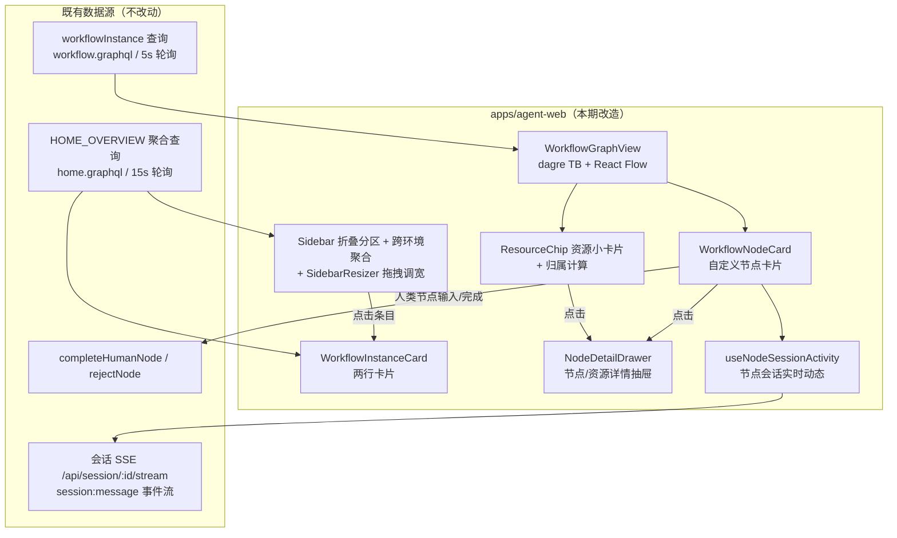
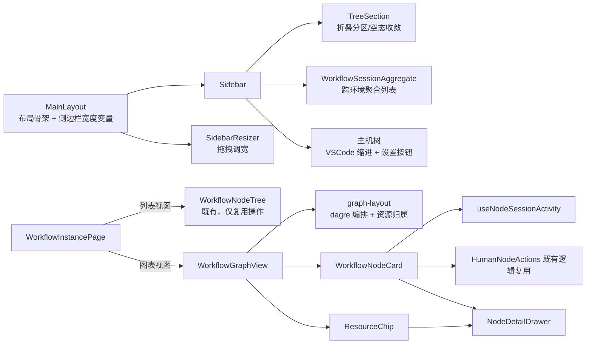
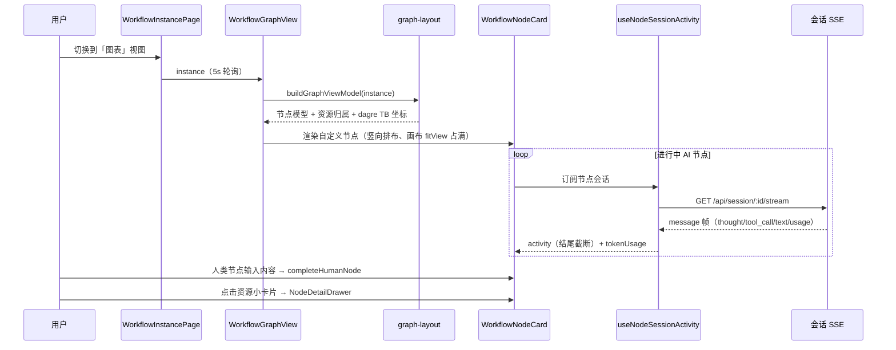
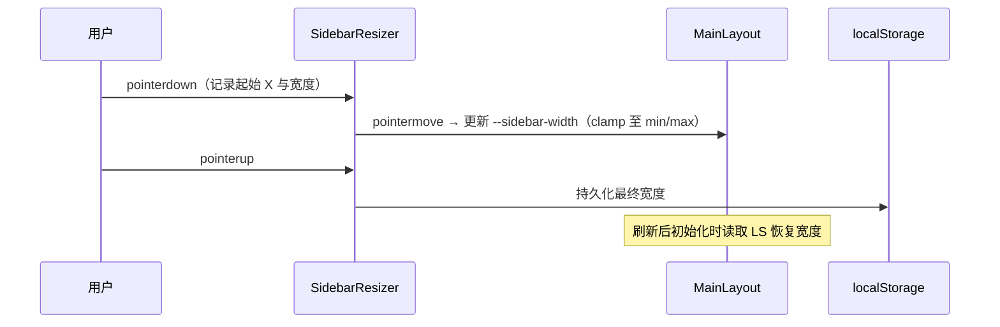

# UI 优化四期（侧边栏与工作流视图） - 技术提案

**功能名称**: UI 优化四期（侧边栏与工作流视图）
**关联 PRD**: [docs/product/draft/20261030-ui-optimization-phase4.md](../../product/draft/20261030-ui-optimization-phase4.md)
**技术提案版本**: v1.0
**创建日期**: 2026-10-30
**作者**: ZeroAsh Agent
**feat-branch**: `feat/ui-optimization-phase4`（需求总分支；实现分支 `feat/ui-optimization-phase4-impl`，参考 z-git skill）

## 1. 概述

### 1.1 背景

GitHub Issue [Deliay/z-agent-gear#345](https://github.com/Deliay/z-agent-gear/issues/345)「261030-UI优化」提出侧边栏与工作流视图两组体验问题（详见关联 PRD 1.1）。经代码现状调研，对应根因：

- **侧边栏**：`MainLayout.tsx` 桌面端固定 `grid-cols-[280px_1fr]`；`Sidebar.tsx`（634 行）把「统一网关/工作流/会话/工作区」四个 `TreeSection` 嵌套在每个控制器（环境）下，会话/工作流按 `controllerId` 分组过滤，无跨环境视图；`TreeSection` 空态渲染 `emptyMessage`（「无会话」等）文字；无宽度拖拽能力。
- **工作流卡片**：`Sidebar.tsx` 内局部组件 `WorkflowInstanceItem` 第二行拼接「工作区 · 控制器 · 状态」纯文本（`instanceStatusText`），无状态徽标。
- **图表视图**：`WorkflowGraphView.tsx` 用 `@xyflow/react`（React Flow v12）+ `@dagrejs/dagre`，dagre `rankdir: 'LR'` 横向排布、节点固定 180×60 内联 label、外层 `h-[600px]` 固定高度；节点 `style` 硬编码 `background: 'white'`、边硬编码 `stroke: '#94a3b8'`、状态色为 hex 常量 `STATUS_COLORS`，均不走 `index.css` 的 oklch 主题变量，故深色主题下卡片仍为白色；边无 `markerEnd`（无箭头）、线宽默认 1px；卡片仅展示节点名/类型/harness chip/状态 pill。
- **人类节点操作**：`WorkflowNodeTree.tsx` 内 `HumanNodeActions`（textarea + `COMPLETE_HUMAN_NODE` / `REJECT_NODE`），图表上不可达；项目无 Sheet/Drawer 组件，`SessionSidePanel.tsx` 以 Dialog 样式冒充侧边抽屉可作参照。
- **资源展示**：`BlackboardPanel.tsx`（黑板/垃圾桶）与 `WorkflowContextPanel.tsx`（关联 PR/追加提示词）固定在右侧 320px 列的折叠列表，图上无投影；节点归属可由黑板 key 约定 `{nodeId}-{nodeName}-产物-{title}` 与 `pullRequestLinks[].nodeId` 解析。

### 1.2 目标

1. 侧边栏改为 VSCode 风格可折叠分区 + 跨环境聚合 + 可拖拽宽度，交互逻辑零变化。
2. 工作流卡片两行化（名称 + 状态徽标 / 工作区）。
3. 图表视图竖向布局、画布占满、节点卡片信息完整（模型/Harness/实时动态/token/PR/检查项/返工）且主题跟随、人类节点就地操作、资源上图关联、六态整体配色、连线加粗带箭头。
4. 全部改动为 `apps/agent-web` 纯前端展示层改造，**零契约变更、零后端变更**。

### 1.3 范围

**做**：`apps/agent-web` 侧边栏布局、工作流卡片、图表视图（布局/节点卡片/资源小卡片/配色/连线）、人类节点与资源详情抽屉、图表视图右栏资源树隐藏。

**不做**：GraphQL 契约与任何后端改动；移动端布局重构（保持现状、不回归）；列表视图（`WorkflowNodeTree`）结构重构（仅复用其操作逻辑与解析工具）；工作流模板编辑器（`WorkflowGraphEditor`）；会话页渲染逻辑（仅复用其解析工具）。

## 2. 技术架构

### 2.1 系统架构图



### 2.2 技术栈

| 层级 | 技术选型 | 说明 |
|------|---------|------|
| 前端框架 | React 19 + TypeScript（strict） | 沿用现状 |
| 构建 | Vite + Tailwind CSS v4 | 沿用现状；配色走 `index.css` oklch 语义变量 |
| 图表渲染 | `@xyflow/react` ^12.6.0 | 沿用；引入自定义节点类型替代内联 label |
| 自动布局 | `@dagrejs/dagre` ^1.1.4 | 沿用；`rankdir` 改 `TB` |
| 状态/数据 | Apollo Client + Zustand（`stores/homeOverview.ts`） | 沿用；不新增全局状态 |
| 组件基础 | 既有 shadcn 风格 `components/ui/*` | 新增 `ui/sheet.tsx` 侧边抽屉 |
| 测试 | Vitest + React Testing Library + Playwright E2E | 沿用 z-test 口径 |

### 2.3 模块划分



| 模块 | 职责 | 关键技术点 |
|------|------|-----------|
| `MainLayout` + `SidebarResizer` | 侧边栏列宽变量、拖拽调宽 | CSS 变量 `--sidebar-width`、pointer capture、localStorage 持久化 |
| `Sidebar` + `TreeSection` | 四个顶层折叠分区、跨环境聚合、空态收敛 | 全宽标题行、展开态持久化、`hasContent` 三态收敛 |
| `WorkflowInstanceCard` | 工作流两行卡片 | 复用 `NODE_STATUS_BADGE` 语义色徽标 |
| `WorkflowGraphView` + `graph-layout` | 竖向布局、画布占满、边箭头 | dagre `TB`、动态节点尺寸、`MarkerType.ArrowClosed` |
| `WorkflowNodeCard` | 节点卡片信息与人类节点就地操作 | React Flow 自定义 node、视图模型 `NodeCardViewModel` |
| `useNodeSessionActivity` | 进行中 AI 节点实时动态行 | 复用会话 SSE 与 `group-messages`/`tool-call-state` 解析 |
| `ResourceChip` | 黑板/PR/追加提示词上图与归属 | key 前缀解析（同 `artifactsOf`）、限高限宽截断 |
| `NodeDetailDrawer` | 人类节点与资源详情抽屉 | 新增 `ui/sheet.tsx`、复用 `HumanNodeActions` 操作与草稿机制 |

## 3. API 设计

### 3.1 API 契约

**本期无新增接口、无契约变更**。全部复用既有契约字段（`contracts/workflow.graphql`、`contracts/home.graphql`）：

| 数据 | 复用来源 | 关键字段 |
|------|---------|---------|
| 侧边栏聚合列表 | `HOME_OVERVIEW`（`graphql/home.ts`） | `controllers`、`workflowInstances` / `archivedWorkflowInstances`（`HomeWorkflowInstanceFields`）、`sessions` |
| 图表节点 | `workflowInstance(id)`（`graphql/workflow.ts` `GET_WORKFLOW_INSTANCE`） | `nodes[]`：`type/status/name/stage/agentConfig{acpServerType,modeId,modelId}/dependsOn/reworkCount/rejectInfo/failInfo` |
| 黑板/产物 | 同上 | `blackboard[]` / `blackboardTrash[]`（`BlackboardEntry{key,value,updatedAt}`） |
| 关联 PR / 检查项 | 同上 | `pullRequestLinks[]`（`pullRequestId/prUrl/nodeId/nodeName/checkRunUrl/lastSyncedCommitSha/lastSyncAt/lastSyncError`） |
| 追加提示词 | 同上 | `additionalPrompts[]`（`WorkflowAdditionalPrompt{key,value}`） |
| 节点实时动态 | 会话 SSE `GET /api/session/:id/stream` | `message` 帧内 `sessionUpdate`：`agent_thought_chunk` / `tool_call(_update)` / `agent_message_chunk` / `usage_update` |
| 模型显示名 | `GET_ACP_SERVER_OPTIONS`（`graphql/queries.ts`） | `acpServerOptions.models{id,name,provider}`，兜底 `node.agentConfig.modelId` 原值 |
| 人类节点操作 | 既有 mutation | `completeHumanNode(instanceId,nodeId,input)`、`rejectNode(instanceId,nodeId,reason)` |

### 3.2 内部接口

组件/hook 间新增的内部契约（纯前端）：

```ts
// hooks/useNodeSessionActivity.ts —— 进行中节点实时动态（轻量订阅）
interface NodeLiveActivity {
  kind: 'thinking' | 'tool_call' | 'text' | 'idle';
  text: string;          // 已截断的结尾展示文本（tool_call 为标题）
  rawTitle?: string;     // 工具调用标题（toolCallHeaderTitle 口径）
  updatedAt?: number;
}
function useNodeSessionActivity(sessionId?: string): {
  activity: NodeLiveActivity | null;
  tokenUsage: number | null;   // 最后一条 usage_update 的 used；无则 null
};

// components/workflow/graph/graph-layout.ts —— 节点卡片视图模型与资源归属
interface NodeCardViewModel {
  id: string; name: string; type: 'HUMAN' | 'AI' | 'FLAG';
  status: WorkflowNodeStatus;
  harnessLabel?: string; modelLabel?: string;
  live?: NodeLiveActivity | null;
  tokenUsage: number | null;
  prLinks: WorkflowPullRequestLink[];
  reworkCount: number;
  artifacts: BlackboardEntry[];
}
function buildGraphViewModel(instance: WorkflowInstanceData): {
  nodeModels: NodeCardViewModel[];
  resourceGroups: ResourceChipGroup[];   // 按 nodeId 归属；null = 实例级
  instanceLevel: ResourceChipGroup;      // 未归属资源（图顶部横排）
};
```

## 4. 数据模型

### 4.1 数据库设计

**无数据库变更**。新增的仅是前端视图模型（见 3.2）与本地偏好存储。

### 4.2 本地偏好存储

| Key（localStorage） | 内容 | 默认值 |
|---------------------|------|--------|
| `sidebar-width` | 侧边栏宽度（px 或 rem 数值） | 20rem（320px） |
| `sidebar-sections-expanded` | 四个分区展开态 `{hosts,workflows,sessions,gateways}` | `{hosts:false,workflows:true,sessions:true,gateways:false}` |
| `workflow-view-mode` | 既有，列表/图表视图 | 既有行为不变 |
| `workflow-node-draft:{instanceId}:{nodeId}` | 既有，人类节点输入草稿 | 既有行为不变 |

## 5. 技术实现方案

### 5.1 核心流程

图表视图渲染与实时动态更新：



侧边栏宽度拖拽：



### 5.2 关键实现点

#### 实现点 1: 侧边栏折叠分区与跨环境聚合

- **描述**: `MainLayout.tsx` 桌面端列定义改为 `grid-cols-[var(--sidebar-width,20rem)_1fr]`。`Sidebar.tsx` 顶层重组为四个全宽折叠分区（类 VSCode：整行标题 hover 高亮 + Chevron + 标题 + 右侧 actions），`SidebarSectionState` 由 `sidebar-sections-expanded` 持久化。
- **技术细节**:
  - 「主机」：内容保持现状（控制器 → 统一网关/工作流/会话/工作区 `TreeSection` 树 + 设置按钮），仅样式改造（见实现点 3）。
  - 「工作流」：`workflowInstances`（活跃平铺 + 「已归档（N）」自折叠分组，沿用 `ControllerWorkflows` 现有结构）不再按 `controllerId` 过滤，聚合 `HOME_OVERVIEW` 全量；条目渲染新两行卡片（实现点 5）。
  - 「会话」：`sessions` 全量平铺（沿用 `NavLink` 条目、状态点、工作区名），不再按 `controllerId` 分组；条目 `title` tooltip 显示所属主机名（`controller.name`），点击行为不变。
  - 「网关」：聚合各控制器的 `GatewayItem`（复用 `GatewaySection`/`GatewayItem`），仅在线控制器有内容。
  - 空态：`TreeSection`/分区在 `hasContent === false` 时不再渲染 `emptyMessage` 文字，仅保留可展开的空容器（`hidden` 子级既有机制沿用）。
- **风险点**: `HOME_OVERVIEW` 已含全量数据，聚合无额外请求；条目排序按 `updatedAt` 倒序，需固定 tie-break（id）保证 5s 轮询间列表稳定不跳动。

#### 实现点 2: 侧边栏宽度拖拽（SidebarResizer）

- **描述**: 侧边栏右缘 4px 宽的拖拽热区（hover 变色、`cursor-col-resize`），拖拽实时更新 `--sidebar-width`。
- **技术细节**: Pointer Events + `setPointerCapture`；宽度 clamp `[15rem, 28rem]`（240px–448px），默认 20rem。上限取值依据：会话/工作流名称普遍 20–40 字符、主机树最深 4 级（工作区→worktree→会话）×0.5rem 缩进 + 设置按钮需常驻可见，28rem 足够完整展示中位数名称；再宽会挤压主内容区（会话/图表视图最小可用宽按 40rem 控制）。拖拽期间 `select-none` 防止选中文本，`pointerup` 持久化。移动端（`Sidebar mobile`）不渲染 Resizer。
- **风险点**: 双击热区恢复默认宽度（附加体验，不改变交互逻辑）。

#### 实现点 3: 主机树 VSCode 层级视觉

- **描述**: 主机树层级缩进统一为每级 0.5rem（≈2 空格），配层级引导线/悬停高亮，节点行全宽占满。
- **技术细节**: `TreeSection` 与 `WorktreeSidebarGroup` 的缩进收敛为 `paddingLeft: level * 0.5rem` 的统一工具类；主机行保留 `Settings` 图标（`stopPropagation` + `navigate('/settings?controllerId=...')`）与状态点、离线置灰逻辑不动。
- **风险点**: worktree 二级树（`WorktreeSidebarGroup` 自维护 `expandedWorktrees`）折叠逻辑不动，仅改缩进量与行样式。

#### 实现点 4: 人类节点详情抽屉（NodeDetailDrawer + ui/sheet）

- **描述**: 新增 `components/ui/sheet.tsx`（shadcn Sheet 形态：右侧滑出、全高、遮罩、Esc/遮罩关闭），承载节点详情抽屉与资源详情抽屉两个形态。
- **技术细节**:
  - 节点详情：名称/阶段/状态/说明、`rejectInfo`/`failInfo` 原因、`reworkCount`/`reworkedAt`、该节点黑板产物（复用 `artifactsOf(node, blackboard)`）、关联 PR 与检查项（`pullRequestLinks` 按 `nodeId` 匹配）、操作区复用 `HumanNodeActions` 的输入（含 `workflow-node-draft:*` 草稿）、`COMPLETE_HUMAN_NODE`、`REJECT_NODE`（Dialog 理由输入）逻辑——抽出为共享 hook `useHumanNodeActions(instanceId, node)` 供 `WorkflowNodeTree` 与抽屉共用，行为零变化。
  - 触达：图表 `WorkflowNodeCard` 点击（输入区/按钮除外）与列表 `NodeCard` 头部新增「详情」入口打开。
  - 资源详情：黑板条目 key + `MarkdownContent` 渲染 value；追加提示词纯文本（`whitespace-pre-wrap`，与 `WorkflowContextPanel` 口径一致）；PR 卡片含 `prUrl` 链接与检查项行。
- **风险点**: `SessionSidePanel` 现以 Dialog 冒充抽屉，样式收敛到 `sheet.tsx` 时保持其全高右贴边观感一致；本次不改造 `SessionSidePanel`（范围外）。

#### 实现点 5: 工作流卡片两行化（WorkflowInstanceCard）

- **描述**: 将 `WorkflowInstanceItem` 抽出为 `components/workflow/WorkflowInstanceCard.tsx`：第一行 `instance.name`（`text-sm font-semibold text-foreground` 强调字号字色）+ 状态徽标（复用 `WorkflowNodeTreeConstants.ts` 的 `NODE_STATUS_BADGE`/`NODE_STATUS_LABELS`，`rounded-full` pill，实例态按 `lastNodeStatus`/`currentNodeNames` 判定，执行中显示「执行中：{name}」）；第二行 `instance.workspace?.name ?? '未知工作区'`（`text-xs text-muted-foreground`）。控制器名不再展示（所属主机移入 hover tooltip）。
- **技术细节**: `instanceStatusText` 的语义（执行中节点名列表）压缩进徽标 tooltip；点击进入详情行为不变。
- **风险点**: 无。

#### 实现点 6: 图表竖向布局与画布占满

- **描述**: `WorkflowGraphView.tsx` dagre 改 `g.setGraph({ rankdir: 'TB', nodesep: 40, ranksep: 70 })`；节点尺寸按卡片实测（宽 280px、高按内容估算 120–220px）写入 dagre；外层容器 `h-[600px]` 改为 `h-full min-h-[480px]`，由 `WorkflowInstancePage` 视图区 flex/grid 行填充，`<ReactFlow fitView>` 初始即占满全图。
- **技术细节**: 并行分支（`dependsOn` 多父/多子）由 dagre 在同层横向展开，主干竖向；MiniMap/Controls/Background 保留，MiniMap `nodeColor` 改从语义状态色取（实现点 10）。既有 `useNodesState/useEdgesState` + instance 轮询整体 `setNodes` 的更新机制不变。
- **风险点**: 节点高度估算与实际卡片渲染高度的偏差（±20px）可接受，`nodesep`/`ranksep` 留出余量；如需精确可后续引入 ResizeObserver 回写。

#### 实现点 7: 节点卡片（WorkflowNodeCard）与信息模型

- **描述**: 以 React Flow `nodeTypes.custom` 自定义节点替代内联 label，卡片结构（自上而下，适配竖向排布）：
  1. **头部行**：状态色左脊（4px，整体状态色）+ 节点名（truncate）+ 类型徽标（人类/AI/旗帜）+ 右侧返工次数（`RotateCcw` + 「返工 N 次」，`reworkCount>0` 才显示，沿用 `WorkflowNodeTree` 现有口径）。
  2. **元信息行**（AI）：Harness 显示名 + 模型显示名（chip）。
  3. **动态行**（AI 且 RUNNING）：`Loader2 spin` + 最新动态（实现点 8）。
  4. **结果行**（AI 且 DONE）：「已完成 · 消耗 {tokenUsage} tokens」（`tokenUsage == null` 时仅「已完成」）。
  5. **徽标行**：PR 徽标（`pullRequestLinks` 按 `nodeId` 匹配，`prUrl` 可点）、检查项徽标（`checkRunUrl`/`lastSyncAt` 有值才显示，沿用 `WorkflowNodeTree` L259-277 样式口径）、其余同列表视图。
  6. **人类节点操作区**（HUMAN 且 READY/RUNNING/REWORK）：内嵌 textarea + 「完成」按钮 + 「打回」按钮（复用 `useHumanNodeActions`），点击卡片其余区域打开详情抽屉。
- **技术细节**: Harness 显示名把 `SessionHeader.tsx` 的 `acpServerTypeLabels` 抽为 `lib/harness-labels.ts` 共用（`opencode→OpenCode`、`kimi_code→Kimi Code` 等，未知回退原值）；模型显示名经 `GET_ACP_SERVER_OPTIONS`/`session.availableModels` 映射 `modelId→name`，取不到显示 `modelId` 原值。
- **风险点**: 卡片内嵌输入框与 React Flow 节点拖拽/选中的手势冲突——卡片 `nodrag` 类 + 输入区 `stopPropagation`，拖拽仅由卡片非交互区触发。

#### 实现点 8: 进行中 AI 节点实时动态行（useNodeSessionActivity）

- **描述**: 新增 `hooks/useNodeSessionActivity.ts`，对节点的 `node.sessionId` 建立轻量 SSE 订阅（复用 `SessionView` 的 `GET /api/session/:id/stream` 地址与鉴权口径），仅维护「最后一条活动」与「最后一条用量」，不在图表内复用全量消息列表。
- **技术细节**: 消息归一化复用 `group-messages.ts` / `tool-call-state.ts`（`mergeToolCallMessages`、`toolCallHeaderTitle`），保证工具调用标题与会话页完全同口径。三类展示：
  - `agent_thought_chunk`（思考）→ 「思考中」+ 思考内容**结尾**截断：`text.slice(-40)`，前缀 `…`，单行 `truncate`（数量取 40 字符——竖卡单行在 280px 宽下约可容纳 26–30 个汉字/52 字符，留图标与前缀后 40 字符安全且信息量足够；做成常量便于调整）；
  - `tool_call`/`tool_call_update` → 工具调用标题（`toolCallHeaderTitle`）；
  - `agent_message_chunk`（文本）→ 「总结中」+ 同思考的结尾截断逻辑。
  - `usage_update` → 记录 `data.used`（`tokenUsage`），DONE 后展示；无 usage 消息则 `null` 不显示。
- **风险点**: 每个进行中节点一个 EventSource，节点并发数通常 ≤5；节点 DONE/离开视图即关闭连接（`useEffect` cleanup）。SSE 断线沿用既有重试口径（连续 3 次失败置空动态行，不阻塞卡片其余信息）。

#### 实现点 9: 资源小卡片上图（ResourceChip）与归属规则

- **描述**: 黑板条目、关联 PR、追加提示词以资源小卡片横排在所属节点旁（节点竖向排布、单节点资源横向排布）；限宽 12rem、限高 2 行截断；点击打开资源详情抽屉；垃圾桶（`blackboardTrash`）不渲染；图表视图下隐藏右栏 `BlackboardPanel`/`WorkflowContextPanel` 展开树（列表视图保留）。
- **技术细节**: 归属规则（渲染期推断，零契约变更）：
  - 黑板条目：key 前缀 `{nodeId}-{nodeName}-产物-` 解析归属（与 `WorkflowNodeTree.artifactsOf` 同构）；
  - 关联 PR：`pullRequestLinks[].nodeId` 精确归属（含检查项徽标信息）；
  - 追加提示词：实例级资源（契约无 nodeId），归属到**渲染时刻处于 RUNNING/REWORK 的节点**旁（追加提示词即针对当前执行节点的追加指引）；无执行中节点时归入图顶部「实例资源行」横排；
  - 无法解析归属的黑板条目同入实例资源行。
  - React Flow 节点形态：资源组不作为独立 dagre 节点参与布局，而是挂在所属节点的自定义卡片右侧槽位（absolute 定位、不干扰 dagre 尺寸测量），实例资源行固定画布顶部。点击抽屉展示 key/value 全文（Markdown）或 PR 详情。
- **风险点**: 资源数量多时同节点横向过宽——资源槽位限 3 个可见 + 「+N」折叠入口（点击展开抽屉列表）。

#### 实现点 10: 节点状态整体配色（语义 token 化）

- **描述**: 七态（`INITIALIZING/READY/RUNNING/DONE/REJECT/REWORK/FAILED`）整体配色：卡片左脊色 + 淡色底 + 徽标色，六种主状态互相可辨，`READY` 作中性态。
- **技术细节**: 废弃 `WorkflowGraphView.tsx` 的 hex `STATUS_COLORS`，统一收敛到 `WorkflowNodeTreeConstants.ts` 语义映射（扩展为 `{spine, tint, badge}` 三段 Tailwind 语义类，走 `index.css` 的 `--color-success/warning/info/destructive` oklch 变量，`.dark` 自动切换）：

| 状态 | 语义色 | 视觉 |
|------|--------|------|
| RUNNING 进行中 | `info` | 蓝色脊 + 浅蓝底 + 动态行转圈 |
| INITIALIZING 等待中 | `muted` | 灰色脊 + 中性底 |
| DONE 已完成 | `success` | 绿色脊 + 浅绿底 |
| FAILED 失败 | `destructive` | 红色脊 + 浅红底 |
| REJECT 打回 | `warning` | 琥珀脊 + 浅琥珀底 |
| REWORK 返工中 | `warning`（斜纹/脉冲底纹区分） | 琥珀系 + 动效区分打回 |
| READY 待开始 | `muted`/虚线边框 | 中性、未开始 |

- **风险点**: REJECT 与 REWORK 同为琥珀系，以底纹动效（REWORK 脉冲、REJECT 静态）与徽标文案双重区分，深浅主题均需可辨（E2E 断言色值差异）。

#### 实现点 11: 连接线加粗与箭头

- **描述**: 边加粗并带箭头指向下游节点。
- **技术细节**: React Flow `MarkerType.ArrowClosed`（`markerEnd`，尺寸 12–16）+ `strokeWidth: 2`（原默认 1）；边色改语义中性色（`--border` 强化变体），下游 RUNNING 时保留既有 `animated` 流动效果并染状态色。
- **风险点**: 无。

#### 实现点 12: 主题一致性收口

- **描述**: 图表节点卡片背景由硬编码 `background:'white'` 改为 `bg-card`/`border-border` 语义类；MiniMap `maskColor`/`nodeColor`、边色、资源小卡片全部走 `index.css` oklch 变量。
- **技术细节**: 亮/深双主题验收基准以 `ThemeContext` 三态（light/dark/system）切换验证；前端规则要求语义化配色键（`active/completed/failed` 式意图命名），本期在 `WorkflowNodeTreeConstants.ts` 内统一命名，不再新增颜色名映射。
- **风险点**: 无。

## 6. 技术决策

### 6.1 决策列表

| 决策 | 选项 A | 选项 B | 最终选择 | 原因 |
|------|--------|--------|---------|------|
| 图表布局 | 手写坐标计算 | dagre 改 `rankdir:'TB'` | B | dagre 已在依赖内，自动处理并行分支与间距 |
| 节点卡片渲染 | 沿用内联 label JSX | React Flow 自定义节点 | B | 需承载输入框/徽标/动态行等交互元素 |
| 宽度拖拽 | 引入 react-resizable-panels | 自研 pointer handle | B | 仅单一拖拽需求，避免新增依赖（前端规则） |
| 抽屉组件 | 继续用 Dialog 样式冒充 | 新增 `ui/sheet.tsx` | B | 统一抽屉底座，人类节点/资源详情/后续场景可复用 |
| 节点实时动态 | 图表内复用 SessionView 全量渲染 | 独立轻量 hook | B | 只需最后一条活动，避免全量消息渲染开销 |
| 资源-节点归属 | 契约加 `additionalPrompts.nodeId` | 渲染期推断归属 | B | 零契约变更；追加提示词归属「执行中节点」语义成立 |
| 状态配色 | 维护 hex 双份 | 语义 token 单一来源 | B | 深浅主题自适应、消除双份映射漂移（前端规则语义化要求） |
| 工作流卡片 | 继续内联 `WorkflowInstanceItem` | 抽出独立组件 | B | 侧边栏与列表复用、便于测试 |

### 6.2 依赖与约束

| 类型 | 内容 | 说明 |
|------|------|------|
| 依赖 | `@xyflow/react` ^12.6.0、`@dagrejs/dagre` ^1.1.4 | 既有依赖，不升级不新增 |
| 依赖 | 会话 SSE 事件口径（`group-messages.ts`/`tool-call-state.ts`） | 动态行标题与会话页一致 |
| 约束 | 零契约变更、零后端变更 | 全部数据既有字段可满足 |
| 约束 | 侧边栏现有交互逻辑不变 | 仅布局与样式（PRD 3.2/5.2） |
| 约束 | 移动端布局不回归 | `Sidebar mobile` 形态保持 |
| 约束 | 深色主题不得残留固定配色 | 前端规则 + PRD 约束 |

## 7. 项目结构

```
apps/agent-web/src/
├── pages/
│   └── MainLayout.tsx                    # 修改：grid-cols-[var(--sidebar-width)_1fr] + Resizer 挂载
├── components/
│   ├── Sidebar.tsx                       # 修改：四折叠分区 / 跨环境聚合 / 空态收敛
│   ├── SidebarResizer.tsx                # 新增：拖拽调宽（clamp + 持久化）
│   ├── ui/
│   │   └── sheet.tsx                     # 新增：侧边抽屉底座
│   ├── tree/
│   │   └── TreeSection.tsx               # 修改：空态无文字、全宽标题行、缩进统一
│   └── workflow/
│       ├── WorkflowInstanceCard.tsx      # 新增：两行卡片（名称+徽标 / 工作区）
│       ├── WorkflowGraphView.tsx         # 修改：dagre TB、画布 h-full、nodeTypes、边箭头
│       ├── WorkflowNodeTreeConstants.ts  # 修改：状态语义配色单一来源
│       ├── NodeDetailDrawer.tsx          # 新增：节点/资源详情抽屉
│       ├── SessionSidePanel.tsx          # 不改（仅样式参照）
│       └── graph/
│           ├── graph-layout.ts           # 新增：视图模型 + 资源归属 + dagre 编排
│           ├── WorkflowNodeCard.tsx      # 新增：自定义节点卡片
│           └── ResourceChip.tsx          # 新增：黑板/PR/追加提示词小卡片
├── hooks/
│   ├── useNodeSessionActivity.ts         # 新增：节点会话实时动态（SSE 轻量订阅）
│   └── useHumanNodeActions.ts            # 新增：人类节点操作逻辑抽离复用
├── lib/
│   └── harness-labels.ts                 # 新增：Harness 显示名映射（自 SessionHeader 抽离）
└── (测试文件与 __tests__/ 同构新增)
```

## 8. 测试策略

### 8.1 测试覆盖要求

- 单元测试覆盖率 ≥ 80%（common-rules）。
- 新增/修改组件与 hook 全部有行为级单测；图表布局与归属规则全覆盖。

### 8.2 测试类型

| 类型 | 工具 | 覆盖范围 |
|------|------|---------|
| 单元/组件测试 | Vitest + RTL | `WorkflowNodeCard`（七态渲染/模型 Harness 行/动态行三类型映射与结尾截断/token 行有无/人类节点输入完成回调/PR·检查项·返工徽标显隐）、`WorkflowInstanceCard` 两行布局、`Sidebar` 分区默认展开态与持久化、`SidebarResizer` clamp 边界与持久化、`TreeSection` 空态无文字、`graph-layout` 资源归属（key 前缀/PR nodeId/追加提示词执行中节点/实例级兜底）、`useNodeSessionActivity`（thought/tool_call/text/usage 归一与清理） |
| E2E | Playwright（z-test 口径） | 图表默认竖向排布与画布占满高度断言（画布高度 ≥ 视图区 95%）、深色主题卡片非纯白（计算样式断言）、人类节点卡片输入并完成节点、资源小卡片点击开抽屉、六态颜色互异断言、连接线 strokeWidth 与箭头 marker 存在、侧边栏拖拽宽度持久化（刷新恢复）、跨环境聚合（两主机的会话/工作流同列表）、空态无占位文字、移动端布局不回归、无横向溢出（`scrollWidth - clientWidth ≤ 1`） |
| 回归 | E2E | 列表视图操作链路（完成/打回/重启）、侧边栏既有点击导航、会话页渲染不受影响 |

## 9. 部署方案

### 9.1 环境规划

| 环境 | 用途 | 部署方式 |
|------|------|---------|
| 开发/测试 | 功能验证与 E2E | Aspire 本地编排（`aspire start`） |
| 生产 | 随常规发布 | 纯前端产物随既有发布流程，无后端/配置变更 |

### 9.2 配置管理

无新增配置项。全部用户偏好（侧边栏宽度/分区展开态）为 localStorage 本地存储。

## 10. 验收标准

- [ ] 技术方案评审通过
- [ ] Contract 评审通过（本期零契约变更，评审确认无遗漏）
- [ ] 代码实现完成（`feat/ui-optimization-phase4-impl`）
- [ ] 单元测试覆盖达标（≥ 80%）
- [ ] API 测试通过（零接口变更，既有用例全量回归通过）
- [ ] E2E 测试通过（8.2 清单全绿）
- [ ] PRD 3.2 全部功能点验收标准逐条通过

## 11. 相关文档

- [关联 PRD: UI 优化四期（侧边栏与工作流视图）](../../product/draft/20261030-ui-optimization-phase4.md)
- 需求来源：[Deliay/z-agent-gear#345](https://github.com/Deliay/z-agent-gear/issues/345)
- [开发规范 common-rules.md](../common-rules.md)、[frontend-rules.md](../frontend-rules.md)
- [[20261028-refactor-conversation-rendering]] — 重构对话渲染（工具调用标题/合并口径来源）
- [[20261025-feat-workflow-check-runs-sync]] — 工作流节点状态 GitHub Check Runs 同步（检查项徽标数据来源）
- [[20261023-feat-workflow-github-pr-callback]] — 工作流 GitHub PR 联动（PR 关联数据来源）
