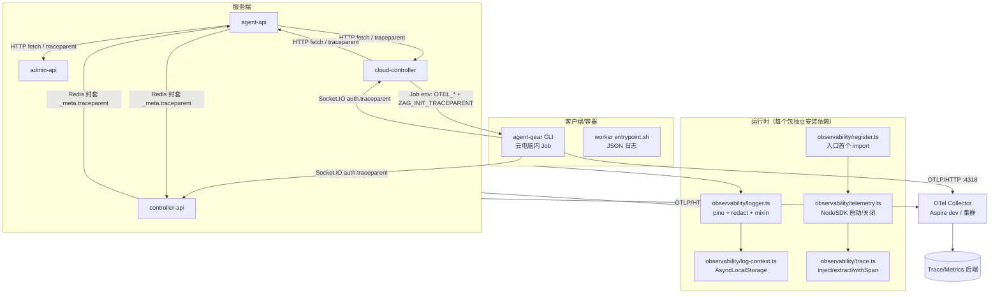
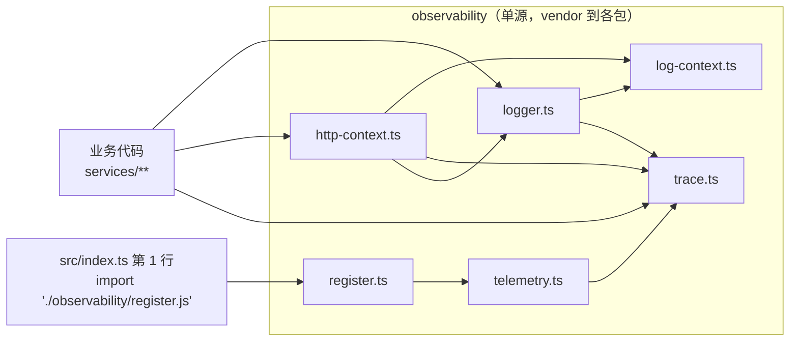
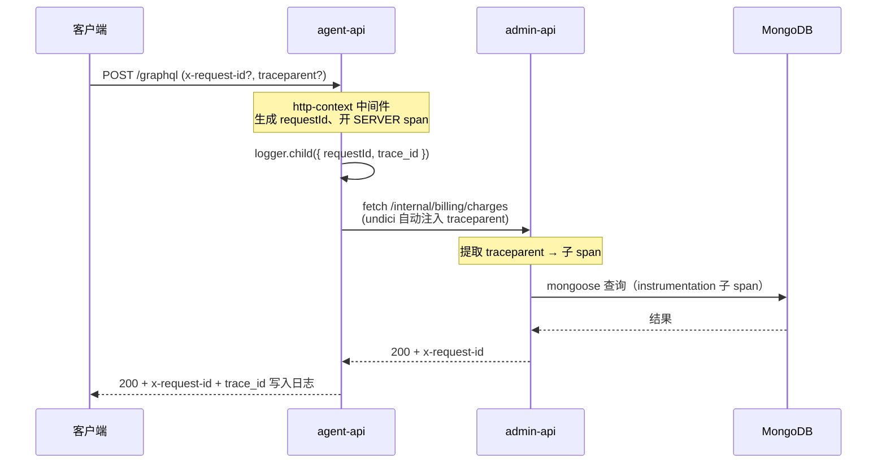
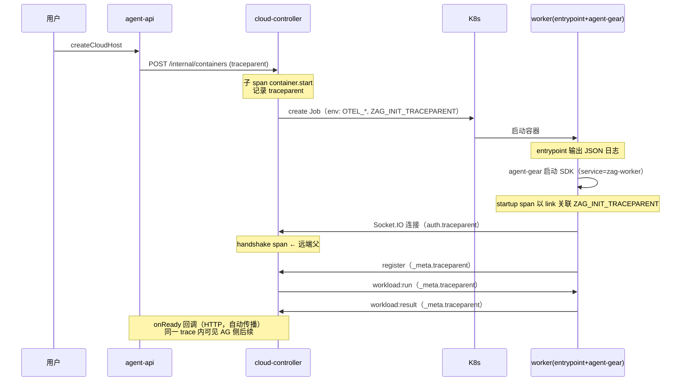
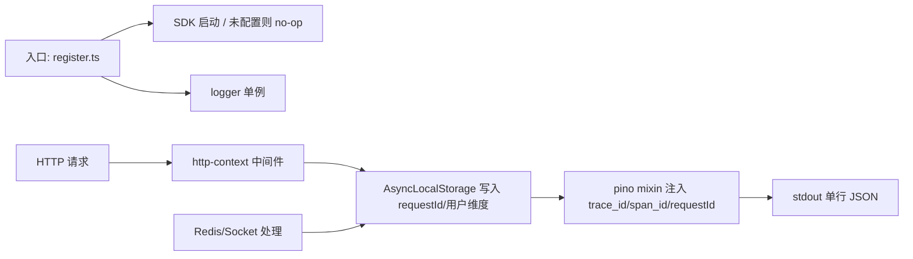
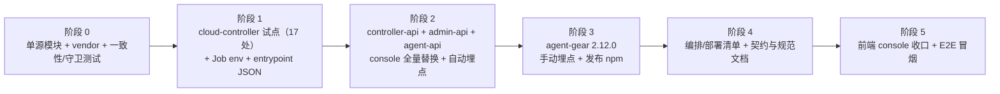

# 规范化日志与全链路可观测性 - 技术提案

**功能名称**: 规范化日志与增加可观测性接入
**关联 PRD**: [[../../product/draft/20261030-unified-logging-and-otel.md]]
**技术提案版本**: v1.0
**创建日期**: 2026-10-30
**作者**: ZeroAsh
**feat-branch**: `feat/unified-logging-otel`

## 1. 概述

### 1.1 背景

需求（Issue #376）只有两句，但覆盖面是整个仓库的运行时：

1. 给所有服务增加 otel 接入，包括云电脑的 jobs 也需要 otel 接入；
2. 增加日志 pino，输出 json 格式，替换仓库内所有 `console.log/error`。

现状盘点（代码事实，逐项核对过）：

| 维度 | 现状 |
|---|---|
| 日志库 | 全仓库**没有** pino / winston；`package.json` 与 `package-lock.json` 中 `pino` 命中 0 次；`@opentelemetry/*` 仅作为 vitest 的 optional peer 出现在 lockfile |
| 日志形态 | 全部为自由文本模板串，带 `[prefix]` 约定（如 `[admin-api]`、`[worker]`、`[socket]`、`[SessionCommand]`），错误对象作为第二个参数直出 |
| 直出打印量 | `servers/admin-api` 138、`servers/agent-api` 179、`servers/controller-api` 177、`servers/cloud-controller` 17、`packages/agent-controller` 131、`apps/agent-web` 19、`apps/admin-web` 2 |
| 日志抽象 | 仅 `servers/cloud-controller/src/logger.ts`（`LOG_LEVEL` + console sink，52 行），其余服务把 `console` 直接当 logger 注入（`admin-api/src/index.ts:210,221`、`cloud-controller/src/index.ts:59`、`socketio-gateway.ts:177`），另有 5 处重复声明的结构化 `Logger` 接口 |
| 请求关联 | **无** `x-request-id` 中间件、无 `traceparent`/`tracestate` 处理；`requestId` 仅作为 ACP/MCP 协议层字段存在 |
| 链路追踪 | 无。无 OTLP collector、无 SDK、无传播 |
| 异步通道 | agent-api 7 个 Redis 订阅者 + 2 个 consumer、controller-api 2 个 consumer、ADMIN/CC 的 RabbitMQ 计费骨干、4 处 Socket.IO 命名空间 |
| 云电脑 Job | `K8sJobManager.buildManifest` 只注入 `ZAG_SERVER_ENDPOINT` / `ZAG_CONTROLLER_KEY` + harness env；**无任何 OTEL env**；`deploy/images/worker/entrypoint.sh` 的 `log()` 是 `echo "[worker] ..."` 纯文本 |
| 构建形态 | 每个 package 独立 `npm ci` + 独立 `package-lock.json`；服务镜像构建上下文是**服务目录本身**（`.github/workflows/build-*-image.yml` 的 `working-directory`）；无根 workspace |
| 规则 | `docs/engineering/common-rules.md` / `backend-rules.md` **没有**任何日志、错误格式、可观测性规范 |

两个硬约束直接决定了方案形态：

- **不能引入跨服务共享发布物**：镜像构建上下文是服务目录，`file:../../packages/xxx` 形式的依赖在镜像内不可解析；新增内部 npm 包则要新增发布流水线与版本对齐成本。→ 采用**单源 vendored 共享模块 + 全仓一致性校验**。
- **不能靠改启动命令实现埋点前置**：`NODE_OPTIONS="--import tsx"` 由 AppHost/compose 注入，prod 与 dev 走同一条链路。→ 采用**入口文件首个 import 的副作用模块**（ESM 静态 import 求值序保证先于其它模块）。

### 1.2 目标

- **日志底座**：每个运行时一个 `logger`（pino），单行 JSON 直出 stdout；字段语义全仓统一；级别由 `LOG_LEVEL` 统一控制；开发环境可切 pretty。
- **追踪底座**：每个服务在入口首个 import 处启动 OTel NodeSDK；未配置采集端时**完全关闭**（0 外发、0 额外线程）。
- **自动埋点**：HTTP（含全局 `fetch`/undici）、Express、GraphQL、Mongoose、ioredis、Socket.IO 覆盖请求与服务间调用；不做逐条业务埋点也能得到可用链路。
- **手工埋点**：只补自动埋点覆盖不到的因果边界——Socket.IO 事件处理、Redis 消息处理、K8s Job 创建与容器内启动、agent-gear 的会话/ACP/MCP/工作负载关键动作。
- **跨进程传播**：统一 W3C Trace Context（`traceparent`）；HTTP 头、Socket.IO 握手 `auth`、WebSocket 事件 `_meta`、Redis 消息封套四条通道全部打通。
- **云电脑覆盖**：cloud-controller 把 OTLP 配置与链路标识注入 Job env；agent-gear 侧 SDK 复用同一套骨架（仅手动埋点，不引 auto-instrumentations 以控制包体积）；worker 入口脚本自身也输出 JSON。
- **全量替换 console**：663 处服务端/CLI 直出全部替换，并由每个 package 内的 `no-console` 不变量测试守住（新增即测试失败）。
- **脱敏与审计例外的边界明确**：pino `redact` 名单 + 既有 `sanitize*` 约定；唯一例外是首次初始化管理员密码（保行为、加标记、加断言）。

### 1.3 范围

**做**：

- 新增共享观测模块（5 个文件）并 vendor 到 5 个运行时包：
  `src/observability/{logger,log-context,trace,telemetry,register}.ts`。
- 五个包依赖新增：`pino`（全量）、`pino-pretty`（devDependencies，仅开发）、`@opentelemetry/{api,sdk-node,resources,semantic-conventions,exporter-trace-otlp-http,exporter-metrics-otlp-http,sdk-metrics}` + 指定 instrumentations（服务端）；agent-gear 只加精简集合。
- 663 处 `console.*` → `logger.*`（按语义映射级别与结构化字段），Web 前端 21 处改为 dev-gated logger。
- 每个 HTTP 服务加统一上下文中间件（requestId + access log + 响应头 `x-request-id`）。
- 四条传播通道：HTTP 头 / Socket.IO 握手与 `_meta` / Redis 消息封套 / K8s Job env + link。
- cloud-controller：Job env 注入 `OTEL_*` 与 `ZAG_INIT_TRACEPARENT`；config 新增观测配置。
- `deploy/images/worker/entrypoint.sh`：`log()` 改为单行 JSON（含时间/级别/服务名），保留 stderr 扫描与退出码语义。
- 编排与部署：AppHost 新增 `otel-collector`（dev）+ 参数化 publish；`aspire/manifest/docker-compose.yaml` 重新生成；`deploy/k8s/cloud-controller.yaml` 增 env；新增可选 `deploy/k8s/otel-collector.yaml`。
- 契约与规范：新增 `contracts/observability.md`；更新 `contracts/cloud-controller-websocket.md`、`contracts/agent-session-websocket.md`、`contracts/mcp-forward-redis.md`；`docs/engineering/common-rules.md` 增「日志与可观测性规范」章节。
- 测试：T-OBS1~T-OBS18 新增；受影响的既有断言同步（见 §8.3）。

**不做**：

- 不做日志中心化存储/检索平台（ELK/Loki/Tempo 等），只产出标准数据。
- 不新增任何后台配置页面；级别/采样/采集端由部署配置控制。
- 不引入浏览器端 OTel / Web Vitals 上报；前端只收敛 console。
- 不做业务指标（计费金额、云电脑在线数等）的 OTel metrics 建模；本期 metrics 仅运行时/主机基础指标（可开关）。
- 不改变任何 GraphQL schema、不新增业务字段、不改错误响应体结构。
- 不做日志审计留存策略、不做脱敏后的日志加密/签名。
- 不重构既有的业务日志语义（保留原有信息量，只换承载形态）。
- 不改 `MIN_WORKER_VERSION` / `MIN_HARNESS_WORKER_VERSION` / `MIN_HARNESS_VERSION_BY_TYPE` 版本门禁（观测能力对旧 worker 为可选增强，见 §6.1 D7）。

## 2. 技术架构

### 2.1 系统架构图



关键边界：

- **进程内只做「产出」**：日志直出 stdout（采集由容器运行时负责），追踪批量导出到 `OTEL_EXPORTER_OTLP_ENDPOINT`。
- **未配置即关闭**：`OTEL_EXPORTER_OTLP_ENDPOINT` 为空 → `startTelemetry()` 直接 return，不注册 exporter、不启线程；日志照常。
- **传播不依赖 payload 语义**：所有跨进程通道只带一个 W3C `traceparent` 字符串，不改变业务字段。

### 2.2 技术栈

| 层级 | 技术选型 | 说明 |
|------|---------|------|
| 日志 | `pino` ^9（服务端/CLI）、`pino-pretty`（仅 devDependencies） | 单行 JSON、同步写 stdout、无 worker 传输（避免 alpine/worker 环境线程问题） |
| 日志上下文 | Node `AsyncLocalStorage` | 复用 agent-api 既有 `workspace-context.ts` 的模式，独立实例避免耦合 |
| 追踪 SDK | `@opentelemetry/sdk-node` + `@opentelemetry/api` | 标准 NodeSDK；`OTEL_SDK_DISABLED` 语义对齐官方 |
| 追踪导出 | `@opentelemetry/exporter-trace-otlp-http` | OTLP/HTTP（`:4318`），避免 gRPC 在 Ingress/多副本下的负载均衡问题 |
| 指标导出 | `@opentelemetry/exporter-metrics-otlp-http` + `sdk-metrics` | 仅运行时/主机基础指标，可开关；默认随追踪一起启用 |
| 自动埋点（服务端） | `@opentelemetry/auto-instrumentations-node` | 一次性覆盖 http/undici/express/graphql/mongoose/ioredis/socket.io/runtime-node；版本锁定在 lockfile |
| 自动埋点（agent-gear） | **无**（仅手动埋点） | 控制 npm 包体积与子进程 patch 风险（ACP 子进程 stdio 桥接） |
| 传播协议 | W3C Trace Context（`traceparent`） | 与 HTTP 标准一致，Socket.IO/Redis 通道复用同一字符串 |
| 采集端 | `otel/opentelemetry-collector-contrib` | dev 由 Aspire 编排；prod 由部署方提供或使用附带的可选 manifest |

### 2.3 模块划分



| 模块 | 职责 | 关键技术点 |
|------|------|-----------|
| `observability/logger.ts` | pino 实例工厂、级别解析、redact 名单、err serializer、context mixin、测试用 destination 注入 | `formatters.level` 输出字符串级别；`mixin()` 从 AsyncLocalStorage 取 `requestId/trace_id/span_id`；`redact.paths` 名单制 |
| `observability/log-context.ts` | 进程内请求/操作上下文（`requestId`、业务标识、`userId/tenantId`） | `AsyncLocalStorage<LogContext>`；`runWithLogContext()`；缺省安全空对象；child logger 与 mixin 共用 |
| `observability/trace.ts` | `withSpan(name, attrs, fn)`、`injectTraceparent(carrier)`、`extractTraceparent(carrier)`、`currentTraceIds()`、`linkToTraceparent(parent)` | 只用 `@opentelemetry/api`；无 SDK 时全部退化为 no-op（API 默认 NoopTracer） |
| `observability/telemetry.ts` | `startTelemetry({service, version})` / `shutdownTelemetry()`；资源属性、采样器、导出器、graceful shutdown | endpoint 缺失即 return；`process.on('SIGTERM')` 时 `sdk.shutdown()`（带 2s 超时上限） |
| `observability/register.ts` | 副作用入口：`dotenv.config()` → `startTelemetry()` → 注册 `uncaughtException/unhandledRejection` 兜底日志 | 必须位于 `src/index.ts` **第一条 import**（ESM 求值序保证先于 express/mongoose） |
| `observability/http-context.ts` | Express 中间件：解析/生成 `x-request-id`、提取 `traceparent`、开 `SERVER` span、写访问日志、回写响应头 | requestId 归一化（长度/字符集）；`res.on('finish')` 记录 statusCode + durationMs |
| `observability/no-console.test.ts` | 不变量：扫描本包 `src/**/*.ts`，除 observability 自身与白名单外不得出现 `console.` | 纯 Node fs 扫描，不引新工具链 |

## 3. API 设计

### 3.1 API 契约

**本期不新增、不删除、不修改任何 GraphQL 字段与 REST 业务端点。** 对外可见的契约增量只有两类，均为可加性变更：

#### 增量 1: 响应头 `x-request-id`

- 所有 HTTP 服务（`admin-api`、`agent-api`、`controller-api`、`cloud-controller`）的响应均回传该头。
- 入站可携带（客户端/上游提供），服务沿用；未携带或非法（非 `[A-Za-z0-9._:-]{8,128}`）则生成 UUID v4 并以响应头回传。
- 语义：同一请求在全部服务日志与链路中可检索。

```http
GET /health HTTP/1.1
X-Request-Id: 6f1a...-user-supplied

HTTP/1.1 200 OK
X-Request-Id: 6f1a...-user-supplied
Content-Type: application/json

{"status":"ok"}
```

#### 增量 2: 内部通道可选字段（详见 §3.2 与契约文件）

| 通道 | 增量 | 兼容性 |
|---|---|---|
| HTTP 服务间调用 | `traceparent`（W3C），由 undici instrumentation 自动写入 | 对端不认识则忽略 |
| Socket.IO 握手 | `auth.traceparent?: string` | 旧客户端不传 = 新链路起点 |
| Socket.IO 事件（仅 cloud-controller `/worker`） | 报文增加 `_meta?: { traceparent?: string }` | 旧 worker 忽略未知字段 |
| Redis 消息封套 | JSON 增加 `_meta?: { traceparent?: string }` | 旧消费者忽略未知字段 |

**不改**：错误响应结构（`errors[].message` / `extensions.code` 原样）、GraphQL schema、OpenAPI 既有字段。

### 3.2 内部接口

#### 3.2.1 日志记录契约（结构化字段）

所有运行时的每条日志为**单行 JSON**，字段如下（缺失字段省略）：

| 字段 | 类型 | 必填 | 说明 |
|---|---|---|---|
| `level` | string | ✅ | `trace\|debug\|info\|warn\|error\|fatal`（字符串，非数字） |
| `time` | string | ✅ | ISO-8601 UTC，毫秒精度，如 `2026-10-30T13:31:56.361Z` |
| `service` | string | ✅ | `agent-api` / `admin-api` / `controller-api` / `cloud-controller` / `agent-gear` / `zag-worker` / `agent-web` / `admin-web` |
| `serviceVersion` | string | ✅ | 取自各自 `package.json` 的 `version` |
| `env` | string | ✅ | `NODE_ENV`，缺省 `development` |
| `hostname` | string | ✅ | `os.hostname()`（K8s 下即 Pod 名） |
| `pid` | number | ✅ | 进程号 |
| `msg` | string | ✅ | 人类可读消息（保留原 `[prefix]` 语义到 `component`，消息体去掉前缀） |
| `component` | string | ⬜ | 模块/服务类名，如 `cloud-host-service`、`session-command`、`migration/016` |
| `trace_id` / `span_id` | string | ⬜ | 活跃 span 存在时自动注入（32/16 hex） |
| `requestId` | string | ⬜ | HTTP 请求标识，与响应头一致 |
| `userId` / `tenantId` / `sessionId` / `controllerId` / `cloudHostId` / `containerId` / `workflowInstanceId` / `nodeId` | string | ⬜ | 上下文可得的业务维度，来自 `log-context` |
| `err` | object | ⬜ | `{ type, message, stack, code? }`（`pino.stdSerializers.err`） |
| `durationMs` | number | ⬜ | 访问日志与耗时类事件 |

示例（访问日志）：

```json
{"level":"info","time":"2026-10-30T13:31:56.361Z","service":"agent-api","serviceVersion":"1.0.0","env":"production","hostname":"agent-api-7d9f-abc","pid":1,"component":"http","msg":"request completed","requestId":"3f2a…","trace_id":"4bf92f3577b34da6a3ce929d0e0e4736","span_id":"00f067aa0ba902b7","method":"POST","route":"/graphql","status":200,"durationMs":12}
```

#### 3.2.2 环境变量契约（全服务统一前缀 `OTEL_*` + 既有 `LOG_LEVEL`）

| 变量 | 默认 | 说明 |
|---|---|---|
| `LOG_LEVEL` | `info` | `debug\|info\|warn\|error`；非法值回落 `info`（沿用 `parseLogLevel` 语义，扩展到全服务） |
| `LOG_PRETTY` | 空 | `1` 时启用 pretty 输出（**仅非生产**；生产强制 JSON，忽略该值并 warn 一次） |
| `OTEL_SDK_DISABLED` | 空 | `true` 时强制关闭 SDK（与官方语义一致） |
| `OTEL_EXPORTER_OTLP_ENDPOINT` | 空 | 空 = 不启用导出（等价于关闭）；示例 `http://otel-collector:4318` |
| `OTEL_EXPORTER_OTLP_PROTOCOL` | `http/protobuf` | 固定 HTTP，避免 gRPC 依赖 |
| `OTEL_EXPORTER_OTLP_HEADERS` | 空 | 采集端鉴权头（不打印、不脱敏校验覆盖） |
| `OTEL_SERVICE_NAME` | 包名 | 默认由 `startTelemetry({service})` 传入；worker 为 `zag-worker` |
| `OTEL_RESOURCE_ATTRIBUTES` | 空 | 追加资源属性（逗号分隔 k=v） |
| `OTEL_TRACES_SAMPLER` | `parentbased_traceidratio` | 采样器 |
| `OTEL_TRACES_SAMPLER_ARG` | `1.0` | 采样比例（内部规模默认全采，可按环境下调） |
| `OTEL_METRICS_ENABLED` | `true`（有 endpoint 时） | 关闭基础指标，仅保留追踪 |
| `OTEL_EXPORT_TIMEOUT_MS` | `5000` | 单次导出超时；超时即丢弃 |

#### 3.2.3 Redis 消息封套（`_meta`）

所有平台自定义 Redis 频道（`session:command`、`session:message`、`session:status`、`elicitation:resolved`、`permission:*`、`harness:login`、`mcp:*`、`pr:check-run`）在发布时为 JSON 顶层追加：

```json
{ "type": "…", "…": "…", "_meta": { "traceparent": "00-4bf9…-00f0…-01" } }
```

订阅侧：`extractTraceparent(payload._meta)` → `withSpan('<channel> handle', { 'messaging.system': 'redis' }, handler)`。旧消费者忽略 `_meta`，新消费者容忍缺失。

#### 3.2.4 Socket.IO 传播

- **握手**：客户端（agent-gear）在 `io(url, { auth: { token, traceparent } })` 中携带当前 span 的 traceparent；服务端（cloud-controller `/worker`、controller-api `/`）在 handshake 阶段 `extractTraceparent`，以 `SpanKind.SERVER` 开 `socket.handshake` span，并把 `containerId`/`controllerId` 写入属性。
- **事件**：服务端每个受控事件（`workload:run`、`workload:result`、`shutdown` 等）在 `_meta.traceparent` 中携带当前 span，客户端据此 `withSpan(..., { links: [...] })` 延续；客户端上报事件同理反向携带。
- **禁止**把 `traceparent` 写入 ACP 协议报文（`contracts/agent-session-websocket.md` 已约定 `_meta.traceparent/tracestate/baggage` 保留给 W3C Trace Context，本期不动 ACP payload，避免影响既有渲染与协议兼容）。

#### 3.2.5 云电脑 Job env 契约（cloud-controller → worker）

`ContainerService.buildHarnessJobEnv()` 新增（仅在配置了 `OTEL_EXPORTER_OTLP_ENDPOINT` 时）：

| 变量 | 值 |
|---|---|
| `OTEL_EXPORTER_OTLP_ENDPOINT` | 来自 cloud-controller 配置 |
| `OTEL_EXPORTER_OTLP_PROTOCOL` | `http/protobuf` |
| `OTEL_SERVICE_NAME` | `zag-worker` |
| `OTEL_RESOURCE_ATTRIBUTES` | `zag.container.id=…,zag.cloud.host.id=…,zag.user.id=…,zag.tenant.id=…,deployment.environment=…` |
| `OTEL_TRACES_SAMPLER` / `_ARG` | 与平台一致 |
| `ZAG_INIT_TRACEPARENT` | cloud-controller 在创建 Job 时产生的 `container.start` span 的 traceparent（供 agent-gear 建 link） |

未配置采集端时注入 `OTEL_SDK_DISABLED=true`（显式关闭，避免容器内自行猜测）。

## 4. 数据模型

### 4.1 数据库设计

**无数据库变更**：不新增集合、不改既有集合、不做数据迁移。可观测性数据不落业务库（日志走 stdout，追踪走 OTLP 导出）。

### 4.2 缓存设计

**无缓存变更**。Redis 仅新增消息封套可选字段（见 §3.2.3），不新增 key、不改变 TTL。

## 5. 技术实现方案

### 5.1 核心流程

#### 5.1.1 HTTP 请求链路（同步）



#### 5.1.2 云电脑创建 → 容器内 Agent（异步跨进程）



#### 5.1.3 日志上下文与级别



### 5.2 关键实现点

#### 5.2.1 共享观测模块（单源 + vendored）

**单源**：`packages/observability/src/` 保存权威实现与文档（不被任何运行时直接 import，不发布到 npm）。

**分发**：脚本 `scripts/sync-observability.mjs` 把 `packages/observability/src/*.ts` 复制到：

```
servers/admin-api/src/observability/
servers/agent-api/src/observability/
servers/controller-api/src/observability/
servers/cloud-controller/src/observability/
packages/agent-controller/src/observability/
```

**防漂移**：`tests/api/src/observability/vendor-consistency.test.ts` 逐文件比对 sha256；不一致即失败并打印 `node scripts/sync-observability.mjs` 提示。

- **技术细节**：
  - 复制文件头部固定注释 `// GENERATED FROM packages/observability/src/<file> — DO NOT EDIT`。
  - 复制时改写相对 import 后缀（`.js` 保持，与各包 ESM 口径一致，源码 `tsx` 与 `tsc` 均可解析）。
  - 一致性测试与 `no-console` 测试是「vendor 策略」的两根护栏：前者防实现分叉，后者防绕过统一日志。
- **风险点**：vendor 会让单点修复需要一次同步提交——用脚本 + 一致性测试把成本压到一条命令。

#### 5.2.2 logger.ts 实现要点

```ts
// servers/<pkg>/src/observability/logger.ts（节选）
import pino, { type Logger as PinoLogger, type DestinationStream } from 'pino';
import { readContext } from './log-context.js';
import { currentTraceIds } from './trace.js';

export type LogLevel = 'debug' | 'info' | 'warn' | 'error';

export const REDACT_PATHS = [
  'req.headers.authorization', 'req.headers.cookie',
  'headers.authorization', 'headers.cookie',
  'authorization', 'cookie',
  'token', 'accessToken', 'refreshToken', 'idToken',
  'password', 'passwordHash', 'secret', 'clientSecret', 'privateKey',
  'apiKey', 'modelApiKey',
  '*.token', '*.password', '*.secret', '*.apiKey',
  'secrets', 'secrets.*',
  'err.config.headers.authorization',
];

export function createLogger(opts: {
  service: string; version: string; level?: string;
  pretty?: boolean; destination?: DestinationStream;
}): PinoLogger {
  const level = parseLogLevel(opts.level ?? process.env.LOG_LEVEL);
  const base = {
    service: opts.service,
    serviceVersion: opts.version,
    env: process.env.NODE_ENV ?? 'development',
  };
  return pino({
    level,
    base,
    timestamp: pino.stdTimeFunctions.isoTime,
    messageKey: 'msg',
    formatters: { level: (label) => ({ level: label }) },
    redact: { paths: REDACT_PATHS, censor: '[REDACTED]' },
    serializers: { err: pino.stdSerializers.err },
    mixin() {
      const ctx = readContext();
      const { traceId, spanId } = currentTraceIds();
      return { ...ctx, ...(traceId ? { trace_id: traceId, span_id: spanId } : {}) };
    },
  }, opts.destination ?? pino.destination({ dest: 1, sync: true }));
}
```

- **同步写 fd 1**：`sync: true` 避免高并发下部分写/乱序；日志为逐行 JSON，容器运行时按行采集。
- **不使用 pino transport / worker thread**：alpine 与 worker 容器内的线程/临时目录差异会引入难排查问题；pretty 只在开发用 `pino-pretty` 管道或 `pino.destination` 包装。
- **`mixin` 是唯一注入点**：业务代码不需要手工传 `requestId`/`trace_id`，避免调用点遗漏。
- **`component` 通过 child logger**：`logger.child({ component: 'cloud-host-service' })`，替换原 `[cloud-host]` 前缀。

#### 5.2.3 log-context.ts

```ts
import { AsyncLocalStorage } from 'node:async_hooks';

export interface LogContext {
  requestId?: string;
  userId?: string;
  tenantId?: string;
  sessionId?: string;
  controllerId?: string;
  cloudHostId?: string;
  containerId?: string;
  workflowInstanceId?: string;
  nodeId?: string;
}

const storage = new AsyncLocalStorage<LogContext>();

export function runWithLogContext<T>(ctx: LogContext, fn: () => T): T {
  return storage.run({ ...storage.getStore(), ...ctx }, fn);
}
export function readContext(): LogContext {
  return storage.getStore() ?? {};
}
```

- 与 agent-api 既有 `workspace-context.ts`（`AsyncLocalStorage<WorkspaceContext>` / `<RequestAuthContext>`）**并存不合并**：前者承载鉴权/工作区语义，本模块只管日志维度，避免为日志改动鉴权链路。
- 边界：`AsyncLocalStorage` 不跨 Socket.IO 的 `emit` 回调自动延续——因此在事件处理器入口显式 `runWithLogContext({ containerId })`。

#### 5.2.4 telemetry.ts / register.ts

```ts
// telemetry.ts（节选）
export function startTelemetry(opts: { service: string; version: string }): void {
  if (started) return;
  if (isTrue(process.env.OTEL_SDK_DISABLED)) return;
  const endpoint = process.env.OTEL_EXPORTER_OTLP_ENDPOINT?.trim();
  if (!endpoint) return;                       // 未配置 = 完全关闭

  const sdk = new NodeSDK({
    resource: resourceFromAttributes({
      'service.name': opts.service,
      'service.version': opts.version,
      'deployment.environment': process.env.NODE_ENV ?? 'development',
    }),
    sampler: buildSampler(),                   // parentbased_traceidratio + arg
    traceExporter: new OTLPTraceExporter({ url: `${endpoint}/v1/traces` }),
    metricReader: metricsEnabled()
      ? new PeriodicExportingMetricReader({
          exporter: new OTLPMetricExporter({ url: `${endpoint}/v1/metrics` }),
          exportIntervalMillis: 60_000,
        })
      : undefined,
    instrumentations: INSTRUMENTATIONS,        // 见 §5.2.5；agent-gear 传 []
  });
  sdk.start();
  started = true;
  process.once('SIGTERM', () => void shutdownTelemetry());
  process.once('SIGINT', () => void shutdownTelemetry());
}

export async function shutdownTelemetry(): Promise<void> {
  if (!started) return;
  started = false;
  await Promise.race([sdk.shutdown(), delay(2000)]).catch(() => {});
}
```

```ts
// register.ts —— src/index.ts 的第一条 import
import 'dotenv/config';
import { startTelemetry } from './telemetry.js';
import { logger } from './index-logger.js';   // 该包的单例 logger

startTelemetry({ service: 'agent-api', version: SERVICE_VERSION });
process.on('uncaughtException', (err) => { logger.fatal({ err }, 'uncaught exception'); process.exit(1); });
process.on('unhandledRejection', (reason) => { logger.error({ err: reason }, 'unhandled rejection'); });
```

- **为什么用「首个 import」而不是 `--import` 预加载**：ESM 静态 import 按声明顺序深度优先求值，`register` 作为第一条 import 必然先于 `express`/`mongoose` 求值，instrumentation 的 `require-in-the-middle`/ESM hook 才能生效；同时**不需要**改 Dockerfile ENTRYPOINT、不需要改 AppHost 的 `NODE_OPTIONS`（改动面最小，回滚只需删一行 import）。
- **不吞异常**：`uncaughtException` 记录后仍 `exit(1)`，保持进程语义不变（既有 `console.error + exit(1)` 的等价替换）。
- **幂等**：重复 import（测试/多入口）由 `started` 标记保证只启动一次。

#### 5.2.5 自动埋点清单与手工埋点清单

| 运行时 | 自动埋点（instrumentations） | 手工埋点（`withSpan`） |
|---|---|---|
| `admin-api` | http、undici、express、graphql、mongoose | 启动（migration runner / seedAdmin / syncIndexes）、RabbitMQ 消费循环、billing scheduler tick、outbox relay 批次 |
| `agent-api` | http、undici、express、graphql、mongoose、ioredis | SSE 连接生命周期、7 个 Redis 订阅者消息处理、issues trigger runner 每轮、cloud-host setup 编排步骤、工作流引擎节点推进 |
| `controller-api` | http、express、ioredis、socket.io | 心跳扫描轮次、disconnect timer 轮次、ACP 会话命令处理、MCP 转发、gateway relay |
| `cloud-controller` | http、express、mongoose、socket.io | Job 创建/删除、worker handshake/register、workload 批次下发与结果、status-sync 每轮、harness 回调（含重试） |
| `agent-gear` | **无** | connect/handshake、session.new、session.prompt、acp child spawn/exit、workload.run、harness.prepare、mcp tool call、github credential refresh、startup（link 到 Job span） |
| `zag-worker`（entrypoint.sh） | — | 无 SDK，仅 JSON 日志 |

**高频路径禁令**（写进实现规范）：会话消息分片（`session:message` 逐 chunk）、ACP 流式 `agent_message_chunk`、工作负载日志轮询、心跳与 watch 的每事件回调，**不得**逐条开 span；只在其所属批次/连接层开 span，并在属性中记录条数。

#### 5.2.6 HTTP 上下文中间件（四服务共用）

```ts
export function httpContext(service: string) {
  return (req, res, next) => {
    const requestId = normalizeRequestId(req.headers['x-request-id']) ?? randomUUID();
    res.setHeader('x-request-id', requestId);
    const parent = extractTraceparent(req.headers);
    return withSpan(
      `${req.method} ${req.path}`,
      { 'http.request.method': req.method, 'url.path': req.path, 'zag.request_id': requestId },
      () => runWithLogContext({ requestId }, () => {
        const start = performance.now();
        res.on('finish', () => {
          logger.info({
            method: req.method, route: req.route?.path ?? req.path,
            status: res.statusCode, durationMs: Math.round(performance.now() - start),
          }, 'request completed');
        });
        next();
      }),
      parent ? { parent } : undefined,
    );
  };
}
```

- **挂载位置**（必须最先）：`admin-api/src/index.ts:58` 后、`agent-api/src/index.ts:57`（事件回调与 webhook 路由**之前**，但这两个路由的原始字节验签不受影响——中间件不读 body）、`controller-api/src/index.ts:27`、`cloud-controller/src/index.ts:83`。
- **不记录 body**：避免凭据与用户内容入日志。
- **静态/健康检查降噪**：`/health` 以 `debug` 记录（仍可查），避免探针刷屏。

#### 5.2.7 Socket.IO 传播实现

- **cloud-controller `/worker`**：`socketio-gateway.ts:149` 已解析 `handshake.auth.token`，同处读取 `auth.traceparent`；`register` 成功后把 `containerId` 写入日志上下文与 span 属性。事件回发（`socketio-gateway.ts:194-196` 的 `nsp.to(containerId).emit`）统一经 `emitToContainer()` 包一层 `injectTraceparent` 写入 `_meta`。
- **controller-api `/`**：`services/socketio.ts:142` 的 `user:${userId}` room 与 ACP 会话事件不动 payload；handshake 与每类事件处理器内 `runWithLogContext` + `withSpan`，把 `userId`/`controllerId`/`sessionId` 落到属性。
- **agent-gear 客户端**：`socketio-client.ts` 的 `io(url, { auth })` 注入 traceparent；重连时重新注入（新 span）。

#### 5.2.8 Redis 封套实现

- 发布侧：在 `redis.publish(channel, JSON.stringify(payload))` 前统一走 `publishJson(channel, payload)` helper（放在 `observability/trace.ts`），自动写入 `_meta.traceparent`。
- 订阅侧：每个 `subscriber.on('message')` 回调内 `withSpan('<channel> handle', { 'messaging.destination.name': channel }, () => runWithLogContext({...}, handler))`，并从 `_meta` 提取远端上下文（`context.with(propagation.extract(...))`）。
- 覆盖清单（逐一改造，不遗漏）：`agent-api` 的 permission / elicitation / harness-login / mcp-endpoint / mcp-relay / session-lifecycle / pr-check-run 订阅者；`controller-api` 的 session-command / mcp-forward consumer；`session:status` 发布方（controller-api）。

#### 5.2.9 云电脑 Job 与 agent-gear

**cloud-controller 侧**：

1. `config/index.ts` 增 `otel` 配置块（endpoint / protocol / samplerArg / resourceAttributes / headers），仅从 env 读取，输出到日志时**不打印 headers**。
2. `container-service.ts` 的 `buildHarnessJobEnv()`（现 411-426 行）：追加 §3.2.5 的 env；`ZAG_INIT_TRACEPARENT` 取自 `start()` 中 `withSpan('container.start')` 的结果（`injectTraceparent`）。
3. `k8s-job-manager.ts` 无需改动（env 由上层传入后已透传）。
4. 未配置 endpoint 时注入 `OTEL_SDK_DISABLED=true`，保证容器内行为确定。

**worker 镜像侧**：

```bash
# entrypoint.sh（节选）
LOG_LEVEL="${LOG_LEVEL:-info}"
json_escape() { printf '%s' "$1" | sed -e 's/\\/\\\\/g' -e 's/"/\\"/g' | tr -d '\000-\010\013\014\016-\037'; }
log() {
  local level="${1:-info}"; shift
  printf '{"level":"%s","time":"%s","service":"zag-worker","serviceVersion":"%s","hostname":"%s","pid":%d,"component":"entrypoint","msg":"%s"}\n' \
    "$level" "$(date -u +%Y-%m-%dT%H:%M:%S.%3NZ)" "${ZAG_WORKER_VERSION:-unknown}" "$(hostname)" "$$" "$(json_escape "$*")"
}
```

- 保留退出码 42 / 自更新 / stderr 扫描 / 信号转发语义**完全不变**（仅换输出形态）；`entrypoint.test.sh` 增加「每行可被 `jq` 解析」断言。
- agent-gear 的 stdout 已是 pino JSON，stderr 仅错误/告警，同样 JSON；`scan_stderr()` 只匹配 `VERSION_MISMATCH` 关键字，不受 JSON 影响。

**agent-gear 侧**：

1. `package.json` 增依赖（精简集）：`pino`、`@opentelemetry/api`、`@opentelemetry/sdk-trace-node`、`@opentelemetry/exporter-trace-otlp-http`、`@opentelemetry/resources`、`@opentelemetry/semantic-conventions`。**不引** `auto-instrumentations-node`（体积与本机 ACP 子进程 patch 风险）。
2. `src/index.ts` 首行 `import './observability/register.js'`；`register` 读取 `OTEL_*` 与 `ZAG_INIT_TRACEPARENT`，`startup` span 用 `links` 关联 Job span。
3. 手工 span 覆盖 §5.2.5 表；`socketio-client.ts`（64 处 console）与 `acp/bridge.ts`（13 处）是重点改造文件。
4. 版本升至 `2.12.0`（可加性变更）；`publish-agent-gear.yml` 无需改动（路径触发已在 `packages/agent-controller/**`）。
5. 云端容器启动时 `npm install -g agent-gear` 自动获得新版本；旧容器仍在旧版本 → 忽略 `OTEL_*`，不报错（Graceful）。

#### 5.2.10 console → logger 迁移策略（663 处）

| 包 | 数量 | 迁移规则 |
|---|---:|---|
| `servers/agent-api` | 179 | `console.log` → `logger.info`（生命周期）/`logger.debug`（高频细节）；`console.warn` → `logger.warn`；`console.error` → `logger.error({ err }, '…')` |
| `servers/controller-api` | 177 | 同上；`session-command.ts`（41）与 `socketio.ts`（35）按事件分组 child logger |
| `servers/admin-api` | 138 | 迁移 runner 的 `[Migration NNN]` → `logger.child({ component: 'migration/NNN' })`；billing 的 `logger: console` 注入改为真实 logger（保留 `Logger` 结构化接口不变） |
| `packages/agent-controller` | 131 | `socketio-client.ts`（64）按连接/事件/重连分 child；`commands/mcp-proxy.ts`（16）区分 user-facing 输出 vs 运维日志（**用户可见的 CLI 输出保持纯文本**，见下） |
| `servers/cloud-controller` | 17 | 就地替换；删除 `src/logger.ts`，改用共享 logger（`socket-diagnostics.ts` 同步） |
| `apps/agent-web` / `apps/admin-web` | 19 / 2 | 改为 `src/lib/logger.ts`：`import.meta.env.DEV` 或 `VITE_LOG_LEVEL` 开启，生产默认静默 |

**关键判断（写进实现规范）**：

- **CLI 面向用户的输出不是日志**：`agent-gear` 的 `console.log` 中属于「交互反馈」的部分（如 `mcp-proxy` 打印代理地址、`harness prepare` 进度）保持 stdout 纯文本，只有诊断信息走结构化 logger。判定标准：该行是「给使用者的结果」还是「给运维的排障信息」。
- **迁移不做「字符串拼接」**：错误对象一律 `{ err }`；上下文字段一律结构化键值，禁止继续用模板串塞信息。
- 迁移后**信息量不减**：原 `[prefix]` 语义进 `component`，原关键键值进字段。

#### 5.2.11 不变量测试（阻止回潮）

```ts
// servers/<pkg>/src/observability/no-console.test.ts
const ALLOW: RegExp[] = [/observability\//, /\.test\.ts$/];
// 递归扫描 src/**/*.ts，命中 /console\.(log|error|warn|info|debug|trace)\(/ 即失败
// 失败信息给出文件:行号 + 正确写法提示
```

- 每个运行时包**各一份**（各自 `npm test` 生效，CI 的 `npm ci && npm test` 门禁自动覆盖，见 `.github/workflows/build-*-image.yml`）。
- 例外用**显式行内白名单**（`// no-console-allow: <原因>`），并在 PR 描述中说明；白名单条目由测试统计输出，避免静默扩张。
- Web 前端不适用该守卫（浏览器语义不同），改由 `logger.ts` 收口 + `logger` 内部唯一的 `console` 调用承载。

#### 5.2.12 脱敏与审计例外

- `REDACT_PATHS`（§5.2.2）覆盖请求头、`token`/`password`/`secret`/`apiKey` 及其一层嵌套；`err` 走 `stdSerializers.err` 且额外 `err.config.headers.authorization`。
- 既有 `sanitizeVersionForLog`（cloud-controller）、`sanitizeOperationError`（agent-api）、`SECRET_ENV_KEYS`+`REDACTED`（agent-gear `workload-executor.ts:34-35`）**保持不变**，日志层再兜一层。
- **唯一审计例外**：`admin-api/src/services/auth.ts` 首次 seed 管理员时打印初始密码。改造为：

```ts
logger.warn(
  { bootstrapAdminPassword: password, userId },
  '初始管理员密码（仅首次初始化输出一次，请立即修改；审计例外）',
);
```

  `bootstrapAdminPassword` **不进入** `REDACT_PATHS`，且由测试 `T-OBS3b` 断言「仅该键不脱敏、其余同结构键必脱敏」，防止例外扩散。

#### 5.2.13 采集端与编排

- **Aspire（dev）**：新增 `otel-collector` 资源（`otel/opentelemetry-collector-contrib`），配置 `aspire/otel-collector/config.yaml`（OTLP receiver :4317/:4318 → `debug` exporter；预留 `otlphttp` exporter 由参数开启）。四个服务 `WithEnvironment("OTEL_EXPORTER_OTLP_ENDPOINT", collector.GetEndpoint("http"))`。
- **publish**：新增参数 `otel-endpoint`（默认空 = 关闭），`OTEL_*` 统一通过参数注入；`aspire publish -o aspire/manifest` 重新生成 compose。
- **K8s**：`deploy/k8s/cloud-controller.yaml` 增 `OTEL_EXPORTER_OTLP_ENDPOINT`（来自 ConfigMap/Secret，默认空）。新增可选 `deploy/k8s/otel-collector.yaml`（Deployment + Service :4317/:4318 + ConfigMap），供无现成采集端的集群自建。
- **采集端不可用**：导出超时 5s、批量异步、失败仅 `debug` 记一条；**不重试放大**（OTel 默认批量处理器自带有限重试，配置上限）。

## 6. 技术决策

### 6.1 决策列表

| # | 决策 | 选项 A | 选项 B | 最终选择 | 原因 |
|---|---|---|---|---|---|
| D1 | 共享模块分发方式 | 内部 npm 包 `@zeroash/observability` | **单源 vendored + 一致性测试** | **B** | 镜像构建上下文为服务目录，`file:` 依赖不可解析；npm 包要新增发布流水线与 5 处版本对齐。vendored 零构建改造，一致性由测试守住 |
| D2 | 日志库 | **pino** | winston / 自研 | **A** | 需求原文指定 pino；性能与 JSON 原生支持最优，依赖树小（无原生模块） |
| D3 | pino 输出方式 | **同步直写 fd1（无 transport）** | pino transport / worker thread | **A** | 容器 stdout 采集口径不变；避免 alpine 与 worker 容器的线程/临时目录差异；跨行乱序风险为 0 |
| D4 | SDK 启动时机 | `--import` 预加载 | **入口首个 import 副作用模块** | **B** | 不改 Dockerfile ENTRYPOINT 与 AppHost `NODE_OPTIONS`，回滚只需删一行；ESM 求值序同样保证 harness 前置 |
| D5 | 导出协议 | gRPC（:4317） | **OTLP/HTTP（:4318）** | **B** | 多副本 + Ingress 下 gRPC 负载均衡易踩坑；HTTP 可复用现有入口与鉴权头；collector 两种都收 |
| D6 | 服务端埋点方式 | **auto-instrumentations + 少量手工** | 全手工 | **A** | 一次覆盖 express/graphql/mongoose/ioredis/undici，避免 663 处业务代码逐点埋点；手工只补因果边界 |
| D7 | agent-gear 埋点方式 | **仅手动 span + 精简依赖** | auto-instrumentations | **A** | npm 全局包体积与容器启动安装时长敏感；ACP 子进程 stdio 桥接被 patch 风险高 |
| D8 | 旧 worker 兼容 | 提升版本门禁强制新版本 | **门禁不变 + 能力优雅降级** | **B** | 观测是可选增强；强升门禁会让存量云电脑无法注册（破坏可用性），且与本期目标无关 |
| D9 | 日志级别字段形态 | **字符串（`"info"`）** | 数字（pino 默认） | **A** | 与业界日志系统/Grafana 对齐，人读友好；解析成本可忽略 |
| D10 | 追踪字段命名 | **`trace_id`/`span_id`（snake_case）** | `traceId`/`spanId` | **A** | 与 Loki/Tempo/Grafana 默认映射一致；业务维度字段仍用 camelCase（TypeScript 口径） |
| D11 | 采样默认值 | **1.0（全采）** | 0.1 | **A** | 内部规模下流量有限，全采才能保证排障不缺样本；通过 `OTEL_TRACES_SAMPLER_ARG` 按环境下调 |
| D12 | 是否在 ACP payload 注入 traceparent | 注入 `_meta` | **不动 ACP payload** | **B** | ACP 报文已被前端渲染与协议兼容依赖；跨进程通过握手 + 平台自有事件即可满足因果，避免污染协议 |
| D13 | 未配置采集端的行为 | 启动 SDK 但不导出 | **完全不启动 SDK** | **B** | 0 额外开销、0 网络请求、测试确定性最好；本地默认体验与现状一致 |
| D14 | 前端 console | 保留 | **dev-gated logger 收口** | **B** | 需求要求「替换仓库内所有 console」，且生产静默可避免泄漏调试信息 |
| D15 | Migration/初始化日志 | 保持自由文本 | **结构化 + component 前缀** | **B** | 迁移失败是高频排障点，必须可检索（`component=migration/016`） |

### 6.2 依赖与约束

| 类型 | 内容 | 说明 |
|---|---|---|
| 依赖 | `pino` ^9、`pino-pretty`（dev） | 每个运行时包独立安装；`package-lock.json` 各自更新 |
| 依赖 | `@opentelemetry/sdk-node`、`api`、`resources`、`semantic-conventions`、`exporter-trace-otlp-http`、`exporter-metrics-otlp-http`、`sdk-metrics`、`auto-instrumentations-node` | 服务端 4 包；agent-gear 用精简子集 |
| 依赖 | `otel/opentelemetry-collector-contrib` 镜像 | dev 编排与可选 k8s manifest；prod 由部署方提供 |
| 约束 | Node.js ≥ 22 / 24（现状） | `AsyncLocalStorage`、全局 fetch、OTel SDK 版本要求 |
| 约束 | 镜像构建上下文为服务目录 | 决定了 vendor 方案（D1） |
| 约束 | `NODE_OPTIONS=--import tsx` 由编排注入 | 决定了「首个 import」方案（D4） |
| 约束 | 不做任何 GraphQL schema 变更 | 观测是横切能力，不引入业务契约风险 |
| 约束 | 版本门禁不变 | 见 D8 |

## 7. 项目结构

```
packages/observability/                     # 新增：单源权威实现（不参与运行时构建）
├── README.md                               # 契约说明 + 同步方式 + 字段字典
└── src/
    ├── logger.ts
    ├── log-context.ts
    ├── trace.ts
    ├── telemetry.ts
    ├── register.ts
    └── http-context.ts

scripts/sync-observability.mjs              # 新增：单源 → 各包 vendor 同步

servers/agent-api/
├── src/observability/{logger,log-context,trace,telemetry,register,http-context,index-logger}.ts   # vendor
├── src/observability/no-console.test.ts
├── src/index.ts                            # 首行 import './observability/register.js'；挂 httpContext
├── src/services/**/*.ts                    # 179 处 console 替换
└── src/services/observability/*.test.ts    # T-OBS 系列

servers/admin-api/        …… 同上（138 处）
servers/controller-api/   …… 同上（177 处）
servers/cloud-controller/ …… 同上（17 处，删除旧 logger.ts）
packages/agent-controller/ …… 同上（131 处，精简 OTel 依赖）

apps/agent-web/src/lib/logger.ts           # 新增：dev-gated（19 处收敛）
apps/admin-web/src/lib/logger.ts           # 新增：dev-gated（2 处收敛）

aspire/AgentGear.AppHost/AppHost.cs        # + otel-collector 资源、+ otel-endpoint 参数
aspire/otel-collector/config.yaml          # 新增
aspire/manifest/docker-compose.yaml        # 重新生成
deploy/k8s/cloud-controller.yaml           # + OTEL_* env
deploy/k8s/otel-collector.yaml             # 新增（可选）
deploy/images/worker/entrypoint.sh         # log() → JSON；entrypoint.test.sh + JSON 断言

contracts/observability.md                 # 新增：日志字段字典 + env 契约 + 传播规则 + 脱敏名单
contracts/cloud-controller-websocket.md    # 附录 A：Job env 增补 + `_meta.traceparent`
contracts/agent-session-websocket.md       # 握手 auth.traceparent + Redis 封套 _meta
contracts/mcp-forward-redis.md             # 封套 _meta
docs/engineering/common-rules.md           # + 「日志与可观测性规范」章节
docs/engineering/backend-rules.md          # 陷阱：mixin 与 AsyncLocalStorage、no-console 守卫
```

## 8. 测试策略

### 8.1 测试覆盖要求

- 新增观测模块（`observability/*.ts`）单元测试覆盖率 **≥ 90%**（它们是全仓公共设施，回归成本最高）。
- 各服务既有覆盖率不低于现状（`vitest.config.ts` 已排除 `src/index.ts`，`register.ts` 随 index 被排除，其余模块必须覆盖）。
- API 测试覆盖新增横切行为：`x-request-id` 回传、入站 `traceparent` 接受、错误响应不含凭据。

### 8.2 测试类型

| 类型 | 工具 | 覆盖范围 |
|---|---|---|
| 单元（日志） | Vitest + 内存 destination | T-OBS1~T-OBS8 |
| 单元（追踪） | Vitest + `InMemorySpanExporter` | T-OBS9~T-OBS12、T-OBS17、T-OBS18 |
| 单元（通道） | Vitest + fake socket / fake redis | T-OBS13、T-OBS14 |
| 单元（Job/脚本） | Vitest + `entrypoint.test.sh` | T-OBS15、T-OBS16 |
| 全仓一致性 | Vitest（`tests/api`） | T-OBS8（vendor 哈希） |
| API | Vitest（`tests/api`） | T-OBS19（`x-request-id` 回传、GraphQL 错误不含凭据） |
| E2E | Playwright + compose 日志脚本 | T-OBS20（启动日志 JSON 可解析、关键链路 trace 贯通冒烟） |

### 8.3 用例矩阵

| 编号 | 用例 | 断言要点 |
|---|---|---|
| T-OBS1 | logger 记录schema | 单行 JSON；`level/time/service/serviceVersion/env/hostname/pid/msg` 齐备；`time` 可被 `Date.parse`；`level` 为字符串 |
| T-OBS2 | 级别过滤 | `LOG_LEVEL=warn` 时 info/debug 不输出；非法值回落 `info`；`parseLogLevel` 表驱动 |
| T-OBS3 | 脱敏 | `authorization`/`cookie`/`token`/`password`/`secret`/`apiKey` 及一层嵌套 → `[REDACTED]`；`err.config.headers.authorization` 脱敏 |
| T-OBS3b | 审计例外边界 | `bootstrapAdminPassword` 明文可见；其余 `*Password`/`password` 键必脱敏（防例外扩散） |
| T-OBS4 | 错误序列化 | `Error` 含 `type/message/stack`；循环引用对象不抛异常；`code` 透传 |
| T-OBS5 | mixin 与 child | `runWithLogContext` 内日志自动带 `requestId/userId/...`；child 的 `component` 合并正确；上下文外为空对象不报错 |
| T-OBS6 | pretty 开关 | 生产 + `LOG_PRETTY=1` → 仍 JSON 且只 warn 一次；开发 + `LOG_PRETTY=1` → 人类可读 |
| T-OBS7 | no-console 不变量 | 每个运行时包扫描 `src/**/*.ts` 命中即失败；白名单行内标注生效；白名单条目被统计输出 |
| T-OBS8 | vendor 一致性 | 5 个包的 6 个文件 sha256 与 `packages/observability/src` 一致；文件头含 `DO NOT EDIT` |
| T-OBS9 | traceparent 编解码 | inject/extract 往返一致；非法格式（长度/字符/版本）忽略并返回 undefined；大小写与空白容错 |
| T-OBS10 | SDK 关闭态 | 无 endpoint → 不创建 exporter、无网络调用、`currentTraceIds()` 为空、业务代码零异常 |
| T-OBS11 | SDK 启动/关闭 | 有 endpoint → InMemory 导出器收到 span；`shutdownTelemetry()` 幂等且 2s 上限内返回 |
| T-OBS12 | http 上下文中间件 | 入站 `x-request-id` 沿用、非法值重生成、缺失生成 UUID；响应头存在；访问日志含 status/durationMs；span 名含方法与路由 |
| T-OBS13 | Socket.IO 传播 | 握手 `auth.traceparent` → 服务端 span 的父一致；emit 报文含 `_meta.traceparent`；缺失时不报错 |
| T-OBS14 | Redis 封套 | `publishJson` 注入 `_meta`；订阅回调 span 父一致；历史无 `_meta` 报文正常处理 |
| T-OBS15 | Job env 注入 | 配置 endpoint → 6 个 `OTEL_*` + `ZAG_INIT_TRACEPARENT` 均存在且值正确；未配置 → 仅 `OTEL_SDK_DISABLED=true`；headers 不出现在日志 |
| T-OBS16 | entrypoint JSON | 每行可被 `JSON.parse`；含 `level/time/service/msg`；错误消息含引号/反斜杠/控制字符时仍可解析；退出码 42/自更新/信号语义不变 |
| T-OBS17 | 采样 | `OTEL_TRACES_SAMPLER_ARG=0` 无 span；父已采样则子跟随（parentbased） |
| T-OBS18 | worker startup link | `ZAG_INIT_TRACEPARENT` 存在时 startup span 的 `links[0].context.traceId` 与注入值一致 |
| T-OBS19 | API 横切 | `/health` 与 GraphQL 响应带 `x-request-id`；错误响应 join 后不含 token/password 明文 |
| T-OBS20 | E2E 冒烟 | compose 启动后四服务首屏日志均为 JSON；一次 GraphQL 请求的 `trace_id` 在 agent-api 与 admin-api 日志中同时出现（借助本地 collector/日志文件断言） |

### 8.4 需要同步修改的既有测试（已知清单）

| 文件 | 现状 | 修改方式 |
|---|---|---|
| `servers/admin-api/src/services/auth.test.ts:46,71` | 捕获 `console.log` 断言含「初始密码」 | 改用 logger 测试 destination，断言 `bootstrapAdminPassword` 与 `msg` |
| `servers/controller-api/src/services/socketio.test.ts:467,493` | 断言 `console.log` 含 `[socket] connected id=…` | 断言结构化字段 `{ component:'socketio', event:'connected', socketId }` |
| `servers/controller-api/src/services/session-command.test.ts:608` | 断言 `console.error('ACP set-model failed: …')` | 断言 `{ err }` + `msg:'ACP set-model failed'` |
| `servers/controller-api/src/services/acp-session-manager.test.ts:1357,1609,1621` | `console.warn` spy | 改 logger sink spy |
| `servers/controller-api/src/services/harness-login-manager.test.ts:85,96,138,191,206` | `console.warn` spy | 同上 |
| `servers/admin-api/src/migrations/*.test.ts`、`servers/cloud-controller/src/migrations/*.test.ts` | `vi.spyOn(console,'log'\|'warn')` 静默 | 改为向 logger 注入静默 destination（统一测试 helper） |
| `servers/cloud-controller/src/services/k8s-job-manager.test.ts` | 既有 env 断言 | 增加 OTEL env 断言（T-OBS15） |

> 统一测试 helper：各包 `src/observability/testing.ts`（不进 vendor 一致性校验的测试辅助白名单），提供 `createTestLogger()` 返回 `{ logger, records }`。

## 9. 部署方案

### 9.1 环境规划

| 环境 | 用途 | 部署方式 | 可观测性配置 |
|---|---|---|---|
| 本地 dev | 开发联调 | `aspire start` | `otel-collector` 由 Aspire 拉起；`LOG_LEVEL=debug` 可选；`LOG_PRETTY=1` 可读 |
| publish（compose） | 类生产验证 | `aspire publish` + `docker compose up` | `OTEL_EXPORTER_OTLP_ENDPOINT` 由 `otel-endpoint` 参数决定，默认空（关闭） |
| 集群（K8s） | 生产 | `deploy/k8s/*` | cloud-controller 的 `OTEL_EXPORTER_OTLP_ENDPOINT` 指向集群 collector；云电脑 Job 由 cloud-controller 透传 |

### 9.2 配置管理

| 配置 | 位置 | 说明 |
|---|---|---|
| `LOG_LEVEL` | AppHost / compose / k8s Deployment | 已存在于 cloud-controller，扩展到全服务 |
| `OTEL_EXPORTER_OTLP_ENDPOINT` | 同上（参数化，默认空） | 空 = 关闭导出 |
| `OTEL_TRACES_SAMPLER_ARG` | 同上（默认 `1.0`） | 按环境下调 |
| `OTEL_EXPORTER_OTLP_HEADERS` | Secret（k8s）/ 参数（compose） | 采集端鉴权；不打印 |
| `ZAG_INIT_TRACEPARENT` | cloud-controller 运行时生成 | Job 级注入，非人工配置 |
| `OTEL_SDK_DISABLED` | 兜底开关 | 紧急关闭（无需改 endpoint） |

### 9.3 发布顺序（可独立回滚）



- **灰度口径**：先 `OTEL_SDK_DISABLED=true` 铺开代码（只验证日志形态与零回归），再按环境打开导出。
- **回滚**：单服务回滚到上一镜像即可；`OTEL_SDK_DISABLED=true` 可在不回滚的情况下关掉追踪；`LOG_LEVEL` 可随时收敛。
- **无数据迁移**：不涉及数据库，不需要回滚脚本。

## 10. 验收标准

- [ ] 技术方案评审通过
- [ ] 契约评审通过（`contracts/observability.md` 与三份通道契约更新）
- [ ] 代码实现完成：5 个运行时接入 logger + telemetry；`console.*` 全量替换（no-console 不变量通过）
- [ ] 云电脑覆盖：cloud-controller Job env 注入 + agent-gear 侧链路可见 + entrypoint JSON 输出
- [ ] 单测覆盖：T-OBS1~T-OBS20 全绿；观测模块覆盖率 ≥ 90%
- [ ] API 测试通过：`x-request-id` 回传、无凭据泄漏、既有端点零回归
- [ ] E2E 冒烟通过：四服务首屏日志 JSON 可解析、跨服务 trace 贯通
- [ ] 未配置采集端时：0 外发、服务启动与业务功能零影响（显式验证）
- [ ] 性能对照：p99 增幅 ≤ 5%
- [ ] 文档更新：`contracts/observability.md`、`common-rules.md`、`backend-rules.md`、各服务 `AGENTS.md` 的日志章节

## 11. 相关文档

- 关联 PRD：[[../../product/draft/20261030-unified-logging-and-otel.md]]
- 需求来源：[Issue #376](https://github.com/Deliay/z-agent-gear/issues/376)
- 新增契约：`contracts/observability.md`
- 通道契约：`contracts/cloud-controller-websocket.md`（附录 A）、`contracts/agent-session-websocket.md`、`contracts/mcp-forward-redis.md`
- 开发规范：[[../common-rules.md]]、[[../backend-rules.md]]
- 相关既有提案：[[20261014-feat-cloud-agent-phase2.md]]（云电脑与 Job 生命周期）、[[20261025-feat-cloud-host-keepalive.md]]（entrypoint 保活与退出码语义）、[[20261028-feat-multi-tenant-phase2.md]]（用户/租户维度口径）
- 参考标准：W3C Trace Context、OpenTelemetry Semantic Conventions（HTTP / Database / Messaging）、pino 文档
