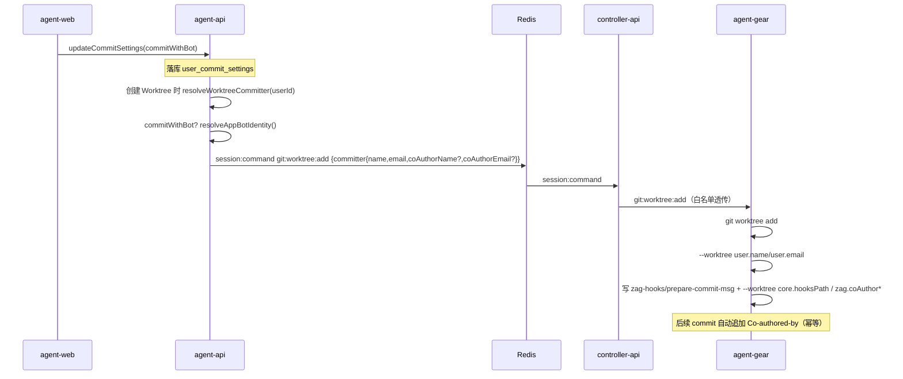

# Commit 与 bot 共同提交 - 技术提案

**功能名称**: Commit 与 bot 共同提交（Worktree Co-Author）
**关联 PRD**: `docs/product/draft/20261031-commit-with-bot-coauthor.md`
**技术提案版本**: v1.0
**创建日期**: 2026-10-31
**作者**: ZeroAsh Agent
**feat-branch**: `feat/commit-with-bot-coauthor`

## 1. 概述

### 1.1 背景

`20261029-feat-commit-author-settings-optimization` 下线了「提交人模式」，提交身份改按上下文下发：

- 云电脑自身（非 Worktree）→ 平台 bot（`resolveCloudHostIdentity`）；
- 勾选 Worktree 的会话/工作流 → 创建者的成员级「提交人」，经 `git:worktree:add` 的 `committer {name,email}` 下发，agent-gear 写 worktree 级 `user.name/user.email`；
- Issue 拉起的工作流 → 触发人的「提交人」，回退其 GitHub 身份，再回退 bot。

容器侧仍保留 `CommitIdentity` 的 `co_author` 能力（`prepare-commit-msg` hook + `core.hooksPath`），但服务端已不再下发该模式。成员级设置中没有「共同作者」字段。

### 1.2 目标

新增成员级开关 `commitWithBot`，勾选后在下发 Worktree 提交人时**追加平台 bot 的帐号名与 GitHub noreply 邮箱**，容器内以 worktree 级 hook 追加 `Co-authored-by` trailer。

### 1.3 非目标

- 不恢复已下线的「提交人模式」；
- 不改变云电脑自身（非 Worktree）恒为 bot 的规则；
- 不支持自定义共同作者，共同作者固定为平台 bot；
- 不修改 `POST /internal/cloud-hosts/:controllerId/commit-identity` 的响应语义。

## 2. 关键决策

### 决策 1：共同作者随 `git:worktree:add` 的 `committer` 下发，而不是容器级身份端点

| 方案 | 说明 | 结论 |
|--|--|--|
| A. 扩展 `commit-identity` 端点返回 `co_author` | 容器级全局 hook，所有提交统一追加 trailer | ❌ 端点按**云电脑**解析、没有成员上下文；成员级开关无法在多人共用的云电脑上正确表达；且云电脑自身提交作者已是 bot，会追加重复的 bot 署名 |
| B. 扩展 `git:worktree:add` 的 `committer` 载荷 | 与现有成员级提交人同链路，按 Worktree 粒度下发 | ✅ 与「谁的 Worktree 署谁」口径一致；天然按成员隔离；旧 worker 忽略未知字段优雅降级 |

采用 **B**。`committer` 扩展为：

```json
{
  "name": "成员用户名",
  "email": "成员邮箱",
  "coAuthorName": "zag-bot[bot]",
  "coAuthorEmail": "123456+zag-bot[bot]@users.noreply.github.com"
}
```

`coAuthorName/coAuthorEmail` 同时存在才视为启用共同作者，否则按旧报文形状处理。

### 决策 2：容器内用「worktree 级 core.hooksPath + 从 worktree config 读取 trailer」实现

全局 hook（`~/.zag/git-hooks`）属于云电脑级 `CommitIdentity`，会被 `commit-identity` 周期同步按 `agent_only` 移除，不能承载成员级开关。改为：

1. `WorktreeHandler.add` 在写完 `user.name/user.email` 后，若收到共同作者：
   - 通过 `git rev-parse --git-common-dir` 定位共享 git 目录；
   - 写入 `<git-common-dir>/zag-hooks/prepare-commit-msg`（`# zag-managed` 标记，0755，内容固定）；
   - `git config --worktree core.hooksPath <hookDir>`；
   - `git config --worktree zag.coAuthorName/Email <bot 身份>`。
2. hook 每次提交时读取当前 worktree 生效配置：
   - 无 `zag.coAuthorName/Email` → 直接退出（不影响普通提交）；
   - 已有相同 trailer → 直接退出（重复提交 / `--amend` 幂等）；
   - 否则 `git interpret-trailers` 追加，失败退回 `printf` 追加。

worktree 级 `core.hooksPath` 已验证可覆盖全局值，且只作用于该 worktree；hook 文件为共享目录内的单一受管文件，多 worktree 共用但行为由各自的 `config.worktree` 决定。

### 决策 3：`commitWithBot` 仅在 `committerType=custom` 时生效

- 未设置提交人时 Worktree 提交沿用容器级 bot，bot 作为主作者再加 bot 共同作者没有意义；
- 服务端归一：`commitWithBot = committerType === 'custom' ? input.commitWithBot === true : false`；
- 前端在「未设置」时置灰勾选项并提示「设置提交人后可勾选」。

### 决策 4：bot 身份不可用时降级为「仅成员署名」

`resolveWorktreeCommitter` 在 `commitWithBot=true` 时调用 `githubService.resolveAppBotIdentity()`（已有 Redis 缓存）。解析失败只告警并返回不带 `coAuthor*` 的提交人，不阻断 Worktree 创建 / 会话创建 / 工作流实例化。

### 决策 5：不提升 worker 版本门禁

共同作者是附加能力，旧 worker 忽略未知字段即可优雅降级；提升门禁会让存量 2.12.x 云电脑在重新注册时被拒，收益不抵风险。agent-gear 包版本随功能提升到 `2.13.0`（新增 worktree co-author hook 能力），门禁基线仍为 `2.12.0`。

## 3. 详细设计

### 3.1 数据模型

`servers/agent-api/src/models/user-commit-setting.ts` 新增字段：

```ts
commitWithBot: { type: Boolean, default: false }
```

- 集合仍为 `user_commit_settings`，键仍为 `{userId}` 唯一；
- 历史行缺少该字段时按 `false` 处理（`toView` / `resolveWorktreeCommitter` 均做布尔归一），**无需数据迁移**；
- 不改变任何索引。

### 3.2 GraphQL 契约

`contracts/github.graphql`：

```graphql
type CommitSettings {
  committerType: CommitterType!
  customName: String
  customEmail: String
  """勾选后 Worktree 提交以成员为主作者、平台 bot 为共同作者（仅 committerType=CUSTOM 时生效）"""
  commitWithBot: Boolean!
}

input CommitSettingsInput {
  committerType: CommitterType!
  customName: String
  customEmail: String
  """缺省 false；committerType=UNSET 时服务端归一为 false"""
  commitWithBot: Boolean
}
```

`servers/agent-api/src/graphql/schemas/github.ts` 同步；resolver 透传不变。

### 3.3 服务层

`servers/agent-api/src/services/commit-settings-service.ts`：

```ts
export interface CommitSettingsInput {
  committerType: string;
  customName?: string | null;
  customEmail?: string | null;
  commitWithBot?: boolean | null;
}

export interface CommitSettingsView {
  committerType: Uppercase<CommitterType>;
  customName: string | null;
  customEmail: string | null;
  commitWithBot: boolean;
}

export interface ResolvedWorktreeCommitter {
  name: string;
  email: string;
  coAuthorName?: string;
  coAuthorEmail?: string;
}
```

- `getCommitSettings` / `updateCommitSettings`：读写 `commitWithBot`，`UNSET` 时归一 `false`；
- `resolveWorktreeCommitter(userId)`：
  1. 读取设置，非 `custom` / 非法 → `null`；
  2. `commitWithBot !== true` → `{name,email}`；
  3. `resolveAppBotIdentity()` → bot 存在则返回 `{name,email,coAuthorName:bot.name,coAuthorEmail:bot.email}`，失败告警后返回 `{name,email}`。

### 3.4 下发链路



透传点：

| 层 | 文件 | 变更 |
|--|--|--|
| agent-api | `services/session.ts` | 实时解析结果原样透传（类型扩展） |
| agent-api | `services/workflow/instance.ts` | 快照字段增加 `worktreeCoAuthorName/Email` |
| agent-api | `models/workflow-instance.ts` | 新增两个可空字符串字段 |
| agent-api | `services/workflow/orchestrator.ts` | 节点级 Worktree 复用快照时携带共同作者 |
| agent-api | `services/workflow/issues-event-handler.ts` | 触发人解析结果原样透传（回退 GitHub 身份时不带共同作者） |
| controller-api | `services/session-command.ts` / `worktree-service.ts` | `committer` 类型扩展，原样透传（不扩张白名单） |
| agent-gear | `src/worktree-handler.ts` | 写用户身份后写 hook + worktree 配置 |
| agent-gear | `src/socketio-client.ts` | 载荷类型扩展 |

### 3.5 容器内 hook

`<git-common-dir>/zag-hooks/prepare-commit-msg`：

```sh
#!/bin/sh
# zag-managed: append Co-authored-by trailer from worktree config (idempotent)
MSG="$1"
[ -n "$MSG" ] || exit 0
NAME=$(git config --get zag.coAuthorName 2>/dev/null) || exit 0
EMAIL=$(git config --get zag.coAuthorEmail 2>/dev/null) || exit 0
[ -n "$NAME" ] && [ -n "$EMAIL" ] || exit 0
TRAILER="Co-authored-by: $NAME <$EMAIL>"
grep -qF "$TRAILER" "$MSG" 2>/dev/null && exit 0
git interpret-trailers --in-place --trailer "$TRAILER" "$MSG" 2>/dev/null \
  || printf '\n%s\n' "$TRAILER" >> "$MSG"
exit 0
```

安全约束：

- 服务端 `coAuthor*` 来自 GitHub API + 缓存，写入前在 `normalizeCommitter` 中拒绝空值与 `\n\r\0`；任一项非法则视为未启用共同作者；
- `git config --worktree` 的参数一律 `shellQuote`；
- hook 内不做字符串插值求值，`TRAILER` 作为数据经双引号传给 `grep` / `git interpret-trailers` / `printf`；
- hook 失败不阻断 worktree 创建（沿用现有「单条身份命令失败只告警」策略）。

### 3.6 生效时点

- Worktree 创建时写入配置，之后修改设置不影响已有 Worktree（与 PRD 一致）；
- 复用已有 Worktree（`existingWorktreePath`）不重写配置；
- 删除 Worktree 时 `config.worktree` 随之删除；共享目录内的 hook 文件保留（无 worktree 引用它，无副作用）。

### 3.7 前端

`apps/agent-web/src/components/settings/GitSettingsSection.tsx`：

- 在「提交人」单选组下方新增 checkbox「与 bot 共同提交」；
- `committerType !== 'CUSTOM'` 时 `disabled`，展示提示「设置提交人后可勾选」；
- 保存时随 `commitWithBot` 一起提交；`UNSET` 时本地归一为 `false`；
- 类型同步 `graphql/types.ts`，查询/变更文档无需改动（字段由后端返回）。

## 4. 异常与降级矩阵

| 场景 | 行为 |
|--|--|
| `commitWithBot=false` / 历史行无字段 | 与当前版本完全一致 |
| `committerType=UNSET` + 勾选 | 服务端归一 `false`，Worktree 提交仍为 bot |
| bot 身份解析失败 | 返回不带 `coAuthor*` 的提交人，仅告警 |
| 旧 worker（<2.13.0） | 忽略 `coAuthor*`，只写 `user.name/email`，不报错 |
| hook 写入 / 配置失败 | 告警并继续，Worktree 创建成功 |
| 重复提交 / `--amend` | hook 检测到已有 trailer 后跳过 |
| 云电脑自身提交 | `commit-identity` 仍为 `agent_only` bot，不经过 worktree hook |

## 5. 影响面

- 契约：`contracts/github.graphql`（CommitSettings / CommitSettingsInput）、`contracts/agent-session-websocket.md` §3.12（committer 字段说明）；
- 后端：agent-api（模型 / 服务 / 快照 / 透传）、controller-api（透传类型）；
- 客户端：agent-gear（worktree hook）、agent-web（Git 区块）；
- 数据库：仅新增字段，无迁移；
- 版本：agent-gear `2.12.0 → 2.13.0`，worker 门禁不变。

## 6. 验收与测试

- 单元：服务层归一 / 解析矩阵、WorktreeHandler 命令与 hook 内容、GitSettingsSection 交互；
- API：`commitSettings` 默认 `commitWithBot=false`、保存回读、UNSET 归一；
- 跨服务：controller-api 透传 `coAuthor*` 字段；
- E2E：设置页勾选保存、回显、未设置时置灰；
- 人工验收：真实云电脑 Worktree 内提交，核对 author 与 `Co-authored-by`，重复提交不叠加。

## 7. 相关文档

- [[../product/draft/20261031-commit-with-bot-coauthor.md]] — 产品方案
- [[../plan/20261031-feat-commit-with-bot-coauthor.md]] — 实现计划
- [[20261029-feat-commit-author-settings-optimization.md]] — 提交人模式下线与 Worktree 提交人链路
- [[20261027-feat-commit-author-settings.md]] — 原 Co-Author 容器能力
