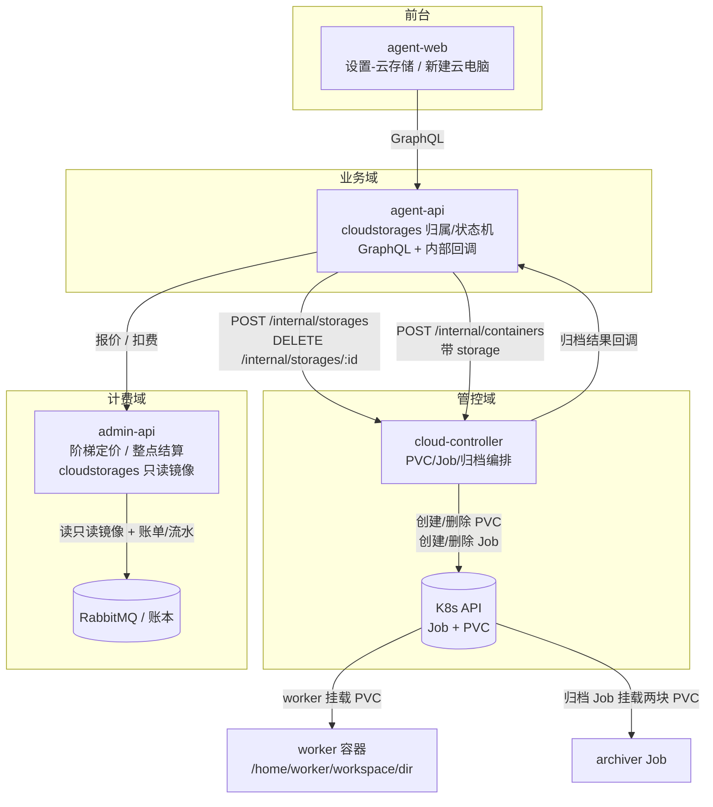
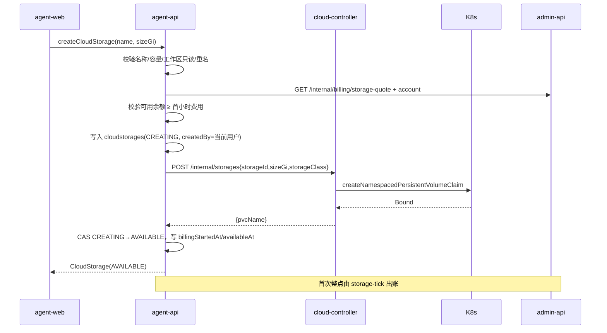
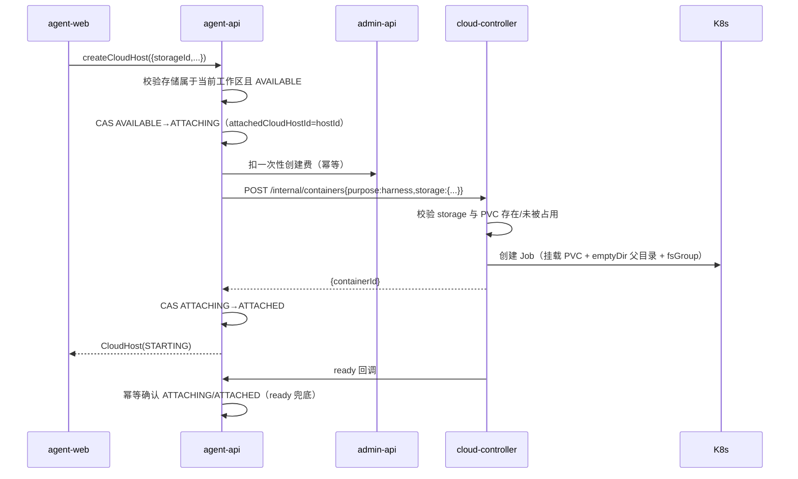
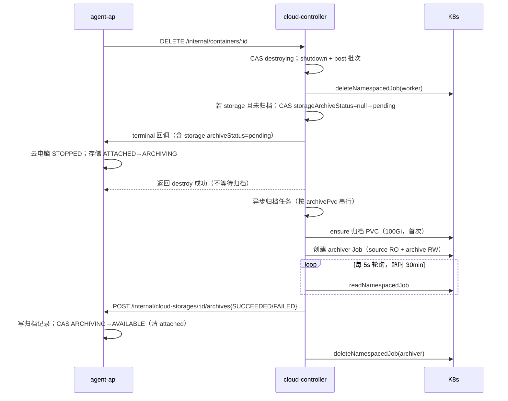
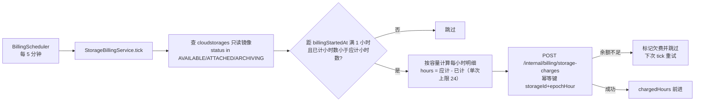
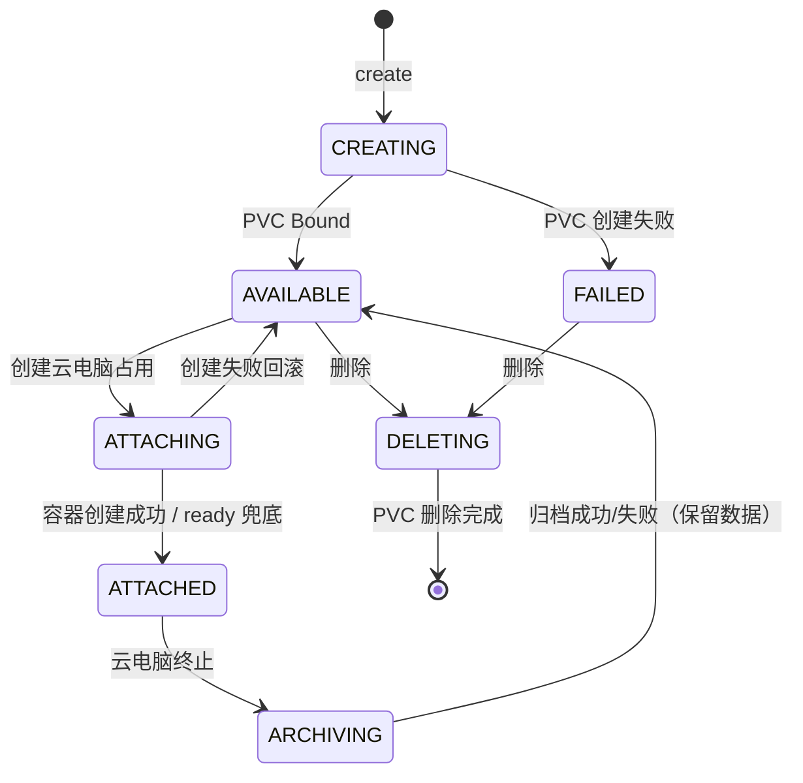

# 云电脑支持申请存储（云存储） - 技术提案

**功能名称**: 云电脑云存储（工作区级持久存储 + 挂载 + 自动归档 + 阶梯小时计费）
**关联 PRD**: `docs/product/draft/20261102-cloud-storage.md`（v1.0）
**技术提案版本**: v1.0
**创建日期**: 2026-11-02
**作者**: z-agent-bot
**feat-branch**: `feat/cloud-storage`
**需求来源**: GitHub Issue [Deliay/z-agent-gear#405](https://github.com/Deliay/z-agent-gear/issues/405)

## 1. 概述

### 1.1 背景

云电脑（`purpose=harness`）由 cloud-controller 以 K8s Job 拉起，容器停止即 Job 删除，容器内数据（可写层）随 Pod 回收永久丢失。当前 Job 仅声明 `resources.limits`（4 vCPU / 16Gi / `ephemeral-storage` 10Gi），**没有任何持久卷**；`k8s-client.ts` 的 `K8sClient` 只覆盖 Job CRUD + Watch，不包含 PVC 能力；`K8sJobManifest` 也没有 `volumes` / `volumeMounts` / Pod 级 `securityContext` 字段（`servers/cloud-controller/src/services/k8s-client.ts:25-61`、`k8s-job-manager.ts:96-152`）。

产品侧需要：

- 设置中新增「云存储」，按名称 + 容量（≤30Gi）创建，按容量阶梯、按小时计费；
- 云存储归属工作区、记录创建人，一个存储同时只能挂载一台云电脑；
- 创建云电脑时勾选并挂载（或就地新建），云电脑内以 `~/workspace/<目录>` 访问；
- 云电脑销毁时把挂载内容压缩为 `.tar.gz2` 写入工作区归档空间（100Gi）。

技术上有四个关键缺口：

1. **持久卷生命周期无人负责**：K8s 侧需要 PVC 的创建、查询、删除与挂载，当前 cloud-controller 没有 PVC API，RBAC 也只授权了 `jobs`（`deploy/k8s/cloud-controller.yaml:33-40`）。
2. **销毁链路没有归档位**：`ContainerService.destroyLocked` 在删除 Job 后直接写 `exited` 并触发终态钩子（`container-service.ts:713-751`），没有「在数据消失前导出」的步骤；而 30Gi 级数据不可能同步压缩，必须异步。
3. **计费模型只有单档单价**：`ProductPrice` 只有 `unitPrice`（分/单位）与 token 三档费率（`models/product-price.ts`），`oneTimeChargeService` 也只接受单个 `productId + quantity`；需求是「前 10Gi 5 credits/小时、10~25Gi 每 Gi 1 credit/小时、25~30Gi 每 Gi 3 credits/小时」的累计分档。
4. **归属与权限**：多租户二期已具备工作区、角色与 `applyWorkspaceScope` 插件，但新资源需要明确「工作区级共享 + 创建人记录 + 删除保护」，并纳入工作区删除资源检查（`workspace-service.ts:274-289` 当前 10 个集合）。

### 1.2 目标

- **持久卷由 cloud-controller 独占管理**：新增 PVC 抽象、创建/删除/挂载/归档，保持「K8s 单一事实源」既有约束（`servers/cloud-controller/AGENTS.md`）。
- **挂载是声明式的**：云电脑启动请求携带 `storage`，cloud-controller 在 Job 模板中挂载；agent-api 负责归属、状态机与计费，不直接操作 K8s。
- **归档异步且不阻塞停止**：销毁完成后由独立的归档 Job 压缩，cloud-controller 持久化归档状态并回调 agent-api；失败可重试、可对账。
- **计费复用现有管线**：以 3 个 `per_unit` 价目（base / tier1 / tier2）表达阶梯，新增整点扫描结算，产出带分档明细的账单（`items`）并扩展账单分类 `storage`。
- **零回归**：不带 `storage` 的云电脑创建/销毁报文、计费与 UI 行为完全不变。

### 1.3 范围

**做**：

- contracts：新增 `contracts/cloud-storage.graphql`；扩展 `contracts/cloud-host.graphql`（`CreateCloudHostInput.storageId`、`CloudHost.storage`）；扩展 `contracts/cloud-controller-websocket.md` 附录 A（存储管理端点、`storage` 字段、归档回调）；扩展 `contracts/admin-billing.graphql` / `contracts/billing.graphql`（`BillingCategory.storage`、存储报价与账单展示）。
- agent-api：`cloudstorages` / `cloudstoragearchives` 两个集合与迁移 020；`cloud-storage-service`；GraphQL schema/resolver；云电脑创建接入 `storageId`；内部回调端点；工作区删除保护；只读镜像兼容。
- cloud-controller：`k8s-client` 的 PVC CRUD；Job manifest 的 `volumes` / `volumeMounts` / `securityContext`；`storage-service`（PVC 生命周期 + 归档 Job 编排 + 状态持久化 + 回调）；内部 REST；容器模型扩展；RBAC 与部署配置。
- admin-api：存储阶梯定价与报价；整点结算 `StorageBillingService`；账单分类 `storage`；`cloudstorages` 只读镜像；`/internal/billing/storage-quote` 与 `/internal/billing/storage-charges`。
- agent-web：设置「云存储」区块（列表/新建/详情/归档记录/删除/重试归档）；新建云电脑对话框「云存储」区块（勾选/下拉/新建…）。
- admin-web：账单分类「存储」展示。
- 部署：`deploy/k8s/cloud-controller.yaml` RBAC 与 env、`aspire/AgentGear.AppHost` / `aspire/manifest/docker-compose.yaml`、新增归档镜像 `deploy/images/archiver/`。

**不做**：

- 云存储扩容/缩容、跨工作区迁移；
- 归档文件下载、恢复到云存储/新云存储（本期只留存与追溯）；
- 归档自动清理/容量水位告警（本期仅支持手动删除归档记录）；
- 一台云电脑挂载多块云存储；
- 归档文件大小/校验和展示（归档 Job 内部可计算，本期不落库）；
- 云存储快照/备份策略、跨可用区容灾；
- 本地/自定义主机（非云电脑）使用云存储。

## 2. 技术架构

### 2.1 系统架构图



### 2.2 技术栈

| 层级 | 技术选型 | 说明 |
|------|---------|------|
| 前端 | React 19 + TypeScript + Apollo Client + Tailwind | 复用 agent-web 既有设置页与对话框组件 |
| 业务后端 | Node.js 24 + TypeScript strict + Express 5 + GraphQL-Yoga 5 + Mongoose 9 | agent-api 既有栈 |
| 管控后端 | Node.js 24 + `@kubernetes/client-node`（`CoreV1Api` + `BatchV1Api`） | cloud-controller 既有权能 + 新增 PVC |
| 计费 | admin-api 既有 ledger/payment/invoicing + 新增整点 tick | 不新增消息队列拓扑 |
| 存储 | CSI 动态供给（默认 StorageClass 或显式 `CLOUD_STORAGE_CLASS`） | `ReadWriteOnce` / `Filesystem` |
| 归档 | `tar` + `bzip2 -9`，独立归档镜像 | 扩展名按需求使用 `.tar.gz2` |
| 测试 | Vitest（单测/真库/集成）+ Playwright E2E | TDD 红-绿-重构 |

### 2.3 模块划分

| 模块 | 新增/修改 | 职责 |
|------|-----------|------|
| `contracts/cloud-storage.graphql` | 新增 | 前台云存储契约（列表/创建/删除/报价/归档记录/重试） |
| `contracts/cloud-host.graphql` | 修改 | `storageId` 入参、`CloudHost.storage` 摘要、报价扩展 |
| `contracts/cloud-controller-websocket.md` | 修改 | 附录 A：存储创建/删除、harness `storage` 字段、归档状态与回调 |
| `contracts/admin-billing.graphql`、`contracts/billing.graphql` | 修改 | `BillingCategory.storage`、账单 items 分档展示 |
| `servers/agent-api/src/models/cloud-storage.ts` | 新增 | `cloudstorages` 工作区级资源（租户/工作区作用域插件） |
| `servers/agent-api/src/models/cloud-storage-archive.ts` | 新增 | `cloudstoragearchives` 归档记录 |
| `servers/agent-api/src/services/cloud-storage-service.ts` | 新增 | 创建/列表/删除/挂载占用/归档状态机/重试/权限与校验 |
| `servers/agent-api/src/services/cloud-host-service.ts` | 修改 | 创建云电脑时占用存储、ready 确认挂载、终止回滚/归档联动 |
| `servers/agent-api/src/services/cloud-controller-client.ts` | 修改 | 存储创建/删除、归档状态查询/重试 |
| `servers/agent-api/src/routes/internal-cloud-storage.ts` | 新增 | 归档事件回调（Bearer 内部 token） |
| `servers/agent-api/src/graphql/schemas/cloud-storage.ts`、`resolvers/cloud-storage.ts` | 新增 | GraphQL 入口（resolver 登记 `index.ts`） |
| `servers/agent-api/src/services/workspace-service.ts` | 修改 | `hasResources` 纳入 `cloudstorages` 与 `cloudstoragearchives`（归档记录保留期间不允许删除工作区） |
| `servers/agent-api/src/migrations/020-cloud-storage-indexes.ts` | 新增 | 索引与必要字段（幂等） |
| `servers/cloud-controller/src/services/k8s-client.ts` | 修改 | PVC 接口 + manifest `volumes`/`volumeMounts`/`securityContext` + InMemory 实现 |
| `servers/cloud-controller/src/services/k8s-storage-manager.ts` | 新增 | PVC manifest + CRUD + 标签命名 |
| `servers/cloud-controller/src/services/storage-service.ts` | 新增 | PVC 生命周期、归档/清理 Job 编排、状态持久化、回调、串行化 |
| `servers/cloud-controller/src/routes/internal-api.ts` | 修改 | 存储端点、`parseHarnessRequest` 的 `storage` 校验 |
| `servers/cloud-controller/src/services/container-service.ts` | 修改 | Job 挂载、启动落库、销毁归档触发 |
| `servers/cloud-controller/src/models/cloud-container.ts` | 修改 | `storage*` / `storageArchive*` 字段 |
| `servers/admin-api/src/services/billing/storage-pricing.ts`、`storage-charge.ts`、`storage-tick.ts` | 新增 | 阶梯报价、整点结算、欠费策略 |
| `servers/admin-api/src/services/billing/pricing.ts` | 修改 | 3 个存储价目默认档 |
| `servers/admin-api/src/services/billing/scheduler.ts` | 修改 | 注册存储结算 tick |
| `servers/admin-api/src/models/cloud-storage.ts` | 新增 | 只读镜像（供 tick 扫描） |
| `servers/admin-api/src/models/storage-billing-cursor.ts` | 新增 | 存储计费进度游标（admin-api 独占写） |
| `servers/admin-api/src/routes/internal-billing.ts` | 修改 | 存储报价/结算内部端点 |
| `servers/admin-api/src/models/billing-invoice.ts` 等 | 修改 | `INVOICE_CATEGORIES` 增加 `storage` |
| `apps/agent-web/src/components/settings/CloudStorageSection.tsx` 等 | 新增 | 设置页区块与对话框 |
| `apps/agent-web/src/components/cloud-host/NewCloudHostDialog.tsx` | 修改 | 云存储勾选/下拉/新建…/费用 |
| `apps/agent-web/src/pages/SettingsPage.tsx` | 修改 | 新增导航项 |
| `apps/admin-web/src/components/billing/InvoiceTable.tsx`、`apps/agent-web/src/pages/BillingPage.tsx` | 修改 | 分类「存储」标签 |
| `deploy/images/archiver/` | 新增 | 归档镜像（tar + bzip2） |
| `deploy/k8s/cloud-controller.yaml`、`aspire/**` | 修改 | RBAC `persistentvolumeclaims`、env |

## 3. API 设计

### 3.1 对外契约（GraphQL）

#### 3.1.1 新增 `contracts/cloud-storage.graphql`

```graphql
# 前台云存储契约（工作区级持久存储）
#
# 鉴权：Authorization: Bearer <front user JWT>；未认证返回 Not authenticated。
# 归属：创建时取当前工作区（x-workspace-id 上下文，缺省个人全局工作区）；
#       跨工作区不可见、不可挂载。
# 计费：按容量阶梯、按小时结算，创建成功（AVAILABLE）起算，删除后停止。

enum CloudStorageStatus {
  CREATING
  AVAILABLE
  ATTACHING
  ATTACHED
  ARCHIVING
  FAILED
  DELETING
}

enum CloudStorageArchiveStatus {
  PENDING
  RUNNING
  SUCCEEDED
  FAILED
  DELETING
}

type CloudStorageArchive {
  id: ID!
  storageId: ID!
  fileName: String!
  status: CloudStorageArchiveStatus!
  cloudHostId: ID
  cloudHostName: String
  startedAt: String
  finishedAt: String
  failureReason: String
  createdAt: String!
}

# 创建人摘要（只暴露展示所需字段）
type CloudStorageCreator {
  id: ID!
  name: String!
}

type CloudStorage {
  id: ID!
  name: String!
  sizeGi: Int!
  status: CloudStorageStatus!
  # 云电脑内挂载目录（展示口径 ~/workspace/<目录名>；服务端权威值为 /home/worker/workspace/<目录名>）
  mountPath: String!
  hourlyCredits: Float!
  createdBy: CloudStorageCreator!
  createdAt: String!
  # 当前挂载的云电脑；未挂载为 null
  attachedCloudHostId: ID
  attachedCloudHostName: String
  attachedAt: String
  # 最近一次归档结果（冗余自归档记录，便于列表展示）
  lastArchive: CloudStorageArchive
  # 归档空间使用概况（工作区级 100Gi 上限）
  archiveSpace: CloudStorageArchiveSpace!
  failureReason: String
}

type CloudStorageArchiveSpace {
  capacityGi: Int!
  # 本期无法精确统计归档体积，返回 null 表示未知（UI 提示“由平台管理”）
  usedGi: Float
}

# 容量阶梯报价
type CloudStoragePriceTier {
  # 例如 “1-10Gi 固定 5 credits/小时”
  label: String!
  amountCredits: Float!
}

type CloudStorageBillingQuote {
  sizeGi: Int!
  hourlyCredits: Float!
  tiers: [CloudStoragePriceTier!]!
  # 当前工作区计费账户可用余额；计费不可用时为 null（仅提示，不阻断）
  availableBalance: Float
}

input CreateCloudStorageInput {
  # trim 后 1~64；同一工作区唯一
  name: String!
  # 1~30（Gi）
  sizeGi: Int!
}

extend type Query {
  # 当前工作区云存储列表；onlyAttachable=true 时仅返回 AVAILABLE（创建云电脑下拉用）
  cloudStorages(onlyAttachable: Boolean = false): [CloudStorage!]!
  cloudStorage(id: ID!): CloudStorage
  cloudStorageArchives(storageId: ID!): [CloudStorageArchive!]!
  # 不传 sizeGi 时按默认 10Gi 报价
  cloudStorageBillingQuote(sizeGi: Int): CloudStorageBillingQuote!
}

extend type Mutation {
  createCloudStorage(input: CreateCloudStorageInput!): CloudStorage!
  # 仅 AVAILABLE 可删除；删除后停止计费，归档记录保留
  deleteCloudStorage(id: ID!): Boolean!
  # 最近一次归档失败时重试（复用最后一次容器；无容器可重试时返回契约错误）
  retryCloudStorageArchive(id: ID!): CloudStorage!
  # 删除归档记录（释放归档空间）；仅创建人/工作区管理员
  deleteCloudStorageArchive(storageId: ID!, archiveId: ID!): Boolean!
}
```

错误文案（服务端权威、前端原样或映射展示）：

| 场景 | 文案 |
|------|------|
| 名称空/超长 | `storage name is required` / `storage name is too long` |
| 同工作区重名 | `storage name already exists` |
| 容量非法 | `storage size must be between 1 and 30 Gi` |
| 存储不存在/跨工作区 | `storage not found` |
| 状态不允许 | `storage is not available` / `storage is attached` / `storage is archiving` |
| 权限不足 | `not allowed to delete storage` |
| 工作区只读 | 复用 `global workspace is read-only` |
| 欠费 | `insufficient balance` |
| 无可用归档容器 | `no archive to retry` |

#### 3.1.2 扩展 `contracts/cloud-host.graphql`

```graphql
type CloudStorageSummary {
  id: ID!
  name: String!
  sizeGi: Int!
  mountPath: String!
  hourlyCredits: Float!
}

type CloudHost {
  # ...既有字段
  # 创建时挂载的云存储；未挂载为 null
  storage: CloudStorageSummary
}

input CreateCloudHostInput {
  # ...既有字段
  # 可选：创建时挂载当前工作区的 AVAILABLE 云存储；必须与云电脑同一工作区
  storageId: ID
}

type CloudHostBillingQuote {
  # ...既有字段
}
```

- `storageId` 缺省 = 不挂载，报文与现状完全一致（`NewCloudHostDialog` 未勾选时不发送该字段）。
- 挂载失败（被抢占/状态变化）时 `createCloudHost` 抛 `storage is not available`；已扣的创建费按既有「拉起失败自动退款」路径退回。

#### 3.1.3 计费契约扩展

`contracts/admin-billing.graphql` 与 `contracts/billing.graphql`：

```graphql
enum BillingCategory {
  container
  model
  manual
  storage
}
```

- 存储账单 `items` 形如：
  - `{productId:"cloud_storage.base.hour", quantity:1, unitPrice:500, amount:500}`
  - `{productId:"cloud_storage.tier1.gib_hour", quantity:10, unitPrice:100, amount:1000}`
  - `{productId:"cloud_storage.tier2.gib_hour", quantity:5, unitPrice:300, amount:1500}`
- 金额单位仍为「分」，`credits = amount / 100`；不新增字段。

### 3.2 内部接口

#### 3.2.1 cloud-controller（`contracts/cloud-controller-websocket.md` 附录 A）

**a) 云电脑启动请求新增 `storage`（可选）**

```jsonc
{
  "purpose": "harness",
  // ...既有字段
  "storage": {
    "id": "<cloudStorageId>",
    "pvcName": "zag-storage-<storageId>",
    "mountPath": "/home/worker/workspace/data-6f2a1c",
    "sizeGi": 20,
    "workspaceId": "<tenantWorkspaceId>"
  }
}
```

校验（`parseHarnessRequest`）：

- `storage` 缺省/null → 不挂载，行为与现状一致；
- 必填字段均为非空字符串；`sizeGi` 为 1~30 整数；`mountPath` 必须匹配 `^/home/worker/workspace/[A-Za-z0-9._-]+$` 且不含 `..`；`pvcName` 必须匹配 `^zag-storage-[a-z0-9-]+$`；
- 非法返回 `400 INVALID_HARNESS`，不创建 Job；
- 同一存储同时被两个活跃容器引用时：cloud-controller 先查 `cloudcontainers.storageId` + 活跃状态，命中返回 `409 STORAGE_IN_USE`；真正的互斥由 agent-api 的 `AVAILABLE→ATTACHING` CAS 保证（唯一调用方），此处为纵深防御。

**b) 存储管理端点**

```
POST   /internal/storages
Body:  { "storageId": "<id>", "tenantId": "<tenant>", "workspaceId": "<workspace>", "sizeGi": 20, "storageClass": "ceph-rbd" }
Resp:  { "storageId": "...", "pvcName": "zag-storage-...", "created": true }

GET    /internal/storages/:storageId
Resp:  { "storageId": "...", "pvcName": "zag-storage-...", "exists": true, "capacity": "20Gi", "phase": "Bound" }

DELETE /internal/storages/:storageId
Resp:  { "storageId": "...", "deleted": true }
错误:  409 STORAGE_IN_USE（仍有活跃容器引用）

POST   /internal/containers/:id/archive
Resp:  { "accepted": true, "archiveId": "<id>" }
错误:  404 NOT_FOUND / 409 CONTAINER_ACTIVE / 409 ARCHIVE_RUNNING

GET    /internal/containers/:id/archive
Resp:  { "status": "NONE|PENDING|RUNNING|SUCCEEDED|FAILED",
         "archiveId": "...", "fileName": "...", "startedAt": "...", "finishedAt": "...", "failureReason": null }

POST   /internal/storages/:storageId/archives/:archiveId/delete
Body:  { "path": "/archive/<workspaceId>/<storageId>/<fileName>" }
Resp:  { "accepted": true }
错误:  409 ARCHIVE_RUNNING
```

- 端点全部 Bearer `INTERNAL_API_TOKEN`（复用 `middleware/internal-auth.ts`）。
- `POST /internal/storages` 幂等：PVC 已存在（按 label `zag.cloud/storage-id` 或名称）直接返回 `created:false`。
- `storageClass` 缺省取 `CLOUD_STORAGE_CLASS`；二者都为空时**省略** `storageClassName`，使用集群默认 StorageClass（显式空串会禁用动态供给，必须避免）。

**c) 归档回调（cloud-controller → agent-api）**

```
POST /internal/cloud-storages/:storageId/archives
Body: {
  "archiveId": "<id>", "storageId": "<id>",
  "cloudHostId": "<id>", "containerId": "<id>",
  "cloudHostName": "我的云电脑",
  "fileName": "我的云电脑-20261102-153012.tar.gz2",
  "path": "/archive/<workspaceId>/<storageId>/<fileName>",
  "status": "RUNNING|SUCCEEDED|FAILED|DELETED",
  "startedAt": "...", "finishedAt": "...", "failureReason": null
}
Resp: { "ok": true }
```

- Bearer `INTERNAL_API_TOKEN`；按 `archiveId` 幂等 upsert。
- 回调失败按「0 / 250ms / 1s / 3s」退避重试（与 `agent-api-client.ts` 既有回调一致），最终失败只记 error；agent-api 侧以 `GET /internal/containers/:id/archive` 兜底对账。

#### 3.2.2 admin-api 计费端点

```
GET  /internal/billing/storage-quote?sizeGi=20
Resp: {
  "sizeGi": 20,
  "hourlyCredits": 15,
  "items": [
    { "productId": "cloud_storage.base.hour", "quantity": 1, "unitPriceCredits": 5, "amountCredits": 5 },
    { "productId": "cloud_storage.tier1.gib_hour", "quantity": 10, "unitPriceCredits": 1, "amountCredits": 10 }
  ]
}

POST /internal/billing/storage-charges
Body: {
  "accountId": "<id>", "storageId": "<id>", "sizeGi": 20,
  "periodStart": "2026-11-02T15:00:00.000Z", "periodEnd": "2026-11-02T16:00:00.000Z",
  "idempotentKey": "cloud_storage.hour:<storageId>:<epochHour>",
  "description": "云存储 my-data（20Gi）15:00-16:00"
}
Resp: { "invoice": {...}, "charged": true }
错误: 404 ACCOUNT_NOT_FOUND / 409 INSUFFICIENT_BALANCE / 400 INVALID_BODY
```

- 单次调用只结算 **1 个整点小时**（`periodStart/periodEnd` 必须相差 1 小时），多小时由 tick 逐小时调用，保证幂等粒度与补结算可重放。

### 3.3 为什么不用新的消息队列事件

云存储是**低频用户动作**（创建/删除）与**小时级周期结算**，不需要容器级秒级事件吞吐：

- 创建/删除走同步内部 REST，失败即回滚，语义更简单；
- 归档状态走同步回调 + 查询兜底，避免新增 MQ 拓扑；
- 小时计费由 admin-api 既有 `BillingScheduler` 增加一个 tick（与 reservation 扫描同模式），幂等键保证重放安全。

后续若需要「删除工作区级联释放 PVC」「归档容量告警」等异步治理，再评估接入 `zag.billing.events` 之外的运维主题。

## 4. 数据模型

### 4.1 `cloudstorages`（agent-api 写，admin-api 只读镜像）

```ts
{
  _id: ObjectId,
  name: string,                 // trim 1~64
  nameKey: string,              // name.toLocaleLowerCase() 用于大小写不敏感唯一
  mountSubdir: string,          // 生成的目录名（mountPath = /home/worker/workspace/<mountSubdir>）
  sizeGi: number,               // 1..30
  status: 'CREATING'|'AVAILABLE'|'ATTACHING'|'ATTACHED'|'ARCHIVING'|'FAILED'|'DELETING',

  tenantId: ObjectId,           // 多租户
  resourceWorkspaceId: ObjectId,// 工作区归属（与 CloudHost.resourceWorkspaceId 同口径）
  createdBy: ObjectId,          // 创建人（需求 3）

  pvcName: string,              // zag-storage-<storageId>
  storageClass: string|null,    // 创建时快照（仅运维留档，不对外暴露）

  attachedCloudHostId: ObjectId|null,
  attachedControllerId: ObjectId|null,
  attachedBy: ObjectId|null,
  attachedAt: Date|null,

  lastContainerId: string|null, // 最近一次挂载的容器（归档重试用）
  lastArchive: {                // 列表展示冗余，权威记录在 cloudstoragearchives
    archiveId: string|null,
    fileName: string|null,
    status: 'PENDING'|'RUNNING'|'SUCCEEDED'|'FAILED'|null,
    startedAt: Date|null,
    finishedAt: Date|null,
    failureReason: string|null
  },

  billingAccountId: string|null,
  billingStartedAt: Date|null,   // AVAILABLE 时写入（计费唯一时间源；已结算进度由 admin-api 自持）
  availableAt: Date|null,
  failureReason: string|null,
  deletedAt: Date|null,

  createdAt: Date, updatedAt: Date
}
```

索引：

```ts
// 工作区内名称唯一（软删后允许重建）
{ resourceWorkspaceId: 1, nameKey: 1 } unique partialFilterExpression { deletedAt: null }
// 一台云电脑最多挂载一块存储（attachedCloudHostId 非空时唯一）
{ attachedCloudHostId: 1 } unique partialFilterExpression { attachedCloudHostId: { $type: 'objectId' } }
{ tenantId: 1 }
{ resourceWorkspaceId: 1, status: 1 }
{ status: 1, billingStartedAt: 1 }   // 计费 tick 扫描
```

> 说明：`{attachedCloudHostId}` 唯一索引同时实现「一块存储只能挂一台云电脑」与「一台云电脑最多挂一块存储」；归档期间保留 `attachedCloudHostId` 直到归档完成，防止归档未完成即被重新挂载。

插件：`applyTenantScope` + `applyWorkspaceScope({ workspaceField: 'resourceWorkspaceId' })`；`tenant-isolation.test.ts` 的集合清单同步加入 `cloudstorages`、`cloudstoragearchives`。

### 4.2 `cloudstoragearchives`（agent-api 写）

```ts
{
  _id: ObjectId,                 // 即 archiveId（由 cloud-controller 生成）
  storageId: ObjectId,
  tenantId: ObjectId,
  resourceWorkspaceId: ObjectId,
  createdBy: ObjectId,
  cloudHostId: ObjectId|null,
  cloudHostName: string|null,
  containerId: string|null,
  fileName: string,
  path: string,                  // /archive/<workspaceId>/<storageId>/<fileName>
  status: 'PENDING'|'RUNNING'|'SUCCEEDED'|'FAILED'|'DELETING',
  startedAt: Date|null,
  finishedAt: Date|null,
  failureReason: string|null,
  createdAt: Date, updatedAt: Date
}
```

索引：`{storageId: 1, createdAt: -1}`、`{resourceWorkspaceId: 1, createdAt: -1}`、`{status: 1}`。

### 4.3 `cloudcontainers`（cloud-controller 写，agent-api 只读镜像）

复制新增字段（历史行为 null/[] 容忍）：

```ts
storageId: string|null,
storagePvcName: string|null,
storageMountPath: string|null,
storageSizeGi: number|null,
storageWorkspaceId: string|null,
storageArchiveStatus: 'pending'|'running'|'succeeded'|'failed'|null,
storageArchiveId: string|null,
storageArchiveFileName: string|null,
storageArchiveStartedAt: Date|null,
storageArchiveFinishedAt: Date|null,
storageArchiveFailure: string|null,
```

### 4.4 价目与账单位

`productprices` 默认档（`pricing.ensureDefaultPrices()` 幂等写入，不改既有档）：

| productId | 含义 | 单价（分） | 对应 credits |
|-----------|------|------------|--------------|
| `cloud_storage.base.hour` | 前 10Gi 固定档 | 500 | 5 / 小时 |
| `cloud_storage.tier1.gib_hour` | 10~25Gi 每 Gi | 100 | 1 / Gi / 小时 |
| `cloud_storage.tier2.gib_hour` | 25~30Gi 每 Gi | 300 | 3 / Gi / 小时 |

计算（纯函数 `quoteStorageHourly(sizeGi)`）：

```
base = 500
tier1 = max(0, min(sizeGi, 25) - 10) * 100
tier2 = max(0, sizeGi - 25) * 300
hourlyCents = base + tier1 + tier2
```

账单：`type=charge`、`category=storage`、`refType='cloud_storage'`、`refId=<storageId>`、`items` 写出各档明细；`description` 形如 `云存储 <name>（20Gi）2026-11-02 15:00-16:00`。

### 4.5 `storagebillingcursors`（admin-api 写，计费进度）

遵循「写方单一」纪律：`cloudstorages` 由 agent-api 独占写，admin-api 只读镜像；已结算到第几个小时由 admin-api 自己的游标集合承载，不回写业务集合。

```ts
{
  _id: ObjectId,
  storageId: ObjectId,          // 唯一
  accountId: ObjectId,
  tenantId: ObjectId,
  sizeGi: number,               // 容量快照（容量不可变，快照仅防镜像异常）
  billingStartedAt: Date,       // 来自 cloudstorages 镜像
  chargedHours: number,         // 已结算小时数
  lastChargedAt: Date|null,
  closedAt: Date|null,          // 存储删除后的尾段结算完成时间
  lastError: string|null,
  createdAt: Date, updatedAt: Date
}
```

索引：`{storageId: 1}` unique、`{closedAt: 1}`。

### 4.6 迁移

- **agent-api `020-cloud-storage-indexes`**：显式创建上表索引（避免生产 `autoIndex=false` 时缺索引），幂等；不涉及存量数据回填。
  - 编号说明：当前最新为 `019-commit-settings-per-member`，故 020。
- **admin-api**：无需迁移（价目由 `ensureDefaultPrices` 启动时 upsert；账单 `category` 为应用层枚举；`storagebillingcursors` 为新建集合，索引由模型 autoIndex 建立）。
- **cloud-controller**：无需迁移（新字段对历史行容忍 null）；如需为存量容器补 `storageArchiveStatus` 不做回填。

## 5. 技术实现方案

### 5.1 核心流程

#### 5.1.1 创建云存储



失败：PVC 创建失败 → `FAILED` + `failureReason`，不写 `billingStartedAt`；删除记录可重试（或用户删除后重建）。

#### 5.1.2 创建云电脑并挂载



失败回滚（逆序）：容器未创建 → 存储 `ATTACHING→AVAILABLE`，创建费退款；容器已创建但 CAS 失败（并发 stop）→ 调 `DELETE /internal/containers/:id`，存储回滚 `AVAILABLE`。

#### 5.1.3 销毁与归档



#### 5.1.4 整点计费



### 5.2 关键实现点

#### 实现点 1: K8s 客户端扩展（PVC + 卷 + 安全上下文）

`K8sClient` 新增：

```ts
createPersistentVolumeClaim(manifest: K8sPvcManifest): Promise<void>;
getPersistentVolumeClaim(name: string): Promise<K8sPvcInfo | null>;
deletePersistentVolumeClaim(name: string): Promise<void>;
listPersistentVolumeClaims(labelSelector: string): Promise<K8sPvcInfo[]>;
```

`K8sJobManifest.spec.template.spec` 新增：

```ts
securityContext?: { fsGroup?: number; fsGroupChangePolicy?: 'OnRootMismatch' | 'Always' };
volumes?: Array<{
  name: string;
  emptyDir?: { sizeLimit?: string };
  persistentVolumeClaim?: { claimName: string; readOnly?: boolean };
}>;
containers: Array<{ /* ... */ volumeMounts?: Array<{ name: string; mountPath: string; readOnly?: boolean }> }>;
```

`RealK8sClient` 增加 `CoreV1Api` 客户端（`ensureInitialized` 中 `kc.makeApiClient(k8s.CoreV1Api)`）；`InMemoryK8sClient` 增加 `pvcs` Map 与 `createdPvcManifests`，供单测/E2E（`K8S_ENABLED=false`）断言。PVC 404 归一为 `null`，与 Job 的 `getJob` 同口径。

#### 实现点 2: PVC 清单与命名

```yaml
apiVersion: v1
kind: PersistentVolumeClaim
metadata:
  name: zag-storage-<storageId>
  namespace: <K8S_NAMESPACE>
  labels:
    app: zag-storage
    zag.cloud/storage-id: <storageId>
    zag.cloud/workspace-id: <workspaceId>
    zag.cloud/tenant-id: <tenantId>
spec:
  accessModes: ['ReadWriteOnce']
  volumeMode: Filesystem
  resources: { requests: { storage: '<sizeGi>Gi' } }
  storageClassName: <CLOUD_STORAGE_CLASS>   # 空则整段省略
```

- 归档 PVC：`zag-archive-<workspaceId>`，100Gi（`CLOUD_ARCHIVE_PVC_SIZE`），`CLOUD_ARCHIVE_STORAGE_CLASS`，同样 `ReadWriteOnce/Filesystem`，标签 `app: zag-archive`。
- 名称全部由服务端生成（不使用用户输入），避免 DNS-1123 与路径注入问题。
- 删除 PVC：仅 `DELETE /internal/storages/:id` 触发；`deleteNamespacedPersistentVolumeClaim` 404 视为成功（幂等）。

#### 实现点 3: 云电脑 Job 挂载与 worker 写权限

- 挂载点：`/home/worker/workspace/<mountSubdir>`（`mountPath` 由 agent-api 生成并随请求下发）。
- **父目录可写**：若直接由 kubelet 创建 `/home/worker/workspace`，它以 root:root 0755 落在容器可写层，worker（uid 1000）无法在其中创建 Git 项目目录。方案：
  1. Pod 级 `securityContext: { fsGroup: 1000, fsGroupChangePolicy: 'OnRootMismatch' }`——PVC/emptyDir 由 `root:worker` 组持有且组可写，避免每次挂载全量 chown；
  2. 仅在挂载云存储时，额外挂载一个 `emptyDir` 到 `/home/worker/workspace`（`sizeLimit: 1Gi`），K8s 按挂载路径深度排序，先挂父目录再挂子路径；emptyDir 与现有「可写层临时目录」语义一致（随容器销毁），不会把临时数据误持久化；
  3. 纵深防御：worker 镜像预创建 `/home/worker/workspace`（worker:worker）——不作为本期的硬依赖。
- 挂载顺序：`/home/worker/workspace`（emptyDir）→ `/home/worker/workspace/<subdir>`（PVC）。
- PVC 内文件属主为 uid 1000（agent-gear 以 worker 运行），归档 Job 以 root 读取，不受影响。

#### 实现点 4: 启动请求校验与容器落库

`parseHarnessRequest` 增加 `storage` 解析（见 §3.2.1），并：

- 校验 `mountPath` 前缀必须是 `/home/worker/workspace/`，防止把用户卷挂到 `/`、`/etc` 等敏感路径；
- `mountSubdir` 由 agent-api 在创建时生成并持久化（cloud-controller 只做格式校验）：
  ```ts
  const slug = name.trim().toLowerCase()
    .replace(/[^a-z0-9._-]+/g, '-')
    .replace(/^-+|-+$/g, '')
    .slice(0, 32) || 'storage';
  const mountSubdir = `${slug}-${storageId.slice(-6)}`; // 稳定、工作区内不冲突
  ```
- 校验同存储未被活跃容器占用：先按 `cloudcontainers.storageId` + 活跃状态查询，命中返回 `409 STORAGE_IN_USE`。**权威占用仍是 agent-api 的 `AVAILABLE→ATTACHING` CAS**（唯一调用方），cloud-controller 的检查是跨版本/异常调用的纵深防御；容器互斥锁保证同一容器 start/destroy 不交错。
- `ContainerService.start` 落库 `storage*` 字段；Job 创建成功后由 `markOnline` 路径保持现状。

#### 实现点 5: 归档触发与状态持久化

- 触发点统一收敛为 `ContainerService.maybeStartStorageArchive(container)`：
  - `destroyLocked`（含终态重入、`forceDestroy`、必须失败、欠费强拆）；
  - `status-sync` 的 Job 消失/失败收口（`markFailed`）路径；
  - 幂等：仅当 `storageId != null` 且 `storageArchiveStatus` 为 `null/failed` 时 CAS 到 `pending`；
- 归档任务在容器互斥锁**外**执行（`KeyedMutex` 非可重入，归档任务不应占用容器锁）；
- 归档状态持久化在 `cloudcontainers.storageArchive*`，cloud-controller 重启后由 `status-sync` 巡检：
  - `pending/running` 超过 `ARCHIVE_TIMEOUT_MS` → 标 `failed` 并回调；
  - 已完成但回调未送达 → 重投回调（幂等）。
- terminal 回调体新增 `storage: { id, archiveStatus }`，agent-api 据此把存储从 `ATTACHED` 推进到 `ARCHIVING`（避免「云电脑已 STOPPED、存储仍显示已挂载」）。

#### 实现点 6: 归档 Job 与归档文件

```yaml
apiVersion: batch/v1
kind: Job
metadata:
  name: zag-archive-<containerSuffix>-<ts>
  labels: { app: zag-archive, zag.cloud/storage-id: <id>, zag.cloud/container-id: <id> }
spec:
  backoffLimit: 0
  ttlSecondsAfterFinished: 600
  template:
    spec:
      restartPolicy: Never
      automountServiceAccountToken: false
      containers:
        - name: archiver
          image: <ARCHIVER_IMAGE>
          env:
            - { name: SOURCE_DIR, value: /source }
            - { name: ARCHIVE_ROOT, value: /archive }
            - { name: WORKSPACE_ID, value: <workspaceId> }
            - { name: STORAGE_ID, value: <storageId> }
            - { name: ARCHIVE_FILE, value: <fileName> }
          command: ['/bin/sh', '-c']
          args:
            - |
              set -eu
              mkdir -p "$ARCHIVE_ROOT/$WORKSPACE_ID/$STORAGE_ID"
              target="$ARCHIVE_ROOT/$WORKSPACE_ID/$STORAGE_ID/$ARCHIVE_FILE"
              tar -cf - -C "$SOURCE_DIR" . | bzip2 -9 > "$target.tmp"
              mv "$target.tmp" "$target"
          resources: { limits: { cpu: '2', memory: '2Gi' } }
          volumeMounts:
            - { name: source, mountPath: /source, readOnly: true }
            - { name: archive, mountPath: /archive }
      volumes:
        - name: source
          persistentVolumeClaim: { claimName: <storagePvc>, readOnly: true }
        - name: archive
          persistentVolumeClaim: { claimName: <archivePvc> }
```

- 文件名：`<hostName 安全化>-<YYYYMMDD-HHmmss>.tar.gz2`；路径 `/archive/<workspaceId>/<storageId>/<fileName>`。
- 压缩算法 bzip2（需求写 `.tar.gz2`，按字面保留扩展名；解压 `tar -xjf`）。
- `.tmp` + `mv` 原子落盘，避免半成品被当作成功归档；Job 成功即视为归档成功。
- 归档镜像独立于 worker（`deploy/images/archiver/`，ubuntu/alpine + `tar` + `bzip2`），与 worker 版本解耦。
- 归档/清理任务按 `archivePvc` KeyedMutex 串行；当前部署单副本，扩容需引入 K8s Lease（列入约束）。

#### 实现点 7: 归档重试与归档删除

- **重试**：`POST /internal/containers/:lastContainerId/archive`；仅终态容器、且当前无运行中归档时允许，生成新 `archiveId` 并重跑；agent-api `retryCloudStorageArchive` 先置 `lastArchive.status=PENDING` 再调用。
- **删除归档**：`POST /internal/storages/:storageId/archives/:archiveId/delete` 创建 cleanup Job（同镜像，命令 `rm -f -- "$path"`），轮询完成；成功后回调 `status=DELETED`，agent-api 删除归档记录并清理 `lastArchive`（若指向该记录）。失败回写 `FAILED` + 原因，记录保留。
- cleanup Job 与归档 Job 共用串行锁，避免与正在写入的归档竞争同一归档 PVC。

#### 实现点 8: agent-api 存储状态机



- 所有迁移用 `findOneAndUpdate({_id, status: from}, {$set: {...}})` CAS，保证并发下只有一个请求成功。
- `ATTACHING` 只在创建云电脑的同步链路中存在（秒级）；`ready` 回调做幂等兜底。
- `ARCHIVING` 允许归档失败回到 `AVAILABLE`（数据仍在原 PVC），并在 `lastArchive` 标记失败。

#### 实现点 9: 云电脑创建的存储占用与回滚

`CloudHostService.create` 顺序调整为：

1. 校验 `storageId`（同一工作区、`AVAILABLE`、未删除、`sizeGi` 合法）+ 首小时余额校验（不足 → `insufficient balance`）；
2. `CAS AVAILABLE→ATTACHING`（写 `attachedCloudHostId/attachedBy/attachedAt`），失败即抛 `storage is not available`（不扣费）；
3. 既有扣费、Key、Controller、CloudHost 落库、容器启动链路不变；
4. `startHarness` 报文携带 `storage`；
5. 成功后 `CAS ATTACHING→ATTACHED`；
6. 任一后续步骤异常：按既有回滚链（销毁容器、撤销 Key、退款）+ `releaseStorage(storageId, hostId)` 回滚到 `AVAILABLE`。

`handleTerminal`（未 ready 即失败）同样调用 `releaseStorage`，避免「失败云电脑永久占用存储」。

#### 实现点 10: 阶梯计费

- `StoragePricingService.quote(sizeGi, at)` 读取 3 个价目并与 `quoteStorageHourly` 组合；缺档回退默认值（500/100/300）并 warn，保证不漏计。
- `CreditCheckRef.type` 增加 `'cloud_storage'`（`services/billing/credit-check.ts`），存储扣费的预检凭证与流水 `ref` 使用该类型。
- 计费账户 owner 与云电脑一致：`tenant`（当前工作区所属租户）。
- **创建/挂载前置余额校验**：创建存储与挂载到云电脑前，按容量报价与账户可用余额校验「至少 1 小时费用」；不足抛 `insufficient balance`（与 PRD「欠费时禁止新建与挂载」一致）；计费服务不可用时降级放行（与云电脑创建报价同口径），避免计费故障阻断业务。
- `StorageBillingService.tick()`：
  - 扫描 `cloudstorages` 只读镜像：`status ∈ {AVAILABLE, ATTACHED, ARCHIVING}` 且 `billingStartedAt != null`；以及 `deletedAt != null` 且游标未关账的记录；
  - 按 `storageId` upsert `storagebillingcursors`（容量、`billingStartedAt` 快照）；
  - `due = floor((now - billingStartedAt)/3600s)`（删除时对删除时刻向上取整）；`hours = due - cursor.chargedHours`；
  - `hours <= 0` 跳过；单次最多补 24 小时（防止长期停机后一次开出巨额账单，剩余下次继续）；
  - 对缺失的每个小时逐条调用 `POST /internal/billing/storage-charges`（幂等键 `cloud_storage.hour:<storageId>:<epochHour>`），每成功一小时 `chargedHours += 1`；失败即停，避免跨小时部分成功无法对齐；
  - 余额不足：不推进 `chargedHours`，记录 `insufficientSince`（复用账户服务）与 `cursor.lastError`，下个 tick 继续重试；存储不删除、不停止挂载；
  - 删除时：结算最后一个不完整小时（向上取整）后写 `closedAt`，之后不再扫描。
- 账单 `items` 明细直接来自 `quote` 的 `items`，保证页面/账单/报价同源。

#### 实现点 11: 权限与工作区保护

- 读：由 `applyWorkspaceScope` 注入可见集（当前工作区）；`cloudStorage`/`cloudStorages` 显式 `findOne({_id, ...scope})`。
- 创建：`getWorkspaceContext()` 必须有工作区；`context.readOnly === true` 时抛 `global workspace is read-only`（复用既有拦截）。
- 删除/删归档：`createdBy === userId` 或当前租户角色为 `admin`（`getWorkspaceContext().role`）；否则 `not allowed to delete storage`。
- `workspace-service.hasResources` 增加 `CloudStorage.countDocuments({resourceWorkspaceId})` 与 `CloudStorageArchive.countDocuments({resourceWorkspaceId})`（归档记录保留期间同样不允许删除工作区，避免孤儿归档 PVC）；测试集合口径 10→12。

#### 实现点 12: 前端

- `SettingsPage` 新增导航项「云存储」（`HardDrive` 图标）与 `#storage-section`，组件 `CloudStorageSection`：
  - 列表卡片：名称/容量/状态徽标/每小时费用/创建人/创建时间/挂载的云电脑；操作「详情」「删除」；空态。
  - `NewCloudStorageDialog`：名称、容量输入（步进 + 滑杆）、`cloudStorageBillingQuote` 实时报价（防抖 300ms）、确认。
  - `CloudStorageDetailDialog`：基本信息、挂载路径、最近归档结果、归档记录列表（状态/时间/删除）、重试归档、删除存储。
- `NewCloudHostDialog`：
  - 新增「云存储」区块：checkbox + `cloudStorages(onlyAttachable:true)` 下拉 + 「新建…」；
  - 「新建…」复用 `NewCloudStorageDialog`，成功后 `refetch` 并自动选中新 id；
  - 提交时 `storageId` 仅在勾选且选中时携带；
  - 收费详情增加「云存储：x credits/小时」。
- 错误文案映射白名单（与既有 `SERVER_ERROR_MESSAGES` 同风格）：`storage is not available` →「该云存储已被其他云电脑挂载」、`storage name already exists` →「同一工作区已存在同名云存储」、`insufficient balance` → 既有余额不足文案。
- 移动端：设置区块滚动可达；对话框不横向溢出。

#### 实现点 13: 可观测性

- 新增 span：
  - `storage.create`（agent-api，属性 `storage.id`/`storage.sizeGi`/`workspace.id`）；
  - `storage.archive`（cloud-controller，属性 `storage.id`/`container.id`/`storage.archive.id`）。
- 日志字段（pino 结构化）：
  - `component: 'cloud-storage'`、`event: 'storage_created|storage_create_failed|storage_attached|storage_released|archive_started|archive_succeeded|archive_failed|archive_retry'`；
  - 不打印 PVC 内容、归档文件内容、内部 token；`storageClass` 可打印（非敏感）。
- 计费：`component: 'billing-storage'`、`event: 'storage_charge|storage_charge_skipped'`，字段 `storageId`/`hours`/`amountCents`。

#### 实现点 14: 兼容与降级

- `CLOUD_STORAGE_ENABLED=false`（agent-api）：capabilities 中隐藏云存储、创建/挂载接口返回 `storage feature is disabled`；存量存储与归档不受影响（仅只读展示），用于灰度/回滚。
- 旧版 cloud-controller 不识别 `storage` 字段：发布顺序保证 cloud-controller 先于 agent-api（§9.4），不存在向旧 controller 下发 `storage` 的窗口；若需回滚 cloud-controller，先关闭 `CLOUD_STORAGE_ENABLED` 再回滚。
- 旧版 agent-api 不下发 `storage`：cloud-controller 行为与现状一致。

## 6. 技术决策

### 6.1 决策列表

| 决策 | 选项 A | 选项 B | 最终选择 | 原因 |
|------|--------|--------|---------|------|
| 存储归属 | 用户私有 | 工作区级共享 + 创建人 | B | 需求 3「归属 workspace、记录创建人」；团队协作场景 |
| K8s 操作方 | agent-api 直连 K8s | cloud-controller 独占 | B | 既有「K8s 单一事实源」约束 |
| 挂载位置 | 用户家目录根 | `~/workspace/<目录>` | B | 需求「挂在 workspace 下」；避免污染家目录隐藏文件 |
| 父目录可写 | 依赖 worker 镜像预建目录 | emptyDir 挂父目录 + fsGroup | B | 不依赖镜像版本；`fsGroup` 满足 worker 写权限 |
| 每台云电脑存储数 | 多块 | 1 块 | B | 与创建对话框单选一致；降低挂载/归档复杂度 |
| 归档执行者 | worker post 脚本 | 独立归档 Job | B | post 批次仅 90s 预算；数据量大且 worker 即将删除 |
| 归档同步性 | 阻塞停止直至归档完成 | 异步 + 回调 + 查询兜底 | B | 停止体验与 API 超时；失败可重试 |
| 归档目标 | 每存储独立 PVC | 每工作区 100Gi 归档 PVC | B | 需求 6 明确 100Gi 归档 PVC |
| 归档容量溢出 | 自动清理旧归档 | 失败 + 手动清理 | B | 避免误删用户数据；由用户显式清理 |
| 压缩算法/扩展名 | `.tar.gz` / gzip | `.tar.gz2` / bzip2 | B | 按需求字面口径 |
| 计费表达 | 新增带 `tiers` 的价目模型 | 3 个 `per_unit` 价目 + 分档明细 | B | 零改动既有定价/出账模型；账单可展示明细 |
| 计费时点 | 预付（创建时扣） | 按小时结算（欠费可重试） | B | 与容器「周期实扣」一致；删除时结算尾段 |
| 计费范围 | 仅挂载时计费 | 存储存在即计费 | B | 持久卷持续占用资源；避免「挂着不收费」套利 |
| 欠费处理 | 自动删除存储 | 保留数据、禁止新建/挂载 | B | 数据安全优先；与「不自动删除用户数据」一致 |
| 归档恢复/下载 | 本期做 | 不做 | B | 需求未要求；范围收敛 |

### 6.2 依赖与约束

| 类型 | 内容 | 说明 |
|------|------|------|
| 依赖 | CSI 动态供给 + 默认 StorageClass（或显式配置） | 不支持动态供给的集群需预先创建 PV；本期不处理 |
| 依赖 | PVC `ReadWriteOnce` 语义 | 归档与 worker 顺序使用，不并发挂载；归档 PVC 亦为 RWO |
| 依赖 | `fsGroup` 支持 | 用于 worker 写权限；极少数 CSI 不遵守 `fsGroup`，需在部署说明中标注 |
| 依赖 | admin-api 计费可用 | 报价/结算不可用时：创建存储仍可进行（报价降级），整点结算重试；不阻断业务 |
| 约束 | cloud-controller 单副本 | 归档任务串行依赖进程内 `KeyedMutex`；扩容需 K8s Lease |
| 约束 | 归档 PVC 100Gi/工作区 | 不做自动扩容/清理；容量不足时归档失败，数据不丢 |
| 约束 | 云存储容量固定 | 本期不支持扩容，需新建 |
| 约束 | 归档状态最终一致 | 回调失败由查询/巡检兜底；UI 可能短暂显示「归档中」 |
| 约束 | 计费 tick 依赖只读镜像 | admin-api 不回查 agent-api；允许分钟级延迟（整点后最迟 5 分钟出账） |

## 7. 项目结构

```text
contracts/
├── cloud-storage.graphql                 # 新增
├── cloud-host.graphql                   # storageId / CloudHost.storage / 报价
├── admin-billing.graphql                # BillingCategory.storage
├── billing.graphql                      # BillingCategory.storage
└── cloud-controller-websocket.md        # 附录 A：存储端点与 storage 字段

servers/agent-api/src/
├── models/
│   ├── cloud-storage.ts                 # 新增
│   ├── cloud-storage-archive.ts         # 新增
│   ├── cloud-container.ts               # 只读镜像新增 storage* 字段
│   └── tenant-isolation.test.ts         # 集合清单 + 豁免/断言
├── services/
│   ├── cloud-storage-service.ts         # 新增
│   ├── cloud-storage-service.test.ts    # 新增
│   ├── cloud-storage-service.real.test.ts
│   ├── cloud-host-service.ts            # 接入 storageId
│   └── cloud-controller-client.ts       # 存储/归档 API
├── routes/
│   ├── internal-cloud-storage.ts        # 新增（归档回调）
│   └── internal-cloud-host.ts           # terminal 回调扩展
├── graphql/schemas/cloud-storage.ts     # 新增
├── graphql/resolvers/cloud-storage.ts   # 新增（登记 index.ts）
├── graphql/schemas/cloud-host.ts        # CloudHost.storage
├── graphql/resolvers/cloud-host.ts
└── migrations/020-cloud-storage-indexes.ts

servers/cloud-controller/src/
├── services/k8s-client.ts               # PVC + volumes + securityContext
├── services/k8s-storage-manager.ts      # 新增
├── services/storage-service.ts          # 新增
├── services/storage-service.test.ts
├── services/container-service.ts        # 挂载与归档触发
├── services/status-sync.ts              # 归档巡检
├── models/cloud-container.ts            # storage* 字段
├── routes/internal-api.ts               # 存储端点 + storage 校验
└── middleware/internal-auth.ts

servers/admin-api/src/
├── models/cloud-storage.ts              # 只读镜像
├── models/storage-billing-cursor.ts     # 计费进度游标
├── services/billing/storage-pricing.ts  # 新增
├── services/billing/storage-charge.ts   # 新增
├── services/billing/storage-tick.ts     # 新增
├── services/billing/pricing.ts          # 默认价目
├── services/billing/scheduler.ts        # 注册 tick
├── models/billing-invoice.ts            # category storage
└── routes/internal-billing.ts           # storage-quote / storage-charges

apps/agent-web/src/
├── components/settings/CloudStorageSection.tsx
├── components/settings/NewCloudStorageDialog.tsx
├── components/settings/CloudStorageDetailDialog.tsx
├── components/cloud-host/NewCloudHostDialog.tsx   # 云存储区块
├── graphql/queries.ts / mutations.ts / types.ts
├── pages/SettingsPage.tsx
└── pages/BillingPage.tsx

apps/admin-web/src/
└── components/billing/InvoiceTable.tsx   # 存储分类

deploy/
├── images/archiver/Dockerfile            # 新增
├── images/archiver/BUILD.md              # 新增
└── k8s/cloud-controller.yaml             # RBAC + env

tests/api/src/agent-api/cloud-storage.test.ts
tests/api/src/cloud-controller/cloud-storage.test.ts
tests/e2e/src/cloud-storage.spec.ts
```

## 8. 测试策略

### 8.1 测试覆盖要求

- 单元测试：agent-api `cloud-storage-service`、cloud-controller `k8s-storage-manager` / `storage-service` / `parseHarnessRequest`、admin-api `storage-pricing` / `storage-charge` / `storage-tick` 新增分支全覆盖。
- 覆盖率：新增代码行 ≥ 90%（`vitest run --coverage`），不低于各包现有水平。
- 真库测试：`cloudstorages` 索引/唯一约束/CAS 使用 `mongodb-memory-server`（与 `019` 真库用例同模式）。
- API/集成：`tests/api` 覆盖 agent-api ↔ cloud-controller（InMemory K8s）完整链路。
- E2E：Playwright 覆盖设置页创建 → 新建云电脑挂载 → 停止 → 归档记录。

### 8.2 测试类型

| 类型 | 工具 | 覆盖范围 |
|------|------|---------|
| 单元（agent-api） | Vitest + mock models/clients | 名称/容量校验、工作区隔离、CAS 状态机、删除权限、回滚 |
| 单元（cloud-controller） | Vitest + `InMemoryK8sClient` | PVC manifest、storageClass 省略、Job volumes/挂载/fsGroup、归档 Job manifest、回调重试 |
| 单元（admin-api） | Vitest + `mongodb-memory-server` | 阶梯报价边界、整点幂等、补结算上限、欠费跳过、账单 items/category |
| API 集成 | Vitest | 创建存储→挂载云电脑→销毁→归档→回调全链路；跨工作区拒绝；并发抢挂 |
| E2E | Playwright | 设置页/新建云电脑/归档记录/错误文案 |
| 回归 | 既有测试 | 未挂载存储的云电脑创建/停止/计费、工作区删除保护区 12 集合 |

### 8.3 计划用例（TDD 先红后绿）

| 编号 | 用例 |
|------|------|
| T-CS1 | 创建：名称 trim 1~64、容量 1~30 合法通过；空/超长/越界拒绝 |
| T-CS2 | 同工作区重名（含大小写差异）拒绝；不同工作区同名允许 |
| T-CS3 | 全局工作区 + developer（readOnly）创建/删除被拒绝 |
| T-CS4 | 创建成功：PVC 创建 → `AVAILABLE` + `billingStartedAt`；PVC 失败 → `FAILED` + 无计费 |
| T-CS5 | `mountPath` 由名称生成且合法（中文/特殊字符/超长回退），同工作区唯一 |
| T-CS6 | 列表只返回当前工作区；`onlyAttachable` 只返回 `AVAILABLE` |
| T-CS7 | 删除：仅 `AVAILABLE` 可删；`ATTACHED/ARCHIVING` 拒绝；非创建人/非管理员拒绝 |
| T-CS8 | 删除成功后停止计费并保留归档记录 |
| T-CS9 | 工作区删除：存在云存储时返回 `workspace is not empty` |
| T-CS-A1 | 挂载：`AVAILABLE` CAS→`ATTACHING`；并发两请求只有一个成功 |
| T-CS-A2 | 存储不属于当前工作区 / 已删除 / 非 `AVAILABLE` → 拒绝 |
| T-CS-A3 | 云电脑创建成功 → `ATTACHED`；ready 回调幂等不重复推进 |
| T-CS-A4 | 云电脑创建失败 → 回滚 `AVAILABLE`、清空 `attached*` |
| T-CS-A5 | 终止未 ready 的云电脑 → 释放存储 |
| T-CS-AR1 | 销毁触发归档：状态 `ATTACHED→ARCHIVING`，terminal 回调携带 pending |
| T-CS-AR2 | 归档成功回调 → `AVAILABLE`、归档记录 `SUCCEEDED`、`lastArchive` 更新 |
| T-CS-AR3 | 归档失败回调 → `AVAILABLE`、`lastArchive=FAILED`、可重试 |
| T-CS-AR4 | 回调重复/乱序（SUCCEEDED 后迟到 RUNNING）→ 终态单调 |
| T-CS-AR5 | 重试归档：终态容器 + 无运行中归档才允许；生成新 archiveId |
| T-CS-AR6 | 删除归档：非创建人/管理员拒绝；`DELETING` 期间不可重复删除 |
| T-CC-P1 | PVC manifest：名称/标签/容量/RWO；`storageClass` 为空时字段省略 |
| T-CC-P2 | PVC 创建幂等（已存在返回 `created:false`）；删除 404 幂等 |
| T-CC-P3 | 删除 PVC：仍有活跃容器引用 → 409 `STORAGE_IN_USE` |
| T-CC-J1 | Job manifest 含 `volumes`/`volumeMounts`；父目录 emptyDir + 子路径 PVC；顺序正确 |
| T-CC-J2 | `fsGroup=1000` + `OnRootMismatch`；未挂载存储时 manifest 与现状一致 |
| T-CC-J3 | `storage` 校验：缺失合法；缺字段/非法路径/非法 pvcName/size 越界 → 400 |
| T-CC-AR1 | 归档 Job manifest：source 只读、archive 可写、名称/路径/文件名正确 |
| T-CC-AR2 | 归档轮询成功 → 持久化 `succeeded` + 回调；失败/超时 → `failed` + 回调 |
| T-CC-AR3 | 归档幂等：重复触发不产生第二个 Job；重启后巡检补收口 |
| T-CC-AR4 | 归档 PVC 按 workspace 复用；并发归档按存储串行 |
| T-CC-AR5 | cleanup Job 删除归档文件；失败回写原因 |
| T-BILL-S1 | 报价边界：1/10/11/15/20/25/26/30Gi → 5/5/6/10/15/20/23/35 credits |
| T-BILL-S2 | 整点结算：首小时出账、跨小时补结算、单次 24 小时上限 |
| T-BILL-S3 | 幂等：同一 storageId+epochHour 重放不重复出账 |
| T-BILL-S4 | 余额不足：跳过后重试；充值后补扣成功 |
| T-BILL-S5 | 删除时结算最后一个不完整小时（向上取整），之后不再出账 |
| T-BILL-S6 | 账单 `category=storage`、`items` 三档明细、描述含名称/容量/时段 |
| T-WEB1 | 设置页云存储列表/空态/错误文案 |
| T-WEB2 | 新建对话框报价防抖、名称/容量校验 |
| T-WEB3 | 新建云电脑勾选 → 下拉只含可用存储 → 提交携带 `storageId` |
| T-WEB4 | 「新建…」创建成功后自动选中并回填 |
| T-WEB5 | 未勾选时不发送 `storageId`（报文形状不变） |
| T-WEB6 | 归档中/已挂载状态无删除入口；错误映射正确 |
| T-WSP1 | 工作区资源检查集合数 10→12 |
| E2E-CS1 | 创建存储 → 新建云电脑挂载 → 停止 → 归档记录可见 |
| E2E-CS2 | 存储被挂载后不出现在其他云电脑下拉；删除拦截 |

## 9. 部署方案

### 9.1 环境与配置

| 变量 | 服务 | 说明 |
|------|------|------|
| `CLOUD_STORAGE_ENABLED` | agent-api | 默认 `true`；`false` 时隐藏/禁用云存储能力（灰度/回滚） |
| `CLOUD_STORAGE_CLASS` | cloud-controller | 云存储 PVC 的 StorageClass；空 = 集群默认 |
| `CLOUD_ARCHIVE_STORAGE_CLASS` | cloud-controller | 归档 PVC 的 StorageClass；空 = `CLOUD_STORAGE_CLASS` 或集群默认 |
| `CLOUD_ARCHIVE_PVC_SIZE` | cloud-controller | 归档 PVC 容量，默认 `100Gi` |
| `ARCHIVER_IMAGE` | cloud-controller | 归档/清理 Job 镜像；未配置时归档功能启动告警并失败（不静默用 worker 镜像） |
| `ARCHIVE_TIMEOUT_MS` | cloud-controller | 单次归档超时，默认 `1800000`（30 分钟） |
| `STORAGE_PVC_PREFIX` | cloud-controller | PVC 名称前缀，默认 `zag-storage-` |
| `ARCHIVE_PVC_PREFIX` | cloud-controller | 归档 PVC 前缀，默认 `zag-archive-` |
| `STORAGE_BILLING_TICK_MS` | admin-api | 存储结算扫描间隔，默认 `300000`（5 分钟） |

`JOB_EPHEMERAL_STORAGE` 保持 10Gi 不变；`emptyDir` 计入临时存储上限，存储卷不计入。

### 9.2 RBAC

`deploy/k8s/cloud-controller.yaml` 的 Role 增加：

```yaml
- apiGroups: ['']
  resources: ['persistentvolumeclaims']
  verbs: ['get', 'list', 'watch', 'create', 'delete']
```

- 仅本命名空间；不授予 PV/StorageClass 写权限（由集群管理员预配）。
- 归档/清理 Job 使用同一 ServiceAccount（Job 内不访问 K8s API，`automountServiceAccountToken: false`）。

### 9.3 镜像

- 新增 `deploy/images/archiver/Dockerfile`：ubuntu minimal（或 alpine）+ `tar` + `bzip2` + `coreutils`；以 root 运行（读取 uid 1000 文件）；构建/推送流程与 worker 镜像一致，`BUILD.md` 说明。
- worker 镜像不新增硬依赖（父目录由 emptyDir 提供）；建议同时预创建 `/home/worker/workspace` 作为纵深防御。

### 9.4 发布顺序与回滚

1. **基础设施**：应用 RBAC/StorageClass 配置，构建并推送 archiver 镜像（此时无流量）。
2. **admin-api**：价目默认档 + `storage-quote` / `storage-charges` + 账单分类（向后兼容，无调用方也不报错）。
3. **cloud-controller**：PVC/归档端点 + Job 挂载支持；旧 agent-api 不下发 `storage`，行为不变。
4. **agent-api**：`CLOUD_STORAGE_ENABLED=false` 先发布，确认内部链路可用后开启开关。
5. **agent-web / admin-web**：发布前端。
6. **灰度**：按工作区/用户灰度开关；观察创建成功率、归档成功率、计费对账。
7. **回滚**：关闭 `CLOUD_STORAGE_ENABLED`（隐藏入口、停止新创建/挂载）；已存在存储继续展示与计费；不删除任何 PVC/归档；`cloud-controller` 回滚不影响已创建的 PVC（新字段忽略）。

### 9.5 运维与对账

- **归档巡检**：`status-sync` 每轮检查 `storageArchiveStatus ∈ {pending,running}` 且超时的容器，标失败并回调；`agent-api` 对 `ARCHIVING` 超 10 分钟的存储，按 `lastContainerId` 调 `GET /internal/containers/:id/archive` 对账。
- **计费对账**：每日对账新增一条「存储」线：`cloudstorages`（存在时长 × 应计小时）vs `invoices(category=storage)`；差异告警。
- **容量巡检**：归档 PVC 使用率超 85% 记录 warn（本期不自动处理），运营可通知用户清理。
- **孤儿 PVC**：`cloudstorages` 已删除但 PVC 存在 → 定期由 `DELETE /internal/storages/:id` 幂等清理；反向（PVC 存在但无记录）仅告警，不自动删除。

## 10. 验收标准

- [ ] 设置页可见「云存储」，可按名称与 1~30Gi 容量创建，重名/越界被拒绝
- [ ] 创建成功后状态「可用」，每小时费用与 PRD 阶梯表一致，账单「存储」分类可查
- [ ] 创建云电脑可勾选存储、下拉仅展示当前工作区可用存储，支持「新建…」并自动选中
- [ ] 未勾选时创建报文与行为与现状完全一致
- [ ] 一个存储同时只能挂载一台云电脑；并发抢挂只有一台成功
- [ ] 云电脑内 `~/workspace/<目录>` 对 worker 可读写，内容持久化
- [ ] 云电脑销毁自动归档为 `.tar.gz2` 写入工作区归档 PVC（100Gi），停止操作不被阻塞
- [ ] 归档成功/失败均可在云存储详情查看；失败可重试；原数据不丢
- [ ] 归档期间不可挂载/删除；删除存储后停止计费且归档记录保留
- [ ] 跨工作区不可见/不可挂载；删除仅创建人/工作区管理员
- [ ] 工作区存在云存储时不可删除工作区
- [ ] 欠费不删除存储；欠费期间禁止新建与挂载
- [ ] 未挂载存储的既有云电脑创建/停止/计费/归档零回归
- [ ] 契约、AGENTS.md、测试矩阵同步更新；技术方案评审通过

## 11. 相关文档

- [关联 PRD](../../product/draft/20261102-cloud-storage.md)
- [cloud-controller WebSocket/内部 API 契约](../../../contracts/cloud-controller-websocket.md)
- [云电脑契约](../../../contracts/cloud-host.graphql)
- [cloud-controller AGENTS](../../../servers/cloud-controller/AGENTS.md)
- [agent-api AGENTS](../../../servers/agent-api/AGENTS.md)
- [admin-api AGENTS](../../../servers/admin-api/AGENTS.md)
- [agent-web AGENTS](../../../apps/agent-web/AGENTS.md)
- [费用中心技术提案](./20261018-feat-credits-billing.md)
- [云电脑创建收费技术提案](./20261027-feat-unlimited-cloud-hosts.md)
- [多租户二期技术提案](./20261028-feat-multi-tenant-phase2.md)
- [需求来源：GitHub Issue #405](https://github.com/Deliay/z-agent-gear/issues/405)
