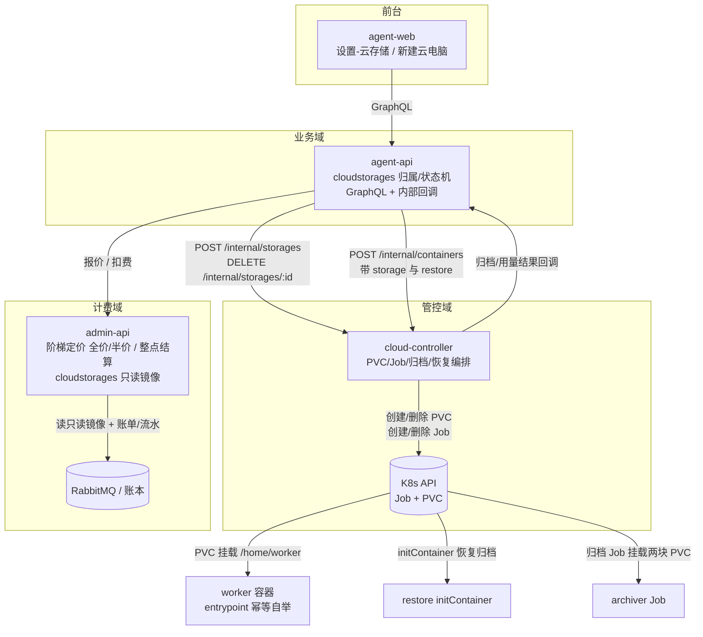
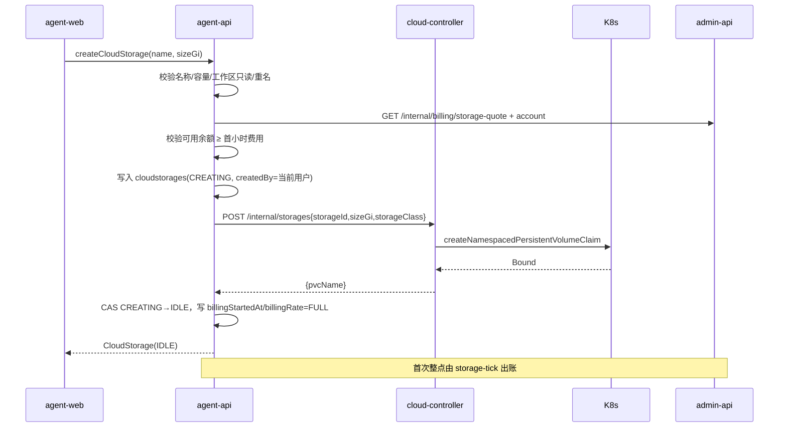
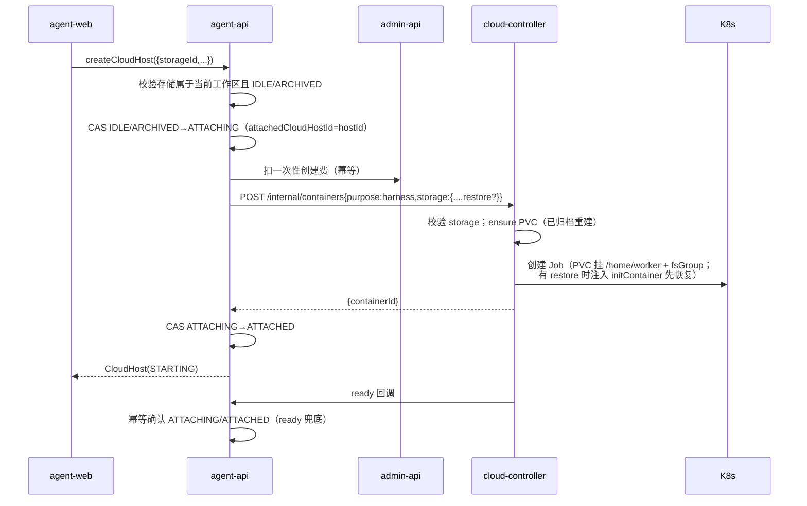
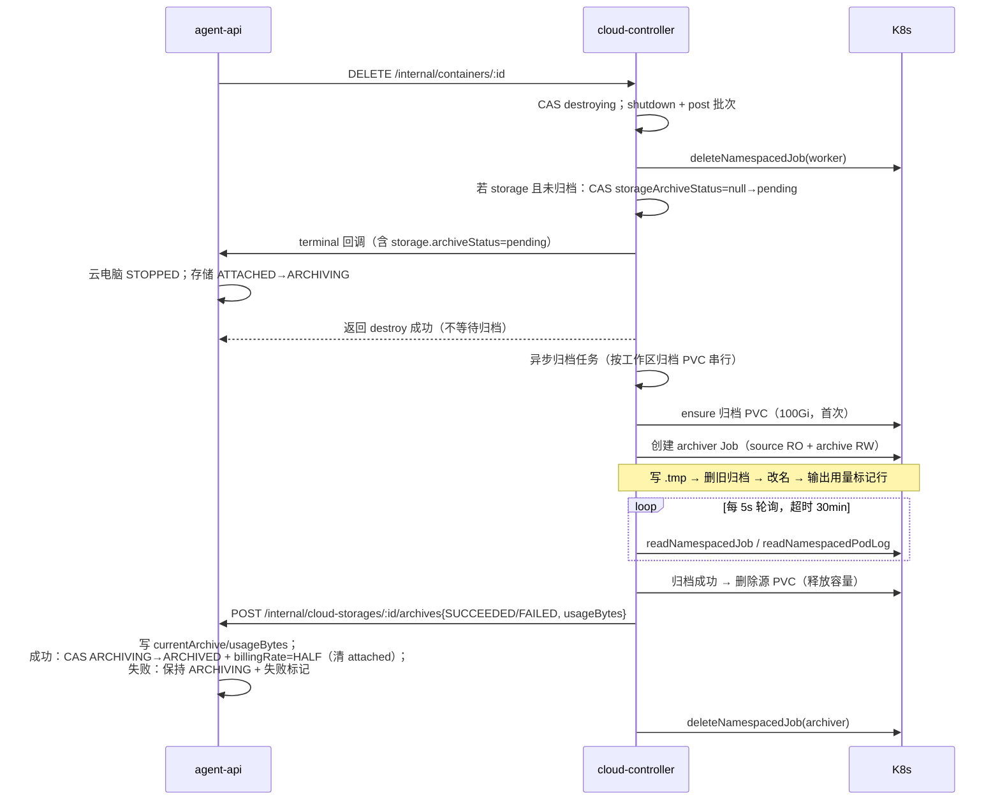
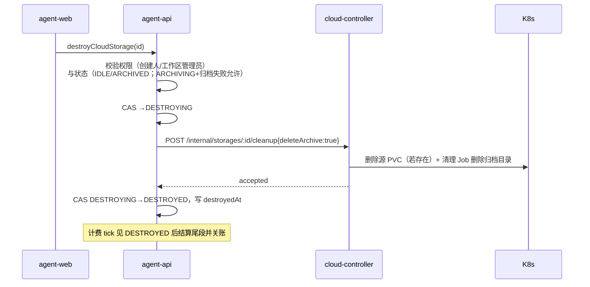
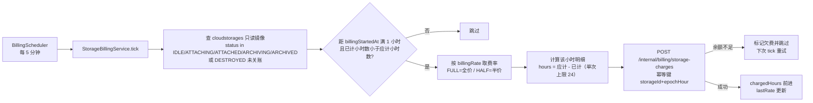
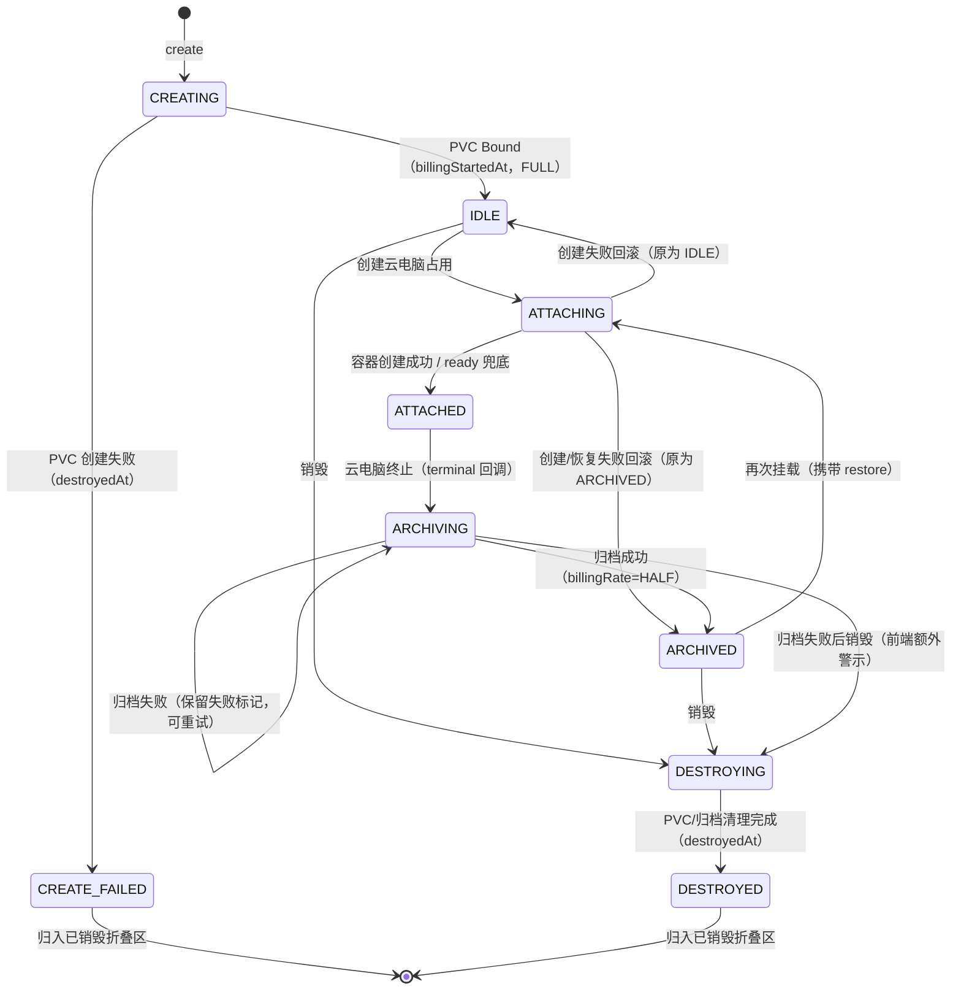

# 云电脑支持申请存储（云存储） - 技术提案

**功能名称**: 云电脑云存储（工作区级持久存储 + 主目录挂载 + 自动归档替换 + 阶梯小时计费/归档半价）
**关联 PRD**: `docs/product/draft/20261102-cloud-storage.md`（v1.1）
**技术提案版本**: v1.1
**创建日期**: 2026-11-02
**作者**: z-agent-bot
**feat-branch**: `feat/cloud-storage`
**需求来源**: GitHub Issue [Deliay/z-agent-gear#405](https://github.com/Deliay/z-agent-gear/issues/405)

**修订记录**:

| 版本 | 日期 | 说明 |
|------|------|------|
| v1.0 | 2026-11-02 | 初版（PR #406） |
| v1.1 | 2026-11-02 | 按 PR #406 评审意见重构：① 挂载点由 `~/workspace/<子目录>` 改为 **`/home/worker` 整目录**（评审 1），entrypoint 新增幂等自举、全部工作负载脚本满足「已有环境重复安装」；② 状态机改为 **CREATING/IDLE（待挂载）/ATTACHING/ATTACHED（已挂载）/ARCHIVING（归档中）/ARCHIVED（已归档）/DESTROYING/DESTROYED（已销毁）/CREATE_FAILED（创建失败）**（评审 2），归档时机固定为销毁云电脑时、**单份归档原子替换**（写临时文件→成功后删旧文件→改名；中断清理临时文件），归档成功后释放源 PVC、下次挂载经 initContainer 恢复；③ 计费区分**已归档半价、已挂载全价**（评审 3）；④ 已销毁（含创建失败）折叠展示、挂载相关状态展示实际占用大小（归档时 `du` 采集 + 挂载中按需刷新）。 |

## 1. 概述

### 1.1 背景

云电脑（`purpose=harness`）由 cloud-controller 以 K8s Job 拉起，容器停止即 Job 删除，容器内数据（可写层）随 Pod 回收永久丢失。当前 Job 仅声明 `resources.limits`（4 vCPU / 16Gi / `ephemeral-storage` 10Gi），**没有任何持久卷**；`k8s-client.ts` 的 `K8sClient` 只覆盖 Job CRUD + Watch，不包含 PVC 能力；`K8sJobManifest` 也没有 `volumes` / `volumeMounts` / `initContainers` / Pod 级 `securityContext` 字段（`servers/cloud-controller/src/services/k8s-client.ts`、`k8s-job-manager.ts:96-152`）。

产品侧需要（PRD v1.1）：

- 设置中新增「云存储」，按名称 + 容量（≤30Gi）创建，按容量阶梯、按小时计费（已归档半价）；
- 云存储归属工作区、记录创建人；状态机：待挂载/已挂载/归档中/已归档/已销毁/创建失败；
- 创建云电脑时勾选并挂载（或就地新建），**整块存储挂载为云电脑主目录 `/home/worker`**，挂载在初始化工作负载之前完成；
- 云电脑销毁时把主目录整体压缩为 `.tar.gz2` **原子替换**写入工作区归档空间（100Gi）；已归档存储可再次挂载并恢复数据。

技术上有五个关键缺口：

1. **持久卷生命周期无人负责**：K8s 侧需要 PVC 的创建、查询、删除与挂载，当前 cloud-controller 没有 PVC API，RBAC 也只授权了 `jobs`（`deploy/k8s/cloud-controller.yaml`）。
2. **主目录挂载遮蔽镜像环境**：worker 镜像把 nvm/Node/pnpm/agent-gear 全部装在 `/home/worker`（`deploy/images/worker/Dockerfile:100-130`：per-user nvm、`PNPM_HOME=/home/worker/.local/share/pnpm`、`pnpm add -g agent-gear`）。PVC 挂在 `/home/worker` 会整体遮蔽这些内容，**entrypoint 必须能在空目录上幂等自举**，否则容器连 node 都没有；恢复归档后再次启动时，所有工作负载脚本会在「已有环境」上重跑，必须幂等（评审 1）。
3. **销毁链路没有归档位**：`ContainerService.destroyLocked` 在删除 Job 后直接写 `exited` 并触发终态钩子（`container-service.ts`），没有「在数据消失前导出」的步骤；30Gi 级数据必须异步压缩，且归档语义是「**替换旧归档**」而非追加。
4. **计费模型只有单档单价**：`ProductPrice` 只有 `unitPrice`（分/单位）与 token 三档费率；需求是「前 10Gi 5 credits/小时、10~25Gi 每 Gi 1 credit/小时、25~30Gi 每 Gi 3 credits/小时」的累计分档，且**已归档半价**（评审 3）。
5. **归属与权限**：多租户二期已具备工作区、角色与 `applyWorkspaceScope` 插件，但新资源需要明确「工作区级共享 + 创建人记录 + 销毁保护」，并纳入工作区删除资源检查。

### 1.2 目标

- **持久卷由 cloud-controller 独占管理**：新增 PVC 抽象、创建/删除/挂载/归档/恢复，保持「K8s 单一事实源」既有约束（`servers/cloud-controller/AGENTS.md`）。
- **挂载是声明式且先于初始化**：云电脑启动请求携带 `storage`，K8s 卷挂载先于容器启动（先于 entrypoint 与一切工作负载脚本）；挂载点为 `/home/worker`。
- **环境可重建、可恢复**：entrypoint 幂等自举基础环境（nvm/Node/pnpm/agent-gear）；全部工作负载脚本幂等可重跑；已归档存储再次挂载时经 initContainer 先恢复数据再启动主容器。
- **归档异步、单份、原子替换**：销毁完成后由独立归档 Job 压缩（临时文件 → 删旧 → 改名），中断清理临时文件；成功后释放源 PVC；失败保留旧归档与原数据、可重试。
- **计费复用现有管线**：3 个 `per_unit` 价目表达阶梯，整点扫描结算按状态费率（已归档半价）出账，账单带分档明细并扩展分类 `storage`。
- **零回归**：不带 `storage` 的云电脑创建/销毁报文、初始化、计费与 UI 行为完全不变。

### 1.3 范围

**做**：

- contracts：新增 `contracts/cloud-storage.graphql`；扩展 `contracts/cloud-host.graphql`（`CreateCloudHostInput.storageId`、`CloudHost.storage`）；扩展 `contracts/cloud-controller-websocket.md` 附录 A（存储管理端点、harness `storage` 字段、归档/用量回调）；扩展 `contracts/admin-billing.graphql` / `contracts/billing.graphql`（`BillingCategory.storage`、存储报价与账单展示）。
- agent-api：`cloudstorages` 集合与迁移 020；`cloud-storage-service`（状态机/权限/校验）；GraphQL schema/resolver；云电脑创建接入 `storageId`；归档/用量内部回调端点；工作区删除保护；admin-api 只读镜像兼容。
- cloud-controller：`k8s-client` 的 PVC CRUD；Job manifest 的 `volumes` / `volumeMounts` / `initContainers` / `securityContext`；`k8s-storage-manager`（PVC 清单）；`storage-service`（PVC 生命周期 + 归档/恢复/用量/清理 Job 编排 + 状态持久化 + 回调 + 串行化）；内部 REST；容器模型扩展；RBAC 与部署配置。
- worker 镜像：`entrypoint.sh` 新增幂等 `bootstrap_home`（nvm/Node 安装）与 `ZAG_STORAGE_HOME` 开关；Dockerfile 将 `NVM_INSTALL_URL` / `NODE_VERSION` 固化为运行时 ENV。
- 工作负载幂等：全部预制工作负载脚本按「锚点跳过 + 结尾硬校验 + 可重复执行」标准核查与刷新（admin-api 迁移 018），并补 harness prepare 幂等验证。
- admin-api：存储阶梯定价与报价（全价/半价）；整点结算 `StorageBillingService`（按状态费率）；账单分类 `storage`；`cloudstorages` 只读镜像；`/internal/billing/storage-quote` 与 `/internal/billing/storage-charges`。
- agent-web：设置「云存储」区块（主列表 + 已销毁折叠区、新建、详情含当前归档与实际占用、销毁、重试归档）；新建云电脑对话框「云存储」区块（勾选/下拉含待挂载+已归档/新建…/恢复提示）。
- admin-web：账单分类「存储」展示。
- 部署：`deploy/k8s/cloud-controller.yaml` RBAC 与 env、`aspire/AgentGear.AppHost` / `aspire/manifest/docker-compose.yaml`、新增归档镜像 `deploy/images/archiver/`。

**不做**：

- 云存储扩容/缩容、跨工作区迁移；
- 归档文件下载、导出、恢复到新存储（归档仅用于同一块存储的下次挂载恢复）；
- 归档自动清理/容量水位告警（释放归档空间通过销毁存储完成）；
- 一台云电脑挂载多块云存储；
- 归档历史多版本保留（每块存储只保留一份最新归档）；
- 已销毁记录的清除入口（本期仅折叠留痕）；
- 云存储快照/备份策略、跨可用区容灾；
- 本地/自定义主机（非云电脑）使用云存储。

## 2. 技术架构

### 2.1 系统架构图



### 2.2 技术栈

| 层级 | 技术选型 | 说明 |
|------|---------|------|
| 前端 | React 19 + TypeScript + Apollo Client + Tailwind | 复用 agent-web 既有设置页与对话框组件 |
| 业务后端 | Node.js 24 + TypeScript strict + Express 5 + GraphQL-Yoga 5 + Mongoose 9 | agent-api 既有栈 |
| 管控后端 | Node.js 24 + `@kubernetes/client-node`（`CoreV1Api` + `BatchV1Api`） | cloud-controller 既有权能 + 新增 PVC |
| 容器环境 | worker 镜像 entrypoint 幂等自举（nvm/Node/pnpm/agent-gear） | 主目录被 PVC 遮蔽时可重建 |
| 计费 | admin-api 既有 ledger/payment/invoicing + 新增整点 tick | 不新增消息队列拓扑 |
| 存储 | CSI 动态供给（默认 StorageClass 或显式 `CLOUD_STORAGE_CLASS`） | `ReadWriteOnce` / `Filesystem` |
| 归档 | `tar` + `pbzip2 -9`（回退 `bzip2`），独立归档镜像 | 扩展名按需求使用 `.tar.gz2` |
| 测试 | Vitest（单测/真库/集成）+ Playwright E2E | TDD 红-绿-重构 |

### 2.3 模块划分

| 模块 | 新增/修改 | 职责 |
|------|-----------|------|
| `contracts/cloud-storage.graphql` | 新增 | 前台云存储契约（列表含已销毁折叠/创建/销毁/报价/当前归档/重试/用量刷新） |
| `contracts/cloud-host.graphql` | 修改 | `storageId` 入参、`CloudHost.storage` 摘要 |
| `contracts/cloud-controller-websocket.md` | 修改 | 附录 A：存储创建/删除/用量刷新、归档触发/查询、harness `storage` 与 `restore` 字段、归档/用量回调 |
| `contracts/admin-billing.graphql`、`contracts/billing.graphql` | 修改 | `BillingCategory.storage`、账单 items 分档与半价展示 |
| `servers/agent-api/src/models/cloud-storage.ts` | 新增 | `cloudstorages` 工作区级资源（租户/工作区作用域插件） |
| `servers/agent-api/src/services/cloud-storage-service.ts` | 新增 | 创建/列表/销毁/挂载占用/归档状态机/重试/用量/权限与校验 |
| `servers/agent-api/src/services/cloud-host-service.ts` | 修改 | 创建云电脑时占用存储、ready 确认挂载、终止归档联动、失败回滚 |
| `servers/agent-api/src/services/cloud-controller-client.ts` | 修改 | 存储创建/删除、归档触发/查询/重试、用量刷新 |
| `servers/agent-api/src/routes/internal-cloud-storage.ts` | 新增 | 归档/用量事件回调（Bearer 内部 token） |
| `servers/agent-api/src/graphql/schemas/cloud-storage.ts`、`resolvers/cloud-storage.ts` | 新增 | GraphQL 入口（resolver 登记 `index.ts`） |
| `servers/agent-api/src/services/workspace-service.ts` | 修改 | `hasResources` 纳入 `cloudstorages`（未销毁存储存在期间不允许删除工作区） |
| `servers/agent-api/src/migrations/020-cloud-storage-indexes.ts` | 新增 | 索引（幂等） |
| `servers/cloud-controller/src/services/k8s-client.ts` | 修改 | PVC 接口 + manifest `volumes`/`volumeMounts`/`initContainers`/`securityContext` + InMemory 实现 |
| `servers/cloud-controller/src/services/k8s-storage-manager.ts` | 新增 | PVC manifest + CRUD + 标签命名 |
| `servers/cloud-controller/src/services/storage-service.ts` | 新增 | PVC 生命周期、归档/恢复/用量/清理 Job 编排、状态持久化、回调、串行化 |
| `servers/cloud-controller/src/routes/internal-api.ts` | 修改 | 存储端点、`parseHarnessRequest` 的 `storage` 校验 |
| `servers/cloud-controller/src/services/container-service.ts` | 修改 | Job 挂载与 initContainer 恢复、启动落库、销毁归档触发 |
| `servers/cloud-controller/src/models/cloud-container.ts` | 修改 | `storage*` / `storageArchive*` 字段 |
| `deploy/images/worker/entrypoint.sh` | 修改 | `bootstrap_home` 幂等自举 + `ZAG_STORAGE_HOME` 开关 |
| `deploy/images/worker/Dockerfile` | 修改 | `NVM_INSTALL_URL` / `NODE_VERSION` 固化为运行时 ENV |
| `servers/admin-api/src/migrations/018-workload-idempotent-anchors.ts` | 新增 | 刷新不满足幂等标准的预制工作负载脚本（核查后按字节匹配刷新） |
| `servers/admin-api/src/services/billing/storage-pricing.ts`、`storage-charge.ts`、`storage-tick.ts` | 新增 | 阶梯报价（全价/半价）、整点结算、欠费策略 |
| `servers/admin-api/src/services/billing/pricing.ts` | 修改 | 3 个存储价目默认档 |
| `servers/admin-api/src/services/billing/scheduler.ts` | 修改 | 注册存储结算 tick |
| `servers/admin-api/src/models/cloud-storage.ts` | 新增 | 只读镜像（供 tick 扫描） |
| `servers/admin-api/src/models/storage-billing-cursor.ts` | 新增 | 存储计费进度游标（admin-api 独占写） |
| `servers/admin-api/src/routes/internal-billing.ts` | 修改 | 存储报价/结算内部端点 |
| `servers/admin-api/src/models/billing-invoice.ts` 等 | 修改 | `INVOICE_CATEGORIES` 增加 `storage` |
| `apps/agent-web/src/components/settings/CloudStorageSection.tsx` 等 | 新增 | 设置页区块（主列表 + 已销毁折叠区）与对话框 |
| `apps/agent-web/src/components/cloud-host/NewCloudHostDialog.tsx` | 修改 | 云存储勾选/下拉/新建…/费用/恢复提示 |
| `apps/agent-web/src/pages/SettingsPage.tsx` | 修改 | 新增导航项 |
| `apps/admin-web/src/components/billing/InvoiceTable.tsx`、`apps/agent-web/src/pages/BillingPage.tsx` | 修改 | 分类「存储」标签与半价标识 |
| `deploy/images/archiver/` | 新增 | 归档/恢复/用量/清理 Job 镜像（tar + pbzip2/bzip2 + coreutils） |
| `deploy/k8s/cloud-controller.yaml`、`aspire/**` | 修改 | RBAC `persistentvolumeclaims`、env |

## 3. API 设计

### 3.1 对外契约（GraphQL）

#### 3.1.1 新增 `contracts/cloud-storage.graphql`

```graphql
# 前台云存储契约（工作区级持久存储）
#
# 鉴权：Authorization: Bearer <front user JWT>；未认证返回 Not authenticated。
# 归属：创建时取当前工作区（x-workspace-id 上下文，缺省个人全局工作区）；
#       跨工作区不可见、不可挂载。
# 计费：按容量阶梯、按小时结算，创建成功（IDLE/待挂载）起算；
#       已挂载（含待挂载/归档中）全价，已归档半价，销毁后停止。

enum CloudStorageStatus {
  CREATING        # 创建中（瞬态）
  IDLE            # 待挂载：刚创建成功，相当于一个待用的 claim
  ATTACHING       # 挂载中（瞬态，创建云电脑同步链路/恢复中）
  ATTACHED        # 已挂载
  ARCHIVING       # 归档中（含归档失败待重试）
  ARCHIVED        # 已归档，可用于下次挂载
  DESTROYING      # 销毁中（瞬态）
  DESTROYED       # 已销毁
  CREATE_FAILED   # 创建失败（归入已销毁类别展示）
}

enum CloudStorageArchiveStatus {
  PENDING
  RUNNING
  SUCCEEDED
  FAILED
}

# 当前归档（每块存储只保留一份最新归档）
type CloudStorageArchive {
  id: ID!
  fileName: String!
  status: CloudStorageArchiveStatus!
  cloudHostId: ID
  cloudHostName: String
  usageBytes: Float
  startedAt: String
  finishedAt: String
  failureReason: String
}

# 创建人摘要（只暴露展示所需字段）
type CloudStorageCreator {
  id: ID!
  name: String!
}

type CloudStorage {
  id: ID!
  name: String!
  sizeGi: Int!
  status: CloudStorageStatus!
  # 实际占用（归档时采集；已挂载期间可经 refreshCloudStorageUsage 刷新）；
  # 待挂载（从未写入）为 0；未知为 null
  usageBytes: Float
  usageUpdatedAt: String
  # 当前状态费率下的每小时费用（credits）
  hourlyCredits: Float!
  # 全价/归档半价每小时费用（展示用）
  hourlyCreditsFull: Float!
  hourlyCreditsArchived: Float!
  createdBy: CloudStorageCreator!
  createdAt: String!
  # 当前挂载的云电脑；未挂载为 null
  attachedCloudHostId: ID
  attachedCloudHostName: String
  attachedAt: String
  currentArchive: CloudStorageArchive
  # 归档空间使用概况（工作区级 100Gi 上限）
  archiveSpace: CloudStorageArchiveSpace!
  failureReason: String
  destroyedAt: String
}

type CloudStorageArchiveSpace {
  capacityGi: Int!
  # 本期无法精确统计归档体积，返回 null 表示未知（UI 提示“由平台管理”）
  usedGi: Float
}

# 容量阶梯报价
type CloudStoragePriceTier {
  # 例如 “1-10Gi 固定 5 credits/小时”
  label: String!
  amountCredits: Float!
}

type CloudStorageRateQuote {
  hourlyCredits: Float!
  tiers: [CloudStoragePriceTier!]!
}

type CloudStorageBillingQuote {
  sizeGi: Int!
  # 全价（待挂载/已挂载/归档中）与归档半价
  full: CloudStorageRateQuote!
  archived: CloudStorageRateQuote!
  # 当前工作区计费账户可用余额；计费不可用时为 null（仅提示，不阻断）
  availableBalance: Float
}

input CreateCloudStorageInput {
  # trim 后 1~64；同一工作区唯一（已销毁/创建失败释放名称）
  name: String!
  # 1~30（Gi）
  sizeGi: Int!
}

extend type Query {
  # 当前工作区云存储列表；onlyAttachable=true 时仅返回 IDLE + ARCHIVED（创建云电脑下拉用）；
  # includeDestroyed=false 时不返回 DESTROYED/CREATE_FAILED（主列表）；=true 用于「已销毁」折叠区
  cloudStorages(onlyAttachable: Boolean = false, includeDestroyed: Boolean = true): [CloudStorage!]!
  cloudStorage(id: ID!): CloudStorage
  # 不传 sizeGi 时按默认 10Gi 报价
  cloudStorageBillingQuote(sizeGi: Int): CloudStorageBillingQuote!
}

extend type Mutation {
  createCloudStorage(input: CreateCloudStorageInput!): CloudStorage!
  # 仅 IDLE/ARCHIVED 可销毁；ARCHIVING 且最近归档失败时允许销毁（前端额外警示）；
  # 销毁后停止计费，存储数据与当前归档一并删除
  destroyCloudStorage(id: ID!): CloudStorage!
  # 最近一次归档失败时重试（复用最后一次容器；无容器可重试时返回契约错误）
  retryCloudStorageArchive(id: ID!): CloudStorage!
  # 刷新实际占用（仅 ATTACHED；由 cloud-controller 在云电脑所在节点执行 du）
  refreshCloudStorageUsage(id: ID!): CloudStorage!
}
```

错误文案（服务端权威、前端原样或映射展示）：

| 场景 | 文案 |
|------|------|
| 名称空/超长 | `storage name is required` / `storage name is too long` |
| 同工作区重名 | `storage name already exists` |
| 容量非法 | `storage size must be between 1 and 30 Gi` |
| 存储不存在/跨工作区 | `storage not found` |
| 状态不允许 | `storage is not attachable` / `storage is attached` / `storage is archiving` / `storage is not destroyable` |
| 权限不足 | `not allowed to destroy storage` |
| 工作区只读 | 复用 `global workspace is read-only` |
| 欠费 | `insufficient balance` |
| 无可用归档容器 | `no archive to retry` |
| 用量刷新不可用 | `storage is not attached` |

#### 3.1.2 扩展 `contracts/cloud-host.graphql`

```graphql
type CloudStorageSummary {
  id: ID!
  name: String!
  sizeGi: Int!
  status: CloudStorageStatus!
  usageBytes: Float
  hourlyCredits: Float!
}

type CloudHost {
  # ...既有字段
  # 创建时挂载的云存储；未挂载为 null
  storage: CloudStorageSummary
}

input CreateCloudHostInput {
  # ...既有字段
  # 可选：创建时挂载当前工作区 IDLE/ARCHIVED 云存储；必须与云电脑同一工作区
  storageId: ID
}
```

- `storageId` 缺省 = 不挂载，报文与现状完全一致（`NewCloudHostDialog` 未勾选时不发送该字段）。
- 挂载失败（被抢占/状态变化）时 `createCloudHost` 抛 `storage is not attachable`；已扣的创建费按既有「拉起失败自动退款」路径退回。

#### 3.1.3 计费契约扩展

`contracts/admin-billing.graphql` 与 `contracts/billing.graphql`：

```graphql
enum BillingCategory {
  container
  model
  manual
  storage
}
```

- 存储账单 `items` 形如（全价小时）：
  - `{productId:"cloud_storage.base.hour", quantity:1, unitPrice:500, amount:500}`
  - `{productId:"cloud_storage.tier1.gib_hour", quantity:10, unitPrice:100, amount:1000}`
  - `{productId:"cloud_storage.tier2.gib_hour", quantity:5, unitPrice:300, amount:1500}`
- 归档半价小时：`unitPrice`/`amount` 取全价一半（250 / 50 / 150），`description` 追加「（归档半价）」。
- 金额单位仍为「分」，`credits = amount / 100`；不新增字段。

### 3.2 内部接口

#### 3.2.1 cloud-controller（`contracts/cloud-controller-websocket.md` 附录 A）

**a) 云电脑启动请求新增 `storage`（可选）**

```jsonc
{
  "purpose": "harness",
  // ...既有字段
  "storage": {
    "id": "<cloudStorageId>",
    "pvcName": "zag-storage-<storageId>",
    "sizeGi": 20,
    "workspaceId": "<tenantWorkspaceId>",
    // 已归档存储再次挂载时携带：归档 PVC 内的完整文件路径；全新（待挂载）为 null
    "restore": {
      "archivePath": "/archive/<workspaceId>/<storageId>/<fileName>"
    }
  }
}
```

校验（`parseHarnessRequest`）：

- `storage` 缺省/null → 不挂载，行为与现状一致；
- `id`/`pvcName`/`workspaceId` 为非空字符串；`sizeGi` 为 1~30 整数；`pvcName` 必须匹配 `^zag-storage-[a-z0-9-]+$`；
- `restore` 缺省/null = 全新挂载（不注入 initContainer）；携带时 `archivePath` 必须匹配 `^/archive/[A-Za-z0-9-]+/[A-Za-z0-9-]+/[A-Za-z0-9._-]+\.tar\.gz2$` 且不含 `..`；
- 非法返回 `400 INVALID_HARNESS`，不创建 Job；
- 同一存储同时被两个活跃容器引用时：cloud-controller 先查 `cloudcontainers.storageId` + 活跃状态，命中返回 `409 STORAGE_IN_USE`；真正的互斥由 agent-api 的 `IDLE/ARCHIVED→ATTACHING` CAS 保证（唯一调用方），此处为纵深防御。

**b) 存储管理端点**

```
POST   /internal/storages
Body:  { "storageId": "<id>", "tenantId": "<tenant>", "workspaceId": "<workspace>", "sizeGi": 20, "storageClass": "ceph-rbd" }
Resp:  { "storageId": "...", "pvcName": "zag-storage-...", "created": true }

GET    /internal/storages/:storageId
Resp:  { "storageId": "...", "pvcName": "zag-storage-...", "exists": true, "capacity": "20Gi", "phase": "Bound" }

DELETE /internal/storages/:storageId
Resp:  { "storageId": "...", "deleted": true }
错误:  409 STORAGE_IN_USE（仍有活跃容器引用）

POST   /internal/containers/:id/archive
Body:  { "archiveId": "<id>", "fileName": "<hostName>-<ts>.tar.gz2" }
Resp:  { "accepted": true, "archiveId": "<id>" }
错误:  404 NOT_FOUND / 409 CONTAINER_ACTIVE / 409 ARCHIVE_RUNNING / 409 NO_STORAGE

GET    /internal/containers/:id/archive
Resp:  { "status": "NONE|PENDING|RUNNING|SUCCEEDED|FAILED",
         "archiveId": "...", "fileName": "...", "usageBytes": 123,
         "startedAt": "...", "finishedAt": "...", "failureReason": null }

POST   /internal/storages/:storageId/usage-refresh
Body:  { "containerId": "<id>" }     # 当前挂载容器，用于定位节点
Resp:  { "accepted": true }
错误:  404 NOT_FOUND / 409 NO_STORAGE / 409 CONTAINER_NOT_ACTIVE

POST   /internal/storages/:storageId/cleanup
Body:  { "workspaceId": "<id>", "deleteArchive": true }
Resp:  { "accepted": true }
错误:  409 ARCHIVE_RUNNING
```

- 端点全部 Bearer `INTERNAL_API_TOKEN`（复用 `middleware/internal-auth.ts`）。
- `POST /internal/storages` 幂等：PVC 已存在（按 label `zag.cloud/storage-id` 或名称）直接返回 `created:false`。
- `storageClass` 缺省取 `CLOUD_STORAGE_CLASS`；二者都为空时**省略** `storageClassName`，使用集群默认 StorageClass（显式空串会禁用动态供给，必须避免）。
- `cleanup` 用于销毁云存储：删除源 PVC（若存在）并跑清理 Job 删除归档目录 `/archive/<workspaceId>/<storageId>/`。

**c) 归档/用量回调（cloud-controller → agent-api）**

```
POST /internal/cloud-storages/:storageId/archives
Body: {
  "archiveId": "<id>", "storageId": "<id>",
  "cloudHostId": "<id>", "containerId": "<id>",
  "cloudHostName": "我的云电脑",
  "fileName": "我的云电脑-20261102-153012.tar.gz2",
  "path": "/archive/<workspaceId>/<storageId>/<fileName>",
  "status": "RUNNING|SUCCEEDED|FAILED",
  "usageBytes": 5368709120,
  "startedAt": "...", "finishedAt": "...", "failureReason": null
}
Resp: { "ok": true }

POST /internal/cloud-storages/:storageId/usage
Body: { "usageBytes": 5368709120, "measuredAt": "..." }
Resp: { "ok": true }
```

- Bearer `INTERNAL_API_TOKEN`；按 `archiveId` 幂等 upsert；终态单调（SUCCEEDED 后迟到的 RUNNING 忽略）。
- 回调失败按「0 / 250ms / 1s / 3s」退避重试（与 `agent-api-client.ts` 既有回调一致），最终失败只记 error；agent-api 侧以 `GET /internal/containers/:id/archive` 兜底对账。

#### 3.2.2 admin-api 计费端点

```
GET  /internal/billing/storage-quote?sizeGi=20
Resp: {
  "sizeGi": 20,
  "full": {
    "hourlyCredits": 15,
    "items": [
      { "productId": "cloud_storage.base.hour", "quantity": 1, "unitPriceCredits": 5, "amountCredits": 5 },
      { "productId": "cloud_storage.tier1.gib_hour", "quantity": 10, "unitPriceCredits": 1, "amountCredits": 10 }
    ]
  },
  "archived": {
    "hourlyCredits": 7.5,
    "items": [
      { "productId": "cloud_storage.base.hour", "quantity": 1, "unitPriceCredits": 2.5, "amountCredits": 2.5 },
      { "productId": "cloud_storage.tier1.gib_hour", "quantity": 10, "unitPriceCredits": 0.5, "amountCredits": 5 }
    ]
  }
}

POST /internal/billing/storage-charges
Body: {
  "accountId": "<id>", "storageId": "<id>", "sizeGi": 20,
  "rate": "FULL|HALF",
  "periodStart": "2026-11-02T15:00:00.000Z", "periodEnd": "2026-11-02T16:00:00.000Z",
  "idempotentKey": "cloud_storage.hour:<storageId>:<epochHour>",
  "description": "云存储 my-data（20Gi）15:00-16:00（归档半价）"
}
Resp: { "invoice": {...}, "charged": true }
错误: 404 ACCOUNT_NOT_FOUND / 409 INSUFFICIENT_BALANCE / 400 INVALID_BODY
```

- 单次调用只结算 **1 个整点小时**（`periodStart/periodEnd` 必须相差 1 小时），多小时由 tick 逐小时调用，保证幂等粒度与补结算可重放。
- `rate=HALF` 时按全价一半出账（价目单价均为 100 分的整数倍，半价后仍为整数分，无舍入误差）。

### 3.3 为什么不用新的消息队列事件

云存储是**低频用户动作**（创建/销毁）与**小时级周期结算**，不需要容器级秒级事件吞吐：

- 创建/销毁走同步内部 REST，失败即回滚，语义更简单；
- 归档/用量状态走同步回调 + 查询兜底，避免新增 MQ 拓扑；
- 小时计费由 admin-api 既有 `BillingScheduler` 增加一个 tick（与 reservation 扫描同模式），幂等键保证重放安全。

后续若需要「删除工作区级联释放 PVC」「归档容量告警」等异步治理，再评估接入 `zag.billing.events` 之外的运维主题。

## 4. 数据模型

### 4.1 `cloudstorages`（agent-api 写，admin-api 只读镜像）

```ts
{
  _id: ObjectId,
  name: string,                 // trim 1~64
  nameKey: string,              // name.toLocaleLowerCase() 用于大小写不敏感唯一
  sizeGi: number,               // 1..30
  status: 'CREATING'|'IDLE'|'ATTACHING'|'ATTACHED'|'ARCHIVING'
        |'ARCHIVED'|'DESTROYING'|'DESTROYED'|'CREATE_FAILED',

  tenantId: ObjectId,           // 多租户
  resourceWorkspaceId: ObjectId,// 工作区归属（与 CloudHost.resourceWorkspaceId 同口径）
  createdBy: ObjectId,          // 创建人（需求 3）

  pvcName: string,              // zag-storage-<storageId>
  storageClass: string|null,    // 创建时快照（仅运维留档，不对外暴露）

  attachedCloudHostId: ObjectId|null,
  attachedControllerId: ObjectId|null,
  attachedBy: ObjectId|null,
  attachedAt: Date|null,

  lastContainerId: string|null, // 最近一次挂载的容器（归档重试/对账用）

  usageBytes: number|null,      // 实际占用（归档时 du 采集；挂载中可刷新）
  usageUpdatedAt: Date|null,

  currentArchive: {             // 当前归档（每块存储只保留一份；无归档为 null）
    archiveId: string,
    containerId: string|null,
    cloudHostId: ObjectId|null,
    cloudHostName: string|null,
    fileName: string,
    path: string,               // /archive/<workspaceId>/<storageId>/<fileName>
    status: 'PENDING'|'RUNNING'|'SUCCEEDED'|'FAILED',
    usageBytes: number|null,
    startedAt: Date|null,
    finishedAt: Date|null,
    failureReason: string|null
  } | null,

  billingAccountId: string|null,
  billingRate: 'FULL'|'HALF',   // FULL=待挂载/已挂载/归档中；HALF=已归档
  billingStartedAt: Date|null,  // IDLE 时写入（计费唯一时间源；已结算进度由 admin-api 自持）
  failureReason: string|null,   // CREATE_FAILED 原因
  destroyReason: string|null,
  destroyedAt: Date|null,       // DESTROYED/CREATE_FAILED 时写入（名称即释放）

  createdAt: Date, updatedAt: Date
}
```

索引：

```ts
// 工作区内名称唯一（销毁后允许重建）
{ resourceWorkspaceId: 1, nameKey: 1 } unique partialFilterExpression { destroyedAt: null }
// 一台云电脑最多挂载一块存储（attachedCloudHostId 非空时唯一）
{ attachedCloudHostId: 1 } unique partialFilterExpression { attachedCloudHostId: { $type: 'objectId' } }
{ tenantId: 1 }
{ resourceWorkspaceId: 1, status: 1 }
{ status: 1, billingStartedAt: 1 }   // 计费 tick 扫描
```

> 说明：`{attachedCloudHostId}` 唯一索引同时实现「一块存储只能挂一台云电脑」与「一台云电脑最多挂一块存储」；归档期间保留 `attachedCloudHostId` 直到归档完成，防止归档未完成即被重新挂载。

插件：`applyTenantScope` + `applyWorkspaceScope({ workspaceField: 'resourceWorkspaceId' })`；`tenant-isolation.test.ts` 的集合清单同步加入 `cloudstorages`。

### 4.2 `cloudcontainers`（cloud-controller 写，agent-api 只读镜像）

复制新增字段（历史行为 null 容忍）：

```ts
storageId: string|null,
storagePvcName: string|null,
storageSizeGi: number|null,
storageWorkspaceId: string|null,
storageRestorePath: string|null,          // 本次启动恢复的归档路径；全新挂载为 null
storageArchiveStatus: 'pending'|'running'|'succeeded'|'failed'|null,
storageArchiveId: string|null,
storageArchiveFileName: string|null,
storageArchiveUsageBytes: number|null,
storageArchiveStartedAt: Date|null,
storageArchiveFinishedAt: Date|null,
storageArchiveFailure: string|null,
```

### 4.3 价目与账单位

`productprices` 默认档（`pricing.ensureDefaultPrices()` 幂等写入，不改既有档）：

| productId | 含义 | 单价（分） | 对应 credits（全价） |
|-----------|------|------------|--------------|
| `cloud_storage.base.hour` | 前 10Gi 固定档 | 500 | 5 / 小时 |
| `cloud_storage.tier1.gib_hour` | 10~25Gi 每 Gi | 100 | 1 / Gi / 小时 |
| `cloud_storage.tier2.gib_hour` | 25~30Gi 每 Gi | 300 | 3 / Gi / 小时 |

计算（纯函数 `quoteStorageHourly(sizeGi)`，单位分）：

```
base  = 500
tier1 = max(0, min(sizeGi, 25) - 10) * 100
tier2 = max(0, sizeGi - 25) * 300
fullCents = base + tier1 + tier2
archivedCents = fullCents / 2        // 各档单价均为 100 的整数倍，半价必为整数分
```

账单：`type=charge`、`category=storage`、`refType='cloud_storage'`、`refId=<storageId>`、`items` 写出各档明细（半价小时 unitPrice/amount 减半）；`description` 形如 `云存储 <name>（20Gi）2026-11-02 15:00-16:00（归档半价）`。

### 4.4 `storagebillingcursors`（admin-api 写，计费进度）

遵循「写方单一」纪律：`cloudstorages` 由 agent-api 独占写，admin-api 只读镜像；已结算到第几个小时由 admin-api 自己的游标集合承载，不回写业务集合。

```ts
{
  _id: ObjectId,
  storageId: ObjectId,          // 唯一
  accountId: ObjectId,
  tenantId: ObjectId,
  sizeGi: number,               // 容量快照（容量不可变，快照仅防镜像异常）
  billingStartedAt: Date,       // 来自 cloudstorages 镜像
  chargedHours: number,         // 已结算小时数
  lastRate: 'FULL'|'HALF'|null, // 最近一次出账费率（排查用）
  lastChargedAt: Date|null,
  closedAt: Date|null,          // 存储销毁后的尾段结算完成时间
  lastError: string|null,
  createdAt: Date, updatedAt: Date
}
```

索引：`{storageId: 1}` unique、`{closedAt: 1}`。

### 4.5 迁移

- **agent-api `020-cloud-storage-indexes`**：显式创建上列索引（避免生产 `autoIndex=false` 时缺索引），幂等；不涉及存量数据回填。编号说明：当前最新为 `019-commit-settings-per-member`，故 020。
- **admin-api `018-workload-idempotent-anchors`**：按「锚点跳过 + 结尾硬校验 + 可重复执行」标准核查预制工作负载脚本，对不满足项按字节匹配刷新脚本内容（与迁移 017 同模式）；核查结果为全部满足时迁移为空操作并记录说明。编号说明：当前最新为 `017-workload-pnpm-scripts`，故 018。
- **cloud-controller**：无需迁移（新字段对历史行容忍 null）；存量容器不回填 `storageArchiveStatus`。

## 5. 技术实现方案

### 5.1 核心流程

#### 5.1.1 创建云存储



失败：PVC 创建失败 → `CREATE_FAILED` + `failureReason` + `destroyedAt`（归入已销毁折叠区），不写 `billingStartedAt`。

#### 5.1.2 创建云电脑并挂载（含已归档恢复）



失败回滚（逆序）：容器未创建/恢复失败 → 存储 `ATTACHING→` 挂载前状态（IDLE 或 ARCHIVED，归档不丢），创建费退款；容器已创建但 CAS 失败（并发 stop）→ 调 `DELETE /internal/containers/:id`，存储回滚。

#### 5.1.3 销毁与归档（原子替换）



#### 5.1.4 销毁云存储



#### 5.1.5 整点计费（全价/半价）



### 5.2 关键实现点

#### 实现点 1: K8s 客户端扩展（PVC + 卷 + initContainer + 安全上下文）

`K8sClient` 新增：

```ts
createPersistentVolumeClaim(manifest: K8sPvcManifest): Promise<void>;
getPersistentVolumeClaim(name: string): Promise<K8sPvcInfo | null>;
deletePersistentVolumeClaim(name: string): Promise<void>;
listPersistentVolumeClaims(labelSelector: string): Promise<K8sPvcInfo[]>;
```

`K8sJobManifest.spec.template.spec` 新增：

```ts
securityContext?: { fsGroup?: number; fsGroupChangePolicy?: 'OnRootMismatch' | 'Always' };
initContainers?: Array<{
  name: string;
  image: string;
  env?: Array<{ name: string; value: string }>;
  command?: string[]; args?: string[];
  resources?: { limits?: Record<string, string> };
  volumeMounts?: Array<{ name: string; mountPath: string; readOnly?: boolean }>;
}>;
volumes?: Array<{
  name: string;
  persistentVolumeClaim?: { claimName: string; readOnly?: boolean };
}>;
containers: Array<{ /* ... */ volumeMounts?: Array<{ name: string; mountPath: string; readOnly?: boolean }> }>;
```

`RealK8sClient` 增加 `CoreV1Api` 客户端（`ensureInitialized` 中 `kc.makeApiClient(k8s.CoreV1Api)`）；`InMemoryK8sClient` 增加 `pvcs` Map 与 `createdPvcManifests`，供单测/E2E（`K8S_ENABLED=false`）断言。PVC 404 归一为 `null`，与 Job 的 `getJob` 同口径。读取归档/用量 Job 完成 Pod 日志用于解析用量标记行（`readNamespacedPodLog`，按 label 选 Pod）。

#### 实现点 2: PVC 清单与命名

```yaml
apiVersion: v1
kind: PersistentVolumeClaim
metadata:
  name: zag-storage-<storageId>
  namespace: <K8S_NAMESPACE>
  labels:
    app: zag-storage
    zag.cloud/storage-id: <storageId>
    zag.cloud/workspace-id: <workspaceId>
    zag.cloud/tenant-id: <tenantId>
spec:
  accessModes: ['ReadWriteOnce']
  volumeMode: Filesystem
  resources: { requests: { storage: '<sizeGi>Gi' } }
  storageClassName: <CLOUD_STORAGE_CLASS>   # 空则整段省略
```

- 归档 PVC：`zag-archive-<workspaceId>`，100Gi（`CLOUD_ARCHIVE_PVC_SIZE`），`CLOUD_ARCHIVE_STORAGE_CLASS`，标签 `app: zag-archive`；`accessModes` 默认 `['ReadWriteOnce']`，可经 `CLOUD_ARCHIVE_ACCESS_MODE` 调整为 `ReadOnlyMany`/`ReadWriteOnce` 组合或 `ReadWriteMany`（取决于 StorageClass 能力，见 §6.2）。
- 名称全部由服务端生成（不使用用户输入），避免 DNS-1123 与路径注入问题。
- 删除 PVC：`DELETE /internal/storages/:id`（用户销毁）或归档成功后自动释放；`deleteNamespacedPersistentVolumeClaim` 404 视为成功（幂等）。

#### 实现点 3: 云电脑 Job 挂载主目录与 worker 写权限

- 挂载点固定为 **`/home/worker`**（整块存储即 worker 主目录；评审 1）。K8s 卷挂载发生在 Pod 创建阶段，**先于 entrypoint 与一切工作负载脚本**，天然满足「初始化工作负载前完成挂载」。
- **写权限**：Pod 级 `securityContext: { fsGroup: 1000, fsGroupChangePolicy: 'OnRootMismatch' }`——PVC 根目录由 `root:worker` 组持有且组可写，worker（uid 1000）可直接写入，避免每次挂载全量 chown；已归档恢复的 PVC 内容属主保持 uid 1000（`fsGroup` 不递归改写已有文件，`OnRootMismatch` 只在根属主不匹配时处理）。
- 主容器 `volumeMounts`：`{ name: 'storage', mountPath: '/home/worker' }`；**不再注入 `ZAG_DEFAULT_WORKSPACE` 之外的任何路径假设**，`~/workspace` 作为主目录内普通目录自然持久化（Git 项目设置默认前缀 `~/workspace` 不变）。
- 挂载存储的容器 env 追加 `ZAG_STORAGE_HOME=1`（entrypoint 据此执行严格自举，见实现点 4）。
- 未挂载存储时 manifest 与现状完全一致（无 volumes/volumeMounts/securityContext/initContainers）。
- sysbox（`runtimeClassName` + `hostUsers: false`）与 `fsGroup` 兼容：用户命名空间内 uid/gid 映射由 runtime 处理，`fsGroup` 语义不变。

#### 实现点 4: entrypoint 幂等自举（home 遮蔽应对）

PVC 挂在 `/home/worker` 会遮蔽镜像烘焙的 `.nvm`（Node）、`.local/share/pnpm`（pnpm 与 agent-gear）、`.bashrc` 等。`entrypoint.sh` 在 `ensure_pnpm` 之前新增 `bootstrap_home`（全部幂等）：

```bash
bootstrap_home() {
  # 1) nvm 缺失 → 用内网安装脚本安装（NVM_INSTALL_URL，构建期 ARG 固化为运行时 ENV）
  if [ ! -s "$WORKER_NVM_DIR/nvm.sh" ]; then
    log "storage home: nvm not found, installing (NVM_INSTALL_URL=$NVM_INSTALL_URL)"
    curl -o- "$NVM_INSTALL_URL" | PROFILE=/dev/null METHOD=script bash
  fi
  # 2) node 缺失 → nvm 安装默认版本并重建 current 软链 + npm registry
  if [ ! -x "$WORKER_NVM_DIR/current/bin/node" ]; then
    . "$WORKER_NVM_DIR/nvm.sh"
    nvm install --default "$NODE_VERSION"
    nvm alias default "$NODE_VERSION"
    ln -sfn "$(dirname "$(dirname "$(nvm which default)")")" "$WORKER_NVM_DIR/current"
    run_as_worker npm config set registry "$NPM_REGISTRY"
  fi
  # 3) pnpm 与 agent-gear 由既有 ensure_pnpm / update_agent_gear 幂等补齐
}
```

- 判定全部基于「目标产物是否存在且可用」（`nvm.sh` 可 source、`current/bin/node` 可执行），任意一步失败即日志 + 非零退出：挂载存储时（`ZAG_STORAGE_HOME=1`）**fail-fast**（Job 失败 → 创建云电脑失败 → 存储回滚）；未挂载存储时镜像内容完整，自举为 no-op。
- 恢复归档后的主目录已含完整环境（归档即整个 `/home/worker`），自举各锚点命中直接跳过，仅每轮既有 `update_agent_gear` 自更新（幂等）。
- Dockerfile 变更：`ARG NVM_INSTALL_URL` / `ARG NODE_VERSION` 追加同名 `ENV`（运行时可用）；`NPM_REGISTRY`/`NVM_NODEJS_ORG_MIRROR` 已是运行时 ENV，不变。
- 镜像版本门：自举能力随 worker 镜像发布；cloud-controller 与镜像同批发布（§9.4），`MIN_HARNESS_WORKER_VERSION`（agent-gear 2.12.0）不变。

#### 实现点 5: 工作负载幂等（已有环境重复安装）

工作负载脚本在 register 后经 Socket.IO 下发、每台新云电脑都会完整重跑 init 批次（「工作流只初始化一次」按容器计）。挂载已归档存储时，脚本面对的是上次留下的完整环境，**必须幂等**（评审 1）：

- **标准**（写入 `docs/engineering/backend-rules.md` 工作负载脚本规范段）：每条 init 脚本必须 ① 开头锚点判定（产物可用 → 校验后 `exit 0`）；② 结尾硬校验（如 `mongod --version`、`playwright --version`）；③ 任意步骤可安全重入（先清旧标记块再写、覆盖式安装、不追加重复配置）。
- **现状**：MongoDB（`command -v mongod` 锚点）、Playwright（锚点 + 幂等标记块）等已符合；pnpm 迁移（017）后脚本自带 npm 自举回退块，天然可重入。
- **动作**：admin-api 迁移 018 逐条核查全部预制脚本，不满足项按字节匹配刷新；补 `tests/api` 口径：每条预制脚本在「已安装环境」夹具上重跑 → 退出码 0 且耗时命中锚点分支（日志含锚点标记）；harness（opencode/kimi/deepseek）的 `harness prepare` 在已有配置目录上重跑幂等（配置 insert 形态已幂等，补回归测试）。
- 与「初始化一次」的关系：同一容器内不重放（既有 `initCompletedAt`/`hasSettledInit` 不变）；幂等保证的是「新容器 + 旧环境」场景。

#### 实现点 6: 归档 Job 与原子替换

```yaml
apiVersion: batch/v1
kind: Job
metadata:
  name: zag-archive-<containerSuffix>-<ts>
  labels: { app: zag-archive, zag.cloud/storage-id: <id>, zag.cloud/container-id: <id> }
spec:
  backoffLimit: 0
  ttlSecondsAfterFinished: 600
  template:
    spec:
      restartPolicy: Never
      automountServiceAccountToken: false
      containers:
        - name: archiver
          image: <ARCHIVER_IMAGE>
          env:
            - { name: SOURCE_DIR, value: /source }
            - { name: ARCHIVE_ROOT, value: /archive }
            - { name: WORKSPACE_ID, value: <workspaceId> }
            - { name: STORAGE_ID, value: <storageId> }
            - { name: ARCHIVE_FILE, value: <fileName> }
          command: ['/bin/sh', '-c']
          args:
            - |
              set -eu
              dir="$ARCHIVE_ROOT/$WORKSPACE_ID/$STORAGE_ID"
              mkdir -p "$dir"
              rm -f "$dir"/*.tmp                      # 清理历史中断遗留的临时文件
              tmp="$dir/$ARCHIVE_FILE.tmp"
              final="$dir/$ARCHIVE_FILE"
              tar -cf - -C "$SOURCE_DIR" . | pbzip2 -9 > "$tmp"
              usage=$(du -sb "$SOURCE_DIR" | cut -f1)
              rm -f "$dir"/*.tar.gz2                  # 归档成功：删除旧归档
              mv "$tmp" "$final"                      # 临时文件改为正式归档
              echo "ZAG_ARCHIVE_RESULT={\"usageBytes\":$usage}"   # 用量标记行
          resources: { limits: { cpu: '2', memory: '2Gi' } }
          volumeMounts:
            - { name: source, mountPath: /source, readOnly: true }
            - { name: archive, mountPath: /archive }
      volumes:
        - name: source
          persistentVolumeClaim: { claimName: <storagePvc>, readOnly: true }
        - name: archive
          persistentVolumeClaim: { claimName: <archivePvc> }
```

- 文件名：`<hostName 安全化>-<YYYYMMDD-HHmmss>.tar.gz2`；路径 `/archive/<workspaceId>/<storageId>/<fileName>`（每次归档时间戳不同，新旧文件名不同，故「删旧 + 改名」两步；同一文件系统内 mv 为原子 rename）。
- **中断清理**：归档被中断/失败/超时 → 临时 `.tmp` 由下一次归档开头 `rm -f *.tmp` 清理（销毁存储的 cleanup Job 会整体删除目录）；**旧归档在新归档成功前绝不被删除**（`rm -f *.tar.gz2` 只在压缩成功之后执行）。
- **用量采集**：`du -sb` 在压缩后执行并打印 `ZAG_ARCHIVE_RESULT` 标记行；cloud-controller 在 Job 完成后读取 Pod 日志解析（缺失标记行按失败处理），随回调上报 `usageBytes`。
- 压缩算法：`pbzip2 -9`（多核加速，归档镜像内置；无 `pbzip2` 时回退 `bzip2 -9`）；扩展名按需求字面 `.tar.gz2`，解压 `tar -xjf`。
- 归档镜像独立于 worker（`deploy/images/archiver/`，ubuntu minimal + `tar` + `pbzip2` + `coreutils`），以 root 运行（读取 uid 1000 文件），与 worker 版本解耦。
- 归档/清理/用量 Job 按工作区归档 PVC `KeyedMutex` 串行；当前部署单副本，扩容需引入 K8s Lease（列入约束）。

#### 实现点 7: 归档成功后的源 PVC 释放与再次挂载恢复

- **释放**：归档成功（标记行解析成功）→ cloud-controller 删除源 PVC（`zag-storage-<id>`），随后回调 agent-api；删除失败不阻断回调，记录 error 并由巡检重试（孤儿 PVC 对账，§9.5）。释放后存储容量成本消失，与「已归档半价」匹配（评审 3）。
- **恢复**：挂载 `ARCHIVED` 存储时，`storage.restore.archivePath` 随启动请求下发；cloud-controller 先 `ensure PVC`（按原容量/StorageClass 重建同名 PVC），再在 Job 中注入 initContainer：

```yaml
initContainers:
  - name: storage-restore
    image: <ARCHIVER_IMAGE>
    env:
      - { name: RESTORE_FILE, value: /archive/<workspaceId>/<storageId>/<fileName> }
    command: ['/bin/sh', '-c']
    args:
      - |
        set -eu
        tar -xjf "$RESTORE_FILE" -C /target
        echo "ZAG_RESTORE_DONE"
    volumeMounts:
      - { name: storage, mountPath: /target }
      - { name: archive, mountPath: /archive, readOnly: true }
```

- initContainer 失败（归档损坏/容量不足）→ Job 失败 → 创建云电脑失败 → agent-api 回滚存储到 `ARCHIVED`（归档文件不动），前端提示恢复失败可重试。
- 恢复在主容器启动前完成，满足「初始化工作负载前挂载并恢复」；恢复耗时随数据量增长（pbzip2 解压显著快于压缩），前端展示「正在恢复数据」（容器 `initializing` 阶段已有进度框承载）。
- 归档 PVC 为 RWO 时，恢复 initContainer 与进行中的归档 Job 跨节点会触发 multi-attach 等待（Pod Pending，最终按序完成）；同工作区归档已串行，恢复不与本存储归档并发；跨存储并发由 K8s attach 排队兜底。需要并行恢复/归档的工作区可将 `CLOUD_ARCHIVE_ACCESS_MODE` 配置为 RWX 并选用支持的 StorageClass（§6.2 约束）。

#### 实现点 8: 实际占用大小（usage）

- **采集时机**：① 归档时 `du -sb`（实现点 6，权威来源）；② 挂载中按需刷新（`refreshCloudStorageUsage`）。
- **挂载中刷新**：cloud-controller 从容器 Pod 读取 `nodeName`，创建 du Job（`nodeName` 直指定，保证与 RWO PVC 同节点；挂载 RO）执行 `du -sb /source` 并输出同一标记行；完成后解析并回调 `/internal/cloud-storages/:id/usage`。Job 失败/超时保留上次值。
- 展示口径：`usageBytes` + `usageUpdatedAt`（前端「约 X Gi（更新于 …）」）；`IDLE` 且 `usageBytes=null` 展示 0。

#### 实现点 9: 归档触发与状态持久化

- 触发点统一收敛为 `ContainerService.maybeStartStorageArchive(container)`：
  - `destroyLocked`（含终态重入、`forceDestroy`、必须失败、欠费强拆）；
  - `status-sync` 的 Job 消失/失败收口（`markFailed`）路径；
  - 幂等：仅当 `storageId != null` 且 `storageArchiveStatus` 为 `null/failed` 时 CAS 到 `pending`；
  - **归档时机永远是销毁云电脑时**（评审 2）：不提供「在线手动归档」入口。
- 归档任务在容器互斥锁**外**执行（`KeyedMutex` 非可重入，归档任务不应占用容器锁）；
- 归档状态持久化在 `cloudcontainers.storageArchive*`，cloud-controller 重启后由 `status-sync` 巡检：
  - `pending/running` 超过 `ARCHIVE_TIMEOUT_MS` → 标 `failed` 并回调（临时文件由下次归档清理）；
  - 已完成但回调未送达 → 重投回调（幂等）。
- terminal 回调体新增 `storage: { id, archiveStatus }`，agent-api 据此把存储从 `ATTACHED` 推进到 `ARCHIVING`（避免「云电脑已 STOPPED、存储仍显示已挂载」）。

#### 实现点 10: agent-api 存储状态机



- 所有迁移用 `findOneAndUpdate({_id, status: from}, {$set: {...}})` CAS，保证并发下只有一个请求成功。
- `ATTACHING` 只在创建云电脑的同步链路中存在（秒级，已归档恢复时为分钟级）；`ready` 回调做幂等兜底。
- 状态 → 用户文案映射：`IDLE=待挂载`、`ATTACHED=已挂载`、`ARCHIVING=归档中`、`ARCHIVED=已归档`、`DESTROYED=已销毁`、`CREATE_FAILED=创建失败`；`CREATING/ATTACHING/DESTROYING` 为瞬态（前端分别展示创建中/挂载中/销毁中）。
- `billingRate` 随状态 CAS 同步更新：`IDLE/ATTACHING/ATTACHED/ARCHIVING → FULL`，`ARCHIVED → HALF`。

#### 实现点 11: 云电脑创建的存储占用与回滚

`CloudHostService.create` 顺序调整为：

1. 校验 `storageId`（同一工作区、`IDLE`/`ARCHIVED`、未销毁、`sizeGi` 合法）+ 首小时余额校验（不足 → `insufficient balance`）；
2. `CAS IDLE/ARCHIVED→ATTACHING`（写 `attachedCloudHostId/attachedBy/attachedAt` 与原状态快照 `attachFromStatus`），失败即抛 `storage is not attachable`（不扣费）；
3. 既有扣费、Key、Controller、CloudHost 落库、容器启动链路不变；
4. `startHarness` 报文携带 `storage`（`ARCHIVED` 来源携带 `restore.archivePath`）；
5. 成功后 `CAS ATTACHING→ATTACHED`；
6. 任一后续步骤异常：按既有回滚链（销毁容器、撤销 Key、退款）+ `releaseStorage(storageId, hostId)` 回滚到 `attachFromStatus`（归档不丢）。

`handleTerminal`（未 ready 即失败）同样调用 `releaseStorage`，避免「失败云电脑永久占用存储」。

#### 实现点 12: 阶梯计费（全价/半价）

- `StoragePricingService.quote(sizeGi, at)` 读取 3 个价目并与 `quoteStorageHourly` 组合，返回 `{full, archived}` 两个报价；缺档回退默认值（500/100/300）并 warn，保证不漏计。
- `CreditCheckRef.type` 增加 `'cloud_storage'`（`services/billing/credit-check.ts`），存储扣费的预检凭证与流水 `ref` 使用该类型。
- 计费账户 owner 与云电脑一致：`tenant`（当前工作区所属租户）。
- **创建/挂载前置余额校验**：创建存储与挂载到云电脑前，按容量全价报价与账户可用余额校验「至少 1 小时费用」；不足抛 `insufficient balance`；计费服务不可用时降级放行（与云电脑创建报价同口径）。
- `StorageBillingService.tick()`：
  - 扫描 `cloudstorages` 只读镜像：`status ∈ {IDLE, ATTACHING, ATTACHED, ARCHIVING, ARCHIVED}` 且 `billingStartedAt != null`；以及 `destroyedAt != null` 且游标未关账的记录；
  - 按 `storageId` upsert `storagebillingcursors`（容量、`billingStartedAt` 快照）；
  - `due = floor((now - billingStartedAt)/3600s)`（销毁时对销毁时刻向上取整）；`hours = due - cursor.chargedHours`；
  - `hours <= 0` 跳过；单次最多补 24 小时（防止长期停机后一次开出巨额账单，剩余下次继续）；
  - 每个缺失小时按**出账时刻镜像的 `billingRate`** 取费率（`FULL`/`HALF`）逐条调用 `POST /internal/billing/storage-charges`（幂等键 `cloud_storage.hour:<storageId>:<epochHour>`），每成功一小时 `chargedHours += 1`；失败即停，避免跨小时部分成功无法对齐；
  - 一小时内发生状态切换的，按结算时刻费率计费（与 PRD 口径一致）；
  - 余额不足：不推进 `chargedHours`，记录 `insufficientSince` 与 `cursor.lastError`，下个 tick 继续重试；存储不删除、不停止挂载；
  - 销毁时：结算最后一个不完整小时（向上取整，按销毁前费率）后写 `closedAt`，之后不再扫描。
- 账单 `items` 明细直接来自 `quote` 的 `items`（半价小时各项减半），保证页面/账单/报价同源。

#### 实现点 13: 权限与工作区保护

- 读：由 `applyWorkspaceScope` 注入可见集（当前工作区）；`cloudStorage`/`cloudStorages` 显式 `findOne({_id, ...scope})`。
- 创建：`getWorkspaceContext()` 必须有工作区；`context.readOnly === true` 时抛 `global workspace is read-only`（复用既有拦截）。
- 销毁/重试归档：`createdBy === userId` 或当前租户角色为 `admin`（`getWorkspaceContext().role`）；否则 `not allowed to destroy storage`。
- `workspace-service.hasResources` 增加 `CloudStorage.countDocuments({resourceWorkspaceId, destroyedAt: null})`（未销毁存储存在期间不允许删除工作区，避免孤儿 PVC/归档）；测试集合口径 10→11。

#### 实现点 14: 前端

- `SettingsPage` 新增导航项「云存储」（`HardDrive` 图标）与 `#storage-section`，组件 `CloudStorageSection`：
  - 主列表卡片：名称/容量/状态徽标（待挂载/已挂载/归档中/已归档）/实际占用（`usageBytes` + 更新时间）/每小时费用（当前费率）/创建人/创建时间/挂载的云电脑；操作「详情」「销毁」（按状态禁用）；空态。
  - 「已销毁」折叠区（默认折叠，`DESTROYED` + `CREATE_FAILED`）：名称/容量/最终状态徽标/创建人/销毁（失败）时间；无操作。
  - `NewCloudStorageDialog`：名称、容量输入（步进 + 滑杆）、`cloudStorageBillingQuote` 实时报价（全价 + 归档半价 + 分档明细，防抖 300ms）、确认。
  - `CloudStorageDetailDialog`：基本信息、状态、实际占用（含「刷新用量」按钮，仅已挂载可用）、当前归档信息（文件名/大小/时间/状态/失败原因）、「重试归档」（归档失败时）、「销毁」（状态规则见契约）。
- `NewCloudHostDialog`：
  - 新增「云存储」区块：checkbox + `cloudStorages(onlyAttachable:true)` 下拉（展示 待挂载/已归档 徽标）+ 「新建…」；
  - 选中「已归档」存储时展示「启动前将恢复最近归档（约 X Gi），耗时随数据量增长」提示；
  - 「新建…」复用 `NewCloudStorageDialog`，成功后 `refetch` 并自动选中新 id；
  - 提交时 `storageId` 仅在勾选且选中时携带；
  - 收费详情增加「云存储：x credits/小时（归档后半价 y）」。
- 错误文案映射白名单（与既有 `SERVER_ERROR_MESSAGES` 同风格）：`storage is not attachable` →「该云存储不可挂载（已被挂载或归档中）」、`storage name already exists` →「同一工作区已存在同名云存储」、`insufficient balance` → 既有余额不足文案。
- 移动端：设置区块滚动可达；对话框不横向溢出。

#### 实现点 15: 可观测性

- 新增 span：
  - `storage.create`（agent-api，属性 `storage.id`/`storage.sizeGi`/`workspace.id`）；
  - `storage.archive`（cloud-controller，属性 `storage.id`/`container.id`/`storage.archive.id`/`storage.usage.bytes`）；
  - `storage.restore`（cloud-controller，属性 `storage.id`/`container.id`）。
- 日志字段（pino 结构化）：
  - `component: 'cloud-storage'`、`event: 'storage_created|storage_create_failed|storage_attached|storage_released|archive_started|archive_succeeded|archive_failed|archive_retry|storage_destroyed|usage_refreshed'`；
  - 不打印 PVC 内容、归档文件内容、内部 token；`storageClass` 可打印（非敏感）。
- 计费：`component: 'billing-storage'`、`event: 'storage_charge|storage_charge_skipped'`，字段 `storageId`/`hours`/`rate`/`amountCents`。

#### 实现点 16: 兼容与降级

- `CLOUD_STORAGE_ENABLED=false`（agent-api）：capabilities 中隐藏云存储、创建/挂载接口返回 `storage feature is disabled`；存量存储与归档不受影响（仅只读展示），用于灰度/回滚。
- 旧版 cloud-controller 不识别 `storage` 字段：发布顺序保证 cloud-controller 先于 agent-api（§9.4），不存在向旧 controller 下发 `storage` 的窗口；若需回滚 cloud-controller，先关闭 `CLOUD_STORAGE_ENABLED` 再回滚。
- 旧版 agent-api 不下发 `storage`：cloud-controller 行为与现状一致。
- 旧版 worker 镜像无 `bootstrap_home`：挂载存储依赖新镜像，发布顺序保证镜像先行（§9.4）；镜像未更新的环境不开放挂载入口（前端经 capabilities 隐藏）。

## 6. 技术决策

### 6.1 决策列表

| 决策 | 选项 A | 选项 B | 最终选择 | 原因 |
|------|--------|--------|---------|------|
| 存储归属 | 用户私有 | 工作区级共享 + 创建人 | B | 需求 3「归属 workspace、记录创建人」；团队协作场景 |
| K8s 操作方 | agent-api 直连 K8s | cloud-controller 独占 | B | 既有「K8s 单一事实源」约束 |
| 挂载位置 | `~/workspace/<子目录>` | `/home/worker` 整目录 | **B（v1.1 修订）** | 评审 1 明确挂载路径为 `/home/worker` 且在初始化工作负载前挂载；工具链/代码/依赖整体随存储 |
| home 遮蔽应对 | initContainer 注入种子环境 | entrypoint 幂等自举 | B | 不引入镜像间耦合与种子漂移；自举幂等且复用既有 ensure_pnpm/update_agent_gear |
| 工作负载重跑 | 跳过已有脚本 | 全部脚本幂等可重入 | B | 评审 1 明确要求「支持在已有环境下重复安装」；新容器 + 旧环境是必然场景 |
| 归档语义 | 多次归档追加保留 | 单份归档原子替换 | **B（v1.1 修订）** | 评审 2：归档替换旧归档；归档空间 100Gi 可控 |
| 归档替换原子性 | 直接覆盖写 | 临时文件 → 删旧 → 改名 | B | 评审 2：中断删除临时文件、完成后删旧再改名；旧归档在成功前不丢 |
| 归档后源 PVC | 保留 | 删除（下次挂载重建+恢复） | **B（v1.1 修订）** | 与「已归档半价」（评审 3）资源成本匹配；归档即唯一持久形态 |
| 恢复方式 | 主容器内恢复 | initContainer 先恢复再启动 | B | 主容器看不到归档 PVC（安全）；恢复失败即创建失败可回滚；先于一切工作负载 |
| 每台云电脑存储数 | 多块 | 1 块 | B | 与创建对话框单选一致；降低挂载/归档复杂度 |
| 归档执行者 | worker post 脚本 | 独立归档 Job | B | post 批次仅 90s 预算；数据量大且 worker 即将删除 |
| 归档同步性 | 阻塞停止直至归档完成 | 异步 + 回调 + 查询兜底 | B | 停止体验与 API 超时；失败可重试 |
| 归档目标 | 每存储独立 PVC | 每工作区 100Gi 归档 PVC | B | 需求 6 明确 100Gi 归档 PVC |
| 归档容量溢出 | 自动清理旧归档 | 失败 + 销毁存储释放 | B | 避免误删用户数据；由用户显式销毁 |
| 压缩算法/扩展名 | `.tar.gz` / gzip | `.tar.gz2` / bzip2(pbzip2) | B | 按需求字面口径；pbzip2 多核加速 |
| 计费表达 | 新增带 `tiers` 的价目模型 | 3 个 `per_unit` 价目 + 分档明细 | B | 零改动既有定价/出账模型；账单可展示明细 |
| 已归档费率 | 与挂载同价 | 半价 | **B（v1.1 新增）** | 评审 3；归档后源 PVC 已释放，资源占用仅为压缩归档 |
| 状态费率切换 | 按小时加权 | 按结算时刻状态 | B | 简单可解释；整点粒度误差可接受（PRD 已声明口径） |
| 计费时点 | 预付（创建时扣） | 按小时结算（欠费可重试） | B | 与容器「周期实扣」一致；销毁时结算尾段 |
| 欠费处理 | 自动删除存储 | 保留数据、禁止新建/挂载 | B | 数据安全优先；与「不自动删除用户数据」一致 |
| 归档恢复/下载到平台外 | 本期做 | 不做 | B | 需求未要求；范围收敛 |
| 已销毁记录 | 可清除 | 折叠留痕不可清除 | B | 评审 2 仅要求折叠展示；留痕便于对账 |

### 6.2 依赖与约束

| 类型 | 内容 | 说明 |
|------|------|------|
| 依赖 | CSI 动态供给 + 默认 StorageClass（或显式配置） | 不支持动态供给的集群需预先创建 PV；本期不处理 |
| 依赖 | PVC `ReadWriteOnce` 语义 | 归档与 worker 顺序使用，不并发挂载同一存储 PVC |
| 依赖 | `fsGroup` 支持 | 用于 worker 写权限；极少数 CSI 不遵守 `fsGroup`，需在部署说明中标注 |
| 依赖 | 归档 PVC 多挂载 | RWO 时恢复 initContainer 与归档 Job 跨节点触发 attach 排队（串行等待）；需要并行时将 `CLOUD_ARCHIVE_ACCESS_MODE` 配为 RWX 并选用支持的 StorageClass |
| 依赖 | worker 镜像新版 entrypoint | 挂载存储必须新镜像（`bootstrap_home`）；发布顺序保证 |
| 依赖 | admin-api 计费可用 | 报价/结算不可用时：创建存储仍可进行（报价降级），整点结算重试；不阻断业务 |
| 约束 | cloud-controller 单副本 | 归档/清理/用量任务串行依赖进程内 `KeyedMutex`；扩容需 K8s Lease |
| 约束 | 归档 PVC 100Gi/工作区 | 不做自动扩容/清理；容量不足时归档失败，旧归档与原数据不丢 |
| 约束 | 云存储容量固定 | 本期不支持扩容，需新建 |
| 约束 | 归档状态最终一致 | 回调失败由查询/巡检兜底；UI 可能短暂显示「归档中」 |
| 约束 | 计费 tick 依赖只读镜像 | admin-api 不回查 agent-api；允许分钟级延迟（整点后最迟 5 分钟出账） |
| 约束 | 恢复耗时 | 已归档存储再次挂载需解压恢复（分钟级），前端明确提示 |

## 7. 项目结构

```text
contracts/
├── cloud-storage.graphql                 # 新增
├── cloud-host.graphql                   # storageId / CloudHost.storage
├── admin-billing.graphql                # BillingCategory.storage
├── billing.graphql                      # BillingCategory.storage
└── cloud-controller-websocket.md        # 附录 A：存储端点与 storage/restore 字段

servers/agent-api/src/
├── models/
│   ├── cloud-storage.ts                 # 新增
│   ├── cloud-container.ts               # 只读镜像新增 storage* 字段
│   └── tenant-isolation.test.ts         # 集合清单 + 豁免/断言
├── services/
│   ├── cloud-storage-service.ts         # 新增
│   ├── cloud-storage-service.test.ts    # 新增
│   ├── cloud-storage-service.real.test.ts
│   ├── cloud-host-service.ts            # 接入 storageId
│   └── cloud-controller-client.ts       # 存储/归档/用量 API
├── routes/
│   ├── internal-cloud-storage.ts        # 新增（归档/用量回调）
│   └── internal-cloud-host.ts           # terminal 回调扩展
├── graphql/schemas/cloud-storage.ts     # 新增
├── graphql/resolvers/cloud-storage.ts   # 新增（登记 index.ts）
├── graphql/schemas/cloud-host.ts        # CloudHost.storage
├── graphql/resolvers/cloud-host.ts
└── migrations/020-cloud-storage-indexes.ts

servers/cloud-controller/src/
├── services/k8s-client.ts               # PVC + volumes + initContainers + securityContext + Pod 日志
├── services/k8s-storage-manager.ts      # 新增
├── services/storage-service.ts          # 新增（归档/恢复/用量/清理编排）
├── services/storage-service.test.ts
├── services/container-service.ts        # 挂载与归档触发
├── services/status-sync.ts              # 归档巡检
├── models/cloud-container.ts            # storage* 字段
├── routes/internal-api.ts               # 存储端点 + storage 校验
└── middleware/internal-auth.ts

servers/admin-api/src/
├── models/cloud-storage.ts              # 只读镜像
├── models/storage-billing-cursor.ts     # 计费进度游标
├── migrations/018-workload-idempotent-anchors.ts  # 新增
├── services/billing/storage-pricing.ts  # 新增
├── services/billing/storage-charge.ts   # 新增
├── services/billing/storage-tick.ts     # 新增
├── services/billing/pricing.ts          # 默认价目
├── services/billing/scheduler.ts        # 注册 tick
├── models/billing-invoice.ts            # category storage
└── routes/internal-billing.ts           # storage-quote / storage-charges

deploy/images/
├── worker/entrypoint.sh                 # bootstrap_home 幂等自举
├── worker/Dockerfile                    # NVM_INSTALL_URL / NODE_VERSION 运行时 ENV
└── archiver/                            # 新增（Dockerfile + BUILD.md）

apps/agent-web/src/
├── components/settings/CloudStorageSection.tsx       # 主列表 + 已销毁折叠区
├── components/settings/NewCloudStorageDialog.tsx
├── components/settings/CloudStorageDetailDialog.tsx
├── components/cloud-host/NewCloudHostDialog.tsx      # 云存储区块
├── graphql/queries.ts / mutations.ts / types.ts
├── pages/SettingsPage.tsx
└── pages/BillingPage.tsx

apps/admin-web/src/
└── components/billing/InvoiceTable.tsx   # 存储分类

deploy/
└── k8s/cloud-controller.yaml             # RBAC + env

tests/api/src/agent-api/cloud-storage.test.ts
tests/api/src/cloud-controller/cloud-storage.test.ts
tests/e2e/src/cloud-storage.spec.ts
```

## 8. 测试策略

### 8.1 测试覆盖要求

- 单元测试：agent-api `cloud-storage-service`、cloud-controller `k8s-storage-manager` / `storage-service` / `parseHarnessRequest`、admin-api `storage-pricing` / `storage-charge` / `storage-tick`、worker `entrypoint.sh`（`entrypoint.test.sh`）新增分支全覆盖。
- 覆盖率：新增代码行 ≥ 90%（`vitest run --coverage`），不低于各包现有水平。
- 真库测试：`cloudstorages` 索引/唯一约束/CAS 使用 `mongodb-memory-server`（与 `019` 真库用例同模式）。
- API/集成：`tests/api` 覆盖 agent-api ↔ cloud-controller（InMemory K8s）完整链路。
- E2E：Playwright 覆盖设置页创建 → 新建云电脑挂载 → 停止 → 归档 → 再次挂载 → 销毁折叠区。

### 8.2 测试类型

| 类型 | 工具 | 覆盖范围 |
|------|------|---------|
| 单元（agent-api） | Vitest + mock models/clients | 名称/容量校验、工作区隔离、CAS 状态机、销毁权限、回滚、费率切换 |
| 单元（cloud-controller） | Vitest + `InMemoryK8sClient` | PVC manifest、storageClass 省略、Job volumes/挂载/fsGroup/initContainer、归档 Job 脚本（删旧/改名/标记行）、回调重试 |
| 单元（admin-api） | Vitest + `mongodb-memory-server` | 阶梯报价边界（全价/半价）、整点幂等、费率切换、补结算上限、欠费跳过、账单 items/category |
| 单元（worker 镜像） | bash（`entrypoint.test.sh`） | bootstrap_home 各锚点（缺 nvm/缺 node/完整环境）、失败 fail-fast、未挂载时 no-op |
| 工作负载幂等 | Vitest + 夹具环境 | 每条预制脚本重跑退出 0 且命中锚点分支 |
| API 集成 | Vitest | 创建存储→挂载云电脑→销毁→归档→回调→再挂载恢复→销毁存储全链路；跨工作区拒绝；并发抢挂 |
| E2E | Playwright | 设置页/新建云电脑/已销毁折叠区/错误文案 |
| 回归 | 既有测试 | 未挂载存储的云电脑创建/停止/计费、工作区删除保护区 11 集合 |

### 8.3 计划用例（TDD 先红后绿）

| 编号 | 用例 |
|------|------|
| T-CS1 | 创建：名称 trim 1~64、容量 1~30 合法通过；空/超长/越界拒绝 |
| T-CS2 | 同工作区重名（含大小写差异）拒绝；不同工作区同名允许；销毁后同名允许 |
| T-CS3 | 全局工作区 + developer（readOnly）创建/销毁被拒绝 |
| T-CS4 | 创建成功：PVC 创建 → `IDLE` + `billingStartedAt` + `billingRate=FULL`；PVC 失败 → `CREATE_FAILED` + `destroyedAt` + 无计费 |
| T-CS5 | 列表只返回当前工作区；`onlyAttachable` 只返回 `IDLE`+`ARCHIVED`；`includeDestroyed=false` 排除已销毁/创建失败 |
| T-CS6 | 销毁：仅 `IDLE`/`ARCHIVED`（与 `ARCHIVING`+归档失败）可销毁；`ATTACHED`/`ARCHIVING`（进行中）拒绝；非创建人/非管理员拒绝 |
| T-CS7 | 销毁成功后停止计费并移入已销毁（`destroyedAt` 写入）；cleanup 调用删除 PVC 与归档目录 |
| T-CS8 | 工作区删除：存在未销毁云存储时返回 `workspace is not empty` |
| T-CS-A1 | 挂载：`IDLE`/`ARCHIVED` CAS→`ATTACHING`；并发两请求只有一个成功 |
| T-CS-A2 | 存储不属于当前工作区 / 已销毁 / 非可挂载状态 → 拒绝 |
| T-CS-A3 | 云电脑创建成功 → `ATTACHED`；ready 回调幂等不重复推进 |
| T-CS-A4 | 云电脑创建失败 → 回滚到 `attachFromStatus`（IDLE/ARCHIVED）、清空 `attached*`、归档不丢 |
| T-CS-A5 | 终止未 ready 的云电脑 → 释放存储 |
| T-CS-AR1 | 销毁触发归档：状态 `ATTACHED→ARCHIVING`，terminal 回调携带 pending |
| T-CS-AR2 | 归档成功回调 → `ARCHIVED` + `billingRate=HALF`、`currentArchive` 更新、`usageBytes` 写入、清 attached |
| T-CS-AR3 | 归档失败回调 → 保持 `ARCHIVING` + 失败标记、可重试 |
| T-CS-AR4 | 回调重复/乱序（SUCCEEDED 后迟到 RUNNING）→ 终态单调 |
| T-CS-AR5 | 重试归档：终态容器 + 无运行中归档才允许；生成新 archiveId |
| T-CC-P1 | PVC manifest：名称/标签/容量/RWO；`storageClass` 为空时字段省略 |
| T-CC-P2 | PVC 创建幂等（已存在返回 `created:false`）；删除 404 幂等 |
| T-CC-P3 | 删除 PVC：仍有活跃容器引用 → 409 `STORAGE_IN_USE` |
| T-CC-J1 | Job manifest：PVC 挂载 `/home/worker`；未挂载存储时 manifest 与现状一致 |
| T-CC-J2 | `fsGroup=1000` + `OnRootMismatch`；`ZAG_STORAGE_HOME=1` 注入 |
| T-CC-J3 | `storage` 校验：缺失合法；缺字段/非法 pvcName/size 越界/非法 restore 路径 → 400 |
| T-CC-RS1 | 已归档挂载：ensure PVC 重建 + initContainer（archive RO / target RW、文件名正确） |
| T-CC-RS2 | 恢复失败 → Job 失败 → 上层回滚到 ARCHIVED |
| T-CC-AR1 | 归档 Job manifest：source 只读、archive 可写、名称/路径/文件名正确；脚本含 `rm -f *.tmp`、压缩、`rm -f *.tar.gz2`、`mv`、标记行顺序 |
| T-CC-AR2 | 归档轮询成功 → 解析用量标记行 → 持久化 `succeeded` + 删除源 PVC + 回调（含 usageBytes） |
| T-CC-AR3 | 归档失败/超时 → `failed` + 回调；临时文件清理由下次归档开头执行 |
| T-CC-AR4 | 归档幂等：重复触发不产生第二个 Job；重启后巡检补收口 |
| T-CC-AR5 | 归档 PVC 按 workspace 复用；并发归档按工作区串行 |
| T-CC-U1 | 用量刷新：du Job 落到容器所在节点（nodeName）、解析标记行并回调 |
| T-CC-D1 | cleanup：删除源 PVC（若存在）+ 清理 Job 删除归档目录；失败回写原因 |
| T-BOOT1 | 完整镜像环境：bootstrap_home 为 no-op（不触发下载） |
| T-BOOT2 | 缺 nvm：安装 nvm → 安装 node → 锚点就绪；再次执行跳过 |
| T-BOOT3 | 缺 node（nvm 在）：仅补 node 与 current 软链 |
| T-BOOT4 | 下载失败：`ZAG_STORAGE_HOME=1` 时非零退出；未挂载时不受影响 |
| T-WL1 | 全部预制工作负载脚本在已安装夹具上重跑 → 退出 0 且命中锚点 |
| T-WL2 | harness prepare 在已有配置目录重跑幂等（配置不重复插入） |
| T-BILL-S1 | 报价边界：1/10/11/15/20/25/26/30Gi 全价 → 5/5/6/10/15/20/23/35 credits；半价 → 2.5/2.5/3/5/7.5/10/11.5/17.5 |
| T-BILL-S2 | 整点结算：首小时出账、跨小时补结算、单次 24 小时上限 |
| T-BILL-S3 | 幂等：同一 storageId+epochHour 重放不重复出账 |
| T-BILL-S4 | 余额不足：跳过后重试；充值后补扣成功 |
| T-BILL-S5 | 销毁时结算最后一个不完整小时（向上取整），之后不再出账 |
| T-BILL-S6 | 账单 `category=storage`、`items` 三档明细、半价小时单价减半且描述含「（归档半价）」 |
| T-BILL-S7 | 费率切换：FULL 小时与 HALF 小时分别按对应费率出账（结算时刻口径） |
| T-WEB1 | 设置页云存储列表/空态/已销毁折叠区默认折叠/错误文案 |
| T-WEB2 | 新建对话框报价防抖（全价+半价）、名称/容量校验 |
| T-WEB3 | 新建云电脑勾选 → 下拉只含 待挂载/已归档 → 提交携带 `storageId` |
| T-WEB4 | 「新建…」创建成功后自动选中并回填 |
| T-WEB5 | 未勾选时不发送 `storageId`（报文形状不变） |
| T-WEB6 | 已挂载/归档中状态无销毁入口；归档失败销毁有额外警示 |
| T-WEB7 | 详情展示实际占用与刷新用量按钮（仅已挂载可用）；已归档存储选中时展示恢复提示 |
| T-WSP1 | 工作区资源检查集合数 10→11 |
| E2E-CS1 | 创建存储 → 新建云电脑挂载 → 停止 → 归档完成（已归档/半价）→ 再次挂载恢复 → 销毁 → 折叠区可见 |
| E2E-CS2 | 存储被挂载后不出现在其他云电脑下拉；销毁拦截 |

## 9. 部署方案

### 9.1 环境与配置

| 变量 | 服务 | 说明 |
|------|------|------|
| `CLOUD_STORAGE_ENABLED` | agent-api | 默认 `true`；`false` 时隐藏/禁用云存储能力（灰度/回滚） |
| `CLOUD_STORAGE_CLASS` | cloud-controller | 云存储 PVC 的 StorageClass；空 = 集群默认 |
| `CLOUD_ARCHIVE_STORAGE_CLASS` | cloud-controller | 归档 PVC 的 StorageClass；空 = `CLOUD_STORAGE_CLASS` 或集群默认 |
| `CLOUD_ARCHIVE_PVC_SIZE` | cloud-controller | 归档 PVC 容量，默认 `100Gi` |
| `CLOUD_ARCHIVE_ACCESS_MODE` | cloud-controller | 归档 PVC accessModes，默认 `ReadWriteOnce`；需并行归档/恢复时配 `ReadWriteMany`（StorageClass 须支持） |
| `ARCHIVER_IMAGE` | cloud-controller | 归档/恢复/用量/清理 Job 镜像；未配置时归档功能启动告警并失败（不静默用 worker 镜像） |
| `ARCHIVE_TIMEOUT_MS` | cloud-controller | 单次归档超时，默认 `1800000`（30 分钟） |
| `STORAGE_PVC_PREFIX` | cloud-controller | PVC 名称前缀，默认 `zag-storage-` |
| `ARCHIVE_PVC_PREFIX` | cloud-controller | 归档 PVC 前缀，默认 `zag-archive-` |
| `STORAGE_BILLING_TICK_MS` | admin-api | 存储结算扫描间隔，默认 `300000`（5 分钟） |
| `NVM_INSTALL_URL` / `NODE_VERSION` | worker 镜像 | 由构建 ARG 固化为运行时 ENV，供 `bootstrap_home` 使用 |

`JOB_EPHEMERAL_STORAGE` 保持 10Gi 不变；存储卷不计入临时存储上限。

### 9.2 RBAC

`deploy/k8s/cloud-controller.yaml` 的 Role 增加：

```yaml
- apiGroups: ['']
  resources: ['persistentvolumeclaims']
  verbs: ['get', 'list', 'watch', 'create', 'delete']
- apiGroups: ['']
  resources: ['pods', 'pods/log']
  verbs: ['get', 'list']
```

- 仅本命名空间；不授予 PV/StorageClass 写权限（由集群管理员预配）。
- `pods/log` 用于读取归档/用量 Job 的用量标记行；`pods` 用于读取云电脑 Pod 的 `nodeName`。
- 归档/恢复/清理 Job 使用同一 ServiceAccount（Job 内不访问 K8s API，`automountServiceAccountToken: false`）。

### 9.3 镜像

- 新增 `deploy/images/archiver/Dockerfile`：ubuntu minimal + `tar` + `pbzip2`（含 `bzip2` 回退）+ `coreutils`；以 root 运行（读取 uid 1000 文件）；构建/推送流程与 worker 镜像一致，`BUILD.md` 说明。
- worker 镜像：`entrypoint.sh` 新增 `bootstrap_home`；Dockerfile 固化 `NVM_INSTALL_URL`/`NODE_VERSION` 为运行时 ENV；其余不变。

### 9.4 发布顺序与回滚

1. **基础设施**：应用 RBAC/StorageClass 配置，构建并推送 archiver 镜像与新版 worker 镜像（此时无流量）。
2. **admin-api**：价目默认档 + `storage-quote` / `storage-charges` + 账单分类 + 迁移 018（向后兼容，无调用方也不报错）。
3. **cloud-controller**：PVC/归档/恢复/用量端点 + Job 挂载与 initContainer 支持；旧 agent-api 不下发 `storage`，行为不变。
4. **agent-api**：`CLOUD_STORAGE_ENABLED=false` 先发布，确认内部链路可用后开启开关。
5. **agent-web / admin-web**：发布前端。
6. **灰度**：按工作区/用户灰度开关；观察创建成功率、归档成功率、恢复成功率、计费对账。
7. **回滚**：关闭 `CLOUD_STORAGE_ENABLED`（隐藏入口、停止新创建/挂载）；已存在存储继续展示与计费；不删除任何 PVC/归档；`cloud-controller` 回滚不影响已创建的 PVC（新字段忽略）。

### 9.5 运维与对账

- **归档巡检**：`status-sync` 每轮检查 `storageArchiveStatus ∈ {pending,running}` 且超时的容器，标失败并回调；`agent-api` 对 `ARCHIVING` 超 10 分钟的存储，按 `lastContainerId` 调 `GET /internal/containers/:id/archive` 对账。
- **计费对账**：每日对账新增一条「存储」线：`cloudstorages`（存在时长 × 应计小时，按费率分段）vs `invoices(category=storage)`；差异告警。
- **容量巡检**：归档 PVC 使用率超 85% 记录 warn（本期不自动处理），运营可通知用户销毁不再需要的存储。
- **孤儿 PVC**：`cloudstorages` 已销毁但 PVC 存在 → 定期由 `DELETE /internal/storages/:id` 幂等清理；反向（PVC 存在但无记录）仅告警，不自动删除；归档成功但源 PVC 删除失败的由巡检重试删除。
- **孤儿临时文件**：归档 Job 开头 `rm -f *.tmp` 自清；销毁存储的 cleanup Job 删除整个归档目录。

## 10. 验收标准

- [ ] 设置页可见「云存储」，可按名称与 1~30Gi 容量创建，重名/越界被拒绝
- [ ] 创建成功后状态「待挂载」，每小时费用与 PRD 阶梯表一致（含归档半价展示），账单「存储」分类可查
- [ ] 创建云电脑可勾选存储、下拉仅展示当前工作区 待挂载/已归档 存储，支持「新建…」并自动选中
- [ ] 未勾选时创建报文与行为与现状完全一致
- [ ] 一个存储同时只能挂载一台云电脑；并发抢挂只有一台成功
- [ ] 挂载后云电脑主目录（`/home/worker`）整块来自存储，对 worker 可读写；全新存储上环境初始化正常完成
- [ ] 工作负载脚本在已恢复环境上重复安装不报错（幂等）
- [ ] 云电脑销毁自动归档为 `.tar.gz2` 写入工作区归档 PVC（100Gi），停止操作不被阻塞
- [ ] 归档原子替换：新归档成功后旧归档被删除；中断/失败清理临时文件且旧归档与原数据不丢
- [ ] 归档成功后源 PVC 被释放，存储进入「已归档」并按半价出账
- [ ] 已归档存储再次挂载时先恢复最近归档，主目录内容与上次销毁时一致
- [ ] 归档失败可重试；归档期间不可挂载/销毁
- [ ] 销毁仅创建人/工作区管理员；销毁后停止计费并移入「已销毁」折叠区（默认折叠）
- [ ] 跨工作区不可见/不可挂载；工作区存在未销毁云存储时不可删除工作区
- [ ] 欠费不删除存储；欠费期间禁止新建与挂载
- [ ] 未挂载存储的既有云电脑创建/停止/计费/归档零回归
- [ ] 契约、AGENTS.md、测试矩阵同步更新；技术方案评审通过

## 11. 相关文档

- [关联 PRD](../../product/draft/20261102-cloud-storage.md)
- [cloud-controller WebSocket/内部 API 契约](../../../contracts/cloud-controller-websocket.md)
- [云电脑契约](../../../contracts/cloud-host.graphql)
- [cloud-controller AGENTS](../../../servers/cloud-controller/AGENTS.md)
- [agent-api AGENTS](../../../servers/agent-api/AGENTS.md)
- [admin-api AGENTS](../../../servers/admin-api/AGENTS.md)
- [agent-web AGENTS](../../../apps/agent-web/AGENTS.md)
- [费用中心技术提案](./20261018-feat-credits-billing.md)
- [云电脑创建收费技术提案](./20261027-feat-unlimited-cloud-hosts.md)
- [多租户二期技术提案](./20261028-feat-multi-tenant-phase2.md)
- [云电脑保活与 worker 用户技术提案](./20261025-feat-cloud-host-keepalive.md)
- [工作负载一期技术提案](./20261018-feat-workload-phase1.md)
- [pnpm 与工作负载 Harness 可选化技术提案](./20261029-feat-pnpm-workload-and-harness-optional.md)
- [需求来源：GitHub Issue #405](https://github.com/Deliay/z-agent-gear/issues/405)
