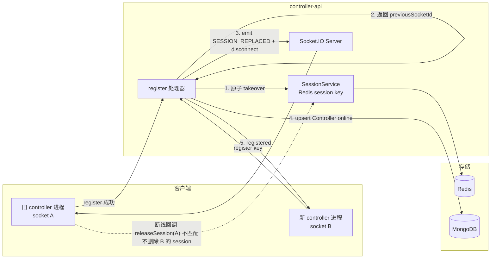
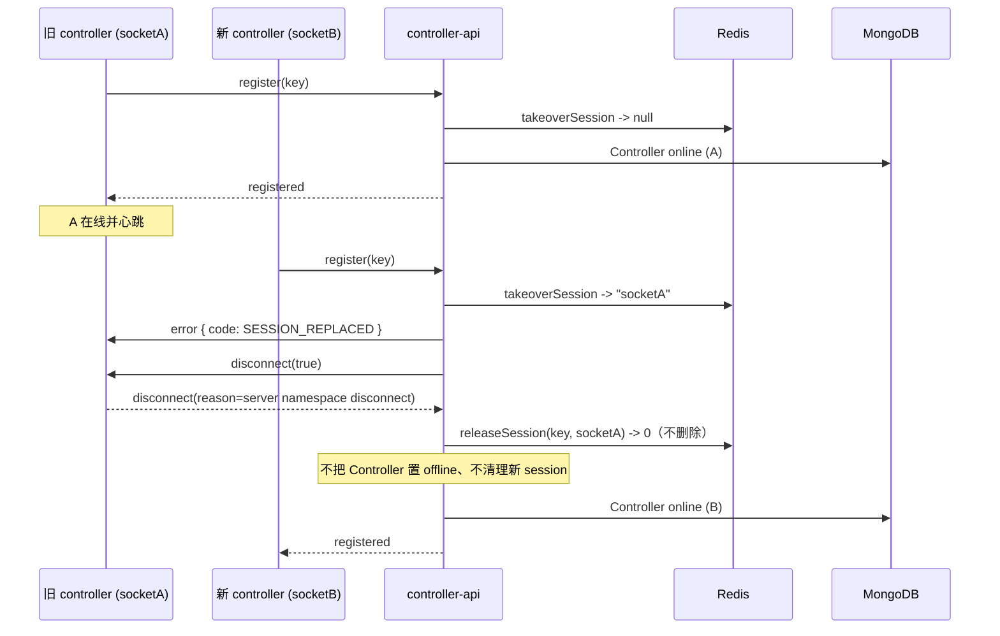

# 云控制器重复登录新连接接管 - 技术提案

**功能名称**: 云控制器重复登录接管（踢出旧连接）
**关联 PRD**: [20261102-controller-session-takeover.md](../../product/draft/20261102-controller-session-takeover.md)
**技术提案版本**: v1.1
**创建日期**: 2026-11-02
**作者**: ZeroAsh Agent（需求来源：[Deliay/z-agent-gear#386](https://github.com/Deliay/z-agent-gear/issues/386)）
**feat-branch**: `feat/controller-session-takeover`

> v1.1 变更：根据 PR #404 评审意见，补充「controller-api 重启导致云容器客户端重连提示已在线」的根因链路、接管方案对该场景的逐步骤验证，并将心跳离线巡检从「无条件下线 + 清理」改为「条件状态迁移（CAS）+ 会话所有权释放」，防止重启后过期巡检把刚重连的新连接再次踢下线。新增重启场景测试 T-ST12~T-ST15。

## 1. 概述

### 1.1 背景

`controller-api` 使用 Redis 键 `session:<keyId>` 维护「一个 Key 同一时间只有一个在线 socket」：

- `register` 校验 Key 后调用 `SessionService.acquireSession(keyId, socket.id, resumeToken)`；
- 若 `session:<keyId>` 已存在且 `resumeToken` 不匹配，返回 `false`，服务端回 `error { code: 'KEY_ALREADY_ONLINE' }` 并断开新连接；
- socket 断开时无条件 `removeSession(keyId)`。

**本需求的核心触发场景是 controller-api 重启**，而不是用户手动多端登录：

1. controller-api 重启前，云电脑容器内的 `agent-gear` 已通过 `ZAG_HOST_KEY` 建立 controller-api 标准连接，Redis `session:<keyId>` 记录该 socket；
2. controller-api 进程重启（发布、滚动升级、OOM 等），旧 TCP 连接随进程消失，但 Redis 中的 `session:<keyId>` 仍在 TTL 内；
3. 云电脑容器内的 `agent-gear` 按 Socket.IO 自动重连，重新 `register`；
4. 云电脑模式 `persistConfig=false`，客户端**不会**持久化/回传 `resumeToken`，因此 `acquireSession` 判为不匹配；
5. 服务端返回 `KEY_ALREADY_ONLINE` 并断开，客户端只能按退避反复重试；在旧 session TTL 到期前始终无法恢复。

这与「同一 Key 被两台存活设备同时使用」不同：重启后旧 socket **已经不存在**，继续保留其在线占用没有任何意义。需求 #386 要求把冲突处理方向反过来：**接受新连接，踢掉旧连接**，同时不能让旧连接的清理逻辑、以及重启后第一轮心跳巡检，反过来破坏刚建立的新连接。

### 1.2 目标

1. 同一 Key 的任意新登录在校验通过后立即接管，成为该 Key 唯一在线连接；**包括 controller-api 重启后旧 socket 已不存在的场景**。
2. 旧连接（若仍存活）收到明确的替换通知（新错误码 `SESSION_REPLACED`）后被断开，并且不再自动重连。
3. 旧连接的断线、注销、心跳等后续动作不得删除/覆盖新连接的 session，也不得把控制器置为离线。
4. 非法 Key / 错误凭据 / 版本不兼容的登录不得触发接管。
5. 不改变 Key 生命周期、控制器绑定、云电脑生命周期与既有心跳离线判定口径。

### 1.3 范围

**做**：

- `servers/controller-api/src/services/session.ts`：新增原子接管与按所有权释放；`resumeToken` 不再作为抢占判据。
- `servers/controller-api/src/services/socketio.ts`：register 接管 + 踢旧连接；disconnect / unregister 的所有权保护；`SESSION_REPLACED` 下发与日志。
- `servers/controller-api/src/services/heartbeat.ts`：离线巡检改为「条件状态迁移（CAS）+ 按 socketId 所有权释放」，消除重启后过期巡检与新接管的竞争。
- `packages/agent-controller/src/socketio-client.ts`：处理 `SESSION_REPLACED`，不重连、不清除本地 Key、按服务端终止语义结束。
- 契约与项目文档：`contracts/agent-controller-websocket.md`、`servers/controller-api/AGENTS.md`、`packages/agent-controller/AGENTS.md`。
- 测试：`session.test.ts`、`socketio.test.ts`、`socketio-client.test.ts`、`tests/api/src/controller-api/websocket.test.ts`。

**不做**：

- 不新增「允许多端同时在线」开关，产品约束仍是「一个 Key 一个在线连接」。
- 不改变 `Controller` / `ControllerKey` / `CloudHost` 的 Mongo schema、GraphQL 契约或 Key 生成/注销流程。
- 不做多 `controller-api` 副本之间的跨实例接管（当前部署 `replicas: 1`，socket id 仅在本实例可寻址；扩容时需引入 Redis adapter 或按实例路由，另立提案）。
- 不改变云电脑双连接职责划分：接管只作用于 controller-api 标准连接，`/worker` 一次性 token 通道不变。
- 不重写 ACP 会话恢复语义：被替换连接仍走既有断线清理；活跃会话按既有 `disconnected` + `acp:reconcile` 语义处理。

## 2. 技术架构

### 2.1 系统架构图



### 2.2 技术栈

无变更：Node.js 24 + TypeScript（strict, ESM）、Express v5 + Socket.IO v4、Mongoose 9、ioredis、Vitest。

### 2.3 模块划分

| 模块 | 职责 | 关键技术点 |
|------|------|-----------|
| `services/session.ts` | session 抢占/释放 | Lua 脚本原子 `GET + SET EX`、`compare-and-delete`；返回前一个 socketId |
| `services/socketio.ts` | 注册与连接生命周期 | 接管后下发 `SESSION_REPLACED` 并断开旧 socket；disconnect / unregister 所有权校验 |
| `services/heartbeat.ts` | 心跳离线巡检 | 巡检读到 socketId 后按所有权释放，不无条件 `cleanupKey` |
| `services/command.ts` / `session-command.ts` / `folder-browser.ts` | 指令路由 | 继续通过 `getSocketId(keyId)` 取当前 socket，接管后自动指向新连接，无需改动 |
| `packages/agent-controller/src/socketio-client.ts` | 客户端错误处理 | 识别 `SESSION_REPLACED`：停止重连、不清 Key、退出码 42 |

## 3. API 设计

### 3.1 协议契约变更（Socket.IO）

#### 3.1.1 `register` 行为变更

- 前置校验顺序不变：`lookupKey` → `bcrypt.compare` → major 版本校验。
- 校验通过后不再调用「可能失败」的 `acquireSession`，改为 `takeoverSession(keyId, socket.id)`：
  - 返回 `previousSocketId: string | null`；
  - 无论是否存在旧 session，都把 `session:<keyId>` 原子写为当前 socket id（`EX 90`）。
- 若 `previousSocketId` 存在且不是当前 socket：
  1. 通过 `io.sockets.sockets.get(previousSocketId)` 找到旧 socket；
  2. 向旧 socket 发送 `error` 事件：
     ```json
     {
       "code": "SESSION_REPLACED",
       "message": "Key has been logged in from another connection",
       "_meta": { "traceparent": "..." }
     }
     ```
  3. 调用 `previous.disconnect(true)`；
  4. 记录 `event: 'session_replaced'` 日志（`keyId`、`previousSocketId`、`newSocketId`、新旧 `hostname`/`version`）。
- 旧 socket 不存在（Redis 中为已死连接的残留 id）时只覆盖 session，不报错。
- 之后继续既有流程：`Controller.findOneAndUpdate(... status: 'online')`、`ControllerKey.updateOne(boundControllerId)`、写 `socket.data.*`、`registered`、`acp:reconcile`。

#### 3.1.2 controller-api 重启场景确认

针对评审提出的核心问题「controller-api 重启导致云容器内客户端重连提示已在线」，逐步骤确认本提案可以解决：

| 步骤 | 重启后实际状态 | 本提案处理 | 结果 |
|------|----------------|-----------|------|
| 1 | 旧 controller-api 进程退出，旧 socket 断开 | Redis `session:<keyId>` 仍保留旧 socketId（TTL ≤ 90s） | 残留记录存在 |
| 2 | 云电脑容器内 `agent-gear` 自动重连并 `register` | `takeoverSession` 读到旧 socketId，写出新 socketId | 接管成功 |
| 3 | `io.sockets.sockets.get(旧 socketId)` | 旧 socket 属于已退出进程，返回 `undefined` | 跳过通知/断开，不影响新连接 |
| 4 | 继续注册流程 | `Controller` upsert 为 `online`，返回 `registered` | **不再返回 `KEY_ALREADY_ONLINE`，云容器客户端恢复在线** |
| 5 | 重启后第一轮心跳巡检读取到重启前的 `lastHeartbeatAt` | 巡检先捕获 sessionId，再做条件状态迁移（仍满足 `lastHeartbeatAt < 阈值` 且 `status='online'` 才置 offline）；新注册已刷新 `lastHeartbeatAt` → CAS 失败 | 不会把新连接误标离线 |
| 6 | 巡检在 CAS 成功后才发生接管 | 巡检只使用 CAS 前捕获的旧 socketId 做断开与 `releaseSession`，不重新读取当前会话 | 不会删除新 session、不会向新 socket 发 shutdown |

结论：**可以解决**。关键点有两个：

1. 注册侧必须允许「有旧 session 但旧 socket 已不存在」时直接覆盖，而不是继续用 `resumeToken` 判定拒绝；
2. 重启后的心跳巡检必须做条件状态迁移与会话所有权释放，否则即使注册成功，也可能被过期巡检在下一轮重新踢下线。二者均纳入本期范围。

代码依据（当前 main）：

- `servers/controller-api/src/services/session.ts`：`acquireSession` 在 `session:<keyId>` 存在且无匹配 `resumeToken` 时直接返回 `false`，这是「已在线」拒绝的来源。
- `servers/controller-api/src/services/socketio.ts`：`acquireSession` 返回 `false` 时下发 `KEY_ALREADY_ONLINE` 并 `disconnect(true)`；`disconnect` 处理器无条件 `removeSession`，因此旧连接清理会误删新 session（本期一并修正）。
- `packages/agent-controller/src/socketio-client.ts`：`register` 仅在 `persistConfig=true` 时读取并携带 `resumeToken`；云电脑模式 `persistConfig=false`，重启后 `resumeToken` 必为 `undefined`。
- `servers/controller-api/src/services/heartbeat.ts`：当前使用「`find` 快照 + `updateMany` 无条件 offline + `getSocketId` + `cleanupKey`」，重启后可能对刚接管的新连接二次下线（本期改为 CAS + 捕获所有权）。
- `packages/agent-controller/src/cloud-host/supervisor.ts` / `socketio-client.ts`：云电脑标准连接自动重连，重连后再次发送 `register`，是触发上述拒绝的入口。

> 补充说明：`resumeToken` 由 `registered` 下发，云电脑模式 `persistConfig=false` 不落盘，因此重启后必定缺失；把 `resumeToken` 作为抢占判据在本场景下必然失败，这也是本次一并移除该判据的原因。

#### 3.1.3 新增错误码 `SESSION_REPLACED`

`error` 事件在注册失败之外新增一种运行期语义：**服务端因同一 Key 被新登录接管而终止当前连接**。

| 字段 | 类型 | 说明 |
|------|------|------|
| `code` | `'SESSION_REPLACED'` | 当前连接已被同一 Key 的新登录替换 |
| `message` | `string` | `Key has been logged in from another connection` |
| `_meta` | `object` | 既有 trace 封套，可为空 |

保留 `KEY_ALREADY_ONLINE` 枚举值（标记为 deprecated / 服务端不再主动下发），避免旧客户端与旧日志解析断裂。

#### 3.1.4 客户端行为

`agent-gear` 收到 `SESSION_REPLACED`：

- 记录 `event: 'session_replaced'` 日志；
- 不调用 `clearConfigKey()`，本地 Key / resume token 保留；
- 调用 `socket.disconnect()` 停止重连；
- 本地单连接：`process.exit(EXIT_SERVER_SHUTDOWN)`（42）；
- 云电脑模式：`notifyShutdown({ reason: 'session_replaced' })`，由 supervisor 关闭两端并按 42 退出（`resolveShutdownExitCode('session_replaced')` 走默认服务端终止分支）。

> 旧版本客户端收到未知 `SESSION_REPLACED` 会落入通用 `error` 分支：本地进程 `exit(1)` 且不重连；云电脑模式以 `error: SESSION_REPLACED`（失败类）退出 1，入口可能重启一次。由于云电脑 Key 按主机唯一分配、同一 Key 的两个存活进程属于异常场景，实际不会形成持续互踢；发布说明需提示升级 agent-gear。若评审要求完全消除该边缘，可改为按旧连接版本选择下发 `shutdown { reason: 'session_replaced' }`，本提案不采用（会在旧本地客户端造成清 Key 的副作用）。

### 3.2 内部接口

| 接口 | 变更 |
|------|------|
| `SessionService.takeoverSession(keyId, socketId): Promise<string \| null>` | 新增；原子接管并返回旧 socketId |
| `SessionService.releaseSession(keyId, socketId): Promise<boolean>` | 新增；仅当 session 值等于 socketId 时删除，返回是否删除 |
| `SessionService.acquireSession(...)` | 移除（或被 `takeoverSession` 取代），不再有「拒绝」返回值 |
| `SessionService.cleanupKey(keyId)` | 保留给显式注销；新增所有权释放路径供断线/巡检使用 |
| `SessionService.getSocketId(keyId)` | 不变；指令路由继续使用 |

## 4. 数据模型

### 4.1 数据库设计

无 Mongo schema 变更。

### 4.2 缓存设计

| Key | 值 | TTL | 用途 |
|-----|-----|-----|------|
| `session:<keyId>` | 当前在线 socketId | 90s（心跳刷新） | 单连接约束 + 指令路由 |
| `heartbeat:<keyId>` | ISO 时间 | 90s | 离线巡检辅助 |
| `resume:<keyId>` | UUID | 无 | **兼容保留**：仍随 `registered` 下发，但不再作为接管判据 |

原子操作（ioredis `eval`）：

```lua
-- takeoverSession
local previous = redis.call('GET', KEYS[1])
redis.call('SET', KEYS[1], ARGV[1], 'EX', ARGV[2])
return previous
```

```lua
-- releaseSession：compare-and-delete
if redis.call('GET', KEYS[1]) == ARGV[1] then
  return redis.call('DEL', KEYS[1])
end
return 0
```

说明：

- `takeoverSession` 用单条 Lua 解决「先 GET 再 SET」的并发窗口；两个并发登录中后执行者获胜，并拿到前者的 socketId 去踢人。
- `releaseSession` 保证旧 socket 的 `disconnect` 不会删除新 socket 写入的 session。

## 5. 技术实现方案

### 5.1 核心流程



### 5.2 关键实现点

#### 实现点 1: 原子接管

- **描述**: `SessionService.takeoverSession` 以 Lua 原子读取旧 socketId 并写入新 socketId。
- **技术细节**: 固定 `EX 90`；不读取/校验 `resumeToken`；返回 `string | null`。
- **风险点**: 单实例部署下 `io.sockets.sockets.get(previousSocketId)` 一定可寻址；多实例下需 adapter（本期不做）。

#### 实现点 2: 旧连接通知与断开

- **描述**: register 中拿到 `previousSocketId` 后，从 `io.sockets.sockets` 取旧 socket，先 `emit('error', withTraceMeta({ code: 'SESSION_REPLACED', ... }))`，再 `disconnect(true)`。
- **技术细节**: 旧 socket 可能已不存在（残留 Redis 值），需空值保护；`previousSocketId === socket.id` 时跳过（同一 socket 重复 register 不应自杀）。
- **风险点**: `emit` 后立即 `disconnect(true)` 依赖 Socket.IO 的包刷新顺序，与现有 `INVALID_KEY`/`VERSION_MISMATCH` 路径一致；集成测试需断言旧客户端确实收到事件。若实测丢包，改为 `socket.disconnect(false)` + 短延迟或先 `socket.conn.close` 前 flush，需在实现阶段验证。

#### 实现点 3: 断线清理改为所有权校验

- **描述**: `socket.on('disconnect')` 中把无条件 `removeSession(keyId)` 改为 `releaseSession(keyId, socket.id)`；仅当返回 `true` 时才把 `Controller` 置 `offline`。
- **技术细节**:
  ```ts
  if (socket.data.keyId) {
    const released = await sessionService.releaseSession(socket.data.keyId, socket.id);
    if (released) {
      await Controller.updateOne(
        { keyId: socket.data.keyId, status: { $ne: 'unbound' } },
        { status: 'offline' },
      );
    }
  }
  ```
  其余 `mcpRelayService.handleSocketDisconnect` / `acpSessionSyncService.cleanupSocket` / `elicitationManager` / `harnessLoginManager` / `acpSessionManager.handleSocketDisconnect` 保持原样（旧 socket 资源需要清理）。
- **风险点**: 旧 socket 断开会把活跃 ACP 会话标 `disconnected`，与既有网络重连行为一致；新连接通过 `acp:reconcile` 保留进程，用户按现有方式恢复会话。不在本期扩展自动重绑。

#### 实现点 4: `unregister` 所有权保护

- **描述**: `unregister` 会删除 `Controller`、`ControllerKey` 与整份 session；必须防止已被替换的旧 socket 在断开前抢跑注销。
- **技术细节**:
  ```ts
  const current = await sessionService.getSocketId(keyId);
  if (current && current !== socket.id) {
    socket.disconnect(true);
    return;
  }
  ```
  `current` 为空时保持既有行为（允许注销，兼容 Redis 丢数据/重启场景）。
- **风险点**: 多一个 Redis GET，开销可忽略；语义上「旧连接无权注销新连接」。

#### 实现点 5: 心跳巡检与重启/接管竞争

- **描述**: `heartbeat.ts` 当前对「快照中已超时」的 controller 执行 `updateMany(status='offline')` 后直接 `cleanupKey(keyId)`。controller-api 重启后，第一轮巡检可能读到重启前的 `lastHeartbeatAt` 快照；如果此时新连接刚完成接管并刷新了心跳，旧实现会把 controller 再次标记为 offline，甚至向新 socket 发送 `shutdown` 并删除新 session，导致「接管成功后又掉线」。
- **技术细节**:
  1. 对每个候选 controller **先读取 `session:<keyId>` 的 socketId**，再做**条件状态迁移（CAS）**：仅当 `_id` 匹配、`status='online'` 仍成立且 `lastHeartbeatAt` 仍小于阈值时，才把该条置为 `offline`；只要新注册已刷新 `lastHeartbeatAt`，CAS 不命中，直接跳过后续断连与清理。
  2. 仅对 CAS 命中的 controller 处理**步骤 1 捕获的 socketId**（不是重新读取的当前值）：
     - 捕获到 `socketId`：向该 socket 发 `shutdown { reason: 'heartbeat_timeout' }` 并断开（若已不存在则跳过），然后 `releaseSession(keyId, socketId)`；仅当返回 `true` 时再 `removeHeartbeat` / `removeResumeToken`；
     - 捕获不到 `socketId`：只清 `heartbeat` / `resume`，**不删除 `session`**（避免误删并发写入的新 session）。
  3. 先读 session 再 CAS + 使用捕获值释放，可覆盖两条关键竞争：
     - 新注册发生在读取 session 之后、CAS 之前 → CAS 因心跳已刷新而不命中，巡检整体跳过；
     - 新注册发生在 CAS 之后 → 巡检只断开/释放捕获的旧 socketId，`releaseSession` 与新 session 不匹配，新连接不受影响。
  4. `Controller` 置 `offline` 的判定口径（60s 无心跳）与巡检周期（15s）保持不变，仅把「先快照后无条件更新」改为「逐条按当前值 CAS + 捕获会话所有权」。
- **风险点**: 逐条 CAS 比一次 `updateMany` 多几次写操作，但巡检候选集通常很小（仅异常 controller），可接受；既有「超时清理」语义保持不变，仅收窄删除范围并消除重启竞赛。

#### 实现点 6: 客户端 `SESSION_REPLACED`

- **描述**: 在 `socket.on('error')` 中前置分支处理 `SESSION_REPLACED`。
- **技术细节**:
  ```ts
  if (data.code === 'SESSION_REPLACED') {
    log.info({ event: 'session_replaced' }, 'connection replaced by a newer login');
    socket.disconnect();
    if (options?.onShutdown) {
      notifyShutdown({ reason: 'session_replaced' });
      return;
    }
    process.exit(EXIT_SERVER_SHUTDOWN);
    return;
  }
  ```
  不调用 `clearResumeTokenFromConfig` / `clearConfigKey`。
- **风险点**: 旧客户端兼容见 §3.1.4。

#### 实现点 7: 日志与可观测性

- **服务端**：接管成功记录 `event: 'session_replaced'`（info）：`keyId`、`previousSocketId`、`newSocketId`、`previousHostname`、`newHostname`、`previousVersion`、`newVersion`。日志**不输出完整 Key**（与现有 `register_attempt` 一致）。
- **客户端**：记录 `event: 'session_replaced'`，不输出 Key。
- 不需要新增 span；沿用 `socket.register` / `socket.disconnect` 既有 span。接管快速路径在一个 register handler 内完成。

## 6. 技术决策

### 6.1 决策列表

| 决策 | 选项 A | 选项 B | 最终选择 | 原因 |
|------|--------|--------|---------|------|
| 冲突策略 | 拒绝新连接（现状） | 接受新连接、踢旧连接 | B | 需求 #386；新连接代表用户当前意图，且能自愈 controller-api 重启后的残留 session |
| 重启残留 session | 启动时扫描并清空所有 `session:*` | 登录时按 Key 原子接管 | B | 清空会影响同一 Redis 上其他实例的在途连接，且无法解决运行期重复登录；按 Key 接管范围最小、可复用 |
| 接管原子性 | `GET` + `SET` 两步 | 单条 Lua `GET + SET` | Lua | 避免并发登录双写、双方都认为在线 |
| 旧连接通知 | 直接 `disconnect` 无原因 | `error SESSION_REPLACED` | 后者 | 用户可感知「被新登录替换」，客户端可停止重连且不清 Key |
| 复用 `shutdown` | `shutdown { reason: 'session_replaced' }` | 新增 `error` 码 | 新增 `error` 码 | `shutdown` 现语义会清本地 Key；错误码更精确，旧客户端也不会误清 Key（本地） |
| `resumeToken` | 保留抢占判据 | 仅兼容保留 | 后者 | 云电脑模式不持久化 resumeToken，重启后必定缺失；继续作为判据会稳定复现「已在线」 |
| 断线清理 | 无条件删 session | compare-and-delete | 后者 | 防止旧 socket 断开时删掉新 session |
| 心跳巡检 | 快照后无条件 offline + `cleanupKey` | 逐条 CAS + 按所有权释放 | 后者 | 防止重启后过期快照把刚接管的新连接再次踢下线、误删新 session |
| 多实例接管 | 本期支持 | 本期不支持 | 不支持 | 当前部署单副本；跨实例需 Redis adapter/路由，另立提案 |
| 旧 ACP 会话 | 自动重绑到新 socket | 走既有断线+对账 | 后者 | 与现有网络重连语义一致，不扩大改动面 |

### 6.2 依赖与约束

| 类型 | 内容 | 说明 |
|------|------|------|
| 依赖 | Redis Lua `eval` | ioredis 已具备；无需新依赖 |
| 依赖 | Socket.IO 本实例 socket 注册表 | `io.sockets.sockets.get(id)` 仅在同实例有效 |
| 约束 | 单副本部署 | 当前 `deploy` 与 Aspire 均为单实例；扩容需另行设计 |
| 约束 | 旧客户端滚动升级 | 旧版云电脑客户端收到未知错误码可能重启一次，发布说明需提示升级 |
| 约束 | 不新增 API / GraphQL / Mongo 字段 | 纯运行时行为调整 |

## 7. 项目结构

```text
servers/controller-api/
├── src/services/
│   ├── session.ts          # takeoverSession / releaseSession（新增）
│   ├── session.test.ts     # 单测更新
│   ├── socketio.ts         # register 接管、disconnect / unregister 所有权
│   ├── socketio.test.ts    # 单测更新
│   └── heartbeat.ts        # 巡检清理按所有权
├── src/services/heartbeat.test.ts
└── AGENTS.md

packages/agent-controller/
├── src/socketio-client.ts      # SESSION_REPLACED 分支
├── src/socketio-client.test.ts
└── AGENTS.md

contracts/
└── agent-controller-websocket.md  # §2.4 / §3.3 / §3.7

tests/api/src/controller-api/
└── websocket.test.ts              # 集成：同 Key 第二连接接管
```

## 8. 测试策略

### 8.1 测试覆盖要求

- 单元测试：`session.ts`、`socketio.ts`、`heartbeat.ts`、`socketio-client.ts` 新增分支全覆盖。
- 单元测试覆盖率：不低于项目现有水平（`vitest run --coverage`），新增代码行覆盖 ≥ 90%。
- API/集成测试：`tests/api/src/controller-api/websocket.test.ts` 覆盖真实 Redis + Socket.IO 的接管链路；新增重启残留 session 场景（T-ST12 / T-ST15）。

### 8.2 测试类型

| 类型 | 工具 | 覆盖范围 |
|------|------|---------|
| 单元（session） | Vitest + mock Redis | 无旧 session、有旧 session、Lua 返回值、release 匹配/不匹配 |
| 单元（socketio） | Vitest + mock io/socket | 接管成功、旧 socket 收到 `SESSION_REPLACED` 并断开、非法 Key/版本不接管、disconnect 不删新 session、旧 socket unregister 被拒 |
| 单元（heartbeat） | Vitest | 巡检 CAS 不命中时不 offline/不断开/不清理；命中时按所有权释放；接管后新 session 保留 |
| 单元（client） | Vitest | `SESSION_REPLACED` 不重连、不调用清 Key、退出 42；云电脑 supervisor reason 分类 42 |
| API 集成 | Vitest + socket.io-client | 同一 Key 两次真实连接：client1 收到 `SESSION_REPLACED` 并断开，client2 收到 `registered`；client1 断线后 client2 仍在线；后续心跳正常 |
| 重启场景集成 | Vitest + 真实 Redis | 预置一个「已死 socketId」的 `session:<keyId>`（模拟重启残留）且不携带 resumeToken → 新客户端 register 成功；随后心跳巡检不把该连接踢下线 |
| 回归 | 既有测试 | `KEY_ALREADY_ONLINE` 旧用例改为接管用例；其余 register/heartbeat/unregister 用例保持通过 |

### 8.3 计划用例（TDD 先红后绿）

| 编号 | 用例 |
|------|------|
| T-ST1 | `takeoverSession` 无旧 session → 返回 `null`，写入新 socketId 且 TTL 90 |
| T-ST2 | `takeoverSession` 有旧 session → 返回旧 socketId，覆盖为新 socketId |
| T-ST3 | `releaseSession` socketId 匹配 → 删除并返回 `true` |
| T-ST4 | `releaseSession` socketId 不匹配 → 不删除并返回 `false` |
| T-ST5 | 同 Key 第二次 register → 新连接 `registered`；旧 socket 收到 `SESSION_REPLACED` 且 `disconnect(true)` |
| T-ST6 | 旧 socket disconnect 回调在接管后执行 → `releaseSession=false`，不置 Controller offline |
| T-ST7 | 旧 socket 发送 `unregister` → 被拒绝，Key/Controller/session 不被删除 |
| T-ST8 | 非法 Key / 错误 bcrypt / 版本不兼容 → 不接管，旧 socket 不收 `SESSION_REPLACED` |
| T-ST9 | 心跳巡检在接管后清理旧 socketId → 新 session 保留 |
| T-ST10 | 客户端收到 `SESSION_REPLACED` → 不重连、不清 Key、退出 42；云电脑 reason 分类 42 |
| T-ST11 | 真实 socket 集成：client1 在线，client2 同 Key 登录成功，client1 断开，client2 心跳后仍在线 |
| T-ST12 | **重启残留**：Redis 预置 `session:<keyId>`=旧 socketId、旧 socket 不存在、register 不带 resumeToken → `takeoverSession` 返回旧 id、新连接 `registered`，绝不返回 `KEY_ALREADY_ONLINE` |
| T-ST13 | **重启后巡检 CAS**：巡检快照读到旧 `lastHeartbeatAt`，期间新连接 register 刷新心跳 → CAS 不命中，不置 offline、不向新 socket 发 `shutdown`、不删新 session |
| T-ST14 | **重启后巡检所有权**：巡检已拿到旧 socketId，期间发生接管 → `releaseSession` 失败，新 session 与 heartbeat 保留 |
| T-ST15 | **重启端到端**：真实 controller-api + Redis，模拟进程重启（保留 Redis session、旧 socket 关闭）→ 客户端重连成功，在线状态为新连接，后续心跳/指令正常 |

## 9. 部署方案

### 9.1 环境规划

| 环境 | 用途 | 部署方式 |
|------|------|---------|
| 本地 / Aspire | 开发与单测 | `aspire start`（Redis + controller-api） |
| 测试 | API 集成 | `tests/api` 连本地 Redis/controller-api |
| 生产 | 单副本 controller-api | 与现状一致，无新增环境变量 |

### 9.2 配置管理

无新增配置项。既有 `SESSION_TTL=90` 常量保持不变。

### 9.3 发布顺序

1. 先发布 `agent-gear` 客户端（识别 `SESSION_REPLACED`，不清 Key、退出 42）。
2. 再发布 `controller-api`（开始下发 `SESSION_REPLACED`）。
3. 云电脑镜像随 `agent-gear` 版本更新；旧镜像即使被接管也只会以失败码退出一次，不形成持续循环。

> controller-api 启动时**不批量清空** `session:*`：重启后由客户端重连触发按 Key 接管即可恢复，避免影响共享 Redis 上的其他实例/在途连接；发布时无需额外的状态清理步骤。

## 10. 验收标准

- [ ] **controller-api 重启后（保留 Redis 残留 session、旧 socket 关闭），云容器客户端自动重连成功，不再出现「已在线」，无需等待超时或人工清理**
- [ ] **重启后第一轮心跳巡检不会把刚重连的新连接置 offline、断开或删除其 session**
- [ ] 同一 Key 第二次登录成功，旧连接 5 秒内断开并收到 `SESSION_REPLACED`
- [ ] 接管后控制器列表在线连接为新连接
- [ ] 旧连接断线回调不会删除新 session、不会把 Controller 置 offline
- [ ] 旧连接 `unregister` 不会删除 Key 或控制器
- [ ] 非法 Key / 错误凭据 / 版本不兼容不触发接管
- [ ] 被替换客户端不自动重连、不清除本地 Key、按 42 退出
- [ ] 心跳超时巡检不误删接管后的新 session
- [ ] 既有 register / heartbeat / unregister / ACP / 云电脑链路回归通过
- [ ] 契约与 AGENTS.md 文档同步更新
- [ ] 技术方案评审通过

## 11. 相关文档

- [关联 PRD](../../product/draft/20261102-controller-session-takeover.md)
- [控制器 WebSocket 契约](../../../contracts/agent-controller-websocket.md)
- [controller-api AGENTS](../../../servers/controller-api/AGENTS.md)
- [agent-controller AGENTS](../../../packages/agent-controller/AGENTS.md)
- [需求来源：GitHub Issue #386](https://github.com/Deliay/z-agent-gear/issues/386)
